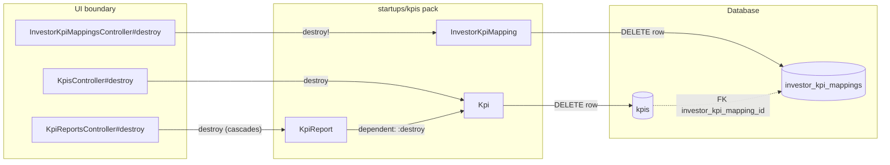
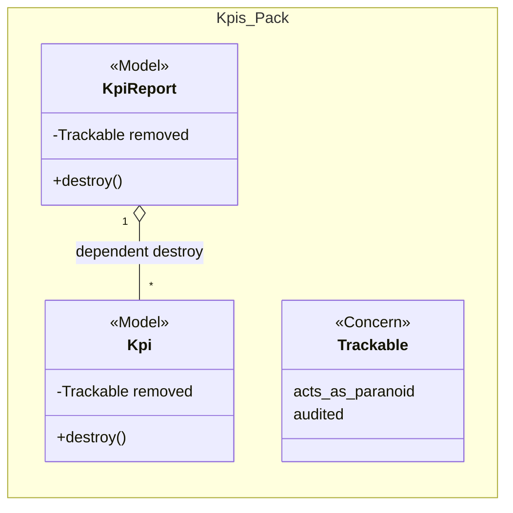
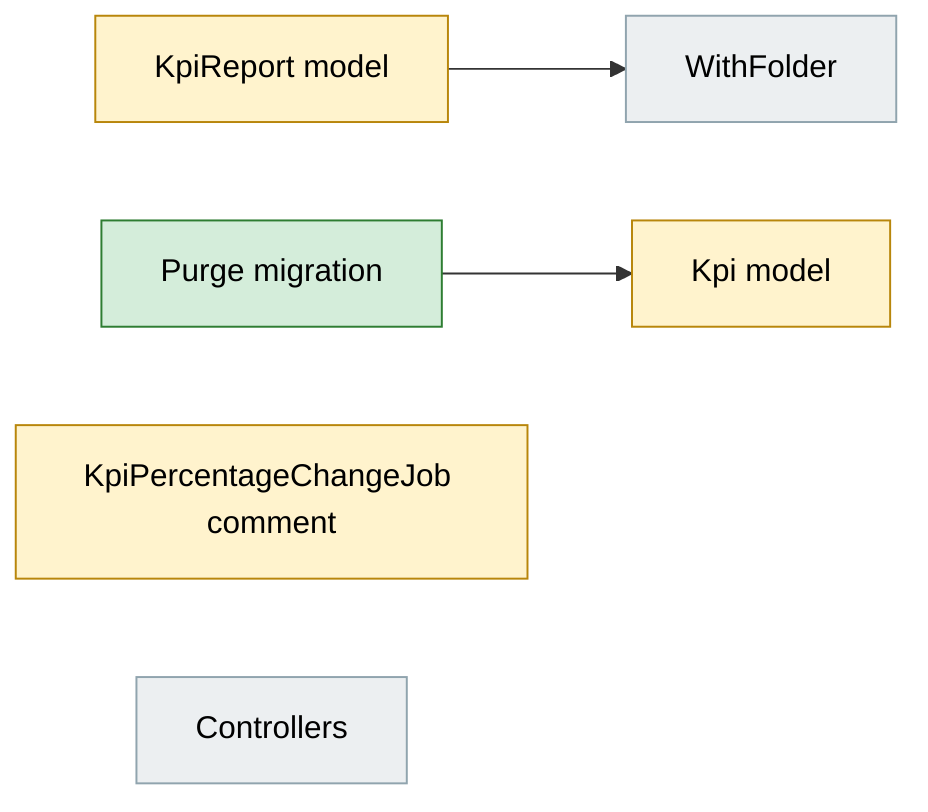
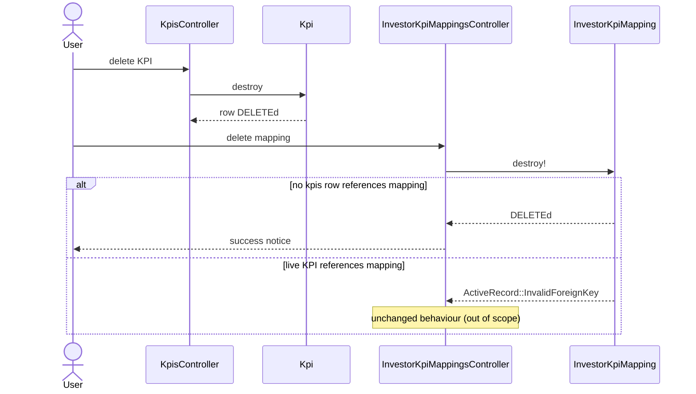

# KPI Hard Delete, No Audit Trail — Design

> **Audience:** Engineering team.
> **Companion documents:** [Proposal](proposal.md) · [Spec](specs/)

> **Planning phase — no code changes.**

---

## Contents

- [Overview](#overview)
- [Architecture](#architecture)
  - [Component Boundaries](#component-boundaries)
  - [Class Diagram](#class-diagram)
  - [Change Footprint](#change-footprint)
- [Data Model and States](#data-model-and-states)
  - [Data Model](#data-model)
  - [State Transitions](#state-transitions)
- [Behaviour](#behaviour)
  - [Pipeline / Flow](#pipeline--flow)
  - [Sequence Diagrams](#sequence-diagrams)
  - [Worked Examples](#worked-examples)
- [Key Components](#key-components)
- [Controllers and Routes](#controllers-and-routes)
- [Policy](#policy)
- [UI Changes](#ui-changes)
- [Cross-cutting Concerns](#cross-cutting-concerns)
- [Design Decisions](#design-decisions)
- [Testing](#testing)
- [Risks and Open Questions](#risks-and-open-questions)

---

## Overview

`Kpi` and `KpiReport` include `Trackable`, which bundles `acts_as_paranoid`, `audited` and `has_associated_audits`. Soft-deleted `kpis` rows keep `investor_kpi_mapping_id`, so the `kpis → investor_kpi_mappings` foreign key blocks `InvestorKpiMapping#destroy!`. The fix removes `Trackable` from both models (destroy becomes a real `DELETE`) and purges existing soft-deleted rows with one migration.

---

## Architecture

### Component Boundaries

| From → To | Contract | Direction rule |
|---|---|---|
| Controllers → models | plain `destroy` | No controller change |
| `KpiReport` → `Kpi` | `dependent: :destroy` | Unchanged; now hard deletes |
| `kpis` → `investor_kpi_mappings` | FK | Blocks only while a row exists |

### Class Diagram

### Change Footprint

New code lives in `db/migrate` and the existing `startups/kpis` pack.

---

## Data Model and States

### Data Model

Drop `kpis.deleted_at` and `kpi_reports.deleted_at` (and their `deleted_at` indexes) after the purge, in the same migration.

**Changes to existing models:**
- `Kpi`: remove `include Trackable.new(...)`. Keeps `WithCustomField`, `ForInvestor`, `KpiCumulative`. uniqueness validation scope drops `:deleted_at` (becomes `kpi_report_id portfolio_company_id status`).
- `KpiReport`: remove `include Trackable.new`. Keeps `WithFolder`, `WithCustomField`, `ForInvestor`.

### State Transitions

N/A — no lifecycle changes; "deleted" is no longer a stored state.

---

## Behaviour

### Pipeline / Flow

N/A — single-step delete.

### Sequence Diagrams

### Worked Examples

**ID legend:** **H** = Happy path · **E** = Edge case · **X** = Error case.

**Shared setup:**

| Record | Name | Key data |
|---|---|---|
| Entity | Alpha Capital | fund |
| Investor (portco) | Acme Co | portfolio company |
| InvestorKpiMapping | Revenue | for Acme Co |
| KpiReport | Q1 2026 Actual | as_of 2026-03-31, 1 Kpi "Revenue" using the mapping |

#### Happy Path

| # | Scenario | Given | When | Then | Spec scenario | Feature |
|---|---|---|---|---|---|---|
| H1 | Delete KPI then mapping | Q1 report with Revenue KPI | delete the KPI, then the mapping | KPI row gone; mapping deleted | Delete a KPI; Delete mapping after its KPI was deleted | features/startup/kpi_hard_delete.feature |
| H2 | Delete report cascades | Q1 report with 3 KPIs | delete the report | report and 3 KPIs gone | Delete a KPI report | features/startup/kpi_hard_delete.feature |
| H3 | No audits written | none | create a KPI, change its value | `audits` has no Kpi entries | Create and update a KPI | features/startup/kpi_hard_delete.feature |

#### Edge Cases

| # | Scenario | Given | When | Then | Spec scenario | Feature |
|---|---|---|---|---|---|---|
| E1 | Re-upload after report delete | Q1 report deleted | create a Q1 report again | succeeds | Re-upload after deleting a report | features/startup/kpi_hard_delete.feature |
| E2 | Purge migration | one soft-deleted KPI + report, one live KPI + report | run the purge | deleted rows gone, live rows intact; mapping of purged KPI deletable | Purge at release | features/startup/kpi_hard_delete.feature |
| E4 | Column dropped, uniqueness holds | migration run | create two approved KPIs with same name in one report | second rejected; `kpis` has no `deleted_at` | Column removed | features/startup/kpi_hard_delete.feature |
| E3 | No audit on report delete | Q1 report | delete it | no audit row for report or KPIs | Delete a KPI report (audit) | features/startup/kpi_hard_delete.feature |

#### Error Cases

| # | Scenario | Given | When | Then | Spec scenario | Feature |
|---|---|---|---|---|---|---|
| X1 | Mapping used by live KPI | live Revenue KPI | delete mapping | mapping remains | Mapping still used by a live KPI | features/startup/kpi_hard_delete.feature |

---

## Key Components

| Component | Responsibility | Notes |
|---|---|---|
| Purge-and-drop migration | Hard-delete rows with `deleted_at` set from `kpis` and `kpi_reports`, then drop the `deleted_at` columns | Batched; `kpis` first (they reference reports); purge must finish before the drop; irreversible |

---

## Controllers and Routes

N/A — no routes or actions change.

---

## Policy

| Role | Access |
|---|---|
| Existing roles | Unchanged |

**Multi-tenancy:** unchanged; existing `entity_id` scoping and Pundit `authorize` stay.

---

## UI Changes

N/A — no screen changes.

---

## Cross-cutting Concerns

### Transactions and Queries

| Operation | In a transaction? | Why |
|---|---|---|
| Report destroy | Yes (Rails default) | cascades to KPIs, documents, access rights, imports atomically |
| Purge migration | Per batch | avoid one huge lock on MySQL |

### Exception Handling and Monitoring

N/A — no new failure modes beyond the existing FK error for live KPIs.

### Performance and Security

- Removes an audit insert per KPI create/update, a real saving on bulk uploads.
- Hard delete is irreversible by design; destroy actions remain behind existing policies.

---

## Design Decisions

1. **Drop `Trackable` entirely** — rather than keeping paranoia only. Alternative: keep soft delete, nullify `investor_kpi_mapping_id` on delete. Rejected: the user wants hard delete and no audits.
2. **Drop `deleted_at` columns** — alternative: leave them unused. Rejected: dead columns plus a misleading uniqueness scope; the drop is a metadata-light DDL on MySQL but runs on large `kpis`, so schedule it off-peak.
3. **Purge, don't migrate-around** — alternative: only nullify the mapping FK on old rows. Rejected: leaves dead rows nobody can see.
4. **Leave old audit rows** — alternative: delete them. Rejected: large table, unreferenced and harmless.

---

## Testing

Cucumber only: new `features/startup/kpi_hard_delete.feature` with a new step file for the purge. Reuse existing KPI, report and mapping factories and steps.

---

## Risks and Open Questions

- `WithFolder#really_destroy!` calls `super`, which only exists under paranoia. Nothing calls it on `KpiReport` today → mitigation: grep callers before removing; confirm none.
- `Document` and `Folder` for a hard-destroyed report: `has_many :documents, dependent: :destroy` already cascades → verify in the feature.
- `KpiPercentageChangeJob` comment claims paranoia scoping on `KpiReport` joins → after the purge the join still works; refresh the comment.
- Guard the column/index drops with `column_exists?`/`index_exists?` so the migration is re-runnable.
- Dropping columns while old app processes still run: a rolling deploy could hit `Unknown column deleted_at` from old code → mitigation: deploy code first (no `deleted_at` reference), run the migration after, or set `ignored_columns` for one release.

| # | Open question | Current thinking | Status |
|---|---|---|---|
| 1 | Friendly error for mappings still used by live KPIs | Out of scope | Deferred |
