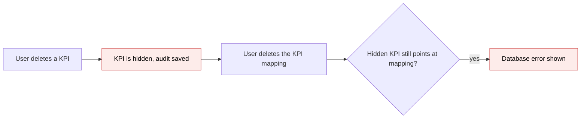
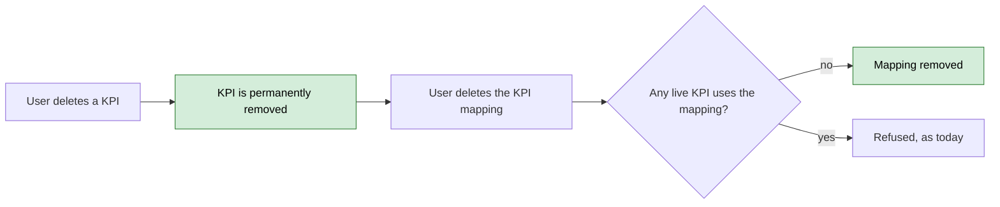

# KPI Hard Delete, No Audit Trail — Proposal

> **Audience:** Business team, product, QA, support — non-technical.
> **Companion document:** [Design](design.md)

> **Planning phase — no code changes.** This document proposes and explains the change. Do not
> edit application code while writing it; implementation happens later, in the tasks phase.

---

## Why

Deleting a KPI or a KPI report today only hides it (a "soft delete") and records an audit trail, even though nobody reviews KPI audits — KPIs are uploaded in bulk and used only for metrics. The hidden rows still point at their KPI mapping, so deleting that mapping later fails with a database error instead of succeeding.

## What Changes

- Deleting a KPI permanently removes it. No hidden copy and no audit history is kept.
- Deleting a KPI report permanently removes it and all its KPIs.
- Deleting a KPI mapping works whenever no KPI still uses it. Hidden (previously soft-deleted) KPIs and reports are cleaned out once, at release, so they stop blocking mapping deletion.
- If a mapping is still used by live KPIs, the mapping delete is still refused, exactly as today (see "Does NOT cover").
- If a KPI or report is deleted by mistake, the user re-uploads the workbook. There is no undo.
- **BREAKING:** the audit history for KPI values and KPI reports is no longer recorded, and nothing can restore a deleted KPI or report.

### Flow Diagram

Before: delete a KPI, then delete its mapping.

After: same steps.

---

## User Stories

### US-1: Delete a mapping after deleting its KPIs

**As a** fund user,
**I want** to delete a KPI mapping after I deleted the KPIs that used it,
**So that** I can tidy up mappings without a database error.

**Acceptance criteria:**
- After every KPI using a mapping is deleted, deleting the mapping succeeds and shows "Investor kpi mapping was successfully destroyed."
- This also works for KPIs that were deleted before this release.

### US-2: Delete and re-upload

**As a** fund user,
**I want** deleting a KPI or KPI report to remove it for good,
**So that** a corrected workbook can be uploaded without leftovers.

**Acceptance criteria:**
- A deleted KPI or report no longer appears anywhere, including KPI lists, reports and dashboards.
- Re-uploading the same period after deleting a report works.
- Deleting a report also deletes its KPIs, documents and import records.

---

## UI Behavior

N/A — no screens change. Existing delete buttons for KPIs, KPI reports and KPI mappings keep their confirmations and messages.

**Behavior notes:**
- The KPI and report delete notices ("Kpi was successfully destroyed.", "Kpi report was successfully destroyed.") are unchanged.
- No audit/history link exists for KPIs or reports today, so none is removed.

---

## What This Feature Does NOT Cover

| Excluded | Covered In |
|---|---|
| A friendly message when a mapping is still used by live KPIs (it still fails with a database error) | Not planned; candidate follow-up |
| Deleting old audit history rows for KPIs and reports | Not planned; harmless, unreferenced |
| Audits or soft delete on other models | Unchanged |

---

## Validation Rules

| Field | Rule | Default |
|---|---|---|
| KPI name, per report, company and status | Unique among existing KPIs (unchanged) | — |
| KPI report period | Unique per entity, company, period and tag (unchanged) | — |

---

## Behavior Rules

| Scenario | What User Sees |
|---|---|
| Delete a KPI, then its mapping | Mapping deleted, success notice |
| Delete a mapping still used by a live KPI | Refused, as today |
| Delete a KPI report | Report and all its KPIs gone for good |
| Delete a KPI or report | Nothing recorded in any audit history |
| Release day, hidden KPIs/reports exist | They are permanently removed once; mappings they blocked can now be deleted |

---

## Resolved Design Decisions

| # | Decision | Resolution |
|---|---|---|
| 1 | Keep any way to undo a delete? | No. Re-upload instead. |
| 2 | What happens to already-hidden KPIs and reports? | Permanently removed at release. |
| 3 | Delete old audit rows? | No; leave them. |
| 4 | Keep the hidden-deletion column? | No; remove it from KPIs and KPI reports after the cleanup. |

---

## Capabilities

### New Capabilities

- `kpi-deletion`: how deleting KPIs, KPI reports and KPI mappings behaves — permanent, unaudited, and never blocked by hidden leftovers.

### Modified Capabilities

None.

---

## Impact

- KPIs and KPI reports (startups/kpis pack): stop being soft-deleted and audited.
- KPI mappings: deletion no longer blocked by hidden KPIs.
- One release-time data cleanup of hidden KPIs and reports, and removal of their now-unused hidden-deletion column.
- KPI delete flows from KPI lists and the report page.

---

## Benefits

1. KPI mapping deletion works after KPIs are deleted.
2. Fewer stored rows and no write overhead on every KPI upload or edit.
3. Delete means delete, so re-uploads start clean.

---

## FAQ

| Question | Answer |
|---|---|
| Can a deleted KPI be restored? | No. Re-upload the workbook. |
| Are existing hidden KPIs affected? | They are permanently removed once at release. |
| Do KPI values still get recomputed (percentage change, cumulative)? | Yes, unchanged. |
| Why can some mappings still not be deleted? | They are used by live KPIs; delete those first. |

---

## Design Principle for the Next Phase

Keep it minimal: remove the shared tracking behaviour from two models and add one cleanup migration. Risk to address: shared folder behaviour on reports assumes soft-delete support.
