# KYC Notifications and Visibility — Design

> **Audience:** Engineering team.
> **Companion documents:** [Proposal](proposal.md) · [Tasks](tasks.md) · User guide matrix:
> [Who Can See a KYC and Get Its Emails](../../../docs/user_guides/investor_kyc_user_guide.md#who-can-see-a-kyc-and-get-its-emails)

> **How to read this.** Part 1 is the whole change in five minutes: one picture, before vs after,
> and one story. Part 2 redraws the same picture with real class names. Part 3 has one card per box
> (same numbers ①–⑦). Part 4 is reference: class diagram, worked examples, risks. Stop at any depth.

---

## Contents

- [1. The idea](#1-the-idea)
  - [What this changes](#what-this-changes)
  - [The idea in one picture](#the-idea-in-one-picture)
  - [Before and after](#before-and-after)
  - [Walkthrough: one KYC, start to finish](#walkthrough-one-kyc-start-to-finish)
  - [Key ideas](#key-ideas)
- [2. The same picture with real names](#2-the-same-picture-with-real-names)
  - [Picture](#picture)
  - [What each box does](#what-each-box-does)
  - [One run, end to end](#one-run-end-to-end)
  - [Lifecycles](#lifecycles)
  - [What users see](#what-users-see)
  - [Design decisions](#design-decisions)
- [3. One card per box](#3-one-card-per-box)
  - [① Investor action](#①-investor-action)
  - [② Notification job](#②-notification-job)
  - [③ The visibility rule](#③-the-visibility-rule)
  - [④ Can this person see it?](#④-can-this-person-see-it)
  - [⑤ Email gate](#⑤-email-gate)
  - [⑥ Email and in-app notification](#⑥-email-and-in-app-notification)
  - [⑦ KYC list and page](#⑦-kyc-list-and-page)
- [4. Reference](#4-reference)
  - [Class diagram](#class-diagram)
  - [Data model and schema changes](#data-model-and-schema-changes)
  - [Component contracts](#component-contracts)
  - [Cross-cutting concerns](#cross-cutting-concerns)
  - [Worked examples](#worked-examples)
  - [Testing](#testing)
  - [Risks and open questions](#risks-and-open-questions)

---

## 1. The idea

### What this changes

Three KYC emails go to the fund's side: **KYC Submitted**, **KYC Updated** and **Updates Requested**.
Today they miss investor advisors who are switched into another company, and the KYC list, the KYC page
and the emails each decide "who may see this KYC" in their own way. After this change **one rule**
decides it for all three, and an advisor is judged by their grant on the fund's entity, wherever they are
switched in. It follows the existing pattern of Pundit `Scope` + `show?` as the single authority, and
`SendKycFormJob` for sending in the background.

**The rule** (a person sees a KYC and gets its emails when):

```
Enable Kycs  AND  ( company admin
                    OR Investor Kyc Read            ← any KYC in the entity
                    OR Investor Kyc Update          ← any KYC in the entity
                    OR access to the KYC's fund
                    OR the KYC has no commitment yet )
```

### The idea in one picture

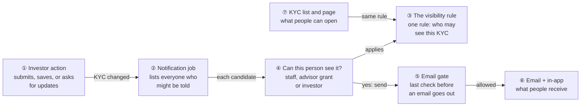

Read it left to right: something happens to a KYC (①), a background job (②) goes through everyone who
might care, asks "can this person see it?" (④), which applies the one rule (③). Those who pass get the
email and in-app notification (⑥) after a last gate (⑤). The list and page (⑦) use the **same** rule,
so nobody is emailed a KYC they cannot open.

### Before and after

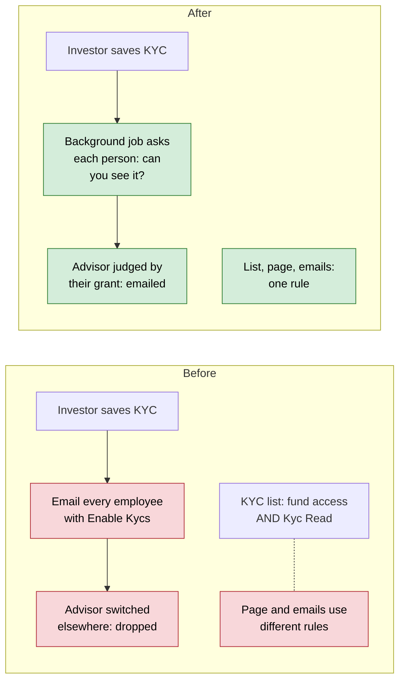

| Question | Before (main) | After |
|---|---|---|
| Who gets **KYC Updated / Updates Requested**? | Every active employee with **Enable Kycs**, whatever the fund | Everyone the rule allows: employees **and advisors** |
| Who gets **KYC Submitted**? | Every employee with **Enable Kycs**; never advisors. Also fired **KYC Updated** at the same time | Everyone the rule allows, advisors included; **only** this email on a final submit |
| Advisor switched into another company | Never emailed (the email gate looked at their *current* company) | Emailed if their grant on the fund's entity passes the rule |
| What does **Investor Kyc Read** give? | Nothing on its own (needed fund access too) | Every KYC in the entity, list + page + emails |
| Employee with fund access but no Kyc Read | Not allowed to open the KYC page | Opens KYCs on their funds |
| KYC with no commitment yet | List/page: company admins only | Everyone with **Enable Kycs** |
| Fund-of-funds LP opening its own KYC | Works on main; broke mid-branch | Works (investor check always reached) |
| When are emails sent? | Inside the investor's web request | In `NotifyKycJob`, a few seconds later |

### Walkthrough: one KYC, start to finish

**Setup.** Urban Capital runs two funds, **Fund A** and **Fund B**. The investor **Mehta Family Trust**
fills in a KYC. Six people might hear about it:

| Person | Who they are | Set up with |
|---|---|---|
| Asha | Urban Capital company admin | **Enable Kycs** on |
| Ben | Urban Capital operations | **Investor Kyc Read**, no fund access |
| Chen | Fund A analyst | Access on Fund A only |
| Dev | Fund B analyst | Access on Fund B only |
| Ela | Urban Capital intern | **Enable Kycs** off |
| Priya | Investor advisor (from Northbridge Advisors) | Grant on Urban Capital with **Investor Kyc Read**; currently switched into another client, **Zen Holdings**, where KYCs are switched off |

**Legend:** ✓ emailed and can open the KYC · ✗ not emailed and cannot open it.

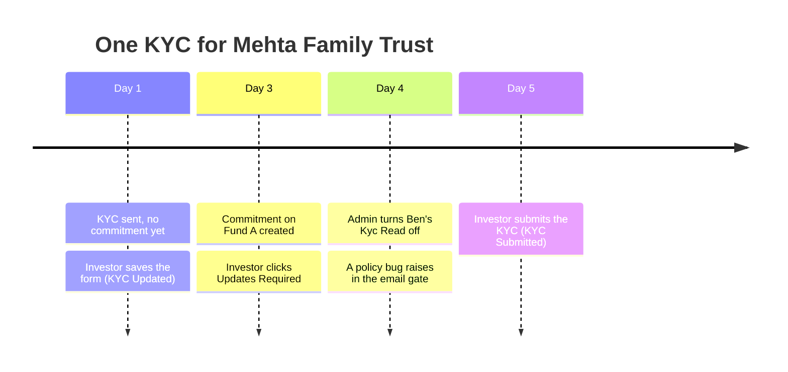

**Phase 1 — before any commitment**

| # | When | What happens | Behind the scenes | Result&nbsp;(who&nbsp;is&nbsp;told) |
|---|---|---|---|---|
| 1 | Day 1, 10:00 | Mehta saves the full form | The investor action (①) queues the notification job (②) with "KYC Updated" | Nothing sent yet — the save returns at once |
| 2 | Day 1, 10:00 + 2 s | The job runs | The job (②) asks the per-person check (④) for each employee and advisor; the rule (③) says "no commitment yet → everyone with Enable Kycs" | Asha&nbsp;✓<br>Ben&nbsp;✓<br>Chen&nbsp;✓<br>Dev&nbsp;✓<br>Ela&nbsp;✗&nbsp;(Enable&nbsp;Kycs&nbsp;off)<br>Priya&nbsp;✓ |
| 3 | Day 1, 10:00 + 2 s | Priya's email reaches the gate | The email gate (⑤) sees Priya is not in Urban Capital right now, finds her grant there and re-asks the check (④), which judges her **grant**, not Zen Holdings | Priya's email is delivered (⑥) |

**Phase 2 — the KYC is committed to Fund A**

| # | When | What happens | Behind the scenes | Result&nbsp;(who&nbsp;is&nbsp;told) |
|---|---|---|---|---|
| 4 | Day 3 | A commitment on Fund A is created for this KYC | Nothing is sent; the rule (③) now has a fund to check | Same people can see it except Dev |
| 5 | Day 3, 15:00 | Mehta clicks **Updates Required** | The investor action (①) queues "Updates Requested"; the job (②) asks the check (④) for each person | Asha&nbsp;✓<br>Ben&nbsp;✓&nbsp;(Kyc&nbsp;Read)<br>Chen&nbsp;✓&nbsp;(Fund&nbsp;A)<br>**Dev&nbsp;✗&nbsp;(only&nbsp;Fund&nbsp;B)**<br>Ela&nbsp;✗<br>Priya&nbsp;✓&nbsp;(grant&nbsp;Kyc&nbsp;Read) |

**Phase 3 — a change of mind, and a failure**

| # | When | What happens | Behind the scenes | Result&nbsp;(who&nbsp;is&nbsp;told) |
|---|---|---|---|---|
| 6 | Day 4 | Asha turns **Investor Kyc Read** off for Ben (undo) | The rule (③) re-evaluates on every request; no cache to clear | Ben's KYC list loses this KYC immediately; he will not be emailed about it |
| 7 | Day 4 | A future bug makes the KYC policy raise while the gate (⑤) checks Priya | The gate (⑤) catches it, reports it to ExceptionNotifier, and skips **only Priya's** email | Priya&nbsp;✗&nbsp;(reported,&nbsp;not&nbsp;silent)<br>Everyone&nbsp;else&nbsp;unaffected |

**Phase 4 — final submit**

| # | When | What happens | Behind the scenes | Result&nbsp;(who&nbsp;is&nbsp;told) |
|---|---|---|---|---|
| 8 | Day 5 | Mehta clicks **Submit KYC**; status becomes **Completed** | The investor action (①) sees the submission and queues **only** "KYC Submitted" (not "KYC Updated" too); the job (②) applies the check (④) | Asha&nbsp;✓<br>**Ben&nbsp;✗&nbsp;(Kyc&nbsp;Read&nbsp;removed)**<br>Chen&nbsp;✓<br>Dev&nbsp;✗<br>Ela&nbsp;✗<br>Priya&nbsp;✓&nbsp;—&nbsp;one&nbsp;email,&nbsp;not&nbsp;two |

**The key moment** — Priya's inbox on Day 5, while she works in Zen Holdings:

```
┌──────────────────────────────────────────────────────────┐
│  From: CapHive · Urban Capital                           │
│  KYC submitted by Mehta Family Trust              ①      │
│  ──────────────────────────────────────────────          │
│  Mehta Family Trust has submitted their KYC.             │
│  [ View KYC ]                                     ②      │
└──────────────────────────────────────────────────────────┘
 ① one email, not "updated" + "submitted"
 ② the link opens the KYC (read-only) even while she is in Zen
    Holdings — the page uses the same rule, so never "access denied";
    editing it still needs her to switch into Urban Capital
```

**What to notice**

- One rule (③) answered every "who" question: emails, list and page never disagree.
- Priya was judged by her **grant** on Urban Capital, not by Zen Holdings where she was working.
- "No commitment yet" is part of the rule, so onboarding emails reach the team without a special case.
- Removing a toggle (row 6) takes effect at once — nothing is cached.
- A broken policy (row 7) costs one email and raises an alert; it never blocks the others.

### Key ideas

| # | Idea | In one line | Card |
|---|---|---|---|
| 1 | One rule | List, page and emails all use `staff_visible_kycs` | [③](#③-the-visibility-rule) |
| 2 | Judge advisors by their grant | Their grant's toggles on the KYC's entity, never their current company | [④](#④-can-this-person-see-it) |
| 3 | Emails only to people who can open the KYC | `notify_kyc` asks `show?` for every recipient | [②](#②-notification-job) |
| 4 | One email per investor action | A final submit sends **KYC Submitted** only | [①](#①-investor-action) |
| 5 | Send in the background | `NotifyKycJob`, same shape as `SendKycFormJob` | [②](#②-notification-job) |
| 6 | Fail closed, but loudly | Gate errors skip that one email and are reported | [⑤](#⑤-email-gate) |

**FAQ**

| Question | Answer |
|---|---|
| Is anyone emailed who could not open the KYC? | No. Every recipient passes the same `show?` the KYC page uses. The only "sees but not emailed" case is a company admin with **Enable Kycs** off. |
| Does this widen access? | Yes, deliberately: **Investor Kyc Read/Update** now cover every KYC in the entity, and fund access alone opens a fund's KYCs. Product decision, 2026-10-07. |
| Does anyone lose emails they get today? | Employees **without** Kyc Read/Update and without access to the KYC's fund stop getting emails for KYCs that already have a commitment. Before, every employee with **Enable Kycs** got them. |
| Do other notifications (funds, documents…) change? | Only for advisors switched out of an entity they hold a grant on — see card [⑤](#⑤-email-gate). |

---

## 2. The same picture with real names

### Picture

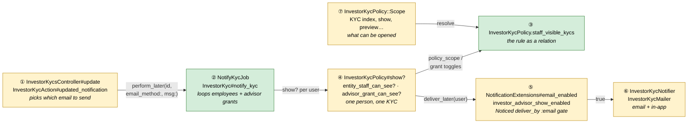

Colour = footprint: **green** new, **amber** modified, **grey** reused unchanged.

### What each box does

| # | Box | Real parts | What it does | When it runs | What it decides | Details |
|---|---|---|---|---|---|---|
| ① | Investor action | `InvestorKycsController#update`, `#send_notification`; `InvestorKycAction#updated_notification`; `InvestorKyc#submitted_notification` / `#updated_notification` / `#updates_requested_notification` | Turns an investor action into one queued notification | Request | Submitted vs Updated vs Updates Requested (one, never two) | [card ①](#①-investor-action) |
| ② | Notification job | `NotifyKycJob`, `InvestorKyc#notify_kyc` | Loops the entity's employees and advisor grants, asks ④ for each | Sidekiq job | Who is a recipient | [card ②](#②-notification-job) |
| ③ | The visibility rule | `InvestorKycPolicy.staff_visible_kycs` | The rule as an `InvestorKyc` relation for one entity, user and set of toggles | Called by ④ and ⑦ | Which KYCs a staff member sees | [card ③](#③-the-visibility-rule) |
| ④ | Can this person see it? | `InvestorKycPolicy#show?`, `#entity_staff_can_see?`, `#advisor_grant_can_see?`; `InvestorAdvisor#is_employee?` / `#is_company_admin?` | Answers yes/no for one person and one KYC via three additive paths | Request and job | Access to one KYC | [card ④](#④-can-this-person-see-it) |
| ⑤ | Email gate | `NotificationExtensions#email_enabled`, `#investor_advisor_show_enabled` | Noticed's last check before sending; lets a switched-out advisor through when ④ says yes | Delivery job | Send the email or not | [card ⑤](#⑤-email-gate) |
| ⑥ | Email + in-app | `InvestorKycNotifier`, `InvestorKycMailer`, `notify_kyc_submitted.html.erb` | Builds the in-app record and the email | Delivery job | Body text, link | [card ⑥](#⑥-email-and-in-app-notification) |
| ⑦ | KYC list and page | `InvestorKycPolicy::Scope#resolve`; everything built on `permissioned_employee?` | The KYCs list and every page action read the rule | Request | What a user can open or act on | [card ⑦](#⑦-kyc-list-and-page) |

### One run, end to end

The happy path from the walkthrough, row 8 (final submit, Priya switched out).

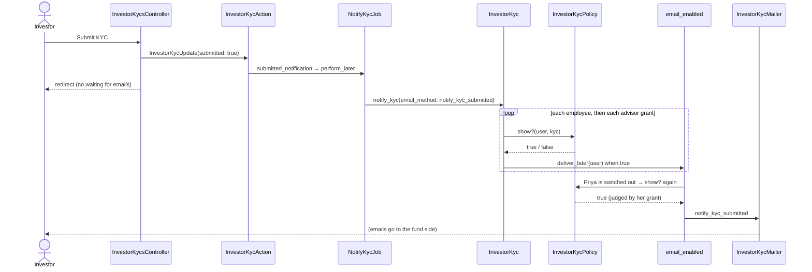

### Lifecycles

N/A — nothing stored changes state. Visibility is derived on every request from toggles, access rights
and commitments; there is no cache to expire.

### What users see

| Where in CapHive | Today (main) | After this change | Who sees it |
|---|---|---|---|
| Sidebar → **Funds → KYCs** list | Employees: KYCs on their funds, only with Kyc Read | The rule: Kyc Read/Update → all; else their funds + uncommitted KYCs | Employees, switched-in advisors |
| KYC page | Same as list | Same as list (they cannot disagree) | Same |
| **KYC Submitted / Updated / Updates Requested** emails | Every employee with Enable Kycs; never switched-out advisors; submit sent two emails | Everyone the rule allows, advisors included wherever they are; one email per action | Fund side |
| User **Edit** page toggles | Unchanged screens | **Investor Kyc Read/Update** now mean "every KYC" | Company admins |

User-facing wording and the full matrix live in the user guide:
[Who Can See a KYC and Get Its Emails](../../../docs/user_guides/investor_kyc_user_guide.md#who-can-see-a-kyc-and-get-its-emails).

### Design decisions

1. **One rule in the policy, reused everywhere.** `staff_visible_kycs` feeds `Scope`, `show?` and (through
   `show?`) the emails. *Alternative:* a separate recipient rule in `notify_kyc`. *Rejected:* it drifted
   immediately — the branch's first version emailed people who then got "access denied".
2. **Advisors judged by their grant.** `advisor_grant_can_see?` reads the grant's `permissions` and
   `extended_permissions` and the KYC entity's flag. *Alternative:* `user.enable_kycs` /
   `user.get_extended_permissions`. *Rejected:* those follow the entity the advisor is currently in
   (walkthrough row 3).
3. **`show?` paths are additive** (`return true if …`), never an exclusive `elsif`. *Alternative:* the
   original `elsif` chain. *Rejected:* holding any grant, or carrying the `:employee` role as a
   fund-of-funds LP does, diverted users away from the path that should have let them in.
4. **Email gate scoped to "holds a grant on this record's entity".** *Alternative:* any user with the
   cached `investor_advisor` role. *Rejected:* `DocumentPolicy#show?` is `true` for any public document,
   so every advisor would have been emailed for every public document app-wide.
5. **Generic gate via `Pundit.policy!(recipient, model).show?`.** *Alternative:* override `email_enabled`
   in `InvestorKycNotifier` only. *Rejected:* the question is generic; the entity-scoped gate (4) already
   makes it safe for other models.
6. **Send from `NotifyKycJob`.** *Alternative:* inline in the request. *Rejected:* one `show?` per
   recipient is N queries; the investor's save should not wait. Mirrors `SendKycFormJob`.
7. **One notification per investor action.** A final submit routes to `submitted_notification` via
   `ctx[:submitted]`. *Alternative:* suppress the controller's sender. *Rejected:* routing also makes all
   three emails share `notify_kyc`'s recipient rule.
8. **Gate errors: fail closed and report.** `Pundit::NotDefinedError` → log; any other error →
   `ExceptionNotifier`. *Alternative:* rescue `NoMethodError` and log at `warn`. *Rejected:* a real policy
   bug would look like an intentional "no" and nobody would notice the missing emails.

**FAQ**

| Question | Answer |
|---|---|
| Why not cache the visibility list? | Toggles and access rights change at any time (walkthrough row 6); a live query is correct and cheap enough per request, and the email fan-out runs in a job. |
| Why keep company admins outside the `Enable Kycs` rule for viewing? | `Scope` already gives them `for_company_admin`, and Group Company users may not carry the entity flag. Changing it risked locking admins out; only their **emails** need `Enable Kycs`. |
| Why does ⑤ call `show?` again when ② already did? | ② decides who to *notify*; ⑤ is Noticed's generic delivery gate shared by all 27 notifiers. Without the third branch, ⑤ would block every switched-out advisor ② selected. |

---

## 3. One card per box

> Same order and numbers as the picture.

### ① Investor action

Turns what the investor did into exactly one queued notification.

| Owns | Reads / receives | Produces |
|---|---|---|
| Which of the three emails to send | Controller's status transition (`completed` and not already completed), `investor_user`, `validate` | `NotifyKycJob.perform_later(id, email_method:, msg:)` |

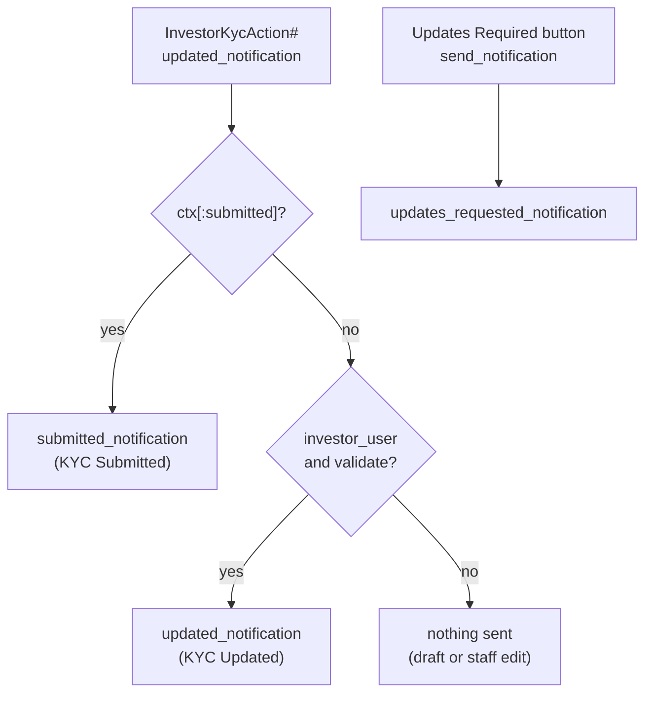

| Trigger | Email | Notes |
|---|---|---|
| Investor's final submit (status → **Completed**) | KYC Submitted | Wins over KYC Updated — before, both were sent |
| Investor's full (validated) save, not final | KYC Updated | **Save Draft** (`validate: false`) sends nothing |
| Investor clicks **Updates Required** | Updates Requested | `InvestorKycsController#send_notification` |
| Staff edit, bulk import | none | Guard is `investor_user && validate`, which keeps imports from mass-emailing |

`msg:` is still passed for KYC Submitted so the in-app notification has a body (see card ⑥).

**Worked examples:** H5, H6, H7.

**FAQ**

| Question | Answer |
|---|---|
| Why route instead of just deleting the controller's own sender? | Routing puts all three emails through `notify_kyc`, so they share one recipient rule (advisors included). |
| What if a new caller completes a submission without `ctx[:submitted]`? | It sends KYC Updated instead — silent. The controller is the only caller today; noted in [Risks](#risks-and-open-questions). |
| Does `InvestorKycCreate` (which shares the step) send KYC Submitted? | No; it never sets `ctx[:submitted]`, and `create` does not apply the status transition. |

### ② Notification job

The fan-out, off the request thread.

| Owns | Reads / receives | Produces |
|---|---|---|
| The recipient list for one KYC email | `investor_kyc_id`, `email_method`, `msg`; `entity.employees`, `entity.investor_advisors` | `InvestorKycNotifier.with(...).deliver_later(user)` per recipient |

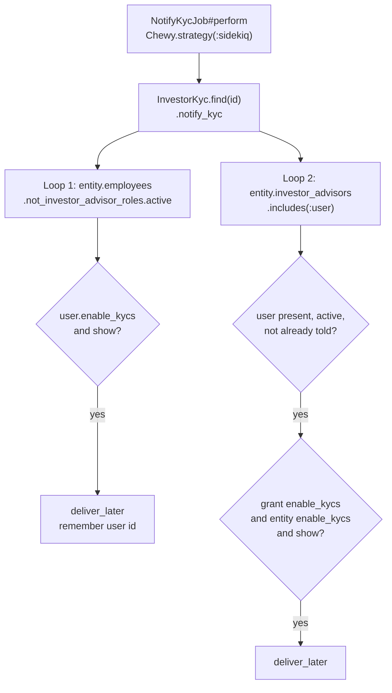

| Concern | Behaviour |
|---|---|
| Queue / retries | Default ActiveJob queue and retries, same as `SendKycFormJob` |
| Idempotency | None needed per run; within a run a `Set` of user ids stops a legacy advisor (nil `advisor_entity_id`) appearing in both loops from being told twice |
| Record deleted before the job runs | `InvestorKyc.find` raises; the job retries and dies — notification lost, same as `SendKycFormJob` |
| Grant whose user row is gone | Skipped (`next if user.nil?`) rather than aborting the remaining advisors |
| Employees vs company admins | Loop 1 checks `user.enable_kycs` as well as `show?`, because `show?` lets a company admin through without it (walkthrough: admin with Enable Kycs off sees but is not emailed) |
| Advisors | Loop 2 reads the **grant's** `enable_kycs`, never `user.enable_kycs` (which follows their current company) |

**Worked examples:** V5, V6, V7, V11, E5.

**FAQ**

| Question | Answer |
|---|---|
| Where did the "no commitment → everyone" fallback go? | Into the rule (③). `notify_kyc` now just asks `show?`, so emails and the page agree. |
| Can this mass-email during a bulk import? | No — only investor actions trigger it (card ①). |
| Why `find_each` on advisors but `each` on employees? | Employees per entity are few and need `.active`; advisor grants use `find_each` with `includes(:user)` to avoid N+1 on the user. |

### ③ The visibility rule

The one place the rule lives, as an `InvestorKyc` relation.

| Owns | Reads / receives | Produces |
|---|---|---|
| "Which KYCs may this staff member see?" | `scope`, `entity_id`, `user_id`, `extended_permissions` (passed explicitly) | A relation: all of the entity's KYCs, or those on the user's funds plus uncommitted ones |

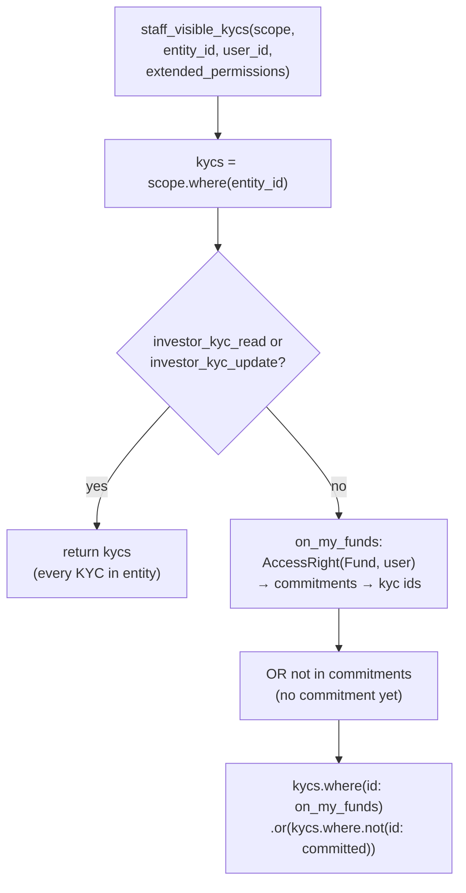

| Input | Where it comes from for an employee | For a switched-out advisor |
|---|---|---|
| `entity_id` | `user.entity_id` | the KYC's `entity_id` |
| `extended_permissions` | `user.get_extended_permissions` (the grant's, if switched in) | the grant's `extended_permissions` |
| fund access | `AccessRight(owner_type: "Fund", user_id)` on the entity | same table, same user |

`enable_kycs` is **not** inside this method — callers check it, because it comes from a different place
for employees (`user.enable_kycs`) and advisors (grant + KYC entity).

Subqueries (`IN` / `NOT IN`), not joins, so a KYC with several commitments is not returned twice. `NULL`
`investor_kyc_id`s are excluded from the `NOT IN` list (otherwise it matches nothing).

**Worked examples:** V1–V5.

**FAQ**

| Question | Answer |
|---|---|
| Why a class method instead of using `Scope`? | A switched-out advisor is not in the entity, so `Scope` (built from `user.entity_id`) cannot answer for them. Passing the inputs explicitly lets both callers share it. |
| Why `AccessRight` directly instead of `Fund.for_employee`? | `Fund.for_employee` is built from `user.entity_id`; the explicit entity is needed for advisors. Same table, same filter. |
| Are soft-deleted commitments or access rights counted? | No — both models are `acts_as_paranoid` via `Trackable`, so default scopes exclude them. |

### ④ Can this person see it?

`InvestorKycPolicy#show?` — one person, one KYC, three additive paths.

| Owns | Reads / receives | Produces |
|---|---|---|
| Access to a single KYC | user, KYC, the user's roles, any `InvestorAdvisor` grant on the KYC's entity | true / false |

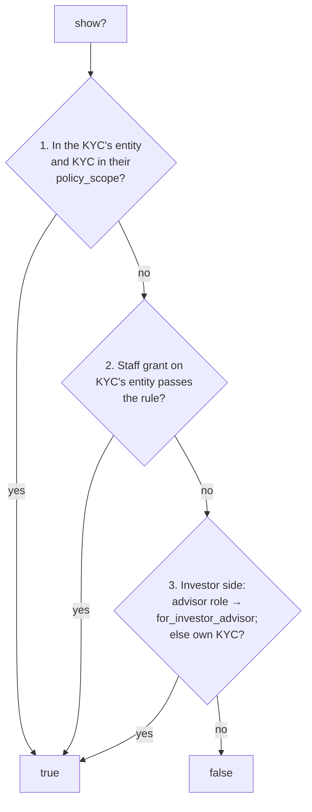

**Path 2 in detail (`advisor_grant_can_see?`):**

| Check | Reads | Why |
|---|---|---|
| Grant exists, roles include `employee` or `company_admin` | `InvestorAdvisor` on `record.entity`, `allowed_roles` stringified | An investor-only grant is not staff; path 3 handles it. Legacy rows serialized as symbols still match |
| `enable_kycs` on the grant **and** on the KYC's entity | `grant.permissions`, `record.entity.permissions` | Switched-out equivalent of `user.enable_kycs` |
| `company_admin` grant → yes | `allowed_roles` | Mirrors a company admin when switched in |
| Otherwise the rule (③) with the grant's toggles | `grant.extended_permissions`, `AccessRight` | Same rule as employees |

**Role → access**

| Viewer | Path | Entity scoping |
|---|---|---|
| Company admin / Group Company user in the entity | 1 (`for_company_admin`) | `belongs_to_entity?` (Group Company: child entities) |
| Employee in the entity | 1 (rule ③ via `Scope`) | `user.entity_id` |
| Advisor switched in | 1, with the grant's toggles via `get_extended_permissions` | `user.entity_id` = KYC entity |
| Advisor switched out | 2 — can **view** the KYC page from a link without switching; every change action needs `belongs_to_entity?`, so editing still requires switching in | grant on `record.entity_id` |
| LP-side advisor | 3 (`for_investor_advisor`) | unchanged |
| Investor, incl. fund-of-funds LP users carrying `:employee` | 3 (own KYC) | `investor.investor_entity_id` |

**Worked examples:** V7, V8, V9, V10, E1, E2.

**FAQ**

| Question | Answer |
|---|---|
| Why does path 1 not check `investor_kyc_read` any more? | Under the rule, fund access alone is enough to open a KYC (V3). Actions that change a KYC still need their own permission (card ⑦). |
| Why can't path 2 just use `user.enable_kycs`? | It reads the company the advisor is in now. In the walkthrough, Priya is in Zen Holdings with KYCs off — she would have been dropped. |
| Could path 1's `:employee` role block a fund-of-funds LP? | No: path 1 requires `belongs_to_entity?`, and the LP is not in the GP's entity, so it falls through to path 3. |

### ⑤ Email gate

`NotificationExtensions#email_enabled` — Noticed's last check, shared by all 27 notifiers.

| Owns | Reads / receives | Produces |
|---|---|---|
| Whether a queued email is actually sent | recipient, `model`, `investor_access` | true / false |

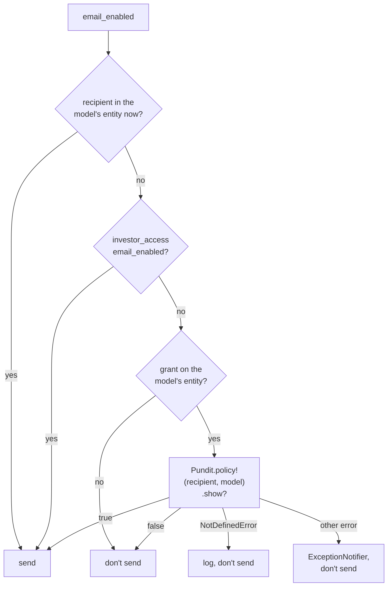

| Failure | What happens | Who is alerted |
|---|---|---|
| Model has no policy | That email skipped; `info` log | Nobody (expected) |
| A policy's `show?` raises | That email skipped | ExceptionNotifier (developers) |
| Grant revoked | Soft-deleted grant excluded by paranoia scope → not sent | — |
| `model` nil | `nil.respond_to?(:entity)` is false → not sent | — |

**Reach beyond KYC.** Any record that belongs to an entity where the recipient holds a grant reaches its
own policy's `show?`. Known case: `DocumentPolicy#show?` is `true` for public documents, so a switched-out
advisor now gets email for their grant entity's **public documents** (pinned by delivery scenario 4).
Accepted: the advisor holds a grant there and the document is public.

In tests `BaseNotifier` skips `email_enabled` entirely, so its scenarios build the notification and
call `email_enabled` directly.

**Worked examples:** H8, E3, X1, X2.

**FAQ**

| Question | Answer |
|---|---|
| Why not gate on the cached `investor_advisor` role (cheaper)? | It reached `DocumentPolicy#show?` for every public document app-wide, overriding explicit `email_enabled = false` opt-outs. |
| Does the extra query slow every email? | No — the two existing branches short-circuit everyone currently in the entity or with an LP access. The `exists?` runs only for the rest. |
| Why `policy!` and not `policy`? | `policy` returns nil for a missing policy, which hid the case; `policy!` raises `NotDefinedError` so it can be logged distinctly from a real bug. |

### ⑥ Email and in-app notification

What lands in the inbox and the bell.

| Owns | Reads / receives | Produces |
|---|---|---|
| Subject, body, link | `email_method` (a **String** after the job boundary), `msg`, any `CustomNotification` | Email + `Noticed::Notification` row |

| Item | Behaviour | Why |
|---|---|---|
| `notify_kyc_submitted.html.erb` | Always renders its formatted body (the `@message` branch was removed from the `else` arm) | The bare `msg` string used to replace the nicer body |
| `msg:` on KYC Submitted | Still passed | `InvestorKycNotifier#message` backs the **in-app** body too; dropping it left the bell entry blank |
| Configured `CustomNotification` | Untouched: its own branch renders first; `send_mail` swaps subject and attachments only | No customer wording is overridden |
| `InvestorKycNotifier#url` | Compares `email_method.to_s` against a `%w[]` list | A String never matched the old symbol list; latent bug that would have linked a future job-routed "KYC Required" to the read-only page |

**Worked examples:** H5, E4.

**FAQ**

| Question | Answer |
|---|---|
| Will a customer's custom KYC Submitted email change? | No — custom notifications take the first branch, which is unchanged. |
| Why do the three emails have different subjects? | Unchanged mailer subjects: "KYC submitted by …", "KYC updated for …", "Action Required: Please update your KYC details". |

### ⑦ KYC list and page

Everything a user can open or do on a KYC reads the same rule.

| Owns | Reads / receives | Produces |
|---|---|---|
| `InvestorKycPolicy::Scope#resolve` (employee branch) | `user.enable_kycs`, `user.get_extended_permissions`, rule ③ | The KYCs list; the base for every `permissioned_employee?` check |

| Action | Needs (on a KYC the user can see) |
|---|---|
| List, open page | the rule |
| Preview, e-sign emails, AML report | **Investor Kyc Read** |
| Edit, **Request Updates**, **KYC Actions → Generate Docs** | **Investor Kyc Update** |
| Delete | **Investor Kyc Delete** |
| Verify | **Investor Kyc Approve** |

These checks already required the KYC to be in `policy_scope`; they now inherit the wider rule
automatically. That widening is intended (Kyc Read/Update holders act entity-wide).

**Verified on dev data (read-only, 2026-10-07):** five Kyc Read users — list and `show?` agree on every
sampled KYC; user 377 goes from 0 to 103 of entity 892's KYCs; a plain employee with no fund access sees
only the one uncommitted KYC; a fund-of-funds LP user can open its own KYC.

**Worked examples:** V1–V6.

**FAQ**

| Question | Answer |
|---|---|
| Can the list and the page ever disagree now? | Not for staff: `show?` path 1 is `policy_scope.exists?`. |
| What about the index's `index?` check? | `index` does not call it; the list is driven by `Scope`, which returns nothing without **Enable Kycs**. |

---

## 4. Reference

### Class diagram

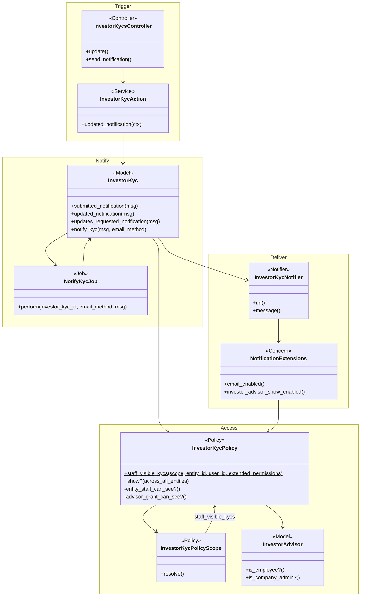

### Data model and schema changes

N/A — no tables or columns change. Reads only: `investor_kycs`, `capital_commitments(investor_kyc_id,
fund_id, entity_id)`, `access_rights(owner_type, owner_id, user_id, entity_id)`, `investor_advisors`
(`permissions`, `extended_permissions`, `allowed_roles`), `users`/`entities` permission flags.

### Component contracts

| From → To | Contract | Direction rule |
|---|---|---|
| ① → ② | `NotifyKycJob.perform_later(id, email_method: String, msg:)` | ① never resolves recipients |
| ② → ④ | `InvestorKycPolicy.new(user, kyc).show?` | ② adds only the `enable_kycs` email gate on top |
| ④ → ③ | `staff_visible_kycs(scope, entity_id:, user_id:, extended_permissions:)` | Callers own `enable_kycs` |
| ② → ⑤ | `InvestorKycNotifier.with(record:, entity_id:, email_method:, msg:, user_id:).deliver_later(user)` | ⑤ may still refuse |
| ⑤ → ④ | `Pundit.policy!(recipient, model).show?` | Only when recipient holds a grant on `model.entity` |
| ⑤ → ⑥ | Noticed `deliver_by :email` `if:` | — |
| ⑦ → ③ | `Scope#resolve` employee branch | Company admin / Group Company branches unchanged |

### Cross-cutting concerns

#### Transactions and queries

- No writes besides notification rows; no transaction needed.
- Per recipient, `show?` runs at most: one `exists?` on the scope (path 1) **or** one `find_by` on
  `investor_advisors` + one `exists?` (path 2). That is N+1 by design across `notify_kyc` — acceptable
  because it runs in a job.
- The `NOT IN` subquery is bounded by `capital_commitments.entity_id` (indexed).

#### Exception handling and monitoring

| Failure | Detected by | Effect |
|---|---|---|
| Policy `show?` raises inside ⑤ | ExceptionNotifier | One email skipped |
| KYC deleted before `NotifyKycJob` runs | Sidekiq retries / dead set | All three emails for that action lost |
| Sidekiq down or backed up | Queue monitoring | Emails delayed; the investor's save already succeeded |

#### Performance and security

- **Volume:** one job per investor action; per job, one `show?` per employee and advisor grant of the
  entity. Fine for current entity sizes; revisit if an entity has thousands of staff.
- **Tenant isolation:** the rule always filters `investor_kycs.entity_id`; path 2 requires a grant on
  that same entity; ⑤ requires a grant on `model.entity`. No path crosses entities.
- **Deliberate widening:** Kyc Read/Update holders see every KYC in their entity, and the actions
  built on `permissioned_employee?` widen with it (card ⑦).

### Worked examples

**ID legend:** **V** = visibility rule example (referenced from code comments) · **H** = happy path ·
**E** = edge case · **X** = error case. No `specs/` exist for this change, so the Spec column is omitted.

**Shared setup:** fund entity with **Fund A** (has the KYC's commitment) and **Fund B** (does not); a
company admin; one investor with one user; one KYC.

#### Happy Path

| # | Scenario | Given | When | Then | Feature |
|---|---|---|---|---|---|
| V1 | Kyc Read alone | employee, Kyc Read, no fund access | investor saves | sees, in list, emailed | `investor_kyc_visibility_rule.feature` |
| V2 | Kyc Update alone | employee, Kyc Update, no fund access | investor saves | sees, in list, emailed | same |
| V3 | Fund access alone | employee, access on Fund A only | investor saves | sees, in list, emailed | same |
| V5 | No commitment yet | new KYC with no commitment; plain employee | investor saves | sees, in list, emailed | same |
| V7 | Advisor switched out | grant Kyc Read; advisor in an entity with KYCs off | updated, updates requested, final submit | gets all three, one Submitted | same |
| V8 | Company-admin grant | grant roles `company_admin`, no fund access, switched out | investor saves | sees, emailed | same |
| V11 | Advisor switched in | grant + Fund A access | investor saves / submits | exactly one email each | `investor_kyc_send_workflow.feature` sc. 21, 23 |
| H5 | One email per submit | fund admin | investor final-submits | KYC Submitted only, formatted body, non-blank in-app | `investor_kyc_send_workflow.feature` sc. 5 |
| H6 | Updates Requested | as V7 | investor clicks Updates Required | advisor gets "Please update your KYC" email | `investor_kyc_visibility_rule.feature` V7 |
| H7 | Sent from a job | employee with Kyc Read | investor saves with jobs held | `NotifyKycJob` queued with `notify_kyc_updated`; no email yet | `investor_kyc_visibility_rule.feature` |
| H8 | Gate lets switched-out advisor through | advisor with grant + Fund A access, switched out | build KYC Updated notification | `email_enabled` true | `investor_kyc_notification_delivery.feature` sc. 1 |

#### Edge Cases

| # | Scenario | Given | When | Then | Feature |
|---|---|---|---|---|---|
| V4 | Other fund only | employee, access on Fund B | investor saves | not seen, not listed, not emailed | `investor_kyc_visibility_rule.feature` |
| V6 | Enable Kycs off | employee, Kyc Read + Fund A, Enable Kycs off | investor saves | nothing | same |
| V9 | Grant Enable Kycs off | grant Kyc Read + Fund A, grant Enable Kycs off, switched out | investor saves | nothing | same |
| V10 | Fund-of-funds LP | investor entity typed Company (user has `:employee`) | opens own KYC | allowed | `investor_kyc_send_workflow.feature` sc. 16 |
| E1 | Investor-only grant | grant roles `investor` | `show?` | falls through to `for_investor_advisor` | sc. 17 |
| E2 | Legacy symbol roles | grant `allowed_roles: [:employee]` | `show?` | treated as employee | sc. 19 |
| E3 | Gate denies unrelated users | advisor without access; outsider employee | build notification | false; in-entity employee still true | delivery sc. 2 |
| E4 | URL after job boundary | `email_method` as String | build notification | editable form for KYC Required, read-only page otherwise | delivery sc. 5 |
| E5 | No double email | advisor with nil `advisor_entity_id`, switched in | investor saves | exactly one email | sc. 21 |
| E6 | Admin grant with Enable Kycs off, switched in | grant roles incl. `company_admin`, grant Enable Kycs off | investor saves | not emailed | sc. 22 |
| E7 | Public document reach | switched-out advisor with grant; public document on that entity | build document notification | `email_enabled` true (accepted widening) | delivery sc. 4 |

#### Error Cases

| # | Scenario | Given | When | Then (what the user sees, who is alerted) | Feature |
|---|---|---|---|---|---|
| X1 | Policy raises | `InvestorKycPolicy#show?` raises | build notification for switched-out advisor | `email_enabled` false; ExceptionNotifier called | delivery feature |
| X2 | No policy | `Pundit.policy!` raises `NotDefinedError` | build notification | false; nothing reported | delivery feature |

### Testing

Cucumber only. New: `features/core/investor_kyc_visibility_rule.feature` +
`investor_kyc_visibility_rule_steps.rb` (V1–V9, H6, H7). Reused and extended:
`investor_kyc_send_workflow.feature` (scenarios 14–23; scenario 15 now expects the Kyc-Read-only employee
to be emailed) and `investor_kyc_notification_delivery.feature` (X1, X2 added). The suite runs jobs
`:inline`, so H7 swaps `NotifyKycJob` onto a test adapter for one step.

### Risks and open questions

- **Wider access for Kyc Read/Update holders** (list, page, preview, edit…) → intended product decision;
  documented in the user guides; dev data checked.
- **Arbitrary policy code runs during email delivery** (⑤) → only for recipients with a grant on the
  record's entity; errors are reported, not swallowed. A future policy with a *required* `show?`
  argument would raise `ArgumentError` out of the gate — not rescued on purpose.
- **Public documents now reach switched-out advisors with a grant** (E7) → accepted; pinned by a scenario.
- **`ctx[:submitted]` is an informal contract** → only the controller sets it; a new caller would send
  KYC Updated instead of Submitted.
- **Async delivery** → a deleted KYC or a Sidekiq outage loses or delays that action's emails; same as
  `SendKycFormJob`.
- **Known test gaps:** production job boundary (tests run inline); only `InvestorKycNotifier` and
  `DocumentNotifier` exercise the new gate branch; the nil-user guard in loop 2 is defensive and
  uncovered.
- **Rollback:** plain revert; nothing persisted. Reverting re-breaks switched-out advisor emails and
  Kyc Read's meaning.

No open questions.

**FAQ**

| Question | Answer |
|---|---|
| Where do I start reviewing? | `InvestorKycPolicy` (cards ③, ④, ⑦), then `InvestorKyc#notify_kyc` (②), then `config/initializers/noticed.rb` (⑤). |
| What must I run before merging? | The four KYC features listed in [Testing](#testing) and `user_guide_lint.feature`. |
| What happens to the FAQ text in the app? | After merge run `guide_faqs:import_markdown REFRESH=1` and `guide_search:reindex` per environment. |
