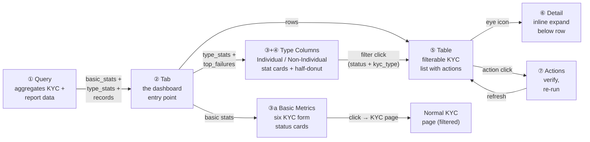
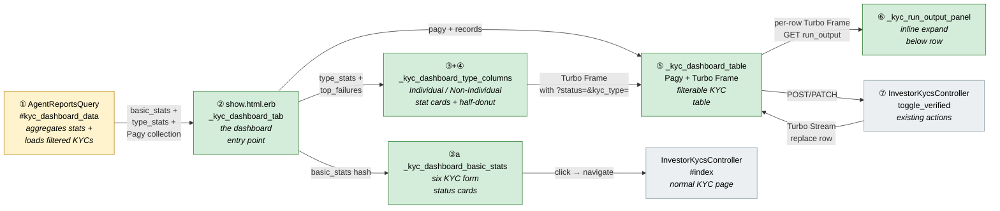
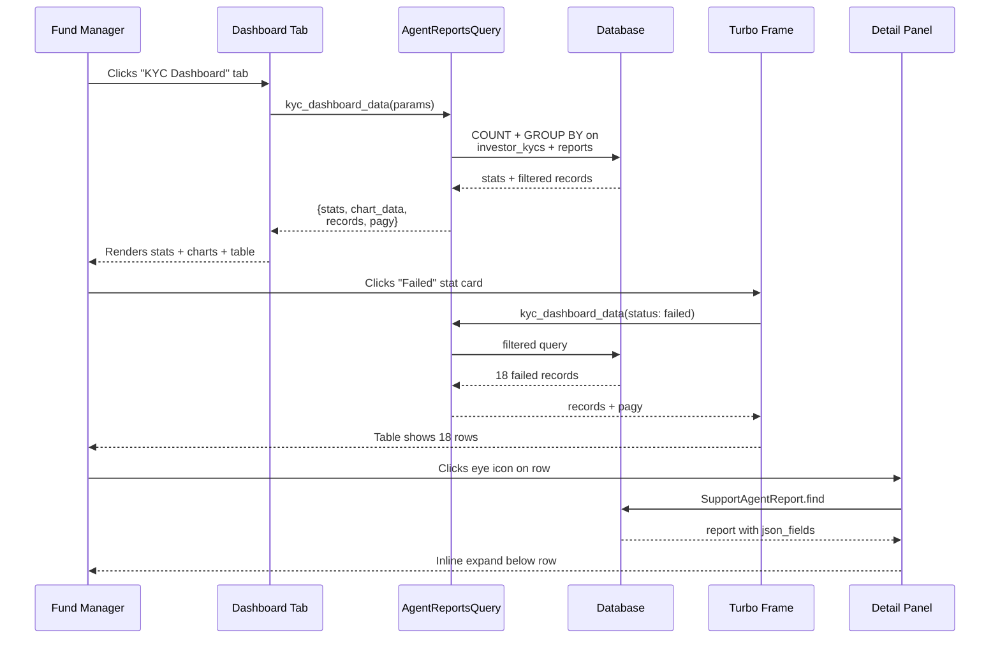
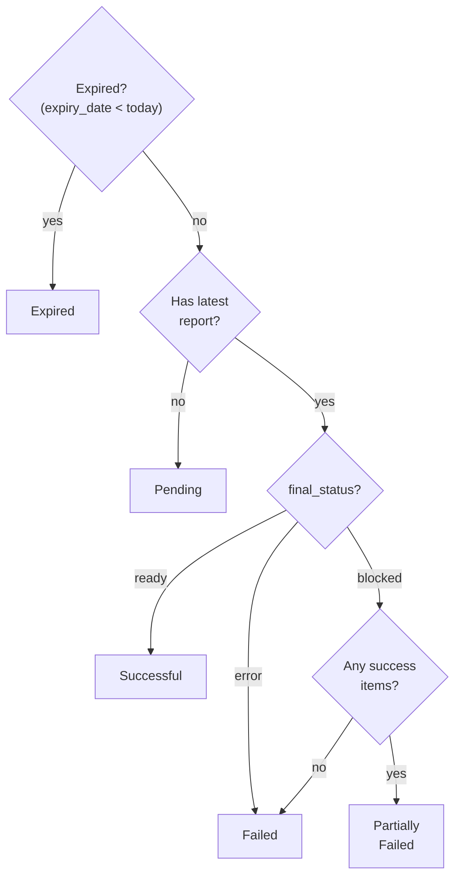
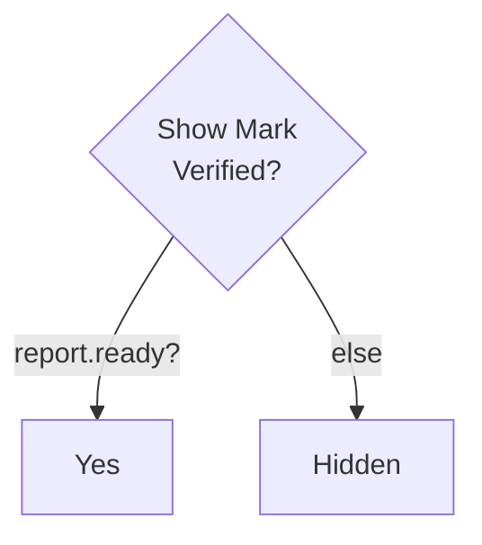
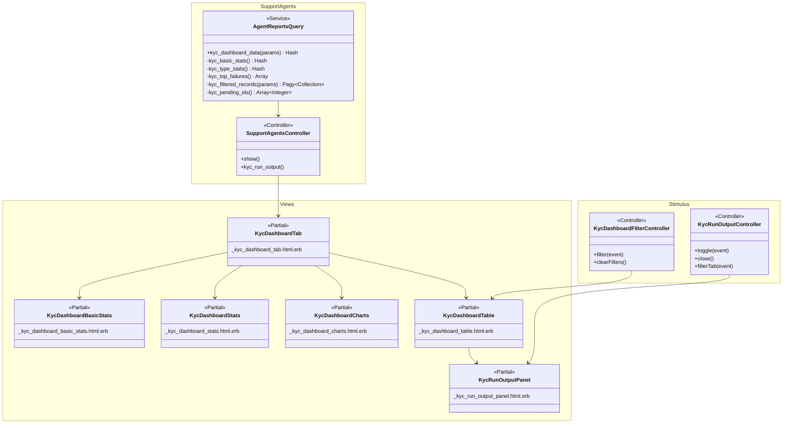

# KYC Agent Dashboard — Design

> **Audience:** Engineering team.
> **Companion documents:** [Proposal](proposal.md) · [Spec](specs/kyc/agent-dashboard/spec.md)

> **Planning phase — no code changes.** This document explains HOW the proposal will be built.
> Do not edit application code while writing it; implementation happens later, in the tasks phase.

---

## Contents

- [1. The idea](#1-the-idea)
  - [What this adds](#what-this-adds)
  - [The idea in one picture](#the-idea-in-one-picture)
  - [Walkthrough: one example, start to finish](#walkthrough-one-example-start-to-finish)
  - [Key ideas](#key-ideas)
- [2. The same picture with real names](#2-the-same-picture-with-real-names)
  - [Picture](#picture)
  - [What each box does](#what-each-box-does)
  - [One run, end to end](#one-run-end-to-end)
  - [Lifecycles](#lifecycles)
  - [What users see](#what-users-see)
  - [Design decisions](#design-decisions)
- [3. One card per box](#3-one-card-per-box)
  - [① Query Service](#①-query-service)
  - [② Dashboard Tab](#②-dashboard-tab)
  - [③ Stat Cards](#③-stat-cards)
  - [④ Charts](#④-charts)
  - [⑤ KYC Table](#⑤-kyc-table)
  - [⑥ Detail Panel](#⑥-detail-panel)
  - [⑦ Inline Actions](#⑦-inline-actions)
- [4. Reference](#4-reference)

---

## 1. The idea

### What this adds

A new "KYC Dashboard" tab on the KYC Onboarding Agent show page, following the same tab pattern used by PortfolioCompanyAgent, CashFlowAssistantAgent, DealsReportAgent, and 5 other agent types. The tab loads a query service that aggregates KYC validation data, renders stat cards, charts, and a filterable table, and wires inline actions back through existing controller endpoints.

**Post-product-call additions (2026-11-02):** The dashboard now shows TWO rows:
- **Row 1 — KYC Form Status (basic metrics):** 6 cards using the same boolean/date scopes as the KYC index page (Verified, Unverified, Completed, Expired, Individual, Non Individual). Clicking navigates to the normal KYC page with Ransack filters. Uses `InvestorKyc` scopes (`.verified`, `.unverified`, etc.) — NOT `submission_status` enum (unreliable for legacy data).
- **Row 2 — Agent Validation Status (two-column layout):** Two side-by-side columns (Individual / Non-Individual), each with 6 stat cards (Total, Pending, Successful, Failed, Partially Failed, Expired) + a half-donut chart. Clicking a card filters the table by both status AND KYC type. The "Run Agent on All Pending" button sits inline with the section heading.

Row 1 gives the FM a holistic KYC funnel view; Row 2 gives per-type agent validation breakdowns at a glance.

### The idea in one picture

### Walkthrough: one example, start to finish

**Setup:** An entity "Alpha Capital" has a KYC Onboarding Agent enabled. 100 investors have submitted KYCs. The FM has not yet run the agent on any of them.

**Legend:** ● = current/active, ✓ = done, — = not applicable.

| # | When | What happens | Behind the scenes | Result |
|---|---|---|---|---|
| 1 | FM opens agent page | Clicks KYC Onboarding Agent from the agents list | Controller loads agent + schedule + execution logs (existing) | Agent show page with General tab active |
| 2 | FM clicks "KYC Dashboard" tab | Tab content loads | The query service (①) runs: counts ALL entity KYCs by boolean scopes (Row 1), then runs `kyc_type_stats` with GROUP BY type → per-type breakdowns (Row 2) | Dashboard shows Row 1: Verified=5, Unverified=95, Completed=50, Expired=2, Individual=85, Non Individual=15. Row 2: two columns — Individual (Total=80, Pending=80, rest=0) and Non-Individual (Total=20, Pending=20, rest=0) |
| 2a | FM clicks "Unverified" card in Row 1 | Navigates to the normal KYC page | Browser navigates to `/investor_kycs?q[verified_eq]=false` (Ransack, entity-scoped) | Normal KYC list showing 95 unverified KYCs |
| 3 | FM clicks "Run Agent on All Pending" | Confirmation modal: "Run on 100 pending KYCs?" → confirms | Hidden form POSTs `target_ids[]` (100 pending IDs from `kyc_pending_ids`) + `target_type=InvestorKyc` to `run_batch`. Job queued in `:adhoc_batch` mode. Background job broadcasts progress to `batch_progress_#{agent.id}` ActionCable channel → `_batch_progress_panel` replaces empty `#batch_progress_panel` div | Progress: "Processing... 0/100" |
| 4 | Agent runs on each KYC | Each KYC goes through the 9-step pipeline | For each: field check → doc presence → doc validity (LLM) → consistency (LLM) → expiry → report saved. `SupportAgentReport` created per KYC with `final_status` = ready or blocked | Progress updates: "47/100... 100/100 complete" |
| 5 | Batch completes | Stats and table refresh | The query service (①) re-runs: 100 validated, 0 pending, 72 successful, 18 failed, 8 partial, 2 expired | Cards update, table shows all 100 with results |
| 6 | FM clicks "Failed" stat card | Table filters to 18 failed KYCs | Stat card click (③) sends Turbo Frame request with `status=failed` filter | Table shows 18 rows, "Failed" card highlighted |
| 7 | FM clicks eye icon on "ABC Pvt Ltd" | Detail panel slides out | Panel loads (⑥) via Turbo Frame: reads the KYC's latest `SupportAgentReport.json_fields` | Panel shows 12 items: 8 matched, 1 failed, 2 partial, 1 missing |
| 8 | **Mistake:** FM clicks "Mark Verified" on a failed KYC | Button is hidden | Mark Verified only shown for status=successful (⑦ decision) | No action available — correct behavior |
| 9 | FM clicks "Successful" stat card, then "Mark Verified" on row | KYC marked verified | Action (⑦) calls `toggle_verified` on `InvestorKycsController`, row refreshes via Turbo | Row shows "Verified ✓" |
| 10 | FM checks the "Docs" column | Sees document validation results from agent | Helper reads `document_issues` from report's `json_fields`, counts valid vs total doc checks | "2/3" green (2 valid of 3 doc checks), "1/5" orange, "0/4" red |
| 11 | FM clicks eye icon to see doc details | Clicks "Documents" tab in run output panel | Panel filters to show only document-related items from `document_issues` | Documents tab shows 3 items: "Valid PAN" ✓, "Missing Declaration" ✗, "Wrong Address Proof" ✗ |

**What to notice:**
- No new models or migrations — the dashboard reads existing `InvestorKyc` + `SupportAgentReport` data
- Batch run uses the existing `run_batch` / `SupportAgentJob` / `SupportAgentService.broadcast_batch_progress` infrastructure. The dashboard tab must subscribe to ActionCable via `turbo_stream_from` so broadcasts reach the DOM.
- Inline actions delegate to existing `InvestorKycsController` endpoints
- Stat card filtering is a Turbo Frame reload with query params, not client-side JS

**FAQ**

| Question | Answer |
|---|---|
| Why not a standalone page? | Following the established agent tab pattern keeps navigation consistent and reuses the show page authorization. |
| Why server-side table filtering instead of client-side DataTables? | With potentially thousands of KYCs, server-side pagination via Pagy is more performant and consistent with other agent report tabs. |

---

## 2. The same picture with real names

### Picture

Colour = footprint: **green** new, **amber** modified, **grey** reused unchanged.

### What each box does

| # | Box | Real parts | What it does | When it runs | What it decides | Details |
|---|---|---|---|---|---|---|
| ① | Query Service | `AgentReportsQuery#kyc_dashboard_data` | Computes basic metrics, agent stat counts, chart breakdowns, document ratios, and returns filtered/paginated KYC records with their latest reports | On tab load and every filter change | Which status bucket each KYC falls into (pending/successful/failed/partial/expired) | [card ①](#①-query-service) |
| ② | Dashboard Tab | `show.html.erb` conditional + `_kyc_dashboard_tab.html.erb` | Entry point partial that orchestrates the sub-partials | On tab click | Nothing — pure layout | [card ②](#②-dashboard-tab) |
| ③a | Basic Metrics | `_kyc_dashboard_basic_stats.html.erb` | Renders 6 cards matching KYC page scopes. Clicking navigates to normal KYC page with Ransack filter. | Rendered by ② | Nothing — data-driven | [card ③a](#③a-basic-metrics) |
| ③+④ | Type Columns | `_kyc_dashboard_type_columns.html.erb` + Chartkick `pie_chart` | Two side-by-side columns (Individual / Non-Individual), each with 6 stat cards + half-donut chart. Top failure reasons below. Clicking stat card filters table by status + kyc_type. | Rendered by ② | Nothing — data-driven | [card ③](#③-stat-cards) / [card ④](#④-charts) |
| ⑤ | KYC Table | `_kyc_dashboard_table.html.erb` + Pagy + Turbo Frame | Filterable, paginated table of KYCs with result summaries. Docs column shows agent doc validation (valid/total from report `document_issues`). | Rendered by ②, reloads on filter/page change | Nothing — driven by query params | [card ⑤](#⑤-kyc-table) |
| ⑥ | Detail Panel | `_kyc_run_output_panel.html.erb` | Inline expand below row showing item-wise match results. Includes a "Documents" tab filtering to document-specific items. | On eye-icon click, loaded via Turbo Frame | Nothing — reads report json_fields | [card ⑥](#⑥-detail-panel) |
| ⑦ | Inline Actions | `InvestorKycsController#toggle_verified` + `SupportAgentsController#run_with_steps` | Verify, re-run from table rows | On action icon click | Whether action is allowed (verified only for successful KYCs) | [card ⑦](#⑦-inline-actions) |

### One run, end to end

### Lifecycles

N/A — no new stored status is introduced. The dashboard reads existing `SupportAgentReport.status` (Pending/Completed/Failed) and `json_fields["final_status"]` (running/ready/blocked/cancelled), both of which are managed by `SupportAgentService` and unchanged by this feature.

### What users see

**At a glance:**

| Where in CapHive | Today | After this change | Who sees it |
|---|---|---|---|
| KYC Onboarding Agent → show page tabs | General, Schedule, Execution History | + "KYC Dashboard" tab | Any user with access to the agent page |
| KYC Dashboard → basic metrics (Row 1) | *(does not exist)* | 6 cards matching KYC page scopes (Verified, Unverified, Completed, Expired, Individual, Non Individual). Clicking navigates to normal KYC page with Ransack filter. | Same |
| KYC Dashboard → agent stats (Row 2) | *(does not exist)* | Two side-by-side columns (Individual / Non-Individual), each with 6 stat cards + half-donut chart. "Run Agent on All Pending" button inline with heading. | Same |
| KYC Dashboard → top failures | *(does not exist)* | Full-width collapsible list of top 5 failure reasons with affected investor drill-down | Same |
| KYC Dashboard → table | *(does not exist)* | Filterable, paginated KYC table with actions | Same |
| KYC Dashboard → detail panel | *(does not exist)* | Inline expand below row with item-wise run output | Same |

**Main journey (see proposal [Workflow Journey](proposal.md#workflow-journey) for full detail):**

| Step | The user... | They see |
|---|---|---|
| 1 | Opens agent page, clicks KYC Dashboard tab | Basic metrics (Row 1) + two-column agent stats with charts (Row 2) + table load |
| 1a | Clicks a basic metrics card (e.g. "Unverified") | Navigates to the normal KYC page filtered by Ransack scope |
| 2 | Clicks "Run Agent on All Pending" → confirms | Progress panel streams updates |
| 3 | Clicks a stat card in Individual column | Table filters to that status + IndividualKyc type |
| 4 | Clicks eye icon on a row | Inline panel expands below the row with item-wise results |
| 5 | Clicks "Mark Verified" on a successful row | Row refreshes with verified status |

### Design decisions

1. **Tab on agent show page, not standalone** — Follows the established pattern (8 other agent types use it). Keeps authorization simple (same `SupportAgentPolicy#show?`). Alternative: new route/controller. Rejected because: it breaks the pattern and requires new authorization.

2. **Single query service method returning a hash, not separate queries** — One `kyc_dashboard_data` method returns `{stats:, chart_data:, records:, pagy:, top_failures:}` via a few efficient queries. Alternative: separate methods for stats, charts, table. Rejected because: multiple methods risk inconsistent entity scoping and add round trips.

3. **Server-side filtering via Turbo Frame, not client-side DataTables** — Consistent with the table pattern in other agent tabs. DataTables would require loading all records upfront. Alternative: client-side DataTables. Rejected because: thousands of KYCs would make initial load slow.

4. **Half-donut via Chartkick with CSS clip** — Chartkick `pie_chart(donut: true)` renders a full donut. CSS `clip-path` or container height truncation makes it a half-donut. Alternative: Chart.js Stimulus controller. Rejected because: Chartkick is already integrated and the CSS approach is simpler.

5. **"Partially Failed" computed at query time, not stored** — Check whether a blocked report has any success/info items in its json_fields. Alternative: add a `partial_failure` flag to the report model. Rejected because: no migration needed, and the logic is simple (JSON contains check).

6. **Expired takes priority — stat cards are mutually exclusive** — If `expiry_date < today`, the KYC is "Expired" regardless of its report's `final_status`. Successful, Failed, and Partially Failed exclude expired KYCs. All stat card counts sum to Validated. Alternative: keep expired as overlapping dimension. Rejected because: product feedback (2026-10-28) — an expired KYC is no longer successful or failed, it is simply expired.

7. **Fund filter via capital_commitments join** — KYCs link to funds through `capital_commitments`. A subquery `InvestorKyc.where(id: CapitalCommitment.where(fund_id: X).select(:investor_kyc_id))` is clean and avoids N+1. Alternative: add `fund_id` to `investor_kycs`. Rejected because: a KYC can span multiple funds, so a single FK doesn't work.

8. **Basic KYC metrics row on agent dashboard (2026-11-02)** — Product wants a holistic KYC funnel view. Row 1 shows 6 cards (Verified, Unverified, Completed, Expired, Individual, Non Individual) using the same boolean/date scopes as the KYC index page. Uses `InvestorKyc` scopes, NOT `submission_status` enum (unreliable for legacy data where booleans diverge from enum). Clicking navigates to the normal KYC page with Ransack filters. Alternative: use `submission_status` GROUP BY. Rejected because: legacy data inconsistency — `submission_status` enum doesn't match `completed_by_investor`/`verified` booleans.

9. **Detail panel inline below row, not side overlay (2026-11-02)** — Product feedback: right-side panel made the UI cluttered. The detail panel now expands as a `<tr>` below the clicked row. Alternative: keep the slide-out overlay. Rejected because: direct product feedback that it's hard to read with overlapping panels.

10. **Reminders and AML disabled by default (2026-11-02)** — Product decision: `send_reminder` and `trigger_aml` toggles remain OFF (fail-closed, which is the existing default). No code change — just confirmed as correct behavior. These may be enabled per-entity later.

11. **Two-column agent stats layout (2026-11-02)** — Product feedback: aggregate stat cards don't show Individual vs Non-Individual breakdown. Merged `kyc_stat_counts` + `kyc_chart_data` into single `kyc_type_stats` query with `GROUP BY type`. Each column (Individual / Non-Individual) gets its own 6 stat cards + half-donut chart. Stat card clicks pass both `status` and `kyc_type` to the Stimulus controller. Alternative: keep flat 6 cards + separate charts. Rejected because: product explicitly asked to "break the stat cards in two individual and non-individual."

12. **`final_status = "error"` classified as Failed (2026-11-02)** — Reports with `final_status = "error"` (agent runtime errors) were falling through all CASE WHENs and being unclassified, causing stat card counts to not sum to total. Fixed in 4 places: SQL stat counts, SQL chart data, SQL status filter, and Ruby helper. Error KYCs are now counted in the "Failed" bucket.

13. **Half-donut via Highcharts startAngle/endAngle, not CSS clip (2026-11-02)** — The CSS `overflow: hidden` approach caused proportions to be wrong (large slices could land in the clipped bottom half). Using `plotOptions.pie.startAngle: -90, endAngle: 90` renders a native semicircle with correct proportions. Zero-value chart entries are filtered out before rendering to prevent Highcharts color array misalignment.

**FAQ**

| Question | Answer |
|---|---|
| Why modify `AgentReportsQuery` instead of a new service? | `AgentReportsQuery` is the established place for agent-specific report loading. Adding a method here keeps the pattern consistent. |
| Can the dashboard handle 10,000+ KYCs? | Yes. Stats use SQL aggregation (COUNT/GROUP BY), not Ruby iteration. Table is paginated at 10 rows. Charts use pre-computed hashes. |
| Why not reuse the existing `_kyc_onboarding_agent.html.erb` partial? | That partial shows per-KYC stats (missing fields, docs). The dashboard needs entity-wide aggregate stats — different data shape. |

---

## 3. One card per box

### ① Query Service

The query service adds a `kyc_dashboard_data` method to `AgentReportsQuery` that returns all data the dashboard needs in one call.

| Owns | Reads / receives | Produces |
|---|---|---|
| Basic metrics, per-type agent stat counts + chart data, top failures aggregation, filtered record loading | `InvestorKyc`, `SupportAgentReport`, `CapitalCommitment` tables | Hash: `{basic_stats:, type_stats:, records:, pagy:, top_failures:}` |

**How basic_stats are computed:**

Uses the same model scopes as the KYC index page `_stats.html.erb`: `InvestorKyc.where(entity_id:).verified.count`, `.unverified.count`, `.completed.count`, `.expired.count`, `.individual.count`, `.non_individual.count`. Returns `{verified: N, unverified: N, completed: N, expired: N, individual: N, non_individual: N}`. Six count queries, no joins — numbers always match the KYC page. Does NOT use `submission_status` enum (unreliable for legacy data).

**How type_stats are computed (single merged query):**

One SQL query with `GROUP BY investor_kycs.type` computes both stat card counts AND chart data per KYC type. Returns `{individual: Hash, non_individual: Hash}` where each inner hash has all 6 values: `{validated:, pending:, successful:, failed:, partial:, expired:}`. This replaced the previous separate `kyc_stat_counts` (aggregate, no type split) and `kyc_chart_data` (per-type, no pending/validated) — one query instead of two, same data serves both stat cards and charts.

The query joins `investor_kycs` to their latest `support_agent_reports` (via `LEFT JOIN` on `latest = true AND support_agent_id = X`), then uses `COUNT` + `CASE WHEN` to bucket each KYC:

- **validated**: total completed KYCs of this type in entity
- **pending**: completed KYCs where report is NULL AND NOT expired
- **successful**: report `final_status = 'ready'` AND NOT expired
- **failed**: report `final_status = 'blocked'` AND no success items (JSON check) AND NOT expired, OR `final_status = 'error'`
- **partial**: report `final_status = 'blocked'` AND has success items (JSON check) AND NOT expired
- **expired**: `expiry_date < CURDATE()` (takes priority — any expired KYC is counted here only)

**Top failures:** Separate query on `SupportAgentReport` json_fields, extracting blocking issues via `JSON_SEARCH(json_fields, 'one', 'blocking', NULL, '$**.severity')`, grouped by humanized label and counted. Labels are type-specific: `invalid_field_value` → "Missing X", `invalid` → "Invalid X", `mismatched_document` → "Wrong Document: X", `missing` → "Missing Document: X". Known acronyms (PAN, GSTIN, IFSC, etc.) are uppercased. Each failure reason also collects the affected investor names and KYC IDs (for the expandable drill-down in the UI). Return shape: `[{message: String, count: Integer, affected: [{kyc_id: Integer, investor_name: String}]}]`.

**Table records:** Standard `InvestorKyc` scope with `includes(:investor, :support_agent_report)`, filtered by params, paginated via Pagy.

**Fund filter:** When `fund_id` param is present, adds `WHERE investor_kycs.id IN (SELECT investor_kyc_id FROM capital_commitments WHERE fund_id = ?)`.

**Decision flowchart — status classification:**

> **Note:** Expired is checked first. A KYC that was previously successful/failed but is now expired counts only as Expired. Reports with `final_status = "error"` (agent runtime errors) are classified as Failed.

**Document ratios (with tooltip):** The Docs column shows `uploaded / required` — how many documents the investor uploaded vs how many File-type required `FormCustomField` fields exist on the form. Color: green (all uploaded), orange (some missing), red (none uploaded). **On hover**, a tooltip shows the doc names: "Required: PAN, Address Proof, Declaration / Uploaded: PAN, Address Proof / Missing: Declaration". The `kyc_doc_ratios` method bulk-loads required names from `FormCustomField` (grouped by `form_type_id`) and uploaded names from `Document` (grouped by `owner_id`) — two queries total, no N+1. Missing names are computed via normalized name matching (same logic as `InvestorKycConcern#missing_required_document_names`). **Agent document validation** (valid/invalid from `document_issues`) is shown in the detail panel's "Documents" tab, not in the table column — the two metrics answer different questions (upload completeness vs agent verification).

**Worked examples:** H1, H1b, H2, H3, H8, E1, E2, E3, E4, E5, X1

**FAQ**

| Question | Answer |
|---|---|
| Why LEFT JOIN instead of separate queries? | One roundtrip for stats. The join is on indexed columns (owner_type, owner_id, support_agent_id, latest). |
| How is "any success items" checked in SQL? | `JSON_SEARCH(json_fields, 'one', 'success', NULL, '$**.severity') IS NOT NULL OR JSON_SEARCH(json_fields, 'one', 'info', NULL, '$**.type') IS NOT NULL` — uses JSON_SEARCH for reliable matching on MySQL's binary JSON columns. |
| What about "Expired" and other statuses? | Expired takes priority. If `expiry_date < today`, the KYC is classified as Expired only — it does not also count as Successful, Failed, or Partially Failed. Stat card counts are mutually exclusive and sum to Validated. |

### ② Dashboard Tab

The entry point: a new tab on `show.html.erb` and a new partial `_kyc_dashboard_tab.html.erb` that orchestrates the sub-partials.

| Owns | Reads / receives | Produces |
|---|---|---|
| Layout, Turbo Frame wrapper, "Run Agent on All Pending" button | Stats hash, chart data, records, pagy from ① | Rendered HTML with sub-partials |

**Routes:** No new routes. The tab content loads within the existing `support_agents#show` action. The controller's `show` method is modified to call `AgentReportsQuery#kyc_dashboard_data` when agent type is `KycOnboardingAgent`.

**Build notes:**
- Tab nav link: `<a class="nav-link" data-bs-toggle="pill" href="#kyc-dashboard-tab">KYC Dashboard</a>`
- Tab pane: `
` rendering `_kyc_dashboard_tab`
- "Run Agent on All Pending" button: rendered as a hidden form that POSTs to `run_batch` with `target_ids[]` (pending KYC IDs from `kyc_pending_ids`) and `target_type=InvestorKyc`. Uses `data-turbo-confirm` for confirmation. The `run_batch` action requires explicit target IDs — it does not auto-discover pending targets.
- Batch progress: existing `_batch_progress_panel.html.erb` rendered below the button. Real-time updates arrive via ActionCable, so the tab **must** include `<%= turbo_stream_from "batch_progress_#{support_agent.id}" %>` to subscribe to the broadcast channel. Without this subscription, the background job's progress broadcasts won't reach the DOM.
- Batch progress flow: `run_batch` enqueues `SupportAgentJob` and responds with a flash notice. The background job calls `SupportAgentService.broadcast_batch_progress` per target and `broadcast_batch_complete` at the end — these replace `#batch_progress_panel` via Turbo Stream over ActionCable. The `batch-progress` Stimulus controller auto-reloads the active tab on completion.

**Worked examples:** H1, H1b, H4, E6

**FAQ**

| Question | Answer |
|---|---|
| Why not lazy-load the tab content? | Could be a follow-up optimization. For now, loading with the page is simpler and the query is fast (SQL aggregation). |

### ③a Basic Metrics

Six stat cards matching the normal KYC index page — same boolean/date scopes, same Ransack filter paths. Simple card style (not `NumberStatsComponent` — product feedback: too bold for this row). Gives the FM a holistic KYC view without leaving the agent dashboard.

| Owns | Reads / receives | Produces |
|---|---|---|
| Card rendering, navigation links | `basic_stats` hash from ① | 6 cards + navigation links to normal KYC page |

**Card definitions (identical to KYC index page `_stats.html.erb`):**

| Card | Icon | Color | Scope | Click action |
|---|---|---|---|---|
| Verified | `ti-check` | `success` | `verified: true` | `investor_kycs_path(q: ransack_query_params("verified", :eq, true))` |
| Unverified | `ti-question-mark` | `warning` | `verified: false` | `investor_kycs_path(q: ransack_query_params("verified", :eq, false))` |
| Completed | `ti-circle-dashed-check` | `info` | `completed_by_investor: true` | `investor_kycs_path(q: ransack_query_params("completed_by_investor", :eq, true))` |
| Expired | `ti-x` | `danger` | `expiry_date < today` | `investor_kycs_path(q: ransack_query_params("expiry_date", :lt, Date.today))` |
| Individual | `ti-user` | `primary` | `kyc_type: "Individual"` | `investor_kycs_path(q: ransack_query_params("kyc_type", :eq, "Individual"))` |
| Non Individual | `ti-building` | `secondary` | `kyc_type: "Non Individual"` | `investor_kycs_path(q: ransack_query_params("kyc_type", :eq, "Non Individual"))` |

**Key differences from agent stat cards (③):**
1. **Scope:** Counts ALL entity KYCs (not just completed ones that the agent targets).
2. **Click behavior:** Navigates to the normal KYC page (not filters the agent dashboard table). Uses the same Ransack paths as the KYC index page `_stats.html.erb`.
3. **No toggle:** Cards are simple links, not toggle-filters. No highlighted/active state.
4. **Numbers match the KYC page** — uses the same boolean/date/enum scopes (`verified`, `completed`, `expired`, `individual`, `non_individual`) not `submission_status`.

**Query:** Uses existing model scopes (`InvestorKyc.verified`, `.unverified`, `.completed`, `.expired`, `.individual`, `.non_individual`) — 6 count queries, no joins.

**Layout:** Rendered in `_kyc_dashboard_basic_stats.html.erb` as a single row above the agent stat cards. A subtle section label "KYC Form Status" above Row 1 and "Agent Validation Status" above Row 2 distinguishes the two rows.

**Worked examples:** H1b, E1

**FAQ**

| Question | Answer |
|---|---|
| Why navigate to the KYC page instead of filtering the agent table? | The agent table only shows completed KYCs. "Not Sent" and "Link Sent" KYCs have no agent data — showing them in the agent table would be misleading. Navigating to the existing KYC list page is correct. |
| Why not just add a link to the KYC page? | Product feedback: the FM wants to see the numbers at a glance without navigating. The cards provide that + a click-through. |

### ③+④ Type Columns (Stat Cards + Charts)

Two side-by-side columns (Individual / Non-Individual) in `_kyc_dashboard_type_columns.html.erb`. Each column is a card containing 6 stat cards (3×2 grid) + a half-donut chart. Top failure reasons sits full-width below both columns. Replaces the previous separate `_kyc_dashboard_stats.html.erb` (flat 6 cards) and `_kyc_dashboard_charts.html.erb` (two charts + failures).

| Owns | Reads / receives | Produces |
|---|---|---|
| Per-type stat card rendering, half-donut charts, top failures list, click-to-filter behavior | `type_stats` hash + `top_failures` array from ① | Two-column layout + Turbo Frame filter requests |

**Card definitions (per column):**

| Card | Color | Count source |
|---|---|---|
| Total KYCs | `primary` | type_stats[:individual][:validated] |
| Pending | `secondary` | type_stats[:individual][:pending] |
| Successful | `success` | type_stats[:individual][:successful] |
| Failed | `danger` | type_stats[:individual][:failed] |
| Partially Failed | `warning` | type_stats[:individual][:partial] |
| Expired | `dark` | type_stats[:individual][:expired] |

Each card shows the count, label, and percentage relative to that type's total.

**Filter behavior:** Each card click sets BOTH `?status=<value>` AND `?kyc_type=<STI type>` on the Turbo Frame wrapping the table. The Stimulus controller `kyc-dashboard-filter` passes both params via `data-kyc-dashboard-filter-kyc-type-param`. Clicking the active card removes both params (toggle off).

**Half-donut technique:** Chartkick renders `pie_chart(data, donut: true, library: { plotOptions: { pie: { startAngle: -90, endAngle: 90 } }, exporting: { enabled: false } })`. Uses Highcharts native semicircle rendering (startAngle/endAngle) instead of CSS `overflow: hidden` clipping (which caused large slices to land in the clipped bottom half with wrong proportions). Zero-value entries are filtered out before rendering to prevent Highcharts color array misalignment.

**Top failure reasons:** Full-width below both columns. Collapsible ordered list with expandable investor drill-down. Same behavior as before — clicking a failure reason shows affected investor names as links.

**Worked examples:** H2, H3, H5, E1, E4, E5, E7

**FAQ**

| Question | Answer |
|---|---|
| Why merge stats + charts into one partial? | The two-column layout needs per-type stat cards AND per-type charts — both use the same `type_stats` data. Keeping them together avoids passing the same data to two separate partials. |
| Why filter out zero-value chart entries? | Highcharts assigns colors by index of rendered slices. If a zero-value entry is included, it can shift colors — "Failed" gets green instead of red. Filtering zeros keeps colors aligned with labels. |

### ⑤ KYC Table

Filterable, paginated table inside a Turbo Frame.

| Owns | Reads / receives | Produces |
|---|---|---|
| Table rendering, filter form, pagination, Turbo Frame reload | Filtered records + pagy from ① | HTML table rows + pagination controls |

**Turbo Frame:** The table and its filters are wrapped in `<turbo-frame id="kyc-dashboard-table">`. Filter changes and pagination links target this frame, so only the table reloads.

**Columns:**

| Column | Source | Notes |
|---|---|---|
| KYC ID | `investor_kyc.id` | Hyperlink to `investor_kyc_path(kyc)`, opens in same tab (back button returns to dashboard) |
| KYC Name | `investor_kyc.full_name` (fallback: `investor.investor_name`) | Shows the name on the KYC form, not the stakeholder name |
| KYC Type | `investor_kyc.kyc_type` | "Individual" or "Non-Individual" |
| Submitted On | `investor_kyc.created_at` | Date (`:short` format) + time in small font below (e.g. "Oct 28" / "06:23 AM"), matching Agent Run On format |
| Status | Derived from latest report | Badge: Pending/Successful/Failed/Partially Failed/Expired |
| Docs | `kyc_doc_ratio(kyc, doc_ratios)` helper | "X / Y" (uploaded / required). Hover tooltip shows doc names (required, uploaded, missing). Green = all uploaded, orange = some missing, red = none. Agent doc validation is in the detail panel's Documents tab. |
| Agent Run On | `report.json_fields["run_at"]` | Date on top (`:short` format), time in small font below (e.g. "Oct 28" / "06:23 AM"), or "—" |
| Result Summary | Computed from report | "X of Y items matched" or "—" |
| Actions | — | Eye, play, check icons |

**Filter form:** Above the table within the Turbo Frame. Dropdown selects + date picker (labels: "Submitted From" / "Submitted To") + search + fund dropdown.

**Worked examples:** H1, H2, H3, H8, E2, E3, E5, E6

**FAQ**

| Question | Answer |
|---|---|
| Why not AG Grid? | AG Grid is used for portfolio investments. KYC agent tabs use standard HTML tables with Pagy, consistent with the other agent report tabs. |
| How is "Result Summary" computed? | Count items in `field_issues + document_issues` where severity is "success" or type is "info" vs total items. |

### ⑥ Detail Panel

**Inline expand below the KYC row** showing item-wise validation results for a single KYC's agent run. Expands below the clicked row in the table, replacing the previous right-side slide-out panel.

| Owns | Reads / receives | Produces |
|---|---|---|
| Panel rendering, item table, tab filtering | `SupportAgentReport.json_fields` | Inline expanded row below the KYC row |

**Placement (changed per product feedback 2026-11-02):** Previously a fixed-position right-side overlay. Product feedback: "UI is cluttered — open comments below the KYC, not on the right." The panel now expands as a full-width `<tr>` below the clicked KYC row, using a `<td colspan="N">` to span all columns. The `<turbo-frame id="kyc_run_output_frame_<kyc_id>">` is embedded per-row (inside a hidden `<tr>` sibling). Clicking the eye icon loads the panel content into that frame. Clicking again (or a close button) collapses it.

**Loading:** Eye icon click triggers a Turbo Frame request to `kyc_run_output` action. The response renders the panel partial inside the per-row turbo frame. The Stimulus controller toggles visibility of the detail row.

**Item table construction from json_fields:**

Items are **grouped by agent pipeline step** using the `step:` tag on each issue (added by `KycOnboardingAgent`). Each group renders as a collapsible section with a step header. The step-to-label mapping:

| `step:` value | Display label |
|---|---|
| `field_completeness` | Field Completeness |
| `document_presence` | Document Presence |
| `document_validity` | Document Validity |
| `consistency` | Field-to-Document Consistency |
| `expiry_status` | Expiry Status |

Within each group, field issues become rows:
- `type: "info"` with `message: "All required attributes are valid"` → Item: message text, Expected/Provided: "—", Status: Passed (green dot)
- `type: "invalid_field_value"` with `message: "bank_name", value: ""` → Item: field name (humanized), Expected/Provided: "(empty)", Status: Failed (red dot)
- `type: "invalid"` with `message: "email", value: ""` → Item: field name, Expected/Provided: value or "(empty)", Status: Failed (red dot)

Document issues become rows:
- `type: "info"` with `name:` present → Item: document name, Expected/Provided: "Valid", Status: Passed (green dot)
- `type: "missing"` → Item: document name or message, Expected/Provided: "Missing", Status: Failed (red dot)
- `type: "field_mismatch"` with `message: "Doc, PAN (X) does not match Model (Y)"` → Item: document name, Expected/Provided: full message, Status: Failed (red dot)
- `type: "mismatched_document"` → Item: document name, Expected/Provided: explanation or "Invalid", Status: Failed (red dot)
- `type: "document_unavailable"` / `type: "llm_parse_error"` → Item: document name, Expected/Provided: message, Status: Warning (amber dot)

**Status display:** Uses colored dots (not badges) matching the mockup: green circle for Passed, red circle for Failed, amber circle for Warning. Each row also shows the status text next to the dot.

**Tabs with counts:** "All (12)", "Passed (8)", "Failed (2)", "Warning (2)", "Documents (4)" — shows item counts per category. Client-side filtering via Stimulus controller. The "Documents" tab filters to show only items sourced from `document_issues` (as opposed to `field_issues`), giving a focused view of document validation results. Each item carries a `data-source` attribute ("field" or "document") for tab filtering. Tab filtering applies across all step groups — e.g., clicking "Failed" shows only failed items in each group (empty groups are hidden).

**Worked examples:** H6, E8, E9

**FAQ**

| Question | Answer |
|---|---|
| Why inline below the row instead of a side panel? | Product feedback (2026-11-02): the right-side overlay made the UI cluttered. Expanding below the row keeps context — the FM sees which KYC they're looking at without the panel overlapping the table. |
| Can we reuse `_support_agent_report.html.erb`? | Partially. It renders field/document issues in a table but not in the Expected/Matched/Status format with colored dots. A new partial is needed, but it reads the same json_fields structure. |
| What about Escape key and click-outside-to-close? | No longer applicable — the panel is inline, not an overlay. Close is via a close button or clicking the eye icon again (toggle behavior). |

### ⑦ Inline Actions

Row actions that delegate to existing controller endpoints.

| Owns | Reads / receives | Produces |
|---|---|---|
| Action icon rendering, visibility rules | KYC record + report status | POST/PATCH requests to existing endpoints |

**Action routing:**

| Action | Endpoint | Method | When shown | Response strategy |
|---|---|---|---|---|
| View Detail | `SupportAgentsController#kyc_run_output` (new) | GET (Turbo Frame) | Report exists | Renders `_kyc_run_output_panel` inside `<turbo-frame id="kyc_run_output_frame">`. **Important:** the output frame must live OUTSIDE the `kyc-dashboard-table` Turbo Frame — Turbo cannot navigate a nested inner frame from a link inside the outer frame. Place the output frame in `_kyc_dashboard_tab.html.erb` after the table frame closes. |
| Re-run Agent | `SupportAgentsController#run_with_steps` | POST | Always | Shows a `data-turbo-confirm` confirmation dialog ("Re-run the KYC validation agent for this investor?") before submitting. Uses `button_to` form submitted via Turbo with `kyc-rerun-disable` Stimulus controller that disables the button after submission (prevents double-clicks and accidental re-runs). The controller reads `params[:progress_panel_id]` (defaults to `"progress_panel_new"` for backwards compatibility with non-dashboard pages). On the KYC dashboard, each table row has a sibling `<tr class="kyc-progress-row">` containing `
">` — hidden via CSS `:has(div:empty)` until content arrives. The controller responds with TWO turbo_streams: (1) replace the per-row div with `_progress_panel.html.erb`, and (2) append a `<turbo-cable-stream-source>` subscription to `#kyc_progress_subscriptions` (outside the table) because custom elements inside `<table>` can be stripped by the HTML parser. |
| Mark Verified | `InvestorKycsController#toggle_verified` | **PUT** (not PATCH) | Report final_status = "ready" | Uses `button_to` with `method: :put`. On success, `toggle_verified` redirects to `investor_kyc_url` (format: html). To stay on the dashboard, the button's form sets `data-turbo: "false"` and the redirect uses `redirect_back(fallback_location:)` — but since modifying InvestorKycsController is out of scope, the simpler approach: let it redirect and the FM navigates back. OR: wrap in a `link_to` with `data-turbo-method: :put` so Turbo handles the redirect back into the page. |
| ~~Export CSV~~ | ~~Removed — not in product design~~ | — | — | — |

**Visibility decision:**

**Turbo Frame for inline detail (updated 2026-11-02):** Each KYC row has a sibling `<tr class="kyc-detail-row d-none">` containing `<td colspan="N"><turbo-frame id="kyc_run_output_frame_<kyc_id>">`. The eye icon link targets this per-row frame. Since the frame is inside the table's Turbo Frame, the response must include a matching `<turbo-frame id="kyc_run_output_frame_<kyc_id>">` wrapping the detail content. The Stimulus controller toggles the `d-none` class on the detail row. This replaces the previous approach where the output frame lived outside the table frame.

**Re-run Agent response handling:** The `run_with_steps` action delays the Sidekiq job by 2 seconds (`set(wait: 2.seconds)`) so the browser has time to establish the ActionCable subscription before broadcasts begin. The controller reads `params[:progress_panel_id]` and uses it as the turbo_stream target (defaults to `"progress_panel_new"` for backward compatibility with the standard agent show page). On the KYC dashboard, the play button passes `progress_panel_id=kyc_single_progress_panel`. The target `
` is a plain div above the table (not inside it) — this avoids `<turbo-cable-stream-source>` being stripped by the HTML parser inside `<table>`. The controller uses `turbo_stream.update` (not `replace`) for this panel so the container div persists across multiple runs. A `kyc-rerun-disable` Stimulus controller: (1) disables the play button on submission, (2) clears stale panel content to prevent broadcast collisions on back-to-back runs, (3) highlights the source table row (`table-active`), and (4) watches the progress panel via MutationObserver — when the status badge no longer says "Running", it re-enables the button, removes the row highlight, and reloads the `kyc-dashboard-table` Turbo Frame (via `frame.src = window.location.href`) so the updated Agent Run On date/time, status, and result summary appear without a full page reload.

**Mark Verified method mismatch:** The route is `PUT /investor_kycs/:id/toggle_verified`, not `PATCH`. Using `method: :patch` generates a `_method=patch` hidden field, which Rails maps to the wrong verb and returns 404 or routing error. Must use `method: :put`.

**Worked examples:** H7, H9, E10, X2

**FAQ**

| Question | Answer |
|---|---|
| Why reuse existing endpoints instead of new ones? | `toggle_verified` already exists, is authorized, and does exactly what's needed. Adding wrapper actions would be unnecessary indirection. |
| How does "Re-run Agent" update the row? | The run is async (SupportAgentJob). A Turbo Stream broadcast from the job's completion updates the row. This is the same pattern used by `_progress_panel.html.erb`. |
| Why was Send Reminder excluded? | Product decision: KYC can be filled by investor, fund, or distributor — "whom to alert" is ambiguous. May revisit in a future phase. |

---

## 4. Reference

### Class diagram

### Data model and schema changes

N/A — no database migrations. The dashboard reads existing tables:
- `investor_kycs` (all columns already exist)
- `support_agent_reports` (polymorphic owner, json_fields, latest flag all exist)
- `capital_commitments` (for fund linkage, already has `investor_kyc_id` FK)

### Component contracts

| From → To | Contract | Direction rule |
|---|---|---|
| ① AgentReportsQuery → ② Tab | `{stats: Hash, chart_data: Hash, records: Pagy::Collection, pagy: Pagy, top_failures: Array}` | Query produces, tab consumes |
| ② Tab → ③ Stats | `stats: {validated:, pending:, successful:, failed:, partial:, expired:}` — all integers | Tab passes, stats renders |
| ② Tab → ④ Charts | `chart_data: {individual: Hash, non_individual: Hash}, top_failures: [{message:, count:, affected: [{kyc_id:, investor_name:}]}]` | Tab passes, charts renders |
| ② Tab → ⑤ Table | `records: [InvestorKyc], pagy: Pagy, doc_ratios: Hash` | Tab passes, table renders. Docs column shows upload ratio from `doc_ratios` with tooltip listing doc names. |
| ③ Stats → ⑤ Table | Turbo Frame request with `?status=<value>` | Stats clicks, table reloads |
| ⑤ Table → ⑥ Panel | Turbo Frame request with `?report_id=<id>` | Table click, panel loads |
| ⑤ Table → ⑦ Actions | POST/PUT to existing endpoints with KYC id | Table click, action executes |
| ⑦ Actions → ⑤ Table | Turbo Stream `replace` for the affected row | Action completes, row refreshes |

### Notifications

The dashboard sends no notifications. "Send Reminder" was excluded from scope per Product decision (KYC can be filled by investor, fund, or distributor — ambiguous recipient). No new email templates, no new notification channels.

### Cross-cutting concerns

#### Transactions and queries

- **Stat counts query:** One SELECT with LEFT JOIN + GROUP BY. No N+1 risk. Scoped by `entity_id` (indexed).
- **Chart data query:** Same base query + GROUP BY `kyc_type`. No N+1 risk.
- **Top failures query:** SELECT on `support_agent_reports` where `owner_type = 'InvestorKyc'` and `support_agent_id = X` and `latest = true`. Uses `JSON_SEARCH(json_fields, 'one', 'blocking', NULL, '$**.severity')` to find reports with blocking issues (LIKE fails on MySQL's binary JSON storage). Plucks `owner_id` + `json_fields`, aggregates in Ruby via `failure_label` method. Batch-loads investor names. Single query + one name lookup query.
- **Table records:** `InvestorKyc.where(entity_id:, completed_by_investor: true).includes(:investor, :support_agent_report)`. Pagy handles LIMIT/OFFSET. `includes` prevents N+1 on investor name and report access.
- **Fund filter subquery:** `WHERE id IN (SELECT investor_kyc_id FROM capital_commitments WHERE fund_id = ?)`. Uses existing index on `capital_commitments.fund_id`.
- **Mark Verified:** Single UPDATE on `investor_kycs`. No transaction boundary concerns.
- **Send Reminder:** Existing flow — enqueues mailer job. No inline transaction.

#### Exception handling and monitoring

N/A — no new background jobs or failure modes. Batch run uses existing `SupportAgentJob` error handling.

#### Performance and security

- **Volume:** Entity with 5,000 KYCs — stat query returns 6 integers via SQL aggregation (sub-millisecond). Table loads 10 rows with `includes`. Chart data is a small hash.
- **Background vs inline:** All dashboard queries are inline (HTTP request). Batch "Run All Pending" is background (SupportAgentJob via Sidekiq).
- **Tenant isolation:** All queries are scoped by `@support_agent.entity_id`. The controller action runs after `set_support_agent` which applies `authorize @support_agent` (Pundit policy scoped to user's entities).
- **Sanitization:** Filter params use allowlisted values (dropdowns) or parameterized queries (search, date range). No raw SQL interpolation.

### Worked examples

**ID legend:** **H** = Happy path · **E** = Edge case · **X** = Error (exception) case.

**Shared setup:**

| Record | Name | Key data |
|---|---|---|
| Entity | Alpha Capital | entity_id: 1, KYC Onboarding Agent enabled |
| SupportAgent | KYC Agent 1 | agent_type: KycOnboardingAgent, entity_id: 1 |
| Fund | Fund Alpha | fund_id: 10, entity_id: 1 |
| Fund | Fund Beta | fund_id: 20, entity_id: 1 |
| InvestorKyc (Individual) | KYC-001 | kyc_type: Individual, submission_status: completed, submitted_at: 2026-10-01, expiry_date: 2027-10-01, fund: Fund Alpha. Report: final_status=ready, 12/12 matched |
| InvestorKyc (Individual) | KYC-002 | kyc_type: Individual, submission_status: completed, submitted_at: 2026-10-05, expiry_date: 2026-09-01 (expired). Report: final_status=blocked, 5/12 matched |
| InvestorKyc (Non-Individual) | KYC-003 | kyc_type: Non-Individual, submission_status: completed, submitted_at: 2026-10-10, fund: Fund Beta. Report: final_status=blocked, 0/12 matched |
| InvestorKyc (Individual) | KYC-004 | kyc_type: Individual, submission_status: completed, submitted_at: 2026-10-15, fund: Fund Alpha. No report (pending) |
| InvestorKyc (Non-Individual) | KYC-005 | kyc_type: Non-Individual, submission_status: completed, submitted_at: 2026-10-20, fund: Fund Beta. Report: final_status=ready, 10/10 matched |
| Investor | Ramesh Kumar | investor for KYC-001, has 1 user |
| Investor | ABC Pvt Ltd | investor for KYC-003, has 0 users |

#### Happy Path

| # | Scenario | Given | When | Then | Spec scenario | Feature |
|---|---|---|---|---|---|---|
| H1 | Dashboard loads with stats | 5 KYCs in shared setup | FM opens KYC Dashboard tab | Stats: Validated=5, Pending=1, Successful=2, Failed=1, Partial=0, Expired=1. (KYC-002 is expired so it counts as Expired only, not Partially Failed) | All six stat cards render with correct counts, mutually exclusive | `kyc_agent_dashboard.feature` |
| H2 | Stat card filters table | Dashboard loaded, all 5 rows visible | FM clicks "Successful" card | Table shows KYC-001, KYC-005 only. "Successful" card highlighted | Click stat card to filter table | `kyc_agent_dashboard.feature` |
| H3 | Stat card toggle clears filter | "Successful" card active | FM clicks "Successful" card again | Table shows all 5 rows. No card highlighted | Click same stat card to clear filter | `kyc_agent_dashboard.feature` |
| H4 | Bulk run on pending | KYC-004 has no report | FM clicks "Run Agent on All Pending", confirms | Agent runs on KYC-004, progress shows, stats refresh with Pending=0 | Batch run on pending KYCs | `kyc_agent_dashboard.feature` |
| H5 | Charts show correct breakdown | 3 Individual KYCs (1 success, 1 expired, 1 pending), 2 Non-Individual (1 success, 1 failed) | Dashboard loads | Individual chart: 33% success, 33% expired, 33% pending. Non-Individual: 50% success, 50% failed. (KYC-002 is expired, not partial, per mutual exclusivity) | Charts render with correct data | `kyc_agent_dashboard.feature` |
| H6 | Run output panel opens | KYC-001 has 12/12 matched items | FM clicks eye icon on KYC-001 | Slide-out shows 12 rows, all "Matched" | Open run output panel | `kyc_agent_dashboard.feature` |
| H7 | Mark Verified from table | KYC-001 has successful report | FM clicks "Mark Verified" on KYC-001 row | KYC-001 verified flag set, row refreshes | Mark Verified from table | `kyc_agent_dashboard.feature` |
| H8 | Docs column shows upload ratio with tooltip | KYC-001 has 3 required docs, 3 uploaded; KYC-003 has 5 required, 2 uploaded | FM views table, hovers over Docs cell | KYC-001 shows "3 / 3" green. KYC-003 shows "2 / 5" orange. Tooltip: "Required: PAN, ... / Uploaded: PAN / Missing: Declaration, ..." | Document upload tracking + tooltip | `kyc_agent_dashboard.feature` |
| ~~H9~~ | ~~Export CSV~~ | ~~Removed — not in product design~~ | — | — | — | — |

#### Edge Cases

| # | Scenario | Given | When | Then | Spec scenario | Feature |
|---|---|---|---|---|---|---|
| E1 | No completed KYCs | Entity has 0 completed KYCs | FM opens dashboard | All cards show 0, empty state message, table empty | No completed KYCs | `kyc_agent_dashboard.feature` |
| E2 | All KYCs pending (never run) | 5 completed KYCs, 0 reports | FM opens dashboard | Validated=5, Pending=5, rest=0. Table shows all as "Pending" | Stat cards with all pending | `kyc_agent_dashboard.feature` |
| E3 | Combined stat card + dropdown filter | "Failed" card active | FM selects "Individual" in KYC Type | Table shows only Individual failed KYCs (KYC-002 is individual + partial, so excluded; only true "failed" individuals shown) | Combined stat card and dropdown filter | `kyc_agent_dashboard.feature` |
| E4 | No KYCs of one type | Entity has only Individual KYCs | FM opens dashboard | Non-Individual chart shows "No Non-Individual KYCs" | No KYCs of one type | `kyc_agent_dashboard.feature` |
| E5 | Expired is mutually exclusive | KYC-002 is expired (expiry_date past) and has a blocked report with some successes | FM clicks "Expired" card | KYC-002 appears. FM clicks "Partially Failed" card — KYC-002 does NOT appear (expired takes priority) | Expired excludes from other status buckets | `kyc_agent_dashboard.feature` |
| E6 | Fund filter narrows everything | Fund Alpha has KYC-001, KYC-004. Fund Beta has KYC-003, KYC-005 | FM selects "Fund Alpha" | Stats recalculate for 2 KYCs only. Charts show Fund Alpha breakdown. Table shows 2 rows | Filter by fund | `kyc_agent_dashboard.feature` |
| E7 | Top failures with no failures | All reports have final_status=ready | FM opens dashboard | Top failures panel shows "No failures found" | No failures | `kyc_agent_dashboard.feature` |
| E8 | Detail panel tabs filter items | KYC-002 has 5 matched, 4 failed, 3 partial items | FM opens panel, clicks "Failed" tab | Only 4 failed items shown | Filter items by tab | `kyc_agent_dashboard.feature` |
| E9 | Detail panel for pending KYC | KYC-004 has no report | FM looks at KYC-004 row | Eye icon is disabled/hidden | Panel disabled for pending KYC | `kyc_agent_dashboard.feature` |
| E10 | Mark Verified hidden for failed KYC | KYC-003 has failed report | FM looks at KYC-003 row actions | "Mark Verified" icon is not shown | Mark Verified hidden for non-successful KYC | `kyc_agent_dashboard.feature` |
| E11 | Failure reason drill-down | Top failures panel shows "Missing PAN Number (3)" with KYC-002, KYC-003, KYC-005 affected | FM clicks "Missing PAN Number (3)" | Row expands to show 3 investor names as links to their KYC pages. Clicking again collapses. | Failure reason drill-down | `kyc_agent_dashboard.feature` |

#### Error Cases

| # | Scenario | Given | When | Then (what the user sees, who is alerted) | Spec scenario | Feature |
|---|---|---|---|---|---|---|
| X1 | Bulk run fails (no LLM key) | Entity has no LLM API key | FM clicks "Run Agent on All Pending" | Batch completes with all failures. Stats show increased "Failed" count. Each report has error in json_fields | Batch run failure | `kyc_agent_dashboard.feature` |
| X2 | Re-run agent on a KYC | KYC-001 already has a report | FM clicks "Re-run Agent" on KYC-001 | Agent re-runs, new report replaces old (latest flag), row refreshes | Re-run Agent | `kyc_agent_dashboard.feature` |

### Testing

All scenarios in one Cucumber feature file: `features/ai/support_agents/kyc_agent_dashboard.feature`. Shared setup uses factory-created entities, agents, KYCs, and reports. Reuses existing step definitions from `support_agents_steps.rb` for agent creation and batch run, and `investor_kycs_steps.rb` for KYC creation. New step definitions for dashboard-specific assertions (stat card counts, table rows, panel content) in `kyc_agent_dashboard_steps.rb`. Every scenario carries a comment naming its H/E/X ID.

### Risks and open questions

- **Risk: JSON column queries for "Partially Failed" classification may be slow on large datasets** → Mitigation: The query uses `JSON_SEARCH` on `support_agent_reports` scoped by `support_agent_id` (indexed) and `latest = true`. With ~5000 reports max per entity, this is sub-second. If it becomes a problem, we can add a `partial_failure` boolean column later.
- **Risk: Half-donut CSS clipping may not render consistently across browsers** → Mitigation: Test on Chrome, Firefox, Safari. Fallback: use Chart.js `rotation: -90, circumference: 180` option via Chartkick's `library` passthrough.
- **Risk: "Run Agent on All Pending" on a large entity (1000+ pending) could overload Sidekiq** → Mitigation: Existing `run_batch` already handles this with controlled concurrency. The batch infrastructure is proven with other agents.

| # | Open question | Current thinking | Status |
|---|---|---|---|
| 1 | Should the dashboard be the default tab when navigating to a KYC agent? | No — keep General as default, per existing pattern. Can revisit based on user feedback. | Resolved |
| 2 | Should we add a "Verified" stat card (7th card) for KYCs already marked verified? | Not in this iteration. Verified is an action outcome, not an agent status. Can add later. | Deferred |

### Known issues (outside dashboard scope — to fix later)

| # | Issue | Where | Details |
|---|---|---|---|
| K1 | `toggle_verified` has no guard on agent report status | `InvestorKycsController#toggle_verified` | The individual KYC page allows marking a KYC as verified even when the agent report shows `final_status = "blocked"` (Partially Failed / Failed). The dashboard hides the "Verified" badge on non-Successful rows, but the DB still has `verified = true`. Fix: add a guard in `toggle_verified` that checks the latest agent report's `final_status == "ready"` before allowing verification, or at minimum show a confirmation warning. |
| K2 | Cancel button on step-circle progress panel navigates to JSON page | `_progress_panel.html.erb` | The Cancel button has `data: { turbo: false }` which causes a full browser navigation to the JSON response URL instead of staying on the page. Affects all agent types, not just KYC dashboard. Fix: handle the cancel via turbo_stream response or use `data-turbo-method` with a redirect. |
| K3 | Step 7 (Save Report) stuck at "running" status | `KycOnboardingAgent#generate_progress_reports` | After the agent completes, step 7 remains at `status: "running"` in json_fields instead of being marked `"success"`. This makes the progress bar show "8 of 9 steps" instead of "9 of 9". The report itself is saved correctly — it's just the step status tracking that's missing the final update. Affects all KYC agent runs. |

14. **Docs column shows upload ratio with hover tooltip for doc names (2026-11-02)** — The Docs column shows `uploaded / required` (form-level upload completeness). On hover, a tooltip lists the required, uploaded, and missing document names. Agent document validation (valid/invalid from `document_issues`) is shown in the detail panel's "Documents" tab — not in the table column. This splits the two concerns: the table answers "did the investor upload the docs?" while the detail panel answers "did the agent find the docs valid?" The `kyc_doc_ratios` method was enhanced to return doc names alongside counts (two bulk queries: `FormCustomField` for required names, `Document` for uploaded names). Missing names use normalized prefix-stripping matching (same as `InvestorKycConcern`). Alternative: show agent validation in the column. Rejected because: agent validation requires a report (pending KYCs would show `—`), and upload status is useful even before the agent runs.

15. **"Documents" tab in run output panel (2026-11-02)** — Product feedback: the run output panel mixes field checks and document checks in one flat list. Adding a "Documents" tab filters to show only items from `document_issues`, giving a focused doc validation view. Each item in `kyc_run_output_items` carries a `source: :field` or `source: :document` tag. The Stimulus controller uses `data-source` attribute on `<tr>` elements for tab filtering. This complements the Docs column in the table — column gives the summary (`2/5`), Documents tab gives the detail (which docs passed/failed).

### Product feedback #12: Show KYC name instead of investor name in Top Failure Reasons

**Problem:** The Top Failure Reasons panel shows investor name (from `investors.investor_name`) in the drill-down badges. Product wants the **KYC name** (`investor_kycs.full_name`) instead, because that's the name the investor provided on the KYC form — it identifies the specific KYC submission, not just the stakeholder record.

**Fix:** Change `kyc_top_failures` in `AgentReportsQuery` to pluck `investor_kycs.full_name` alongside `investors.investor_name`, and prefer `full_name` with investor name as fallback (same pattern used in the main KYC table). Rename the hash key from `investor_name` to `kyc_name` for clarity. Update both ERB views (`_kyc_dashboard_charts.html.erb` and `_kyc_dashboard_type_columns.html.erb`) to use `inv[:kyc_name]`.

**Before:** "Investor A1", "Larry Richer" (stakeholder name from investors table)
**After:** "Meera Sharma", "John Corp LLC" (KYC form name from investor_kycs.full_name, with investor name fallback)

**Affected files:**
- `agent_reports_query.rb` — `kyc_top_failures` method: change pluck + hash key
- `_kyc_dashboard_charts.html.erb` — line 111: `inv[:investor_name]` → `inv[:kyc_name]`
- `_kyc_dashboard_type_columns.html.erb` — line 139: `inv[:investor_name]` → `inv[:kyc_name]`

### Product feedback (call 2026-11-09): Use submission_status for Agent Metrics row

**Problem:** The Individual/Non-Individual stat cards in the Agent Metrics row (Row 2) currently count KYCs using `.completed` scope (`completed_by_investor = true`). This is the old boolean flag. The correct indicator is `submission_status = "completed"` — this reflects whether the KYC form was actually submitted, not just the checkbox.

**Fix:** Change `kyc_type_stats` and `kyc_base_scope` in `AgentReportsQuery` to use `where(submission_status: "completed")` only — NOT `"verified"`. Verified KYCs have already been reviewed and marked verified; running the agent on them again is unnecessary. The "Run Agent on All Pending" button and `kyc_pending_ids` should also use `submission_status: "completed"` only.

**Impact:** Row 1 (KYC Form Status) already uses its own scopes and shows the "Verified" count separately — unchanged. Only Row 2 and the table query change. Row 2's "Total KYCs" now matches Row 1's "Completed" count.

**Affected files:**
- `agent_reports_query.rb` — `kyc_type_stats`, `kyc_base_scope`, `kyc_pending_ids`

### Product feedback (call 2026-11-09): Remove ID column, hyperlink KYC name

**Problem:** The KYC table shows a numeric ID column that has no user-facing relevance. Product wants it removed and the KYC name to be the clickable link to the KYC detail page instead. Search/filter by KYC ID should also be removed.

**Fix:**
- Remove the ID column (`<td>`) from `_kyc_dashboard_table.html.erb`
- Make the KYC name column (`full_name`) a `link_to` the KYC detail page
- Remove KYC ID from the search/filter input placeholder and query logic

**Before:** `| 1897 | Suraj Verma | Individual | ...` (ID is a link)
**After:** `| Suraj Verma | Individual | ...` (name is a link)

**Affected files:**
- `_kyc_dashboard_table.html.erb` — remove ID `<th>`/`<td>`, add `link_to` on name

### Product feedback (call 2026-11-09): Color consistency across dashboard

**Problem:** The Passed/Failed badge colors in the run output panel (grouped step sections) don't match the green/red tones used in the stat cards and charts. Also, some blue table headers use white text while others use black/dark blue text.

**Fix (iteration 1):**
1. **Badge colors:** Standardize Passed (green) and Failed (red) badge colors in the run output panel to use the same hex values as the stat cards (`#198754` for success, `#dc3545` for danger)
2. **Table headers:** Standardize all blue table headers to use white text on the blue background, matching the run output panel's grouped step headers

**Fix (iteration 2 — product feedback 2026-11-11):**
Product feedback: the solid dark badges (`background: #198754` / `#dc3545` with white text) are "too dark" and don't match the lighter tones used across the platform. The step header badges use `bg-success bg-opacity-10 text-success` (light background, colored text) while item row badges used solid fills — creating a visible mismatch within the same panel.

1. **Item row badges:** Switch from inline solid-color styles to Bootstrap opacity classes matching the step header badges: `bg-success bg-opacity-10 text-success` (Passed), `bg-danger bg-opacity-10 text-danger` (Failed), `bg-warning bg-opacity-10 text-warning` (Warning). Both badge levels now use the same visual style.
2. **Info message:** Add helper text next to the "Agent Metrics" heading: "KYCs with submitted status as complete are considered for agent run" — clarifies what the Total KYCs count represents.

**Affected files:**
- `_kyc_run_output_panel.html.erb` — badge classes (item rows)
- `_kyc_dashboard_tab.html.erb` — info message next to Agent Metrics heading

**FAQ**

| Question | Answer |
|---|---|
| Where do I start reviewing? | Start with the query service (① `AgentReportsQuery#kyc_dashboard_data`) — it's the engine. Then the tab partial (②), then the table (⑤). |
| What's the biggest risk? | The JSON column queries for classifying "Partially Failed". If too slow, we can pre-compute the flag at report-save time. |
| How many new files? | ~7 new files: 1 tab partial, 1 stats partial, 1 charts partial, 1 table partial, 1 detail panel partial, 1 helper, 2 Stimulus controllers. Plus modifications to 3 existing files (show.html.erb, agent_reports_query.rb, support_agents_controller.rb). |
