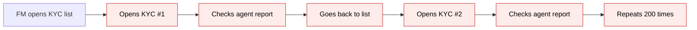
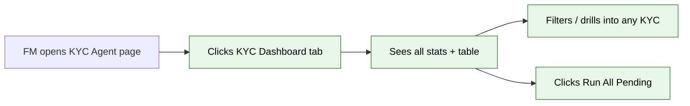
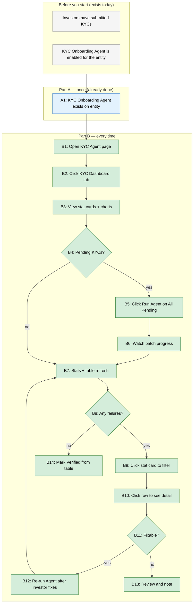

# KYC Agent Dashboard — Proposal

> **Audience:** Business team, product, QA, support — non-technical.
> **Companion document:** [Design](design.md)
> **New to this? Start with the [Workflow Journey](#workflow-journey)** — every action, in order, from start to the outcome.

> **Planning phase — no code changes.** This document proposes and explains the change. Do not
> edit application code while writing it; implementation happens later, in the tasks phase.

---

## Why

Today, a Fund Manager can only see KYC agent validation results one investor at a time — they must open each KYC page individually to check whether the agent found issues. With hundreds of investors across multiple funds, there is no way to answer "how many KYCs passed?", "which ones failed?", or "can I validate them all at once?" without clicking through every record. This creates a bottleneck: KYCs pile up unvalidated, compliance deadlines slip, and the FM has no visibility into the overall health of their investor onboarding.

The KYC Agent Dashboard gives Fund Managers a single page with aggregate stats, a filterable table of all KYC validation results, item-wise drill-down, bulk validation, and Individual vs Non-Individual breakdown charts — turning a tedious one-by-one process into a manageable workflow.

---

## What Changes

- **New "KYC Dashboard" tab** on the KYC Onboarding Agent's page, alongside the existing General, Schedule, and Execution History tabs
- **Six clickable stat cards** showing aggregate KYC validation counts (Validated, Pending, Successful, Failed, Partially Failed, Expired) — clicking one filters the table below. Counts are mutually exclusive: Expired takes priority (an expired KYC is not also counted as Successful or Failed)
- **Filterable KYC table** with search, Customer Type, Status, and date range filters, showing KYC ID, Customer Name, Customer Type, Submitted On, Status, Agent Run On, Result Summary, and Actions
- **Run Output detail panel** — a slide-out panel from the table showing the item-wise match/success/failure breakdown for a KYC's agent run
- **"Run Agent on All Pending" button** — batch-triggers the KYC agent on all completed KYCs that haven't been validated yet
- **Two half-donut charts** showing Individual vs Non-Individual success/failure distribution
- **Inline row actions** — Mark Verified and Re-run Agent directly from the table
- **Top Failure Reasons panel** — aggregated most-common blockers across all reports, with expandable drill-down showing affected investor names (as links to their KYC pages)
- **Fund filter** — scope the entire dashboard to a specific fund

### Flow Diagram

**Before: Checking KYC validation results one by one**



**After: Centralized KYC Agent Dashboard**



---

## Workflow Journey

### Who is involved

| Person | Role | What they do in the journey |
|---|---|---|
| Meera | Fund Manager (has KYC Onboarding Agent enabled) | Views dashboard, runs agent, verifies KYCs |

### The journey on one page



### Before you start

| Needed | Why | Where it comes from |
|---|---|---|
| KYC Onboarding Agent enabled for the entity | Dashboard tab only appears when agent exists | Agent setup page → enable KYC Onboarding Agent |
| At least one completed KYC | Dashboard shows submitted KYCs | Investors submit their KYC forms |
| Entity has LLM API key configured | Agent needs AI for document validation | Settings → LLM Keys |

### Part A — once (already done)

The KYC Onboarding Agent must already exist for the entity. This is existing functionality — no new setup required. The dashboard tab simply appears on the agent's page.

| Step | Who | Where | Action | What the system does | What you see |
|---|---|---|---|---|---|
| A1 | Meera | Support Agents → KYC Onboarding Agent | Agent already exists | — | Agent page with General, Schedule, Execution History tabs |

### Part B — every time (daily workflow)

| Step | Who | Where | Action | What the system does | What you see |
|---|---|---|---|---|---|
| B1 | Meera | Support Agents list | Clicks on KYC Onboarding Agent | Opens agent page | Agent page with tabs |
| B2 | Meera | Agent page | Clicks "KYC Dashboard" tab | Loads dashboard with stats, charts, table | Dashboard view |
| B3 | Meera | KYC Dashboard tab | Views stat cards | System queries all KYCs + reports for entity | 6 stat cards with counts + percentages, 2 half-donut charts |
| B4 | Meera | KYC Dashboard tab | Checks "Pending to be Validated" card | — | Card shows count, e.g. "152" |
| B5 | Meera | KYC Dashboard tab | Clicks "Run Agent on All Pending" | System queues batch job for all completed KYCs without a latest report | Batch progress panel appears: "Processing 152 KYCs..." |
| B6 | Meera | KYC Dashboard tab | Watches progress | Agent runs on each KYC: field check → document check → AI validation → expiry check | Progress bar updates: "47/152 done...", then "152/152 complete" |
| B7 | Meera | KYC Dashboard tab | Views updated results | Stats recalculate, table refreshes | Cards update: Pending drops, Successful/Failed/Partially Failed increase |
| B8 | Meera | KYC Dashboard tab | Checks "Failed" stat card | — | Card shows count, e.g. "23" |
| B9 | Meera | KYC Dashboard tab | Clicks "Failed" stat card | Table filters to show only failed KYCs | Table shows 23 rows, all with red "Failed" status |
| B10 | Meera | KYC Dashboard tab | Clicks eye icon on a row | Slide-out panel opens with item-wise results | Panel shows: Entity Name ✅ Matched, PAN ❌ Failed, Address ⚠️ Partial... |
| B11 | Meera | Run output panel | Reviews the issues | — | Sees "PAN mismatch" — investor typed wrong PAN |
| B12 | Meera | Table row | Clicks "Re-run Agent" action | Agent re-runs on that KYC | Row refreshes with updated result |
| B14 | Meera | Table row (for successful KYCs) | Clicks "Mark Verified" action | KYC verified flag set to true | Status changes to "Verified", row updates |

### What you see

**Dashboard layout:**

```
┌──────────────────────────────────────────────────────────────────────────┐
│  KYC Onboarding Agent: "Kyc Agent 1"                                    │
│  ┌─────────┬──────────┬──────────────┬──────────────┬────────────────┐  │
│  │ General │ Schedule │ Exec History │ KYC Dashboard│                │  │
│  └─────────┴──────────┴──────────────┴──────────────┴────────────────┘  │
│                                                                          │
│  ┌────────────────────────────────────────────────────┐  ┌────────────┐ │
│  │                                                    │  │▶ Run Agent │ │
│  │  [✓ 1,248]  [⏳ 152]  [✅ 842]  [❌ 212]  [⚠ 136]  [📋 58]     │ │
│  │  Validated   Pending  Success   Failed   Partial  Expired         │ │
│  │  100%        10.8%    67.5%     17.0%    10.9%    4.6%            │ │
│  │                                                                    │ │
│  │  Click on any stat card to filter the table below                  │ │
│  └────────────────────────────────────────────────────────────────────┘ │
│                                                                          │
│  ┌────────────────────────────┐  ┌────────────────────────────────────┐ │
│  │ Success/Failure by Type    │  │ Top Failure Reasons                │ │
│  │                            │  │                                    │ │
│  │   Individual    Non-Indiv  │  │ 1. PAN Mismatch         (34)      │ │
│  │   ╭──────╮      ╭──────╮  │  │ 2. Missing Address Proof (28)     │ │
│  │   │72.6% │      │63.1% │  │  │ 3. Expired KYC          (15)     │ │
│  │   │      │      │      │  │  │ 4. Invalid PAN Card     (12)     │ │
│  │   ╰──────╯      ╰──────╯  │  │ 5. Missing Bank Cheque  (9)      │ │
│  │  (half-donut charts)       │  │                                    │ │
│  └────────────────────────────┘  └────────────────────────────────────┘ │
│                                                                          │
│  Fund: [All Funds ▼]  Customer Type: [All ▼]  Status: [All ▼]          │
│  Search: [________________]  Submitted On: [__/__] to [__/__]           │
│                                                                          │
│  ┌──────────────────────────────────────────────────────────────────────┐│
│  │ KYC ID       │Customer   │Type       │Submitted │Status  │Docs   │Run On   ││
│  │──────────────│───────────│───────────│──────────│────────│───────│─────────││
│  │ KYC-2024-248 │Ramesh K.  │Individual │20 May    │✅ Pass │5/5    │20 May   ││
│  │ KYC-2024-247 │ABC Pvt Ltd│Non-Indiv  │20 May    │⚠ Part │4/7    │20 May   ││
│  │ KYC-2024-246 │Suresh P.  │Individual │20 May    │❌ Fail │2/5    │20 May   ││
│  │ KYC-2024-245 │XYZ LLP    │Non-Indiv  │20 May    │⏳ Pend│3/7    │—        ││
│  │ KYC-2024-244 │Neha S.    │Individual │19 May    │📋 Exp │5/5    │20 May   ││
│  └──────────────────────────────────────────────────────────────────────┘│
│  Showing 1-10 of 152 results                     [< 1 2 3 ... 16 >]    │
└──────────────────────────────────────────────────────────────────────────┘
```

**Run output detail panel (slide-out):**

Issues are grouped by agent pipeline step (Field Completeness, Document
Presence, Document Validity, Field-to-Document Consistency, Expiry Status).
Each group is a collapsible section showing only items from that step.
The agent tags each issue with `step:` so the dashboard helper can group them.

```
┌──────────────────────────────────────────────────────┐
│  KYC Run Output                                   ✕  │
│  KYC ID: 1247    KYC Name: ABC Pvt Ltd               │
│  Run On: 20 May 2024 09:50 AM                        │
│                                                       │
│  [All (12)] [Passed (8)] [Failed (3)] [Warning (1)]  │
│                                                       │
│  ▼ Field Completeness                                 │
│  Item                │ Expected / Provided  │ Status  │
│  ────────────────────│──────────────────────│─────────│
│  Entity Name         │ ABC Pvt Ltd          │ ● Pass  │
│  PAN                 │ AABCA1234E           │ ● Pass  │
│  GSTIN               │ 07AABCA...           │ ● Pass  │
│  Residency           │ (empty)              │ ● Fail  │
│                                                       │
│  ▼ Document Presence                                  │
│  All required documents are present        │ ● Pass   │
│                                                       │
│  ▼ Document Validity                                  │
│  Upload Tax ID       │ Valid                │ ● Pass   │
│                                                       │
│  ▼ Field-to-Document Consistency                      │
│  CML                 │ 123456 ≠ 98765       │ ● Fail  │
│                                                       │
│  ▼ Expiry Status                                      │
│  No expiry date set  │ —                    │ ● Pass   │
│                                                       │
│                                         [Close]       │
└──────────────────────────────────────────────────────┘
```

**Example arithmetic for stat cards (entity with 1,248 completed KYCs):**

- KYCs Validated: 1,248 (100% — all completed KYCs in the entity)
- Pending to be Validated: 152 (completed KYCs with no latest agent report = 1,248 − 1,096 validated)
- Successful: 842 (reports with final_status = "ready" = 842/1,248 = 67.5%)
- Failed: 212 (reports with final_status = "blocked" and 0 matched items = 212/1,248 = 17.0%)
- Partially Failed: 136 (reports with final_status = "blocked" but some items matched = 136/1,248 = 10.9%)
- Expired: 58 (KYCs where expiry_date < today, regardless of agent status = 58/1,248 = 4.6%)
- Check: 152 + 842 + 212 + 136 + 58 = 1,400 ≠ 1,248 — this is because Expired overlaps with other statuses (an expired KYC can also be successful or failed). The stat cards are not mutually exclusive; Expired is an independent dimension.

### What goes wrong

**Scenario: FM clicks "Run Agent on All Pending" but no LLM API key is configured**

1. Meera clicks "Run Agent on All Pending"
2. Batch job starts, but each KYC's agent run fails at the document validity step (which needs an LLM)
3. The batch progress panel shows: "152/152 complete — 152 failed"
4. Stats update: Failed card increases by 152
5. Meera clicks a failed row, sees: "LLM API key not configured — set up API keys in Settings → LLM Keys"
6. **Fix:** Meera goes to Settings → LLM Keys, adds the key, returns to dashboard, clicks "Run Agent on All Pending" again

### Summary: the minimum actions

| # | Action | Who | How often |
|---|---|---|---|
| 1 | Open KYC Onboarding Agent page | Meera | Every time |
| 2 | Click KYC Dashboard tab | Meera | Every time |
| 3 | Click "Run Agent on All Pending" | Meera | When pending KYCs exist |
| 4 | Click stat card to filter failures | Meera | As needed |
| 5 | Click row to view run output | Meera | As needed |
| 6 | Mark Verified from table | Meera | Per KYC |

---

## User Stories

### US-1: View aggregate KYC validation stats

**As a** Fund Manager,
**I want** to see stat cards showing how many KYCs are validated, pending, successful, failed, partially failed, and expired,
**So that** I can quickly assess the overall health of investor onboarding.

**Acceptance criteria:**
- Six stat cards are displayed at the top of the KYC Dashboard tab
- Each card shows a count and percentage of total
- Cards are: KYCs Validated, Pending to be Validated, Successful, Failed, Partially Failed, Expired
- Clicking a stat card filters the table below to show only KYCs matching that status
- Clicking the same card again clears the filter (toggle behavior)

### US-2: Filter and search KYC validation table

**As a** Fund Manager,
**I want** to filter the KYC table by Customer Type, Status, date range, and free-text search,
**So that** I can find specific KYCs or groups of KYCs quickly.

**Acceptance criteria:**
- Table columns: KYC ID, Customer Name, Customer Type, Submitted On, Status, Agent Run On, Result Summary, Actions
- Customer Type dropdown: All, Individual, Non-Individual
- Status dropdown: All, Pending, Successful, Failed, Partially Failed, Expired
- Submitted On date range picker
- Free-text search searches KYC ID, Customer Name, and PAN
- Pagination at 10 rows per page
- "Clear Filters" button resets all filters

### US-3: View run output detail for a KYC

**As a** Fund Manager,
**I want** to see the item-wise validation results for any KYC directly from the dashboard,
**So that** I can understand exactly what passed or failed without opening the KYC page.

**Acceptance criteria:**
- Eye icon on each table row opens a slide-out panel
- Panel header shows KYC ID, Customer Name, and Run Date
- Panel shows a table: Item, Expected/Provided, Matched, Status (Matched ✅ / Partial ⚠️ / Failed ❌)
- Tabs at top: All Items, Matched, Failed, Partial — each filters the item list
- Panel has a Close button
- For KYCs with no agent run yet (Pending status), the eye icon is disabled or hidden

### US-4: Bulk-run agent on all pending KYCs

**As a** Fund Manager,
**I want** to run the KYC Onboarding Agent on all pending KYCs at once,
**So that** I don't have to validate them one by one.

**Acceptance criteria:**
- "Run Agent on All Pending" button is visible at the top right of the dashboard
- Button shows the pending count: "Run Agent on All Pending (152)"
- Clicking it shows a confirmation modal: "Run KYC Onboarding Agent on 152 pending KYCs?"
- After confirmation, a batch progress panel appears showing real-time progress
- When complete, stat cards and table refresh automatically
- Button is disabled (grayed out) when there are no pending KYCs
- Button is disabled while a batch is already running

### US-5: View Individual vs Non-Individual charts

**As a** Fund Manager,
**I want** to see the success/failure breakdown for Individual and Non-Individual KYCs as half-donut charts,
**So that** I can identify if one investor type has more compliance issues than the other.

**Acceptance criteria:**
- Two half-donut (semicircle) charts side by side
- Left chart: Individual KYCs — segments: Successful, Partially Failed, Failed, Expired
- Right chart: Non-Individual KYCs — same segments
- Each segment shows percentage
- Legend below each chart
- Charts update when fund filter changes

### US-6: Inline actions from the table

**As a** Fund Manager,
**I want** to Mark Verified and Re-run Agent on a KYC directly from the dashboard table,
**So that** I can take action without navigating away.

**Acceptance criteria:**
- Action icons per row: View Detail (eye), Re-run Agent (play), Mark Verified (check)
- "Mark Verified" sets verified = true on the KYC and refreshes the row status
- "Mark Verified" is only shown for KYCs with Successful status (agent says "Ready")
- "Re-run Agent" triggers the agent on that single KYC and updates the row when done

### US-7: Top Failure Reasons panel

**As a** Fund Manager,
**I want** to see the most common reasons KYCs fail validation,
**So that** I can address systemic issues (e.g., improve form instructions, fix document upload flow).

**Acceptance criteria:**
- Panel below charts showing top 5 failure reasons
- Each reason shows: issue description and count of affected KYCs
- Issues are aggregated from all latest SupportAgentReports (field_issues + document_issues with severity "blocking")
- Sorted by count descending

### US-8: Fund filter

**As a** Fund Manager,
**I want** to filter the entire dashboard by fund,
**So that** I can assess KYC health per fund when managing multiple funds.

**Acceptance criteria:**
- Fund dropdown above the table filters: "All Funds" (default) plus each fund in the entity
- Selecting a fund filters stat cards, charts, table, and top failure reasons to only KYCs linked to that fund (via capital commitments)
- "All Funds" shows the entity-wide view

### ~~US-9: Export to CSV~~ *(Removed — not in product design)*

### US-10: Document tracking column

**As a** Fund Manager,
**I want** to see how many required documents have been uploaded for each KYC directly in the table,
**So that** I can identify KYCs with missing documents at a glance without opening the detail panel.

**Acceptance criteria:**
- A "Docs" column in the table shows "X / Y" — uploaded count vs required count
- Required count comes from the entity's FormCustomField configuration (File-type required fields) plus the agent's `required_docs` config
- Uploaded count comes from the KYC's `documents` association
- When all docs are uploaded: green text "5/5"
- When some docs are missing: orange text "3/5"
- When no docs are uploaded: red text "0/5"
- The detail panel's item table includes document rows showing uploaded vs missing status

---

## UI Behavior

### KYC Dashboard Tab

- The tab appears on the KYC Onboarding Agent show page, after Execution History
- Tab label: "KYC Dashboard"
- Default tab remains "General" — dashboard is not the default view

**Stat card behavior:**
- Cards act as toggle filters — click to filter, click again to clear
- Only one card can be active at a time (selecting a new one deselects the previous)
- Active card gets a highlighted border/background
- Cards show animated count-up on page load (existing NumberStatsComponent behavior)

**Table behavior:**
- Server-side pagination via Pagy (10 per page)
- Sorting by clicking column headers (Submitted On, Agent Run On)
- Stat card filter combines with dropdown/search filters (AND logic)
- Table reloads via Turbo Frame on filter change — no full page reload

**Slide-out panel behavior:**
- Opens from the right side of the page
- Clicking outside or pressing Escape closes it
- Only one panel open at a time
- Panel content loads via Turbo Frame (lazy-loaded)

**Batch progress behavior:**
- Progress panel appears below the "Run Agent on All Pending" button
- Shows: "Processing X of Y KYCs... Z successful, W failed"
- Updates in real-time via Turbo Stream
- When complete: "Batch complete: X successful, Y failed, Z skipped"
- Dashboard stats and table auto-refresh on completion

---

## What This Feature Does NOT Cover

| Excluded | Covered In |
|---|---|
| KYC form creation or editing | Existing KYC management pages |
| Investor-facing KYC views | Existing investor portal |
| Agent configuration (toggles, thresholds) | Existing General tab on agent page |
| Scheduling agent runs | Existing Schedule tab on agent page |
| AML report details | Existing AML reports page |
| KYC Doc Extractor Agent results | Separate agent — not part of this dashboard |
| KYC journey step tracking | Existing KYC journey feature |
| Send Reminder to investors | Parked — KYC can be filled by investor, fund, or distributor; unclear recipient. May revisit later. |

---

## Validation Rules

| Field | Rule | Default |
|---|---|---|
| Fund filter | Must be a fund belonging to the agent's entity | All Funds |
| Customer Type filter | Must be "All", "Individual", or "Non-Individual" | All |
| Status filter | Must be "All", "Pending", "Successful", "Failed", "Partially Failed", or "Expired" | All |
| Date range | Start date must be before or equal to end date | No date filter |
| Pagination | Page size fixed at 10 | Page 1 |

---

## Behavior Rules

| Scenario | What User Sees |
|---|---|
| No completed KYCs exist for the entity | Empty state: "No KYC submissions yet. KYCs will appear here once investors submit their forms." |
| Completed KYCs exist but agent has never been run | All stat cards show 0 except "Pending to be Validated" which shows total count. Table shows all as "Pending". |
| Agent is currently running a batch | "Run Agent on All Pending" button is disabled with spinner. Progress panel is visible. |
| KYC has expired AND failed validation | Appears in both "Expired" and "Failed" filters. Status column shows "Failed" (agent result takes priority for display). Expired badge shown separately. |
| FM clicks "Mark Verified" on a KYC | KYC is verified, row refreshes. If KYC had a journey, the journey's "Verify KYC" step is also completed. |
| Table is filtered by stat card and then by dropdown | Both filters apply (AND logic). Stat card filter stays active. |
| Fund filter changes | All components refresh: stat cards, charts, table, top failure reasons |

---

## Resolved Design Decisions

| # | Decision | Resolution |
|---|---|---|
| 1 | Where does the dashboard live? | New tab on KYC Onboarding Agent show page — follows existing agent tab pattern (portfolio reports, deal reports, etc.) |
| 2 | Chart type | Half-donut (semicircle) charts, not bar charts — per product specification |
| 3 | Validation trend chart | Skipped — per product specification. Space used for "Run Agent on All Pending" action area + top failure reasons |
| 4 | Stat card mutual exclusivity | Cards are NOT mutually exclusive. "Expired" overlaps with other statuses. This matches the real-world data model. |
| 5 | Table pagination | Server-side via Pagy at 10 rows — consistent with other agent report tabs |
| 6 | "Partially Failed" definition | KYC with agent report final_status = "blocked" but at least one field/document item marked as matched/success |
| 7 | "Pending" definition | Completed KYC (`submission_status: completed`) with no latest SupportAgentReport for this agent |
| 8 | Fund linkage | KYCs link to funds through capital_commitments. A KYC with multiple commitments across funds appears in each fund's filtered view. |
| 9 | Send Reminder excluded | Parked per Product — KYC can be filled by investor, fund, or distributor, so "whom to alert" is ambiguous. Not part of this dashboard. |
| 10 | Document tracking column | Table shows "Docs: X/Y" (uploaded vs required). Required docs from FormCustomField (File type) + agent's required_docs config. Uploaded docs from the KYC's documents association. |

---

## Capabilities

### New Capabilities

- `kyc/agent-dashboard`: KYC Agent Dashboard — aggregate stats, filterable table, document tracking, run output detail, bulk run, charts, inline actions, failure analysis, and fund filter for KYC Onboarding Agent results

### Modified Capabilities

*(none — this is a new dashboard view; the existing KYC journey and agent behavior are unchanged)*

---

## Impact

- **KYC Onboarding Agent page** — gains a new "KYC Dashboard" tab
- **Agent reports query service** — needs a new method to load KYC reports
- **Support agents controller** — needs to load dashboard data when agent type is KycOnboardingAgent
- **KYC list page** — unchanged; the dashboard is a separate view on the agent page
- **Individual KYC pages** — unchanged; per-KYC stat cards and reports remain as-is
- **No database migration** — all data already exists in investor_kycs and support_agent_reports tables
- **No new API** — uses existing Turbo Frames and controller actions
- **Dependencies** — Chartkick (already integrated), Pagy (already integrated), NumberStatsComponent (existing)

---

## Benefits

1. **Time savings** — FM validates hundreds of KYCs from one page instead of opening each one individually
2. **Visibility** — instant picture of how many KYCs are clean vs problematic across the entity
3. **Actionability** — inline actions (verify, re-run) let the FM work through issues without navigating away
4. **Pattern detection** — top failure reasons help the FM spot systemic issues and fix them at the source (better form instructions, clearer document requirements)
5. **Fund-level oversight** — fund filter lets the FM prioritize the fund with the most KYC issues

---

## FAQ

| Question | Answer |
|---|---|
| Who can see the dashboard? | Any user with access to the KYC Onboarding Agent's page (same permission as today's General/Schedule/Execution History tabs). |
| Does this change anything about how the agent runs? | No. The agent pipeline, report format, and per-KYC views are all unchanged. This is a read-and-action layer on top of existing data. |
| What happens to existing agent run results? | They appear in the dashboard immediately — no migration needed. All historical SupportAgentReports with owner_type "InvestorKyc" are shown. |
| Can I still run the agent on individual KYC pages? | Yes. The per-KYC "Run Agent" button on individual KYC pages remains unchanged. |
| Does "Mark Verified" from the dashboard do the same as verifying from the KYC page? | Yes — same action, same result. If the KYC has a journey, the journey step is also completed. |
| How long does "Run Agent on All Pending" take? | Depends on the number of KYCs and LLM response times. Each KYC takes roughly 30-60 seconds for full validation. 100 KYCs ≈ 15-20 minutes (they run in parallel via Sidekiq). |
| Is there a limit on batch size? | No hard limit. The existing batch infrastructure handles the queuing. |

---

## Design Principle for the Next Phase

- **Reuse the existing agent tab pattern** — the show page already handles 8+ agent types with conditional tabs. Add one more, don't restructure.
- **Reuse NumberStatsComponent** for stat cards — don't build new card components.
- **Reuse Chartkick** for charts — don't introduce a new charting library. Half-donut is `pie_chart` with `donut: true` and CSS to clip to semicircle.
- **Reuse the existing `_support_agent_report.html.erb` partial** for the run output panel — it already renders field_issues and document_issues.
- **Reuse `run_batch` endpoint** — don't create a new batch mechanism.
- **Risk: stat card query performance** — aggregating across all KYCs + reports for an entity with thousands of records could be slow. Design must address this with efficient queries (single query with GROUP BY, not N+1).
- **Risk: "Partially Failed" classification** — requires inspecting json_fields to count matched vs blocked items. This is a JSON column query. Design should consider whether to compute this at report-save time or at query time.
