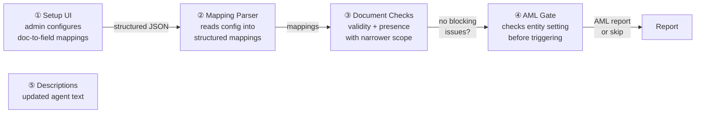
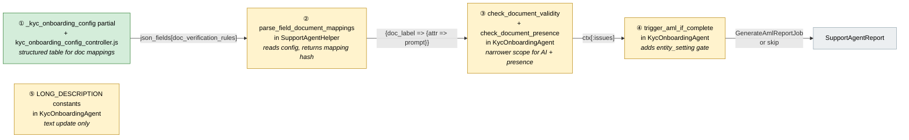
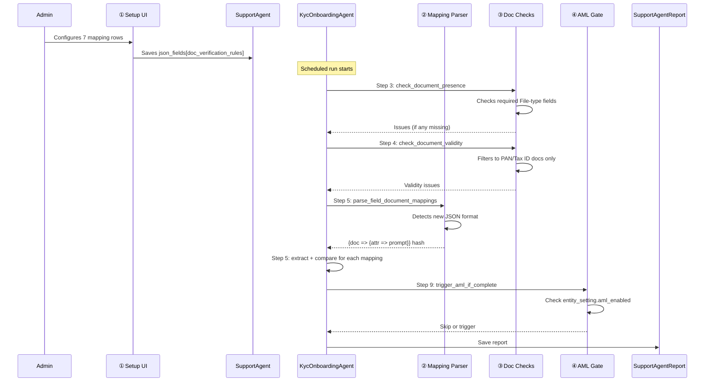
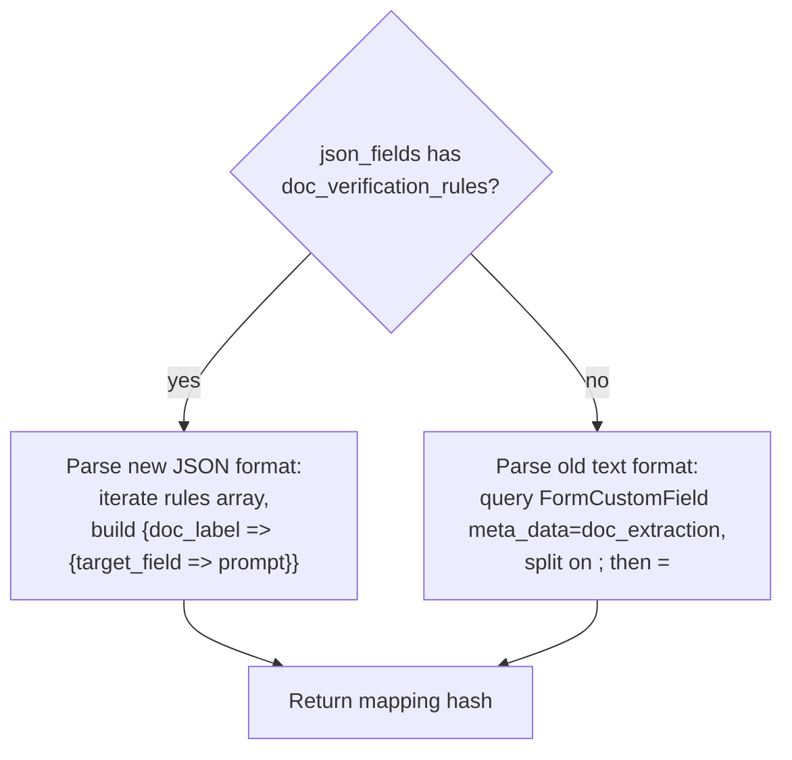
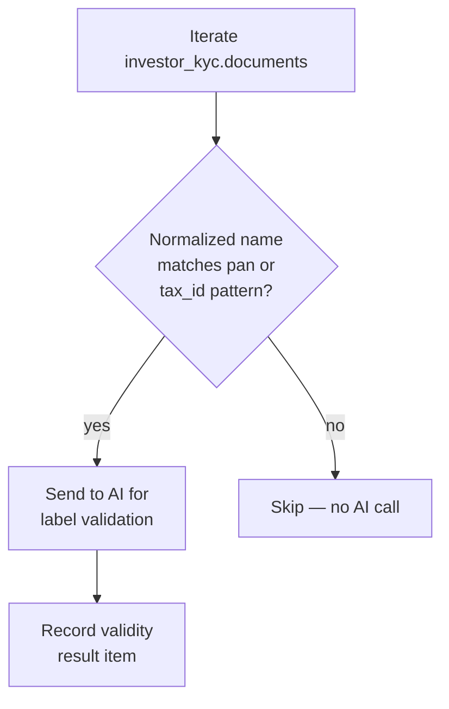
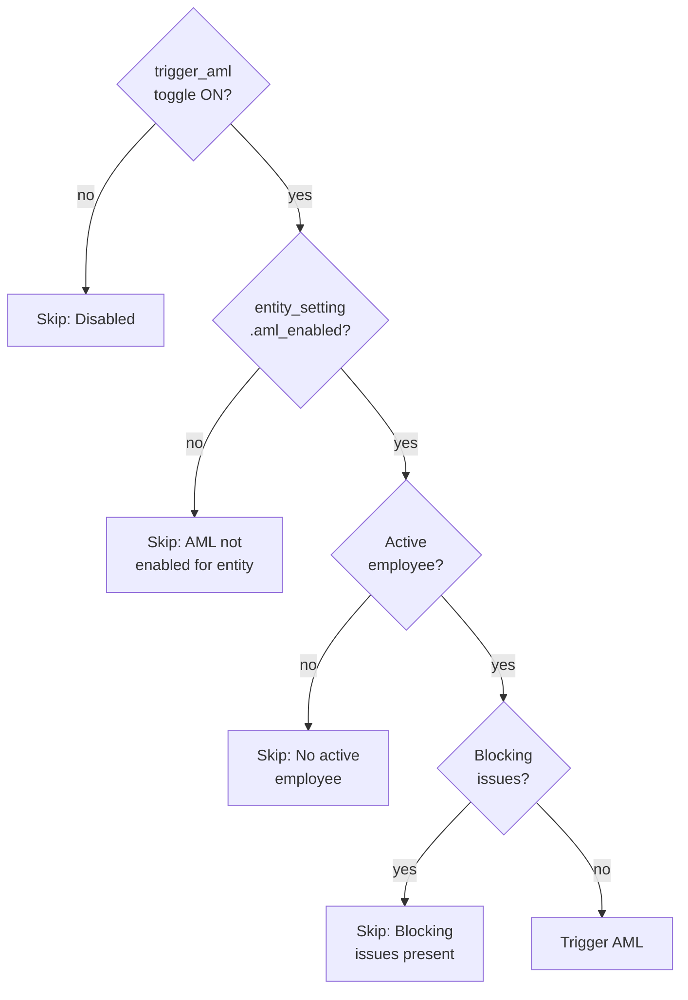
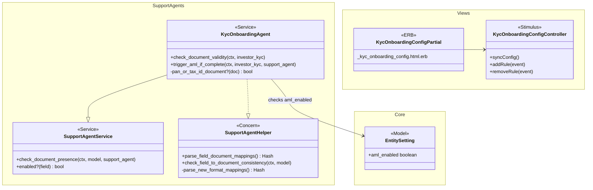

# KYC Onboarding Agent Improvements — Design

> **Audience:** Engineering team.
> **Companion documents:** [Proposal](proposal.md) · [Spec](specs/)

> **Planning phase — no code changes.** This document explains HOW the proposal will be built.
> Do not edit application code while writing it; implementation happens later, in the tasks phase.

> **Design, not code.** Explain the design with mermaid diagrams and tables. Do NOT paste Ruby/JS
> class bodies, migrations, route blocks or policy code. Put real class, method, table and path
> names inside the diagrams and tables instead.

> **Zoom one picture.** The whole design hangs off ONE numbered picture. Part 1 draws it in plain
> words. Part 2 redraws the SAME picture, same shape and same numbers, with real names. Part 3 has
> one card per box, in the same order. Part 4 is reference material that spans several boxes. The
> numbers ①②③ mean the same box everywhere, so a reader always knows where they are.

---

## Contents

- [1. The idea](#1-the-idea)
  - [What this adds](#what-this-adds)
  - [The idea in one picture](#the-idea-in-one-picture)
  - [Walkthrough: one example, start to finish](#walkthrough-one-example-start-to-finish)
  - [Key ideas](#key-ideas)
- [2. The same picture with real names](#2-the-same-picture-with-real-names)
  - [Picture](#picture)
  - [What each box does](#what-each-box-does)
  - [One run, end to end](#one-run-end-to-end)
  - [Design decisions](#design-decisions)
- [3. One card per box](#3-one-card-per-box)
  - [① Setup UI](#①-setup-ui)
  - [② Mapping Parser](#②-mapping-parser)
  - [③ Document Checks](#③-document-checks)
  - [④ AML Gate](#④-aml-gate)
  - [⑤ Descriptions](#⑤-descriptions)
- [4. Reference](#4-reference)
  - [Class diagram](#class-diagram)
  - [Component contracts](#component-contracts)
  - [Notifications](#notifications)
  - [Cross-cutting concerns](#cross-cutting-concerns)
  - [Worked examples](#worked-examples)
  - [Testing](#testing)
  - [Risks and open questions](#risks-and-open-questions)

---

## 1. The idea

### What this adds

Five targeted improvements to the KYC Onboarding Agent, following the same patterns already used by KycDocExtractorAgent (structured config UI) and WorkflowChecks (entity-level AML gating). The setup UI replaces a raw text field with a dropdown-based table. The validation steps get narrower scopes. The AML trigger adds a billing guard. Agent descriptions get updated text.

### The idea in one picture



### Walkthrough: one example, start to finish

**Setup:** Entity "Alpha Capital" (Indian server) has a KYC Onboarding Agent. AML is NOT enabled for this entity. An investor "Meera" has submitted a KYC with PAN, Bank Details, and Address Proof documents uploaded.

**Legend:** ✓ = done, ● = current step, — = skipped.

| # | When | What happens | Behind the scenes | Result |
|---|---|---|---|---|
| 1 | Admin opens agent settings | Clicks Edit on the KYC Onboarding Agent | Controller loads agent + form types | Settings page with toggles and empty Document Verification Setup table |
| 2 | Admin configures PAN mapping | Selects "Upload PAN" from Document dropdown, types "PAN / Tax ID number", selects "PAN" from Field to Verify | Setup UI (①) adds row to table | One row configured |
| 3 | Admin adds Bank Details rows | Clicks + Add Row 5 times, configures bank_name, branch_name, account_type, ifsc_code, account_number | Setup UI (①) appends rows | 6 rows total (1 PAN + 5 bank) |
| 4 | Admin adds Address Proof row | Adds row: "Upload Address Proof" → "address" → "permanent_address" | Setup UI (①) appends row | 7 rows total |
| 5 | Admin saves | Clicks Save | Stimulus controller serializes rows to JSON in hidden `json_fields` field. Controller saves to DB. | Flash: "Agent updated successfully" |
| 6 | Agent runs on Meera's KYC | Scheduled run or manual trigger | Agent picks completed KYCs. Runs field completeness (existing). | ✓&nbsp;Field&nbsp;Completeness |
| 7 | Document Presence | Checks uploads | Document Checks (③) checks all File-type fields with `required: true` (or in `required_docs` list). All 3 docs present. | ✓&nbsp;Document&nbsp;Presence |
| 8 | Document Validity — PAN only | Validates PAN document | Document Checks (③) filters to PAN/Tax ID docs only. Sends "Upload PAN" to AI. AI confirms: "matches label". Address Proof and Bank Details NOT sent to AI. | ✓&nbsp;Document&nbsp;Validity<br/>"Valid Upload PAN" |
| 9 | Field-to-Document Consistency | Cross-checks 7 mappings | Mapping Parser (②) reads the 7 rows from JSON. For each: AI extracts value from document, compares with KYC form field. PAN matches. Bank details match. Address matches. | ✓&nbsp;Field-Doc&nbsp;Consistency<br/>7 of 7 items passed |
| 10 | Expiry check | Checks KYC expiry | Existing behavior, unchanged. No expiry date set. | ✓&nbsp;Expiry&nbsp;Status |
| 11 | AML gate blocks | Would trigger AML but can't | AML Gate (④) checks `trigger_aml` toggle = ON, then checks `entity.entity_setting.aml_enabled` = false. Skips. | —&nbsp;Trigger&nbsp;AML<br/>"AML not enabled for entity" |
| 12 | Report saved | Agent finishes | `final_status = "ready"` (no blocking issues). Report persisted. | Report visible on dashboard |

**What the admin sees after step 5:**

```
Document Verification Setup
┌──────────────────┬──────────────────────┬──────────────────┬───┐
│ Document       ▼ │ Information to pull   │ Field to verify ▼│   │
├──────────────────┼──────────────────────┼──────────────────┼───┤
│ Upload PAN       │ PAN / Tax ID number   │ PAN              │ ✕ │
│ Upload Bank Det. │ bank name             │ bank_name        │ ✕ │
│ Upload Bank Det. │ branch name           │ branch_name      │ ✕ │
│ Upload Bank Det. │ account type          │ account_type     │ ✕ │
│ Upload Bank Det. │ SWIFT / IFSC code     │ ifsc_code        │ ✕ │
│ Upload Bank Det. │ bank account number   │ account_number   │ ✕ │
│ Upload Addr Proof│ address               │ permanent_address│ ✕ │
└──────────────────┴──────────────────────┴──────────────────┴───┘
                                                   [ + Add Row ]
```

**What to notice:**
- The setup table uses dropdowns populated from the entity's actual FormCustomField records — no hardcoded document types.
- Document Validity sent 1 AI call (PAN only) instead of 3 (all documents) — 67% reduction.
- AML was skipped despite the toggle being ON, because the entity hasn't purchased AML.
- The mapping parser reads structured JSON, not `attribute=prompt;attribute=prompt` strings.
- Existing agents with old-format config still work — the parser detects the format.

### Key ideas

| # | Idea | In one line | Card |
|---|---|---|---|
| 1 | Structured config UI | Dropdowns and text inputs replace fragile text strings | [①](#①-setup-ui) |
| 2 | Dual-format parser | Reads both old text and new JSON formats for backward compat | [②](#②-mapping-parser) |
| 3 | PAN/Tax ID-only validity | Document Validity filters docs by name pattern before AI call | [③](#③-document-checks) |
| 4 | Entity-level AML gate | `entity_setting.aml_enabled` checked before `GenerateAmlReportJob` | [④](#④-aml-gate) |
| 5 | Description text update | Agent descriptions reference real document types | [⑤](#⑤-descriptions) |

**FAQ**

| Question | Answer |
|---|---|
| Is the 9-step pipeline order changing? | No. Same steps in the same order. We're only narrowing what steps 3, 4, and 9 process. |
| Does the setup UI replace FormCustomField records with meta_data=doc_extraction? | No — those old records stay in the DB. The parser checks for new-format JSON first, falls back to old format. Admins who re-save get the new format. |
| Why not migrate all existing configs to the new format? | Low value, high risk. Only a few agents exist with doc_extraction config. The dual-format parser is simpler than a data migration. |

---

## 2. The same picture with real names

### Picture



Colour = footprint: **green** new, **amber** modified, **grey** reused unchanged. Exact files are in [lld.md File Map](lld.md#file-map).

### What each box does

| # | Box | Real parts | What it does | When it runs | What it decides | Details |
|---|---|---|---|---|---|---|
| ① | Setup UI | `_kyc_onboarding_config.html.erb`, `kyc_onboarding_config_controller.js` | Renders 3-column table with dropdowns, serializes to `json_fields` | Admin edits agent settings | Which documents map to which fields | [card ① →](#①-setup-ui) |
| ② | Mapping Parser | `SupportAgentHelper#parse_field_document_mappings` | Detects config format (new JSON or old text), returns mapping hash | Agent run, step 5 | Whether to use new or old parsing path | [card ② →](#②-mapping-parser) |
| ③ | Document Checks | `KycOnboardingAgent#check_document_validity`, `SupportAgentService#check_document_presence` | Validity: filters to PAN/Tax ID before AI. Presence: checks required File-type fields. | Agent run, steps 3 and 4 | Which docs to send to AI; which docs are required | [card ③ →](#③-document-checks) |
| ④ | AML Gate | `KycOnboardingAgent#trigger_aml_if_complete` | Adds `entity_setting.aml_enabled` guard before AML trigger | Agent run, step 9 | Whether entity has AML enabled | [card ④ →](#④-aml-gate) |
| ⑤ | Descriptions | `KycOnboardingAgent::DESCRIPTION`, `LONG_DESCRIPTION`, `SINGLE_LONG_DESCRIPTION` | Updates text to reference Tax ID, Address Proof, Bank Details | Agent page render | — (text only) | [card ⑤ →](#⑤-descriptions) |

### One run, end to end



### Lifecycles

N/A — no new stored or derived status. The agent report's `final_status` ("ready"/"blocked") is unchanged.

### What users see

**At a glance**

| Where in CapHive | Today | After this change | Who sees it |
|---|---|---|---|
| Agent settings page › Edit | Raw text field for doc-to-field mapping config | Structured 3-column table with dropdowns and + / ✕ buttons | Admin / Fund Manager |
| Agent description text | References "passport, ID" | References "Tax ID, Address Proof, Bank Details" | Anyone viewing the agent |
| Agent report — Document Validity items | Items for every uploaded document | Items only for PAN/Tax ID documents | Admin viewing report |
| Agent report — Trigger AML step | "Disabled" or "AML triggered" or "Blocking issues" | Also: "AML not enabled for entity" | Admin viewing report |

### Design decisions

1. **Store config as `doc_verification_rules` key in json_fields** — Not as separate FormCustomField records with `meta_data: "doc_extraction"`. The new key holds a JSON array of `{doc_label, prompt, target_field}` objects. Old FormCustomField-based config stays untouched for backward compat. Alternative: migrate old records to new format. Rejected because: migration is risky for a few records, dual-format parser is simpler.

2. **Reuse KycDocExtractorAgent's Stimulus pattern** — The `kyc_doc_extractor_config_controller.js` pattern (hidden JSON field + sync on input + template-based row cloning) is proven. We adapt it with dropdowns instead of free text. Alternative: build a completely new controller. Rejected because: unnecessary duplication.

3. **PAN/Tax ID filter by normalized document name** — Use the same `normalize_doc_name` helper (strips "Upload"/"Attach your"/"Attach" prefixes) and match against `%w[pan tax_id tax\ id taxid]`. Alternative: filter by FormCustomField meta_data or ID. Rejected because: the document name is the only reliable attribute available at validation time — the doc record doesn't link back to its FormCustomField.

4. **Standard upload fields are hardcoded in ERB views, not FormCustomFields** — Fields like "Upload PAN / Tax ID" and "Upload Address Proof" are rendered by `file_fields()` helper in `_form.html.erb` which creates in-memory (unsaved) FormCustomField objects at render time. They do NOT exist in the `form_custom_fields` table. The PAN label is locale-dependent: `sys_t('investor_kyc.tax_id')` resolves to "PAN / Tax ID" (en) or "Tax ID" (en-US). For the Setup UI Document dropdown, we must include these standard labels alongside any persisted File-type FormCustomFields. We build the standard list as `["Upload #{pan_label}", "Upload Address Proof"]` and merge with `FormCustomField.where(field_type: "File")` results. For Document Presence, entity-level required doc lists are already stored in `EntitySetting#individual_kyc_doc_list` / `non_individual_kyc_doc_list` — the `InvestorKycConcern#required_document_names` method returns these normalized names.

5. **Entity setting eager-loaded via includes** — Add `:entity_setting` to the `includes` in `targets` to avoid N+1 when checking AML. Alternative: separate query. Rejected because: `has_one` with includes is cheaper and consistent with the existing `:entity` eager load.

**FAQ**

| Question | Answer |
|---|---|
| What if an admin has both old and new config? | The parser checks for `doc_verification_rules` key first (new format). If present, uses it exclusively. If absent, falls back to old `meta_data: "doc_extraction"` lookup. An admin who re-saves the form writes the new format, and the old FormCustomField records become inert. |
| Does Document Presence behavior actually change? | No — we are keeping the current `required: true` filter for FormCustomField-based docs. Standard upload fields (PAN, Address Proof) are hardcoded in ERB views via `file_fields()` and are always present on the form — their required doc names are stored in `EntitySetting#individual_kyc_doc_list` / `non_individual_kyc_doc_list`. |
| Why not add an `is_standard` flag to FormCustomField? | Standard upload fields are not FormCustomFields at all — they are hardcoded in the view layer via `file_fields()` helper. Adding a flag would require migrating them to persisted records, which is a broader platform change outside this scope. |

---

## 3. One card per box

### ① Setup UI

The setup UI has two distinct sections:

1. **Standard Documents** — fixed-mapping rows for platform-level upload fields (PAN/Tax ID, Address Proof). Document name and target DB column are fixed labels; only the extraction prompt is editable. These map to DB columns on `investor_kycs` (e.g., `PAN`, `address`).
2. **Per-form-type tables** — dropdown-based rows for custom File-type FormCustomFields. Document, prompt, and target field are all configurable via dropdowns.

| Owns | Reads / receives | Produces |
|---|---|---|
| `_kyc_onboarding_config.html.erb`, `kyc_onboarding_config_controller.js` | `STANDARD_DOC_MAPPINGS` constant (locale-aware), FormCustomField records (File-type for doc dropdown, non-File/non-Header for field dropdown) | `json_fields["doc_verification_rules"]` — JSON with `"standard"` key for fixed mappings and per-form-type-id keys for custom mappings |

**How it works:**

The partial renders two sections:

**Standard Documents section:** Defined by a constant `STANDARD_DOC_MAPPINGS` that pairs each standard upload label with its DB column:

| Document label | Target DB column | Notes |
|---|---|---|
| `"Upload #{pan_label}"` | `PAN` | `pan_label` = `sys_t('investor_kyc.tax_id')`, locale-aware |
| `"Upload Address Proof"` | `address` | Same across all KYC types |

Each row shows the document name and mapped field as fixed labels. Only the prompt textarea is editable. No dropdowns needed — the mapping is deterministic.

**Per-form-type section:** Queries `FormType.where(entity_id:, name: %w[IndividualKyc NonIndividualKyc])`. For each form type with File-type FormCustomFields:
- **Document dropdown:** File-type FormCustomFields (custom attachments like CML, cancelled cheque)
- **Field to verify dropdown:** non-File, non-Header FormCustomFields

The Stimulus controller (`kyc_onboarding_config_controller`) follows the same pattern as `kyc_doc_extractor_config_controller`:
- Hidden `json_fields` input as target
- `syncConfig()` reads standard rows + per-form-type rows, serializes to `doc_verification_rules`, writes to hidden field
- `addRule()` clones row from `<template>`, appends to tbody
- `removeRule()` removes row, syncs

**Wiring into `_form.html.erb`:** Add a conditional render for `KycOnboardingAgent` alongside existing `KycDocExtractorAgent`, `CashFlowAssistantAgent`, etc.

**JSON shape stored in json_fields:**

```
{
  "doc_verification_rules": {
    "standard": [
      {"doc_label": "Upload PAN / Tax ID", "prompt": "Extract the PAN number", "target_field": "PAN"},
      {"doc_label": "Upload Address Proof", "prompt": "Extract the full address", "target_field": "address"}
    ],
    "42": [
      {"doc_label": "CML", "prompt": "Extract demat account number", "target_field": "demat_account"}
    ]
  },
  "validate_fields": "true",
  "validate_documents": "true",
  ...existing keys preserved...
}
```

**Worked examples:** H1, H2, E1, E2, E3

**FAQ**

| Question | Answer |
|---|---|
| Why separate standard vs custom sections? | Standard upload fields (PAN, Address Proof) are hardcoded in ERB views and map to DB columns. Custom fields are FormCustomFields that vary per entity/form type. Separating them avoids confusion and prevents wrong mappings. |
| Why are standard document mappings fixed (no dropdowns)? | PAN always maps to `PAN` column, Address Proof always maps to `address` column. Making these configurable adds complexity with no benefit — the old text config hardcoded the same mappings. |
| Can custom File fields still be added per form type? | Yes — the per-form-type cards below the standard section have full dropdowns for custom File-type FormCustomFields. |
| What if the entity has no custom File-type FormCustomFields? | Only the Standard Documents section appears. The per-form-type cards are hidden. |
| What if a new standard document is added in future? | Add it to `STANDARD_DOC_MAPPINGS` constant — one-line code change. |

---

### ② Mapping Parser

The modified `parse_field_document_mappings` in `SupportAgentHelper` that reads both old and new config formats.

| Owns | Reads / receives | Produces |
|---|---|---|
| Format detection + dual parsing logic | `json_fields["doc_verification_rules"]` (new) or FormCustomField `meta_data: "doc_extraction"` + `json_fields[field.name]` (old) | `{ "Document Label" => { "attribute" => "prompt" } }` hash — same shape regardless of format |

**Format detection:**



The output hash shape is identical for both formats, so `check_field_to_document_consistency` needs no changes — it consumes the same `{ "Upload PAN" => { "PAN" => "Extract..." } }` hash.

**Worked examples:** H3, E4, E5

**FAQ**

| Question | Answer |
|---|---|
| Does the old format ever get deleted? | No. Old FormCustomField records with `meta_data: "doc_extraction"` stay in the DB. They just stop being read once the agent has `doc_verification_rules`. |
| What if both formats exist simultaneously? | New format wins — the parser returns early if `doc_verification_rules` is present. |

---

### ③ Document Checks

Modified Document Validity (Step 4) and Document Presence (Step 3) with narrower scopes.

| Owns | Reads / receives | Produces |
|---|---|---|
| PAN/Tax ID filter logic in `check_document_validity` | `investor_kyc.documents`, document name normalization | Validity issues only for PAN/Tax ID docs |

**Document Validity — PAN/Tax ID filter:**



Name matching uses a helper method that normalizes the document name (strips "Upload"/"Attach your"/"Attach" prefixes, downcases, strips whitespace) and checks against a list of PAN/Tax ID patterns: `%w[pan tax_id taxid tax\ id]`.

**Document Presence — no change:**

Per design decision #4, the current `required_fields_for(field_type: "File")` filter is kept as-is. Standard document fields are already marked `required: true` by admins, so they're already checked. No code change needed here.

**Worked examples:** H4, H5, E6, E7, X1

**FAQ**

| Question | Answer |
|---|---|
| What if a document is named "PAN Card" instead of "Upload PAN"? | The normalizer strips "Upload"/"Attach" prefixes and the match checks for "pan" anywhere in the normalized name. "PAN Card" → "pan card" → contains "pan" → matched. |
| Is Document Presence changing at all? | No. After investigating the DB schema, there's no reliable way to distinguish standard from custom fields. The current `required: true` filter already covers the product need. |

---

### ④ AML Gate

One additional guard clause in `trigger_aml_if_complete` checking entity-level AML setting.

| Owns | Reads / receives | Produces |
|---|---|---|
| Entity AML check guard clause | `investor_kyc.entity.entity_setting.aml_enabled` | Step skip with "AML not enabled for entity" or existing behavior |

**Decision flow:**



The new guard is inserted right after the existing `enabled?("trigger_aml")` check and before the employee check. Entity is already eager-loaded via `targets` includes. `entity_setting` is added to the `includes` to avoid N+1.

**Worked examples:** H6, E8, E9

**FAQ**

| Question | Answer |
|---|---|
| What if entity_setting is nil? | `entity&.entity_setting&.aml_enabled` — safe navigation returns nil, which is falsy, so AML is skipped. This is correct: no entity setting means AML is not configured. |
| Does this affect the dashboard's AML step display? | The dashboard reads the report's `aml_report` array. The new skip message ("AML not enabled for entity") will appear there, and the step will show as skipped. No dashboard code change needed. |

---

### ⑤ Descriptions

Text-only change to agent description constants.

| Owns | Reads / receives | Produces |
|---|---|---|
| `DESCRIPTION`, `LONG_DESCRIPTION`, `SINGLE_LONG_DESCRIPTION` in `KycOnboardingAgent` | — | Updated text referencing Tax ID, Address Proof, Bank Details |

Replace "passport, ID, etc." with "Tax ID, Address Proof, Bank Details" in all three constants. Also update the `LONG_DESCRIPTION` Step 2 line from "verifies required document types (passport, ID, etc.) have been uploaded" to "verifies required document types (Tax ID, Address Proof, etc.) have been uploaded".

**Worked examples:** H7

**FAQ**

| Question | Answer |
|---|---|
| Does this affect any logic? | No — these are display-only constants used in the agent list and run descriptions. |

---

## 4. Reference

### Class diagram



### Data model and schema changes

N/A — no table or column changes. All config is stored in the existing `json_fields` JSON column on `support_agents`.

### Component contracts

| From → To | Contract | Direction rule |
|---|---|---|
| ① Setup UI → SupportAgent | `json_fields["doc_verification_rules"]` JSON array of `{doc_label, prompt, target_field}` per form_type_id | UI writes on save |
| ② Mapping Parser → ③ Document Checks | `{ "Document Label" => { "attribute" => "prompt" } }` hash | Parser called by step 5, returns hash |
| ③ Document Checks → SupportAgentReport | `ctx[:issues][:document_issues]` array with severity items | Steps 3-4 append items |
| ④ AML Gate → GenerateAmlReportJob | `perform_later(investor_kyc.id, employee.id)` or skip | Gate decides; job is existing |
| ④ AML Gate → EntitySetting | `entity.entity_setting&.aml_enabled` boolean read | Read-only check |

### Notifications

This change does not add, change, or suppress any notifications. The existing expiry reminder emails (Step 8: `KycExpiryMailer#expiry_alert`) and AML report generation are unchanged. The only AML change is gating — when AML is skipped due to entity settings, no AML report is generated and no notification is sent. This is the intended behavior: entities without AML should not receive AML-related communications.

### Cross-cutting concerns

#### Transactions and queries

N/A — no new multi-table writes. The `entity_setting` read is a single `has_one` query, eager-loaded via `includes(:entity_setting)` added to `targets`.

#### Performance and security

- **AI call reduction:** Document Validity sends 1 AI call per KYC (PAN/Tax ID only) instead of N calls (one per document). For a KYC with 3 documents, this is a 67% reduction.
- **Tenant isolation:** The setup UI queries FormCustomField scoped to the current user's entity via `FormType.where(entity_id: current_user.entity_id)`. Agent runs are scoped by `entity_id` via `targets`. No cross-tenant risk.

### Worked examples

**ID legend:** **H** = Happy path · **E** = Edge case · **X** = Error (exception) case.

**Shared setup:**

| Record | Name | Key data |
|---|---|---|
| Entity | Alpha Capital | Indian server, AML NOT enabled in entity_setting |
| Entity | Beta Ventures | US server, AML enabled in entity_setting |
| KycOnboardingAgent | Alpha KYC Agent | entity: Alpha Capital, validate_documents: true, trigger_aml: true |
| KycOnboardingAgent | Beta KYC Agent | entity: Beta Ventures, validate_documents: true, trigger_aml: true |
| InvestorKyc | Meera's KYC | entity: Alpha, completed, documents: Upload PAN, Upload Bank Details, Upload Address Proof, expiry: nil |
| InvestorKyc | John's KYC | entity: Beta, completed, documents: Upload Tax ID, Upload Bank Statement, expiry: 2026-12-01 |
| FormCustomField | Upload PAN | entity: Alpha, field_type: File, label: "Upload PAN", required: true |
| FormCustomField | Upload Tax ID | entity: Beta, field_type: File, label: "Upload Tax ID", required: true |
| FormCustomField | Upload Bank Details | entity: Alpha, field_type: File, label: "Upload Bank Details", required: true |
| FormCustomField | PAN | entity: Alpha, field_type: TextField, label: "PAN" |
| FormCustomField | bank_name | entity: Alpha, field_type: TextField, label: "bank_name" |

#### Happy Path

| # | Scenario | Given | When | Then | Spec scenario | Feature |
|---|---|---|---|---|---|---|
| H1 | Setup table renders with dropdowns | Alpha KYC Agent exists, entity has File-type and non-File FormCustomFields | Admin opens agent edit page | "Document Verification Setup" section shows with Document dropdown listing Upload PAN, Upload Bank Details, Upload Address Proof; Field to Verify dropdown listing PAN, bank_name, etc. | Setup table visible on agent edit page | `features/ai/support_agents/kyc_agent_setup.feature` |
| H2 | Admin configures and saves mappings | Alpha KYC Agent, setup table visible | Admin selects Upload PAN / "PAN number" / PAN, clicks Save | Config saved as structured JSON; on reload, row shows saved values | Save and reload preserves configuration | `features/ai/support_agents/kyc_agent_setup.feature` |
| H3 | New format mappings used in consistency check | Alpha KYC Agent with doc_verification_rules saved | Agent runs step 5 on Meera's KYC | parse_field_document_mappings reads new JSON format, returns {Upload PAN => {PAN => "PAN number"}}. Consistency check runs using these mappings. | New structured JSON format works | `features/ai/support_agents/kyc_agent_validation.feature` |
| H4 | Document Validity validates PAN only | Meera's KYC with 3 documents | Agent runs step 4 | Upload PAN sent to AI (result: Valid). Upload Bank Details and Upload Address Proof NOT sent to AI. | PAN document is validated; Address Proof document is skipped | `features/ai/support_agents/kyc_agent_validation.feature` |
| H5 | Document Presence checks required docs | Meera's KYC with all 3 docs uploaded | Agent runs step 3 | All required File-type fields have uploads. Result: "All required documents are present" | All required documents present | `features/ai/support_agents/kyc_agent_validation.feature` |
| H6 | AML skipped for entity without AML | Alpha Capital (AML not enabled), no blocking issues | Agent runs step 9 | Step skipped: "AML not enabled for entity". No GenerateAmlReportJob queued. | AML not enabled for entity but toggle ON | `features/ai/support_agents/kyc_agent_validation.feature` |
| H7 | Agent description updated | Any KycOnboardingAgent | User views agent description | Description says "Tax ID, Address Proof, Bank Details", NOT "passport, ID" | Agent description text | `features/ai/support_agents/kyc_agent_validation.feature` |

#### Edge Cases

| # | Scenario | Given | When | Then | Spec scenario | Feature |
|---|---|---|---|---|---|---|
| E1 | Empty document row discarded on save | Admin adds row but leaves Document dropdown blank | Admin clicks Save | Row is not stored; does not appear on reload | Empty document row is discarded | `features/ai/support_agents/kyc_agent_setup.feature` |
| E2 | Same document in multiple rows | Admin creates 5 rows all selecting "Upload Bank Details" | Admin saves | All 5 rows saved with different target_field values | Same document in multiple rows | `features/ai/support_agents/kyc_agent_setup.feature` |
| E3 | No File-type fields on entity | Entity has no File-type FormCustomFields | Admin opens setup | Document dropdown is empty; "No KYC form types found" if no form types at all | No File-type fields exist | `features/ai/support_agents/kyc_agent_setup.feature` |
| E4 | Old text format still works | Agent configured with meta_data=doc_extraction + attribute=prompt strings, no doc_verification_rules key | Agent runs step 5 | parse_field_document_mappings falls back to old format, returns correct mapping hash | Old text format still works | `features/ai/support_agents/kyc_agent_validation.feature` |
| E5 | Re-save migrates to new format | Agent has old format config, admin opens Edit and saves without changes | On next run | doc_verification_rules key exists in json_fields, parser uses new format | Re-saving migrates to new format | `features/ai/support_agents/kyc_agent_setup.feature` |
| E6 | Document named "PAN Card" matched for validity | KYC has document named "PAN Card" (not "Upload PAN") | Agent runs step 4 | Normalizer strips prefix, checks "pan card" contains "pan" → matched, sent to AI | PAN document is validated | `features/ai/support_agents/kyc_agent_validation.feature` |
| E7 | validate_documents toggle OFF | Agent with validate_documents: false | Agent runs steps 3, 4, 5 | All three steps skipped: "Disabled" | Document validity disabled | `features/ai/support_agents/kyc_agent_validation.feature` |
| E8 | AML enabled for entity, toggle ON, no blocking issues | Beta Ventures (AML enabled), John's KYC with no blocking issues | Agent runs step 9 | AML triggered: GenerateAmlReportJob queued | AML enabled for entity and toggle ON | `features/ai/support_agents/kyc_agent_validation.feature` |
| E9 | Entity setting is nil | Entity has no entity_setting record | Agent runs step 9 with trigger_aml ON | `entity.entity_setting&.aml_enabled` returns nil → falsy → skipped: "AML not enabled for entity" | AML not enabled for entity but toggle ON | `features/ai/support_agents/kyc_agent_validation.feature` |

#### Error Cases

| # | Scenario | Given | When | Then (what the user sees, who is alerted) | Spec scenario | Feature |
|---|---|---|---|---|---|---|
| X1 | PAN document AI call fails | Upload PAN document, AI returns unparseable response | Agent runs step 4 | Document validity item: "Could not ascertain Upload PAN" with severity: warning. Agent continues. | PAN document is validated (warning path) | `features/ai/support_agents/kyc_agent_validation.feature` |
| X2 | Setup table save fails | Network error during form submit | Admin clicks Save | Standard Rails form error handling; no data loss, admin retries | — | — |

### Testing

Cucumber only. Two feature files: `kyc_agent_setup.feature` (UI: setup table renders, add/remove rows, save/reload, edge cases) and `kyc_agent_validation.feature` (agent run: PAN-only validity, AML gate, description text, old format compat). Shared step file: `support_agent_steps.rb` (reused from existing agent features). New step file: `kyc_agent_setup_steps.rb` for the setup UI interactions.

### Bug fix: consistency mismatch message shows blank platform value

**Problem:** `compare_extracted_with_model` in `SupportAgentHelper` reads the platform value via `model[attribute_name]`, which only reads ActiveRecord database columns (e.g., `pan`, `bank_name`). When the doc verification rule targets a custom form field stored in `json_fields` (e.g., `clientid` from a CML document), `model["clientid"]` returns `nil` because no DB column exists. The mismatch message then shows `InvestorKyc ()` instead of `InvestorKyc (98765)`.

**Fix:** Fall back to `model.json_fields[attribute_name]` when `model[attribute_name]` returns nil. DB columns take precedence (they are the canonical source for standard fields like `pan`); json_fields is the fallback for custom form fields.

**Affected method:** `SupportAgentHelper#compare_extracted_with_model` — line that reads `model_val = model[attribute_name]`.

**Before:** `Cml, clientid (123456) does not match IndividualKyc ()`
**After:** `Cml, clientid (123456) does not match IndividualKyc (98765)`

### Product feedback #10: Clearer success messages in run output

**Problem:** The run output shows `"All required attributes are valid"` which is technical jargon — product asked "what is this?". Similarly, `"All required custom fields are valid"` and `"All required documents are present"` are not user-friendly.

**Fix:** Rename the success info messages to plain English:

| Current message | New message | Method |
|---|---|---|
| `All required attributes are valid` | `All required fields are filled` | `check_field_completeness` in `kyc_onboarding_agent.rb` |
| `All required custom fields are valid` | `All custom fields are filled` | `validate_custom_fields` in `kyc_onboarding_agent.rb` |
| `All required documents are present` | `All required documents are uploaded` | `check_document_presence` in `support_agent_service.rb` |

These are `type: :info, severity: :success` issues that appear as green "Passed" rows in the run output panel.

### Product feedback #11: Grey out AML toggle when not enabled for entity

**Problem:** The agent setup page shows a `trigger_aml` Yes/No toggle even when AML is not enabled in entity settings. Product wants this greyed out (disabled) with a message, so admins don't enable a toggle that has no effect.

**Fix:** In `_kyc_onboarding_config.html.erb`, add a Stimulus action on connect that checks `entity.entity_setting.aml_enabled`. If false:
- Find the `trigger_aml` select field rendered by `custom_form_fields`
- Disable it and set value to "No"
- Append a helper text: "AML is not enabled for this entity. Enable it in Entity Settings."

**Approach:** Pass `aml_enabled` as a data attribute on the config container div. The existing `kyc-onboarding-config` Stimulus controller reads it on connect and disables the field. This avoids modifying the generic `custom_form_fields` helper.

**Affected files:**
- `_kyc_onboarding_config.html.erb` — add `data-aml-enabled` attribute
- `kyc_onboarding_config_controller.js` — add `connect()` logic to disable AML toggle

### Risks and open questions

- **Risk:** Old-format agents may have inconsistent FormCustomField records (orphaned, renamed) → Mitigation: the parser handles missing/blank gracefully (existing behavior).
- **Risk:** PAN/Tax ID name matching may miss unusual document names → Mitigation: the normalizer is generous (strips prefixes, case-insensitive, substring match). Can be expanded later.

| # | Open question | Current thinking | Status |
|---|---|---|---|
| 1 | Should the setup UI auto-populate default rows (PAN, Bank, Address) for new agents? | Lean no — let the admin configure explicitly. Product can revisit. | Deferred |
| 2 | Should the old FormCustomField meta_data=doc_extraction records be cleaned up? | No — they're inert once doc_verification_rules exists. Cleanup is a future task if needed. | Deferred |

**FAQ**

| Question | Answer |
|---|---|
| Where do I start reviewing? | Start with the proposal for the "why", then card ① for the setup UI, card ② for the parser, card ③+④ for agent logic changes. |
| Is this a big change? | No — the setup UI is the largest piece (new partial + Stimulus controller, ~150 lines total). The agent logic changes are 3 small modifications to existing methods (add filter, add guard clause, update text). |
