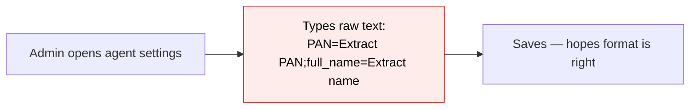
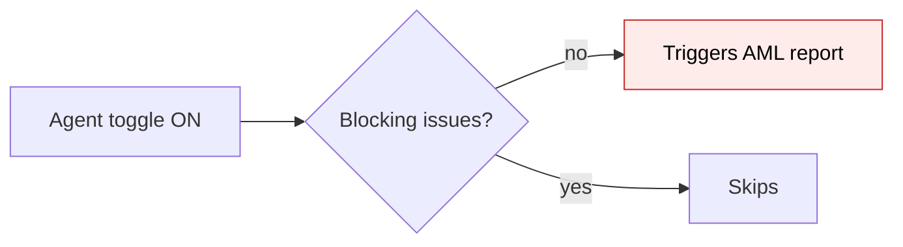
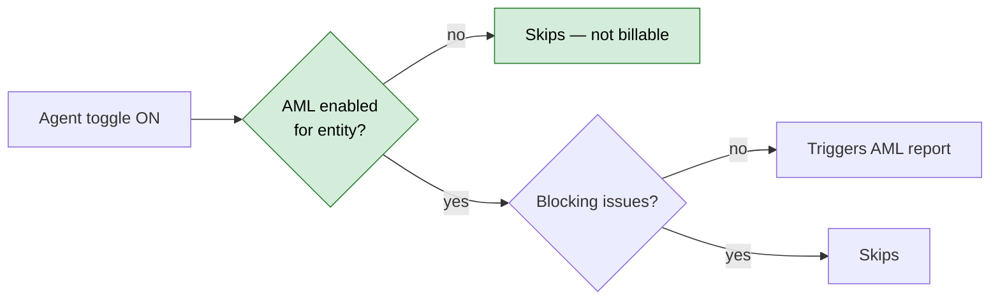
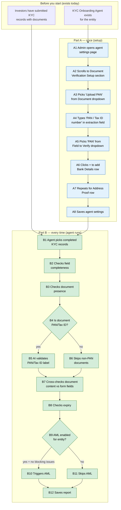

# KYC Onboarding Agent Improvements — Proposal

> **Audience:** Business team, product, QA, support — non-technical.
> **Companion document:** [Design](design.md)
> **New to this? Start with the [Workflow Journey](#workflow-journey)** — every action, in order, from start to the outcome.

> **Planning phase — no code changes.** This document proposes and explains the change. Do not
> edit application code while writing it; implementation happens later, in the tasks phase.

---

## Why

The KYC Onboarding Agent validates investor KYC records automatically — checking fields, documents, expiry, and triggering AML. Today, configuring *which* documents to cross-check requires typing fragile text strings (`PAN=Extract the PAN number;full_name=Extract the full name`), the agent sends every uploaded document to the AI for validity checking (unnecessary cost and false positives), and the AML trigger fires even when the entity hasn't paid for AML screening. Product wants a usable setup UI, tighter validation scopes, and an AML billing safeguard — all to ship the agent to clients sooner.

## What Changes

- **Structured setup UI** — the "Field-to-Document Consistency" configuration moves from a raw text field to a visual 3-column table (Document dropdown, Extraction prompt, Field to verify dropdown). Admins pick from existing fields instead of memorizing syntax.
- **Smarter document checks** — Document Validity (AI label matching) now runs only on PAN/Tax ID documents instead of every upload. Document Presence considers all standard attachment fields as always required, while custom attachment fields must be explicitly marked required.
- **AML billing safeguard** — the agent checks whether AML screening is enabled at the entity level before triggering it. Prevents generating billable AML reports for entities that haven't purchased AML.
- **Clearer descriptions** — agent descriptions reference "Tax ID, Address Proof, Bank Details" instead of "passport, ID" which confused users since passports aren't part of the KYC flow.

### Flow Diagram

**Field-to-Document Consistency setup — Before vs After**




**AML trigger — Before vs After**





---

## Workflow Journey

### Who is involved

| Person | Role | What they do in the journey |
|---|---|---|
| The admin | Fund manager with agent access | Configures the KYC agent's document verification setup |
| The system | KYC Onboarding Agent | Runs validation checks on completed KYC records |
| The investor | KYC submitter | Fills in KYC form and uploads documents (existing flow, unchanged) |

### The journey on one page



### Before you start

| Needed | Why | Where it comes from |
|---|---|---|
| KYC Onboarding Agent created for the entity | The setup UI lives on the agent settings page | Admin creates agent from the Agents page |
| Investors have submitted KYC records | The agent only runs on completed KYC records | Investors fill in KYC form via emailed link |
| Standard document fields exist on the KYC form | The Document dropdown populates from these | Standard upload labels hardcoded in ERB views (locale-aware "Upload PAN / Tax ID", "Upload Address Proof") plus any persisted FormCustomField records with field_type "File" on the KYC form type |

### Part A — once (setup)

| Step | Who | Where | Action | What the system does | What you see |
|---|---|---|---|---|---|
| A1 | Admin | Agents › KYC Onboarding Agent › Edit | Opens agent settings | Loads settings form | Settings page with toggles and the new Document Verification Setup section |
| A2 | Admin | Settings page › Document Verification Setup | Scrolls to the section | — | A table with 3 columns: Document, Information to pull, Field to verify. Empty initially. |
| A3 | Admin | Document dropdown | Selects "Upload PAN" | — | Dropdown shows standard document fields from the KYC form (e.g., Upload PAN, Upload Address Proof, Upload Bank Details). Label shows "PAN" on Indian entities, "Tax ID" on US entities. |
| A4 | Admin | "Information to pull" text field | Types "PAN / Tax ID number" | — | Free text describing what the AI should extract from the document |
| A5 | Admin | "Field to verify" dropdown | Selects "PAN" | — | Dropdown shows standard fields from the KYC form (text/number fields, not file fields). |
| A6 | Admin | + button | Clicks to add a new row | Appends empty row to the table | New row appears with empty dropdowns and text field |
| A7 | Admin | New rows | Adds Bank Details (bank name, branch, account type, SWIFT/IFSC, account number) and Address Proof (permanent address) rows | — | Three rows configured in the table |
| A8 | Admin | Save button | Saves the agent | Stores the configuration as structured JSON in the agent's settings | Success flash: "Agent updated successfully" |

### Part B — every time (agent runs)

| Step | Who | Where | Action | What the system does | What you see |
|---|---|---|---|---|---|
| B1 | System | Background job | Agent starts (scheduled or manual) | Picks all completed KYC records for the entity | Dashboard shows agent running |
| B2 | System | — | Field completeness check | Checks all mandatory fields are populated, flags placeholders (N/A, UNKNOWN) | Report items: "All required fields valid" or specific missing fields |
| B3 | System | — | Document presence check | Checks all standard attachment fields have uploads. For custom attachment fields, only checks those marked required. | "All required documents present" or "Missing: Upload Address Proof" |
| B4 | System | — | Document validity check | Identifies PAN/Tax ID documents only | — |
| B5 | System | — | AI validates PAN/Tax ID | Sends only PAN/Tax ID docs to AI asking "does this document match its label?" | "Valid Upload PAN" or "Invalid Upload PAN — document appears to be a bank statement" |
| B6 | System | — | Skips non-PAN documents | Address proofs, bank details, etc. are NOT sent to AI for label matching | No validity items for non-PAN documents |
| B7 | System | — | Field-to-document consistency | For each row in the setup table: extracts value from document via AI, compares with the KYC form field | "PAN matches" or "PAN mismatch: document says AQMPM1234F, form says AQMPM1234E" |
| B8 | System | — | Expiry check | Checks KYC expiry date against configured thresholds | "KYC valid until 2027-03-15" or "KYC expired on 2026-10-01" |
| B9 | System | — | AML gate check | Checks (1) trigger_aml toggle is ON, (2) AML is enabled for the entity in entity settings | — |
| B10 | System | — | Triggers AML | If both gates pass and zero blocking issues, queues AML screening job | "AML triggered" in report |
| B11 | System | — | Skips AML | If AML not enabled for entity, skips even when toggle is ON | "AML not enabled for entity" in report |
| B12 | System | — | Saves report | Writes all results to the agent report | Report visible on the KYC Dashboard tab |

### What the user sees

**Document Verification Setup (agent settings page)**

```
┌─────────────────────────────────────────────────────────────────────────┐
│  Document Verification Setup                                            │
│                                                                         │
│  ┌──────────────────┬──────────────────────┬──────────────────┬───┐     │
│  │ Document       ▼ │ Information to pull   │ Field to verify ▼│ ✕ │     │
│  ├──────────────────┼──────────────────────┼──────────────────┼───┤     │
│  │ Upload PAN       │ PAN / Tax ID number   │ PAN              │ ✕ │     │
│  │ Upload Bank Det. │ bank name             │ bank_name        │ ✕ │     │
│  │ Upload Bank Det. │ branch name           │ branch_name      │ ✕ │     │
│  │ Upload Bank Det. │ account type          │ account_type     │ ✕ │     │
│  │ Upload Bank Det. │ SWIFT / IFSC code     │ ifsc_code        │ ✕ │     │
│  │ Upload Bank Det. │ bank account number   │ account_number   │ ✕ │     │
│  │ Upload Addr Proof│ address               │ permanent_address│ ✕ │     │
│  └──────────────────┴──────────────────────┴──────────────────┴───┘     │
│                                                        [ + Add Row ]    │
└─────────────────────────────────────────────────────────────────────────┘
```

- The Document dropdown lists standard File-type fields from the KYC form.
- The Field to Verify dropdown lists standard non-File fields from the KYC form.
- The same document can appear in multiple rows (e.g., Bank Details appears 5 times for 5 different fields to extract).

### What goes wrong

**Scenario: Admin saves without selecting a document**
- The admin clicks + Add Row, types an extraction prompt, but forgets to pick a Document from the dropdown.
- On save, the row is ignored (empty document = no mapping). The admin sees the row disappear after reload.
- Fix: The admin adds the row again and selects a document before saving.

**Scenario: AML triggers but entity hasn't purchased AML**
- Before this change: AML report gets generated, entity gets billed for an AML check they didn't purchase.
- After this change: The agent checks entity settings first. If AML isn't enabled, the step shows "AML not enabled for entity" and skips. No billable AML report is generated.

### Summary: the minimum actions

| # | Action | Who | How often |
|---|---|---|---|
| 1 | Configure document verification rows in agent settings | Admin | Once per entity (update as needed) |
| 2 | Enable/disable agent toggles (validate_fields, validate_documents, etc.) | Admin | Once per entity |
| 3 | Agent runs and produces validation reports | System | Every scheduled run or manual trigger |

---

## User Stories

### US-1: Structured Document Verification Setup

**As a** fund manager configuring the KYC agent,
**I want** a visual table to set up which documents to cross-check against which form fields,
**So that** I don't have to memorize a text format and risk typos breaking the verification.

**Acceptance criteria:**
- The agent settings page shows a "Document Verification Setup" section with a 3-column table
- Column 1 is a dropdown of standard File-type fields from the entity's KYC form types
- Column 2 is a free text input for the extraction prompt
- Column 3 is a dropdown of standard non-File fields from the entity's KYC form types
- I can add rows with a + button and remove rows with an ✕ button
- On save, the configuration persists as structured JSON in the agent's settings
- On reload, the table shows the saved rows correctly
- Rows with an empty document are silently discarded on save

### US-2: PAN/Tax ID-only Document Validity

**As a** fund manager,
**I want** the agent to only AI-validate PAN/Tax ID documents for label correctness,
**So that** we don't waste AI calls on address proofs and bank statements where label matching is unreliable.

**Acceptance criteria:**
- When the agent runs Document Validity, only documents whose name matches PAN or Tax ID patterns are sent to the AI
- Other documents (address proof, bank details, etc.) are skipped entirely — no AI call, no validity result item
- PAN/Tax ID documents are validated as before: AI checks if the document matches its label

### US-3: AML Entity-Level Guard

**As a** fund manager,
**I want** the agent to check that AML screening is enabled for my entity before triggering an AML report,
**So that** we don't accidentally generate billable AML reports for entities that haven't purchased AML.

**Acceptance criteria:**
- When trigger_aml toggle is ON but AML is not enabled in the entity's settings, the step shows "AML not enabled for entity" and skips
- When trigger_aml toggle is ON and AML IS enabled for the entity, behavior is unchanged (triggers AML if no blocking issues)
- The step status in the report clearly indicates why AML was skipped

### US-4: Accurate Document Presence Checking

**As a** fund manager,
**I want** the agent to check that all standard document fields have uploads (regardless of the "required" flag), while only checking custom attachment fields that are explicitly marked required,
**So that** standard documents like PAN and Address Proof are never missed.

**Acceptance criteria:**
- Standard attachment fields on the KYC form are always checked for presence, even if `required` is not set
- Custom attachment fields are checked only when `required` is true
- Missing standard documents are flagged as blocking
- Missing non-required custom attachment fields are not flagged

### US-5: Clear Agent Descriptions

**As a** fund manager reading the agent description,
**I want** the description to reference documents I actually collect (Tax ID, Address Proof, Bank Details),
**So that** I'm not confused by references to "passport" which isn't part of our KYC flow.

**Acceptance criteria:**
- Agent descriptions reference "Tax ID, Address Proof, Bank Details" instead of "passport, ID"
- No mention of passport in any user-facing agent description

---

## UI Behavior

### Agent Settings Page — Document Verification Setup

```
┌─────────────────────────────────────────────────────────────────────────┐
│  Document Verification Setup                                            │
│                                                                         │
│  ┌──────────────────┬──────────────────────┬──────────────────┬───┐     │
│  │ Document       ▼ │ Information to pull   │ Field to verify ▼│   │     │
│  ├──────────────────┼──────────────────────┼──────────────────┼───┤     │
│  │ Upload PAN       │ PAN / Tax ID number   │ PAN              │ ✕ │     │
│  └──────────────────┴──────────────────────┴──────────────────┴───┘     │
│                                                        [ + Add Row ]    │
└─────────────────────────────────────────────────────────────────────────┘
```

**Behavior notes:**
- The table is rendered inside the existing agent edit form, below the toggle fields
- Document dropdown options come from two sources: (1) standard upload labels hardcoded in ERB views — locale-aware "Upload PAN / Tax ID" and "Upload Address Proof", and (2) persisted `FormCustomField` records with `field_type: "File"` on the entity's KYC form types (IndividualKyc, NonIndividualKyc)
- Field to Verify dropdown options come from `FormCustomField` records with non-File field types on the same form types
- Labels adapt per entity: "PAN" on Indian entities, "Tax ID" on US entities — based on what standard fields exist
- The + button appends an empty row; the ✕ button removes its row
- Changes are serialized into the hidden `json_fields` input on every edit via a Stimulus controller
- A row with no document selected is silently dropped on save
- The table persists across page reloads

---

## What This Feature Does NOT Cover

| Excluded | Covered In |
|---|---|
| KYC form field/flow changes (submission status, new fields) | Separate KYC form changes — parked per product decision |
| Custom field support in Field to Verify dropdown | Future iteration — standard fields only for now |
| Dashboard UI changes | Separate `feature/kyc-agent-dashboard` branch |
| Agent setup wizard / onboarding flow | Future — the table is embedded in the existing settings form |
| Document Validity for non-PAN documents | Future — currently only PAN/Tax ID; may expand later |

---

## Validation Rules

| Field | Rule | Default |
|---|---|---|
| Document (setup row) | Must be selected from dropdown for row to be saved | Empty = row discarded |
| Information to pull (setup row) | Free text, required if document is selected | — |
| Field to verify (setup row) | Must be selected from dropdown for the mapping to work | — |
| trigger_aml toggle | ON/OFF | ON (default in new setup) |
| send_reminder toggle | ON/OFF | ON (default in new setup) |

---

## Behavior Rules

| Scenario | What User Sees |
|---|---|
| Agent runs Document Validity on a PAN document | AI validates label — "Valid Upload PAN" or "Invalid Upload PAN" |
| Agent runs Document Validity on an Address Proof document | Skipped — no AI call, no result item for this document |
| Agent runs Document Presence, standard doc missing | "Missing: Upload PAN" — blocking issue |
| Agent runs Document Presence, optional custom attachment missing | Not flagged — custom attachment was not required |
| Agent trigger_aml=ON, entity AML enabled, no blocking issues | AML report triggered |
| Agent trigger_aml=ON, entity AML NOT enabled | Step skipped: "AML not enabled for entity" |
| Agent trigger_aml=OFF | Step skipped: "Disabled" (existing behavior) |
| Admin saves setup with empty Document row | Row silently discarded, other rows saved |
| Admin saves setup with 3 rows configured | All 3 mappings stored, used in next agent run for Field-to-Document Consistency |

---

## Resolved Design Decisions

| # | Decision | Resolution |
|---|---|---|
| 1 | Should Document Validity check all documents or just PAN/Tax ID? | PAN/Tax ID only — reduces AI cost and false positives on ambiguous doc types. May expand later. |
| 2 | Should the Field to Verify dropdown include custom fields? | Standard fields only for now — custom fields make the list too long. Product will revisit later. |
| 3 | Should AML trigger check entity settings or just the agent toggle? | Both — the agent toggle is the admin's intent, the entity setting is the billing gate. Both must be ON. |
| 4 | What happens to existing agents with the old text-based config? | The new `parse_field_document_mappings` must read both formats — old text format for backward compatibility, new structured JSON for new setups. Migration is not required. |
| 5 | How many document types in the setup? | Three for now: Address Proof, Bank Details, PAN/Tax ID. The dropdown shows all standard File-type fields, but product guidance is to configure only these three. |
| 6 | Should the Document dropdown restrict to only 3 types? | No — the dropdown shows all standard File fields. The 3-type limit is a product guidance, not a technical restriction. Admins can map any standard document. |
| 7 | PAN vs Tax ID label — how to handle? | The label comes from the FormCustomField label on the entity's KYC form. Indian entities have "PAN", US entities have "Tax ID". No code-level mapping needed — the dropdown shows what exists. |
| 8 | Default values for trigger_aml and send_reminder toggles | Both default to ON in new agent setups. AML has the additional entity-level gate. |

---

## Capabilities

### New Capabilities

- `kyc/agent-setup-ui`: Structured 3-column table UI for configuring Field-to-Document Consistency mappings on the KYC Onboarding Agent, replacing the raw text format
- `kyc/agent-validation-scope`: Scoped document validation — Document Validity limited to PAN/Tax ID, Document Presence split between standard (always required) and custom (required flag), AML entity-level billing guard

### Modified Capabilities

_(none — the existing `kyc/investor-kyc-journey` spec covers the KYC journey workflow, not the agent's internal validation pipeline)_

---

## Impact

- **Agent settings page** — new section with 3-column table below existing toggles
- **Agent validation pipeline** — Document Validity filters to PAN/Tax ID only; Document Presence separates standard vs custom fields; AML checks entity settings
- **Agent descriptions** — text changes only, no functional impact
- **Backward compatibility** — existing agents with old text-based config continue to work; the mapping parser reads both formats

---

## Benefits

1. **Faster setup** — admins configure document verification with dropdowns instead of memorizing text syntax, reducing setup errors from minutes of debugging to zero
2. **Lower AI cost** — Document Validity only sends PAN/Tax ID to the AI instead of every document, cutting AI calls per KYC run by ~70%
3. **No accidental billing** — AML reports only trigger when the entity has actually purchased AML screening
4. **Clearer communication** — agent descriptions match the actual documents collected, reducing support questions

---

## FAQ

| Question | Answer |
|---|---|
| Will existing agent configurations break? | No — the mapping parser reads both the old text format and the new structured JSON. Existing setups continue working. Admins can re-save to migrate to the new format. |
| Do investors see any changes? | No — all changes are on the admin/agent side. The investor KYC submission flow is unchanged. |
| Does this change what the agent checks? | Document Validity now only checks PAN/Tax ID (was checking all documents). Document Presence now always checks standard docs. AML now also checks entity settings. Field Completeness and Expiry are unchanged. |
| Can the admin add custom fields to the Field to Verify dropdown? | Not in this phase — standard fields only. Custom fields may be added in a future iteration. |
| What about the KYC form/field changes discussed in the product call? | Those are parked — a separate team member will handle KYC form changes later. This change is agent-only. |
| Will this work on both Indian and US servers? | Yes — the dropdowns populate from the entity's actual form fields, so "PAN" appears on Indian entities and "Tax ID" on US entities automatically. |

---

## Design Principle for the Next Phase

- **Reuse the KycDocExtractorAgent config pattern** — the existing `_kyc_doc_extractor_config.html.erb` partial and its Stimulus controller already implement a structured table UI for document extraction rules. The design should adapt this pattern (with dropdowns instead of free text for columns 1 and 3) rather than building from scratch.
- **Backward-compatible parsing** — `parse_field_document_mappings` must read both old and new formats. The design should handle this with a format-detection branch, not a data migration.
- **Keep the agent pipeline steps unchanged** — the 9-step Trailblazer pipeline order doesn't change. We're only narrowing what each step processes, not restructuring the pipeline.
