# LP Folio Portfolio & Company Dashboard — Design

> **Audience:** Engineering team.
> **Companion documents:** [Proposal](proposal.md) · [Spec](specs/) · [Business rules (H/E/X)](business-rules.md)

> **Planning phase — no code changes.** This document explains HOW the proposal will be built.
> Do not edit application code while writing it; implementation happens later, in the tasks phase.

> **Design, not code.** Explain the design with mermaid diagrams and tables. Real class, method,
> table and path names go inside the diagrams and tables.

> **Zoom one picture.** The whole design hangs off ONE numbered picture. Part 1 draws it in plain
> words. Part 2 redraws the SAME picture with real names. Part 3 has one card per box, in the same
> order. Part 4 is reference material. ①–⑦ mean the same box everywhere.

> **⚠ Existing-model changes need sign-off before tasks.** This design adds columns to `funds` and
> `investors`, treats `dashboard_widgets` layouts whose name includes the tag "LP" as LP layouts (widening `name` from 20 to 100 characters), adds two bits to `Fund#features`, changes two existing policy
> scopes and the holding show page, and stops reading `aggregate_portfolio_investments.show_portfolio`.
> The full list is in [Changes to existing models](#changes-to-existing-models). `AccountEntry` and
> the allocation engine are read only.

---

## Contents

- [1. The idea](#1-the-idea)
  - [What this adds](#what-this-adds)
  - [The idea in one picture](#the-idea-in-one-picture)
  - [Walkthrough: one example, start to finish](#walkthrough-one-example-start-to-finish)
  - [Key ideas](#key-ideas)
- [2. The same picture with real names](#2-the-same-picture-with-real-names)
  - [Picture](#picture)
  - [What each box does](#what-each-box-does)
  - [One run, end to end](#one-run-end-to-end)
  - [Lifecycles](#lifecycles)
  - [What users see](#what-users-see)
  - [Design decisions](#design-decisions)
- [3. One card per box](#3-one-card-per-box)
  - [① Fund LP portfolio view](#-fund-lp-portfolio-view)
  - [② Folio allocations](#-folio-allocations)
  - [③ Visible set and own share](#-visible-set-and-own-share)
  - [④ LP portfolio screens](#-lp-portfolio-screens)
  - [⑤ Company sharing](#-company-sharing)
  - [⑥ LP Company Dashboard](#-lp-company-dashboard)
  - [⑦ LP data paths](#-lp-data-paths)
- [4. Reference](#4-reference)
  - [Class diagram](#class-diagram)
  - [Data model and schema changes](#data-model-and-schema-changes)
  - [Component contracts](#component-contracts)
  - [Notifications](#notifications)
  - [Cross-cutting concerns](#cross-cutting-concerns)
  - [Worked examples](#worked-examples)
  - [Testing](#testing)
  - [Risks and open questions](#risks-and-open-questions)

---

## 1. The idea

### What this adds

One shared rule, the **visible set**, decides which holdings an LP may see in a fund and what their
own cost and FMV are. It reads the folio allocation entries the allocation engine already writes. Every
LP surface asks that rule: the holding lists (through the existing Pundit scopes), the new LP Company
Dashboard, the widget data endpoints and the LP assistant. The LP Company Dashboard reuses the existing
Portfolio Company Dashboard widget machinery (`DashboardWidget` + `dashboard_widgets` helper), rendering the
fund manager's **LP layouts**: Portfolio Company Dashboard layouts whose name includes the tag "LP"
("LP", "LP, FinTech"…). The company's tags pick which one, as described in card ⑤. It replaces the per-holding preview page.

### The idea in one picture

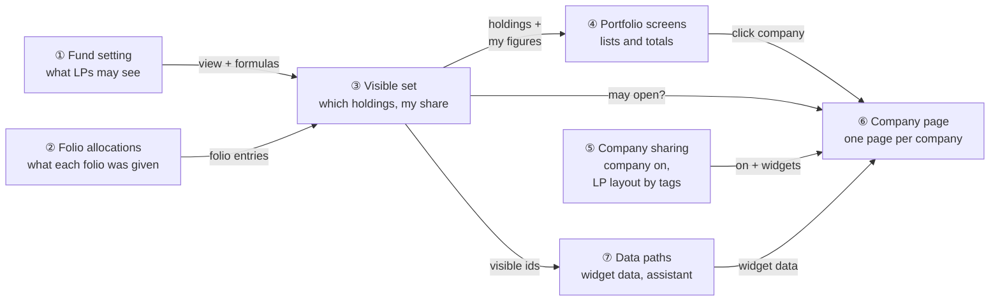

### Walkthrough: one example, start to finish

**Setup.** Growth Fund I (GF1) holds Acme Robotics (cost ₹25 Cr, FMV ₹40 Cr), Bluefin Health (₹20 /
₹22 Cr) and Cedar Logistics (₹15 / ₹18 Cr). Ravi's folio F-012 holds 10% and was excused from
Bluefin. Meera runs fund operations. The full data is in the
[shared setup](business-rules.md#shared-setup).

**Legend for the Result column.** One line per company, as Ravi sees it:
✓ = listed and its page opens · ● = listed, not a link (company not shared) · ○ = not listed.

#### Phase 1 — Meera sets up (once)

| # | When | What happens | Behind the scenes | Result for Ravi |
|---|---|---|---|---|
| 1 | Release day | Nothing to do. Acme's holding had "Show Portfolio" on | The carry-over in company sharing (⑤) turns Acme's company switch on. GF1 had portfolios shown, so the fund setting (①) reads *Whole fund* | **Acme ✓**<br>Bluefin ●<br>Cedar ● |
| 2 | Day 2, 10:00 | Meera sets GF1 to *Allocated, with their own share*, picks "Allocated Portfolio Cost" as the allocation formula and "Allocated Portfolio FMV" for Your FMV | The fund setting (①) stores the folio and own-share bits and the two formula ids, after checking both are GF1's holding-level formulas | Acme ✓<br>Cedar ●<br>**Bluefin ○** |
| 3 | 10:05 | Meera clicks Set up LP layout, then adds an Embed Document "Founder Video" | Company sharing (⑤) creates `DashboardWidget` rows with `name = "LP"` (Data Card, Key KPIs, Valuations), checking each type is LP-safe | Same as row 2 |

#### Phase 2 — Ravi looks (every time)

| # | When | What happens | Behind the scenes | Result for Ravi |
|---|---|---|---|---|
| 4 | 11:00 | Ravi opens GF1 › Portfolio | The portfolio screens (④) ask the visible set (③), which reads F-012's entries under the allocation formula only (②). Bluefin's are ₹0, so it is out | **Acme ✓** — Your cost ₹2.50 Cr, FMV ₹4.00 Cr<br>Cedar ● — ₹1.50 / ₹1.80 Cr<br>Bluefin ○ |
| 5 | 11:01 | Ravi clicks Acme | The company page (⑥) asks the visible set (③) "may Ravi open Acme in GF1?" and company sharing (⑤) "is Acme on, which widgets?" | **Acme page open**: holdings card + 4 widgets |
| 6 | 11:01 | The widgets load | Each widget frame calls the LP data paths (⑦), which re-check the visible set (③) and return Actual-only KPIs and GF1-only data | Same as row 5 |

#### Phase 3 — a mistake and a stall

| # | When | What happens | Behind the scenes | Result for Ravi |
|---|---|---|---|---|
| 7 | 14:00 | Meera clicks Hide from LPs on Acme by mistake and confirms | Company sharing (⑤) sets Acme's switch off. Nothing else changes | **Acme ●**<br>Cedar ●<br>Bluefin ○ |
| 8 | 14:02 | Meera clicks Show to LPs again (undo) | Same switch set back on. The action sets an explicit value, so a double click does no harm | **Acme ✓**<br>Cedar ●<br>Bluefin ○ |
| 9 | Day 3 | Meera records a new holding, Delta AI, but no allocation has run yet | No folio entries for Delta in the folio allocations (②), so the visible set (③) leaves it out | Same as row 8 (Delta ○) |
| 10 | Day 3 | Meera apportions a deal expense to Delta | F-012 now has a non-zero deal-expense entry for Delta, but the visible set (③) reads only the allocation formula, so Delta stays out | Same as row 8 (Delta ○) |
| 11 | Day 4 | The allocation runs the cost formula, but the FMV formula is disabled this quarter | F-012 gets "Allocated Portfolio Cost" ₹0.70 Cr for Delta in the folio allocations (②), so Delta is visible. There is no FMV entry, so Your FMV shows "—" | Acme ✓<br>Cedar ●<br>**Delta ● — ₹0.70 Cr / FMV "—"** (left out of the FMV total) |
| 12 | Day 5 | Meera re-enables the FMV formula and re-runs | The next page load picks up the new entry, with no cache to clear | Acme ✓<br>Cedar ●<br>**Delta ● — ₹0.70 / ₹0.75 Cr** |

**Snapshot at row 4** (what Ravi sees):

```
Growth Fund I › Portfolio                                 As of 30/09/2026
Showing investments allocated to your folio (F-012)
Company           Fund cost  Fund FMV   Your cost  Your FMV  Multiple
Acme Robotics  ▸  ₹25.00 Cr  ₹40.00 Cr  ₹2.50 Cr   ₹4.00 Cr  1.60x
Cedar Logistics   ₹15.00 Cr  ₹18.00 Cr  ₹1.50 Cr   ₹1.80 Cr  1.20x
Total (2)         ₹40.00 Cr  ₹58.00 Cr  ₹4.00 Cr   ₹5.80 Cr  1.45x
```

**What to notice**
- One rule (③) answered rows 4, 5, 6, 10 and 11. Nothing re-implements "is this holding Ravi's".
- Visibility comes from one formula's data, not from a flag anyone maintains (rows 9–12). A deal
  expense alone doesn't reveal a holding (row 10).
- The company switch (⑤) only decides whether a page opens. It never makes a hidden holding visible
  (row 7 leaves Bluefin ○).
- A missing own-share figure is shown as "—", never guessed (row 11).
- The undo is just setting the value back (row 8). There is no history to repair.

### Key ideas

| # | Idea | In one line | Card |
|---|---|---|---|
| 1 | One dropdown, stored as flags | The four-option view maps onto `show_portfolios` plus two new bits, so every existing `show_portfolios?` check keeps working | [①](#-fund-lp-portfolio-view) |
| 2 | Visibility is derived from one formula | A holding is visible when a folio has a non-zero entry under the fund's chosen allocation formula, dated on or before today. Nothing new is stored | [③](#-visible-set-and-own-share) |
| 3 | One rule, many callers | Scopes, company page, widget endpoints and the assistant all call `LpPortfolioVisibility` | [③](#-visible-set-and-own-share) |
| 4 | Read, don't recompute | Your cost is the allocation formula's entries and Your FMV a second formula's: the latest per subject on or before today, summed per holding | [③](#-visible-set-and-own-share) |
| 5 | Reuse the widget engine | The LP page is the existing dashboard renderer with an LP filter and no catalogue fallback | [⑥](#-lp-company-dashboard) |
| 6 | LP data stays behind LP endpoints | LP widgets fetch through one LP controller that re-checks access. Internal KPI and document endpoints are untouched | [⑦](#-lp-data-paths) |

**FAQ**

| Question | Answer |
|---|---|
| Why derive visibility instead of storing "LP can see holding X"? | The allocation engine already records participation per folio. A stored copy would drift after every run, re-run, excusal change or upload. |
| Why "dated on or before today" rather than "the latest run"? | `allocation_runs` has no completed status, and entries are regenerated per reporting date. "Any entry up to today" is stable and keeps exited holdings visible to the LPs who were in them. |
| Why one formula instead of "any portfolio formula"? | It is explainable ("LPs see holdings where their folio has a non-zero amount under the allocation formula"), and it cuts the lookup from all of a folio's entries (~16,700 in the busiest production fund) to that one formula's (~2,600 actual, 283 estimated by the index intersection). |
| Does anything block the fund team? | No. All fund-team screens behave as today, except the holding page loses two buttons. |

---

## 2. The same picture with real names

### Picture

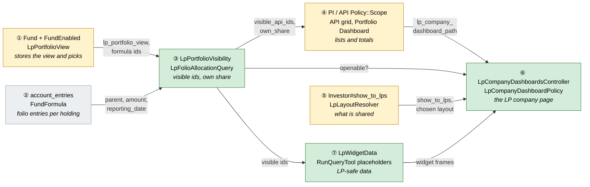

Colour = footprint: **green** new, **amber** modified, **grey** reused unchanged. Exact files are
listed in [lld.md File Map](lld.md#file-map).

### What each box does

| # | Box | Real parts | What it does | When it runs | What it decides | Details |
|---|---|---|---|---|---|---|
| ① | Fund LP portfolio view | `Fund` / `FundEnabled` (`show_portfolios`, new `lp_folio_portfolio`, `lp_own_share` bits), `funds.lp_allocation_fund_formula_id`, `funds.lp_fmv_fund_formula_id`, `LpPortfolioView`, fund `_features` form | Stores and validates the four-option view and the two formula picks | Fund save, fund upload | Which view applies. Whether the picks are valid | [card ① →](#-fund-lp-portfolio-view) |
| ② | Folio allocations | `account_entries` (`capital_commitment_id`, `parent_type`/`parent_id`, `fund_formula_id`, `amount_cents`, `reporting_date`, `deleted_at`), `FundFormula#rule_type` | Already written by `AllocatePortfolioInvestments`, `AllocateAggregatePortfolios`, `AllocateForPortfolioCompany` | Allocation runs, uploads | Nothing new. Read only | [card ② →](#-folio-allocations) |
| ③ | Visible set and own share | `LpPortfolioVisibility` (service), `LpFolioAllocationQuery` (query object) | For an LP (or a previewed investor) and their funds: visible holding, instrument and company ids, folio labels, and per-holding own share | Per request, memoised on the request | Is holding X visible? Which funds qualify for company C? Your cost/FMV per holding | [card ③ →](#-visible-set-and-own-share) |
| ④ | LP portfolio screens | `PortfolioInvestmentPolicy::Scope` / `#show?`, `AggregatePortfolioInvestmentPolicy::Scope` / `#show?`, API grid partials (LP columns, totals, banner), `DashboardWidgetsHelper#dashboard_widgets` (LP filter on the fund Portfolio Dashboard) | Narrows every LP holding list to the visible set, adds Your columns, hides fund-wide charts under allocated views | Each LP portfolio request | Which rows and widgets an LP gets | [card ④ →](#-lp-portfolio-screens) |
| ⑤ | Company sharing | `investors.show_to_lps`, `InvestorsController#lp_sharing`, `InvestorPolicy#lp_sharing?`, `LpLayoutResolver`, `DashboardWidget::LP_LAYOUT_TOKEN` ("LP") + `LP_SAFE_WIDGET_NAMES` validation, `DashboardWidgetsController#setup_lp_layout`, widget form/index guidance, migration `CarryOverShowPortfolioToCompanies`, holding page clean-up | Lets the fund team share a company and lay out the LP layout. Carries old flags over once | Fund-team clicks, release migration | Is the company shared? Which widgets make up the LP page? | [card ⑤ →](#-company-sharing) |
| ⑥ | LP Company Dashboard | `LpCompanyDashboardsController` (`show`, `preview`), `LpCompanyDashboardPolicy`, `lp_company_dashboards/show` view, holdings card partial, `DashboardWidgetsHelper` LP path, `AggregatePortfolioInvestmentsController#show` redirect, `documents/_embed` video branch | Renders one page per company and fund for an LP (or a fund-team preview) | LP opens a company, fund team previews, old holding link | May this LP open it? Which fund is shown? | [card ⑥ →](#-lp-company-dashboard) |
| ⑦ | LP data paths | `LpWidgetData` (per-widget loaders, rendered with the page — no separate widget address), `RunQueryTool` (`{VISIBLE_API_IDS}`, `{VISIBLE_PI_IDS}`), `LpChatProvider` | Serves LP widget content (KPIs Actual only, valuations, fund-limited stats) and scopes the LP assistant | Lazy widget frames, assistant queries | What data an LP widget or the assistant may return | [card ⑦ →](#-lp-data-paths) |

### One run, end to end

Ravi opens GF1's portfolio, then Acme's page. GF1 is set to *Allocated, with their own share*.

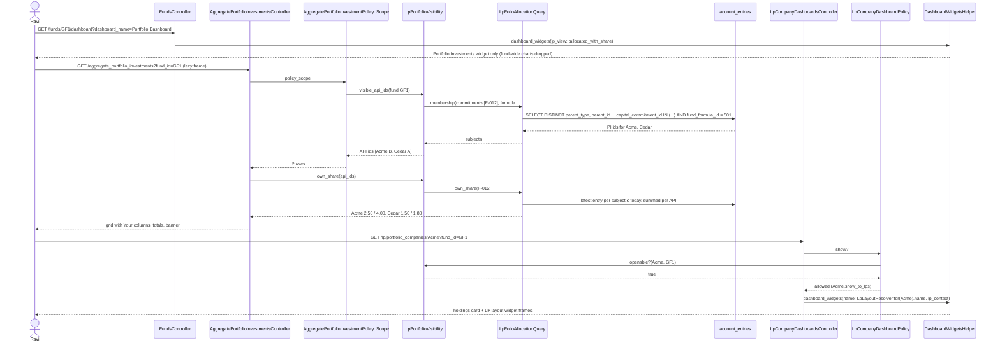

### Lifecycles

**Fund LP portfolio view (stored as `funds.features` bits).** Any option can move to any other on
save. The diagram shows the stored-flag meaning of each state.

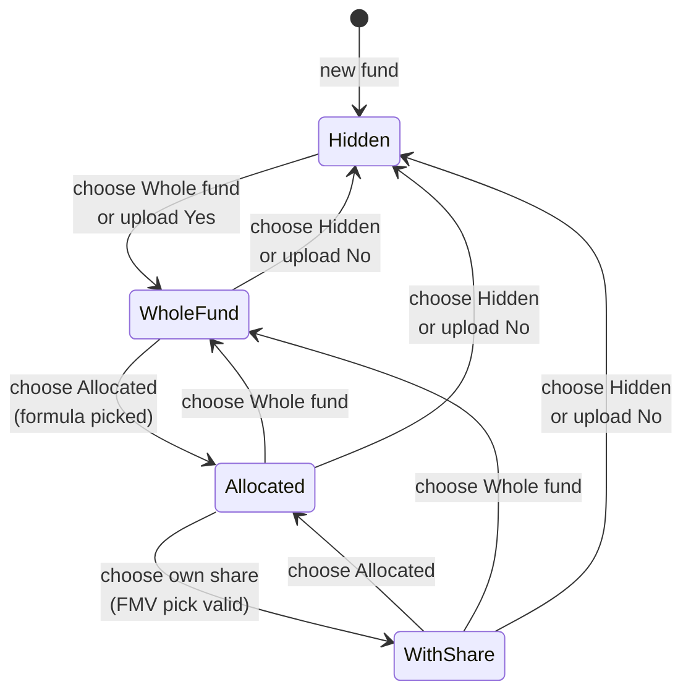

| State | `show_portfolios` | `lp_folio_portfolio` | `lp_own_share` | Allocation formula | Your FMV formula |
|---|---|---|---|---|---|
| Hidden | off | kept | kept | kept, ignored | kept, ignored |
| WholeFund | on | off | off | kept, ignored | kept, ignored |
| Allocated | on | on | off | required, used | kept, ignored |
| WithShare | on | on | on | required, used | required, used |

Under Hidden, the two new bits are kept (not cleared). That is how an upload "No" followed by "Yes"
restores the previous view's picks (E3). An upload "Yes" sets only `show_portfolios`, so a fund that
was Allocated before being hidden returns to Allocated.

**Holding visibility for one LP (derived, never stored).**

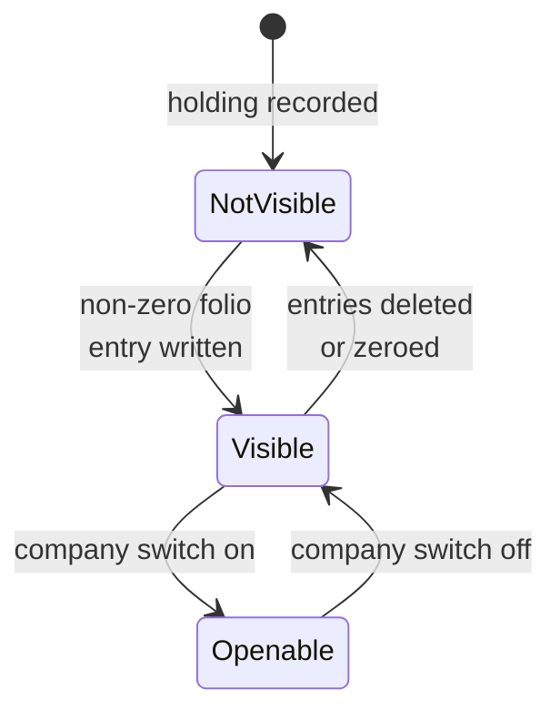

**Company switch (stored, `investors.show_to_lps`).** Off → On by Show to LPs or the release
carry-over. On → Off by Hide from LPs (with confirmation).

### What users see

**At a glance**

| Where in CapHive | Today | After this change | Who sees it |
|---|---|---|---|
| Fund › Edit › Features | "Show fund portfolios to LPs" checkbox | "LP portfolio view" dropdown with four options, plus the Allocation formula and Your FMV pickers | Fund team |
| LP › Fund › Portfolio | Every holding, fund figures | Per the view: nothing / every holding / allocated holdings, with optional Your cost and Your FMV, banner, totals | LPs |
| LP › Fund › Portfolio Dashboard charts | All fund-wide charts | Fund-wide charts hidden under allocated views | LPs |
| Portfolio company page › Actions | — | Show to LPs / Hide from LPs, Preview as LP | Fund team |
| Settings › Dashboards › Portfolio Company Dashboard | Layouts ("Default", …) | LP layouts ("LP", "LP, <tag>"; LP-safe types only), Set up LP layout and New LP layout for a tag buttons, guidance notices | Fund team |
| LP Company Dashboard | Per-holding preview page | One page per company: holdings card plus shared widgets, fund selector | LPs |
| Holding page | Preview, Show/Hide Portfolio buttons | Removed, as are the Widgets and Track Record tabs (records kept) | Fund team |
| Embed Document widget | Video plays nowhere | Video plays inline on every dashboard | Everyone who sees the widget |

**Main everyday journey: an LP opens a company.** The mockups and messages are in the
[proposal's UI Behavior](proposal.md#ui-behavior). This shows where each part comes from.

```
┌────────────────────────────────────────────────────────────────────┐
│ Acme Robotics                              ② [ Growth Fund I  ▾ ]  │
├────────────────────────────────────────────────────────────────────┤
│ ① Holdings (Growth Fund I)                                          │
│ Series B CCPS  1,00,000  ₹2,500  ₹25.00 Cr  ₹40.00 Cr  ₹2.50  ₹4.00 │
├────────────────────────────┬───────────────────────────────────────┤
│ ③ Data Card                │ ③ Key KPIs (Actual)                    │
├────────────────────────────┴───────────────────────────────────────┤
│ ③ Valuations                         ④ Founder Video ▶              │
└────────────────────────────────────────────────────────────────────┘
```

| Step | The user… | They see |
|---|---|---|
| 1 | Clicks Acme in GF1 › Portfolio | ① Holdings card from the visible set (③ box), with Your columns under the own-share view |
| 2 | (Holds Acme through two funds) | ② Fund selector listing only qualifying funds, defaulting alphabetically |
| 3 | Waits a moment | ③ Shared widgets load in lazy frames from the LP data paths (⑦) |
| 4 | Presses play | ④ The Embed Document video plays inline |

### Design decisions

1. **Store the dropdown as flags on the existing `features` column** — two new bits next to
   `show_portfolios`, with `LpPortfolioView` mapping the four options to bit sets. Alternative
   considered: a new `lp_portfolio_view` string column. Rejected because `show_portfolios?` is read
   by policies, uploads, the market-data flags and step definitions. Keeping it as the "shown at all"
   bit means none of them change.
2. **Derive visibility from one formula's `account_entries` per request.** Membership reads only the
   fund's chosen allocation formula. Alternative considered: any non-proforma portfolio formula.
   Rejected because the rule was harder to explain (a deal expense alone revealed a holding) and it
   read every portfolio entry of the folio (~11,400 of ~16,700 in the busiest fund), against a few
   hundred for one formula. Also considered: a stored
   `lp_visible_holdings` table, or a Rails cache keyed per run. Both rejected. A stored table needs
   upkeep on every run, re-run, upload and deletion, and `allocation_runs` has no completion signal to
   key a cache on. The query is index-backed (see [Performance](#performance-and-security)). A cache
   remains available if production timing ever says otherwise.
3. **Filter in the existing Pundit scopes, not in each screen.** Alternative considered: filtering in
   `AggregatePortfolioInvestmentList` / `PortfolioInvestmentList`. Rejected because scopes also cover
   `show?`, the lazy grids inside widgets and any future endpoint. One place stops leaks.
4. **One new LP controller for the company page and its widget data.** Alternative considered: open
   `InvestorsController#dashboard`, `KpiReportsController` and `ValuationsController` to LPs.
   Rejected because those endpoints and their policies serve fund-team and portco users. Widening them
   risks exposing Budget KPIs, IC tags and all-fund data. The LP controller re-checks access and
   loads only LP-safe data.
5. **The LP page is an LP layout of the existing dashboard, chosen by company tags.** LPs see the
   enabled widgets of the Portfolio Company Dashboard layout (`dashboard_widgets.name`) that
   `LpLayoutResolver` picks from the "LP"-tagged layouts using the company's `tag_list`, rendered by the
   existing `dashboard_widgets(...)` with an LP context and no catalogue fallback. Alternatives
   considered: a per-widget `show_to_lps` flag, or a separate LP template. The flag was rejected
   because one widget row can't have a different order or size for LPs, so the fund team couldn't
   arrange the LP page separately. LP layouts give them that, per group of companies, using the layout feature they
   already know, with no new column. A separate template would be a second widget system.
   `tags` / `tag_list` were not used as the marker because they already mean the nav label and the
   per-user visibility filter.
6. **Hide fund-wide charts under allocated views.** Alternative considered: rework FMV %, Holding
   Cost %, Bought %, Sold %, IRR and fund Portfolio Stats to aggregate over the visible set. Rejected
   for this change. Each reads fund-level aggregates (`fund_ratios`, API sums), and IRR is not
   additive. The holdings grid with its totals covers the need.
7. **Only holding-level formulas can be picked.** Instrument-level, master-fund instrument-level and
   aggregated-holding formulas map cleanly onto holdings, for both the allocation formula and Your
   FMV. Company-level formulas (`AllocateForPortfolioCompany-Folio`) can't be split across a
   company's holdings, so they can't be picked.
8. **Retire, don't drop, `aggregate_portfolio_investments.show_portfolio`.** Stop reading it after
   the carry-over. Drop the column in a later change once production has run on the new switch.
   Alternative considered: drop now. Rejected because it removes the only rollback path.
9. **Embed Document video in the shared partial.** Add a video branch to `documents/_embed`, reusing
   `layouts/video` from `documents/show`. Every dashboard benefits, and there's no new widget type.

**FAQ**

| Question | Answer |
|---|---|
| Why not a `lp_visible` column on `portfolio_investments`? | Visibility is per folio, not per holding, so one column can't express it. A join table would duplicate the ledger. |
| Why keep the new bits when the view is Hidden? | Uploads only know "Show Portfolios" yes/no. Keeping the bits lets Yes restore the previous view instead of downgrading it to Whole fund. |
| What if a fund has hundreds of holdings? | The scope filters by an id list. An LP sees at most the fund's holdings (hundreds), well within an `IN (...)` list. |
| Can the LP page leak internal widgets through the helper's empty-config fallback? | No. The LP path never falls back. With no LP layout widgets it renders the holdings card only (E54). |
| What if a fund manager already has a layout whose name includes "LP"? | None does: on the production copy, all 133 Portfolio Company Dashboard widgets are in "Default". The validation also stops any non-safe widget from ever being saved into it. |

---

## 3. One card per box

> Same order and numbers as the picture.

### ① Fund LP portfolio view

The fund form's single dropdown and its storage. `LpPortfolioView` is a small value object: it
translates the four options to and from `Fund#features` bits and validates the formula picks.

| Owns | Reads / receives | Produces |
|---|---|---|
| Bits `lp_folio_portfolio`, `lp_own_share`; columns `lp_allocation_fund_formula_id` (membership + Your cost), `lp_fmv_fund_formula_id`; `Fund#lp_portfolio_view` / `#lp_portfolio_view=`; validations | Fund form params, `ImportFund` "Show Portfolios" | `fund.lp_portfolio_view` ∈ `:hidden, :whole_fund, :allocated, :allocated_with_share`; the two `FundFormula`s |

**Validation (only for the two *Allocated* views)**

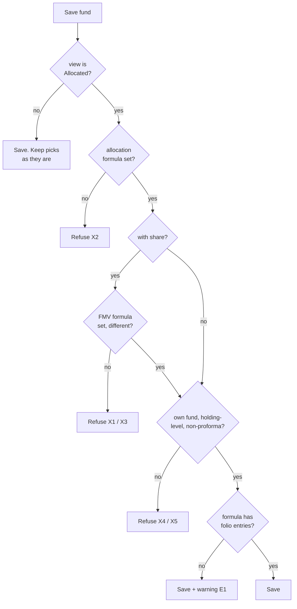

| Check | Rule | Refusal |
|---|---|---|
| Holding-level types | `rule_type` ∈ `AllocatePortfolioInvestment`, `AllocateMasterFundPortfolioInvestment`, `AllocateAggregatePortfolios` (constant `LpPortfolioView::OWN_SHARE_RULE_TYPES`) | X4/X5 message |
| Own fund | `fund_formula.fund_id == fund.id` | X4 message |
| Warning query | `exists?` over `account_entries` with `fund_formula_id` = the allocation formula and a non-null `capital_commitment_id` (one `SELECT 1 … LIMIT 1` on `index_account_entries_on_fund_formula_id`) | Warning only |

**Build notes**
- Form: replace the "Show fund portfolios to LPs" checkbox in `funds/_features.html.erb` with a
  `select` for `lp_portfolio_view` and two `select`s for the formulas. A small Stimulus toggle shows
  the allocation formula for both *Allocated* options and Your FMV only for *with share*, reusing the pattern the features partial already uses for
  dependent fields. Options come from `fund.fund_formulas.where(rule_type: OWN_SHARE_RULE_TYPES)`.
- `ImportFund` keeps writing `show_portfolios=`. The flag semantics give E2/E3 for free.
- New funds: `show_portfolios` is not in `NEW_FUND_DEFAULTS`, so new funds start Hidden (E7).

**Worked examples:** H4–H7, E1–E8, X1–X5 ([business-rules.md](business-rules.md))

**FAQ**

| Question | Answer |
|---|---|
| Why do the picks live on `funds` and not in a settings table? | They are two foreign keys with a 1:1 relationship to the fund. A settings table would be one row per fund anyway. |
| What happens to a pick when its formula is deleted? | The FK is `on_delete: :nullify`. The view is kept. A missing Your FMV formula makes `Fund#lp_own_share_ready?` false, so there are no Your columns (E6). A missing allocation formula means no holdings are visible (E6a). The fund page tells the fund team which to pick again. |
| Why is the "no allocations" check a warning, not a refusal? | Fund teams often set the view before the first run. Refusing would force an order of operations for no safety gain. |

### ② Folio allocations

Existing data, read only. The allocation engine writes one entry per folio and subject:

| Formula `rule_type` | `parent_type` | One entry per | Notes |
|---|---|---|---|
| `AllocatePortfolioInvestment`, `AllocateMasterFundPortfolioInvestment` | `PortfolioInvestment` | folio × purchase × reporting date | Master-fund variant writes on the feeder fund, with the parent a master-fund PI |
| `AllocateAggregatePortfolios` | `AggregatePortfolioInvestment` | folio × holding × date | Entry `name` is "Company-Instrument: Formula", so match on `fund_formula_id`, never on `name` |
| `AllocateForPortfolioCompany-Folio` | `Investor` (company) | folio × company × date | Not used. Can't be picked |
| `…-Proforma` variants | as above | — | Excluded everywhere |

| Owns | Reads / receives | Produces |
|---|---|---|
| Nothing new | — | Rows for ③ |

**Worked examples:** none directly. Proven through ③'s rows.

**FAQ**

| Question | Answer |
|---|---|
| Do we add an index to `account_entries`? | No. With `fund_formula_id` in the filter, MySQL intersects `index_account_entries_on_capital_commitment_id` and `index_account_entries_on_fund_formula_id`: 283 rows estimated, ~2,600 actual, for one folio in the busiest production fund (EXPLAIN on the production copy). |
| Why `fund_formula_id` and not `entry_type` like the SOA? | `entry_type` is free text that differs by fund ("Portfolio Allocation", "Reporting", …). `fund_formula_id` is exact. |

### ③ Visible set and own share

The single rule. `LpPortfolioVisibility` is built once per request for a viewer: an LP user, or an
investor during preview. It is memoised per request in `LpPortfolioVisibilityCache`, a small `CurrentAttributes` class (one instance per viewer) so scopes, views and
policies share one query.

| Owns | Reads / receives | Produces |
|---|---|---|
| The membership and own-share rules; `LpFolioAllocationQuery` SQL | Viewer's investor ids and eligible fund ids (`FeederMasterFundAccess.eligible_ids_for_investor`), each fund's `lp_portfolio_view` and picks, `account_entries`, `portfolio_investments.aggregate_portfolio_investment_id` | `visible_api_ids(fund)`, `visible_pi_ids(fund)`, `visible_company_ids(fund)`, `qualifying_funds_for(company)`, `openable?(company, fund)`, `folio_labels(fund)`, `own_share(fund)` → `{api_id => {cost:, fmv:, missing: [...]}}` |

**Which commitments count for a holding's fund**

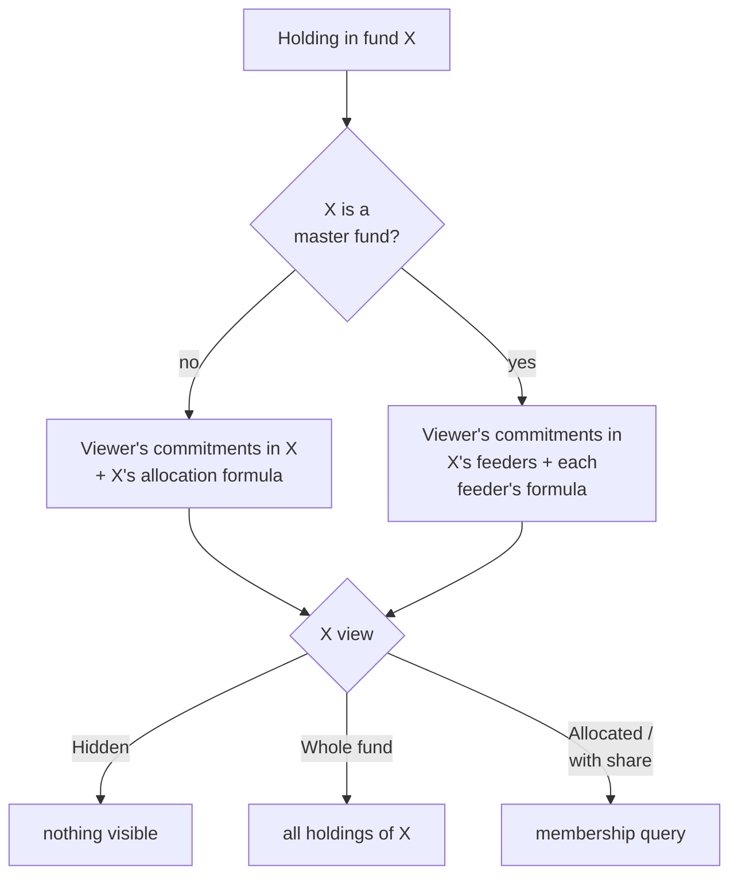

**Membership query (one per viewer per request, all qualifying funds at once).** Each commitment is
paired with the allocation formula of the fund it sits in. A feeder commitment uses the feeder fund's
formula (E28a: no formula, no master holdings).

| Clause | Value | Why |
|---|---|---|
| `(capital_commitment_id, fund_formula_id) IN (…)` | Viewer's commitments, each with its fund's allocation formula id | Index intersection on the two single-column indexes. Several folios combine (E23). Other formulas never count (E11, E14, E16, E20) |
| `parent_type IN ('PortfolioInvestment','AggregatePortfolioInvestment')` | — | Holding-level subjects only (E21) |
| `deleted_at IS NULL` | — | E19 |
| `reporting_date <= CURRENT_DATE` | — | E17, E18 |
| `ABS(amount_cents) >= 1` | One minor unit | Ignores sub-unit noise (E12, E13). Negatives count (E15) |
| `SELECT DISTINCT parent_type, parent_id` | — | Dedup in SQL (CLAUDE.md) |

The result is then mapped in one cheap query, PI ids → their API ids
(`portfolio_investments.aggregate_portfolio_investment_id`). Only holdings in funds whose view is an
*Allocated* option are kept. Because every date up to today counts, an exited holding stays visible
(E20a).

**Own share query (one per fund shown with share).** For the fund's allocation formula (Your cost)
and Your FMV formula, and the viewer's commitments: rank entries per (`capital_commitment_id`, `parent_type`, `parent_id`, `fund_formula_id`)
by `reporting_date DESC` with `ROW_NUMBER()`, keep rank 1 on or before today and not deleted, then
`SUM(amount_cents)` grouped by holding (PI rows mapped to their API). A holding without a rank-1 row
for the FMV formula is reported in `missing` (E38). The allocation formula always has a row for a
visible holding, by definition. A zero row is a figure, not missing (E39). Currency is
the currency of the fund whose entries were read (E36).

**Openable?** `openable?(company, fund)` is true when the fund's view is not Hidden, the company is in
`visible_company_ids(fund)` and `company.show_to_lps`. `qualifying_funds_for(company)` lists the
funds where the first two hold, ordered by name (E59).

**Worked examples:** H2, H3, H15, E9–E41, X17 ([business-rules.md](business-rules.md))

**FAQ**

| Question | Answer |
|---|---|
| Why `ROW_NUMBER()` and not `MAX(reporting_date)` per holding? | Purchases under one holding can have different latest dates (E33). Each purchase's own latest entry must be summed. |
| Why compute for all funds at once? | A user's portfolio pages, policies and the assistant usually touch several funds per request. One membership query per request beats one per fund. |
| Why not memoise on `Current`? | `Current` deliberately holds only the acting user. A separate `CurrentAttributes` class gives the same per-request reset without widening it. Only controllers and the LP assistant build it. |
| What about snapshot holdings? | Unchanged. The scopes keep whatever snapshot filtering they apply today. The visible set filters by id. |

### ④ LP portfolio screens

Existing LP screens, narrowed to the visible set.

| Owns | Reads / receives | Produces |
|---|---|---|
| Investor branches of `PortfolioInvestmentPolicy::Scope#resolve` / `#show?` and `AggregatePortfolioInvestmentPolicy::Scope#resolve` / `#show?`; LP Your columns, totals row and banner in the API grid; LP widget filter on the fund Portfolio Dashboard | ③'s ids, own share and labels | Narrowed rows, the totals row, the "Showing investments allocated to your folio (…)" banner |

**Scope rule (investor role)**

| Fund's view | Rows kept |
|---|---|
| Hidden | none (today: excluded by the `show_portfolios` bit, unchanged) |
| Whole fund | all of the fund's rows (unchanged) |
| Allocated / with share | `id IN visible_api_ids` (API scope) or `id IN visible_pi_ids` (PI scope) |

This is a single SQL condition: `fund_id IN (whole-fund ids) OR id IN (visible ids)`. It is a plain
`where` string, which avoids ActiveRecord's structurally-compatible-joins rule for `#or`, as the
existing comment in the scope notes. `show?` reuses the same check (X17).

**Fund Portfolio Dashboard for LPs.** When the viewer is an investor and the fund's view is an
*Allocated* option, `dashboard_widgets` keeps only widgets whose name is in
`DashboardWidget::LP_ALLOCATED_PORTFOLIO_WIDGETS` (`Portfolio Investments`) (E42). The grid shows the
totals row computed from the narrowed rows, and the Your columns when `own_share` is present.

**Build notes**
- The API grid's company cell links to `lp_company_dashboard_path(company, fund_id:)` only when
  `openable?` is true, and is plain text otherwise (E44).
- The totals row sums visible rows server-side, so it doesn't depend on ag-Grid pagination. The
  "Excludes N holdings not yet allocated" note comes from `own_share[:missing]`.

**Worked examples:** H1, H2, H3, E42–E44, X17

**FAQ**

| Question | Answer |
|---|---|
| Why not filter in `AggregatePortfolioInvestmentList`? | The list services serve fund-team searches too. The scope is the single LP gate that `show?` and every lazy grid already use. |
| Does the fund team see any change? | No. The employee branch of each scope is untouched. |

### ⑤ Company sharing

The fund team's controls: the company switch, the LP layouts and how tags choose them, the guidance
notices, plus the one-time carry-over and the holding page clean-up.

| Owns | Reads / receives | Produces |
|---|---|---|
| `investors.show_to_lps`; `InvestorsController#lp_sharing` (PATCH with explicit `show_to_lps=true/false`); `InvestorPolicy#lp_sharing?`; `DashboardWidget::LP_LAYOUT_TOKEN = "LP"`, `LP_SAFE_WIDGET_NAMES` and the validation tying them; `DashboardWidgetsController#setup_lp_layout`; LP-safe type list in the widget form; guidance notices and tooltips; `CarryOverShowPortfolioToCompanies` migration; holding page clean-up | Fund-team clicks; old `show_portfolio` values | Shared companies and the LP layout for ⑥ |

**How a widget becomes LP-visible.** There is no per-widget flag. `LpLayoutResolver.for(company)`
picks one layout, then the existing tag filter narrows its widgets:

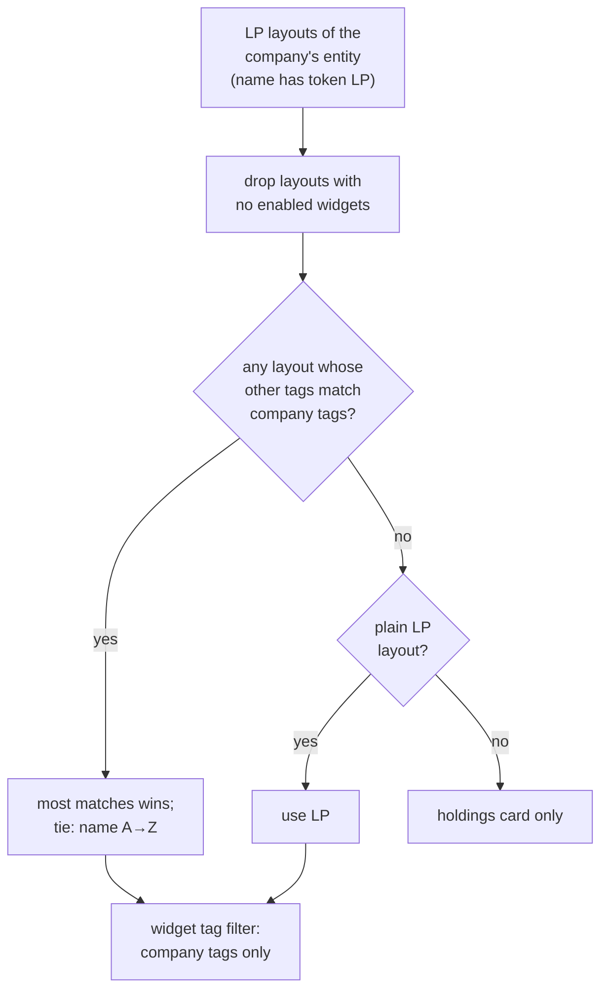

| Step | Rule | Proves |
|---|---|---|
| Parse a layout name | Split on commas, strip spaces, downcase. It is an LP layout iff a token equals `lp`. Other tokens are its tags | E82, E89, E90 |
| Company tags | `company.tag_list` split the same way | E82 |
| Score | Number of layout tags in the company tags. Plain "LP" scores 0 and is the fallback | E81, E83, H11 |
| Tie | Highest score, then layout name ascending. `LpLayoutResolver` returns `tie_with:` for the notice | E84, E92 |
| Empty layout | Layouts with no `enabled` rows are skipped before scoring | E85, E54 |
| Widget filter | `dashboard_widgets(..., name: chosen, tag_list: company.tag_list, lp_context:)`. In LP context the helper skips `current_user.tag_list` | E86, E87 |

The resolver returns a small result (`name`, `matched_tags`, `tie_with`, `fallback?`) that the
company-page notice, the preview banner and the settings notice ("used by N companies") all read,
so the wording never re-derives the rule. The model validation refuses saving a row into an LP layout
(create, or an edit that changes `name`) unless `widget_name` is in `LP_SAFE_WIDGET_NAMES` (X6).

**Routes**

| Verb and path | Action | Does | Responds with |
|---|---|---|---|
| `PATCH /investors/:id/lp_sharing` | `InvestorsController#lp_sharing` | Sets `show_to_lps` to the posted value (idempotent, E45) | Redirect to the company page with a flash |
| `POST /dashboard_widgets/setup_lp_layout` | `DashboardWidgetsController#setup_lp_layout` | If no LP layout rows exist for `current_user.entity_id`, creates Data Card, Key KPIs, Valuations from the catalogue entries. Otherwise does nothing (E52a) | Redirect to the widget list with `name=LP layout` |
| `POST /dashboard_widgets/new_lp_layout` (`tag`) | `DashboardWidgetsController#new_lp_layout` | Creates "LP, <tag>" by copying the "LP" rows (same widget, size, position, metadata). Refuses if that layout exists | Redirect to the new layout (E88) |
| (existing) `GET /dashboard_widgets/new?name=…` | `DashboardWidgetsController#new` | For an LP layout, the type select lists only `LP_SAFE_WIDGET_NAMES`, plus the help texts (E52, E94) | Form |

**Access**

| Role | Change company switch | Edit LP layouts |
|---|---|---|
| Fund team with update permission on the company (`InvestorPolicy#update?` and `record.category == "Portfolio Company"`) | Yes | Yes, if allowed to manage dashboard widgets (`DashboardWidgetPolicy#create?`/`update?`, entity-scoped) |
| Fund team read-only | No (X8) | No |
| LP / investor user | No (X7) | No |

`entity_id` scoping: `InvestorPolicy` already requires `user.entity_id == record.entity_id` for
updates. `DashboardWidgetsController` forces `entity_id = current_user.entity_id`, and
`DashboardWidgetPolicy` requires `belongs_to_entity?`.

**Guidance placement** (the wording lives in the
[proposal](proposal.md#guidance-tooltips-and-info-notices)):

| Where | Partial | Condition computed by |
|---|---|---|
| Show to LPs button tooltip; company header notices (layout used, tie, none) | `investors/show` button bar, Misc dropdown and header | `LpLayoutResolver.for(company)` result; `company` funds' `lp_portfolio_view` (any not Hidden) |
| Settings invite, LP layout notice ("used by N companies"), selector labels and tooltip | `dashboard_widgets/index`, `_dashboard_selector` | `DashboardWidget.lp_layouts_for(entity)`; resolver run over the entity's shared companies (`investors.show_to_lps`) |
| Widget form help (types, Tags field, Embed Document) | `dashboard_widgets/_form` | `DashboardWidget.lp_layout_name?(name)`; widget type |
| Preview banner (layout used, empty) | `lp_company_dashboards/show` (preview) | `LpLayoutResolver.for(company)` |
| Fund tooltip | `funds/_features` | static |
| Holding page notice | `aggregate_portfolio_investments/_show` Actions card | static, links to the company |

All notices reuse the existing Bootstrap alert/tooltip patterns (`alert alert-info` / `alert-warning`
with an icon, `data-bs-toggle="tooltip"`). No new CSS.

**Carry-over** (data migration, idempotent): one `UPDATE investors SET show_to_lps = TRUE` for
`id IN (SELECT DISTINCT portfolio_company_id FROM aggregate_portfolio_investments WHERE show_portfolio
AND deleted_at IS NULL AND snapshot = FALSE)`, restricted to existing, non-deleted investors. It logs
the counts changed and skipped (H17, E48–E51, X19). On the current production copy it touches 13
real-client companies plus the demo accounts. It does not create LP layouts, so those
companies show the holdings card (the same figures as today) until the fund team sets one up. The
E73 notice tells them.

**Holding page clean-up.** Remove the Preview button, the Show/Hide Portfolio button, the "Show
Portfolio" attribute row and the `toggle_show_portfolio` route/action, and add the E80 notice.
The Widgets and Track Record tabs are removed; their records stay stored (E66, E67).

**Worked examples:** H8, H8a, H9, H17, H18, E45–E52b, E72–E77, E81–E94, X6–X8, X19

**FAQ**

| Question | Answer |
|---|---|
| Why layouts chosen by tags instead of a per-widget flag? | One widget row can't have a different order or size for LPs. LP layouts let the fund team arrange LP pages independently, per group of companies, using the layout feature and the company tags they already use. |
| Why "most matching tags, then name" for ties? | It is deterministic and explainable. The company page names the winner and warns about ties, so the fund team can resolve them by editing a tag or a layout. |
| Why a PATCH with an explicit value rather than a toggle? | A toggle flips on a double click (E45) and makes the confirm popup's meaning depend on the current state. |
| Why is the LP-safe list in code, not configurable? | It is a security boundary. Adding a type means checking its data path in ⑦, which is a code change anyway. |
| Why put the company switch on `investors` and not on a new table? | The flag is 1:1 with the company and read on every LP company render. A side table adds a join for nothing. It is flagged for sign-off. |
| Why doesn't the carry-over create an LP layout? | Which widgets an LP should see is the fund team's call. The holdings card preserves exactly what those LPs see today. |

### ⑥ LP Company Dashboard

The new page. `LpCompanyDashboardsController` renders a company for one fund, for an LP or a
fund-team preview, and redirects old holding links.

| Owns | Reads / receives | Produces |
|---|---|---|
| Controller `show` / `preview`; `LpCompanyDashboardPolicy`; view `lp_company_dashboards/show` (holdings card, fund selector, widgets area); LP context in `DashboardWidgetsHelper#dashboard_widgets`; LP mode of `dashboard_widgets/_dashboard` (no Reports dropdown, no layout selector); investor redirect in `AggregatePortfolioInvestmentsController#show`; video branch in `documents/_embed` | ③ `openable?`, `qualifying_funds_for`, visible holdings and own share; ⑤ company switch and the LP layout | The page; widget frames pointing at ⑦ |

**Routes**

| Verb and path | Action | Does | Responds with |
|---|---|---|---|
| `GET /lp/portfolio_companies/:id?fund_id=` | `show` | Authorise. Default `fund_id` to the first qualifying fund | Page, or refusal page with the spec message |
| `GET /lp/portfolio_companies/:id/preview?investor_id=&fund_id=` | `preview` | Fund-team only. Builds ③ for the chosen investor and renders `show` with the banner | Page with "Preview — viewing as …" |
| `GET /aggregate_portfolio_investments/:id` (investor role) | `AggregatePortfolioInvestmentsController#show` | Redirect to `show` for the holding's company and fund. Ignores `preview` | Redirect, or refusal |

**Access decision**

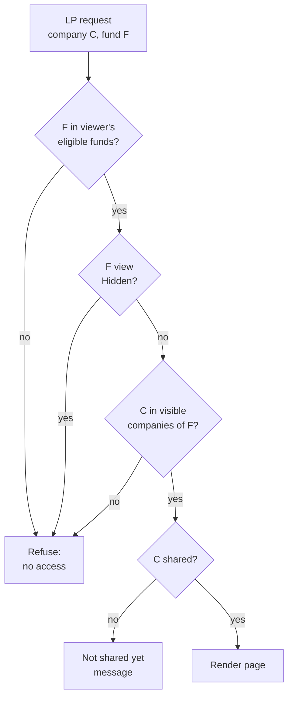

| Role | `show` | `preview` |
|---|---|---|
| LP / investor user with access to F | Per the flowchart (X9–X12) | No (X15) |
| Fund team of C's entity with investor read | Not needed (uses preview) | Yes, as any investor of the entity |
| Anyone else | No (X10) | No |

`entity_id` scoping: the policy requires `company.entity_id == fund.entity_id`. For preview it also
requires `user.entity_id == company.entity_id` and that the chosen investor belongs to that entity.

**Widgets in LP context.** `dashboard_widgets(PORTFOLIO_COMPANY_DASHBOARD, company.entity_id,
name: LpLayoutResolver.for(company).name, tag_list: company.tag_list, lp_context: { company:, fund:, visibility: })`:
- filters `enabled: true, name: <chosen layout>` and, defensively, `widget_name: LP_SAFE_WIDGET_NAMES`.
  Order, size and nav labels come from the layout (`position`, `size`, `tags`);
- applies the existing per-widget tag filter with the company's tags only, skipping
  `current_user.tag_list` and dashboard sequence preferences, which belong to fund-team users (E86, E87);
- in `_dashboard`, LP mode keeps the nav pills (jump links) and drops the Reports dropdown, the layout
  selector and any widget edit/run buttons (E54a);
- never uses the default catalogue (E54);
- sets `@investor = company` for partials that read it, and passes `lp_context` in `uri_params`;
- for widgets that load lazily, renders the card with its frame `src` set to
  `lp_company_dashboard_widget_path(company, widget, fund_id:)` (⑦) instead of the internal endpoint.

**Embed Document video.** `documents/_embed` gains a `document.video?` branch rendering
`layouts/video` with `document.file_url` (E64). In LP context, `investors/widgets/_embedded_doc` finds
the document as today (latest by id with that name, E62) and renders nothing if absent (E60).

**Build notes**
- Fund selector: a `select` that reloads a `turbo_frame` wrapping the holdings card and widgets
  (`lp_company_dashboard_frame`), so only that part reloads (H14).
- Holdings card: reuse the row layout of `aggregate_portfolio_investments/_card_table2`, iterating the
  visible APIs of C in F, with Your columns when own share is on.
- HTML layout: the existing investor-facing layout (`application` / `modernize`, already rendering `_locale_date_meta`).

**Worked examples:** H10–H14, H16, E47, E53–E68, E78, E81–E87, E90, E93, X9–X12, X15, X16

**FAQ**

| Question | Answer |
|---|---|
| Why not reuse `investors#dashboard` with an LP branch? | Its policy (`InvestorPolicy#dashboard?`) and partials assume a fund-team or portco viewer. A separate controller keeps the LP gate in one place and leaves the internal page unchanged. |
| Why is preview its own action rather than a parameter on `show`? | A parameter is exactly the bypass we are removing (X16). A separate action with a fund-team-only policy can't be reached by LPs. |
| What does an LP see during the brief load of a lazy widget? | The standard loading placeholder, as on every dashboard. |

### ⑦ LP data paths

Where LP widget content and LP assistant data come from.

| Owns | Reads / receives | Produces |
|---|---|---|
| `LpWidgetData` loaders and LP widget partials (rendered with the page); `RunQueryTool` placeholders `{VISIBLE_API_IDS}` / `{VISIBLE_PI_IDS}`; `LpChatProvider` supplying them | ③ visible ids; `KpiReport`, `Kpi`, `Valuation`, `PortfolioInvestment`, `AggregatePortfolioInvestment`, `Document` | Widget HTML fragments; scoped assistant queries |

**Widget data in LP context**

| Widget | Internal source today | LP source | LP limits |
|---|---|---|---|
| Data Card | `@investor` attributes, inline | Same, inline | Fields chosen in widget metadata |
| Key KPIs | `@investor.portfolio_kpi_reports` latest, inline | Same, inline, Actual-tagged reports only | Actual only (E55) |
| KPIs | frame → `kpi_reports_path(portfolio_company_id:)` | inline `lp_company_dashboards/widgets/_kpis` ← `LpWidgetData#kpi_table` | Actual only. Metadata `tag_list` forced to Actual (E55, E56) |
| KPI Performance Table | frame → `show_performance_kpi_reports_path` | inline `_kpis` (same LP table) | Actual only |
| Valuations | frame → `/valuations?owner_id=` | inline `_valuations` ← `LpWidgetData#valuations` | Instruments of C's visible holdings in F |
| Portfolio Investments | frame → `/portfolio_investments?portfolio_company_id=` | Same endpoint with `fund_id=F` (④'s scope already narrows it) | F only, visible only (E57) |
| Portfolio Stats | inline `stats_for_portfolio_company` (all funds) | inline with `fund: F` and visible APIs only | F only (E57) |
| Embed Document | inline | inline | The named document only (E63) |

Implementation note (apply): LP widget content is rendered server-side with the page, through
`DashboardWidgetsHelper#lp_widget_partial` (LP versions for KPIs, KPI Performance, Valuations, Portfolio
Stats; the usual partial for Data Card, Key KPIs (Actual-only), Portfolio Investments (selected fund) and
Embed Document). There is no separate widget-content address, so nothing outside the chosen layout can be
fetched (X13). Internal endpoints keep their policies (X14).

**LP assistant.** Today the assistant scopes portfolio tables only by `{FUND_IDS}`. `RunQueryTool`
will reject any query naming `aggregate_portfolio_investments` without `{VISIBLE_API_IDS}`, or
`portfolio_investments` without `{VISIBLE_PI_IDS}` (X18). `LpChatProvider` substitutes the ids from
③. Those are all holdings for Whole-fund funds, the visible ids for Allocated funds, and none for
Hidden funds (H19, E69–E71). The `portfolio.md` skill is updated to describe the placeholders and the
company-level `show_to_lps`, replacing the per-holding `show_portfolio`.

**Worked examples:** H19, E55–E57, E69–E71, X13, X14, X18

**FAQ**

| Question | Answer |
|---|---|
| Why not add an LP branch to `KpiReportPolicy`? | `KpiReport` access rights serve the startup-to-fund sharing flow. An LP branch there would affect every KPI screen. The LP loader reads only what the widget needs. |
| Does the assistant change for fund-team users? | No. Placeholders apply only to `LpChatProvider`. |
| Could the assistant previously see holdings of funds with portfolios hidden? | It scoped by `{FUND_IDS}` only. The new placeholder closes that for Hidden funds as a side effect. |

---

## 4. Reference

### Class diagram

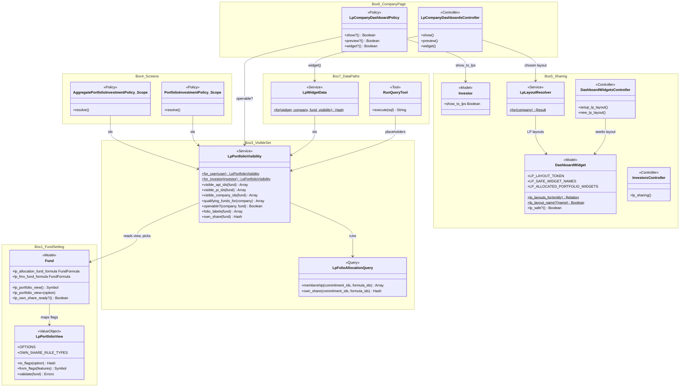

### Data model and schema changes

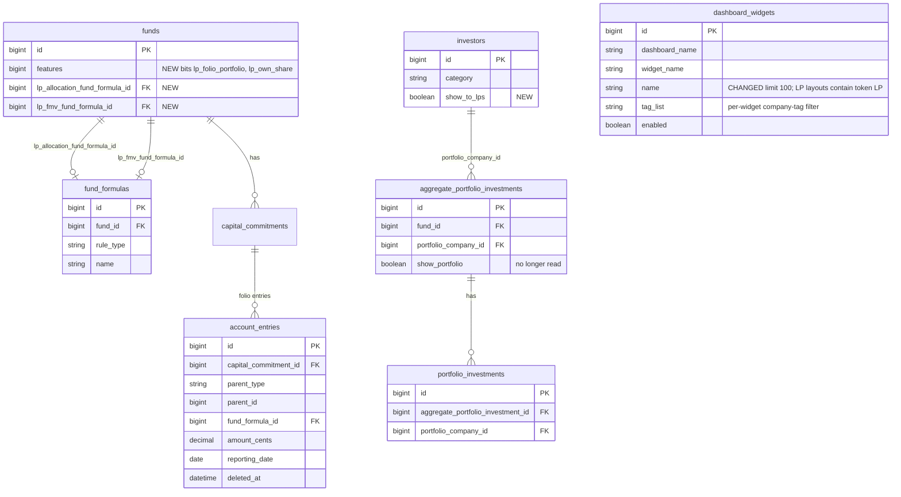

**Indexes:** new `index_funds_on_lp_allocation_fund_formula_id`, `index_funds_on_lp_fmv_fund_formula_id`.
No new index on `account_entries` (see card ②).

**Schema changes**

**`funds`** (changed): stores the fund's LP portfolio view and the two own-share formula picks.

| Column / index | What changed | Why it's needed |
|---|---|---|
| `features` | Two new flag bits appended after `use_own_fx_rates`: `lp_folio_portfolio`, `lp_own_share`. No column change | Encodes *Allocated* and *with own share* next to `show_portfolios`, so existing `show_portfolios?` callers keep working |
| `lp_allocation_fund_formula_id` | Added: bigint, null, FK → `fund_formulas`, `on_delete: :nullify` | The allocation formula: its non-zero folio entries decide which holdings an LP sees under the *Allocated* views, and they are "Your cost" under own share |
| `lp_fmv_fund_formula_id` | Added: bigint, null, FK → `fund_formulas`, `on_delete: :nullify` | The formula whose folio entries are "Your FMV" under own share |
| `index_funds_on_lp_allocation_fund_formula_id` | Added | The FK needs it. It also speeds the "formula in use" check when deleting formulas |
| `index_funds_on_lp_fmv_fund_formula_id` | Added | Same |

**`investors`** (changed): marks a portfolio company as shared with LPs.

| Column / index | What changed | Why it's needed |
|---|---|---|
| `show_to_lps` | Added: boolean, not null, default false | The company-level switch that replaces the per-holding `show_portfolio`. Only meaningful for `category = "Portfolio Company"` |

**`dashboard_widgets`** (changed): layout names now carry tags ("LP, Enterprise Infrastructure -
Software"), so `name` must be longer. No production rows use an LP-tagged name today (all 133
Portfolio Company Dashboard rows are "Default"; the longest name is 7 characters).

| Column / index | What changed | Why it's needed |
|---|---|---|
| `name` | Changed: string limit 20 → 100, default "Default" kept | Layout names now hold "LP" plus company tags. Portfolio company tags themselves run to 120 characters |

**`aggregate_portfolio_investments`** (behaviour only): `show_portfolio` is no longer read or written
after the carry-over. The drop is deferred to a later change.

#### Changes to existing models

These need sign-off (proposal decision 12):
- `Fund` / `FundEnabled`: two new flags; `lp_portfolio_view` reader/writer; two `belongs_to
  …_fund_formula, optional: true`; validation via `LpPortfolioView`.
- `Investor`: new `show_to_lps` attribute (no callbacks).
- `DashboardWidget`: constants `LP_LAYOUT_TOKEN`, `LP_SAFE_WIDGET_NAMES`,
  `LP_ALLOCATED_PORTFOLIO_WIDGETS`; `lp_layouts_for(entity)`, `lp_layout_name?(name)`; validation
  refusing non-safe types in any LP layout; `name` limit widened to 100.
- New `LpLayoutResolver` (service): picks the LP layout for a company from its tags.
- `DashboardWidgetsController`: new `setup_lp_layout`; LP-safe type list and help text on the form
  when `name` is an LP layout; new `new_lp_layout` action. Index and selector notices.
- `PortfolioInvestmentPolicy::Scope`, `AggregatePortfolioInvestmentPolicy::Scope` and both `show?`:
  investor branch narrowed by ③.
- `AggregatePortfolioInvestmentsController#show` (investor redirect); `#toggle_show_portfolio` and
  its route removed.
- `InvestorsController` (new `lp_sharing` action), `InvestorPolicy#lp_sharing?`; company show page
  button bar (Show/Hide from LPs), Misc dropdown (Preview as LP) and header notices.
- `DashboardWidgetsHelper#dashboard_widgets`: new `lp_context:` / LP portfolio filter keywords. The
  existing call sites are unchanged.
- `documents/_embed`: video branch.
- `RunQueryTool`, `LpChatProvider`, `ai/lp_assistant/skills/portfolio.md`.
- **Not changed:** `AccountEntry`, allocation engine services, `SoaGenerator`, `KpiReportPolicy`,
  `DocumentPolicy`.

### Component contracts

| From → To | Contract | Direction rule |
|---|---|---|
| ① → ③ | `fund.lp_portfolio_view` (Symbol), `fund.lp_allocation_fund_formula_id`, `fund.lp_fmv_fund_formula_id`, `fund.lp_own_share_ready?` | ③ reads ①. ① never calls ③ (except the E1 warning, which is its own `exists?`) |
| ② → ③ | `account_entries` rows filtered as in card ③ | Read only. No writes from this change |
| ③ → ④ | `visible_api_ids(fund)`, `visible_pi_ids(fund)`, `own_share(fund)`, `folio_labels(fund)` | Scopes and views call ③. ③ knows nothing about screens |
| ④ → ⑥ | `lp_company_dashboard_path(company, fund_id:)`, rendered only when `openable?` | Link only. ⑥ re-authorises |
| ③ → ⑥ | `openable?(company, fund)`, `qualifying_funds_for(company)`, visible holdings for the card | Policy and controller call ③ |
| ⑤ → ⑥ | `company.show_to_lps`; `LpLayoutResolver.for(company)` → `name`, `matched_tags`, `tie_with` | ⑥ reads. ⑤ never renders LP pages |
| ③ → ⑦ | Visible ids for widget loaders and assistant placeholders | ⑦ calls ③ |
| ⑦ → ⑥ | LP widget partial rendered with the page (`lp_widget_partial`) | ⑥ renders only the chosen layout's widgets |

### Notifications

This change sends, adds, changes and suppresses **no** notifications.

| Audience | Considered | Why nothing is sent |
|---|---|---|
| Investors (LPs) | An email when a company is shared, when the view changes, or when a new holding becomes visible after a run | LP portfolio pages are pull, not push, and visibility changes after every allocation run, so it would be noisy. Funds already notify LPs about statements through existing SOA flows. The proposal lists notifications as not planned |
| Internal (FundOps) | An alert when the view is set with no folio allocations, or when the carry-over skips holdings | The first is an inline form warning to the person saving (E1). The carry-over prints its counts in the migration output, read by whoever deploys. Neither needs a `Noticed` alert |

### Cross-cutting concerns

#### Fund manager modules

Two of the fund manager's modules switch parts of this feature on (E95–E97, X20, X21).

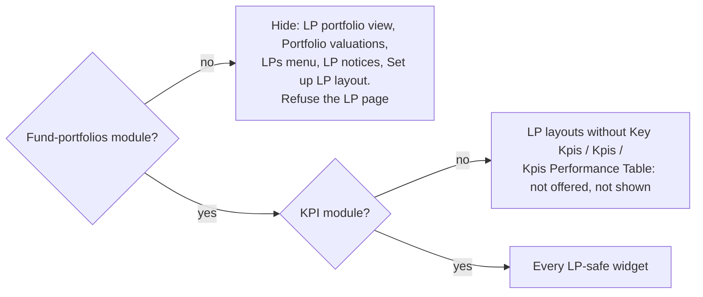

| Module | Checked in | Without it |
|---|---|---|
| Fund portfolios (`enable_fund_portfolios`) | `FundFeatureGuard::PORTFOLIO_FLAGS`, `FundsController#assign_lp_portfolio_view`, `InvestorPolicy#lp_sharing?`, `DashboardWidgetPolicy#manage_lp_layouts?`, `LpCompanyDashboardPolicy` | Settings hidden with stored values kept (as market data, E10). LP sharing controls and the LP page are gone |
| KPIs (`enable_kpis`, the fund manager's switch, since the reader is an LP) | `DashboardWidget.lp_safe_widget_names`: widget form, `lp_safe_in_lp_layout`, starter layout, `lp_layout_widgets`, `LpLayoutResolver` | KPI widgets not offered, refused if posted, skipped on LP pages; a layout holding only KPI widgets counts as empty (E85) |

**Why stored values are kept:** removing a module shouldn't silently change what LPs already see or lose the fund
team's picks. When the module comes back, the settings reappear as they were.

#### Transactions and queries

- **Membership:** one `SELECT DISTINCT` per viewer per request (card ③), then two id-mapping queries
  (`portfolio_investments` → API ids; company → API ids). Memoised per request in `LpPortfolioVisibilityCache`.
- **Own share:** one windowed query per fund shown with share. It selects only `capital_commitment_id,
  parent_type, parent_id, fund_formula_id, amount_cents, reporting_date`, never the wide columns
  (CLAUDE.md).
- **N+1 risks:** the holdings card loads the visible APIs with `includes(:investment_instrument)`. The
  grid's company links use the `openable?` hash, with no per-row query.
- **Writes:** fund save (one row), `lp_sharing` (one row), widget update (one row), carry-over (one
  `UPDATE`). No multi-table transaction.

#### Exception handling and monitoring

N/A — no background work or external calls. Policy refusals render the spec messages. Unexpected
errors follow the standard controller error handling.

#### Performance and security

- **Volume:** in the busiest production fund (fund 316, 33 portfolio formulas), one folio has about
  16,700 entries in all, but only ~2,600 under its "Portfolio FMV" formula (155 purchases × 17 dates).
  Filtering by commitment *and* the allocation formula, MySQL uses an index intersection
  (`index_account_entries_on_capital_commitment_id` ∩ `index_account_entries_on_fund_formula_id`,
  283 rows estimated, EXPLAIN on the production copy). Own share reads two formulas, so it is about
  double. That's inline, with no cache and no new index.
- **Tenant isolation:** every LP path goes through `FeederMasterFundAccess.eligible_ids_for_investor`
  (AccessRight-based) and `company.entity_id == fund.entity_id`. Preview requires the same entity.
- **Data minimisation:** LP widgets render with the page through `lp_widget_partial` and `LpWidgetData` only. The Budget/IC KPI,
  document-folder and all-fund endpoints stay closed (X14).
- **Bypass removed:** the investor path of the holding show page no longer honours `preview`.
- **Assistant:** required placeholders are substituted with integer-cast ids, the same as the existing
  `{FUND_IDS}` handling.

### Worked examples

All H/E/X rows live in **[business-rules.md](business-rules.md)**: the shared setup, then the Happy
Path (H1–H19), Edge Cases (E1–E71) and Error Cases (X1–X19) tables, with the spec scenario and feature
file per row and a coverage check against all three specs. Each card above lists the IDs that prove
it.

### Testing

Cucumber only. There are six feature files, listed in
[business-rules.md › Feature files](business-rules.md#feature-files). New steps live in
`features/step_definitions/lp_portfolio_steps.rb` (shared setup: funds, folios, formulas, entries
with explicit `parent`/`fund_formula_id`/`reporting_date`). They reuse the existing fund, investor,
access-right and dashboard-widget steps. Every scenario carries a comment naming its ID and path, and
code comments name the IDs they implement, linking to `business-rules.md`.

### Risks and open questions

- **Partial run visible mid-run.** An LP loading during an allocation run's bulk insert may briefly
  see a partly-updated set. → Accepted. Runs are short and the next load corrects it. Same as
  today's SOA preview behaviour.
- **Flag bit order.** `Fund#features` bits are positional. The parallel `fund-market-data` change also
  appends flags. → Append at the end, and before merging check `FundEnabled` on main for new flags
  (task in lld).
- **Fund-wide charts disappear for LPs under allocated views.** Funds may notice. → Proposal states it.
  The holdings grid totals remain. Reworking charts is listed as not covered.
- **Fund picks the wrong allocation formula** (e.g. a formula that allocates only new purchases each
  period). → Every date up to today counts, so earlier purchases stay visible. Preview as LP and the
  E1 warning let the fund team check before LPs look.
- **Assistant prompt drift.** The LLM may omit the new placeholder. → The tool rejects the query and
  the skill explains the placeholder. The same pattern as `{FUND_IDS}` works today.

| # | Open question | Current thinking | Status |
|---|---|---|---|
| 1 | When to drop `aggregate_portfolio_investments.show_portfolio` | After one release on the new switch with no rollback | Deferred |
| 2 | Cache for the visible set | Not expected to be needed with the one-formula filter. Revisit only if production timing says otherwise | Deferred |

**FAQ**

| Question | Answer |
|---|---|
| Where do I start reviewing? | Card ③ (the rule), then the two scope changes in card ④, then the access flowchart in card ⑥. |
| What's the riskiest part? | Getting the scope `OR` condition wrong would show LPs too much or too little. X17, E9, H1 and H2 pin it from both sides. |
| How do we roll back? | Set funds back to *Whole fund* or *Hidden*. The old `show_portfolio` column is still populated, so restoring the old holding page is a code revert, not a data repair. |
