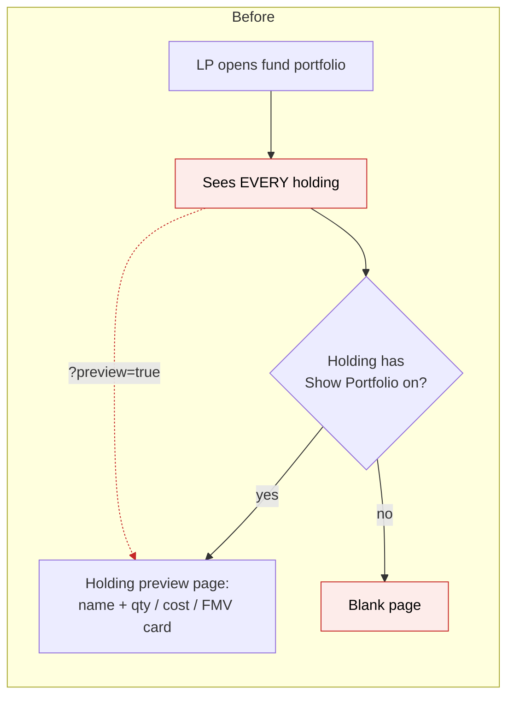
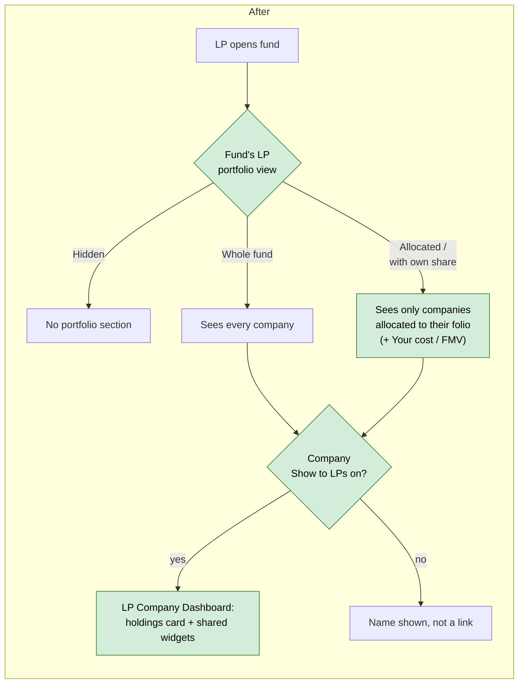
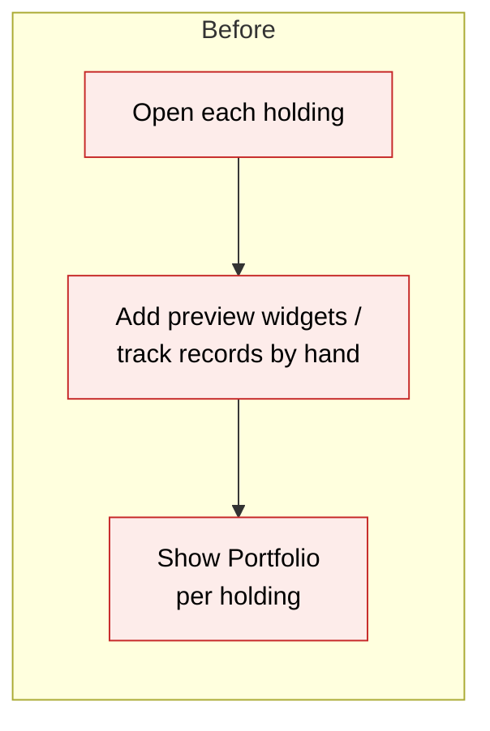
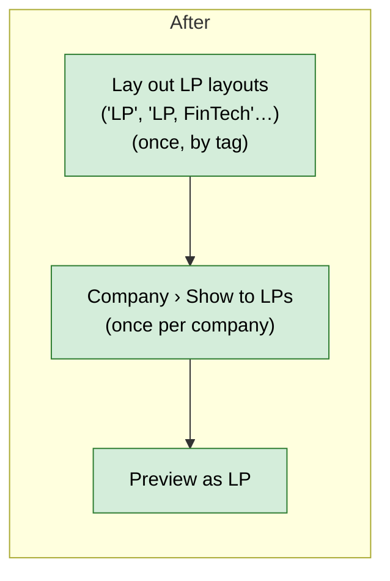

# LP Folio Portfolio & Company Dashboard (replaces the holding preview page) — Proposal

> **Audience:** Business team, product, QA, support — non-technical.
> **Companion document:** [Design](design.md)

> **Planning phase — no code changes.** This document proposes and explains the change. Do not
> edit application code while writing it; implementation happens later, in the tasks phase.

---

## Why

There are four problems with what LPs see of a fund's portfolio today.

1. **LPs see the whole portfolio.** When a fund turns on "Show fund portfolios to LPs", every LP
   sees every investment, including deals their folio was excused from. The allocation engine
   already records which investments are allocated to each folio, but the LP screens ignore that
   record.
2. **The LP company page is a stop-gap.** The only page an LP can open for a company is the
   **holding preview page**, switched on per holding with the **Show Portfolio** button. It was
   meant to represent the *company*, but it hangs off a single holding (one fund × one company ×
   one instrument), so a company held through two instruments has two pages. An LP can also force
   the page open by adding `?preview=true` to its address, even when Show Portfolio is off.
3. **LPs only see the fund's figures, never their own.** An LP sees that the fund put ₹25 Cr into
   Acme, but not their own ₹2.5 Cr share of it. The allocation engine already works out each
   folio's share of each holding for many funds (formulas such as "Allocated Portfolio Cost" and
   "Allocated Portfolio FMV"), but today those figures reach LPs only inside statement-of-account
   documents.
4. **The fund team's real company view is internal only.** Fund teams configure the **Portfolio
   Company Dashboard** (KPIs, valuations, data card, investments), but there is no way to share
   any of it with LPs.

The production data copy (refreshed 8 Oct 2026) shows where the effort has actually gone:

| Feature | Real clients using it | Notes |
|---|---|---|
| Holding preview page content (widgets, track records, preview documents) | **0** | All 14 widgets, 4 track records and 11 preview documents belong to our own demo accounts |
| "Show Portfolio" switch on a holding | 4 (Rhapsody 6 holdings, Fireside 1, Artha 2, Pravega 4) | Only Rhapsody and Fireside also have the fund switch on, so only their LPs can open the page. It shows just the company name and a quantity / cost / FMV card |
| Portfolio Company Dashboard, custom widget layout | 8 real clients plus 2 demo accounts, 133 widgets | Kedaara (55), JM Financial, Lightspeed, Inflexor, Stellaris, SR Retailtech and others. Other accounts get the default widget set |

So this change replaces the preview page with the dashboard fund teams already use, and narrows
the portfolio to each LP's folio.

## What Changes

- **New: one "Show to LPs" switch per portfolio company**, on the company itself. The company is
  what the page represents, so the switch moves off the holding.
- **New: the LP Company Dashboard** replaces the holding preview page. An LP who opens a company
  sees:
  - a **holdings card** for the fund they are viewing (instrument, quantity, average cost, FMV),
    the same figures today's preview page shows, now one row per instrument on a single page;
  - the widgets of the **"LP" layout**, with data limited to the LP's fund.
- **New: LP layouts of the Portfolio Company Dashboard, chosen by company tags.** Fund teams
  already keep named layouts of that dashboard (e.g. "Default"). Any layout whose name includes the
  tag **LP** is an LP layout: "LP" for every company, and "LP, FinTech", "LP, D2C" and so on for
  companies carrying those tags. Portfolio companies already have tags (in production, 309 of 648
  do: "Fintech", "SAAS", "Consumer"…). For each shared company:
  - **Which layout:** the LP layout whose other tags match the most of the company's tags. A company
    tagged "Fintech" gets "LP, FinTech" *instead of* "LP" (matching ignores case). With no match it
    gets the plain "LP" layout. With no LP layout at all, only the holdings card. A matching layout
    with no enabled widgets is skipped. If two layouts match equally, the first by name wins, and the
    company page tells the fund team which one is used.
  - **Which widgets inside it:** the existing widget tag still works. A widget tagged "Fintech"
    inside "LP" shows only for Fintech companies, and untagged widgets show for every company. So one
    "LP" layout can carry an extra "Loan book KPIs" widget just for fintechs.

  The chosen layout's widgets, order, sizes and labels are exactly what LPs see. The internal
  layouts are untouched. Only LP-safe widget types can be added to an LP layout: Data Card, Key
  KPIs, KPIs, KPI Performance Table, Valuations, Portfolio Investments, Portfolio Stats and Embed
  Document. Notes, Tasks, Events, AI scoring and analysis, Captable, Fund Ratios and the Documents
  folder widget can never be added. A **Set up LP layout** button creates the layout with a
  starter set (Data Card, Key KPIs, Valuations) for the fund team to adjust.
- **New: guidance where the fund team looks.** Tooltips and info notices on the company page, the
  dashboard settings, the widget form, Preview as LP, the fund's LP portfolio view and the old
  holding page all point to the LP layout. See
  [Guidance: tooltips and info notices](#guidance-tooltips-and-info-notices).
- **New: Embed Document plays videos.** Today the widget shows a spreadsheet, PDF or Office file;
  an uploaded video falls through to the Office viewer and doesn't play. It will play inline, the
  same way the document page already plays videos. This is how a fund team puts a **founder
  video** on the company page: upload "Founder Video" to each company's documents and add one
  Embed Document widget named "Founder Video". The same fix applies to the fund and investor
  dashboards, which use the same widget.
- **New: one fund dropdown, "LP portfolio view"**. It replaces today's "Show fund portfolios to
  LPs" checkbox, and every LP portfolio list, widget, total and company page follows it:

  | Option | LP sees |
  |---|---|
  | **Hidden from LPs** | No portfolio section (today's checkbox off, and the default for new funds) |
  | **Whole fund portfolio** | Every company, with the fund's figures (today's checkbox on) |
  | **Allocated to their folio** | Only companies allocated to the LP's folio, with the fund's figures |
  | **Allocated, with their own share** | The same companies, plus **Your cost** and **Your FMV** columns |

  Under the two *Allocated* options, fund-wide charts that can't be narrowed to the LP's
  holdings (FMV %, Holding Cost %, Bought %, Sold %, Portfolio IRR, fund Portfolio Stats) are
  hidden from LPs. The holdings list and its totals stay.

  For both *Allocated* options the fund picks its **allocation formula**, the one formula that
  decides which holdings each LP sees. A holding is visible when the LP's folio has a non-zero
  amount under that formula on any date up to today. Under *with their own share* the same
  formula also gives **Your cost**, and the fund picks a second formula for **Your FMV**. Formula
  names differ from fund to fund (in production: "Allocated Portfolio Cost", "Amount Invested",
  "Portfolio Cost", "Allocated Portfolio FMV" and more), so the fund chooses.
  Existing funds land on *Hidden* or *Whole fund* according to today's checkbox, so nothing changes
  for them.
- **New: "Preview as LP"** on the portfolio company page, so the fund team can see exactly what a
  chosen LP will see.
- **Retired:** the holding preview page, the **Show Portfolio / Hide Portfolio** button and the
  **Preview** button on holdings, and the `?preview=true` back door. Old links to a holding page
  take an LP to the company's dashboard instead.
- **Carried over automatically:** a company's new switch is turned on if any of its holdings has
  Show Portfolio on today. Rhapsody's and Fireside's LPs keep the access they have now, with the
  same figures, on the new page.
- **Not deleted:** widgets, track records and preview documents attached to holdings stay in the
  database, but LPs no longer see them. Only demo accounts have any. Investment opportunities and
  deals keep using their own widgets and track records, unchanged.
- **BREAKING (minor):** the holding-level Show Portfolio switch goes away. Anyone who used it now
  uses the company switch. The migration keeps every currently visible company visible.

### Flow Diagram

**LP opening a company.** Today the page belongs to one holding and is mostly empty. After this
change, the LP opens one dashboard for the company.





**Fund team sharing a company.** Today the team toggles each holding and builds preview content
from scratch. After this change, they lay out the LP layout once and switch companies on.





---

## User Stories

### US-1: LP sees only investments allocated to their folio

**As an** LP, **I want** the portfolio to show only investments my folio participates in, **so
that** I don't see deals I was excused from.

**Acceptance criteria:**
- With either *Allocated* option, a holding is listed only when one of the LP's folios in that fund has
  a non-zero amount for it under the fund's allocation formula, dated on or before today.
- A company is listed if any of its holdings is visible.
- The portfolio list, the aggregated list, the fund Portfolio Dashboard widgets, every total and
  the company page access check all use the same visible set.
- The banner names the folio(s): "Showing investments allocated to your folio (F-012)".

### US-2: Fund team chooses the LP portfolio view in one place

**As** fund operations, **I want** one dropdown that decides what LPs see of the portfolio, **so
that** I don't have to line up separate switches.

**Acceptance criteria:**
- **LP portfolio view** sits under Fund › Edit › Features, where "Show fund portfolios to LPs" used
  to be, with the four options in the table under What Changes.
- Existing funds open showing *Hidden from LPs* if the old checkbox was off and *Whole fund
  portfolio* if it was on. LPs see no difference until someone changes the dropdown.
- Choosing either *Allocated* option reveals the **Allocation formula** picker (required).
  *Allocated, with their own share* also reveals the **Your FMV** picker (required). Other options
  hide both.
- Saving either *Allocated* option when the allocation formula has no folio entries yet saves but
  warns: "No folio allocations found for this fund yet. LPs will see an empty portfolio until an allocation
  run completes."

### US-3: Fund team shares a company with LPs

**As** fund operations, **I want** one Show to LPs switch per portfolio company, **so that** I
manage the company, not each holding.

**Acceptance criteria:**
- The portfolio company page has **Show to LPs / Hide from LPs** under Actions, and a **Visible to
  LPs** badge when on.
- At release, a company's switch is on if any of its holdings had Show Portfolio on. No company
  that LPs can open today becomes unopenable.
- The switch alone grants nothing. The LP also needs fund access, a fund LP portfolio view other than
  *Hidden*, and the company in their visible set.

### US-4: Fund team lays out LP layouts, chosen by company tags

**As** fund operations, **I want** LP layouts of the Portfolio Company Dashboard picked by company
tags, **so that** fintechs, D2C brands and everyone else can each get the right widgets without
touching my internal layouts.

**Acceptance criteria:**
- Any Portfolio Company Dashboard layout whose name includes the tag "LP" is an LP layout: "LP" for
  every company, "LP, FinTech" for companies tagged FinTech, and so on. **Set up LP layout** creates
  "LP" (Data Card, Key KPIs, Valuations). **New LP layout for a tag** creates "LP, <tag>" as a copy
  of "LP".
- For a shared company, LPs see the LP layout whose other tags match the most of the company's tags
  (ignoring case), else "LP", else only the holdings card. Layouts with no enabled widgets are
  skipped. A tie goes to the first name alphabetically, and the company page says which layout won.
- Inside the chosen layout, a widget with tags shows only for companies with one of those tags.
  Untagged widgets show for every company using the layout.
- Adding a widget to an LP layout offers only LP-safe types (see Validation Rules). Other types are
  refused, also when sent directly.
- The LP page follows the layout's order, sizes and nav labels. A disabled widget is never shown.
- Editing an LP layout never changes Default or any other internal layout.

### US-5: LP opens the company dashboard

**As an** LP, **I want** to open a company from my portfolio, **so that** I see its holdings and
shared information in one place.

**Acceptance criteria:**
- The company name is a link only when the company switch is on and the company is in the LP's
  visible set.
- The page shows the holdings card for the selected fund, one row per instrument, followed by the
  LP layout widgets. KPIs are Actual only. Investment and valuation data is limited to the selected
  fund.
- If the LP holds the company through several qualifying funds, a fund selector appears. It
  defaults to the first fund alphabetically.
- With no LP layout widgets, the page still shows the holdings card plus "No further company
  information has been shared." It never falls back to the internal widget set.
- LPs never see the Reports dropdown, the layout selector or any edit/run buttons.
- A company outside the visible set returns "You do not have access to this company."

### US-6: Old holding links keep working

**As an** LP with a bookmarked holding page, **I want** to land somewhere sensible, **so that**
links don't break.

**Acceptance criteria:**
- Opening an old holding page as an LP (with or without `?preview=true`) redirects to that
  company's dashboard for the holding's fund if the LP may see it. Otherwise it refuses with the
  US-5 message.
- Fund team users opening a holding still get the internal holding page, without the Preview and
  Show/Hide Portfolio buttons.

### US-8: LP sees their own share (when the fund wants it)

**As an** LP, **I want** to see my own cost and FMV for each company, **so that** I understand my
exposure, not just the fund's.

**Acceptance criteria:**
- Applies only when the fund's LP portfolio view is *Allocated, with their own share*. Any other
  option shows no "Your" columns anywhere.
- With that option, the fund's allocation formula gives **Your cost**, and the fund must also pick
  a **Your FMV** formula. Only the fund's formulas that write per-folio, per-holding allocations
  are offered.
- "Your" figures are the LP's own folio allocation entries (the latest one on or before today, from non-proforma
  formulas), added up per holding, company and total. Several folios in the fund are added together.
- They appear in the LP portfolio list, its totals, the fund Portfolio Dashboard totals and the
  company page holdings card, with an info note naming the two formulas and the latest reporting date.
- A holding with no entry under a picked formula shows "—" ("Not yet allocated to your folio")
  and is left out of the LP's totals, with a note saying how many were left out.
- The figures match the LP's statement of account when the statement uses the same formulas.

### US-7: Fund team previews the LP view

**As** fund operations, **I want** to preview the company dashboard as a chosen LP, **so that** I
can check before telling LPs.

**Acceptance criteria:**
- **Preview as LP** on the portfolio company page has an LP and fund picker. It renders exactly what
  that LP sees, under a "Preview — viewing as …" banner.

---

## UI Behavior

### Portfolio company page (fund team) — button bar

```
┌────────────────────────────────────────────────────────────────────────┐
│ [ ✎ Edit ] [ 🗑 Delete ] [ 🌐 Show to LPs ] [ ⋮ Misc ▾ ]                │
│                                               ├ CapTable               │
│                                               ├ Dashboard              │
│                                               ├ Preview as LP …   ← new │
│                                               ├ Documents              │
│                                               └ …                      │
│ ⓘ LPs see the "LP, FinTech" layout for this company (matched on its    │
│   tag FinTech). → Open layout                                          │
└────────────────────────────────────────────────────────────────────────┘
```

**Behavior notes:**
- **Show to LPs** sits in the page's existing button bar, next to Edit and Delete, with the same
  outline-button style. When on, it reads **Hide from LPs**, and a "Visible to LPs" badge
  (`badge bg-success-subtle text-success`) appears beside the company name.
- **Preview as LP…** is a new item in the existing **Misc** dropdown, which already holds Dashboard
  and CapTable. It opens a small modal to pick an LP and a fund.
- Hide from LPs uses the app's existing action-summary confirm popup (Bootstrap modal): "LPs will no
  longer be able to open this company's page. Their portfolio list still shows the company."
- The info notice under the bar is one of the guidance notices below.

### Settings › Dashboards › Portfolio Company Dashboard › LP layouts

```
┌──────────────────────────────────────────────────────────────────────┐
│ Portfolio Company Dashboard   Layout: [ LP, FinTech       ▾ ]  ⓘ     │
│                                         Default                      │
│                                         LP                (LPs, all) │
│                                         LP, D2C     (LPs, tag D2C)   │
│                                         LP, FinTech (LPs, tag FinTech)│
│ ⓘ LPs see this layout for shared companies tagged FinTech (3 today:  │
│   Paywise, LendKart, Cashflo). Other companies use "LP". Only        │
│   LP-safe widgets can be added. Check it with Preview as LP.         │
├────┬──────────────────────┬─────────┬────────┬─────────┬─────────────┤
│ #  │ Widget               │ Enabled │ Size   │ Tags    │             │
├────┼──────────────────────┼─────────┼────────┼─────────┼─────────────┤
│ 1  │ Data Card            │ ✓       │ Medium │         │ [Edit]      │
│ 2  │ Key KPIs             │ ✓       │ Medium │         │ [Edit]      │
│ 3  │ KPIs (Loan book)     │ ✓       │ XL     │ NBFC    │ [Edit]      │
│ 4  │ Valuations           │ ✓       │ XL     │         │ [Edit]      │
├────┴──────────────────────┴─────────┴────────┴─────────┴─────────────┤
│ [ + Add widget ]   [ + New LP layout for a tag ]                     │
└──────────────────────────────────────────────────────────────────────┘
```

**Behavior notes:**
- With no LP layout yet, the page shows an info notice and a **Set up LP layout** button
  instead of the table. It creates "LP" with Data Card, Key KPIs and Valuations.
- **New LP layout for a tag** asks for a tag (suggesting the tags already used on portfolio
  companies) and creates "LP, <tag>" by copying the widgets of "LP" as a starting point.
- The selector labels each LP layout with who sees it: "(LPs, all)" or "(LPs, tag FinTech)". The
  info notice names how many shared companies use the selected layout today.
- A widget's **Tags** column narrows it within the layout: "KPIs (Loan book)" tagged NBFC shows only
  for companies also tagged NBFC. An empty Tags cell means every company using this layout.
- **Add widget** on an LP layout lists only LP-safe types. The form says so: "LP layout: only
  widgets that are safe to show LPs are listed."

### Guidance: tooltips and info notices

| Where | When | Type | Text |
|---|---|---|---|
| Company page button bar › **Show to LPs** | Always | Tooltip | "LPs who hold this company will be able to open its page. They see the holdings card and the widgets of the LP layout that matches this company's tags." |
| Company page header | Switch on | Info notice | "LPs see the "LP, FinTech" layout for this company (matched on its tag FinTech). → **Open layout**" (or "…the "LP" layout (no tag-specific layout matches)") |
| Company page header | Switch on, two LP layouts match equally | Info notice (warning style) | "Two LP layouts match this company's tags ("LP, D2C" and "LP, FinTech"). LPs see "LP, D2C". Remove a tag or a layout to choose." |
| Company page header | Switch on, no LP layout has enabled widgets for it | Info notice (warning style) with link | "LPs see only the holdings card for this company. Add widgets to an LP layout → **Set up LP layout**" |
| Company page header | Switch on, fund LP portfolio view *Hidden* for every fund holding it | Info notice | "No LP can open this page yet: every fund holding this company hides its portfolio from LPs. Change it in Fund › Edit › LP portfolio view." |
| Settings › Dashboards › Portfolio Company Dashboard (any layout) | No LP layout exists | Info notice + button | "Want to share company pages with LPs? Create an LP layout. It's what LPs see, and your internal layouts stay as they are. Add "LP, <tag>" layouts later for companies with that tag. → **Set up LP layout**" |
| Same page, an LP layout selected | Always | Info notice | "LPs see this layout for shared companies tagged FinTech (3 today: …). Other companies use "LP". Only LP-safe widgets can be added. Check it with Preview as LP." (For "LP": "LPs see this layout for shared companies that no tag-specific LP layout matches (12 today).") |
| Same page, layout selector | Always | Option label + tooltip | "(LPs, all)" / "(LPs, tag FinTech)"; tooltip "Layouts whose name includes LP are shown to LPs. Other layouts are internal." |
| Widget form, LP layout | Always | Help text under the widget type | "LP layout: only widgets that are safe to show LPs are listed." |
| Widget form, LP layout, Tags field | Always | Help text | "Optional. Show this widget only for companies with one of these tags. Leave empty for every company using this layout." |
| Widget form, LP layout, type Embed Document | Always | Help text | "Shows the company's latest document with this exact name, e.g. "Founder Video". Upload it to each company you share." |
| Preview as LP banner | Always | Info notice | "Preview — viewing as Ravi Menon (F-012). Layout: "LP, FinTech" (company tag FinTech)." Adds "This LP sees only the holdings card. Add widgets to an LP layout → **Open LP layout**" when the layout is empty |
| Fund › Edit › LP portfolio view ⓘ | Always | Tooltip | "Decides which holdings LPs see. To let LPs open a company's page, also switch the company to Show to LPs and set up an LP layout." |
| Holding page (fund team), where the old buttons were | Always | Info notice | "Sharing with LPs has moved to the company: use Show to LPs on the company page and the LP layouts in dashboard settings." with a link to the company |

### Holding page (fund team) — what goes away

- The **Preview** button, the **Show Portfolio / Hide Portfolio** button, and the "Show Portfolio:
  Yes/No" attribute row.
- The **Widgets** and **Track Record** tabs are removed. Their records stay stored but are no longer shown (only demo accounts have any).

### Fund › Edit › Features

```
┌─────────────────────────────────────────────────────────────────┐
│ LP portfolio view   [ Allocated, with their own share     ▾ ]  ⓘ │
│                       • Hidden from LPs                          │
│                       • Whole fund portfolio                     │
│                       • Allocated to their folio                 │
│                       • Allocated, with their own share          │
│                                                                  │
│     Allocation formula [ Allocated Portfolio Cost  ▾ ]  ⓘ        │
│       decides which holdings LPs see, and gives Your cost        │
│     Your FMV           [ Allocated Portfolio FMV   ▾ ]           │
└─────────────────────────────────────────────────────────────────┘
```

**Behavior notes:**
- The Allocation formula picker appears for both *Allocated* options. Your FMV appears only for
  *Allocated, with their own share*. Both appear without a page reload and list only this fund's
  holding-level portfolio allocation formulas.
- The ⓘ tooltip explains that the two *Allocated* options use the fund's allocation runs up to today.

### LP › Fund › Portfolio

**Ravi's portfolio (Growth Fund I, F-012, rule = Allocated to folio, own share = on):**

```
┌──────────────────────────────────────────────────────────────────────────────────┐
│ Growth Fund I › Portfolio                                 As of 30/09/2026       │
│ Showing investments allocated to your folio (F-012)                          ⓘ   │
├────────────────────┬────────────┬────────────┬────────────┬────────────┬─────────┤
│ Company            │ Fund cost  │ Fund FMV   │ Your cost  │ Your FMV   │ Multiple│
├────────────────────┼────────────┼────────────┼────────────┼────────────┼─────────┤
│ Acme Robotics    ▸ │ ₹25.00 Cr  │ ₹40.00 Cr  │ ₹2.50 Cr   │ ₹4.00 Cr   │ 1.60x   │
│ Cedar Logistics    │ ₹15.00 Cr  │ ₹18.00 Cr  │ ₹1.50 Cr   │ ₹1.80 Cr   │ 1.20x   │
├────────────────────┼────────────┼────────────┼────────────┼────────────┼─────────┤
│ Total (2)          │ ₹40.00 Cr  │ ₹58.00 Cr  │ ₹4.00 Cr   │ ₹5.80 Cr   │ 1.45x   │
└────────────────────┴────────────┴────────────┴────────────┴────────────┴─────────┘
 ⓘ Your cost = "Allocated Portfolio Cost", Your FMV = "Allocated Portfolio FMV",
   from the allocation run dated 30/09/2026.
```

- Fund totals: cost 25 + 15 = **₹40 Cr**. FMV 40 + 18 = **₹58 Cr**.
- Ravi's figures come from his folio's allocation entries, not from a percentage worked out on
  the screen. In this example the formulas gave F-012 10% of each holding it takes part in:
  Acme 10% × 25 = **₹2.50 Cr** cost and 10% × 40 = **₹4.00 Cr** FMV; Cedar 10% × 15 = **₹1.50 Cr**
  and 10% × 18 = **₹1.80 Cr**. Ravi's totals: 2.50 + 1.50 = **₹4.00 Cr** cost and
  4.00 + 1.80 = **₹5.80 Cr** FMV, so his multiple is 5.80 ÷ 4.00 = **1.45x**.
- The multiple column uses Ravi's figures when his own share is shown, and the fund's otherwise.
- The fund also holds Bluefin Health (₹20 Cr cost, ₹22 Cr FMV), so the whole fund totals ₹60 Cr
  cost and ₹80 Cr FMV. F-012 was excused from Bluefin, so its allocation is ₹0 and Bluefin is in
  neither the rows nor the totals.
- With the option off, the two "Your" columns are absent and the screen looks as it does today.

**Ravi's LP Company Dashboard (Acme Robotics):**

```
┌──────────────────────────────────────────────────────────────────────┐
│ Acme Robotics                                         Growth Fund I  │
├──────────────────────────────────────────────────────────────────────┤
│ Holdings (Growth Fund I)                                             │
│ Instrument     Quantity  Avg cost  Fund cost  Fund FMV  Your cost Your FMV│
│ Series B CCPS  1,00,000  ₹2,500    ₹25.00 Cr  ₹40.00 Cr ₹2.50 Cr  ₹4.00 Cr│
├────────────────────────────┬─────────────────────────────────────────┤
│ Data Card                  │ Key KPIs (Actual, Q2 FY27)              │
│ Sector   Industrial robots │ Revenue      ₹62.0 Cr   ▲ 18% YoY       │
│ HQ       Pune              │ EBITDA       ₹ 7.4 Cr   ▲  9% YoY       │
│ Invested Mar 2023          │ Headcount    410                        │
├────────────────────────────┴─────────────────────────────────────────┤
│ Valuations                                                           │
│ 31/03/2026  ₹36.00 Cr      30/09/2026  ₹40.00 Cr                     │
└──────────────────────────────────────────────────────────────────────┘
```

- Holdings arithmetic: 1,00,000 × ₹2,500 = ₹25,00,00,000 = **₹25.00 Cr** fund cost. "Your" columns
  are Ravi's allocation entries for this holding, shown only when the fund has the option on.
- The holdings card carries the same three figures (quantity, average cost, FMV) as today's
  preview card, so Rhapsody's and Fireside's LPs lose nothing.


---

## What This Feature Does NOT Cover

| Excluded | Covered In |
|---|---|
| LP's own share of income, realised gains or expenses per company | Later. This change covers cost and FMV only |
| Company-level allocation formulas (allocated per company, not per holding) | Later. Only holding-level formulas can be picked, for visibility or own share |
| Own share in the LP's folio currency | Later. Figures are in the currency of the fund that allocated them |
| Tag-free per-company layouts | Not planned. Use a company tag and an "LP, <tag>" layout |
| LP-visible Documents, Captable, Fund Ratios, Value Bridge widgets | Later. Each needs its own LP data limits |
| Videos hosted on YouTube / Vimeo (a link, not an uploaded file) | Later, if needed. Would add a URL option to Embed Document |
| Deleting holding widgets, track records or preview documents | Not done. They are kept but no longer shown to LPs |
| Investment opportunity and deal pages | Unchanged. They keep their own widgets and track records |
| Notifications to LPs when a company is shared | Not planned |
| Mobile LP app | Separate work |
| The informational "Excused investors" list | Visibility follows allocations only |

---

## Validation Rules

| Field | Rule | Default |
|---|---|---|
| LP portfolio view (fund) | One of: Hidden from LPs / Whole fund portfolio / Allocated to their folio / Allocated, with their own share | Hidden for new funds. Existing funds follow today's checkbox |
| Allocation formula (fund) | Required for both *Allocated* options, ignored otherwise. Missing: "Choose the allocation formula that decides which holdings LPs see." | Empty |
| Your FMV formula (fund) | Required for *Allocated, with their own share*. Missing: "Choose the allocation formula that gives the LP's FMV." Must differ from the allocation formula | Empty |
| Both formulas | Must be one of this fund's non-proforma holding-level portfolio allocation formulas (instrument or aggregated holding). Company-level and other funds' formulas are refused | — |
| Show to LPs (portfolio company) | On/off. Only the fund manager that owns the company can change it | Off, except carried over at release |
| LP layout name | Comma-separated tags including "LP" (e.g. "LP", "LP, FinTech"), up to 100 characters. Matching ignores case and spaces | — |
| Widget in an LP layout | Type must be Data Card, Key KPIs, KPIs, KPI Performance Table, Valuations, Portfolio Investments, Portfolio Stats or Embed Document. Any other type is refused, also on the server: "This widget can't be added to an LP layout: it isn't safe to show LPs." | — |

---

## Behavior Rules

Every scenario, with its happy-path (H), edge-case (E) and error-case (X) ID, is in
[business-rules.md](business-rules.md). QA and support should test from there.

---

## Resolved Design Decisions

| # | Decision | Resolution |
|---|---|---|
| 1 | Keep the preview page, add widgets to it, or replace it? | **Replace it.** No real client ever added preview content, the page was holding-scoped though it meant the company, and it had a bypass. The dashboard is what clients actually configure |
| 2 | Where does the LP switch live? | **On the portfolio company.** The page represents the company |
| 3 | What happens to existing Show Portfolio flags? | Carried over: company on if any holding was on. Then the holding flag and its button are retired |
| 4 | What happens to holding widgets, track records, preview documents? | Kept in the database, no longer shown to LPs. Only demo accounts have any |
| 5 | What does "allocated to the folio" mean? | A non-zero amount for the folio under the fund's chosen **allocation formula**, for that holding, dated on or before today. One formula, not "any portfolio formula", which keeps the rule explainable and the lookup to a few hundred rows per folio instead of ~16,700 |
| 6 | Show the LP's own share? | **Yes, if the fund turns it on.** The allocation formula gives "your cost", and the fund picks a second formula for "your FMV". Figures are read from the LP's folio entries, never recomputed on screen. Fund figures stay alongside |
| 7 | Which widgets can be shared, and how? | Widgets placed in an **LP layout** of the Portfolio Company Dashboard: any layout whose name includes the tag "LP". The company's tags pick the layout ("LP, FinTech" over "LP"), and widget tags narrow it further. Funds arrange LP pages separately from their internal layouts. Only types on a fixed LP-safe list can be placed in an LP layout |
| 8 | Empty LP layout? | Holdings card only. Never a fallback to the internal widget set. Info notices point the fund team to set it up |
| 9 | KPIs for LPs? | Actual only |
| 10 | Founder video: new widget or existing? | Existing **Embed Document**, taught to play uploaded videos. No new widget type |
| 11 | Separate switches or one control? | **One dropdown, "LP portfolio view"**, replacing the "Show fund portfolios to LPs" checkbox. *Whole fund* with own share isn't offered: it would list companies the LP was excused from with ₹0 figures |
| 12 | Existing records affected | Adds a switch to portfolio companies, reserves an "LP" layout name for dashboard widgets (no new column), and adds the LP portfolio view (with its two formula picks) to funds, built on the existing "show portfolios" flag. Retires a field on holdings. **These touch existing models and need sign-off before the design phase** |

---

## Capabilities

### New Capabilities

- `funds/lp-folio-portfolio-visibility`: The fund's single LP portfolio view (hidden, whole fund,
  allocated, allocated with own share), applied the same way to every LP portfolio list, widget, total and company page.
- `funds/lp-portfolio-own-share`: The *with their own share* view: shows each LP their own cost and FMV per holding,
  company and total, read from the folio allocation entries of the allocation formula and a Your FMV formula.
- `funds/lp-portfolio-company-dashboard`: The company-level Show to LPs switch, LP-safe "Show to
  LPs" dashboard widgets, the LP Company Dashboard (holdings card plus shared widgets, limited to
  the LP's fund), Preview as LP, retirement of the holding preview page and redirect of its links,
  and the carry-over of existing flags.

### Modified Capabilities

None. No existing spec covers LP portfolio access, the holding preview page or dashboard widgets.

---

## Impact

- **Fund settings:** the "Show fund portfolios to LPs" checkbox becomes the four-option LP portfolio view
  dropdown. Anything that reads the old flag keeps working: *Hidden* means off, every other option means on.
- **Portfolio company page:** Show to LPs / Hide from LPs and Preview as LP actions.
- **Dashboard settings:** a reserved "LP" layout with LP-safe widget types only, a Set up LP layout button, and the guidance notices.
- **New LP Company Dashboard,** reached from the LP portfolio list.
- **Holding page:** loses Preview, Show/Hide Portfolio and the attribute row. LP views of it
  redirect.
- **LP portfolio screens:** lists, the fund Portfolio Dashboard and totals follow the visibility
  rule.
- **Data behind shared widgets** (KPIs, valuations, investments) gets an LP access path limited to
  the LP's fund and visible set.
- **LP AI assistant:** its portfolio skill describes the holding-level flag. It must describe the
  company switch instead, and follow the same visibility rule.
- **One-time data step at release:** carry Show Portfolio over to companies. In the current
  production copy that covers 13 real-client companies plus the demo accounts.
- **Read only, unchanged:** the allocation engine and statements of account.
- **Docs:** the portfolio investments and dashboard widgets user guides and their FAQs.

---

## Benefits

1. LPs see only the deals they are in, and their screens match their statements of account, which
   use the same allocations.
2. One page per company instead of one per instrument, built from the dashboard fund teams already
   maintain. No more hand-building preview content.
3. The preview back door is closed, and internal widgets can never reach LPs.
4. Funds that want it can show each LP their own cost and FMV per company, matching their
   statement of account.
5. No one loses anything at release. Every company LPs can open today stays openable, with the same
   figures.

---

## FAQ

| Question | Answer |
|---|---|
| Who can use this? | Fund operations users who can edit funds, portfolio companies and dashboards set it up. LPs with fund access see the result |
| What happens to companies LPs can see today? | They stay visible. The company switch is turned on automatically wherever a holding had Show Portfolio on |
| What happens to the widgets and track records we added to holdings? | They stay stored but are no longer shown to LPs. In production only our demo accounts have any |
| Do investment opportunity and deal pages change? | No |
| Why did an LP's portfolio go empty after switching the rule? | No allocation run has allocated holdings to folios yet. Run allocations, or choose *Whole fund portfolio* until then |
| Can LPs see their own share? | Yes, if the fund's LP portfolio view is *Allocated, with their own share* and the Your FMV formula is picked. Otherwise they see the fund's figures, as today |
| Why does my own share show "—" for one company? | That holding hasn't been allocated to your folio by an allocation run yet. It appears after the next run |
| Will the own-share figures match my statement? | Yes, when the statement uses the same allocation formulas, because both read the same entries |
| Why is a company listed but not clickable? | Its Show to LPs switch is off |
| Can we share different widgets per company? | Per group of companies, yes, through tags. Tag the companies (e.g. FinTech) and create an "LP, FinTech" layout, or tag individual widgets inside "LP". A one-off layout for a single company works the same way with a tag only that company has |
| Does changing the LP layout change our internal dashboard? | No. It is a separate layout. Default and your other layouts are untouched |
| Can we show a founder video? | Yes. Upload it to the company's documents under one agreed name (e.g. "Founder Video"), add an Embed Document widget with that name to the LP layout. Only that one document is exposed to LPs, not the company's document folder |
| Could an LP see internal notes or AI scoring? | No. Those widget types can't be added to the LP layout, and the server refuses them even if forced |
| Old bookmarked links? | They redirect to the company dashboard, or refuse if the LP may not see it |
| Notifications, billing? | None in this change |
| How does it work under the hood? | See [design.md](design.md) |

---

## Design Principle for the Next Phase

Keep the design DRY and simple. Reuse what exists.

- **One visible-set rule.** "Companies and holdings this LP may see" must live in one place and be
  used by every LP list, widget, total, company page, redirect and the LP AI assistant.
- **The account entries table is very large.** The visibility query must be narrowed by fund,
  commitment and the one allocation formula, select only the columns it needs, and use
  `exists`/`distinct` in SQL, never loading entries into Ruby (see CLAUDE.md).
- **Own share reads the same entries as the visible-set rule.** One query per LP and fund should
  return both "which holdings" and "my cost / my FMV", grouped in SQL by holding. It must never
  load entries row by row. The statement-of-account generator already reads these entries per
  company, so reuse its approach rather than writing a second reader.
- **Point-in-time vs running totals.** Some formulas write a balance at each date (FMV), others
  write the amount for each period (e.g. "Amount Invested"), and some are flagged cumulative.
  Design must define how each kind becomes one "as at" figure, ideally from the formula itself
  rather than asking the fund team.
- **"Latest completed, non-proforma run".** Define it once, including behaviour while a run is in
  progress.
- **Reuse the dashboard machinery.** Render the LP page through the existing widget dashboard
  partials with an LP-scoped context, not a second page. Today the partials read the company
  directly, and the screens they load lazily have fund-team-only checks. Extend each LP-safe
  endpoint's check once, using the visible-set rule.
- **No catalogue fallback for LPs.** Today, with no widget configuration, the full default set
  renders. The LP path must render only the LP layout's LP-safe widgets.
- **Embed Document for LPs exposes exactly one named document.** Its file must be served to the
  LP without opening the company's document folder. Add the video case to the shared embed
  display, reusing the existing video player from the document page.
- **Reuse the holdings card** from today's preview page as the top section, rather than a new
  component.
- **Retire, don't delete.** Remove the preview rendering, buttons and route behaviour. Leave the
  stored widget and track-record records untouched, since investment opportunities and deals share
  those tables.
- **Feeder/master funds.** Master-fund holdings are allocated on the feeder fund. Handle this
  inside the visible-set rule, not per screen.
- **Existing-model changes** (portfolio company switch, widget flag, fund setting, retired holding
  field) need explicit sign-off before design starts.
