# CapHive LP Mobile App — Design

> **Audience:** Engineering team.
> **Companion documents:** [Proposal](proposal.md) · [Spec](specs/) · [LLD](lld.md) · [QA checklist](qa-checklist.md)

> **Planning phase — no code changes.** This document explains HOW the proposal will be built.
> Do not edit application code while writing it; implementation happens later, in the tasks phase.

> **Design, not code.** Explain the design with mermaid diagrams and tables. Real class, method,
> table and path names go inside the diagrams and tables.

> **Zoom one picture.** The whole design hangs off ONE numbered picture. Part 1 draws it in plain
> words. Part 2 redraws the SAME picture with real names. Part 3 has one card per box, in the same
> order. Part 4 is reference material. The numbers ①–⑦ mean the same box everywhere.

---

## Contents

- [1. The idea](#1-the-idea)
  - [What this adds](#what-this-adds)
  - [The idea in one picture](#the-idea-in-one-picture)
  - [Walkthrough: one example, start to finish](#walkthrough-one-example-start-to-finish)
  - [Key ideas](#key-ideas)
- [2. The same picture with real names](#2-the-same-picture-with-real-names)
  - [Picture](#picture)
  - [What each box does](#what-each-box-does)
  - [One run, end to end](#one-run-end-to-end)
  - [Lifecycles](#lifecycles)
  - [What users see](#what-users-see)
  - [Design decisions](#design-decisions)
- [3. One card per box](#3-one-card-per-box)
  - [① Phone app](#①-phone-app)
  - [② Phone sign-in](#②-phone-sign-in)
  - [③ Device registry](#③-device-registry)
  - [④ Investor data service](#④-investor-data-service)
  - [⑤ Notification sender](#⑤-notification-sender)
  - [⑥ Push gate and sender](#⑥-push-gate-and-sender)
  - [⑦ Website hand-off](#⑦-website-hand-off)
- [4. Reference](#4-reference)
  - [Class diagram](#class-diagram)
  - [Data model and schema changes](#data-model-and-schema-changes)
  - [Component contracts](#component-contracts)
  - [Notifications](#notifications)
  - [Cross-cutting concerns](#cross-cutting-concerns)
  - [Worked examples](#worked-examples)
  - [Testing](#testing)
  - [Risks and open questions](#risks-and-open-questions)

---

## 1. The idea

### What this adds

A React Native (Expo) app in `mobile/` and, on the Rails side, a versioned JSON namespace
`/api/mobile/v1`. The namespace answers only through the **existing Pundit policies and scopes**,
so the app can never see more than the website. Phones sign in through a new path that reuses the
website's two-factor rules and stores one `mobile_devices` row per phone. Push is added **once**,
as a new `deliver_by :push` on the shared `BaseNotifier`, in the same way WhatsApp was added as
`DeliveryMethods::WhatsApp`. Screens the app does not build open on the website through a
single-use hand-off link, built on the `CrossSiteLink` credential that cross-region login already
uses.

### The idea in one picture

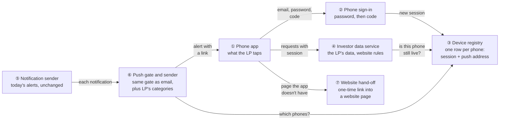

The **device registry (③)** is the centre. Every request from a phone is checked against it,
every push is addressed through it, and signing a phone out is a single change to its row.

### Walkthrough: one example, start to finish

**Setup.** Rahul Sharma is an LP user of investor **Sharma Family Office**, which has a
₹5,00,00,000 commitment to **Arka Growth Fund I** (fund manager **Arka Capital**, India region).
Calls 1 (₹75,00,000) and 2 (₹50,00,000) are paid. Rahul uses an authenticator app for two-factor.
Meera at Arka Capital is about to issue Capital Call 3 for 15% (₹75,00,000, due 30/10/2026). The
full data is in the [shared setup](#worked-examples).

**Legend:** each Result lists Rahul's device row and the push for Call 3. ✓ done · **●** we are
here, waiting on this (not done yet) · ○ not started · ✗ failed / ended.

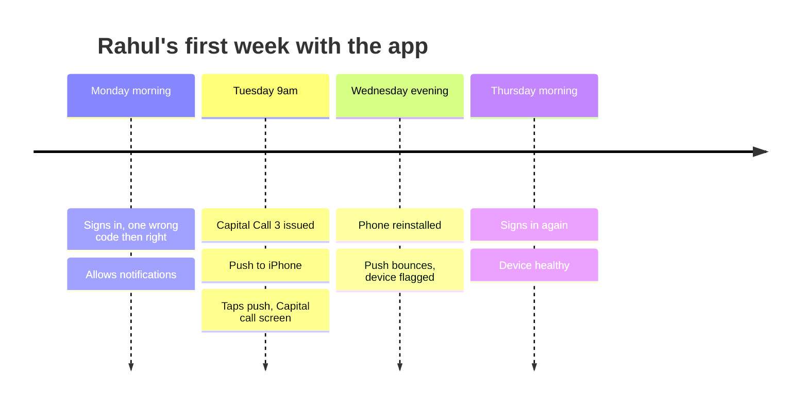

**Phase 1 — sign-in (Monday)**

| # | When | What happens | Behind the scenes | Result&nbsp;(device&nbsp;"iPhone&nbsp;15") |
|---|---|---|---|---|
| 1 | Mon 10:00 | Rahul picks India and enters email and password | The phone app (①) posts to phone sign-in (②). The password is right and two-factor is on, so sign-in (②) returns a challenge, not a session | Sign&nbsp;in&nbsp;with&nbsp;password&nbsp;✓<br>**Enter&nbsp;code&nbsp;●**<br>Register&nbsp;phone&nbsp;○<br>Allow&nbsp;push&nbsp;○ |
| 2 | Mon 10:01 | He types a stale code | Sign-in (②) counts attempt 1 of 5 and the challenge stays open | Same as row 1 |
| 3 | Mon 10:02 | He types the current code | Sign-in (②) verifies it and creates the "iPhone 15" row in the device registry (③), with tokens bound to it | Sign&nbsp;in&nbsp;with&nbsp;password&nbsp;✓<br>Enter&nbsp;code&nbsp;✓<br>Register&nbsp;phone&nbsp;✓<br>**Allow&nbsp;push&nbsp;●** |
| 4 | Mon 10:03 | He taps Allow, then turns on Face ID | The phone app (①) sends its push address to the device registry (③) | Sign&nbsp;in&nbsp;with&nbsp;password&nbsp;✓<br>Enter&nbsp;code&nbsp;✓<br>Register&nbsp;phone&nbsp;✓<br>Allow&nbsp;push&nbsp;✓ |

**Phase 2 — a capital call (Tuesday)**

| # | When | What happens | Behind the scenes | Result&nbsp;(push&nbsp;for&nbsp;Call&nbsp;3) |
|---|---|---|---|---|
| 5 | Tue 09:00 | Meera issues Capital Call 3 | The notification sender (⑤) creates the remittance notification for Rahul. Email and WhatsApp go out as today | Gate&nbsp;check&nbsp;**●**<br>Send&nbsp;○<br>Tap&nbsp;○ |
| 6 | Tue 09:00 | — | The push gate (⑥) checks: email would be sent ✓, Rahul is not an Arka Capital user ✓, "Capital calls" category on ✓. It asks the device registry (③) for live phones: iPhone 15 | Gate&nbsp;check&nbsp;✓<br>**Send&nbsp;●**<br>Tap&nbsp;○ |
| 7 | Tue 09:00 | The banner appears | The push sender (⑥) posts to Expo with title "Arka Capital", the custom subject as the body, and link `caphive://capital-calls/9031` | Gate&nbsp;check&nbsp;✓<br>Send&nbsp;✓<br>**Tap&nbsp;●** |
| 8 | Tue 09:01 | Rahul taps it | The phone app (①) unlocks with Face ID and calls the data service (④), which checks the device registry (③), then loads remittance 9031 through `policy_scope`. The notification is marked read | Gate&nbsp;check&nbsp;✓<br>Send&nbsp;✓<br>Tap&nbsp;✓ |

**Phase 3 — something breaks (Wednesday–Thursday)**

| # | When | What happens | Behind the scenes | Result&nbsp;(device&nbsp;"iPhone&nbsp;15") |
|---|---|---|---|---|
| 9 | Wed 18:00 | Rahul reinstalls the app. A distribution push is sent | Expo's receipt says `DeviceNotRegistered`. The push sender (⑥) marks the row in the device registry (③) `not_registered`. The email went out anyway | Session&nbsp;✓<br>**Push&nbsp;address&nbsp;✗&nbsp;(not&nbsp;registered)** |
| 10 | Thu 08:00 | Rahul signs in again on the reinstalled app | Same install id, so sign-in (②) reuses the same device row, revokes its old tokens, and stores the new push address | Session&nbsp;✓<br>Push&nbsp;address&nbsp;✓ |

**What Rahul sees at row 8:**

```
┌──────────────────────────────────────┐
│ ‹ Capital Call 3                     │
│ Arka Growth Fund I                    │
│ Status            ◌ Pending           │
│ Call amount        ₹75,00,000         │
│ Received                ₹0            │
│ Due by            30/10/2026          │
│ [   View call notice (PDF)   ]       │
└──────────────────────────────────────┘
```

**What to notice**
- The phone never gets a session until the code is verified (rows 1–3). A wrong code only uses
  up one of the challenge's three attempts (the website's rule).
- Push rides on the notification that already exists (row 5). Nothing changed for Meera.
- The gate (row 6) is the email gate plus two extra checks, so push can never reach someone
  email would not.
- One device row carries both the session and the push address, so a reinstall or a sign-out
  repairs or ends both together (rows 9–10).

### Key ideas

| # | Idea | In one line | Card |
|---|---|---|---|
| 1 | One device row per phone | Session tokens, push address and health live together, so revoking one row ends both | [③](#③-device-registry) |
| 2 | Two-factor before any token | Sign-in returns a challenge, and tokens exist only after the code is verified | [②](#②-phone-sign-in) |
| 3 | Website rules, new shapes | The data service only uses existing `policy_scope`/`authorize`. It adds lean JSON, never new access rules | [④](#④-investor-data-service) |
| 4 | Push = email gate + 2 checks | `email_enabled && body present && not internal && category on` | [⑥](#⑥-push-gate-and-sender) |
| 5 | One hook, 37 notifiers | `deliver_by :push` is added on `BaseNotifier` only. The category and deep link come from lookup tables, not from each notifier | [⑤](#⑤-notification-sender) |
| 6 | Never a dead end | Anything not native opens on the website through a one-time hand-off link | [⑦](#⑦-website-hand-off) |

**FAQ**

| Question | Answer |
|---|---|
| Why not reuse the existing JSON endpoints (`/capital_remittances.json`)? | They return the full, GP-oriented jbuilder shapes and accept any devise-api token, including one minted without two-factor. A separate namespace can require a device-bound token and return lean, versioned shapes that the app depends on. |
| Does the website change for GPs? | No. The only new website screen is the user's own Profile › Devices. |
| Why is the device registry the centre, not the data service? | Every security property (revocation, password change, lost phone, dead push address) is a change to one device row. Making it the single source keeps those rules in one place. |
| What if Expo is down? | Push fails and is retried. Email and WhatsApp are separate deliveries and are unaffected (see [⑥](#⑥-push-gate-and-sender)). |

---

## 2. The same picture with real names

### Picture

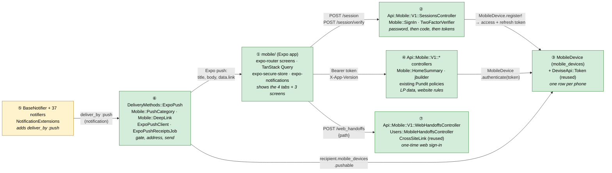

Colour = footprint: **green** new, **amber** modified, **grey** reused unchanged. Exact files are in
[lld.md File Map](lld.md#file-map).

### What each box does

| # | Box | Real parts | What it does | When it runs | What it decides | Details |
|---|---|---|---|---|---|---|
| ① | Phone app | `mobile/` Expo project, expo-router, TanStack Query, expo-secure-store, expo-local-authentication, expo-notifications | Renders the 4 tabs and 3 screens, caches data, holds tokens behind biometrics, handles push taps | On the phone | Which screen a link opens; when to ask for Face ID | [card ① →](#①-phone-app) |
| ② | Phone sign-in | `Api::Mobile::V1::SessionsController`, `Mobile::SignIn`, `TwoFactorVerifier` (extracted from `Users::TwoFactorController`), `TwilioSmsVerification`, `SendOtpToWhatsappJob` | Checks password, lockout and persona, runs the two-factor challenge, and issues tokens | Request | Session, challenge or refusal | [card ② →](#②-phone-sign-in) |
| ③ | Device registry | `MobileDevice`, `mobile_devices`, `DeviseApi::Token`, `Users::MobileDevicesController` (website Devices page) | Binds tokens and push address to a phone, and revokes them | Request; user callbacks | Is this token live? Which phones get a push? | [card ③ →](#③-device-registry) |
| ④ | Investor data service | `Api::Mobile::V1::{Me,Home,Commitments,CapitalRemittances,Documents,Notifications,Personas,Devices}Controller`, `Mobile::HomeSummary`, jbuilder views, existing policies | Returns LP data shaped for the app | Request | Nothing new: all access comes from the existing policies | [card ④ →](#④-investor-data-service) |
| ⑤ | Notification sender | `BaseNotifier`, `NotificationExtensions` (`config/initializers/noticed.rb`) | Adds the push delivery and its gate to every notifier | When any notifier is delivered | Whether push runs for this notification | [card ⑤ →](#⑤-notification-sender) |
| ⑥ | Push gate and sender | `DeliveryMethods::ExpoPush`, `Mobile::PushCategory`, `Mobile::DeepLink`, `ExpoPushClient`, `ExpoPushReceiptsJob`, `mobile_push_deliveries` | Picks the phones, builds the message, sends it to Expo, reads receipts | Noticed delivery job; receipts job 15 min later | Category, link, and which devices are dead | [card ⑥ →](#⑥-push-gate-and-sender) |
| ⑦ | Website hand-off | `Api::Mobile::V1::WebHandoffsController`, `Users::MobileHandoffsController`, `CrossSiteLink` (purpose `mobile_web`) | Turns a phone session into a one-time website sign-in on a given path | Request | Whether the link and path are valid | [card ⑦ →](#⑦-website-hand-off) |

### One run, end to end

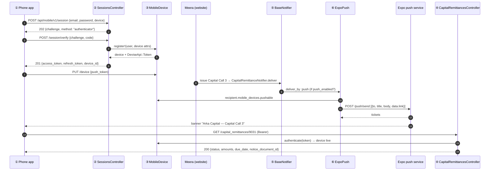

### Lifecycles

**Device session** (stored: `mobile_devices.revoked_at`, `revoked_reason`; expiry is derived from `last_used_at`)

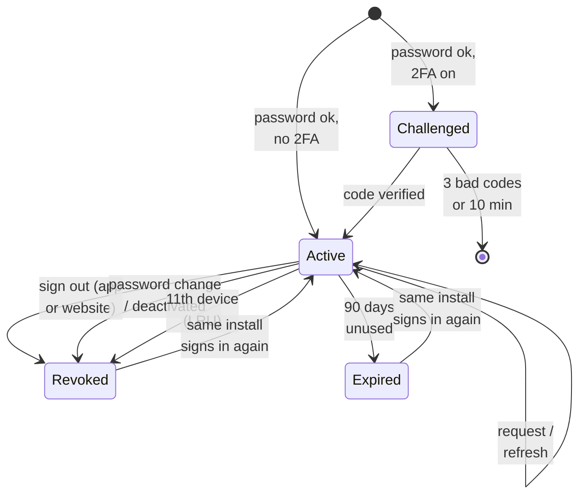

"Challenged" is not stored as a device. It lives in the signed challenge token plus an attempt
counter in `Rails.cache`. "Expired" is derived (`last_used_at < 90.days.ago`). "Revoked" is
stored.

**Push address** (stored: `mobile_devices.push_status`)

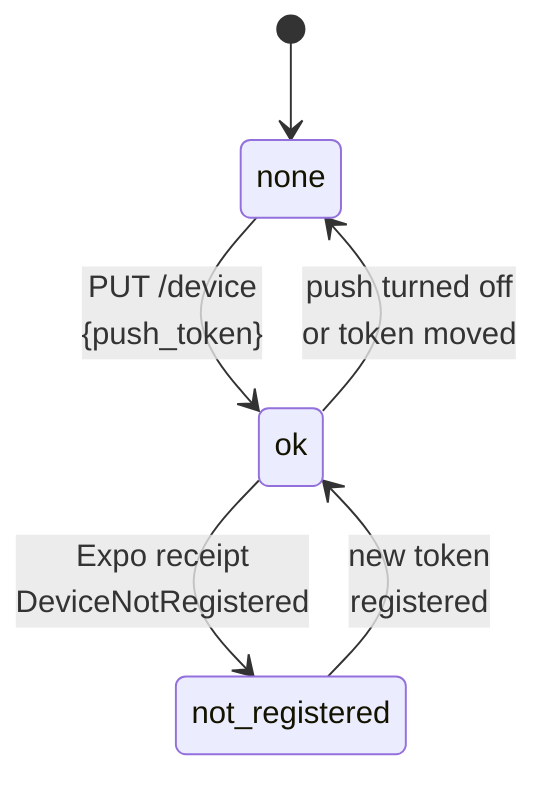

### What users see

**At a glance**

| Where in CapHive | Today | After this change | Who sees it |
|---|---|---|---|
| iOS / Android | Nothing | CapHive app: Home, Documents, Alerts, Profile + Fund, Capital call, Document | LP users, advisors |
| Phone lock screen | Nothing | Push for every LP notification (gated) | LP users, advisors |
| Website › Profile › Devices | Does not exist | List of phones with Sign out | Any user with a phone session |
| Website, everything else | — | Unchanged | — |

**Main everyday journey: a push to the capital call**

```
 Lock screen                     Capital call
┌───────────────────────┐      ┌──────────────────────────┐
│ ① Arka Capital         │ tap  │ ‹ Capital Call 3      ②  │
│   Capital Call 3 —     │ ───▶ │ ◌ Pending             ③  │
│   ₹75,00,000 due ...   │      │ Call amount ₹75,00,000   │
└───────────────────────┘      │ Due by 30/10/2026        │
                                │ [ View call notice ]  ④  │
                                └──────────────────────────┘
```

| Step | The user… | They see |
|---|---|---|
| ① | sees the banner | Title = fund manager name, body = notification subject |
| ② | taps it, then Face ID | The Capital call screen opens directly, without passing through Home |
| ③ | reads the status | Pending / Paid / Overdue / Overpaid, as on the website, with an icon and colour |
| ④ | taps View call notice | The approved notice PDF in the document viewer, with Share |

The other journeys (sign-in, Home, Documents/sign, settings, Devices page) are in cards
[①](#①-phone-app), [③](#③-device-registry) and the [proposal](proposal.md#workflow-journey).

### Design decisions

1. **Separate `/api/mobile/v1` namespace** — Choice: new thin controllers that call
   `policy_scope`/`authorize` on the existing policies. Alternative: reuse the existing `.json`
   responses of the website controllers. Rejected: those accept any devise-api token (minted
   without 2FA by devise-api's own `/users/tokens/sign_in`), return wide GP-shaped payloads, and
   would make the app break whenever a web view changes.
2. **Reuse `devise_api_tokens` for tokens** — Choice: mint `DeviseApi::Token` rows ourselves after
   2FA and bind them to a `mobile_devices` row. Alternative: a new token table or JWTs. Rejected:
   the existing table already handles access/refresh/revoke, and JWTs cannot be revoked instantly
   for a lost phone.
3. **Device binding enforced on every request** — Choice: the mobile base controller accepts a
   token only when its `mobile_devices` row is live. Alternative: trust any valid devise-api
   token. Rejected: tokens from the 2FA-less devise-api endpoint must not reach LP data through
   the app's API.
4. **Extract `TwoFactorVerifier`** — Choice: move the code checks (TOTP, SMS verify, WhatsApp OTP)
   out of `Users::TwoFactorController` into a session-free service that both the website and the
   phone path call. Alternative: duplicate the checks in the mobile controller. Rejected: two
   copies of 2FA logic would drift, which is how security bugs start.
5. **Push via Expo push service** — Choice: one HTTPS call to Expo, which forwards to APNs and FCM.
   Alternative: direct APNs + FCM (rpush). Rejected: two integrations and two sets of
   certificates, for no user-visible gain at our volume.
6. **One `deliver_by :push` on `BaseNotifier`** — Choice: one delivery method, a category lookup
   table keyed by notifier class, and a deep-link lookup keyed by record class. Alternative: a
   `push_*` method per notifier. Rejected: 37 edits, and every new notifier would need
   remembering.
7. **No email delay for push** — Choice: push is sent immediately. Alternative: reuse
   `email_delay`. Rejected: that delay exists to spread SES load and has no purpose for push.
8. **Category preferences in `users.preferences["push"]`** — Choice: a key in the existing JSON
   column. Alternative: a new table. Rejected: four booleans per user don't justify a table, and
   the column already holds per-user UI preferences.
9. **Hand-off via `CrossSiteLink`** — Choice: reuse the signed, single-use, 5-minute credential
   with a new purpose `mobile_web` and `site` = this region. Alternative: put the access token in a
   URL. Rejected: a bearer token in a URL leaks into logs and browser history.
10. **Bank details not shown natively** — Choice: View call notice. Alternative: new fund bank
    fields. Rejected: CapHive has no structured fund bank data, and adding it is a GP-side change
    outside this scope.
11. **Maestro for app tests** — Choice: Cucumber for every server row and Maestro flows for
    app-only rows, carrying the same IDs. Alternative: Appium driven from Cucumber. Rejected: slow
    and flaky for React Native (decided with product, 2026-10-13).

**FAQ**

| Question | Answer |
|---|---|
| Does the devise-api `/users/tokens/sign_in` endpoint (no 2FA) stay open? | It is untouched by this change, but its tokens cannot reach `/api/mobile/v1` (decision 3). Closing it is listed under [risks](#risks-and-open-questions). |
| Why not a GraphQL or generic REST API? | The app needs about 15 fixed shapes. Purpose-built endpoints are simpler to secure and test. |
| Why are tokens and devices separate tables? | `devise_api_tokens` is reused unchanged. A device points at its current token, and rotation replaces the pointer. |
| Is there anything new in the MCP ontology? | No. The mobile API is not an MCP surface. |

---

## 3. One card per box

> Same order and numbers as the picture.

### ① Phone app

An Expo (React Native, TypeScript) app in `mobile/`, built with EAS for iOS and Android. It has no
business logic of its own. It renders what the data service (④) returns, and decides only
navigation, caching, locking and formatting.

| Owns | Reads / receives | Produces |
|---|---|---|
| Screens, navigation, local cache, secure token storage, biometric lock, push permission and taps | `/api/mobile/v1` JSON; Expo push payloads; region list baked into the build | API requests; push address; hand-off requests |

**Screens and routes (expo-router)**

| Route | Screen | Data (④) | Primary action |
|---|---|---|---|
| `/(auth)/region`, `/(auth)/sign-in`, `/(auth)/code` | Region, Sign in, Code | `POST /session`, `/session/verify`, `/session/resend` | Sign in |
| `/(tabs)/home` | Home | `GET /home` | Tap a to-do item |
| `/funds/[commitmentId]` | Fund (segments) | `GET /commitments/:id`, `.../calls`, `.../distributions`, `.../documents` | Switch segment |
| `/capital-calls/[remittanceId]` | Capital call | `GET /capital_remittances/:id` | View call notice |
| `/(tabs)/documents`, `/documents/[id]` | Documents, Document | `GET /documents`, `GET /documents/:id` | Sign / Share |
| `/(tabs)/alerts` | Alerts | `GET /notifications`, `POST /notifications/:id/read`, `/read_all` | Tap an alert |
| `/(tabs)/profile`, `/profile/notifications` | Profile, Notification settings | `GET /me`, `PATCH /me/push_preferences`, `PUT /device` | — |
| `/web?path=` | In-app browser (expo-web-browser auth session) | `POST /web_handoffs` | — |

**Build notes**
- **State:** TanStack Query with persisted cache (MMKV). Stale-while-revalidate gives instant
  screens, and the offline bar comes from NetInfo. Tokens are kept in `expo-secure-store`, gated
  by `expo-local-authentication` when Face ID is on.
- **Look:** one fixed theme module (`src/constants/theme.ts`: graphite palette with gradients and
  hairlines, CapHive orange accent, Manrope type scale with light figures, status colours paired
  with icons). Custom full-width tab bar (round icons, white active circle), round back button,
  dotted SVG gauge on Home. Skeletons, not spinners. Haptics on success.
  Accessibility labels on every pressable, and hit areas of at least 44 pt.
- **Formatting:** dates use the server's `date_format` (a strftime pattern, from `GET /me`) through
  a small strftime port, mirroring `locale_date_format.js`. Money uses `Intl.NumberFormat` with
  `en-IN` for INR, so lakh/crore grouping is correct, and compact cards use `Cr`/`L` for INR and
  `K`/`M` otherwise.
- **Links:** scheme `caphive://` plus universal links on the region hosts. A push `data.link` is
  either an app route or `web:<path>`, which opens `/web`.
- **Lock:** AppState listener. After more than 5 minutes in the background it requires biometrics,
  and after 3 failures it does a full sign-out. A privacy overlay covers the app while inactive.
- **Update gate:** any 426 response shows the blocking update screen.

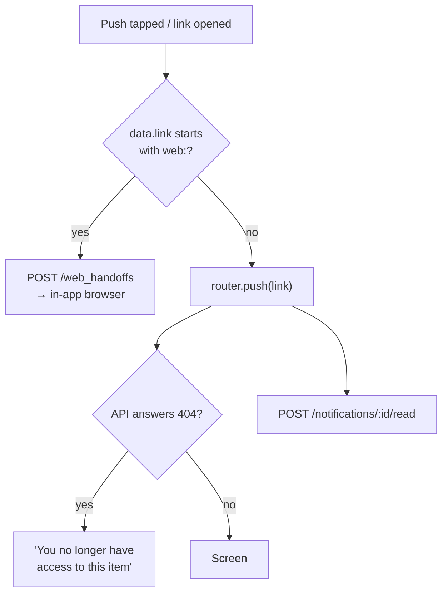

**Worked examples:** H16, H17, H18, H19, E30, E31, E32, E33, E34, X14, X19, X21

**FAQ**

| Question | Answer |
|---|---|
| Why not use the website's numbers formatting in JS? | The app has no Rails view context. It gets the locale's strftime pattern and currency from `/me` and formats with the same rules. |
| Can the app work against both regions at once? | No, deliberately. One region's session at a time, as on the website. |
| What does "Sign" do for Digio? | It opens Digio's signing gateway for `documents.provider_doc_id` in an auth session, then refetches the document on return (card ④). |
| Why MMKV for the cache? | It is fast and synchronous, so cached screens render on the first frame. The cache holds only data, never tokens. |

### ② Phone sign-in

Turns email and password (plus a code when two-factor is on) into a device session. The checks
are the website's, run through the same Devise and Warden strategies and an extracted
`TwoFactorVerifier`.

| Owns | Reads / receives | Produces |
|---|---|---|
| The challenge token and its attempt counter; persona check | Email, password, code; device attrs (`install_id`, platform, name, app version) | Session (via ③), challenge, or refusal |

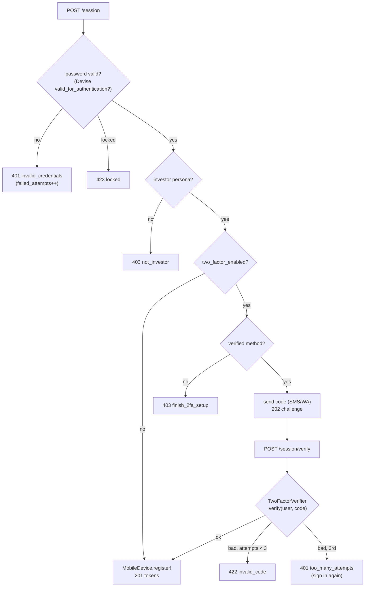

**Responsibilities**

| Concern | Rule |
|---|---|
| Challenge | `Rails.application.message_verifier(:mobile_2fa)` signs `{user_id, nonce, method}`, expires in 10 min. Attempts are counted in `Rails.cache` under the nonce (TTL 10 min). Verified challenges are claimed (deleted) so they cannot be reused |
| Lockout | Password failures use Devise lockable exactly as the website does (6 failures, unlocked after 5 minutes). Three bad codes end the challenge — the website's rule — and the user signs in again; the account is not locked by codes |
| Persona | `user.has_cached_role?(:investor) \|\| has_cached_role?(:investor_advisor)` (family office users carry `:investor`) |
| Rate limit | Rack::Attack: 10 `POST /api/mobile/v1/session*` per IP per minute, 5 per email per minute |
| Idempotency | Verify is single-use per challenge. A double-tap gets 401 `challenge_spent` and the app ignores it, because the first response already arrived |

**Routes**

| Verb and path | Action | Does | Responds with |
|---|---|---|---|
| `POST /api/mobile/v1/session` | `create` | Password and persona check | 201 tokens / 202 challenge / 401 / 403 / 423 |
| `POST /api/mobile/v1/session/verify` | `verify` | Code check | 201 tokens / 422 / 423 / 401 expired |
| `POST /api/mobile/v1/session/resend` | `resend` | Resends SMS/WhatsApp, same cooldown as web (`OtpSmsRateLimiter`) | 204 / 429 |
| `POST /api/mobile/v1/session/refresh` | `refresh` | Rotates tokens for a live device | 201 / 401 |
| `DELETE /api/mobile/v1/session` | `destroy` | Revokes this device (reason `app_sign_out`) | 204 |

**Worked examples:** H1, H2, H3, E1, E2, E3, E4, X1, X2, X3, X4

**FAQ**

| Question | Answer |
|---|---|
| Why not keep the 2FA state in a session cookie like the website? | The API is cookie-less. A signed challenge token carries the same state without server sessions. |
| Why extract `TwoFactorVerifier` instead of calling the controller? | Controller code reads `session[:otp_user_id]`. The extraction keeps one implementation and leaves website behaviour unchanged (the website controller calls it too). |
| Magic link and forgot password? | They open the website flows in the browser. A magic-link sign-in lands on the website, not in the app. |
| Does a wrong region reveal whether the email exists? | No. It gets the same 401 `invalid_credentials`, and the app adds the generic "Is your account on the US site?" hint. |

### ③ Device registry

One `mobile_devices` row per (user, app install). It owns the binding between a phone, its current
`DeviseApi::Token`, and its push address, and it is the only place sessions are revoked. It also
backs the website's Profile › Devices page.

| Owns | Reads / receives | Produces |
|---|---|---|
| `mobile_devices` rows; revocation; LRU eviction; push address uniqueness | Register/refresh calls from ②; `PUT /device` from ①; user callbacks; receipts from ⑥ | `current_user` for ④; pushable device list for ⑥ |

**Rules**

| Event | Effect |
|---|---|
| `register!(user, install_id:, …)` | Upsert on `[user_id, install_id]`. Revoke the previous token, mint a new `DeviseApi::Token` (access 1 h, refresh 90 d), and clear `revoked_at`. If the user then has more than 10 live devices, revoke the least recently used with `device_limit` |
| `authenticate(access_token)` | Find the token (not revoked, not expired) → its device. The device must be live (`revoked_at nil`, `last_used_at ≥ 90.days.ago`) and `user.active?`. Touch `last_used_at` at most every 5 min. Otherwise nil, which gives 401 |
| `PUT /device {push_token}` | `push_token` is globally unique, so another row holding it has its token cleared first (same phone, new user). Sets `push_status: ok` |
| Password change (`User` `after_update_commit` on `saved_change_to_encrypted_password?`) | Revoke all the user's devices with `password_changed` |
| Deactivation | Checked live in `authenticate` (`user.active?`). Devices are also revoked with `deactivated` in the same callback |
| Website Devices › Sign out | `revoke!(reason: "website_sign_out")`. The next request gets 401 and pushes stop at once (the `pushable` scope excludes revoked rows) |

**Website routes**

| Verb and path | Action | Does | Responds with |
|---|---|---|---|
| `GET /users/mobile_devices` | `Users::MobileDevicesController#index` | Lists `current_user.mobile_devices` | HTML page (Profile › Devices tab) |
| `DELETE /users/mobile_devices/:id` | `#destroy` | Revokes a device of `current_user` | turbo_stream row replace |

**Access:** the policy is `MobileDevicePolicy`. A user sees and revokes only their own devices
(`record.user_id == user.id`). Support's existing `login_as` impersonation gives support the same
view.

**Build notes (website):** reuse the existing profile tab layout and table partial styling. Status
uses `badge bg-success-subtle text-success` for live, `bg-secondary-subtle` for signed out, and
`bg-danger-subtle` for "not registered". Sign out goes through the action-summary confirm modal, not
`confirm()`.

**Worked examples:** H14, E5, E6, E7, E8, E26, E27, X5, X6, X7, X15

**FAQ**

| Question | Answer |
|---|---|
| Why key on `install_id` and not the push token? | A push token can be missing (permission denied) or change. The install id is generated once per install and kept in secure storage. |
| What about two users sharing one phone? | Each signs in separately and gets its own row. The push token moves to whoever registered last (E7). |
| Why throttle `last_used_at` writes? | Otherwise every API call writes a row. Five-minute precision is enough for a 90-day expiry. |

### ④ Investor data service

Thin controllers under `Api::Mobile::V1`. Each one builds a query from an existing
`policy_scope(...)`, selects only the columns its jbuilder needs, paginates at 25, and renders a
fixed shape. The base controller authenticates through ③, checks `X-App-Version`, and sets
`current_user`. It includes the existing `switch_advisor` handling, so advisors see the investor
they switched to.

| Owns | Reads / receives | Produces |
|---|---|---|
| Response shapes (v1), pagination, `Mobile::HomeSummary` | Existing models and policies: `CapitalCommitment`, `CapitalRemittance`, `CapitalDistributionPayment`, `Document`, `ESignature`, `Noticed::Notification`, `InvestorAdvisor` | JSON |

**Routes**

| Verb and path | Action | Does | Responds with |
|---|---|---|---|
| `GET /me` | `MeController#show` | User, region, `date_format`/`time_format` for the user's locale, personas, push prefs | 200 |
| `PATCH /me/push_preferences` | `MeController#push_preferences` | Sets the four category booleans | 200 |
| `GET /personas` · `POST /personas/:investor_advisor_id/switch` | `PersonasController` | Lists and switches advisor persona via `InvestorAdvisor#switch` (`authorize :switch?`) | 200 / 404 |
| `GET /home` | `HomeController#show` | `Mobile::HomeSummary`: to-do + commitment cards | 200 |
| `GET /commitments/:id` (+ `/calls`, `/distributions`, `/documents`) | `CommitmentsController` | Totals; remittances, distribution payments and `docs_for_investor` of one commitment, paginated | 200 / 404 |
| `GET /capital_remittances/:id` | `CapitalRemittancesController#show` | Status, amounts, due date, `notice_document_id` | 200 / 404 |
| `GET /documents?q=&commitment_id=&to_sign=&page=` | `DocumentsController#index` | `policy_scope(Document)` minus NDA-gated folders, newest first | 200 |
| `GET /documents/:id` | `DocumentsController#show` | Short-lived file URL; `sign_action` (`digio_url` / `docusign_email` / none). Records `ViewedBy` | 200 / 404 |
| `GET /notifications?page=` · `POST /notifications/:id/read` · `POST /notifications/read_all` | `NotificationsController` | `current_user.notifications` newest first, with `link` from `Mobile::DeepLink`. Sets `read_at` | 200 / 204 |
| `PUT /device` | `DevicesController#update` | Push token, push on/off, app version for the current device | 200 |
| `POST /web_handoffs` | see ⑦ | — | — |

**Figures:** cards read `committed_amount`, `call_amount`, `distribution_amount`, `due_amount`
(= `call_amount − collected_amount + other_fee`) straight from `CapitalCommitment`. These are the
four values `capital_commitments/_card` shows, so the app and website agree by construction.
Evergreen folios reuse the values `evergreen/funds/_lp_card` computes (`EvergreenUnitRegister`
row, latest approved `FundNav`). Both the partial and the API read the same
`EvergreenUnitRegister` row, so they cannot drift — no extraction was needed.

**To-do:** unpaid remittances (`policy_scope(CapitalRemittance).where(status: %w[Pending Overdue])`,
ordered by `capital_calls.due_date`) plus `policy_scope(Document)` joined to `e_signatures` where
`e_signatures.user_id = current_user.id` and status is not signed, and the document's
`sent_for_esign` is true.

**Signing:** `sign_action` is `digio_url` when the entity's esign provider is Digio and
`provider_doc_id` is present. The URL is Digio's documented signing gateway for that document and
the signer's email. `docusign_email` is used for DocuSign. The app refetches the document on
return. Status still comes from the existing webhook/fetch-updates flow.

**Access:** no new rules. Every action is `policy_scope` + `authorize(record, :show?)`, with the
policies' existing `entity_id`/investor-access scoping. A record outside scope raises
`Pundit::NotAuthorizedError` or `RecordNotFound`, and both map to 404, so existence is not leaked.

| Role | Home / commitments / calls / distributions | Documents | Notifications | Personas |
|---|---|---|---|---|
| LP user (investor access) | Own investor's, via existing scopes | `policy_scope(Document)` | Own | — |
| Investor advisor | Switched investor's, if approved | Same, in switched persona | Own | Own advisor rows |
| Family office user | As LP | As LP | Own | — |
| GP employee / other entity | Refused at sign-in (②). Even with a token, existing scopes return only what the website would | ← | ← | ← |

**Worked examples:** H4, H5, H6, H7, H8, H9, H15, E16, E17, E18, E19, E20, E21, E22, E24, E25, E28, E29, X8, X9, X17, X18

**FAQ**

| Question | Answer |
|---|---|
| Why paginate at 25? | `capital_remittances`, `capital_distribution_payments` and `documents` are large tables (CLAUDE.md). 25 fills about two phone screens. |
| Why move evergreen card logic into a class? | The partial computes it inline. The API needs the same numbers, and copying the ERB logic would let the two drift. |
| Is `ViewedBy` written on list views? | No, only on `GET /documents/:id`, matching the website's show. |
| What if the LP has 3 folios in one fund? | Three cards, as on the website (one per `CapitalCommitment`). |

### ⑤ Notification sender

`BaseNotifier` gets one more delivery and nothing else. The 37 notifier classes are unchanged.

| Owns | Reads / receives | Produces |
|---|---|---|
| `deliver_by :push` declaration and its `config.if` | Each notifier's existing `message`, `url`, `custom_notification`, `record`, `entity`; `NotificationExtensions#email_enabled` | Calls ⑥ per notification |

| Setting | Value |
|---|---|
| `deliver_by :push, class: "DeliveryMethods::ExpoPush"` | Added in both the test and non-test branches. In test the HTTP call is stubbed (WebMock), with no hard kill-switch needed, unlike WhatsApp |
| `config.if` | `push_enabled` (new, in `NotificationExtensions`) = `email_enabled && custom_notification_body_present? && recipient.entity_id != model.entity_id && Mobile::PushCategory.enabled_for?(recipient, event) && recipient.mobile_devices.pushable.exists?` |
| `config.wait` | none (decision 7) |
| Queue | Noticed's delivery jobs on the existing notifications queue |

**Worked examples:** H11, H12, E9, E10, E11, E12, E13

**FAQ**

| Question | Answer |
|---|---|
| Will this change email or WhatsApp behaviour? | No. They are separate `deliver_by` blocks, and push failures are isolated in their own delivery job. |
| Why `pushable.exists?` in the gate? | To skip the job entirely for the many LPs without the app. It is a `SELECT 1 … LIMIT 1`, per the CLAUDE.md rules. |
| What if a notifier has no custom subject? | `notification.message` is the same fallback the email subject uses. |

### ⑥ Push gate and sender

Builds and sends the push for one notification to each pushable device. It records tickets and
checks Expo receipts later.

| Owns | Reads / receives | Produces |
|---|---|---|
| `Mobile::PushCategory` (notifier → category), `Mobile::DeepLink` (record → link), `mobile_push_deliveries`, Expo client | Notification, recipient's pushable devices, unread count | Expo requests; device `push_status`; delivery log |

**Category map** (anything absent → `other`)

| Category | Notifier classes |
|---|---|
| `capital_calls` | `CapitalRemittanceNotifier`, `CapitalRemittancePaymentNotifier`, `ReminderNotifier` when its record is a `CapitalRemittance` |
| `distributions` | `CapitalDistributionPaymentNotifier` |
| `documents` | `DocumentNotifier`, `NdaEventNotifier`, `NdaReminderNotifier`, `FinancialStatementNotifier` |
| `other` | Every other notifier, e.g. `InvestorKycNotifier`, `FundInvestorKycNotifier`, `ApprovalNotifier`, `OfferNotifier`, `InterestNotifier`, `EvergreenNotifier` |

**Deep links** (from `event.record`)

| Record | Link |
|---|---|
| `CapitalRemittance` | `/capital-calls/:id` |
| `CapitalCommitment` | `/funds/:id` |
| `CapitalDistributionPayment` | `/distributions/:id` |
| `Document` | `/documents/:id` |
| anything else | `web:` + the notifier's existing `url` path |

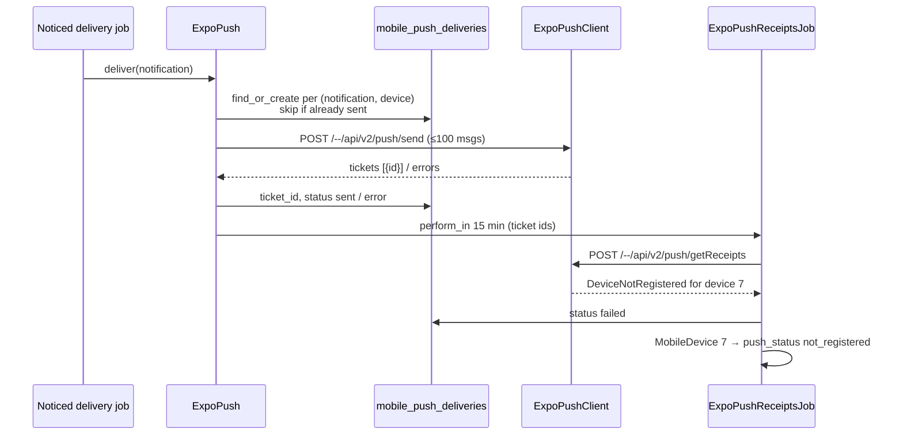

| Concern | Rule |
|---|---|
| Idempotency | Unique `[noticed_notification_id, mobile_device_id]` in `mobile_push_deliveries`. A retried job skips devices already `sent` (E35) |
| Retries | HTTP 5xx and timeouts raise, and the Noticed job retries 5× with backoff. A 4xx other than 429 is logged and not retried |
| Payload | `title` = `event.entity.name`, `body` = subject truncated to 178 chars with `…`, `data` = `{link, notification_id}`, `badge` = unread count, `sound: default`. The body is sanitised (`full_sanitizer`) |
| Config missing | No Expo access token in the region's credentials disables the delivery method (`config.if` short-circuits), with a warning logged once per boot |

**Worked examples:** H10, H11, H12, E12, E14, E15, E26, E27, E35, X10, X11, X20

**FAQ**

| Question | Answer |
|---|---|
| Why a deliveries table? | It provides idempotency across retries, gives the Devices page its "last delivery" column, and gives support an audit trail. |
| Do receipts need a cron? | No. Each send schedules its own receipts check 15 minutes later, as Expo recommends. |
| Could a push reveal sensitive data on a lock screen? | Only the subject line, which already appears in email previews. Bank numbers are never in subjects (spec). |

### ⑦ Website hand-off

Gives the in-app browser a website session for the same user, for one specific path. It uses
`CrossSiteLink` with purpose `mobile_web` and `site` = `SiteRegistry.current_code`.

| Owns | Reads / receives | Produces |
|---|---|---|
| Path validation, the web landing action | Phone session (③), requested path | A signed single-use URL, then a Devise session plus a redirect |

| Verb and path | Action | Does | Responds with |
|---|---|---|---|
| `POST /api/mobile/v1/web_handoffs {path}` | `WebHandoffsController#create` | Validates `path` (must start with `/` and not `//`, and must be a recognised route via `Rails.application.routes.recognize_path`). Then `CrossSiteLink#generate(user.email, purpose: "mobile_web", site: current, from: current, expires_in: 5.min)` | 201 `{url}` / 422 |
| `GET /users/mobile_handoff?token=&path=` | `Users::MobileHandoffsController#show` | `CrossSiteLink#verify` (claims the nonce), `sign_in` with the same `session_token` cookie the sessions controller sets, then redirects to the path. Any failure goes to the sign-in page | 302 |

The path is passed alongside the token and re-validated on landing. The token does not carry it,
which keeps `CrossSiteLink` unchanged. An attacker who swaps the path still lands only on a page
the user may already open, and every page re-applies Pundit.

**Worked examples:** H13, E15, E23, E36, X12, X13, X16

**FAQ**

| Question | Answer |
|---|---|
| Does the hand-off skip 2FA? | It is minted only from a device session that already passed 2FA, so this is equivalent to the website's remember-me. |
| Why the system auth-session browser and not a WebView? | The auth session shares nothing with Safari or Chrome cookies, and it is the platform-approved way to show a signed-in web flow. |
| What if the web session outlives the app session? | Website sessions follow the existing Devise timeout. Revoking a device does not end a web session it once created, which is acceptable because that session is short-lived. |

---

## 4. Reference

### Changes made during implementation (2026-10-13)

Decisions taken while building, each agreed with the product owner or forced by the code. They
override anything above that disagrees.

| # | Change | Why |
|---|---|---|
| 1 | **Reuse the website's JSON endpoints** for the commitment, capital calls, distribution payments, a document and notifications, with the phone token. New mobile endpoints only where none existed: `session`, `me`, `home`, `documents` (LP list), `device`, `web_handoffs`. Additive JSON fields: `capital_remittances` → `due_date`, `notice_document_id`; `capital_commitments` → `due_amount`; `documents/show` → `signature_status`, `sign_action`, `sign_url`; `notifications` → `message`, `sender`, `link`, `category`. `capital_distribution_payments#index` returns the jbuilder rows to bearer callers (`api_request?`) | Product owner: "reuse as much as possible, with minor mods, build only where you have to" |
| 2 | **Token gap closed for all bearer clients**: `Users::TokensController` (devise-api's `/users/tokens/*`) refuses a two-factor user, so every website JSON endpoint is safe to reuse (X22) | Reuse made the 2FA-less token path reachable from the app's data; closing it at the source was the smaller change |
| 3 | **Three code attempts, then sign in again** (not five + account lock); password lockout is Devise's (6 failures, 5 minutes) | Website parity — `Users::TwoFactorController` already works this way |
| 4 | **Flat service names**: `MobileSignIn`, `MobileHomeSummary`, `MobileDocuments`, `MobileDeepLink`, `MobilePushCategory`, `MobileMoney`, `ExpoPushClient`, `MobileDocumentJson` | Every folder under `app/packs` is a Zeitwerk root, so `services/mobile/x.rb` cannot define `Mobile::X` |
| 5 | **No `Evergreen::LpCardSummary`**: Home reads the same `EvergreenUnitRegister` row as the website card | Already shared; the live partial stays untouched |
| 6 | **Data-room documents are not listed in the app** (only documents on the LP's own commitments, calls and distribution payments) | The NDA gate lives in `DocumentsController#ensure_nda_accepted` on the website; the app must not bypass it |
| 7 | **Push receipts by a 15-minute sweep** (`ExpoPushReceiptsJob` cron, statuses `sent → delivered / failed`), which also purges rows older than 90 days | No per-push delayed job; survives restarts; the inline test adapter cannot schedule jobs |
| 8 | **Pre-existing bug fixed**: `NotificationsController#index` "mark all read" wrote on the read replica (GET) — now on the primary | Found by E25 |
| 9 | **Look**: one fixed graphite theme with CapHive orange (#FF4D00), after the MYGRID reference; floating pill tab bar; Ionicons | Product owner review of the first build |
| 10 | **App verification**: app screens verified with Playwright against the Expo **web** build and the `mobile:seed_demo` data; Maestro flows are written but not yet run (no simulator on the build machine) | Tooling available here |
| 11 | **Push jobs are only queued when worth it** (`before_enqueue` → `push_candidate?`: push configured in the region and the recipient has a live push-enabled phone); the full email-parity gate still runs in the job | Review: Noticed evaluates `if:` inside the delivery job, so every notification would otherwise queue a push job |
| 12 | **devise-api `/users/tokens/refresh` refuses phone tokens** (`use_mobile_refresh`, X23) and never confirms a password for a locked two-factor account | Review: a website refresh orphaned the phone's token and minted an unbound one |
| 13 | **Mobile fields on the website's notifications JSON fail safe**, and the web hand-off answers 503 when the cross-region secret is missing | Review: one deleted record must not break the website's notification list |


### Class diagram

```mermaid
classDiagram
    namespace Api_Mobile_V1 {
        class BaseController {
            <<Controller>>
            +authenticate_mobile_device!()
            +require_app_version!()
            +current_user
        }
        class SessionsController {
            <<Controller>>
            +create() +verify() +resend() +refresh() +destroy()
        }
        class HomeController { <<Controller>> +show() }
        class CommitmentsController { <<Controller>> +show() +calls() +distributions() +documents() }
        class CapitalRemittancesController { <<Controller>> +show() }
        class DocumentsController { <<Controller>> +index() +show() }
        class NotificationsController { <<Controller>> +index() +read() +read_all() }
        class MeController { <<Controller>> +show() +push_preferences() }
        class PersonasController { <<Controller>> +index() +switch() }
        class DevicesController { <<Controller>> +update() }
        class WebHandoffsController { <<Controller>> +create() }
    }
    namespace Mobile {
        class SignIn { <<Service>> +call(email, password, device_attrs) Result }
        class HomeSummary { <<Service>> +call(user) Hash }
        class PushCategory { <<Service>> +for(event) Symbol +enabled_for?(user, event) bool }
        class DeepLink { <<Service>> +for(notification) String }
        class ExpoPushClient { <<Service>> +send_messages(msgs) tickets +receipts(ids) Hash }
    }
    namespace Users_pack {
        class TwoFactorVerifier { <<Service>> +verify(user, code) Result +deliver_code(user) }
        class MobileDevice { <<Model>> +register!(user, attrs)$ +authenticate(token)$ +revoke!(reason) +pushable$ }
        class MobileDevicesController { <<Controller>> +index() +destroy() }
        class MobileHandoffsController { <<Controller>> +show() }
        class MobileDevicePolicy { <<Policy>> +index?() +destroy?() }
        class User { <<Model>> +mobile_devices +push_preferences() }
        class TwoFactorController { <<Controller>> modified: calls TwoFactorVerifier }
    }
    namespace Notifications_pack {
        class BaseNotifier { <<Model>> +deliver_by push }
        class ExpoPush { <<DeliveryMethod>> +deliver() }
        class MobilePushDelivery { <<Model>> }
        class ExpoPushReceiptsJob { <<Job>> +perform(delivery_ids) }
    }
    namespace Evergreen {
        class LpCardSummary { <<Service>> +call(capital_commitment) Hash }
    }
    BaseController <|-- SessionsController
    BaseController <|-- HomeController
    BaseController <|-- WebHandoffsController
    SessionsController --> SignIn
    SignIn --> TwoFactorVerifier
    SignIn --> MobileDevice
    TwoFactorController --> TwoFactorVerifier
    BaseController --> MobileDevice
    HomeController --> HomeSummary
    HomeSummary --> LpCardSummary
    BaseNotifier --> ExpoPush
    ExpoPush --> PushCategory
    ExpoPush --> DeepLink
    ExpoPush --> ExpoPushClient
    ExpoPush --> MobilePushDelivery
    ExpoPushReceiptsJob --> ExpoPushClient
    User --> MobileDevice
```

### Data model and schema changes

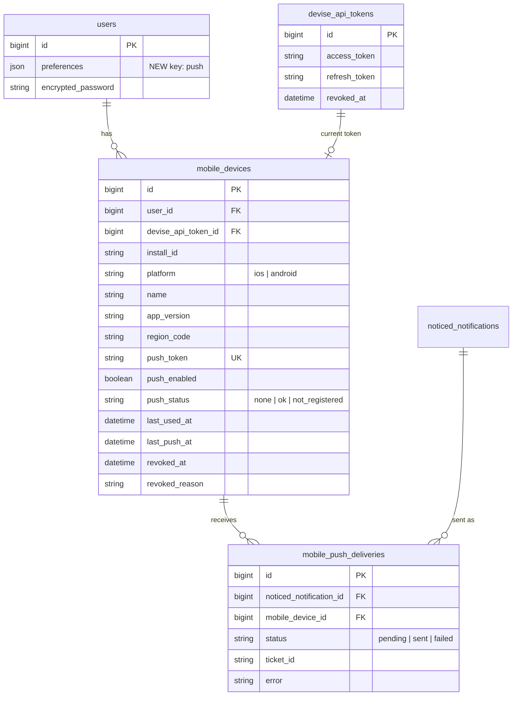

**Indexes:** `mobile_devices`: unique `[user_id, install_id]`, unique `push_token`,
`devise_api_token_id`, `[user_id, revoked_at, last_used_at]`. `mobile_push_deliveries`: unique
`[noticed_notification_id, mobile_device_id]`, `[mobile_device_id, created_at]`, `ticket_id`.

**Schema changes**

**`mobile_devices`** (new): the device registry (③). One row per user per app install, holding
the session binding and the push address.

| Column / index | What changed | Why it's needed |
|---|---|---|
| `user_id` | Added, FK, not null | Whose phone |
| `devise_api_token_id` | Added, FK, nullable | The current token. Revoking the device revokes this token, and refresh replaces it |
| `install_id` | Added, string 64, not null | Stable per-install id from the app, so re-sign-in on the same install reuses the row (E6) |
| `platform` | Added, string 10 | Shown on the Devices page, and selects iOS or Android payload options |
| `name` | Added, string 100 | "iPhone 15" on the Devices page |
| `app_version` | Added, string 20 | Support diagnosis and the minimum-version policy |
| `region_code` | Added, string 10 | Shown on the Devices page. Always this deployment's code (regions don't share rows) |
| `push_token` | Added, string 255, nullable | Expo push address |
| `push_enabled` | Added, boolean, default true | Per-phone push on/off from Profile |
| `push_status` | Added, string 20, default "none" | Health shown on the Devices page. Dead addresses are skipped |
| `last_used_at` | Added, datetime | 90-day expiry and LRU eviction |
| `last_push_at` | Added, datetime | "Last delivery" on the Devices page |
| `revoked_at`, `revoked_reason` | Added | Sign-out, password change, deactivation, device limit. The audit reason is shown to support |
| unique `[user_id, install_id]` | New index | Upsert key (E6) |
| unique `push_token` | New index | One address → one device (E7) |
| `[user_id, revoked_at, last_used_at]` | New index | `pushable` / live lookups and LRU |

**`mobile_push_deliveries`** (new): one row per push attempt per device. It provides idempotency
and receipts.

| Column / index | What changed | Why it's needed |
|---|---|---|
| `noticed_notification_id` | Added, FK, not null | Which notification |
| `mobile_device_id` | Added, FK, not null | Which phone |
| `status` | Added, string 10 | pending / sent / failed |
| `ticket_id` | Added, string 64 | To fetch the Expo receipt |
| `error` | Added, string 255 | Expo error code (e.g. DeviceNotRegistered) for support |
| unique `[noticed_notification_id, mobile_device_id]` | New index | No double push on retries (E35) |
| `[mobile_device_id, created_at]` | New index | Last delivery per device |
| `ticket_id` | New index | Receipt lookup |

**Changes to existing models:**
- `User`: `has_many :mobile_devices, dependent: :destroy`; `push_preferences` reader/writer over
  `preferences["push"]` (default all true); an `after_update_commit` that revokes devices on a
  password change or deactivation. **Changes an existing model**, so approval is needed at review.
- `BaseNotifier`: adds `deliver_by :push`. `NotificationExtensions`: adds `push_enabled`.
  **Changes existing code**, so approval is needed at review.
- `Users::TwoFactorController`: delegates code checks to `TwoFactorVerifier`. Behaviour is
  unchanged and covered by the existing 2FA features.

### Component contracts

| From → To | Contract | Direction rule |
|---|---|---|
| ① → ② | `POST /session {email, password, device:{install_id, platform, name, app_version}}` → `201 {access_token, refresh_token, expires_in, device_id}` / `202 {challenge, method, destination_hint}` / `4xx {error}`; `POST /session/verify {challenge, code}` | App never stores the password. The challenge is opaque to the app |
| ② → ③ | `MobileDevice.register!(user, attrs)` → `[device, token]` | Only ② creates devices |
| ① → ④ | `Authorization: Bearer <access>`, `X-App-Version`, `Accept-Language`; JSON v1 shapes; 401 `unauthorised`, 404, 426 `update_required` | Additive changes only within v1 |
| ④ → ③ | `MobileDevice.authenticate(token)` → device or nil | ④ never reads tokens directly |
| ⑤ → ⑥ | Noticed `deliver_by :push` with the `Noticed::Notification` | ⑥ never changes the notification |
| ⑥ → ③ | `recipient.mobile_devices.pushable`; `device.mark_not_registered!` | ⑥ may only change push columns |
| ⑥ → ① | Expo message `{to, title, body, data:{link, notification_id}, badge, sound}` | Links are relative app routes or `web:` paths |
| ① → ⑦ | `POST /web_handoffs {path}` → `{url}` (5 min, single use) | Same-site paths only |

### Notifications

| Notification | Trigger | Recipients | Channel | Customisable | Default | Sent once? |
|---|---|---|---|---|---|---|
| **Push copy of every existing investor notification** (capital call, remittance payment, reminder, distribution payment, document / e-sign, NDA events, KYC, approvals, offers, interests, evergreen, financial statements, investor access…) | The existing notifier's delivery | Exactly the existing notifier's recipients (`Investor#notification_users(record)`: investor users with access, approved advisors), filtered to those passing the email gate, not members of the sending entity, category on, and with a live push-enabled device | Push (new), in addition to the unchanged email / WhatsApp / in-app | Wording yes: the push body uses the `CustomNotification` subject. Push itself can't be disabled per fund separately from email | On whenever email is on (GP: investor access "Email enabled"). LP: four category toggles in Profile › Notifications, default on | Yes: unique `[notification, device]` in `mobile_push_deliveries` |
| Internal (GP employee) notifications | — | — | **Never pushed** (gate: recipient not in the sending entity) | — | — | — |
| "New sign-in on a phone" | — | — | Not sent in v1. The Devices page is the control. Listed in [risks](#risks-and-open-questions) | — | — | — |
| Two-factor code (SMS / WhatsApp) | Phone sign-in with SMS/WA method | The signing-in user | SMS / WhatsApp (existing senders) | No | As website | Once per challenge and resend, with the same cooldown as the website |

Internal audience considered: no new GP or internal alerts are added. GPs see no change.

### Cross-cutting concerns

#### Transactions and queries

- `MobileDevice.register!`: one transaction covering the device upsert, the previous token's
  revoke, the new token, and LRU eviction. The user row is locked (`user.lock!`) so two
  simultaneous sign-ins can't both exceed 10.
- `Mobile::HomeSummary`: one `policy_scope(CapitalCommitment).includes(:fund, :entity)` query with
  only the needed columns. The to-do is two bounded queries (`limit 20`). No
  `includes(:capital_remittances)` (large table).
- Lists paginate with `limit 25 offset` on indexed orderings (`capital_calls.due_date`,
  `documents.id desc`). `present?`/`blank?` are never called on relations.
- `ExpoPush#deliver`: no transaction around the HTTP call. A delivery row is created before the
  call and updated after.

#### Exception handling and monitoring

| Failure | Who is alerted | Channel | Detail |
|---|---|---|---|
| Expo 5xx / timeout | Nobody at once; Sentry after the final retry | Noticed job retry → Sentry | Email unaffected |
| `DeviceNotRegistered` receipt | Nobody; visible on the Devices page | — | Device marked `not_registered` |
| Expo token missing | Ops | Warning log at boot | Push disabled in that region |
| Sign-in exceptions (Twilio down) | User sees "We couldn't send your code — try again"; Sentry | — | Same handling as the website `:undeliverable` path |

#### Performance and security

- **Volume:** a capital call to 300 LPs fans out through Noticed jobs as today. Push adds one HTTP
  call per recipient with devices (batched up to 100 messages). The gate's `exists?` keeps cost
  near zero for the many LPs without the app.
- **Tenant isolation:** no new access rules. All reads go through existing `policy_scope`.
  Out-of-scope records give 404. Push recipients are the existing notifier recipients.
- **Tokens:** access 1 h and refresh 90 d (rotated), stored in iOS Keychain or Android Keystore
  via secure-store. Device binding is checked on every request, and revocation takes effect
  immediately.
- **Transport:** HTTPS only (SiteRegistry enforces https). Certificate pinning is not in v1 (risk
  listed).
- **Logging:** `filter_parameters` adds `password`, `code`, `challenge`, `refresh_token`,
  `push_token`, `token`.

### Worked examples

**ID legend:** **H** = Happy path · **E** = Edge case · **X** = Error (exception) case. Rows marked
*Maestro* are app-side flows in `mobile/e2e/`. All others are Cucumber.

**Shared setup:**

| Record | Name | Key data |
|---|---|---|
| Entity (fund manager) | Arka Capital | India region; esign provider Digio |
| Fund | Arka Growth Fund I | INR |
| Investor | Sharma Family Office | Commitment ₹5,00,00,000 |
| Capital calls | Call 1 / 2 / 3 | 15% ₹75,00,000 paid 05/01/2026 · 10% ₹50,00,000 paid 12/06/2026 · 15% ₹75,00,000 due 30/10/2026, Pending (remittance id 9031) |
| Distribution | Distribution 1 | ₹30,00,000 paid 15/08/2026 |
| User | rahul@sharmafo.in | LP of Sharma FO, authenticator 2FA, locale `en` |
| User | anil@advisors.in | Investor advisor approved for Sharma FO, no 2FA |
| User | meera@arkacapital.in | Arka Capital employee, also holds the app (E11) |
| User | vikram@kapoor.in | LP of Kapoor Holdings (another investor in the same fund) |
| User | jane@us-lp.com | `en-US` locale LP (E24) |
| Documents | Q2 2026 Statement; Side Letter (Digio, Rahul pending); Subscription Addendum (DocuSign, Rahul pending); "Data Room Model.xlsx" (NDA-gated) | |
| Devices | Rahul: "iPhone 15" (ios), "Pixel 8" (android), both push ok | |

#### Happy Path

| # | Scenario | Given | When | Then | Spec scenario | Feature |
|---|---|---|---|---|---|---|
| H1 | Sign in with authenticator | Rahul with authenticator 2FA | POST /session with the right password, then verify with a valid TOTP | 202 challenge, then 201 tokens; device "iPhone 15" created | User with two-factor must enter a code | `features/mobile/mobile_sign_in.feature` |
| H2 | Sign in without 2FA | Anil, no 2FA | POST /session | 201 tokens; device created | User without two-factor signs in | mobile_sign_in.feature |
| H3 | Refresh rotates tokens | Rahul's live device | POST /session/refresh | New access + refresh; old access token refused | — (session lifecycle) | mobile_sign_in.feature |
| H4 | Home figures and to-do | Shared setup | GET /home as Rahul | Card: committed 5,00,00,000, called 2,00,00,000, due 75,00,000, distributed 30,00,000. To-do: Call 3 (due 30/10/2026), Side Letter, Subscription Addendum | Figures match the website card; Indian date | `features/mobile/mobile_data.feature` |
| H5 | Fund calls list | Shared setup | GET /commitments/:id/calls | Call 3 Pending, Call 2 Paid, Call 1 Paid, with amounts | Calls listed | mobile_data.feature |
| H6 | Capital call with notice | Approved generated notice on remittance 9031 | GET /capital_remittances/9031 | status Pending, call 75,00,000, received 0, due 2026-10-30, `notice_document_id` set | Open the notice | mobile_data.feature |
| H7 | Open document records view | Q2 2026 Statement | GET /documents/:id | File URL returned; `ViewedBy` row for Rahul | View recorded | mobile_data.feature |
| H8 | Advisor switches persona | Anil approved for Sharma FO | POST /personas/:id/switch, GET /home | Only Sharma FO's commitment | Advisor switches investor | mobile_data.feature |
| H9 | Mark read is shared | Unread capital-call notification | POST /notifications/:id/read | `read_at` set; website bell count drops by 1 | Read on website | mobile_data.feature |
| H10 | Register push token | Rahul's device, no token | PUT /device {push_token} | `push_status` ok | Register on allow | `features/mobile/push_delivery.feature` |
| H11 | Capital call pushed to both phones | Shared setup, email enabled | Meera issues Call 3 | 2 Expo messages: title "Arka Capital", `data.link` "/capital-calls/9031"; 2 delivery rows sent | Capital call pushed | push_delivery.feature |
| H12 | Custom subject is the body | CustomNotification subject "Arka Growth I — Call 3 notice" | Call 3 notification | Push body = that subject | Custom subject used | push_delivery.feature |
| H13 | Approval opens on website | Approval notification | POST /web_handoffs {path: /approvals/55}, then GET the URL | Web session for Rahul; lands on /approvals/55 | Approval opens on the website | `features/mobile/mobile_web_handoff.feature` |
| H14 | Website Devices sign-out | Rahul's 2 devices | Profile › Devices › Sign out on "iPhone 15" (confirm) | Row shows Signed out; next API call from it gives 401 | Device signed out from the website | `features/mobile/mobile_devices.feature` |
| H15 | Category preferences saved | Rahul | PATCH /me/push_preferences {distributions: false} | `preferences.push.distributions` false; GET /me reflects it | — (supports E10) | mobile_data.feature |
| H16 | App first-run *(Maestro)* | Fresh install, staging seed | Region India → sign in → code → Allow → Use Face ID | Home shows the Arka card and the To do card with 3 items | — (journey A1–A6) | `mobile/e2e/first_run.yaml` |
| H17 | Push tap opens the call *(Maestro)* | Signed in | Open link `caphive://capital-calls/9031` | Capital call screen; alert marked read | Capital call link | `mobile/e2e/deep_link.yaml` |
| H18 | Digio signing *(Maestro)* | Side Letter pending | Document › Sign → mock Digio page completes → return | "Signed ✓" after refetch | Digio signing | `mobile/e2e/sign_document.yaml` |
| H19 | Notification settings *(Maestro)* | Signed in | Profile › Notifications, toggle Distributions off | Toggle off persists after app restart | — (US-7) | `mobile/e2e/settings.yaml` |

#### Edge Cases

| # | Scenario | Given | When | Then | Spec scenario | Feature |
|---|---|---|---|---|---|---|
| E1 | One wrong code then right | Rahul's challenge | Verify with a wrong code, then the right one | 422 `invalid_code` (attempt 1/5), then 201 | User with two-factor must enter a code | mobile_sign_in.feature |
| E2 | Challenge at 9:59 vs 10:01 | Challenge issued at T | Verify at T+9:59 / at T+10:01 | 201 / 401 `challenge_expired` | — (10-min rule) | mobile_sign_in.feature |
| E3 | SMS resend | User with SMS 2FA | POST /session/resend twice within the cooldown | First 204, second 429 | — (resend) | mobile_sign_in.feature |
| E4 | 2FA on but no verified method | `two_factor_mode` blank | POST /session | 403 `finish_2fa_setup` ("Finish setting up two-factor on the website") | — (website parity) | mobile_sign_in.feature |
| E5 | Eleventh device | Rahul with 10 live devices | Sign in on another install | Least recently used revoked (`device_limit`); 10 live | Eleventh device | mobile_devices.feature |
| E6 | Same install signs in again | Revoked "iPhone 15" | Sign in with the same `install_id` | Same row re-activated, old token revoked, new token | — (reinstall) | mobile_devices.feature |
| E7 | Push token moves to new user | Rahul's Pixel token T | Vikram signs in on that phone and PUTs token T | Rahul's row token cleared; Vikram's row holds T | Same phone, new user | push_delivery.feature |
| E8 | 90-day expiry boundary | Device last used 89 d / 91 d ago | GET /home | 200 / 401 | — (90-day rule) | mobile_devices.feature |
| E9 | Email disabled → no push | Investor access email_enabled false | Call 3 issued | No Expo call; notification in GET /notifications | Email disabled means no push | push_delivery.feature |
| E10 | Category off | Rahul distributions false | Distribution payment notification | No push; email delivered | Category switched off | push_delivery.feature |
| E11 | Internal notification not pushed | Meera has a device | A notifier addressed to Meera for an Arka Capital record | No push | Internal notification not pushed | push_delivery.feature |
| E12 | Unmapped notifier → other | Notifier class absent from the map | Delivered; `other` on vs off | Push when `other` on; none when off | Unmapped type | push_delivery.feature |
| E13 | Advisor not approved for record | Anil not approved for a specific document | DocumentNotifier for it | No email, no push | — (email gate parity) | push_delivery.feature |
| E14 | Long subject truncated | 250-char subject | Push sent | Body is 178 chars ending "…" | — (content rule) | push_delivery.feature |
| E15 | Non-native record links to web | KYC and Approval notifications | GET /notifications | `link` = `web:/investor_kycs/…` and `web:/approvals/55` | KYC from Alerts | push_delivery.feature |
| E16 | Two folios in one fund | Sharma FO has 2 commitments in Arka Growth Fund I | GET /home | Two cards | — (website parity) | mobile_data.feature |
| E17 | Evergreen folio card | Evergreen folio | GET /home | Card type evergreen with value, units, NAV with date, gain — the `EvergreenUnitRegister` row the website card uses | — (Home requirement) | mobile_data.feature |
| E18 | Paid call drops off; overdue shows | Call 3 paid; separately, a call due yesterday unpaid | GET /home | Call 3 absent from to-do; the overdue one listed with status Overdue | Paid call drops off | mobile_data.feature |
| E19 | Pagination | 30 documents | GET /documents page 1, page 2 | 25, then 5; `next_page` null on page 2 | — (25 per page) | mobile_data.feature |
| E20 | NDA-gated docs hidden | NDA not accepted | GET /documents | "Data Room Model.xlsx" absent | NDA-gated documents stay hidden | mobile_data.feature |
| E21 | DocuSign sign action | Subscription Addendum pending | GET /documents/:id | `sign_action` "docusign_email" | — (signing rule) | mobile_data.feature |
| E22 | No notice yet | Remittance without a generated approved doc | GET /capital_remittances/:id | `notice_document_id` null | No notice yet | mobile_data.feature |
| E23 | Off-site hand-off path | — | POST /web_handoffs {path: "//evil.com"} and {path: "https://evil.com"} | 422 `invalid_path` | — (same-site rule) | mobile_web_handoff.feature |
| E24 | US locale formats | Jane, `en-US` | GET /me | `date_format` "%m/%d/%Y" | Indian date (counterpart) | mobile_data.feature |
| E25 | Mark all read | 3 unread | POST /notifications/read_all | 0 unread; badge 0 on next push | — (Alerts) | mobile_data.feature |
| E26 | Phone push turned off | Pixel `push_enabled` false | Call 3 | Push only to iPhone 15 | — (per-phone switch) | push_delivery.feature |
| E27 | Revoked device not pushed | iPhone 15 revoked | Call 3 | Push only to Pixel 8 | Lost phone | push_delivery.feature |
| E28 | Nothing to do, zero figures | New LP, commitment with no calls | GET /home | To-do empty; called 0, due 0, distributed 0 | Caught up | mobile_data.feature |
| E29 | Two fund managers | LP in funds of Arka Capital and Beta Partners | GET /home | Cards grouped by fund manager | — (multi-GP) | mobile_data.feature |
| E30 | Offline *(Maestro)* | Cached Home | Airplane mode, reopen | Cached cards and the "Last updated HH:MM — offline" bar; Sign disabled | Offline Home | `mobile/e2e/offline.yaml` |
| E31 | Biometric fails 3× *(Maestro)* | Face ID on | 3 failed matches (simulator) | Full sign-in screen | — (biometric rule) | `mobile/e2e/biometric.yaml` |
| E32 | Lock after 5 minutes *(Maestro)* | Face ID on | Background 4 min → no prompt; 6 min → prompt | As stated | Unlock on return | `mobile/e2e/biometric.yaml` |
| E33 | Largest text size *(Maestro)* | Accessibility XXXL | Open Home | No truncated amounts (assert visible text) | Large text | `mobile/e2e/accessibility.yaml` |
| E34 | Permission denied *(Maestro)* | Notifications denied at system level | Profile › Notifications | "Off in phone settings" + Open phone settings | Permission denied at system level | `mobile/e2e/settings.yaml` |
| E35 | Retried job doesn't double-push | Delivery row sent for iPhone 15 | Noticed job re-runs | No second Expo message for iPhone 15 | — (idempotency) | push_delivery.feature |
| E36 | Hand-off to a forbidden page | Path of another investor's remittance | Open the hand-off URL | Signed in; website shows its standard access-denied | — (Pundit on web) | mobile_web_handoff.feature |

#### Error Cases

| # | Scenario | Given | When | Then (what the user sees, who is alerted) | Spec scenario | Feature |
|---|---|---|---|---|---|---|
| X1 | Wrong password | Rahul | POST /session with a bad password | 401 `invalid_credentials`, "Incorrect email or password"; `failed_attempts` +1 | Wrong password | mobile_sign_in.feature |
| X2 | Three bad codes | Challenge | 3 bad verifies | 3rd → 401 "Too many failed attempts. Please sign in again."; the right code is then refused (`challenge_spent`) | Wrong code too many times | mobile_sign_in.feature |
| X3 | Locked account | Rahul locked (6 failed passwords) | POST /session | 423 "Your account is locked. Please try again in 5 minutes." | — (lockout) | mobile_sign_in.feature |
| X22 | Two-factor user and the website token endpoint | Rahul has authenticator 2FA | POST /users/tokens/sign_in with the right password | 403 `two_factor_required`, no token (a user without 2FA still gets one) | Two-factor user cannot mint a token without a code | mobile_devices.feature |
| X23 | Website refresh of a phone token | Rahul's live phone | POST /users/tokens/refresh with the phone's refresh token | 403 `use_mobile_refresh`; the phone's session still works | Website API token cannot reach the phone service | mobile_devices.feature |
| X4 | GP employee refused | Meera without investor access | POST /session | 403 "This app is for investors. Please use the CapHive website."; no device | GP employee refused | mobile_sign_in.feature |
| X5 | Deactivated user | Rahul's live device; user deactivated | GET /home | 401; devices revoked `deactivated` | — (deactivation) | mobile_devices.feature |
| X6 | Password change | 2 live devices | Rahul changes password on the website | Both devices revoked `password_changed`; GET /home → 401 | Password change ends phone sessions | mobile_devices.feature |
| X7 | Unbound devise-api token | Token from `/users/tokens/sign_in` | GET /api/mobile/v1/home | 401 | Website API token cannot reach the phone service | mobile_devices.feature |
| X8 | Other investor's call | Vikram's remittance | Rahul GETs it | 404 | Another investor's capital call | mobile_data.feature |
| X9 | Old app version | Min version 1.2.0 | Request with X-App-Version 1.1.9 | 426 `update_required` | Old app | mobile_data.feature |
| X10 | DeviceNotRegistered | Expo receipt error for iPhone 15 | Receipts job runs | Device `push_status` not_registered; later pushes skip it; email for the notification delivered | Reinstalled app | push_delivery.feature |
| X11 | Expo 503 | Expo stub returns 503 | Call 3 | Delivery job raises and retries; email delivered | — (isolation) | push_delivery.feature |
| X12 | Hand-off reused | URL used once | Open it again | Website sign-in page | Link reused | mobile_web_handoff.feature |
| X13 | Hand-off expired | URL minted 6 min ago | Open it | Website sign-in page | — (5-min rule) | mobile_web_handoff.feature |
| X14 | Wrong region *(Maestro + Cucumber)* | Jane is US-only | Sign in with India selected | API 401 `invalid_credentials`; app shows "Incorrect email or password" + "Is your account on the US site? Switch region" | Wrong region | mobile_sign_in.feature + `mobile/e2e/region.yaml` |
| X15 | Signed-out device calls API | Device revoked | Any GET | 401; app returns to sign-in | — (revocation) | mobile_devices.feature |
| X16 | Hand-off without a live session | Revoked device | POST /web_handoffs | 401 | — | mobile_web_handoff.feature |
| X17 | Advisor switch not approved | Anil not an advisor of Kapoor | POST /personas/:kapoor_id/switch | 404 | — (advisor rule) | mobile_data.feature |
| X18 | Document outside scope | Kapoor's document | Rahul GETs /documents/:id | 404; no ViewedBy | — (visibility) | mobile_data.feature |
| X19 | Access removed since push *(Maestro)* | Push link to a remittance; access then removed | Tap the link | "You no longer have access to this item" | Access removed since push | `mobile/e2e/deep_link.yaml` |
| X20 | Expo token missing | No credential in the region | Call 3 | No push attempted; one warning log; email delivered | — (config) | push_delivery.feature |
| X21 | Update screen *(Maestro)* | Server min version above the app | Launch | "Please update CapHive to continue" + store link | Update required | `mobile/e2e/update.yaml` |

### Testing

Cucumber covers every server row: API features drive `/api/mobile/v1` with a request helper (new
`features/step_definitions/mobile_api_steps.rb`) and stub Expo with WebMock
(`features/support/expo_push_stub.rb`). They reuse the existing fund, investor, remittance and 2FA
steps. Maestro flows in `mobile/e2e/` cover app-only rows against a seeded staging region, with
Digio and Expo stubbed through a dev-only flag. Traceability: every scenario and flow carries a
comment `# <ID> — <Happy path|Edge case|Error case>: <path>`, code comments name the IDs of the
branches they implement, and the last task checks that the ID sets are equal.

### Risks and open questions

- **devise-api's own `/users/tokens/sign_in` issues tokens without 2FA** → the mobile API refuses
  them (X7). Closing that endpoint for the rest of the website is a separate security fix, which
  will be raised with the user, not bundled here.
- **App Store review** (guideline 4.2 "minimum functionality" for web-wrapper apps) → the app is
  native for its core flows, and the web fallback is a secondary path.
- **Digio gateway URL format changes** → the URL is built in one method and covered by E21/H18.
  If it fails, the app falls back to "Open the email from Digio".
- **Push on lock screens shows subjects** → subjects already appear in email previews. The spec
  forbids bank numbers in push. Revisit if a GP asks for "hidden content" pushes.
- **No certificate pinning in v1** → standard TLS only. Pinning can be added later with Expo
  config plugins.
- **Two-region builds** → one app binary holds both region hosts. The Expo push access token and
  minimum version are per-region credentials (IN and US stay independent).

| # | Open question | Current thinking | Status |
|---|---|---|---|
| 1 | Send a "new phone signed in" email? | Useful security signal. Deferred to keep v1 notifications unchanged | Deferred |
| 2 | Apple / Google developer accounts and app name "CapHive" | Needed before TestFlight. A business task, not engineering | Deferred (owner: product) |

**FAQ**

| Question | Answer |
|---|---|
| Where do I start reviewing? | Card ② (2FA) and card ③ (revocation). They carry the security weight. Then the gate in ⑤. |
| What's the riskiest change to existing code? | Extracting `TwoFactorVerifier` from `Users::TwoFactorController`. The existing 2FA features must stay green unchanged. |
| Can this ship server-first? | Yes. Phases 1–4 are server-only and invisible until an app exists. Push is gated on devices existing. |
