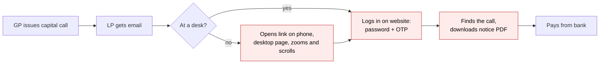
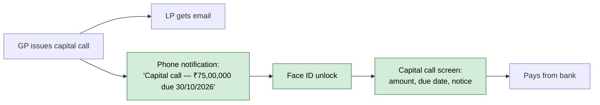
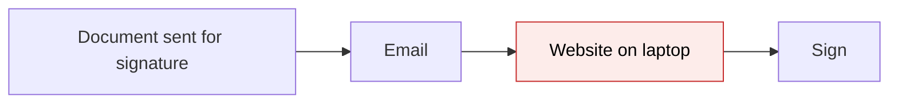
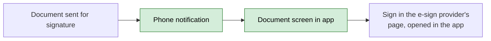
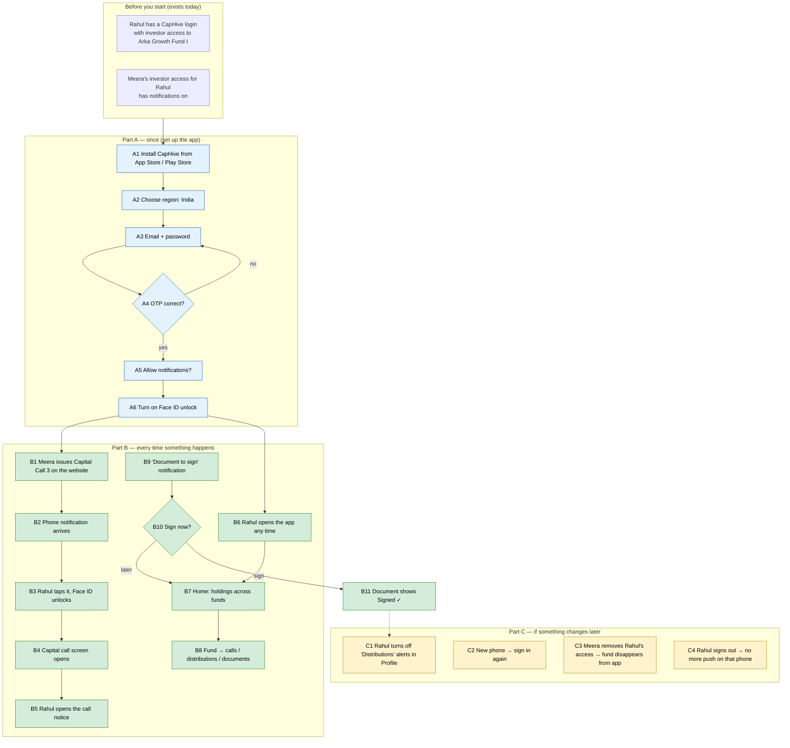
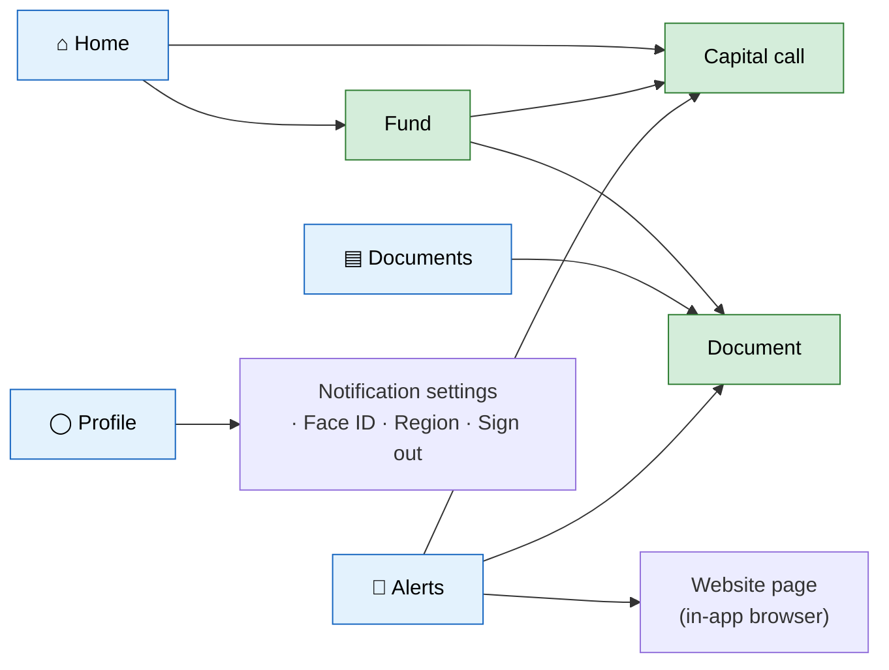

# CapHive LP Mobile App — Proposal

> **Audience:** Business team, product, QA, support — non-technical.
> **Companion document:** [Design](design.md)
> **New to this? Start with the [Workflow Journey](#workflow-journey)** — every action, in order, from start to the outcome.

> **Planning phase — no code changes.** This document proposes and explains the change. Do not
> edit application code while writing it; implementation happens later, in the tasks phase.

---

## Why

Investors (LPs) today can only reach CapHive through a desktop-first website. On a phone they get
a cramped admin-style layout, and they learn about capital calls, distributions and documents
only through email or WhatsApp, which then sends them back to that website. LPs increasingly
expect a native app with phone alerts, like the ones their banks and brokers provide. Without
one, capital calls get paid late, documents go unsigned and support gets "where is my statement?"
questions. This change adds an **iOS and Android app for LPs**, with **push notifications**, for
the few things an LP does most: check holdings, act on capital calls, and read and sign
documents.

## What Changes

The app is a pocket version of the LP side of CapHive. Like a banking app beside the bank's
website, it does not replace the website. It shows the same investments, with the same
permissions, on a phone screen.

- **New iOS and Android app "CapHive"** for LP users, investor advisors and family-office users.
  It deliberately has **only the key screens**: four tabs (**Home, Documents, Alerts, Profile**)
  plus three detail screens (**Fund, Capital call, Document**). Sign-in uses the same two-factor
  check as the website. Everything else stays on the website and opens there from the app when
  needed.
- **Simple, clean and modern.** One primary action per screen, card layouts, large light-weight
  figures, a graphite look with CapHive orange. See [UI/UX principles](#uiux-principles).
- **Push notifications.** Every alert an LP gets today by email (a capital call issued, a
  reminder, a distribution paid, a document to sign, a KYC request, an approval, a new statement)
  can also arrive as a phone notification. Tapping the notification opens the right screen in
  the app.
- **Notification settings in the app.** The LP chooses which kinds of alert reach the phone. The
  GP's existing per-investor settings still decide whether the LP is notified at all. Push
  follows the same rules as email and never notifies anyone email would not.
- **Biometric unlock.** After the first sign-in, Face ID, Touch ID or fingerprint unlocks the
  app, so the LP does not repeat the password and OTP each time.
- **Region choice.** The LP picks India or US on first launch. Each region is a separate
  CapHive with its own sign-in and data, as it is on the web today.
- **A secure investor data service** behind the app. It hands the app exactly what the LP
  already sees on the website, and nothing more.
- **Nothing changes on the website.** GPs need no new setup to send push alerts. Notifications
  they send today reach the app automatically for LPs who have installed it.

### Flow Diagram

**Capital call: before** — the LP finds out by email and has to use a desktop website.



**Capital call: after** — the LP gets a phone notification and lands on the call with one tap.



**Signing a document: before / after**





---

## Workflow Journey

### Who is involved

| Person | Role | What they do in the journey |
|---|---|---|
| Rahul Sharma | LP user. Investor "Sharma Family Office" in **Arka Growth Fund I** (Arka Capital, India region) | Installs the app, signs in, receives and acts on alerts |
| Meera Iyer | GP fund operations at Arka Capital | Issues the capital call and uploads documents on the website as today. Nothing new to do |
| Anil Rao | Investor advisor to Sharma Family Office | Uses the same app and switches between the investors he advises |
| Priya (Support) | CapHive support | Helps when an LP cannot sign in or gets no notifications |

### The journey on one page



### Before you start

| Needed | Why | Where it comes from |
|---|---|---|
| A CapHive user login for the LP | The app uses the same login as the website | GP invites the LP today (investor access) |
| Investor access to at least one fund/entity | Decides what the app shows | GP › Investor › Access |
| Two-factor method set up (if the GP requires it) | The app asks for the same OTP as the website | Website › Profile › Two-factor |
| Notifications on for the LP's investor access | Push follows the same on/off as email | GP › Investor access › "Email enabled" |
| A phone with iOS 16+ or Android 10+ | Supported devices | App Store / Play Store |

### Part A — once (set up the app)

| Step | Who | Where | Action | What the system does | What you see |
|---|---|---|---|---|---|
| A1 | Rahul | App Store / Play Store | Installs "CapHive" | — | App icon on the home screen |
| A2 | Rahul | Welcome › Region | Taps **India** | Remembers the region on this phone | Sign-in screen with "India" shown and **Change** next to it |
| A3 | Rahul | Sign in | Enters email + password, taps **Sign in** | Checks the password, the lockout count and the account status, as the website does | OTP screen, or "Incorrect email or password" |
| A4 | Rahul | Verify | Enters the 6-digit OTP (authenticator / SMS / WhatsApp, whichever is set) | Checks the code and issues an app session for this phone | Home screen, or "Code is incorrect or expired — try again" |
| A5 | Rahul | System prompt | Taps **Allow** on "CapHive would like to send you notifications" | Registers this phone for Rahul's push alerts | Home screen. Profile › Notifications shows "On" |
| A6 | Rahul | Prompt "Use Face ID to unlock?" | Taps **Use Face ID** | Stores the session behind the phone's biometric lock | Next launches unlock with Face ID |
| A6a | Anil (advisor) | Home › top bar | Taps the investor name, picks "Sharma Family Office" | Switches to that investor, as on the website | Home now shows Sharma Family Office's funds |

### Part B — every time

| Step | Who | Where | Action | What the system does | What you see |
|---|---|---|---|---|---|
| B1 | Meera | Website › Capital Calls › New | Issues "Capital Call 3" (15%) for Arka Growth Fund I | Creates remittances and sends notifications as today. **New:** also sends a push to each registered phone of each recipient who would get the email | Nothing new on the website |
| B2 | — | Rahul's phone | — | Push delivered | Banner: **"Arka Capital — Capital Call 3"** / "₹75,00,000 due by 30/10/2026" |
| B3 | Rahul | Banner | Taps it | App unlocks with Face ID and opens the linked screen | Capital call screen |
| B4 | Rahul | Capital call | Reads | Loads only Rahul's remittance | Amount due, due date, status and the call notice (see mockup) |
| B5 | Rahul | Capital call › **Notice** | Taps | Opens the call notice PDF | PDF viewer with **Share / Save** |
| B6 | Rahul | App icon | Opens the app | — | Home |
| B7 | Rahul | Home | Scrolls | Shows totals per fund, as on the website's LP dashboard | Fund cards (see mockup) |
| B8 | Rahul | Fund › Documents | Taps a quarterly statement | Opens the document. Records "viewed by", as the website does | PDF viewer |
| B9 | — | Phone | — | A "Side letter — please sign" notification arrives | Banner. Tapping it opens the document |
| B10 | Rahul | Document › **Sign** | Taps | Opens the e-sign provider's signing page in a sheet inside the app | Provider page. After signing, the sheet closes and the document shows "Signed ✓" |
| B11 | Rahul | Alerts tab | Opens | Lists the same notifications as the website's bell | Unread items show a dot. Tapping one opens its screen and marks it read on the website too |
| B12 | Rahul | Alerts › an approval request | Taps | Approvals have no native screen in v1 | The website's approval page opens in the in-app browser, already signed in |

### Part C — if something changes later

| Step | Who | Where | Action | What the system does | What you see |
|---|---|---|---|---|---|
| C1 | Rahul | Profile › Notifications | Turns off **Distributions** | Stops push for that category on all Rahul's phones. Email is unaffected | Toggle off |
| C2 | Rahul | New phone | Installs the app and signs in (A1–A6) | Registers the new phone. The old phone keeps working until signed out or 90 days unused | — |
| C3 | Meera | Website › Investor access | Removes Rahul's access to the fund | The app stops showing the fund on its next refresh, and no further push for it | The fund disappears from Home |
| C4 | Rahul | Profile › **Sign out** | Taps | Ends the app session and unregisters this phone from push | Sign-in screen. No more alerts on this phone |
| C5 | Rahul | Website › Profile › Devices | Taps **Sign out** next to "iPhone 15 — last used 02/10/2026" | Ends that phone's session remotely and stops its push | The lost phone shows the sign-in screen on next use |

### What you see

**Home** (Rahul, India region, amounts in fund currency, dates in the user's locale format)

```
┌──────────────────────────────────────┐
│ Good morning, Rahul                   │
│ Sharma Family Office ▾                │
│                                      │
│ ┌──────────────────────────────────┐ │
│ │ To do (2)                        │ │
│ │ ● Capital Call 3   ₹75,00,000  › │ │
│ │   Arka Growth Fund I · due 30/10 │ │
│ │ ● Side letter — sign          ›  │ │
│ └──────────────────────────────────┘ │
│                                      │
│ ┌──────────────────────────────────┐ │
│ │ Arka Growth Fund I   Arka Capital│ │
│ │ Committed          ₹5.00 Cr      │ │
│ │ ███████████░░░░░░░░ 40% called   │ │
│ │ Called ₹2.00 Cr · Due ₹75.00 L   │ │
│ │ Distributed        ₹30.00 L    › │ │
│ └──────────────────────────────────┘ │
│                                      │
│  ⌂ Home   ▤ Documents   🔔 Alerts ³  ◯ Profile │
└──────────────────────────────────────┘
```

Cards show compact amounts (₹5.00 Cr). Tapping a card opens the Fund screen, which shows the
exact figures (₹5,00,00,000).

Arithmetic: Calls 1 and 2 called 25% of ₹5,00,00,000, which is ₹1,25,00,000. Call 3 adds 15%,
which is ₹75,00,000. Called = ₹1,25,00,000 + ₹75,00,000 = **₹2,00,00,000** (40%).
Calls 1 and 2 are paid, so collected = ₹1,25,00,000. Due = called − collected (+ any other fees)
= ₹2,00,00,000 − ₹1,25,00,000 = **₹75,00,000**, which is Call 3. These are the same four figures
(Committed, Called, Distributed, Due Amount) that the website's LP fund card shows. The app reads
them and does not recompute them.

**Capital call**

```
┌──────────────────────────────────────┐
│ ← Capital Call 3                     │
│ Arka Growth Fund I                    │
│                                      │
│ Status            Pending  ●          │
│ Call amount        ₹75,00,000         │
│ Received                ₹0            │
│ Due by            30/10/2026          │
│                                      │
│ Payment instructions and the fund's   │
│ bank details are in the call notice.  │
│                                      │
│ [   View call notice (PDF)   ]       │
└──────────────────────────────────────┘
```

**Notification settings**

```
┌──────────────────────────────────────┐
│ ← Notifications                      │
│ Push notifications on this phone  [●]│
│                                      │
│ Capital calls & reminders         [●]│
│ Distributions                     [ ]│
│ Documents & signatures            [●]│
│ Everything else                   [●]│
│ (KYC, approvals, deals, fund news)   │
│                                      │
│ Email alerts are managed by your fund │
│ manager and are not affected here.    │
└──────────────────────────────────────┘
```

### What goes wrong

**Rahul allowed notifications but gets none for Capital Call 3.**
1. Priya asks Rahul to open **Profile › Notifications**. It shows "Push notifications on this
   phone: **Off in phone settings**", with an **Open phone settings** button. Rahul had denied
   permission at the system level.
2. If the app says "On", Priya checks the website. On Rahul's investor access for Arka Capital,
   **Email enabled** is off. Push follows that switch, so no push was sent, just as no email was.
   Meera turns it on, and later alerts arrive.
3. If both are on, Priya opens **Website › Admin › User › Devices** and sees Rahul's phone with
   "Last delivery: failed — device no longer registered" (the app was reinstalled). Rahul signs
   in again on that phone and the device registers afresh.

**Rahul enters the wrong code three times.** The app shows "Too many failed attempts. Please sign
in again." and returns to the password screen — the same rule as the website. Six wrong passwords
lock the account for 5 minutes, as on the website.

### Summary: the minimum actions

| # | Action | Who | How often |
|---|---|---|---|
| 1 | Install the app, choose region, sign in with OTP | LP | Once per phone |
| 2 | Allow notifications, turn on Face ID | LP | Once per phone |
| 3 | Issue calls, upload documents, send approvals | GP | As today, nothing new |
| 4 | Tap a notification to act on it | LP | Every alert |

---

## User Stories

### US-1: Sign in securely on a phone

**As an** LP user,
**I want** to sign in with my existing CapHive email, password and OTP,
**So that** I don't need a separate account and my data stays as protected as on the website.

**Acceptance criteria:**
- The region (India / US) is chosen before sign-in and shown on the sign-in screen with **Change**.
- Email and password errors, lockouts and the OTP step behave exactly as on the website. The app
  never skips two-factor for a user who has it set up.
- "Forgot password" and "Email me a sign-in link" open the website's existing flows.
- Only users with an investor, investor-advisor or family-office persona can use the app. Any
  other user sees "This app is for investors. Please use the CapHive website."

### US-2: Unlock with Face ID / fingerprint

**As an** LP user, **I want** biometric unlock, **so that** opening the app is quick but still secure.

**Acceptance criteria:**
- Offered once after the first successful sign-in, and switchable in Profile.
- After 3 failed biometric attempts, the app falls back to the full sign-in.
- The app session expires after 90 days unused, or immediately when the password changes,
  the user is deactivated, or the device is signed out from the website.

### US-3: See my holdings

**As an** LP, **I want** a home screen with my funds and a "To do" list, **so that** I know where I stand and what to do.

**Acceptance criteria:**
- Fund cards show committed, called (with a progress bar), due and distributed amounts, the
  same figures as the website's LP fund card. Evergreen funds show value, units, NAV per unit
  with its date, and gain, like the website's evergreen card.
- "To do" lists only two kinds of item: unpaid capital calls (earliest due date first) and
  documents awaiting my signature. When there are none, the card reads "You're all caught up".
- Tapping a fund card opens the Fund screen. It has three segments (**Calls, Distributions,
  Documents**), with exact amounts and the totals at the top.
- Users with access to several GPs see all their funds, grouped by GP.
- Advisors switch investor from the top bar. The list matches the website's advisor switcher.

### US-4: Act on a capital call

**As an** LP, **I want** to open a capital call from a notification and see what to pay, **so that** I pay on time.

**Acceptance criteria:**
- The screen shows the call name, fund, amount due, amount received, due date, status, and
  **View call notice**, which opens the notice PDF containing the payment instructions and the
  fund's bank details. CapHive does not store a fund's bank details as data, so the app shows
  the notice rather than copying them.
- When no notice has been generated yet, the button is replaced by "The call notice isn't
  available yet".
- A status of Paid, Partially paid or Overdue matches the website.

### US-5: Read and sign documents

**As an** LP, **I want** to open my fund documents and sign those waiting for me, **so that** I don't need a laptop.

**Acceptance criteria:**
- The Documents tab lists the same documents the website shows this LP, with search and a fund
  filter.
- Opening a document records "viewed by", as the website does.
- **Share / Save** uses the phone's share sheet.
- **Sign** appears only when this user is a pending signatory. For documents sent through
  **Digio** (the default provider), it opens Digio's signing page inside the app, and on return
  the document refreshes its signature status. For **DocuSign** documents, DocuSign only allows
  signing from its own email, so the button reads **Sign in DocuSign email** and explains "Open
  the email from DocuSign on this phone to sign".
- Documents inside an NDA-gated data room stay hidden until the NDA is accepted, as on the
  website.

### US-6: Get push notifications

**As an** LP, **I want** phone alerts for the things I'm emailed about, **so that** I react quickly.

**Acceptance criteria:**
- Every notification an LP receives in the website's bell can also be sent as a push.
- A push is sent only when the email would have been sent. The GP's per-investor "Email
  enabled" switch also controls push.
- The push title is the fund manager's name. The body is the same subject line as the email,
  including any custom wording the GP set for that notification.
- Tapping a push opens the matching app screen. If the app has no screen for it, the app opens
  the notification in the in-app browser on the website.
- Push and notification bodies never contain bank account numbers or document contents.
- A push is not delayed beyond the email's own sending delay.

### US-7: Control my alerts

**As an** LP, **I want** to switch categories of push on or off, **so that** I only get what matters to me.

**Acceptance criteria:**
- There are four categories: Capital calls & reminders, Distributions, Documents & signatures,
  and Everything else (KYC, approvals, deals, fund news).
- These settings apply to all my phones and never change email or WhatsApp.
- If the phone's system permission is off, the screen says so and offers **Open phone settings**.

### US-8: Manage my devices

**As an** LP, **I want** to see and sign out my phones from the website, **so that** a lost phone can't access my data.

**Acceptance criteria:**
- Website › Profile › **Devices** lists each phone: name, platform, region, last used, and
  push on/off.
- **Sign out** ends that phone's session and stops push to it within one minute.

---

## UI Behavior

### The whole app: 4 tabs and 3 detail screens



| Screen | Primary action | Everything else on it |
|---|---|---|
| Home | Tap a "To do" item | Fund cards, investor switcher (advisors / multi-investor users only) |
| Fund | Switch segment | Totals strip; lists of calls, distributions and documents |
| Capital call | **View call notice** | Status, call amount, received, due date |
| Document | **Sign** (if pending), otherwise **Share** | Inline PDF viewer |
| Documents tab | Search | Fund filter chips; "To sign" chip |
| Alerts | Tap an alert | Swipe to mark read; "Mark all read" |
| Profile | — | Notification settings, Face ID, region, devices help, sign out |

- **Alerts** shows the unread count. It is the same unread count as the website's bell, and
  marking an alert read in either place updates both.
- Pull down to refresh on every list. Screens also refresh when the app returns to the
  foreground.

### Fund

```
┌──────────────────────────────────────┐
│ ‹ Arka Growth Fund I                 │
│ Committed ₹5,00,00,000 · 40% called   │
│ ┌ Calls ┐ Distributions  Documents    │
│                                      │
│ Capital Call 3        ₹75,00,000     │
│ due 30/10/2026           ◌ Pending   │
│ ──────────────────────────────────── │
│ Capital Call 2        ₹50,00,000     │
│ paid 12/06/2026          ✓ Paid      │
│ ──────────────────────────────────── │
│ Capital Call 1        ₹75,00,000     │
│ paid 05/01/2026          ✓ Paid      │
└──────────────────────────────────────┘
```

Check: Call 1 + Call 2 = ₹1,25,00,000 (25%). Adding Call 3 gives ₹2,00,00,000 (40%), which
matches Home.

**Behavior notes:**
- Dates use the signed-in user's locale format, the same as the website (`dd/mm/yyyy` for
  India English, `mm/dd/yyyy` for US English).
- Amounts use the fund's currency and the same number formatting as the website (lakh/crore
  grouping for INR).
- Evergreen funds use the same Fund screen with the segments **Holding, Transactions,
  Documents** (read-only). Subscribe / Redeem open the website's wizard in the in-app browser.
- Offline: the app shows the last loaded data with a "Last updated 10:42 — offline" bar.
  **Sign** is disabled while offline.

### Sign-in

```
┌──────────────────────────────────────┐
│              CapHive                  │
│ Region: India                [Change] │
│ Email     [rahul@sharmafo.in        ] │
│ Password  [••••••••••           👁  ] │
│                  [ Sign in ]          │
│ Forgot password?  Email me a link     │
└──────────────────────────────────────┘
```

### UI/UX principles

The app should feel like a modern banking or brokerage app: calm, quick, and obvious without
any training. Every screen is checked against these rules.

| # | Principle | What it means in this app |
|---|---|---|
| 1 | **Only what an LP needs on the go** | 4 tabs and 3 detail screens, nothing more. Anything else opens the website page inside the app, so the app is never a dead end |
| 2 | **One primary action per screen** | One prominent button (View call notice, Sign). Secondary actions sit in a "⋯" menu or a bottom sheet |
| 3 | **Answer first, detail on tap** | Home answers "what do I own and what do I owe?" in one glance. Exact figures and history are one tap deeper (progressive disclosure) |
| 4 | **One designed look on every platform** | A full-width bottom tab bar of round icons (white circle = current tab), round back button, swipe-back, system share sheet, haptic tick on success — the same on iPhone, Android and the web review build |
| 5 | **Clean visual system** | After the MYGRID reference chosen by the product owner: soft graphite surfaces with a subtle gradient and hairline edges, CapHive orange (#FF4D00) as the one accent, Manrope with large light-weight figures, pill controls, generous spacing, and colour used only for status (paid = green, due = amber, overdue = red), always with an icon or label |
| 6 | **One fixed theme** | The graphite theme does not change with the phone's light/dark setting (product decision, 2026-10-13) |
| 7 | **Feels instant** | Skeleton placeholders instead of spinners, cached data shown first then refreshed, pull to refresh, optimistic "mark read" |
| 8 | **Friendly empty and error states** | "You're all caught up", "No documents yet for this fund", plus a plain-English error with a **Try again** button. Never a raw error code |
| 9 | **Accessible by default** | Respects the phone's text size (Dynamic Type / font scale), VoiceOver and TalkBack labels on every control, 44 pt minimum touch targets, WCAG AA contrast |
| 10 | **Security without friction** | Face ID / fingerprint unlock, the app content blurred in the app switcher, auto-lock after 5 minutes in the background |
| 11 | **Readable money** | Compact amounts on cards (₹5.00 Cr, $1.2M), exact amounts on detail screens, tabular digits so columns line up |
| 12 | **Notifications that earn their place** | Ask for permission after sign-in with one line on why ("Get notified when a capital call or document needs you"), not on first launch. Tapping a notification always opens the exact item |

---

## What This Feature Does NOT Cover

| Excluded | Covered In |
|---|---|
| GP / fund-admin screens in the app | Not planned — GPs use the website |
| Native approval screen (approvals open on the website inside the app) | Phase 2 |
| A separate "Funds" tab (funds are reached from Home) | Not planned — keeps the app to 4 tabs |
| Completing KYC forms and uploading KYC documents in the app (the app shows status and opens the website flow in the in-app browser) | Phase 2 |
| Evergreen Subscribe / Redeem wizards built natively (opened on the website for now) | Phase 2 |
| Uploading payment proof for a capital call | Phase 2 |
| Deals / secondary offers: making offers or expressing interest (view only) | Phase 2 |
| LP AI assistant chat in the app | Phase 2 |
| Web push in the browser, or desktop notifications | Not planned |
| Changing which emails a GP sends | Unchanged — GP custom notifications |
| Tablet-optimised layouts (the phone layout runs on tablets) | Later |

---

## Validation Rules

| Field | Rule | Default |
|---|---|---|
| Region | Must be one of the deployment regions (India, US) | None. Asked on first launch |
| Email / password | Same rules and lockout as the website (5 failed attempts) | — |
| OTP | Required whenever the user has two-factor set up. Same expiry as the website | — |
| App session | Expires 90 days after last use. Revoked on password change, deactivation or device sign-out | 90 days |
| Push category toggles | Per user, applied to all their devices | All on |
| Devices per user | Up to 10 active. Signing in on an 11th signs out the least recently used | 10 |

---

## Behavior Rules

| Scenario | What User Sees |
|---|---|
| GP turns off "Email enabled" for the investor access | No email and no push for that investor's notifications. In-app Alerts still list them, as the website bell does |
| LP turns off the "Distributions" category | No push for distributions. The email still arrives. Alerts still lists it |
| User has two phones | Both get the push. Reading it on one marks it read everywhere |
| Access removed by GP | The fund disappears on the next refresh. Opening an old push link shows "You no longer have access to this item" |
| User deactivated, or password changed | Every app session ends. The next action returns to Sign in |
| Push points to an item with no app screen yet (e.g. a deal offer) | Opens the website page for it in the in-app browser, already signed in |
| User is a GP employee who is also an LP somewhere | Can sign in. The app shows only their investor persona |
| Region mismatch (a US user signs in under India) | "Incorrect email or password", the same message as any failed sign-in so the app never reveals whether an email exists, plus the line "Is your account on the US site? **Switch region**" |
| App version too old for the server | "Please update CapHive to continue" with a store link |

---

## Resolved Design Decisions

| # | Decision | Resolution |
|---|---|---|
| 1 | Native app technology | **React Native with Expo**: one codebase for iOS and Android with a fully native UI (chosen by product, 2026-10-13) |
| 2 | Where the app's data comes from | A new, versioned **investor data service** on each CapHive region, using the same permissions as the website. No GP data is exposed through it |
| 3 | Push delivery | Through **Expo's push service** (which forwards to Apple and Google), so one integration covers both platforms |
| 4 | Which notifications become push | **All** existing LP notifications, by adding push to the shared notification sender once, not to each notification type |
| 5 | Who controls whether a push is sent | The GP's existing per-investor email switch (an outer gate) plus the LP's category toggles (an inner gate). Push never goes where email wouldn't |
| 6 | Two-factor in the app | Mandatory whenever the user has it set up, identical to the website. Today's API token sign-in does not ask for OTP, so the app gets its own sign-in path that does |
| 7 | Regions | The app holds one region's session at a time and the user picks the region. India and US stay fully independent, with no shared accounts, tokens or push setup |
| 8 | Screens not built natively in v1 | Opened on the website inside the app's in-app browser, already signed in, so every LP task stays possible from the phone |
| 9 | Where the app's code lives | A `mobile/` folder in this repository, on branch `feature/lp-mobile-app`, so the investor data service and the app change together |
| 10 | Date and number display | Follows the website's locale formats, with no separate mobile format |

---

## Capabilities

### New Capabilities

- `mobile/lp-mobile-app`: the iOS/Android LP app — region choice, sign-in with OTP, biometric
  unlock, the four tabs (Home, Documents, Alerts, Profile), the Fund, Capital call and Document
  screens, signing, the in-app browser fallback, the UI/UX principles, and offline and
  forced-update behavior.
- `mobile/lp-mobile-api`: the investor data service the app uses — device sign-in with
  two-factor, sessions per device, revocation, and read endpoints scoped exactly to the LP's
  website permissions, plus the "mark read" action.
- `notifications/push-delivery`: push as a delivery channel for LP notifications — device
  registration, gating by email-enabled and category, deep links, failure handling, and the
  website's Devices page.

### Modified Capabilities

None. Existing specs (`identity/cross-region-login`, `funds/open-ended-investor-view`,
`kyc/investor-kyc-journey`) keep their requirements. The app reads what they define and does not
change it.

---

## Impact

- **New mobile app**: a new `mobile/` folder (Expo project), plus App Store and Play Store
  listings, developer accounts and signing keys for CapHive.
- **Website / server**: a new investor data service; a new phone sign-in path that enforces
  two-factor; device registration; push added to the shared notification sender (one place,
  covering every LP notification); a Devices page on the user profile.
- **Notifications**: every LP notification type gains push, and email and WhatsApp behave as
  before.
- **Operations**: an Expo push access token per region (India and US separately); monitoring of
  push failures; a minimum supported app version that the server can enforce.
- **Support**: a new playbook for "no notifications" and lost phones (see What goes wrong).

---

## Benefits

1. LPs learn about capital calls the moment they are issued and can see what to pay in two taps,
   which should mean fewer late payments and fewer reminder chases for GPs.
2. Documents get signed from a phone, without waiting for the LP to be at
   a desk.
3. One app covers every GP an LP invests with on CapHive, so all their alerts are in one place.
4. Security is the same as the website (same OTP, same permissions), with remote sign-out for a
   lost phone.
5. GPs need no setup. Every notification they already send reaches the phone.

---

## FAQ

| Question | Answer |
|---|---|
| Who can use the app? | Any user who logs into the website as an investor, investor advisor or family office. GP staff use the website |
| Do LPs need a new account? | No. They use the same email, password and OTP as the website |
| Does the GP have to do anything to send push notifications? | No. Push follows the notifications GPs already send and the same per-investor on/off switch as email |
| Will LPs still get emails? | Yes. Push is in addition to email and WhatsApp, never instead of them |
| Can an LP turn push off? | Yes, per category or entirely, in the app's Profile › Notifications. Email is unaffected |
| Can an LP see anything in the app they can't see on the website? | No. The app uses the same permission checks, so it shows exactly what the website shows them, or less |
| What if a phone is lost? | The LP (or support) signs that phone out from Website › Profile › Devices. The session ends and push stops within a minute |
| What about India vs US accounts? | They are separate, as on the website. The LP picks the region in the app and can change it |
| Will the custom email wording a GP set appear in the push? | The custom subject line becomes the push text. The full email body stays in the email |
| What if a feature isn't in the app yet (e.g. KYC upload)? | The app opens that website page inside the app, already signed in, so the LP can still finish it |
| Is there a charge? | No change to pricing is assumed. This is a product decision to confirm before launch |
| How is it released? | Through the App Store and Play Store, region by region, starting with a pilot GP's LPs on TestFlight / Play internal testing |

---

## Design Principle for the Next Phase

Keep it DRY and simple:

- **Do not re-implement permissions.** The investor data service must reuse the existing Pundit
  policies and scopes the website uses, so the app can never show more than the website. A
  separate "mobile policy" is the main risk to avoid.
- **One push hook, not 37.** Push is added once to the shared notification sender, reusing each
  notification's existing message and link, and the existing email-enabled gate. The design
  must map each notification's website link to an app screen in one table, not per notifier.
- **Reuse figures, don't recompute.** Home and fund totals must come from the same calculations
  the website's LP dashboard uses.
- **Watch the large tables.** Lists of remittances, distribution payments and documents must be
  paginated and select only the needed columns (see the project's large-table rules).
- **Two-factor is the riskiest part.** Today's token sign-in skips OTP, so the design must
  specify a phone sign-in that cannot bypass it, plus token revocation.
- **Regions stay independent.** There is no shared token, push credential or device table across
  India and US.
- **Notifications design** must name every recipient and channel (investor and internal), as
  the project's design schema requires.
