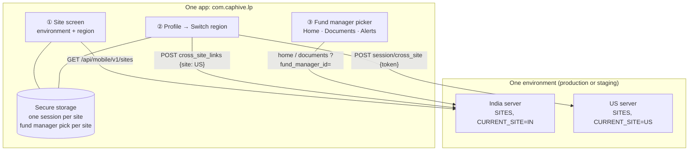

# Design — LP mobile app across environments, regions and fund managers

Builds on `openspec/changes/lp-mobile-app`. Worked examples and edge-case tables:
[business-rules.md](business-rules.md).

## The picture



| # | Box | Real name |
|---|---|---|
| ① | Site screen | `mobile/src/app/(auth)/region.tsx`, `src/api/config.ts`, `Api::Mobile::V1::SitesController` |
| ② | Region switch | `CrossSiteLinksController`, `SessionsController#cross_site`, `MobileSignIn.cross_site`, `auth/session.tsx#switchRegion` |
| ③ | Fund manager picker | `MobileFundManagers`, `BaseController#fund_manager_id`, `lib/fund-manager.tsx`, `ui/fund-manager-picker.tsx` |

## ① One app, every environment

**What:** every build carries the same environment list (`ENVIRONMENTS` in `src/api/config.ts`):
Production (`app.caphive.com`) and Staging (`dev.altconnects.com`), plus a typed-in Custom address.
The app knows one address per environment and asks it `GET /api/mobile/v1/sites`, which answers
with that deployment's own `SITES` — the list the website's region switcher uses.

**Why from the server:** `SITES` is already the single source of truth for which regions an
environment has (`SiteRegistry`, validated at boot). Copying it into the app would let the two
drift; asking keeps staging from ever listing a production site.

**Visibility:** investors see only CapHive. A long press on the CapHive name reveals Staging and
Custom. `APP_ENV` now only picks which environment the screen opens on (`extra.defaultEnvironment`)
— a staging build opens on Staging with the test environments revealed. Staging and production
builds share the app identity `com.caphive.lp`; the development dev-client stays separate because it
loads JavaScript from a laptop.

**Older servers:** a server without `/sites` answers 404, so the app uses that environment's
built-in `fallbackSites`. Custom has no fallback and shows "Can't reach this server".

### FAQ

**Q: Why not keep separate staging and production apps?**
A tester then tests a different binary from the one investors install. With one identity, the
staging APK is the production app pointed at staging.

**Q: Can an investor end up on staging by accident?**
Only by long-pressing the title and choosing Staging. Sign-in shows the environment and address next
to the region on any non-production site, and Profile shows "US · staging".

## ② Region switch

The website's switch (`UsersController#cross_site_link` → `#cross_site_login`), without the browser
redirect:

```mermaid
sequenceDiagram
    participant P as Phone (session on IN)
    participant IN as IN API
    participant US as US API
    P->>IN: POST /api/mobile/v1/cross_site_links {site: "US"}
    Note over IN: secret configured, US in SITES, US ≠ current,<br/>UserPolicy#cross_site_link?(site: US)
    IN-->>P: 201 {token, site, url}
    Note over IN: CrossSiteLink: {email, purpose: "mobile_cross_site",<br/>site: US, from: IN}, 5 minutes
    P->>US: POST /api/mobile/v1/session/cross_site {token, device}
    Note over US: verify signature, expiry, purpose, destination;<br/>user active here; investor persona; claim nonce
    US-->>P: 201 {access_token, refresh_token, device_id}
```

- **Who sees it:** users with two or more `switchable_region_codes` (`/me.regions`).
- **No password or code:** the user proved both in the region they came from — the website's rule.
- **Its own purpose**, `mobile_cross_site`: a website link (`:login`) cannot be redeemed as a phone
  session, and a phone link cannot sign a browser in.
- **One session per site on the phone** (`sessionKey(url)` in secure storage, list in
  `caphive.session_sites`): switching back is instant; each region's server has its own
  `mobile_devices` row, so each can push to the phone.
- **Sign out signs every site out** — a lost phone must not stay signed in to the other region.

### FAQ

**Q: What if the US account is deactivated or locked?**
US refuses (`invalid_credentials`): a region does not sign in a user it has disabled just because the
other region vouched for them (MS-E4).

**Q: What if the switch fails half way?**
Nothing changes on the phone: the app moves to the new site only after the US session is stored.
Profile shows "Couldn't switch region" with the server's message.

## ③ One fund manager at a time

**What:** `MobileFundManagers#list` is the website's LP dashboard dropdown
(`entities/_vc_dashboard`): entities of the user's approved `InvestorAccess` rows, sorted by name
case-insensitively. `#resolve(requested_id)` returns the requested id while the user still has
access, otherwise the first. `BaseController#fund_manager_id` applies it to every request that takes
`fund_manager_id`; `home` and `documents` narrow their policy-scoped relations with
`where(entity_id:)` and echo `fund_manager_id`.

**Why "never all":** the product owner's rule (2026-10-17). It matches the website, whose dropdown
has no "All" entry, and keeps Home's totals meaningful — one fund manager's funds share a currency
and reporting conventions.

**On the phone:** `FundManagerProvider` holds the pick per site (`fundManagerKey(url)`); the picker
is a pill showing the selected name, opening a sheet with a checkmark on the current one. With one
fund manager it is a plain label. Alerts filter on the notification's new `sender_id`; an alert with
no sender shows for every fund manager. The Fund screen reads the card from its own commitment's
fund manager (`commitment.entity_id`).

### FAQ

**Q: What does Mark all read do?**
It marks every alert read, as on the website — including other fund managers'. The unread badge is
per user, not per fund manager.

**Q: An advisor switches investor — which fund manager?**
`/me.fund_managers` changes with the persona; a pick no longer in the list falls back to the first.

## Notifications

No new notification types. Two changes to existing pushes and alerts:

| Recipient | What changes | Why |
|---|---|---|
| Investor / advisor (push) | Expo payload `data` gains `region` (sending server's `CURRENT_SITE`) and `fund_manager_id` (`event.entity_id`) | A tap moves the app to that region and fund manager first (MS-H5, MF-H5) |
| Investor / advisor (Alerts tab) | Notification JSON gains `sender_id` | Alerts tab shows only the selected fund manager's alerts |
| Internal (fund manager staff) | None | The app is for investors only |

## Data model and schema changes

None. No migration; no change to existing models. Existing code touched: `MeController`,
`HomeController`, `DocumentsController`, `SessionsController`, `BaseController`, `MobileSignIn`,
`MobileHomeSummary`, `MobileDocuments`, `MobileDeepLink`, `DeliveryMethods::ExpoPush`,
`config/routes/mobile.rb`.

## Reference — endpoints

| Method | Path | Auth | Body / params | Answer |
|---|---|---|---|---|
| GET | `/api/mobile/v1/sites` | none | — | `{current, sites: [{code, label, url}]}` |
| POST | `/api/mobile/v1/cross_site_links` | phone token | `{site}` | 201 `{token, site, url}` · 422 `region_unavailable` |
| POST | `/api/mobile/v1/session/cross_site` | none | `{token, device}` | 201 tokens · 401 `region_switch_failed` / `challenge_spent` / `invalid_credentials` · 403 `not_investor` |
| GET | `/api/mobile/v1/home` | phone token | `fund_manager_id` | adds `fund_manager_id` |
| GET | `/api/mobile/v1/documents` | phone token | `fund_manager_id` | adds `fund_manager_id` |
| GET | `/api/mobile/v1/me` | phone token | — | adds `fund_managers`, `regions` |
