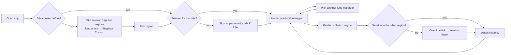

# LP mobile app: one app for every environment, region switching, one fund manager at a time

## Why

The first release of the LP app (`lp-mobile-app`, PR #1835) was built as three separate apps —
production, staging and development — each with its server addresses baked in at build time.
The product owner asked for three changes on 2026-10-17:

1. **The same app must work across all environments.** A tester's phone should run exactly what
   investors get, and reach staging or a laptop without a different build.
2. **The app must switch between regions**, the way the website's top-bar region dropdown does —
   without signing in again.
3. **The app must have the fund manager (GP) dropdown** the LP dashboard has on the website, and
   **always show one fund manager — never every fund manager mixed together.**

## What Changes

- **One app identity** (`com.caphive.lp`, "CapHive") for staging and production builds. Only the
  development dev-client stays a separate app.
- **Site screen**: the user picks an environment and region. Investors see only CapHive
  (production). A long press on the CapHive name reveals **Staging** and **Custom address**; a
  staging build opens with them revealed.
- **Regions come from the server**: new public `GET /api/mobile/v1/sites` returns the
  environment's own `SITES`. Staging therefore never lists a production site.
- **Region switch** in Profile, for users who belong to two or more regions
  (`User#switchable_region_codes`, the website's rule): new `POST /api/mobile/v1/cross_site_links`
  mints the website's signed, five-minute, single-use `CrossSiteLink` with a mobile-only purpose,
  and the other region's new `POST /api/mobile/v1/session/cross_site` redeems it for a phone
  session. No password or code is asked again — exactly as on the website.
- **One session per region on the phone**, like the browser's separate cookies: switching back is
  instant, each region registers the phone for push, and Sign out signs every region out.
- **Fund manager picker** on Home, Documents and Alerts. The list is `/me`'s `fund_managers` — the
  user's approved investor accesses, sorted by name, the website's dropdown. Exactly one is
  selected: the last pick on this phone, else the first. `home` and `documents` take
  `fund_manager_id`; alerts are filtered by the new `sender_id`.
- **Push taps** carry `region` and `fund_manager_id`, so tapping a notification first moves the
  app to that region and fund manager, then opens the item.
- **Build fix**: `.easignore` sent EAS an empty project (directory patterns with a trailing slash
  never matched), so every cloud build failed in its first phase.

## Workflow Journey

### Part A — First launch and sign-in

| # | Who | Action | What the app does | Example |
|---|---|---|---|---|
| A1 | Investor | Opens the app | Site screen lists CapHive's regions from `GET /api/mobile/v1/sites` on app.caphive.com | India, US |
| A2 | Investor | Taps India | Moves to India; no session yet → Sign in | — |
| A3 | Investor | Email + password (+ code if 2FA) | Unchanged from lp-mobile-app | rahul@sharmafo.in |
| A4 | Tester | Long-presses "CapHive", picks Staging | Lists staging's regions from dev.altconnects.com | India (dev.altconnects.com), US (dev.altconnects.us) |
| A5 | Developer | Picks Custom, types `http://192.168.1.20:3000`, Connect | Lists that server's regions | — |

### Part B — Fund manager

| # | Who | Action | What the app does | Example |
|---|---|---|---|---|
| B1 | Investor with Arka and Beta | Opens Home | Shows Arka Capital only (first by name), picker "Arka Capital ▾" | Arka cards, Arka To do |
| B2 | Investor | Picks Beta Partners | Home, Documents and Alerts show only Beta | Beta Opportunities card; Arka's Call 3 gone from To do |
| B3 | Investor | Reopens the app tomorrow | Still on Beta (pick stored per region) | — |
| B4 | Investor with one fund manager | Opens Home | Fund manager name as a label, no dropdown | "Arka Capital" |

### Part C — Region switch

| # | Who | Action | What the app does | Example |
|---|---|---|---|---|
| C1 | Investor in IN and US | Profile → Switch region → US | IN mints a link; US redeems it; phone registered in US | ~1 s, no password |
| C2 | Investor | Switches back to India | India's stored session reused | 82 ms in the local run |
| C3 | Investor only in IN | Opens Profile | No Switch region card | — |
| C4 | Investor | Taps a US push while on India | Switches to US and that push's fund manager, then opens the item | Capital Call 3 in US |
| C5 | Investor | Sign out | Every region's phone session ends | IN and US both revoked |

## Capabilities

### New Capabilities
- `lp-mobile-multi-site`: one app across environments, region switching, one fund manager at a time.

### Modified Capabilities
- (none — `lp-mobile-app` is not yet archived; this change builds on it)

## Impact

- **Server**: new `SitesController`, `CrossSiteLinksController`, `SessionsController#cross_site`,
  `MobileSignIn.cross_site`, `MobileFundManagers`; `/me`, `home`, `documents`, notification JSON
  and the Expo push payload gain fields. No migration. No change to existing models.
- **App**: site screen, per-site session storage, region switch, fund manager picker; staging and
  production are one app identity.
- **Website**: unchanged.
- **Release**: the server change must be deployed to a region before its app users get the picker
  and region switch. Against an older server the app falls back to the built-in region list and to
  the server's unfiltered Home.
