# NDA Module 2: LP Acceptance Flow (Stakeholder-Level) — Design

> **Audience:** Engineering team.
> **Companion documents:** [Proposal](proposal.md) · [Spec](specs/)

> **Planning phase — no code changes.** This document explains HOW the proposal will be built.
> Do not edit application code while writing it; implementation happens later, in the tasks phase.

> **Design, not code.** Explain the design with mermaid diagrams and tables. Do NOT paste Ruby/JS
> class bodies, migrations, route blocks or policy code. Put real class, method, table and path
> names inside the diagrams and tables instead.

---

## Contents

- [Overview](#overview)
- [Architecture](#architecture)
  - [Component Boundaries](#component-boundaries)
  - [Class Diagram](#class-diagram)
  - [Change Footprint](#change-footprint)
- [Data Model and States](#data-model-and-states)
  - [Data Model](#data-model)
  - [State Transitions](#state-transitions)
- [Behaviour](#behaviour)
  - [Pipeline / Flow](#pipeline--flow)
  - [Sequence Diagrams](#sequence-diagrams)
  - [Worked Examples](#worked-examples)
- [Key Components](#key-components)
  - [Decision Flows](#decision-flows)
- [Controllers and Routes](#controllers-and-routes)
- [Policy](#policy)
- [UI Changes](#ui-changes)
  - [At a glance](#at-a-glance)
  - [Journey 1: LP accepts NDA to access folder](#journey-1-lp-accepts-nda-to-access-folder)
  - [Journey 2: LP declines NDA](#journey-2-lp-declines-nda)
  - [Build notes (for implementers)](#build-notes-for-implementers)
- [Cross-cutting Concerns](#cross-cutting-concerns)
  - [Transactions and Queries](#transactions-and-queries)
  - [Exception Handling and Monitoring](#exception-handling-and-monitoring)
  - [Performance and Security](#performance-and-security)
- [Design Decisions](#design-decisions)
- [Testing](#testing)
- [Risks and Open Questions](#risks-and-open-questions)

---

## Overview

Adds an NDA acceptance gate to the existing Data Room folder access flow. When an LP navigates to an NDA-protected folder, a `before_action` on `DocumentsController#folder` redirects them to a new `NdaAcceptancesController` that renders the NDA document and captures the LP's accept or decline decision. This follows the same polymorphic, pack-based pattern established by `NdaConfigsController` in Module 1, living under `app/packs/core/nda_configs/`.

**Stakeholder-level acceptance:** The acceptance is recorded at investor (stakeholder) level. When any user of a stakeholder accepts, the gate opens for all users of that stakeholder. The signing user's investor is resolved from their `InvestorAccess` record for the NDA config's entity. The `nda_acceptances` table carries both `user_id` (who signed) and `investor_id` (on whose behalf).

---

## Architecture

### Component Boundaries

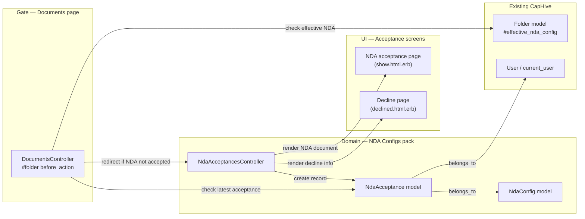

| From → To | Contract | Direction rule |
|---|---|---|
| DocumentsController → Folder | `@folder.effective_nda_config` returns the applicable NdaConfig or nil | Gate reads, never writes Folder |
| DocumentsController → NdaAcceptance | Query latest record by `[nda_config_id, investor_id]` to check stakeholder-level access | Gate reads, never writes |
| DocumentsController → InvestorAccess | Resolve current_user's investor(s) for the NDA config's entity | Gate reads, never writes |
| DocumentsController → NdaAcceptancesController | Redirect with `nda_config_id` + `folder_id` + `return_to` params | HTTP redirect, not method call |
| NdaAcceptancesController → NdaAcceptance | Creates new record on accept/decline with `investor_id` from user's InvestorAccess | Controller writes via model |
| NdaAcceptance → NdaConfig | `belongs_to :nda_config` | Read-only association |
| NdaAcceptance → Investor | `belongs_to :investor` | Read-only association |

### Class Diagram

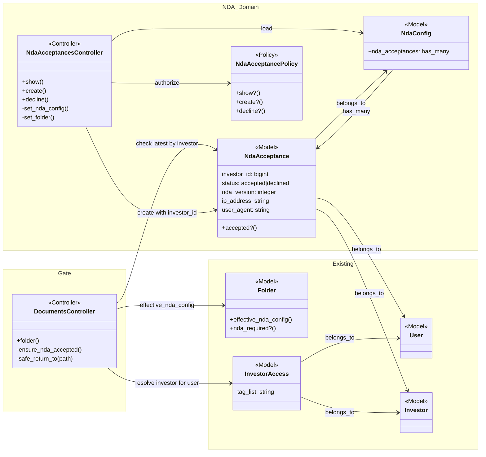

### Change Footprint

New code lives in `app/packs/core/nda_configs/`.

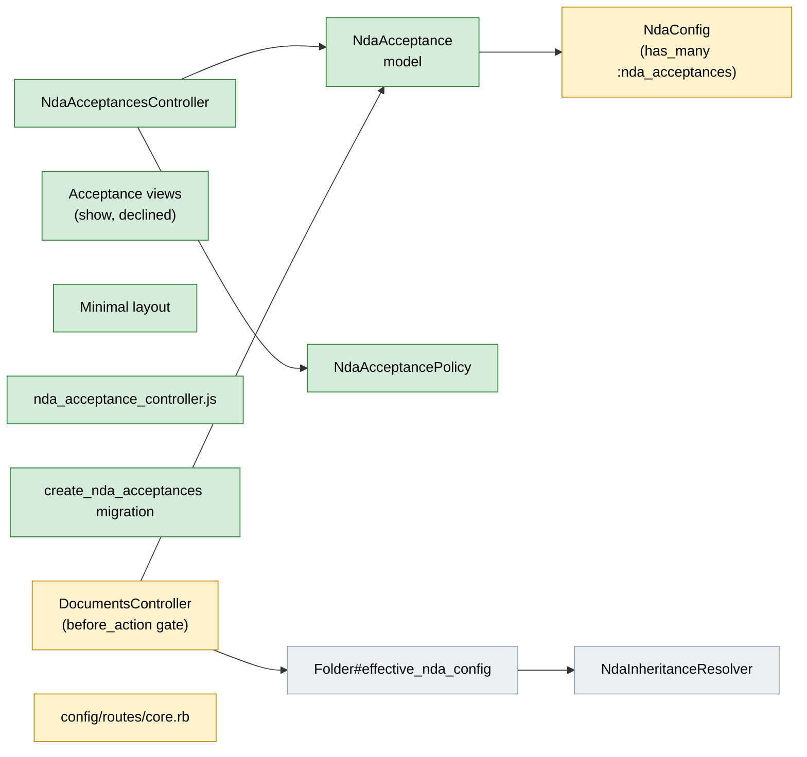

---

## Data Model and States

### Data Model

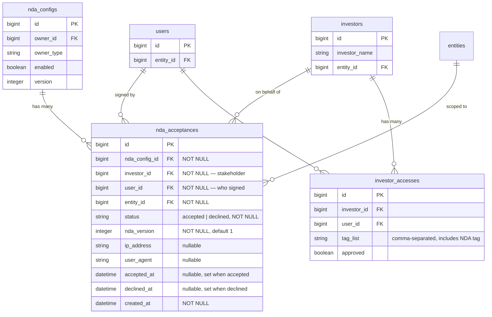

**Indexes:** `[nda_config_id, investor_id, created_at DESC]` for gate lookup (latest record per stakeholder+config). `[entity_id]` for dashboard queries. `[user_id]` for user-scoped audit queries. `[investor_id]` for stakeholder-scoped queries.

| Column | Why |
|---|---|
| investor_id | The stakeholder (investor) this acceptance is on behalf of. The gate checks at this level — if any acceptance exists for this investor+config, all users of the stakeholder pass. |
| user_id | The individual who signed. Kept for audit trail — shows exactly who clicked Accept. |
| nda_version | Captures which version the LP acted on — enables Module 4 re-acceptance detection without schema changes |
| entity_id | Denormalized from NdaConfig for fast entity-scoped dashboard queries (Module 3) without joining through nda_configs |
| ip_address, user_agent | Legal audit trail — records the environment of the acceptance event |
| accepted_at / declined_at | Separate from created_at to clearly distinguish when the action happened vs when the record was created |

**Changes to existing models:**

- `NdaConfig`: add `has_many :nda_acceptances, dependent: :destroy`. No new methods needed — the gate queries NdaAcceptance directly.
- `NdaAcceptance`: add `belongs_to :investor` association alongside existing `belongs_to :user`.
- No changes to `Folder`, `User`, `Investor`, or `InvestorAccess` models. The "NDA" tag is a convention on the existing `tag_list` field — no schema change needed.

### State Transitions

The stakeholder's effective NDA status per NdaConfig is derived from the latest `NdaAcceptance` record for that investor, not stored as a field.

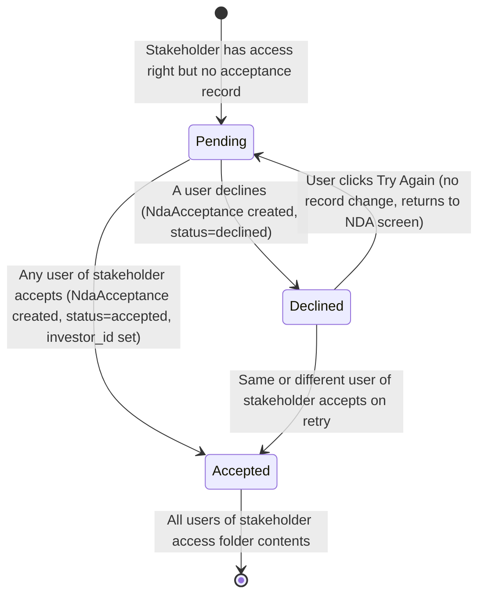

**States are derived at stakeholder level:** "Pending" = no NdaAcceptance record exists for this investor+config (or latest is not "accepted"). "Accepted" = latest record for the investor has status "accepted" at current NDA version. "Declined" = latest record for the investor has status "declined" (another user of the same stakeholder can still accept). There is no stored status field — the gate queries NdaAcceptance each time by `[nda_config_id, investor_id]`.

---

## Behaviour

### Pipeline / Flow

N/A — single-path request/response, no multi-branch processing.

### Sequence Diagrams

**Happy path — LP accepts NDA on behalf of stakeholder:**

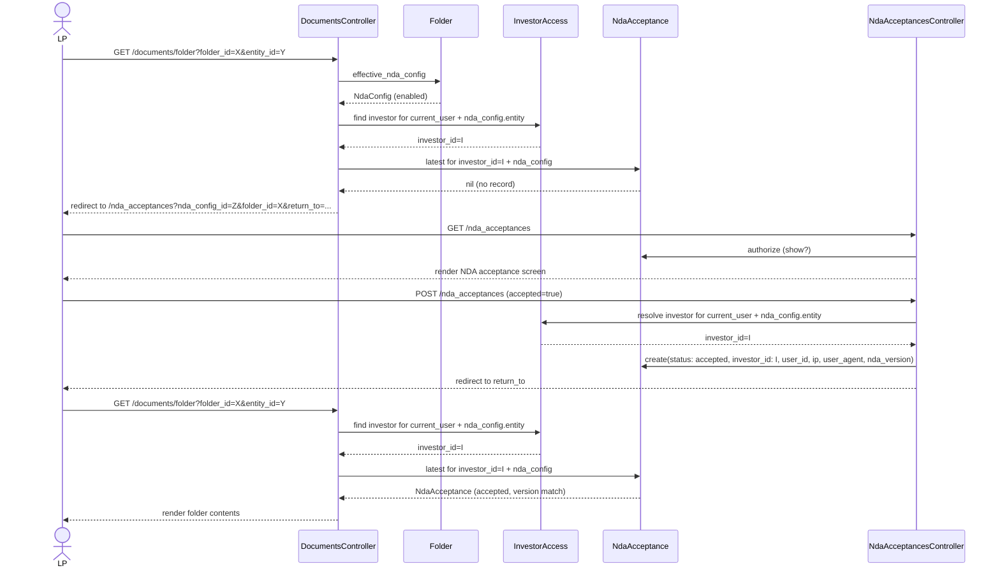

**Another user of same stakeholder accesses folder after acceptance:**

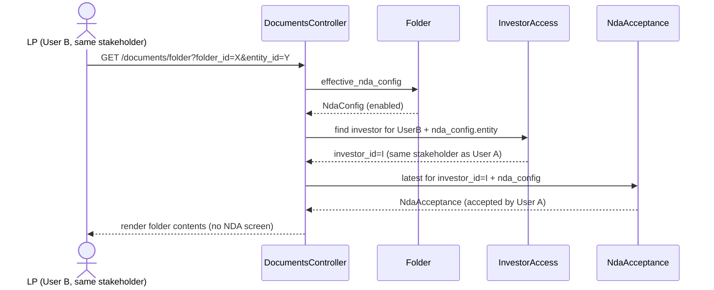

**LP declines NDA:**

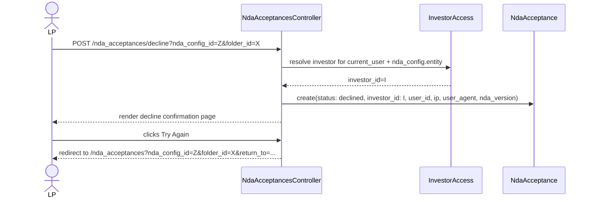

**GP employee — bypass:**

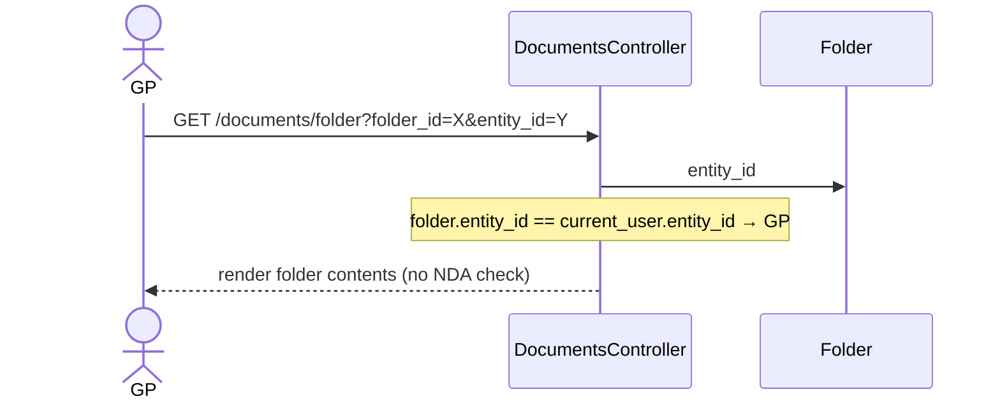

### Worked Examples

**ID legend:** **H** = Happy path · **E** = Edge case · **X** = Error (exception) case.

**Shared setup:**

| Record | Name | Key data |
|---|---|---|
| Entity | Alpha Ventures | id=100, enable_data_rooms=true |
| Entity | LP Corp | id=200 |
| Investor | TechVentures LP | id=50, entity_id=100, investor_entity_id=200 |
| User (GP) | GP Admin | entity_id=100, role=company_admin |
| User (LP) | LP User A | entity_id=200, InvestorAccess to TechVentures LP (approved, tag_list="NDA") |
| User (LP) | LP User B | entity_id=200, InvestorAccess to TechVentures LP (approved, no NDA tag) |
| Folder | Data Room | id=10, entity_id=100, system parent, nda_inheritance_mode=own |
| Folder | Deal Pipeline | id=11, parent=Data Room, nda_inheritance_mode=inherit |
| Folder | Fund Alpha Docs | id=12, parent=Data Room, nda_inheritance_mode=own |
| Folder | Public Info | id=13, parent=Data Room, nda_inheritance_mode=opt_out |
| NdaConfig | NDA-A | id=1, owner=Data Room(10), enabled=true, version=1, acceptance_method=click_through, contact_email=legal@alpha.com |
| NdaConfig | NDA-B | id=2, owner=Fund Alpha Docs(12), enabled=true, version=1, acceptance_method=click_through |
| NdaConfig | NDA-C | id=3, owner=Data Room(10), enabled=true, version=1, acceptance_method=esign |
| AccessRight | LP Access | TechVentures LP (via category or investor) has access to Data Room + children |

#### Happy Path

| # | Scenario | Given | When | Then | Spec scenario | Feature |
|---|---|---|---|---|---|---|
| H1 | LP accepts NDA on behalf of stakeholder | LP User A (NDA-tagged), no acceptance for TechVentures LP + NDA-A | LP User A navigates to Data Room (folder 10) | Redirected to NDA screen, accepts, acceptance recorded with investor_id=50, redirected back, sees folder contents | LP without acceptance hits NDA-protected folder; LP accepts NDA | nda_acceptance.feature |
| H2 | LP accesses folder after stakeholder acceptance | LP User A, TechVentures LP accepted NDA-A v1 | LP User A navigates to Data Room (folder 10) | Folder contents shown immediately | LP with accepted NDA accesses folder | nda_acceptance.feature |
| H3 | LP declines NDA | LP User A, no acceptance for TechVentures LP + NDA-A | LP User A navigates to Data Room, sees NDA screen, clicks Decline | Decline page shown with contact email and retry link | LP declines NDA | nda_acceptance.feature |
| H4 | LP retries after decline | LP User A, declined NDA-A | LP User A clicks Try Again on decline page | NDA acceptance screen shown again | LP retries after decline | nda_acceptance.feature |
| H5 | Acceptance screen shows all elements | LP User A, no acceptance for TechVentures LP + NDA-A | NDA screen renders | PDF inline, entity name, folder name, checkbox unchecked, Accept disabled, Decline enabled, contact email shown | Acceptance screen renders with all elements | nda_acceptance.feature |
| H6 | Another user of same stakeholder accesses folder | LP User A accepted NDA-A for TechVentures LP | LP User B (same stakeholder, no NDA tag) navigates to Data Room | Folder contents shown immediately — stakeholder-level unlock | Stakeholder user B accesses folder after user A accepted | nda_acceptance.feature |

#### Edge Cases

| # | Scenario | Given | When | Then | Spec scenario | Feature |
|---|---|---|---|---|---|---|
| E1 | Inherited NDA already accepted by stakeholder | TechVentures LP accepted NDA-A | LP User A navigates to Deal Pipeline (folder 11, inherits NDA-A) | Folder contents shown (no NDA screen) | Inherited NDA already accepted on parent | nda_acceptance.feature |
| E2 | Child with own NDA requires separate stakeholder acceptance | TechVentures LP accepted NDA-A | LP User A navigates to Fund Alpha Docs (folder 12, own NDA-B) | NDA screen for NDA-B | Child folder with own NDA requires separate acceptance | nda_acceptance.feature |
| E3 | Opted-out folder no gate | TechVentures LP, no acceptances | LP User A navigates to Public Info (folder 13, opt_out) | Folder contents shown (no NDA screen) | Child folder opted out of NDA | nda_acceptance.feature |
| E4 | Folder with no NDA | LP User A | LP navigates to a folder with no effective NDA | Folder contents shown | Folder has no active NDA | nda_acceptance.feature |
| E5 | GP employee bypasses gate | GP Admin | GP navigates to Data Room (folder 10, NDA-A active) | Folder contents shown (no NDA screen) | GP employee bypasses NDA gate | nda_acceptance.feature |
| E6 | NDA disabled | LP User A | LP navigates to Data Room, NDA-A enabled=false | Folder contents shown (no NDA screen) | Folder has no active NDA | nda_acceptance.feature |
| E7 | E-sign falls back to click-through | LP User A, NDA-C has acceptance_method=esign | LP navigates to folder with NDA-C | Click-through NDA screen shown | E-sign configured but not available | nda_acceptance.feature |
| E8 | Acceptance screen without contact email | LP User A, NDA-B has no contact_email | NDA screen for NDA-B renders | No contact email line shown | Acceptance screen without contact email | nda_acceptance.feature |
| E9 | Multiple acceptance records preserved | TechVentures LP: User A accepted, User A declined NDA-A | Query acceptances for TechVentures LP + NDA-A | Both records exist, latest (declined) determines stakeholder status | Multiple records preserved | nda_acceptance.feature |
| E10 | Accept button disabled without checkbox | LP User A | NDA screen shown, checkbox unchecked | Accept button disabled | Accept button disabled without checkbox | nda_acceptance.feature |
| E11 | User B decline does not block User A acceptance | LP User B declined NDA-A for TechVentures LP | LP User A navigates to Data Room, sees NDA screen, accepts | Acceptance recorded for TechVentures LP, User B's decline superseded | Decline by one user does not block acceptance by another | nda_acceptance.feature |
| E12 | User with no InvestorAccess to entity | User from entity 300, no InvestorAccess to Alpha Ventures | User navigates to Data Room | Access denied by folder access rights (never reaches NDA gate) | User without investor relationship cannot access | nda_acceptance.feature |

#### Error Cases

| # | Scenario | Given | When | Then (what the user sees, who is alerted) | Spec scenario | Feature |
|---|---|---|---|---|---|---|
| X1 | Invalid return_to URL | LP User accepts NDA-A | return_to is "https://evil.com/steal" | LP redirected to Data Rooms listing (fallback) | Missing or invalid return URL | nda_acceptance.feature |
| X2 | Missing return_to | LP User accepts NDA-A | return_to param is absent | LP redirected to Data Rooms listing (fallback) | Missing or invalid return URL | nda_acceptance.feature |
| X3 | NDA config not found | LP User | GET /nda_acceptances/show?nda_config_id=9999 | 404 / record not found, standard Rails error handling | N/A (infrastructure) | nda_acceptance.feature |
| X4 | Acceptance record audit fields | LP User accepts NDA-A | Record created | Contains nda_config_id, user_id, entity_id, status, nda_version, ip_address, user_agent, accepted_at | Acceptance record contains audit fields | nda_acceptance.feature |

---

## Key Components

| Component | Responsibility | Notes |
|---|---|---|
| `DocumentsController#ensure_nda_accepted` | Before-action gate: resolves investor for current_user, checks effective NDA and latest acceptance at stakeholder level, redirects if stakeholder not accepted | Runs only on `folder` action. Skips for GP employees (same entity). Resolves investor via InvestorAccess, then single query for latest acceptance by investor_id. |
| `NdaAcceptancesController` | Renders NDA acceptance screen, processes accept/decline, records NdaAcceptance with investor_id | Standard CRUD controller in nda_configs pack. Uses minimal layout. Resolves investor from current_user's InvestorAccess on create/decline. |
| `NdaAcceptance` | Append-only audit record of accept/decline events at stakeholder level | No callbacks. No state machine gem. Status is a simple string column. Carries both user_id (who signed) and investor_id (on whose behalf). |
| `NdaAcceptancePolicy` | Authorizes LP access to view and submit acceptance forms | LP must have access to the folder's entity via investor relationship. GP employees are never routed here (gate skips them). |

### Decision Flows

**NDA gate decision (ensure_nda_accepted) — stakeholder-level:**

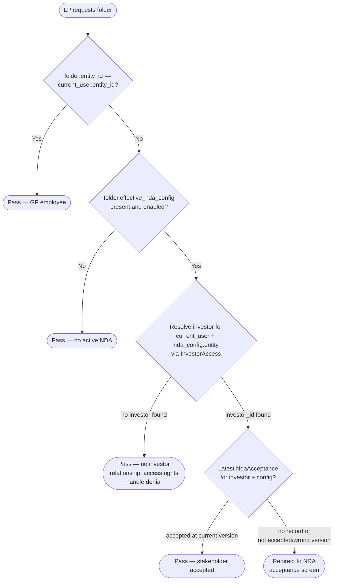

---

## Controllers and Routes

| Verb and path | Action | Does | Responds with |
|---|---|---|---|
| `GET /documents/folder` | `DocumentsController#folder` | (existing) Loads folder and documents for LP. **Modified:** `before_action :ensure_nda_accepted` checks NDA gate. | HTML (existing behavior) or redirect to acceptance screen |
| `GET /nda_acceptances` | `NdaAcceptancesController#show` | Loads NdaConfig, renders NDA PDF and acceptance form. Requires `nda_config_id`, `folder_id`, optional `return_to`. | HTML with minimal layout |
| `POST /nda_acceptances` | `NdaAcceptancesController#create` | Creates NdaAcceptance with status=accepted, redirects to return_to. | Redirect to return_to or data_rooms_folders_path |
| `POST /nda_acceptances/decline` | `NdaAcceptancesController#decline` | Creates NdaAcceptance with status=declined, renders decline page. | HTML with minimal layout |

Routes are defined as a standalone resource (not nested under folders) since NDA acceptance is tied to NdaConfig, not Folder. The `folder_id` is passed as a query param for context display.

---

## Policy

| Role | Access |
|---|---|
| LP (investor user from different entity) | Can view NDA acceptance screen and submit accept/decline for NDA configs on folders they have access rights to |
| GP employee (same entity as folder) | Never reaches the acceptance controller — gate skips them. If they somehow access the route, policy denies. |
| Investor Advisor | Same as LP — subject to NDA gate if accessing cross-entity folders |
| Unauthenticated | Cannot access — standard `authenticate_user!` blocks |

**NDA acceptance policy decision:**

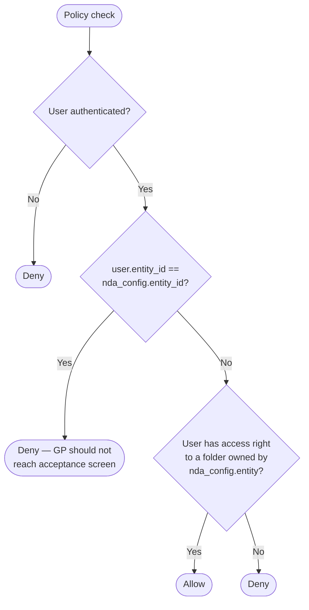

**Multi-tenancy:** `entity_id` on NdaAcceptance is set from `nda_config.entity_id` on creation. The policy checks that the user is NOT from the same entity (GP check) and HAS an investor relationship with the NDA config's entity.

---

## UI Changes

### At a glance

| Where in CapHive | Today | After this change | Who sees it |
|---|---|---|---|
| LP navigates to NDA-protected Data Room folder | Folder contents shown immediately | NDA acceptance screen shown first; folder contents after acceptance | LP users (investors) |
| NDA acceptance screen | Does not exist | New minimal-layout page with NDA PDF, checkbox, Accept/Decline | LP users encountering NDA gate |
| NDA decline page | Does not exist | New minimal-layout page with decline message, contact email, retry link | LP users who decline |

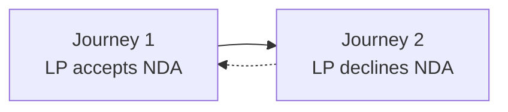

### Journey 1: LP accepts NDA to access folder

```
NDA Acceptance Screen (minimal layout)
+-------------------------------------------------------+
|  ① [Logo]                     ② [Back to Data Rooms]  |
+-------------------------------------------------------+
|                                                       |
|  ③ Non-Disclosure Agreement                           |
|  ④ Entity: Alpha Ventures  |  Folder: Deal Pipeline  |
|                                                       |
|  +---------------------------------------------------+|
|  |                                                   ||
|  |  ⑤ << NDA PDF document (iframe) >>               ||
|  |                                                   ||
|  +---------------------------------------------------+|
|                                                       |
|  ⑥ [ ] I have read and agree to the terms of this    |
|      Non-Disclosure Agreement                         |
|                                                       |
|  ⑦ [    Accept    ]        ⑧ [ Decline ]             |
|                                                       |
|  ⑨ Questions? Contact: legal@alpha.com                |
+-------------------------------------------------------+
```

| Step | The user... | They see |
|---|---|---|
| 1 | Clicks a Data Room folder link | Redirected to this screen instead of folder contents |
| 2 | Reads the NDA document | ⑤ PDF rendered inline, scrollable |
| 3 | Sees the context | ③ title, ④ entity and folder name |
| 4 | Checks the confirmation checkbox | ⑥ checkbox checked, ⑦ Accept button becomes enabled |
| 5 | Clicks Accept | Redirected to the folder they originally wanted — folder contents now visible |
| 6 | (Alternative) Clicks ② Back to Data Rooms | Redirected to Data Rooms listing — no record created |

### Journey 2: LP declines NDA

```
Decline Confirmation Page (minimal layout)
+-------------------------------------------------------+
|  ① [Logo]                     ② [Back to Data Rooms]  |
+-------------------------------------------------------+
|                                                       |
|  ③ NDA Declined                                       |
|                                                       |
|  ④ You have declined the Non-Disclosure Agreement     |
|     for the folder "Deal Pipeline".                   |
|                                                       |
|  ⑤ You cannot access this folder's contents without   |
|     accepting the NDA.                                |
|                                                       |
|  ⑥ Questions? Contact: legal@alpha.com                |
|                                                       |
|  ⑦ [  Try Again  ]       ⑧ [  Back to Data Rooms  ]  |
+-------------------------------------------------------+
```

| Step | The user... | They see |
|---|---|---|
| 1 | Clicks Decline on the acceptance screen | This decline page |
| 2 | Reads the explanation | ④⑤ Cannot access without acceptance |
| 3 | Sees contact info | ⑥ Contact email if configured |
| 4 | Clicks ⑦ Try Again | Returns to NDA acceptance screen (Journey 1) |
| 5 | (Alternative) Clicks ⑧ Back to Data Rooms | Data Rooms listing |

### Build notes (for implementers)

| Interaction | Screen update |
|---|---|
| Checkbox toggle | Stimulus controller enables/disables Accept button — no server round-trip |
| Accept form submission | Standard form POST, server redirect — no Turbo Stream |
| Decline form submission | Standard form POST, server renders decline page — no Turbo Stream |
| Back to Data Rooms | Standard link navigation |
| Try Again | Standard link navigation to acceptance screen |

**Layout:** Create `app/packs/core/base/views/layouts/nda_minimal.html.erb` — stripped-down variant of `modernize`. Includes: DOCTYPE, meta tags, CSRF, importmap tags, core CSS (`styles.css`), `<%= yield %>`. Excludes: sidebar, topbar, breadcrumbs, searchbar, command palette, preloader, theme chooser, AG Grid, DataTables, PDFTron, x-spreadsheet, Select2 — none needed for this page.

**Stimulus:** New `nda_acceptance_controller.js` with a single `toggleAccept` method that enables/disables the Accept button based on checkbox state.

---

## Cross-cutting Concerns

### Transactions and Queries

| What is read | When | N+1 risk | How it stays cheap |
|---|---|---|---|
| `Folder#effective_nda_config` | Every `DocumentsController#folder` request for LP users | No — walks at most 3 ancestors (Data Room tree depth cap) | Memoized on the Folder instance; ancestors are ancestry gem's single query |
| Latest `NdaAcceptance` for user + config | Every `DocumentsController#folder` request for LP users hitting NDA-protected folder | No — single indexed query | `NdaAcceptance.where(nda_config_id:, user_id:).order(created_at: :desc).limit(1)` on composite index |
| `NdaConfig` by id | `NdaAcceptancesController#show` | No — single PK lookup | Standard `find` |

| Operation | In a transaction? | Why |
|---|---|---|
| Create NdaAcceptance record | No | Single table insert, no multi-table write. Append-only, no update conflicts. |

### Exception Handling and Monitoring

| Failure scenario | Who is alerted | Channel | Detail |
|---|---|---|---|
| NdaConfig not found (invalid nda_config_id) | User | In-app (404) | Standard Rails RecordNotFound handling |
| Folder not found during gate check | User | In-app (404) | Standard Rails RecordNotFound — existing behavior |
| NdaAcceptance save failure (validation error) | User | In-app (flash error) | Re-render acceptance screen with error. Unlikely since only status and version are required. |

### Performance and Security

**Performance:**
- The gate adds one indexed query per LP folder request (latest acceptance lookup). Combined with the existing `effective_nda_config` call (memoized, max 3 ancestor hops), overhead is negligible.
- No additional queries on GP employee requests — gate short-circuits on entity_id match.

**Security:**
- `return_to` parameter sanitized to prevent open redirect — only relative paths starting with `/` accepted, absolute URLs and protocol-relative URLs rejected.
- IP address and user agent captured from `request.remote_ip` and `request.user_agent` for audit trail.
- CSRF protection via standard Rails `verify_authenticity_token` (not skipped).
- NdaAcceptancePolicy prevents GP employees from reaching the acceptance controller and ensures LP has investor relationship with the NDA config's entity.

---

## Design Decisions

1. **Append-only acceptance records, not upsert** — Each accept/decline creates a new row. Alternative: single record per investor+config with upsert. Rejected because: audit trail requires full history; Module 4 (version re-acceptance) needs to compare versions across records.

2. **Gate on DocumentsController, not a concern** — The `ensure_nda_accepted` method lives directly on `DocumentsController` as a private method. Alternative: extract to a `WithNdaGate` concern. Rejected because: only one controller needs it, and adding a concern for a single method is premature abstraction.

3. **Standalone routes, not nested under folders** — `GET /nda_acceptances` instead of `GET /folders/:folder_id/nda_acceptances`. Alternative: nest under folders. Rejected because: acceptance is tied to NdaConfig, not Folder. The folder_id is context for display only, passed as a query param.

4. **Minimal layout as a new file, not a conditional in modernize** — Create `nda_minimal.html.erb` instead of adding conditionals to `modernize.html.erb`. Alternative: pass a flag to modernize to hide sidebar/topbar. Rejected because: modernize is 177 lines with many includes; a conditional would make it harder to maintain. A separate 20-line layout is simpler.

5. **Derived status, not stored** — The stakeholder's NDA status is derived from the latest NdaAcceptance record for the investor, not stored as a column. Alternative: maintain a `current_status` column. Rejected because: derived status is always consistent, no sync issues, and the indexed query is fast.

6. **No Turbo Stream for acceptance flow** — Standard form POST + redirect. Alternative: Turbo Stream for inline updates. Rejected because: the acceptance flow is a full-page experience with redirect — Turbo Stream adds complexity with no UX benefit here.

7. **Stakeholder-level acceptance via investor_id on NdaAcceptance** — The gate checks at investor (stakeholder) level. When any user of a stakeholder accepts, all users pass. Alternative: user-level acceptance with dashboard aggregation. Rejected because: NDAs are between companies, not individuals (product confirmed). The data model carries `investor_id` alongside `user_id` to capture both "on whose behalf" and "who signed".

8. **NDA signatory tag on InvestorAccess, not a new model** — Reuse the existing `tag_list` string column with an "NDA" convention. Alternative: new `nda_signatory` boolean column or separate `NdaSignatory` model. Rejected because: the existing tagging system is already understood by GPs, no migration needed, and per product guidance, keep the code simple.

9. **Investor resolution via InvestorAccess** — The signing user's investor is found by querying `InvestorAccess.where(user_id:, entity_id: nda_config.entity_id, approved: true)`. A user may have multiple InvestorAccess records (multiple stakeholders) — use the first one. This matches how folder access rights are resolved.

10. **No hard enforcement on signatory** — Any user who reaches the NDA acceptance screen can sign, regardless of NDA tag. The tag controls notifications/reminders only. Per product: protection is against outsiders, not against internal stakeholder users.

---

## Testing

Cucumber only. Single feature file `features/core/nda_acceptance.feature` covering all H/E/X scenarios from the worked examples table. Reuses existing step definitions from `nda_config_steps.rb` (entity/folder/NDA config setup) and `nda_inheritance_steps.rb` (inheritance mode setup). New step definitions file `nda_acceptance_steps.rb` for acceptance-specific actions (navigate to folder as LP, see NDA screen, accept, decline, check redirect). Tag: `@nda`.

---

## Risks and Open Questions

- [Risk] LP with many NDA-protected folders may experience slight delay on each folder navigation due to the gate query → Mitigation: single indexed query, sub-millisecond. Monitor with existing request logging.
- [Risk] Minimal layout diverges from main layout over time → Mitigation: layout is intentionally simple (~20 lines). Review on major modernize layout changes.
- [Risk] `return_to` param could be manipulated to keep LP in a redirect loop → Mitigation: sanitize to relative paths only, fallback to data_rooms listing if invalid. The acceptance screen itself does not redirect again.

| # | Open question | Current thinking | Status |
|---|---|---|---|
| 1 | Should the NDA PDF be rendered via iframe or PDFTron viewer? | Iframe is simpler and sufficient for read-only viewing. PDFTron is already loaded in modernize layout but adds weight. Minimal layout intentionally excludes it. | Deferred — iframe for v1, can upgrade later |
