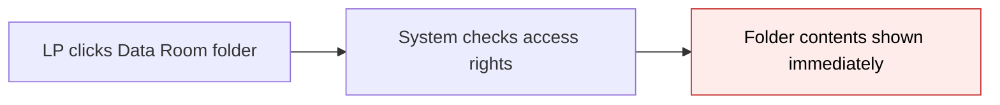
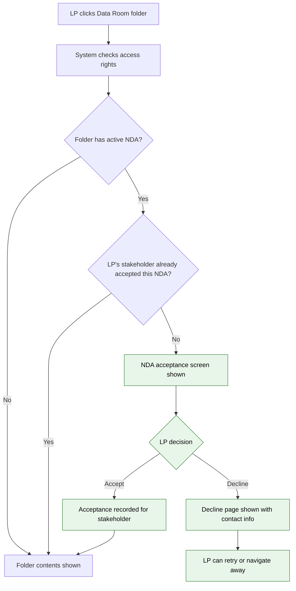

# NDA Module 2: LP Acceptance Flow (Stakeholder-Level) — Proposal

> **Audience:** Business team, product, QA, support — non-technical.
> **Companion document:** [Design](design.md)

> **Planning phase — no code changes.** This document proposes and explains the change. Do not
> edit application code while writing it; implementation happens later, in the tasks phase.

---

## Why

Data Room folders can now be NDA-protected (Module 1) and that protection cascades to child folders (Module 5), but there is no gate that actually stops an LP from viewing folder contents without accepting the NDA. Today, any LP with access rights sees the documents immediately — the NDA configuration exists but is not enforced. Module 2 closes this gap by adding the acceptance flow that LPs encounter when they try to access an NDA-protected folder.

**Stakeholder-level NDA (amendment):** A typical NDA is signed between two companies, not between individuals. When one authorized person from a stakeholder (investor/family office) accepts the NDA, the entire stakeholder is unlocked — all users under that stakeholder can see the folder. The GP designates who can sign by adding an "NDA" tag to the relevant contact in Investor Access. Only NDA-tagged contacts receive signing notifications and can trigger the acceptance flow.

## What Changes

- When an LP navigates to a Data Room folder that has an active NDA (direct or inherited), they are redirected to a **focused NDA acceptance screen** instead of seeing the folder contents.
- The acceptance screen shows the NDA PDF document inline and requires the LP to check a confirmation checkbox before accepting.
- Accepting records the event and redirects the LP to the folder they originally wanted.
- Declining shows a confirmation page with the GP's contact email and an option to retry.
- **Acceptance is at stakeholder (investor) level, not user level.** When any user of a stakeholder accepts the NDA, the entire stakeholder is unlocked. All users under that stakeholder can then access the folder — they do not need to sign individually.
- **Acceptance is tied to the NDA configuration, not the folder.** If NDA-A is accepted for a stakeholder on the "Data Room" folder, all child folders inheriting NDA-A are also unlocked — the stakeholder never sees the same NDA twice.
- **NDA signatory designation** — the GP tags specific contacts as "NDA" in Investor Access. Only NDA-tagged users receive signing notifications (Module 8). Any user with folder access can reach the NDA acceptance screen, but notifications and reminders are targeted to NDA-tagged signatories only.
- If a folder's NDA is configured for e-sign (Module 6, not yet built), the system falls back to click-through acceptance with no visible difference to the LP.

### Flow Diagram

**Before — LP accesses NDA-protected folder (no gate):**



**After — LP encounters NDA gate before folder access (stakeholder-level):**



---

## User Stories

### US-1: LP accepts NDA on behalf of stakeholder

**As an** LP (investor user),
**I want** to read and accept the NDA for a Data Room folder on behalf of my stakeholder (family office / LP entity),
**So that** my entire stakeholder can access the folder's documents after I agree to the confidentiality terms.

**Acceptance criteria:**
- When I navigate to an NDA-protected folder and my stakeholder has not yet accepted, I see the NDA acceptance screen instead of documents
- The NDA PDF is displayed inline on the screen so I can read the full document
- I must check the confirmation checkbox before the Accept button becomes enabled
- After accepting, I am redirected to the folder I originally wanted to view
- My acceptance is recorded with timestamp, IP address, browser information, and the stakeholder (investor) it applies to
- All other users under my stakeholder can now access the folder without signing again

### US-2: LP declines NDA

**As an** LP,
**I want** to decline the NDA if I do not agree to the terms,
**So that** I am informed of the consequences and can contact the GP with questions.

**Acceptance criteria:**
- I see a Decline button alongside Accept on the NDA screen
- After declining, I see a page explaining I cannot access the folder contents
- The page shows the GP's contact email (from NDA configuration) so I can reach out with questions
- I can click a "Try Again" link to return to the NDA acceptance screen
- My decline is recorded for GP visibility (but does not block other users of the same stakeholder from accepting)

### US-3: Stakeholder accesses folder with inherited NDA already accepted

**As an** LP whose stakeholder has already accepted an NDA,
**I want** to navigate freely between folders that share the same NDA,
**So that** no one from my stakeholder has to accept the same NDA again.

**Acceptance criteria:**
- If my stakeholder accepted NDA-A on the parent "Data Room" folder, I can access any child folder inheriting NDA-A without seeing the NDA screen again
- If a child folder has its own different NDA-B (override), I see a new NDA screen for NDA-B (stakeholder must accept NDA-B separately)
- If a child folder has opted out of NDA, I access it without any NDA screen

### US-4: GP sees acceptance records at stakeholder level

**As a** GP/admin,
**I want** LP NDA acceptances and declines to be recorded at stakeholder level,
**So that** I have an audit trail of which stakeholder accepted, who signed on their behalf, and when.

**Acceptance criteria:**
- Each accept or decline creates a record with: signing user, stakeholder (investor), NDA config, status, timestamp, IP address, browser info, and NDA version number
- Multiple records per stakeholder per NDA are preserved (full history, not overwritten)
- The latest record per stakeholder determines whether the stakeholder has access

### US-5: Another user of the same stakeholder accesses folder after acceptance

**As an** LP whose colleague already accepted the NDA on behalf of our stakeholder,
**I want** to access the NDA-protected folder directly without signing again,
**So that** I can view documents without waiting for my own acceptance.

**Acceptance criteria:**
- If User A from stakeholder "TechVentures" accepted NDA-A, User B from the same stakeholder sees folder contents immediately — no NDA screen
- The gate checks stakeholder-level acceptance, not per-user acceptance

### US-6: GP designates NDA signatories via Investor Access tags

**As a** GP/admin,
**I want** to tag specific contacts as "NDA" in Investor Access,
**So that** only designated people receive NDA signing notifications and reminders.

**Acceptance criteria:**
- In the Investor Access form, the existing tag_list field can include "NDA" as a tag
- Only users with the "NDA" tag on their InvestorAccess receive signing notifications (Module 8)
- Any user with folder access can still reach the NDA acceptance screen if they navigate to the folder — the tag controls notifications and reminders, not hard access to the acceptance page
- If no user of a stakeholder is NDA-tagged, the stakeholder can still sign (any user who reaches the page can accept), but no notifications or reminders will be sent

---

## UI Behavior

### NDA Acceptance Screen (Minimal Layout)

```
+----------------------------------------------------------+
|  [Company Logo]                    [Back to Data Rooms]   |
+----------------------------------------------------------+
|                                                          |
|  Non-Disclosure Agreement                                |
|  Entity: Alpha Ventures    |    Folder: Deal Pipeline    |
|                                                          |
|  +----------------------------------------------------+ |
|  |                                                    | |
|  |           << NDA PDF Document >>                   | |
|  |                                                    | |
|  |  (Rendered inline via iframe, scrollable,          | |
|  |   full document visible)                           | |
|  |                                                    | |
|  +----------------------------------------------------+ |
|                                                          |
|  [ ] I have read and agree to the terms of this          |
|      Non-Disclosure Agreement                            |
|                                                          |
|  [    Accept    ]           [ Decline ]                  |
|                                                          |
|  Questions? Contact: legal@fund.com                      |
+----------------------------------------------------------+
```

**Behavior notes:**
- Minimal layout — no application navigation sidebar or header menus; only company logo and a "Back to Data Rooms" link
- Accept button is **disabled** until the checkbox is ticked
- Contact email line is only shown if the GP configured a contact email on the NDA
- "Back to Data Rooms" link returns to the Data Rooms listing page
- Entity name and folder name shown as context so the LP knows which NDA they are accepting

### Decline Confirmation Page

```
+----------------------------------------------------------+
|  [Company Logo]                    [Back to Data Rooms]   |
+----------------------------------------------------------+
|                                                          |
|  NDA Declined                                            |
|                                                          |
|  You have declined the Non-Disclosure Agreement for      |
|  the folder "Deal Pipeline".                             |
|                                                          |
|  You cannot access this folder's contents without        |
|  accepting the NDA.                                      |
|                                                          |
|  Questions? Contact: legal@fund.com                      |
|                                                          |
|  [  Try Again  ]          [  Back to Data Rooms  ]       |
+----------------------------------------------------------+
```

**Behavior notes:**
- Same minimal layout as the acceptance screen
- "Try Again" returns to the NDA acceptance screen
- Contact email shown if configured

---

## What This Feature Does NOT Cover

| Excluded | Covered In |
|---|---|
| Exemptions (GP marks stakeholder as exempt from NDA) | Module 3 — Status Dashboard |
| NDA expiry and re-acceptance on version change | Module 4 — Validity & Versioning |
| E-sign acceptance via Zoho Sign | Module 6 — E-Sign |
| Email notifications on accept/decline events | Module 8 — Notifications |
| GP-facing status dashboard for viewing acceptances | Module 3 — Status Dashboard |
| Bulk reminder sending to pending/declined stakeholders | Module 3 + Module 8 |
| ~~DocShare NDA gate~~ | **Removed from roadmap** — DocShare is for ad-hoc documents, not Data Rooms |

---

## Validation Rules

| Field | Rule | Default |
|---|---|---|
| Acceptance checkbox | Must be checked before Accept button is enabled | Unchecked |
| return_to parameter | Must be a relative path on the same host (open redirect protection) | Data Rooms listing page |

---

## Behavior Rules

| Scenario | What User Sees |
|---|---|
| LP navigates to NDA-protected folder, stakeholder has not accepted | NDA acceptance screen |
| LP navigates to NDA-protected folder, stakeholder already accepted (latest record = accepted, same version) | Folder contents (no gate) |
| User B of same stakeholder navigates to folder after User A accepted | Folder contents (no gate) — stakeholder-level unlock |
| LP navigates to folder with no NDA (or opted-out) | Folder contents (no gate) |
| LP navigates to child folder inheriting parent's NDA, stakeholder already accepted parent's NDA | Folder contents (no gate) |
| LP navigates to child folder with its own NDA (override), stakeholder not yet accepted | NDA acceptance screen for the child's NDA |
| LP accepts NDA | Acceptance recorded for stakeholder; LP redirected to the folder they originally wanted |
| LP declines NDA | Decline confirmation page with contact info and retry link. Another user of the same stakeholder can still accept. |
| LP clicks "Try Again" after decline | Returns to NDA acceptance screen |
| NDA configured for e-sign but e-sign not yet available | Falls back to click-through acceptance silently |
| LP is a GP employee accessing their own entity's folders | No NDA gate (GP employees are not subject to NDA) |
| NDA config exists but is disabled (enabled = false) | No NDA gate |
| Stakeholder has folder access but no user is NDA-tagged | Any user can still accept if they navigate to the folder; no notifications/reminders sent until someone is tagged |

---

## Resolved Design Decisions

| # | Decision | Resolution |
|---|---|---|
| 1 | Single record vs append-only history | Append-only — each accept/decline creates a new record. Latest record per stakeholder determines access. Full audit trail preserved. |
| 2 | Exemptions in Module 2 | Not in scope. Module 3 adds exemptions. Module 2 gate only checks acceptance status. |
| 3 | Return URL mechanism | URL parameter (`return_to`) passed as hidden field through the acceptance form. Sanitized against open redirect attacks. Falls back to Data Rooms listing if missing or invalid. |
| 4 | Layout for acceptance screen | Minimal — no app navigation. Focused solely on the NDA document and acceptance action. Can be swapped for full layout later if needed. |
| 5 | E-sign acceptance method | Falls back to click-through silently if `acceptance_method == "esign"`. Module 6 adds real Zoho Sign integration. |
| 6 | NDA version tracking | `nda_version` integer stored on each acceptance record. Captures which version the LP acted on. Future-proofs Module 4 (re-acceptance on version change) without adding complexity now. |
| 7 | Acceptance scope | Tied to `NdaConfig`, not folder. Accepting once covers all folders sharing the same NDA config via inheritance. |
| 8 | GP employee NDA gate | GP employees (users belonging to the entity that owns the folder) bypass the NDA gate entirely. NDA is an LP-facing control. |
| 9 | **Stakeholder-level vs user-level NDA** | **Stakeholder-level.** A typical NDA is signed between two companies, not individuals. One user accepts on behalf of the stakeholder (investor); all users under that stakeholder are then unlocked. The acceptance record captures both the signing user (who) and the investor (on behalf of). Product confirmed this approach. |
| 10 | **NDA signatory designation** | Use the existing `tag_list` field on InvestorAccess with an "NDA" tag. No new columns. Only NDA-tagged contacts receive notifications/reminders. Any user can still accept if they reach the page — the tag is for targeting notifications, not hard-blocking access to the acceptance screen. Keeps code simple per product guidance. |
| 11 | **Decline scope** | A decline is recorded per user, not per stakeholder. One user declining does not block another user of the same stakeholder from accepting. The stakeholder is unlocked when any user accepts. |
| 12 | **No hard enforcement on who can sign** | Per product: do not add checks preventing non-NDA-tagged users from signing. The protection is against outsiders, not against internal users. If by mistake a non-tagged user signs, that's acceptable. |
| 13 | **DocShare NDA** | Not implementing. DocShare is for ad-hoc individual documents, not Data Room. NDA is only for Data Rooms. Module 7 (DocShare NDA) is removed from the roadmap. |

---

## Capabilities

### New Capabilities

- `nda-lp-acceptance`: LP-facing NDA acceptance gate — intercepts folder access when NDA is active, presents NDA document, records accept/decline, and grants or denies access based on latest acceptance status.

### Modified Capabilities

<!-- No existing project-level specs are modified by this change. -->

---

## Impact

- **Data Room folder access** — LPs will now be intercepted before viewing NDA-protected folder contents. The gate checks at stakeholder (investor) level — if any user of the stakeholder accepted, all users pass.
- **Documents page** — The page that shows folder contents gains a before-access check. No visual changes to the page itself.
- **NDA configuration** — The existing NDA config gains a relationship to acceptance records. No changes to the config UI or workflow.
- **Database** — New `nda_acceptances` table with `investor_id` column for stakeholder-level tracking. Each record captures both the signing user and the stakeholder.
- **Investor Access** — The existing `tag_list` field gains an "NDA" tag convention for designating signatories. No schema change — uses the existing tagging system.
- **Routes** — New routes for the NDA acceptance flow (show NDA, accept, decline).

---

## Benefits

1. **Legal protection enforced** — NDA acceptance is no longer just configured; it is actually enforced before LPs can view sensitive documents.
2. **Stakeholder-level acceptance** — Matches real-world NDA practice (company-to-company). One signature unlocks the entire stakeholder — no need for every individual to sign.
3. **Audit trail** — Every accept and decline is recorded with timestamp, IP, browser information, signing user, and stakeholder for legal compliance.
4. **Frictionless for compliant stakeholders** — Accept once, access all folders sharing the same NDA. No repeated acceptance for inherited NDAs. Other users of the same stakeholder access immediately.
5. **Clear communication on decline** — LPs who decline know exactly why they can't access content and how to reach the GP.
6. **GP control over signatories** — The "NDA" tag on Investor Access gives GPs simple control over who receives signing notifications, using the existing tagging system they already know.

---

## FAQ

| Question | Answer |
|---|---|
| Who sees the NDA gate? | Only LP users (investors) accessing folders in another entity's Data Room. GP employees accessing their own entity's folders do not see the NDA gate. |
| What if someone from the same stakeholder already accepted? | All users of that stakeholder go straight to the folder contents — no NDA screen shown. The gate checks at stakeholder level. |
| Does accepting on one folder cover child folders? | Yes, if the child inherits the same NDA config. If the child has its own different NDA, the stakeholder must accept that separately. |
| Who can sign the NDA? | Any user with folder access can reach the NDA acceptance screen and sign. The "NDA" tag on Investor Access controls who receives notifications and reminders, not who can physically sign. |
| What if no one is NDA-tagged for a stakeholder? | The stakeholder can still accept if a user navigates to the folder and signs. But no notifications or reminders will be sent until someone is tagged. |
| What if one user declines? Can another user of the same stakeholder still accept? | Yes. A decline is per-user, not per-stakeholder. Another user can accept on behalf of the stakeholder. |
| What happens if the LP closes the browser during the NDA screen? | Nothing is recorded. Next time they access the folder, they see the NDA screen again. |
| Can the LP undo their acceptance? | Not by themselves. A GP can revoke acceptance in Module 3 (Status Dashboard), which would require the stakeholder to re-accept. |
| Does this work with e-sign NDAs? | For now, e-sign NDAs fall back to click-through acceptance. Module 6 will add real Zoho Sign embedded signing. |
| Are there notifications when an LP accepts or declines? | Not in Module 2. Module 8 adds email notifications for acceptance and decline events, sent to NDA-tagged contacts and GP notification recipients. |
| What about DocShare? | DocShare is for ad-hoc individual documents, not Data Rooms. NDA gating does not apply to DocShare. Module 7 has been removed from the roadmap. |

---

## Design Principle for the Next Phase

- **Reuse the inheritance resolution** already built in Module 5 (`Folder#effective_nda_config` and `NdaInheritanceResolver`). The gate should call `effective_nda_config` to find the applicable NDA — do not duplicate inheritance logic.
- **Keep the gate lightweight** — a single query to check the latest acceptance record per stakeholder. Avoid loading the full acceptance history on every folder access.
- **The acceptance controller belongs in the NDA configs pack** (`app/packs/core/nda_configs/`), not in the documents or folders packs. NDA acceptance is NDA-domain logic.
- **The minimal layout should be a simple variant**, not a whole new layout engine. A stripped-down version of the existing `modernize` layout or a new minimal layout file that can be swapped later.
- **Open redirect protection on `return_to`** is a security requirement — sanitize the parameter to ensure it is a relative path on the same host.
- **Resolve investor from current_user's InvestorAccess** — the signing user's stakeholder (investor) is determined by looking up their InvestorAccess for the NDA config's entity. This is the same relationship used for folder access rights. Do not add a new mapping mechanism.
- **Keep it simple** — per product guidance, do not over-engineer edge cases. The protection is against outsiders, not against internal stakeholder users. Avoid adding complexity for cases that don't happen in the real world.
