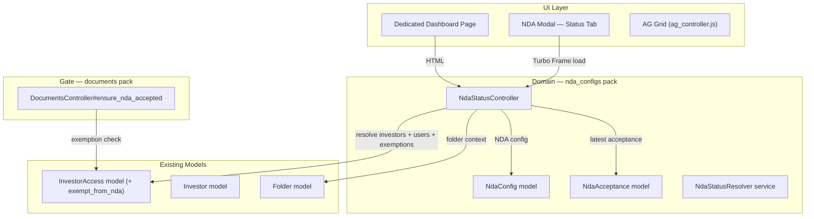
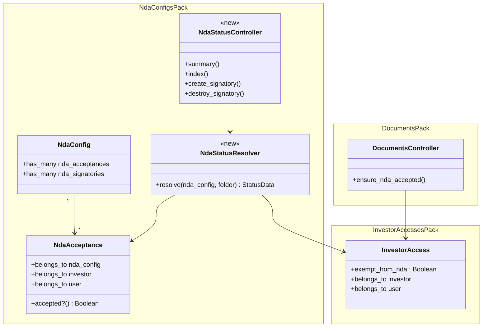
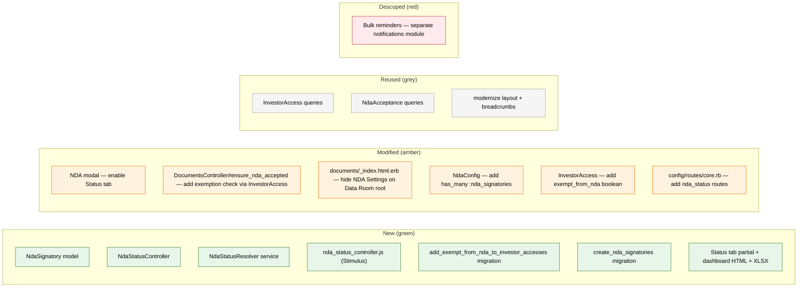
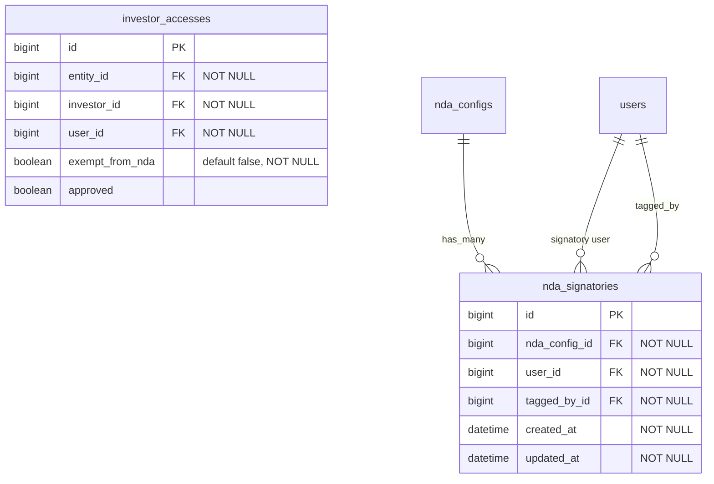
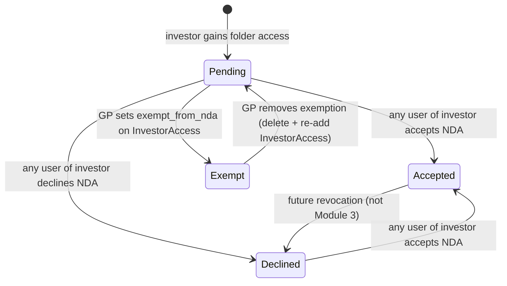
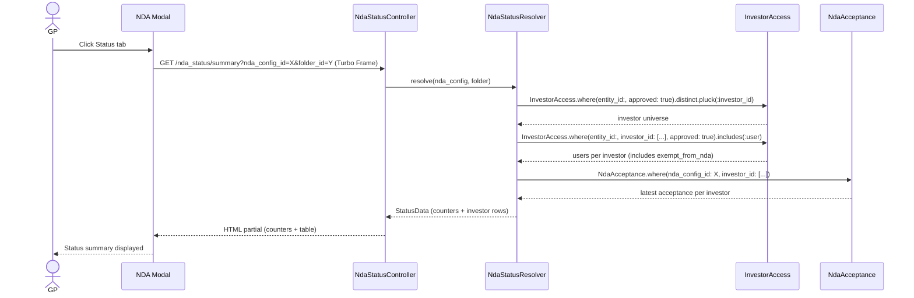
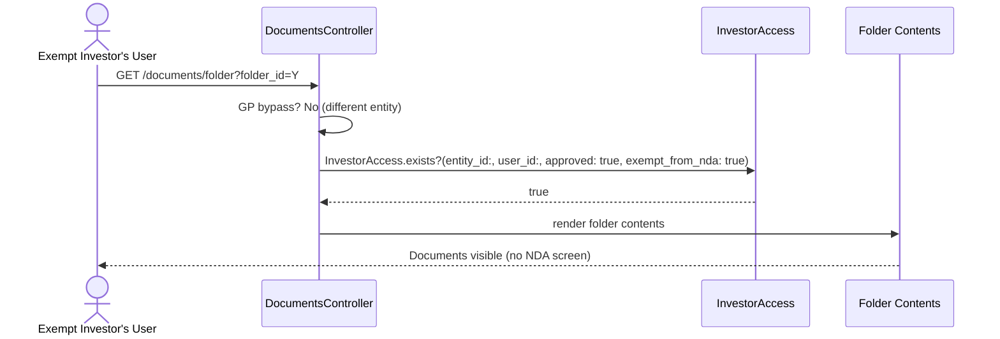
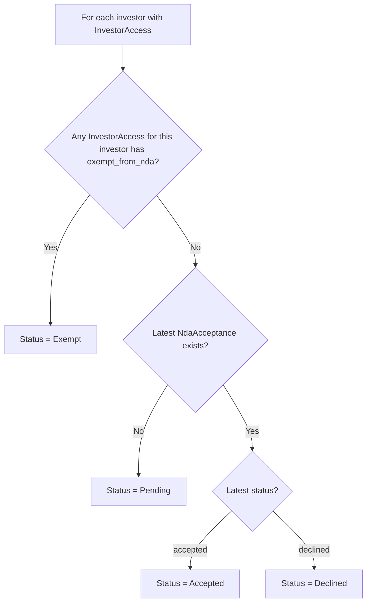
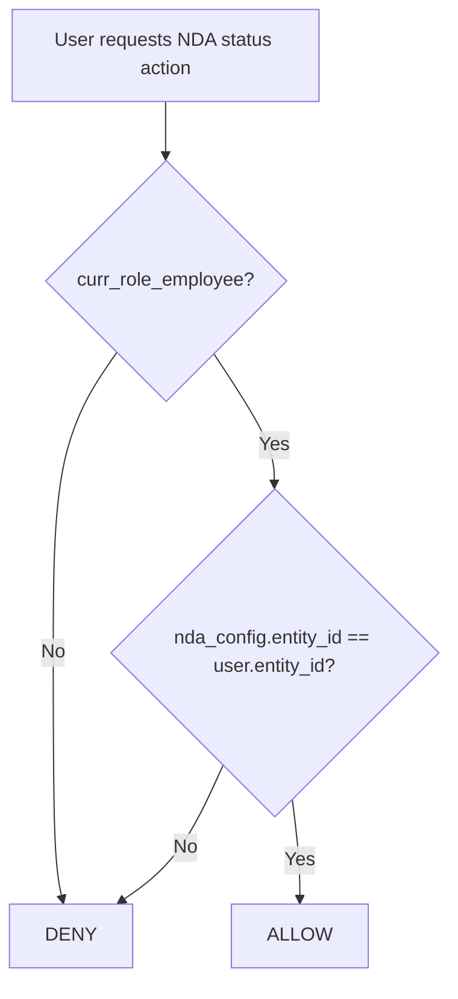

# NDA Module 3: GP Status Dashboard — Design

> **Audience:** The engineering team implementing this feature.
> **Companion documents:** [Proposal](proposal.md) · [Spec](specs/) · [LLD](lld.md) · [Tasks](tasks.md)

> **Planning phase — no code changes.** This document explains how to implement the feature.
> Implementation happens in the tasks phase.

---

## Contents

- [Overview](#overview)
- [Architecture](#architecture)
  - [Component Boundaries](#component-boundaries)
  - [Class Diagram](#class-diagram)
  - [Change Footprint](#change-footprint)
- [Data Model and States](#data-model-and-states)
  - [Data Model](#data-model)
  - [State Transitions](#state-transitions)
- [Behaviour](#behaviour)
  - [Sequence Diagrams](#sequence-diagrams)
  - [Worked Examples](#worked-examples)
- [Key Components](#key-components)
- [Controllers and Routes](#controllers-and-routes)
- [Policy](#policy)
- [UI Changes](#ui-changes)
  - [Journey 1: GP views NDA status summary in modal](#journey-1-gp-views-nda-status-summary-in-modal)
  - [Journey 2: GP opens dedicated dashboard and manages exemptions](#journey-2-gp-opens-dedicated-dashboard-and-manages-exemptions)
  - [Journey 3: GP sends bulk reminders](#journey-3-gp-sends-bulk-reminders)
  - [Build Notes for Implementers](#build-notes-for-implementers)
- [Cross-cutting Concerns](#cross-cutting-concerns)
- [Design Decisions](#design-decisions)
- [Testing](#testing)
- [Risks and Open Questions](#risks-and-open-questions)

---

## Overview

Adds a GP-facing NDA status dashboard using a server-rendered HTML table (matching the standard Ransack table style). Two views: a lightweight Status tab in the existing NDA Settings modal (simple HTML partial via Turbo Frame) and a dedicated full-page dashboard with HTML table, client-side filtering, export, exemption management, and signatory tagging. Exemptions are stakeholder-level: a boolean `exempt_from_nda` on `InvestorAccess` (not a separate table). A new `nda_signatories` table stores per-NDA signatory designations, and the existing NDA gate gains an exemption check. Bulk reminders are descoped to a separate notifications module.

**NDA placement:** NDA is never configured on the Data Room root folder itself — the root is just a container whose visibility is gated by `enable_data_rooms` permission. NDA is configured on the folders **inside** the Data Room (e.g., "Financials", "Legal"). Sub-folders inherit from their parent via `effective_nda_config`. The "NDA Settings" option in the folder Actions dropdown is hidden on the Data Room root (`data_room_root?`) and only appears on sub-folders.

---

## Architecture

### Component Boundaries



**Contract table:**

| From | To | Contract | Direction |
|---|---|---|---|
| Modal Status Tab | NdaStatusController#summary | Turbo Frame request → HTML partial | Request |
| Dashboard Page | NdaStatusController#index | HTML (page) + XLSX (export) | Request |
| NdaStatusController | InvestorAccess | `.where(entity_id:, approved: true)` → investor universe + users + exempt_from_nda | Query |
| NdaStatusController | NdaAcceptance | `.where(nda_config_id:, investor_id:)` → latest status | Query |
| DocumentsController | InvestorAccess | `.exists?(entity_id:, user_id:, approved: true, exempt_from_nda: true)` | Query |

**Design decision — investor universe source:** The investor universe comes from `InvestorAccess` (entity-level), not `AccessRight` (folder-level). Data Room folder visibility for regular LP users is driven by InvestorAccess — the `!investor_advisor?` check in `DocumentsController#folder` bypasses folder-level AccessRight checks for all non-advisor users. The NDA gate also resolves investors via InvestorAccess, so the dashboard uses the same source for consistency.

### Class Diagram



### Change Footprint



---

## Data Model and States

### Data Model



**Indexes:**
- `idx_nda_signatories_config_user [nda_config_id, user_id]` UNIQUE — one signatory tag per user per NDA config
- `idx_nda_signatories_user [user_id]` — lookup queries

**Changes to existing models:**
- `InvestorAccess`: add `exempt_from_nda` boolean column (default: false)
- `NdaConfig`: add `has_many :nda_signatories, dependent: :destroy`

**Design decision — Exemption is stakeholder-level, not user-level:**
NDA exemption is a boolean on InvestorAccess (`exempt_from_nda`). When a GP grants access to an investor stakeholder, they can check "Exempt from NDA". If the investor later declines, the GP deletes and re-adds the InvestorAccess with the exemption flag. This is stakeholder-level because the NDA acceptance itself is stakeholder-level — one user signs on behalf of the investor, and all users under that investor are unlocked. Per product decision (2026-10-05 call): user-level exemption was removed because exemption logically applies to the investor relationship, not individual users.

**Design decision — NDA signatory is per-NDA, not global:**
NDA signatory tagging is scoped to a specific NDA config (folder), not stored globally on InvestorAccess. This allows a GP to designate different signatories for different folders' NDAs. Previously, the NDA tag was stored in the InvestorAccess `tag_list` field, but that is entity-wide and not configurable per folder. The `nda_signatories` table is per-NDA config. Management is done entirely from the NDA Status Dashboard — no need to navigate to Stakeholder pages.

### State Transitions

Investor-level NDA status is derived at read time, not stored. The states and transitions:



Exemption is stakeholder-level: the `exempt_from_nda` boolean on InvestorAccess applies to all users under that investor. No user-level exemption exists.

---

## Behaviour

### Sequence Diagrams

**Happy path: GP views status summary in modal**



**Exempt investor is shown on dashboard**

Exemptions are managed from the InvestorAccess / Stakeholders page (checkbox at time of granting access), not from the NDA Status Dashboard. The dashboard reads and displays the `exempt_from_nda` flag but does not write it. When all InvestorAccess records for an investor have `exempt_from_nda: true`, the investor status is "Exempt".

**Exempt investor user hits NDA gate**



### Worked Examples

**Shared setup:**

| Entity | Item | Detail |
|---|---|---|
| Alpha Ventures | GP Admin | fm1@ian.com, company_admin |
| Alpha Ventures | Folder "Fund Alpha Docs" | Data Room folder with NDA-A (enabled, click_through, until_revoked) |
| Alpha Ventures | Investor "Acme Capital" | Category: LP. InvestorAccess approved. |
| Acme Capital | User A (alice@acme.com) | InvestorAccess approved, NDA signatory (nda_signatories record) |
| Acme Capital | User B (bob@acme.com) | InvestorAccess approved, NDA signatory (nda_signatories record) |
| Acme Capital | User C (carol@acme.com) | InvestorAccess approved, not a signatory |
| Acme Capital | User D (dave@acme.com) | InvestorAccess approved, not a signatory |
| Acme Capital | User E (eve@acme.com) | InvestorAccess approved, not a signatory |
| Alpha Ventures | Investor "Beta Holdings" | Category: LP. InvestorAccess approved. No acceptance. |
| Beta Holdings | User F (frank@beta.com) | InvestorAccess approved, NDA signatory (nda_signatories record) |
| Alpha Ventures | Investor "Gamma Fund" | Category: LP. InvestorAccess approved. Declined. |
| Gamma Fund | User G (gina@gamma.com) | InvestorAccess approved, NDA signatory (nda_signatories record) |

**Happy Path:**

| # | Scenario | Given | When | Then | Spec scenario | Feature |
|---|---|---|---|---|---|---|
| H1 | GP views status summary in modal | NDA-A active on folder, Acme accepted, Beta pending, Gamma declined | GP opens NDA Settings modal, clicks Status tab | Counters: Accepted=1, Pending=1, Declined=1, Exempt=0. Table shows 3 investor rows with correct statuses. | GP views status summary for NDA-protected folder | nda_status.feature |
| H2 | GP opens dedicated dashboard | Same as H1 | GP clicks "View Full Dashboard" | HTML table with 3 investor rows. Acme expandable to 5 users (Alice=Signer, rest=dash). | GP opens dedicated dashboard from modal | nda_status.feature |
| H3 | Investor exempted at access time | Beta Holdings granted access with exempt_from_nda=true | GP views dashboard | Beta Holdings status = "Exempt". All Beta users bypass NDA gate. | Stakeholder-level exemption via InvestorAccess | nda_status.feature |
| H4 | GP removes exemption | Beta exempt, needs to sign now | GP deletes Beta's InvestorAccess and re-adds without exempt flag | Beta status reverts to "Pending" | Exemption removed via re-grant | nda_status.feature |
| H5 | GP exports status | Same as H1 | GP clicks Export | XLSX downloaded with all investors + users, statuses, dates | GP exports NDA status | nda_status.feature |
| H6 | ~~GP sends bulk reminders~~ | ~~Descoped to separate notifications module~~ | — | — | — | — |

**Edge Cases:**

| # | Scenario | Given | When | Then | Spec scenario | Feature |
|---|---|---|---|---|---|---|
| E1 | Exempt investor user accesses folder before stakeholder signs | Beta exempt (exempt_from_nda=true), Beta has NOT accepted NDA-A | Beta user navigates to folder | Folder contents shown (no NDA screen) | Exempt investor accesses NDA-protected folder | nda_status.feature |
| E2 | Exemption removed, stakeholder not accepted | Beta re-added without exempt flag, Beta has NOT accepted | Beta user navigates to folder | NDA acceptance screen shown | Exemption removed, stakeholder not accepted | nda_status.feature |
| E3 | All entity investors shown | All investors with approved InvestorAccess to entity | GP views dashboard | All approved investors appear regardless of folder | Entity-level investor universe | nda_status.feature |
| E4 | Investor access revoked | Acme's InvestorAccess revoked (approved: false) | GP views dashboard | Acme no longer appears in dashboard | Investor access revoked | nda_status.feature |
| E5 | ~~No pending investors for reminders~~ | ~~Descoped to separate notifications module~~ | — | — | — | — |
| E6 | ~~Duplicate exemption attempt~~ | ~~Removed — exemption is a boolean on InvestorAccess, no separate table~~ | — | — | — | — |
| E7 | ~~Reminder skips exempt users~~ | ~~Descoped to separate notifications module~~ | — | — | — | — |
| E8 | ~~Reminder targets only NDA-tagged~~ | ~~Descoped to separate notifications module~~ | — | — | — | — |
| E9 | Status tab hidden for folder without NDA | Folder has no NDA config | GP opens NDA Settings modal | Only Settings tab visible, no Status tab | Status tab hidden when no active NDA | nda_status.feature |
| E10 | Inherited NDA status | Child folder inherits NDA-A from parent | GP opens Status tab on child | Shows statuses for NDA-A. Investor universe from entity's InvestorAccess. | Status tab for inherited NDA | nda_status.feature |
| E12 | NDA Settings hidden on Data Room root | GP navigates to the Data Room root folder | GP opens Actions dropdown | No "NDA Settings" option visible — NDA is configured on sub-folders, not the root | NDA Settings hidden on Data Room root | nda_status.feature |
| E11 | Investor exempt | Delta LP's InvestorAccess has exempt_from_nda=true | GP views dashboard | Delta LP investor-level status = "Exempt" | Stakeholder-level exemption display | nda_status.feature |

**Error Cases:**

| # | Scenario | Given | When | Then | Spec scenario | Feature |
|---|---|---|---|---|---|---|
| X1 | Non-GP tries to access dashboard | LP user logged in | LP navigates to /nda_status?nda_config_id=X | 403 Forbidden — policy denies | (policy check) | nda_status.feature |
| X2 | Other-entity GP tries dashboard | GP from different entity | GP navigates to /nda_status?nda_config_id=X | 403 Forbidden — entity mismatch | (policy check) | nda_status.feature |
| X3 | NDA config not found | Invalid nda_config_id | GP navigates to /nda_status?nda_config_id=99999 | 404 Not Found | (standard RecordNotFound) | nda_status.feature |

---

## Key Components

| Component | Responsibility |
|---|---|
| NdaStatusResolver | Resolves the full status picture for a given NDA config + folder: investor universe (from InvestorAccess), user details per investor (from InvestorAccess, includes exempt_from_nda), latest acceptance per investor (from NdaAcceptance), signatory users (from NdaSignatory). Returns structured data for both the modal summary and the HTML table. |
| nda_status_controller.js | Stimulus controller for client-side status filtering, text search, and signatory tag/untag actions via fetch API. |

**Status derivation decision flow:**



---

## Controllers and Routes

| Method | Route | Action | Response |
|---|---|---|---|
| GET | `/nda_status/summary` | NdaStatusController#summary | Turbo Frame HTML partial (counters + table) |
| GET | `/nda_status` | NdaStatusController#index | HTML page (dashboard) |
| GET | `/nda_status.xlsx` | NdaStatusController#index | XLSX download |
| POST | `/nda_status/signatories` | NdaStatusController#create_signatory | JSON (for Stimulus fetch) |
| DELETE | `/nda_status/signatories/:id` | NdaStatusController#destroy_signatory | JSON (for Stimulus fetch) |

Note: Exemption routes removed. Exemptions are managed from the InvestorAccess/Stakeholders page via `exempt_from_nda` boolean, not from the NDA Status Dashboard.

All routes scoped under the NDA configs pack. Query params: `nda_config_id`, `folder_id`.

---

## Policy

**NdaStatusPolicy:**

| Role | summary | index / export | create_signatory | destroy_signatory |
|---|---|---|---|---|
| GP Admin (same entity) | Allow | Allow | Allow | Allow |
| GP Employee (same entity) | Allow | Allow | Allow | Allow |
| LP / Investor user | Deny | Deny | Deny | Deny |
| Other-entity GP | Deny | Deny | Deny | Deny |

**Entity scoping:** Policy checks `nda_config.entity_id == current_user.entity_id` and `curr_role_employee?`. Same pattern as NdaConfigPolicy.



---

## UI Changes

### At a Glance

| Screen | Before | After |
|---|---|---|
| NDA Settings Modal | Status tab disabled ("Coming soon") | Status tab enabled with summary counters + investor table |
| Dedicated dashboard page | Does not exist | New page: HTML table, status filter, search, export, signatory tagging |
| NDA gate (invisible to GP) | GP bypass → stakeholder check | GP bypass → **exemption check** → stakeholder check |
| Data Room root folder Actions | NDA Settings option visible | NDA Settings **hidden** — NDA configured on sub-folders only |

### Journey 1: GP views NDA status summary in modal

```
+-------------------------------------------------------+
|  NDA Settings — Fund Alpha Docs                    [x] |
|-------------------------------------------------------|
|  [Settings]  [Status]  <-- ① Tab now enabled           |
|-------------------------------------------------------|
|                                                        |
|  ② Accepted: 1  Pending: 1  Declined: 1  Exempt: 0    |
|                                                        |
|  ③ +--------------------------------------------------+|
|     | Investor        | Status   | Signed By | Date   ||
|     |-----------------|----------|-----------|--------|  |
|     | Acme Capital    | Accepted | Alice     | Oct 3  ||
|     | Beta Holdings   | Pending  | —         | —      ||
|     | Gamma Fund      | Declined | Gina      | Oct 2  ||
|     +--------------------------------------------------+|
|                                                        |
|  ④ [View Full Dashboard -->]                            |
+-------------------------------------------------------+
```

| Step | The user... | They see |
|---|---|---|
| 1 | Clicks the Status tab in the NDA Settings modal | Tab becomes active, Settings pane hides, Status pane shows |
| 2 | Looks at the counters | Four badges: Accepted, Pending, Declined, Exempt with counts |
| 3 | Scans the investor table | Simple HTML table with one row per investor |
| 4 | Clicks "View Full Dashboard" | Navigates to the dedicated dashboard page |

### Journey 2: GP opens dedicated dashboard and manages signatories

```
+--------------------------------------------------------------+
|  NDA Status — Fund Alpha Docs                                |
|  ① [Filter: Status v] ② [Search...] ③ [Export]              |
+--------------------------------------------------------------+
|  ④ Investor       | Status   | Signed By | Date    | Action  |
|  ------------------|----------|-----------|---------|---------|
|  v Acme Capital    | Accepted | Alice     | Oct 3   |         |
|    ⑤ Alice         | Signer   | [Signatory][Untag]  |         |
|    Bob             | —        | [Tag]               |         |
|    Carol           | —        | [Tag]               |         |
|  > Beta Holdings   | Exempt   | —         | —       |         |
|  > Gamma Fund      | Declined | Gina      | Oct 2   |         |
+--------------------------------------------------------------+
```

| Step | The user... | They see |
|---|---|---|
| 1 | Selects a status from Filter dropdown | Table filters to show only investors matching that status |
| 2 | Types in Search box | Table filters by investor name |
| 3 | Clicks Export | XLSX file downloads |
| 4 | Expands Acme Capital row | User rows appear under the investor with Signatory column |
| 5 | Sees Alice marked as Signer with Signatory badge and Untag button | Alice is the designated signatory who physically signed |

### Journey 3: GP sends bulk reminders

| Step | The user... | They see |
|---|---|---|
| 1 | Clicks "Send Reminders" | Confirmation dialog: "Send NDA reminders to 1 pending investor (1 NDA-tagged user)?" |
| 2 | Clicks Confirm | Flash message: "Reminders sent to 1 user" |
| 3 | If no pending investors | Button disabled or message "No pending investors to remind" |

### Build Notes for Implementers

- **Modal Status tab**: Turbo Frame lazy-load. The Status tab content is loaded via `turbo_frame_tag "nda_status_summary"` with `src` pointing to `nda_status_summary_path(nda_config_id:, folder_id:)` and `loading: :lazy`. Content loads only when the tab is clicked.
- **AG Grid**: Follow existing pattern — `data-controller="ag"`, `data-source` pointing to JSON endpoint, `data-custom-columns` from `STANDARD_COLUMNS`. Use `group_by_column` for investor-level grouping.
- **Turbo Stream for exemptions**: POST/DELETE actions return Turbo Stream responses that replace the affected user row in the grid. Consider using `turbo_stream.replace` targeting the user row by DOM id.
- **Export**: Standard `.xlsx.axlsx` template. Skip pagination when `request.format.xlsx?`.
- **Reminder job**: Enqueue `NdaReminderJob` from the controller to keep the response fast. The job loops through user_ids and dispatches `NdaReminderNotifier`.

---

## Cross-cutting Concerns

### Transactions and Queries

- **NdaStatusResolver**: Multiple queries (InvestorAccess, NdaAcceptance, NdaSignatory) but all are reads — no transaction needed. Preload investors and users to avoid N+1. Exemption status read from `InvestorAccess.exempt_from_nda` — no separate query needed.
- **Send reminders**: Controller enqueues one background job with the list of user_ids. The job dispatches notifications one at a time (Noticed handles delivery). No transaction.
- **N+1 risk**: The JSON endpoint must eager-load investor → users → investor_accesses to avoid N+1 when rendering rows. Use `includes` or batch queries in the resolver.

### Exception Handling and Monitoring

| Failure | Who is alerted | How |
|---|---|---|
| NdaSignatory save fails (validation) | GP | JSON error response on page |

### Performance

- Status derivation is read-time, not cached. For large investor lists (100+), the resolver should batch queries (pluck investor_ids, batch NdaAcceptance lookups) rather than N+1.
- The modal summary partial should be lightweight — no AG Grid JS loaded.

### Security

- All actions require GP authentication + entity match via NdaStatusPolicy.
- NdaSignatory.tagged_by_id set server-side (current_user), not from params.
- XLSX export does not include sensitive fields beyond what's visible on screen.

---

## Design Decisions

| # | Decision | Alternative | Why rejected |
|---|---|---|---|
| 1 | Boolean `exempt_from_nda` on InvestorAccess | Separate NdaExemption table (user-level) | Exemption is a stakeholder-level decision, matching how NDA acceptance works (one user signs on behalf of the investor). Per product call (2026-10-05): GP sets exemption at time of granting access; to remove, they delete and re-add. A boolean on InvestorAccess is simpler and natural for this flow. |
| 2 | NdaStatusResolver service object | Inline queries in controller | The resolver is reused by both the modal summary and the dashboard JSON endpoint. Extracting it avoids duplication. |
| 3 | Background job for reminders | Inline notification dispatch in controller | Sending N emails synchronously would block the GP's request. Job keeps the response fast. |
| 4 | Turbo Frame lazy-load for modal Status tab | Eager-load status data with the modal | Status data requires multiple queries. Lazy-loading means the Settings tab renders instantly and status loads only when clicked. |
| 5 | Simple HTML table in modal, AG Grid on dedicated page | AG Grid everywhere | Modal-lg is too narrow for AG Grid. HTML table is simpler and faster for a summary. |
| 6 | Exemption per stakeholder (investor) | Exemption per user | Product decision (2026-10-05): exemption applies to the investor relationship, not individual users. NDA acceptance is already stakeholder-level (one user signs, all unlock). Exemption mirrors this — exempt the stakeholder, all their users bypass NDA. |
| 7 | Status computed at read time | Denormalized status column | Status depends on NdaAcceptance (append-only) + InvestorAccess.exempt_from_nda (mutable) + InvestorAccess scope (mutable). Caching would go stale. Read-time derivation is simpler and always correct. |
| 8 | Hide NDA Settings on Data Room root folder | Show on all data room folders | The Data Room root is a container whose LP visibility is gated by `enable_data_rooms` permission — it has no NDA of its own. NDA is configured on folders inside the Data Room (e.g., "Financials", "Legal"). Showing the NDA Settings option on the root would be confusing and redundant. The condition `@folder.in_data_room? && !@folder.data_room_root?` in `documents/_index.html.erb` hides it on the root while keeping it on all sub-folders. Per product clarification (2026-10-05). |

---

## Testing

Cucumber only. Single feature file `features/core/nda_status.feature`, tagged `@nda`.

Shared setup reuses existing step files: `nda_config_steps.rb` (entity, folder, NDA config), `nda_acceptance_steps.rb` (acceptance records), `investor_access_steps.rb` (InvestorAccess with tags). New step file: `nda_status_steps.rb` for dashboard navigation, exemption actions, reminder actions, and export verification.

The Feature column in Worked Examples maps each scenario to `nda_status.feature`.

---

## Risks and Open Questions

- **Large investor lists**: Entities with 500+ investors could make the modal summary slow. Mitigation: the Turbo Frame lazy-load keeps the modal responsive; if needed, limit the modal table to top N rows with a "View Full Dashboard" CTA.
- **InvestorAccess cannot be edited after creation**: The app currently requires delete + re-add to change InvestorAccess attributes. The `exempt_from_nda` checkbox must be available at creation time. If edit functionality is added later, the checkbox should be editable too.
- **Data Room root has no NDA**: NDA Settings is hidden on the Data Room root folder. If a GP accidentally configures NDA on the root before this change is deployed, the NDA would still be enforced (the gate walks the folder tree). After deploy, the Settings option disappears from the root but any existing NdaConfig remains in the DB. Cleanup is manual if needed.
