# NDA Module 3: GP Status Dashboard — Design

> **Audience:** The engineering team implementing this feature.
> **Companion documents:** [Proposal](proposal.md) · [Spec](specs/) · [LLD](lld.md) · [Tasks](tasks.md)

> **Planning phase — no code changes.** This document explains how to implement the feature.
> Implementation happens in the tasks phase.

---

## Contents

- [Overview](#overview)
- [Architecture](#architecture)
  - [Component Boundaries](#component-boundaries)
  - [Class Diagram](#class-diagram)
  - [Change Footprint](#change-footprint)
- [Data Model and States](#data-model-and-states)
  - [Data Model](#data-model)
  - [State Transitions](#state-transitions)
- [Behaviour](#behaviour)
  - [Sequence Diagrams](#sequence-diagrams)
  - [Worked Examples](#worked-examples)
- [Key Components](#key-components)
- [Controllers and Routes](#controllers-and-routes)
- [Policy](#policy)
- [UI Changes](#ui-changes)
  - [Journey 1: GP views NDA status summary in modal](#journey-1-gp-views-nda-status-summary-in-modal)
  - [Journey 2: GP opens dedicated dashboard and manages exemptions](#journey-2-gp-opens-dedicated-dashboard-and-manages-exemptions)
  - [Journey 3: GP sends bulk reminders](#journey-3-gp-sends-bulk-reminders)
  - [Build Notes for Implementers](#build-notes-for-implementers)
- [Cross-cutting Concerns](#cross-cutting-concerns)
- [Design Decisions](#design-decisions)
- [Testing](#testing)
- [Risks and Open Questions](#risks-and-open-questions)

---

## Overview

Adds a GP-facing NDA status dashboard following the existing AG Grid + jbuilder pattern (same as Investors, InvestorAccesses). Two views: a lightweight Status tab in the existing NDA Settings modal (simple HTML partial via Turbo Frame) and a dedicated full-page dashboard with AG Grid, export, exemption management, and bulk reminders. A new `nda_exemptions` table stores user-level NDA bypasses, and the existing NDA gate gains an exemption check.

---

## Architecture

### Component Boundaries

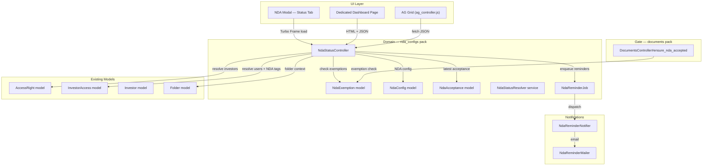

**Contract table:**

| From | To | Contract | Direction |
|---|---|---|---|
| Modal Status Tab | NdaStatusController#summary | Turbo Frame request → HTML partial | Request |
| Dashboard Page | NdaStatusController#index | HTML (page) + JSON (AG Grid data) | Request |
| NdaStatusController | AccessRight | `AccessRight.where(owner: folder)` → investors | Query |
| NdaStatusController | InvestorAccess | `.where(entity_id:, approved: true)` → users + tags | Query |
| NdaStatusController | NdaAcceptance | `.where(nda_config_id:, investor_id:)` → latest status | Query |
| NdaStatusController | NdaExemption | `.where(nda_config_id:)` → exempt user_ids | Query |
| NdaStatusController | NdaReminderJob | `perform_later(nda_config_id, user_ids)` | Async |
| NdaReminderJob | NdaReminderNotifier | `.with(record:, entity_id:).deliver_later(user)` | Async |
| DocumentsController | NdaExemption | `.exists?(nda_config_id:, user_id:)` | Query |

### Class Diagram

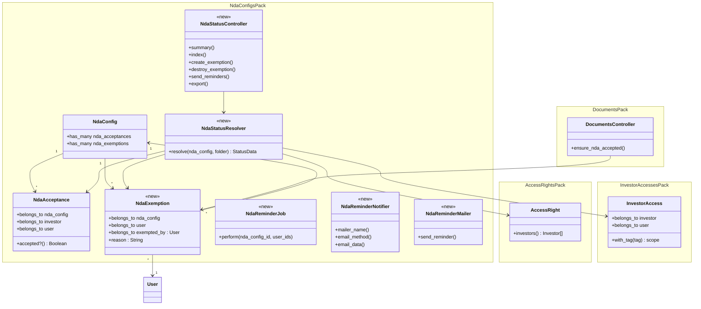

### Change Footprint

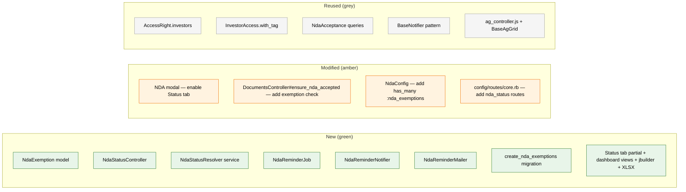

---

## Data Model and States

### Data Model

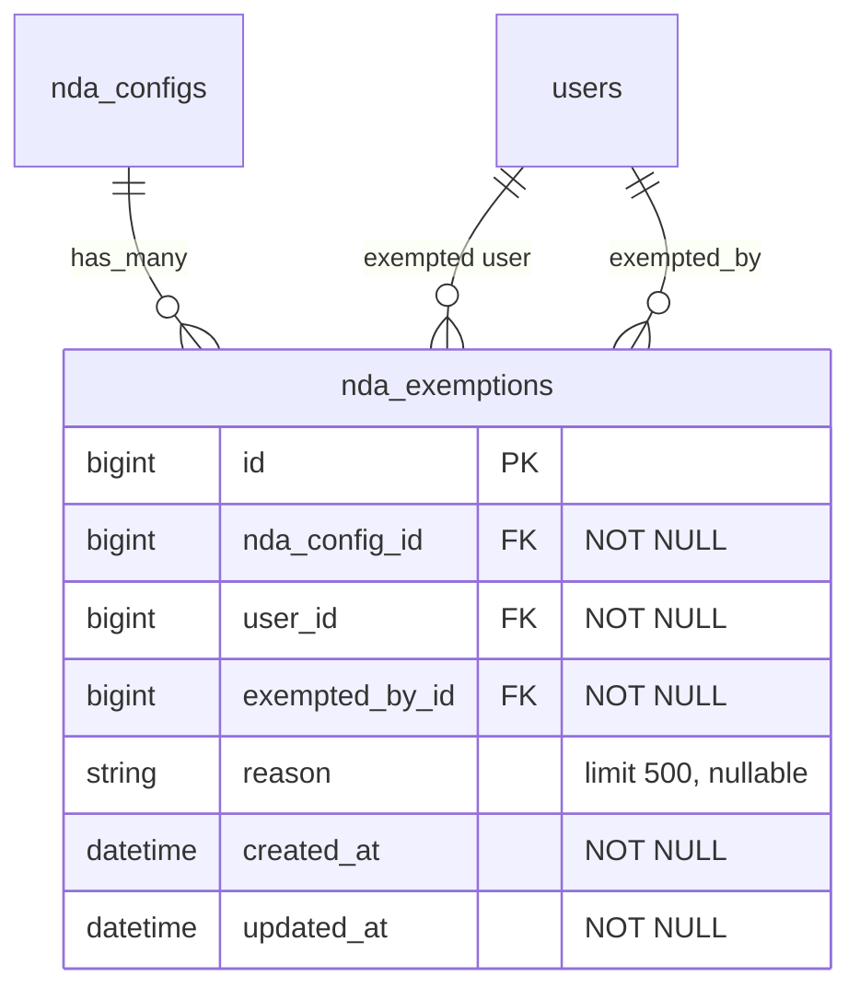

**Indexes:**
- `idx_nda_exemptions_config_user [nda_config_id, user_id]` UNIQUE — one exemption per user per NDA config
- `idx_nda_exemptions_user [user_id]` — audit queries

**Changes to existing models:**
- `NdaConfig`: add `has_many :nda_exemptions, dependent: :destroy`

### State Transitions

Investor-level NDA status is derived at read time, not stored. The states and transitions:

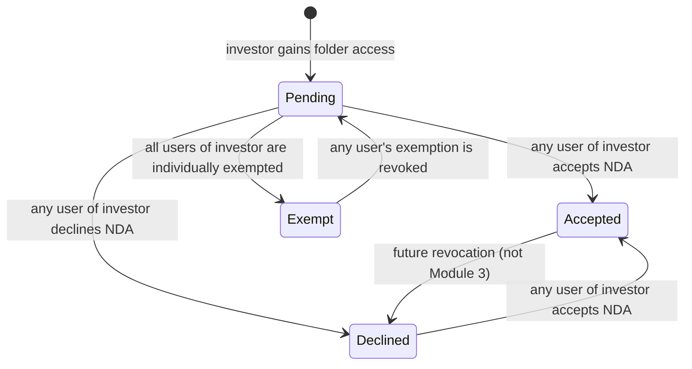

User-level exemption status:

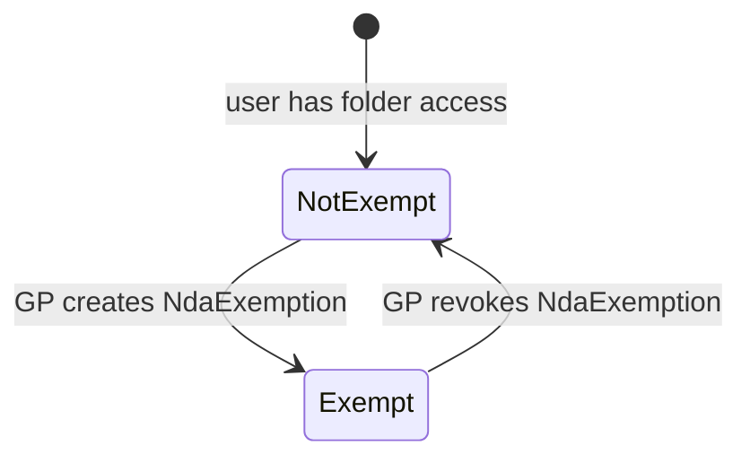

---

## Behaviour

### Sequence Diagrams

**Happy path: GP views status summary in modal**

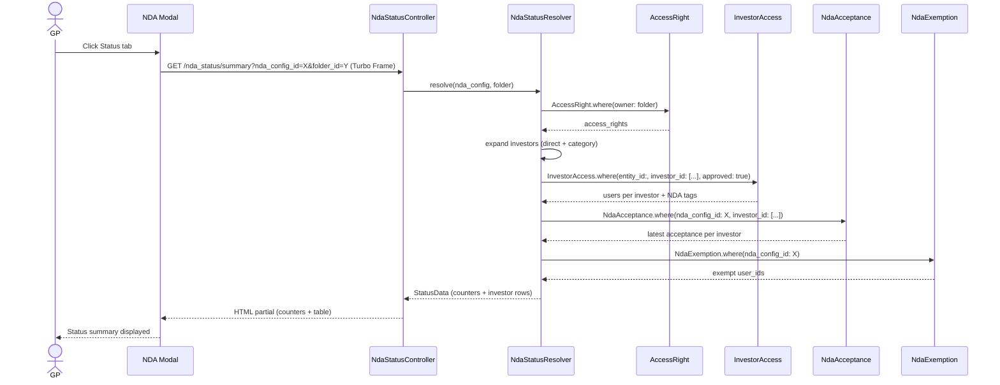

**GP marks user as exempt**

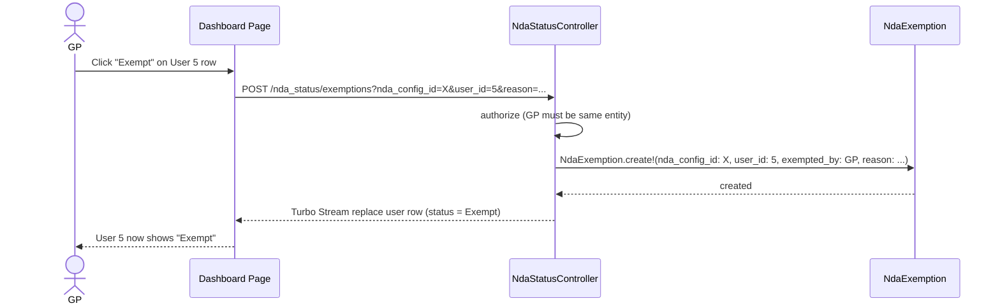

**GP sends bulk reminders**

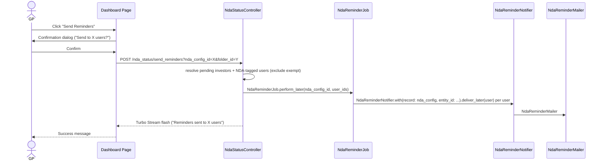

**Exempt user hits NDA gate**

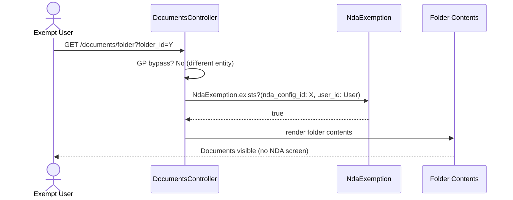

### Worked Examples

**Shared setup:**

| Entity | Item | Detail |
|---|---|---|
| Alpha Ventures | GP Admin | fm1@ian.com, company_admin |
| Alpha Ventures | Folder "Fund Alpha Docs" | Data Room folder with NDA-A (enabled, click_through, until_revoked) |
| Alpha Ventures | Investor "Acme Capital" | Category: LP. AccessRight to folder. |
| Acme Capital | User A (alice@acme.com) | InvestorAccess approved, NDA tag |
| Acme Capital | User B (bob@acme.com) | InvestorAccess approved, NDA tag |
| Acme Capital | User C (carol@acme.com) | InvestorAccess approved, no NDA tag |
| Acme Capital | User D (dave@acme.com) | InvestorAccess approved, no NDA tag |
| Acme Capital | User E (eve@acme.com) | InvestorAccess approved, no NDA tag, EXEMPT |
| Alpha Ventures | Investor "Beta Holdings" | Category: LP. AccessRight to folder. No acceptance. |
| Beta Holdings | User F (frank@beta.com) | InvestorAccess approved, NDA tag |
| Alpha Ventures | Investor "Gamma Fund" | Category: LP. AccessRight to folder. Declined. |
| Gamma Fund | User G (gina@gamma.com) | InvestorAccess approved, NDA tag |

**Happy Path:**

| # | Scenario | Given | When | Then | Spec scenario | Feature |
|---|---|---|---|---|---|---|
| H1 | GP views status summary in modal | NDA-A active on folder, Acme accepted, Beta pending, Gamma declined, Eve exempt | GP opens NDA Settings modal, clicks Status tab | Counters: Accepted=1, Pending=1, Declined=1, Exempt=0. Table shows 3 investor rows with correct statuses. | GP views status summary for NDA-protected folder | nda_status.feature |
| H2 | GP opens dedicated dashboard | Same as H1 | GP clicks "View Full Dashboard" | AG Grid with 3 investor rows. Acme expandable to 5 users (Alice=Signer, Eve=Exempt, rest=dash). | GP opens dedicated dashboard from modal | nda_status.feature |
| H3 | GP marks user as exempt | Eve not yet exempt | GP clicks Exempt on Eve's row, enters reason "NDA signed offline" | Eve's status changes to Exempt. NdaExemption record created. | GP creates exemption for a user | nda_status.feature |
| H4 | GP revokes exemption | Eve is exempt | GP clicks Revoke on Eve's row | Eve's status reverts to stakeholder status (Accepted). NdaExemption deleted. | GP revokes exemption | nda_status.feature |
| H5 | GP exports status | Same as H1 | GP clicks Export | XLSX downloaded with all investors + users, statuses, dates | GP exports NDA status | nda_status.feature |
| H6 | GP sends bulk reminders | Beta pending (Frank is NDA-tagged), Gamma declined | GP clicks Send Reminders, confirms | Reminder sent to Frank only (Beta is pending + NDA-tagged). Gamma is declined, not pending. | GP sends reminders to pending investors | nda_status.feature |

**Edge Cases:**

| # | Scenario | Given | When | Then | Spec scenario | Feature |
|---|---|---|---|---|---|---|
| E1 | Exempt user accesses folder before stakeholder signs | Eve exempt, Acme has NOT accepted NDA-A | Eve navigates to folder | Folder contents shown (no NDA screen) | Exempt user accesses NDA-protected folder before stakeholder signs | nda_status.feature |
| E2 | Exemption revoked, stakeholder not accepted | Eve's exemption revoked, Acme has NOT accepted | Eve navigates to folder | NDA acceptance screen shown | Exemption revoked, stakeholder not accepted | nda_status.feature |
| E3 | Category-based access right expands | AccessRight with access_to_category="LP" on folder | GP views dashboard | All LP-category investors in entity appear | Category-based access right | nda_status.feature |
| E4 | Investor removed from access rights | Acme's AccessRight deleted | GP views dashboard | Acme no longer appears in dashboard | Investor removed from access rights | nda_status.feature |
| E5 | No pending investors for reminders | All investors accepted or declined | GP clicks Send Reminders | Button disabled or "No pending investors to remind" | No pending investors | nda_status.feature |
| E6 | Duplicate exemption attempt | Eve already exempt | GP attempts to exempt Eve again | No duplicate created (unique constraint) | Exemption uniqueness | nda_status.feature |
| E7 | Reminder skips exempt users | Frank (Beta, NDA-tagged) is exempt | GP sends reminders | Frank does NOT receive reminder | Reminder not sent to exempt users | nda_status.feature |
| E8 | Reminder targets only NDA-tagged | Beta pending, Frank (NDA-tagged) + Hannah (not tagged) | GP sends reminders | Only Frank receives reminder | Reminder targets only NDA-tagged users | nda_status.feature |
| E9 | Status tab hidden for folder without NDA | Folder has no NDA config | GP opens NDA Settings modal | Only Settings tab visible, no Status tab | Status tab hidden when no active NDA | nda_status.feature |
| E10 | Inherited NDA status | Child folder inherits NDA-A from parent | GP opens Status tab on child | Shows statuses for NDA-A. Investor universe from child's access rights. | Status tab for inherited NDA | nda_status.feature |
| E11 | Investor fully exempt | All users of Delta LP are individually exempt | GP views dashboard | Delta LP investor-level status = "Exempt" | Investor-level status derivation (all exempt) | nda_status.feature |

**Error Cases:**

| # | Scenario | Given | When | Then | Spec scenario | Feature |
|---|---|---|---|---|---|---|
| X1 | Non-GP tries to access dashboard | LP user logged in | LP navigates to /nda_status?nda_config_id=X | 403 Forbidden — policy denies | (policy check) | nda_status.feature |
| X2 | Other-entity GP tries dashboard | GP from different entity | GP navigates to /nda_status?nda_config_id=X | 403 Forbidden — entity mismatch | (policy check) | nda_status.feature |
| X3 | NDA config not found | Invalid nda_config_id | GP navigates to /nda_status?nda_config_id=99999 | 404 Not Found | (standard RecordNotFound) | nda_status.feature |

---

## Key Components

| Component | Responsibility |
|---|---|
| NdaStatusResolver | Resolves the full status picture for a given NDA config + folder: investor universe (from AccessRight), user details (from InvestorAccess), latest acceptance per investor (from NdaAcceptance), exempt users (from NdaExemption). Returns structured data for both the modal summary and the AG Grid JSON. |
| NdaReminderJob | Background job that receives a list of user_ids and dispatches NdaReminderNotifier to each. Keeps the controller response fast. |
| NdaReminderNotifier | Noticed-based notifier following BaseNotifier pattern. Delivers via email channel. |
| NdaReminderMailer | Mailer with `send_reminder` method. Email body includes folder name, entity name, and a link to the Data Room. |

**Status derivation decision flow:**

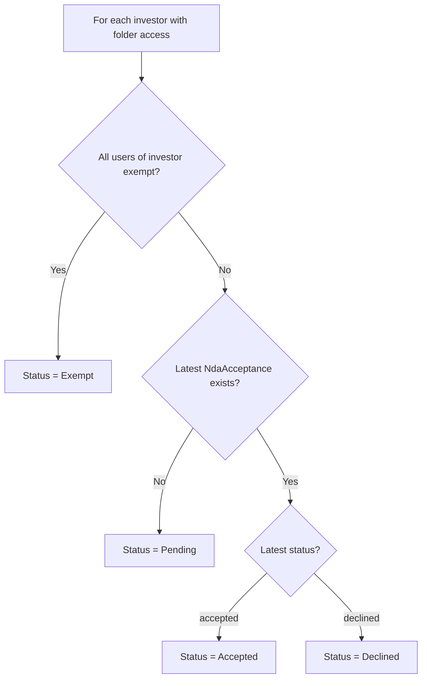

---

## Controllers and Routes

| Method | Route | Action | Response |
|---|---|---|---|
| GET | `/nda_status/summary` | NdaStatusController#summary | Turbo Frame HTML partial (counters + table) |
| GET | `/nda_status` | NdaStatusController#index | HTML page (dashboard) |
| GET | `/nda_status.json` | NdaStatusController#index | JSON (AG Grid data) |
| GET | `/nda_status.xlsx` | NdaStatusController#index | XLSX download |
| POST | `/nda_status/exemptions` | NdaStatusController#create_exemption | Turbo Stream (update user row) |
| DELETE | `/nda_status/exemptions/:id` | NdaStatusController#destroy_exemption | Turbo Stream (update user row) |
| POST | `/nda_status/send_reminders` | NdaStatusController#send_reminders | Turbo Stream (flash message) |

All routes scoped under the NDA configs pack. Query params: `nda_config_id`, `folder_id`.

---

## Policy

**NdaStatusPolicy:**

| Role | summary | index / export | create_exemption | destroy_exemption | send_reminders |
|---|---|---|---|---|---|
| GP Admin (same entity) | Allow | Allow | Allow | Allow | Allow |
| GP Employee (same entity) | Allow | Allow | Allow | Allow | Allow |
| LP / Investor user | Deny | Deny | Deny | Deny | Deny |
| Other-entity GP | Deny | Deny | Deny | Deny | Deny |

**Entity scoping:** Policy checks `nda_config.entity_id == current_user.entity_id` and `curr_role_employee?`. Same pattern as NdaConfigPolicy.

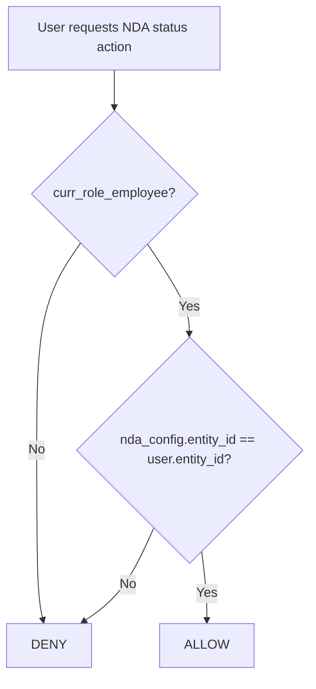

---

## UI Changes

### At a Glance

| Screen | Before | After |
|---|---|---|
| NDA Settings Modal | Status tab disabled ("Coming soon") | Status tab enabled with summary counters + investor table |
| Dedicated dashboard page | Does not exist | New page: AG Grid, filters, export, exemptions, reminders |
| NDA gate (invisible to GP) | GP bypass → stakeholder check | GP bypass → **exemption check** → stakeholder check |

### Journey 1: GP views NDA status summary in modal

```
+-------------------------------------------------------+
|  NDA Settings — Fund Alpha Docs                    [x] |
|-------------------------------------------------------|
|  [Settings]  [Status]  <-- ① Tab now enabled           |
|-------------------------------------------------------|
|                                                        |
|  ② Accepted: 1  Pending: 1  Declined: 1  Exempt: 0    |
|                                                        |
|  ③ +--------------------------------------------------+|
|     | Investor        | Status   | Signed By | Date   ||
|     |-----------------|----------|-----------|--------|  |
|     | Acme Capital    | Accepted | Alice     | Oct 3  ||
|     | Beta Holdings   | Pending  | —         | —      ||
|     | Gamma Fund      | Declined | Gina      | Oct 2  ||
|     +--------------------------------------------------+|
|                                                        |
|  ④ [View Full Dashboard -->]                            |
+-------------------------------------------------------+
```

| Step | The user... | They see |
|---|---|---|
| 1 | Clicks the Status tab in the NDA Settings modal | Tab becomes active, Settings pane hides, Status pane shows |
| 2 | Looks at the counters | Four badges: Accepted, Pending, Declined, Exempt with counts |
| 3 | Scans the investor table | Simple HTML table with one row per investor |
| 4 | Clicks "View Full Dashboard" | Navigates to the dedicated dashboard page |

### Journey 2: GP opens dedicated dashboard and manages exemptions

```
+--------------------------------------------------------------+
|  NDA Status — Fund Alpha Docs                                |
|  ① [Filter: Status v] ② [Search...] ③ [Export] ④ [Reminders]|
+--------------------------------------------------------------+
|  ⑤ Investor       | Status   | Signed By | Date    | Action  |
|  ------------------|----------|-----------|---------|---------|
|  v Acme Capital    | Accepted | Alice     | Oct 3   |         |
|    ⑥ Alice (NDA)   | Signer   | Alice     | Oct 3   |         |
|    Bob (NDA)       | —        | —         | —       |[Exempt] |
|    Carol           | —        | —         | —       |[Exempt] |
|    Dave            | —        | —         | —       |[Exempt] |
|    ⑦ Eve           | Exempt   | —         | —       |[Revoke] |
|  > Beta Holdings   | Pending  | —         | —       |         |
|  > Gamma Fund      | Declined | Gina      | Oct 2   |         |
+--------------------------------------------------------------+
```

| Step | The user... | They see |
|---|---|---|
| 1 | Selects a status from Filter dropdown | Grid filters to show only investors matching that status |
| 2 | Types in Search box | Grid filters by investor or user name |
| 3 | Clicks Export | XLSX file downloads |
| 4 | Clicks Send Reminders | Confirmation dialog, then success message |
| 5 | Expands Acme Capital row | User rows appear under the investor |
| 6 | Sees Alice marked as Signer with (NDA) tag | Alice is the user who physically signed |
| 7 | Sees Eve marked as Exempt with Revoke button | Eve has an NdaExemption record |

### Journey 3: GP sends bulk reminders

| Step | The user... | They see |
|---|---|---|
| 1 | Clicks "Send Reminders" | Confirmation dialog: "Send NDA reminders to 1 pending investor (1 NDA-tagged user)?" |
| 2 | Clicks Confirm | Flash message: "Reminders sent to 1 user" |
| 3 | If no pending investors | Button disabled or message "No pending investors to remind" |

### Build Notes for Implementers

- **Modal Status tab**: Turbo Frame lazy-load. The Status tab content is loaded via `turbo_frame_tag "nda_status_summary"` with `src` pointing to `nda_status_summary_path(nda_config_id:, folder_id:)` and `loading: :lazy`. Content loads only when the tab is clicked.
- **AG Grid**: Follow existing pattern — `data-controller="ag"`, `data-source` pointing to JSON endpoint, `data-custom-columns` from `STANDARD_COLUMNS`. Use `group_by_column` for investor-level grouping.
- **Turbo Stream for exemptions**: POST/DELETE actions return Turbo Stream responses that replace the affected user row in the grid. Consider using `turbo_stream.replace` targeting the user row by DOM id.
- **Export**: Standard `.xlsx.axlsx` template. Skip pagination when `request.format.xlsx?`.
- **Reminder job**: Enqueue `NdaReminderJob` from the controller to keep the response fast. The job loops through user_ids and dispatches `NdaReminderNotifier`.

---

## Cross-cutting Concerns

### Transactions and Queries

- **NdaStatusResolver**: Multiple queries (AccessRight, InvestorAccess, NdaAcceptance, NdaExemption) but all are reads — no transaction needed. Preload investors and users to avoid N+1 on the AG Grid JSON endpoint.
- **Create exemption**: Single INSERT — no transaction needed.
- **Send reminders**: Controller enqueues one background job with the list of user_ids. The job dispatches notifications one at a time (Noticed handles delivery). No transaction.
- **N+1 risk**: The JSON endpoint must eager-load investor → users → investor_accesses to avoid N+1 when rendering rows. Use `includes` or batch queries in the resolver.

### Exception Handling and Monitoring

| Failure | Who is alerted | How |
|---|---|---|
| NdaExemption save fails (validation) | GP | Flash error on page |
| NdaReminderJob fails | Sidekiq retry + dead set | Standard Sidekiq monitoring |
| NdaReminderMailer delivery fails | Sidekiq retry | Standard mail delivery retry |

### Performance

- Status derivation is read-time, not cached. For large investor lists (100+), the resolver should batch queries (pluck investor_ids, batch NdaAcceptance lookups) rather than N+1.
- The modal summary partial should be lightweight — no AG Grid JS loaded.

### Security

- All actions require GP authentication + entity match via NdaStatusPolicy.
- NdaExemption.exempted_by_id set server-side (current_user), not from params.
- XLSX export does not include sensitive fields beyond what's visible on screen.

---

## Design Decisions

| # | Decision | Alternative | Why rejected |
|---|---|---|---|
| 1 | Separate NdaExemption table | Store exemption as NdaAcceptance with status "exempt" | Exemption is a GP configuration, not an LP action. Mixing them in the same table muddies the audit trail and conflates two different concepts. |
| 2 | NdaStatusResolver service object | Inline queries in controller | The resolver is reused by both the modal summary and the dashboard JSON endpoint. Extracting it avoids duplication. |
| 3 | Background job for reminders | Inline notification dispatch in controller | Sending N emails synchronously would block the GP's request. Job keeps the response fast. |
| 4 | Turbo Frame lazy-load for modal Status tab | Eager-load status data with the modal | Status data requires multiple queries. Lazy-loading means the Settings tab renders instantly and status loads only when clicked. |
| 5 | Simple HTML table in modal, AG Grid on dedicated page | AG Grid everywhere | Modal-lg is too narrow for AG Grid. HTML table is simpler and faster for a summary. |
| 6 | Exemption per user (not per investor) | Exemption per investor | Product requirement: specific users are exempted (legal counsel, advisors), not entire organizations. |
| 7 | Status computed at read time | Denormalized status column | Status depends on NdaAcceptance (append-only) + NdaExemption (mutable) + AccessRight (mutable). Caching would go stale. Read-time derivation is simpler and always correct. |

---

## Testing

Cucumber only. Single feature file `features/core/nda_status.feature`, tagged `@nda`.

Shared setup reuses existing step files: `nda_config_steps.rb` (entity, folder, NDA config), `nda_acceptance_steps.rb` (acceptance records), `investor_access_steps.rb` (InvestorAccess with tags). New step file: `nda_status_steps.rb` for dashboard navigation, exemption actions, reminder actions, and export verification.

The Feature column in Worked Examples maps each scenario to `nda_status.feature`.

---

## Risks and Open Questions

- **AG Grid row grouping with Turbo Stream updates**: Replacing a single user row inside a grouped AG Grid via Turbo Stream may not work cleanly — AG Grid manages its own DOM. Mitigation: exemption toggle may need to reload the grid data via `fetch` + `gridApi.setRowData()` instead of Turbo Stream DOM replacement. Investigate during implementation.
- **Large investor lists**: Entities with 500+ investors could make the modal summary slow. Mitigation: the Turbo Frame lazy-load keeps the modal responsive; if needed, limit the modal table to top N rows with a "View Full Dashboard" CTA.
- **Reminder deduplication**: If the GP clicks "Send Reminders" twice quickly, two jobs may enqueue. Mitigation: disable the button after first click via Stimulus controller; consider job-level idempotency check.
