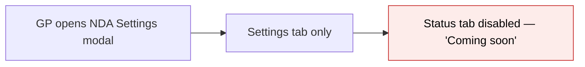
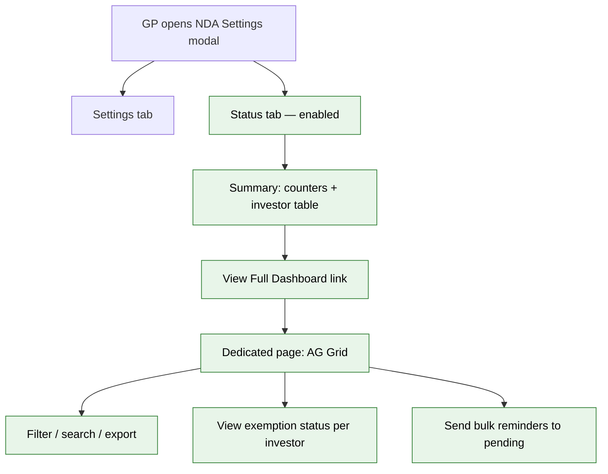
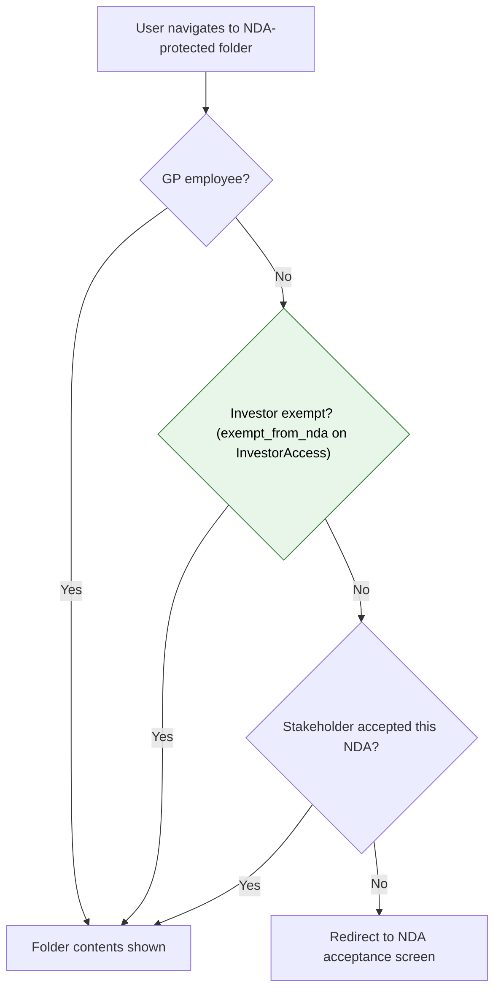

# NDA Module 3: GP Status Dashboard — Proposal

> **Audience:** Business team, product, QA, support — non-technical.
> **Companion document:** [Design](design.md)

> **Planning phase — no code changes.** This document proposes and explains the change. Do not
> edit application code while writing it; implementation happens later, in the tasks phase.

---

## Why

GPs can now configure NDAs on Data Room folders (Module 1) and LPs are gated from accessing folder contents until their stakeholder accepts (Module 2), but the GP has no visibility into who has accepted, who hasn't, and who is exempt. Today the GP must check individual database records to know the NDA status of their investors — there is no dashboard, no export, and no way to send reminders or view exemption status. Module 3 adds the GP-facing status view, exemption visibility, bulk reminders, and export.

## What Changes

- The existing disabled **"Status" tab** in the NDA Settings modal is enabled. It shows a **summary view**: counters for each status (Accepted, Pending, Declined, Exempt) and a simple HTML table of investors with their current NDA status.
- A **"View Full Dashboard"** link in the modal opens a **dedicated full-page dashboard** with an AG Grid table showing all investors who have access to the folder, their NDA status, who signed, when, NDA version, and validity. The grid supports filtering by status, searching by investor name, and row grouping (investor-level rows expandable to individual users).
- The GP can **mark entire investors (stakeholders) as exempt** from NDA via a toggle on the **Investor show page**. Toggling "Exempt from NDA" bulk-updates all InvestorAccess records for that investor, so all users under that investor bypass the NDA gate. Exemption status appears as "Exempt" on the dashboard. The toggle does not appear on individual user InvestorAccess forms — it is an investor-level decision.
- The GP can **export** the NDA status records as an XLSX file from the dedicated dashboard.
- The GP can **send bulk reminders** to NDA-tagged users of pending investors (investors whose stakeholder has not yet accepted or declined).
- The NDA gate in the folder view is updated to **check stakeholder exemptions before stakeholder-level acceptance** — an exempt investor's users always pass, even if their investor hasn't signed.

### Flow Diagram

**Before — GP has no visibility into NDA acceptance status:**



**After — GP has full NDA status dashboard with exemption visibility and reminders:**



**After — NDA gate updated with exemption check:**



---

## User Stories

### US-1: GP views NDA status summary in modal

**As a** GP/admin,
**I want** to see a quick summary of NDA acceptance status when I open the NDA Settings modal,
**So that** I can assess at a glance how many investors have accepted, are pending, declined, or are exempt.

**Acceptance criteria:**
- The "Status" tab in the NDA Settings modal is enabled and clickable
- Clicking the Status tab shows counters: Accepted (count), Pending (count), Declined (count), Exempt (count)
- Below the counters, a simple HTML table lists investors with columns: Investor Name, Status, Signed By, Date
- The table shows all investors who have access to this folder (via access rights)
- A "View Full Dashboard" link is visible at the bottom

### US-2: GP views full NDA status dashboard

**As a** GP/admin,
**I want** a dedicated page showing detailed NDA acceptance status for all investors with access to the folder,
**So that** I can filter, search, and manage NDA compliance across my investor base.

**Acceptance criteria:**
- Clicking "View Full Dashboard" from the modal opens a dedicated page
- The page uses an AG Grid table with columns: Investor Name, User Name, Status, NDA Version, Signed By, Signed Date, Valid Until
- Rows are grouped by investor (investor-level rows), expandable to show individual users under that investor
- Investor-level status: Accepted, Pending, Declined, or Exempt (only if all users of that investor are exempt)
- User-level detail: "Signer" (the user who physically signed), "Exempt", or "—"
- The grid supports filtering by status and searching by investor/user name
- The page title shows the folder name and NDA config context

### US-3: GP exempts an investor from NDA

**As a** GP/admin,
**I want** to exempt an entire investor (stakeholder) from the NDA requirement via a toggle on the Investor show page,
**So that** trusted investors (legal counsel firms, co-investors with existing NDAs, internal advisory firms) can access the folder without signing.

**Acceptance criteria:**
- On the Investor show page (stakeholder info card), a toggle "Exempt from NDA" is available
- Toggling it on bulk-updates all InvestorAccess records for that investor with `exempt_from_nda = true`
- When exempt, all users under that investor bypass the NDA gate entirely — they see folder contents immediately
- The investor's status appears as "Exempt" on the NDA status dashboard
- The exemption is independent of the stakeholder-level acceptance — even if no one from the investor has signed, all their users get through
- To remove an exemption, the GP toggles it off on the same Investor page — all InvestorAccess records are set to `exempt_from_nda = false`
- The `exempt_from_nda` checkbox does **not** appear on individual user InvestorAccess forms
- No separate exemption management UI on the dashboard — the dashboard displays exemption status read-only

### US-4: GP exports NDA acceptance records

**As a** GP/admin,
**I want** to export the NDA acceptance status as an XLSX file,
**So that** I have a downloadable record for compliance and audit purposes.

**Acceptance criteria:**
- An "Export" button is visible on the dedicated dashboard page
- Clicking it downloads an XLSX file with all rows (investors + users) and their NDA status details
- The export includes: Investor Name, User Name, Email, Status, NDA Version, Signed Date, Valid Until, Exempt (Yes/No)

### US-5: GP sends bulk NDA reminders to pending investors

**As a** GP/admin,
**I want** to send NDA reminders to investors who haven't responded yet,
**So that** I can prompt them to sign without contacting each one individually.

**Acceptance criteria:**
- A "Send Reminders" button is visible on the dedicated dashboard page
- Clicking it sends reminder notifications to NDA-tagged users of investors with "Pending" status
- Only users with the "NDA" tag on their InvestorAccess receive the reminder (consistent with Module 2's signatory designation)
- The reminder directs the user back to the Data Room where they can review and accept the NDA
- A confirmation dialog is shown before sending ("Send reminders to X pending investors?")
- After sending, a success message is shown ("Reminders sent to X users")

### US-6: Exempt user accesses NDA-protected folder without signing

**As a** user whose investor has been exempted from NDA by the GP,
**I want** to access the Data Room folder contents directly,
**So that** I don't have to wait for my stakeholder's NDA to be signed or go through the acceptance screen myself.

**Acceptance criteria:**
- When I navigate to the NDA-protected folder, I see folder contents immediately — no NDA screen
- This works even if no one from my investor has signed the NDA yet
- Exemption is at the investor level — if the GP has toggled "Exempt from NDA" on the Investor page, all users under that investor bypass the gate
- If the GP toggles the exemption off, I am subject to the normal NDA gate on my next visit

---

## UI Behavior

### NDA Settings Modal — Status Tab

```
+-------------------------------------------------------+
|  NDA Settings — Fund Alpha Docs                    [x] |
|-------------------------------------------------------|
|  [Settings]  [Status]                                  |
|-------------------------------------------------------|
|                                                        |
|  Accepted: 12   Pending: 5   Declined: 2   Exempt: 1  |
|                                                        |
|  +---------------------------------------------------+|
|  | Investor        | Status   | Signed By  | Date    ||
|  |-----------------|----------|------------|---------|  |
|  | Acme Capital    | Accepted | J. Smith   | Oct 3   ||
|  | Beta Holdings   | Declined | R. Patel   | Oct 2   ||
|  | Gamma Fund      | Pending  | —          | —       ||
|  | Delta LP        | Accepted | M. Lee     | Oct 1   ||
|  +---------------------------------------------------+|
|                                                        |
|  [View Full Dashboard -->]                              |
+-------------------------------------------------------+
```

**Behavior notes:**
- Status tab is only visible when the folder has an active NDA config (enabled=true)
- Counters reflect investor-level statuses (not user-level)
- Table is simple HTML, not AG Grid — no pagination, shows all investors
- "View Full Dashboard" link opens the dedicated page in a new tab or navigates away from the modal

### Dedicated Status Dashboard Page

```
+--------------------------------------------------------------+
|  NDA Status — Fund Alpha Docs                                |
|  [Filter: Status v]  [Search...]  [Export]  [Send Reminders] |
+--------------------------------------------------------------+
|  Investor         | Status   | Signed By  | Date    | Action |
|-------------------|----------|------------|---------|--------|
|  v Acme Capital   | Accepted | J. Smith   | Oct 3   |        |
|    User 1 (NDA)   | Signer   | J. Smith   | Oct 3   |        |
|    User 2 (NDA)   | —        | —          | —       |        |
|    User 3         | —        | —          | —       |        |
|    User 4         | —        | —          | —       |        |
|  > Beta Holdings  | Pending  | —          | —       |        |
|  > Gamma Fund     | Declined | R. Patel   | Oct 2   |        |
+--------------------------------------------------------------+
```

**Behavior notes:**
- Uses AG Grid with row grouping (investor as group, users as children)
- Filter dropdown allows selecting: All, Accepted, Pending, Declined, Exempt
- Search filters by investor name or user name
- "Export" downloads XLSX with all visible rows
- "Send Reminders" sends to NDA-tagged users of Pending investors only
- Exemption status is displayed read-only on the dashboard — the GP manages exemptions via the InvestorAccess form, not from the dashboard
- "(NDA)" tag shown next to user name when the user's InvestorAccess has the NDA tag
- Page uses the standard `modernize` layout with sidebar/topbar (not the minimal NDA layout)

---

## What This Feature Does NOT Cover

| Excluded | Covered In |
|---|---|
| NDA configuration (upload, validity, acceptance method) | Module 1 |
| LP acceptance/decline flow and gate | Module 2 |
| NDA inheritance mode (inherit/own/opt_out) | Module 5 |
| E-sign integration (Zoho) | Module 6 |
| NDA version management (re-acceptance on version change) | Module 7 |
| NDA event notifications to GP (accept/decline/expire events) | Module 8 |
| NDA expiry detection and re-acceptance flow | Module 9 |
| Revoke/reset of an investor's acceptance by GP | Future module |

---

## Validation Rules

| Field | Rule | Default |
|---|---|---|
| InvestorAccess.exempt_from_nda | Boolean, bulk-set via toggle on Investor show page | false |
| InvestorAccess.exempt_from_nda scope | Toggle bulk-updates all InvestorAccess records for the investor under the entity — all users under that investor inherit the exemption | — |
| InvestorAccess.exempt_from_nda removal | GP toggles "Exempt from NDA" off on the Investor page — all records set to false | — |

---

## Behavior Rules

| Scenario | What User Sees |
|---|---|
| GP opens Status tab on folder with active NDA | Counters + investor table showing current statuses |
| GP opens Status tab on folder without NDA | Status tab not visible (only Settings tab shown) |
| GP opens Status tab on inherited NDA folder | Status shows investors for the effective NDA config (may be parent's config) |
| GP clicks "View Full Dashboard" | Navigates to dedicated dashboard page for this NDA config |
| GP toggles "Exempt from NDA" on for an investor | All InvestorAccess records for that investor are set to exempt_from_nda=true. Investor's status shows as "Exempt" on dashboard; all users under that investor bypass the NDA gate |
| GP toggles "Exempt from NDA" off for an investor | All InvestorAccess records for that investor are set to exempt_from_nda=false. Investor's status reverts to their stakeholder's status (Accepted/Pending/Declined); all users are subject to the NDA gate again |
| GP clicks "Send Reminders" | Confirmation dialog → reminders sent to NDA-tagged users of Pending investors → success message |
| GP clicks "Send Reminders" with no pending investors | Button disabled or message "No pending investors to remind" |
| GP clicks "Export" | XLSX file downloads with all investor + user NDA status records |
| Exempt investor's user visits NDA-protected folder | Folder contents shown immediately — no NDA screen, regardless of stakeholder acceptance status |
| GP exempts an investor, then that investor's stakeholder accepts NDA | Investor shows as "Exempt" (exemption takes precedence over acceptance in display) |
| Investor has access via category-based access right ("All LPs") | All investors of that category appear in the dashboard |
| Investor removed from folder access rights | Investor no longer appears in the dashboard (dynamic, not cached) |
| GP opens context menu on Data Room root folder | NDA Settings option is hidden — NDA is configured on sub-folders only, not the root. Controlled by `!@folder.data_room_root?` condition. |

---

## Resolved Design Decisions

| # | Decision | Resolution |
|---|---|---|
| 1 | Where does the dashboard live? | Two views: summary in the NDA modal Status tab, full dashboard on a dedicated page |
| 2 | What AG Grid is used in the modal? | No AG Grid in modal — simple HTML table. AG Grid on the dedicated page only. |
| 3 | Dashboard rows: user or investor level? | Investor-level rows with expandable user detail (AG Grid row grouping) |
| 4 | Exemptions: investor or user level? | Stakeholder-level. A boolean on InvestorAccess, toggled from the Investor show page (bulk-updates all records for that investor). All users under an exempt investor bypass the NDA gate. |
| 5 | Where is exemption stored? | Boolean `exempt_from_nda` on InvestorAccess, bulk-managed via toggle on Investor page. Not on individual InvestorAccess forms. Not on NdaAcceptance (different concept). |
| 6 | Gate order with exemptions | GP bypass → stakeholder exemption check (InvestorAccess.exempt_from_nda) → stakeholder acceptance check → redirect to NDA screen |
| 7 | Who receives reminders? | NDA-tagged users of investors with "Pending" status. Consistent with Module 2's signatory designation model. |
| 8 | Modal size | Stays modal-lg — summary view is simple HTML, fits comfortably |
| 9 | Status tab visibility | Only shown when the folder has an active (enabled) NDA config |
| 10 | Which investors appear in dashboard? | Only investors who have access to the folder via AccessRight (direct investor_id or expanded from category). Dynamic — reflects current access rights, not cached. |
| 11 | Expired status | Deferred to Module 9 (NDA expiry). For now, only: Accepted, Pending, Declined, Exempt. |

---

## Capabilities

### New Capabilities

- `nda-gp-status`: GP-facing NDA status dashboard — summary view in modal, dedicated page with AG Grid, status filtering, export, exemption visibility (read-only), bulk reminder sending, and gate exemption check.

### Modified Capabilities

<!-- No existing spec-level capabilities are being modified. Module 2's nda-lp-acceptance spec remains unchanged — the exemption check is additive to the gate, not a change to acceptance behavior. -->

---

## Impact

- **NDA Settings modal** — Status tab enabled, loads investor status data via a new controller action
- **Folder Documents page** — NDA gate updated to check stakeholder exemptions (InvestorAccess.exempt_from_nda) before stakeholder acceptance
- **New dedicated page** — Route, controller, views, AG Grid JSON endpoint, XLSX export template
- **Modified table** — `investor_accesses` gains `exempt_from_nda` boolean for stakeholder-level exemptions (bulk-set from Investor page toggle, not per-user InvestorAccess form)
- **Modified page** — Investor show page gains "Exempt from NDA" toggle on the stakeholder info card
- **Notifications** — New NDA reminder notifier and mailer for bulk reminders
- **AccessRight queries** — Dashboard resolves the investor universe from folder access rights (existing model, no changes to AccessRight itself)
- **InvestorAccess queries** — Dashboard shows NDA tag and reads `exempt_from_nda` from InvestorAccess (read-only display); reminders target NDA-tagged users

---

## Benefits

1. **GP visibility** — At-a-glance NDA compliance status per investor, directly from the NDA Settings modal
2. **Exemption flexibility** — GPs can exempt specific investors/stakeholders (legal counsel firms, co-investors with offline NDAs) without disabling the NDA for everyone
3. **Compliance export** — Downloadable XLSX record of all NDA statuses for audit and legal purposes
4. **Proactive follow-up** — Bulk reminders to pending investors save the GP from manually contacting each one
5. **Minimal disruption** — Summary in existing modal means GPs don't need to learn a new page for quick checks; dedicated page is there when they need full control

---

## FAQ

| Question | Answer |
|---|---|
| Who can see the NDA status dashboard? | Only GP employees (company_admin / employees) of the entity that owns the folder. LPs and other-entity users cannot access it. |
| Can the GP exempt an entire investor at once? | Yes — exemption is per-investor (stakeholder), not per-user. The GP toggles "Exempt from NDA" on the Investor show page. All users under that investor bypass the NDA gate. |
| What happens if an exempt investor's access to the folder is removed? | Deleting the InvestorAccess removes both the access and the exemption flag on that record (since `exempt_from_nda` lives on InvestorAccess). If the GP re-adds the InvestorAccess, the new record defaults to `exempt_from_nda: false` — the GP would need to re-toggle exemption on the Investor page. |
| Does the reminder go to all users of a pending investor? | No — only to NDA-tagged users (designated signatories). If no user of a pending investor is NDA-tagged, no reminder is sent for that investor. |
| What about the "Expired" status from the product doc? | Deferred to Module 9 (NDA expiry). Module 3 shows four statuses: Accepted, Pending, Declined, Exempt. |
| Can the GP revoke an accepted NDA from this dashboard? | Not in Module 3. Revocation is a future module. Module 3 displays exemption status (read-only) and sends reminders. |
| Does the dashboard show inherited NDA status? | Yes — if a child folder inherits its parent's NDA, the Status tab shows the status for that effective NDA config. The investor universe comes from the current folder's access rights. |
| Is any existing data needed? | No migration of existing data. The dashboard computes status dynamically from NdaAcceptance records and AccessRight queries. Existing InvestorAccess records default to `exempt_from_nda: false`. |
| Does this change notifications or emails? | It adds one new notification type: NDA reminder. No changes to existing notification types. Module 8 will add accept/decline/expire event notifications. |

---

## Design Principle for the Next Phase

- **Reuse AG Grid infrastructure** — The project has a well-established AG Grid pattern (STANDARD_COLUMNS, jbuilder JSON, ag_controller.js). The dedicated dashboard should follow this pattern exactly rather than building a custom grid.
- **Status computation is read-time, not stored** — Investor NDA status (Accepted/Pending/Declined) is derived dynamically from NdaAcceptance records and AccessRight queries. Do not cache or denormalize status into a column — it would go stale. The only stored state is the `exempt_from_nda` boolean on InvestorAccess.
- **Keep modal summary lightweight** — The Status tab in the modal is a simple HTML partial loaded via Turbo Frame, not a full AG Grid. Keep it fast and simple.
- **Exemption is a separate concept from acceptance** — `exempt_from_nda` on InvestorAccess is a GP configuration flag, NdaAcceptance is an LP action record. They are checked separately in the gate. Do not mix them.
- **Exemption is investor-level, not per-user** — The `exempt_from_nda` boolean lives on InvestorAccess but is managed from the Investor show page as a bulk toggle. The checkbox must NOT appear on individual InvestorAccess forms — that would make it a per-user setting.
- **Investor universe from AccessRight** — The dashboard must resolve which investors have folder access via AccessRight (both direct investor_id and category expansion). This is an existing pattern — reuse `access_right.investors` rather than building new queries.
