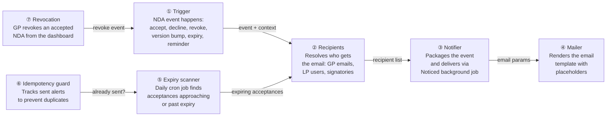
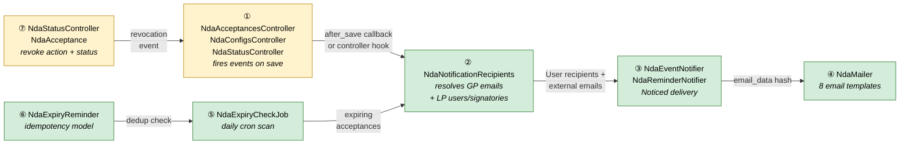
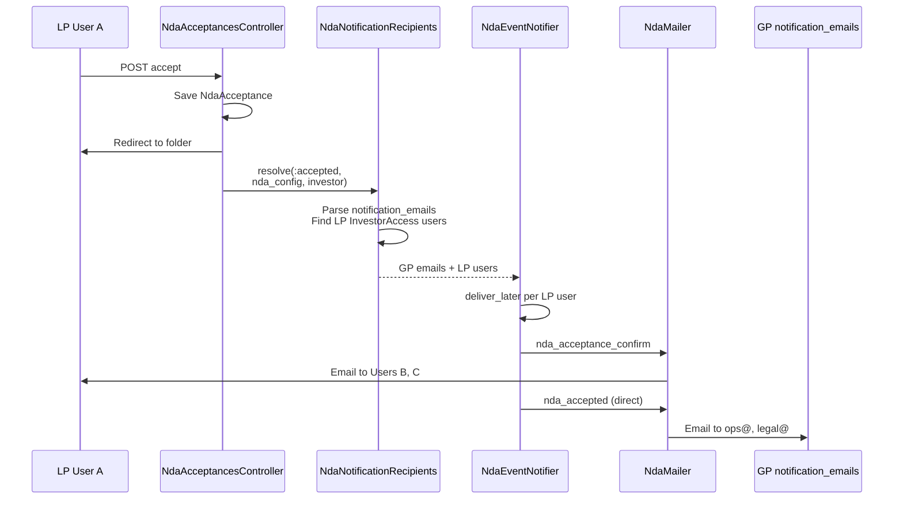
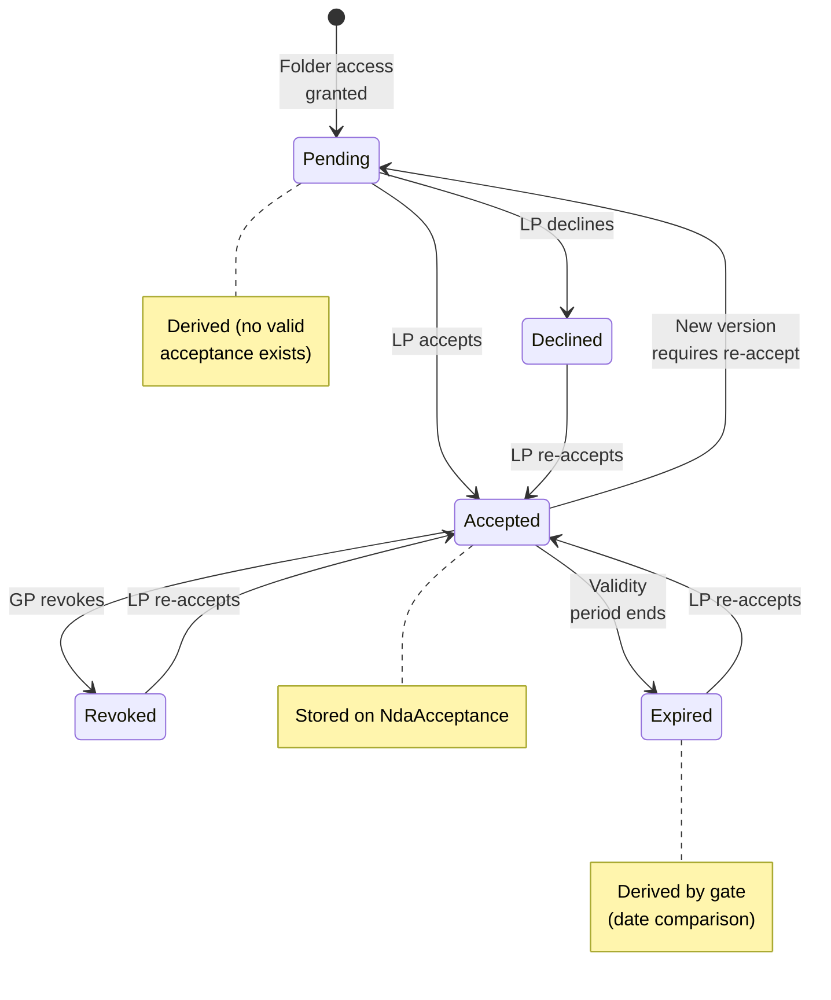
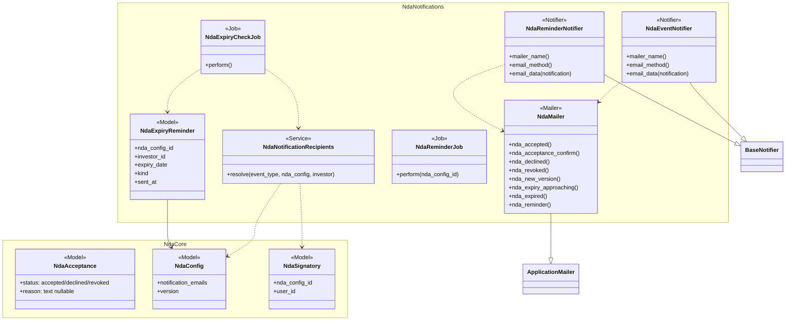
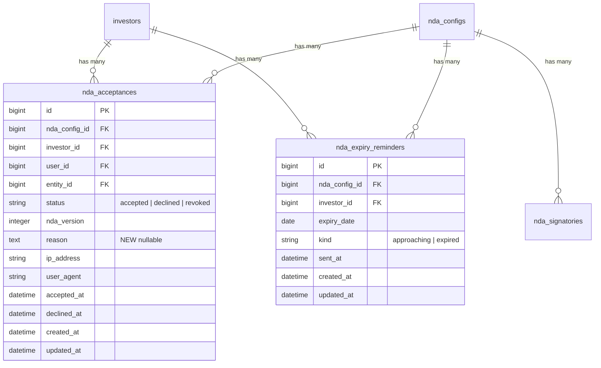

# NDA Module 8 — Notifications & Reminders — Design

> **Audience:** Engineering team.
> **Companion documents:** [Proposal](proposal.md) · [Spec](specs/)

> **Planning phase — no code changes.** This document explains HOW the proposal will be built.
> Do not edit application code while writing it; implementation happens later, in the tasks phase.

> **Design, not code.** Explain the design with mermaid diagrams and tables. Do NOT paste Ruby/JS
> class bodies, migrations, route blocks or policy code. Put real class, method, table and path
> names inside the diagrams and tables instead.

---

## Contents

- [1. The idea](#1-the-idea)
  - [What this adds](#what-this-adds)
  - [The idea in one picture](#the-idea-in-one-picture)
  - [Walkthrough: one example, start to finish](#walkthrough-one-example-start-to-finish)
  - [Key ideas](#key-ideas)
- [2. The same picture with real names](#2-the-same-picture-with-real-names)
  - [Picture](#picture)
  - [What each box does](#what-each-box-does)
  - [One run, end to end](#one-run-end-to-end)
  - [Lifecycles](#lifecycles)
  - [What users see](#what-users-see)
  - [Design decisions](#design-decisions)
- [3. One card per box](#3-one-card-per-box)
  - [① Trigger](#①-trigger)
  - [② Recipients](#②-recipients)
  - [③ Notifier](#③-notifier)
  - [④ Mailer](#④-mailer)
  - [⑤ Expiry scanner](#⑤-expiry-scanner)
  - [⑥ Idempotency guard](#⑥-idempotency-guard)
  - [⑦ Revocation](#⑦-revocation)
- [4. Reference](#4-reference)
  - [Class diagram](#class-diagram)
  - [Data model and schema changes](#data-model-and-schema-changes)
  - [Component contracts](#component-contracts)
  - [Cross-cutting concerns](#cross-cutting-concerns)
  - [Worked examples](#worked-examples)
  - [Testing](#testing)
  - [Risks and open questions](#risks-and-open-questions)

---

## 1. The idea

### What this adds

Adds 8 email notification types to the NDA lifecycle, following the existing BaseNotifier + ApplicationMailer pattern used by DocumentNotifier, InvestorKycNotifier, and 20+ other notifiers. A daily Sidekiq-cron job (NdaExpiryCheckJob) handles scheduled expiry alerts with an idempotency model following the ObligationReminder pattern. GP-triggered reminders use an on-demand background job (NdaReminderJob). Revocation adds a "revoked" status to NdaAcceptance with an optional reason field.

### The idea in one picture



### Walkthrough: one example, start to finish

**Setup:** GP entity "AlphaFund" has a Data Room folder "Financials" with NDA enabled (version 1, validity: 365-day fixed period). notification_emails: `["ops@alphafund.com", "legal@alphafund.com"]`. Investor "Acme Capital" has three users with InvestorAccess: User A (NDA signatory), User B, and User C. Investor "Beta LP" has one user, User D (NDA signatory), status Pending.

**Legend:** GP = AlphaFund team, LP = Acme Capital / Beta LP users.

#### Phase 1: LP accepts — instant notifications

| # | When | What happens | Behind the scenes | Result |
|---|---|---|---|---|
| 1 | User A visits Financials | Sees NDA acceptance screen | NDA gate (WithNda) checks no valid acceptance exists | NDA screen shown |
| 2 | User A clicks Accept | Acceptance recorded, redirected to folder | Trigger (①) fires after NdaAcceptance save | Acceptance saved |
| 3 | — (background) | GP team emailed | Recipients (②) resolves notification_emails. Notifier (③) sends via NdaMailer (④) `nda_accepted` | ops@ and legal@ receive "Acme Capital accepted NDA" |
| 4 | — (background) | User B and C emailed | Recipients (②) finds all InvestorAccess users of Acme minus User A. Notifier (③) sends via NdaMailer (④) `nda_acceptance_confirm` | Users B, C receive "NDA accepted — you have access" |

#### Phase 2: GP sends reminders — manual trigger

| # | When | What happens | Behind the scenes | Result |
|---|---|---|---|---|
| 5 | GP clicks "Send Reminders" | Confirmation dialog: "Send to 1 pending investor (1 user)?" | Controller counts pending investors and signatory users | Dialog shown |
| 6 | GP confirms | Flash: "Reminders sent to 1 user" | NdaReminderJob enqueued. Recipients (②) finds Beta LP's signatory User D. Notifier (③) sends `nda_reminder` | User D receives reminder email |

#### Phase 3: Expiry approaching — scheduled job

| # | When | What happens | Behind the scenes | Result |
|---|---|---|---|---|
| 7 | Day 358 (7 days before expiry) | Daily cron runs | Expiry scanner (⑤) finds Acme's acceptance is 7 days from expiry. Idempotency guard (⑥) confirms no alert sent yet | — |
| 8 | — (background) | GP + LP signatory alerted | Recipients (②) resolves notification_emails + Acme's signatory (User A). Notifier (③) sends `nda_expiry_approaching` | ops@, legal@, User A receive "NDA expires in 7 days" |
| 9 | Day 358 (job runs again) | No duplicate sent | Idempotency guard (⑥) finds existing NdaExpiryReminder record | No emails sent |

#### Phase 4: GP revokes — dashboard action

| # | When | What happens | Behind the scenes | Result |
|---|---|---|---|---|
| 10 | GP clicks "Revoke" on Acme | Dialog: "Revoke NDA for Acme Capital?" with reason field | — | Dialog shown |
| 11 | GP enters "Deal terminated", confirms | Acme status → Revoked | Revocation (⑦) creates NdaAcceptance with status=revoked, reason="Deal terminated". Trigger (①) fires | Status updated |
| 12 | — (background) | Acme users notified | Recipients (②) finds all InvestorAccess users of Acme. Notifier (③) sends `nda_revoked` | Users A, B, C receive "Your NDA access has been revoked" |

**What to notice:**
- Notifications are always background — the LP's acceptance response is never delayed
- GP notification_emails are a simple email list, not system Users — sent as direct emails alongside Noticed delivery
- The idempotency guard prevents duplicate expiry alerts even if the cron job runs multiple times
- Revocation creates an audit trail row, never deletes existing records
- The signing user is excluded from acceptance confirmation (they already know)

### Key ideas

| # | Idea | In one line | Card |
|---|---|---|---|
| 1 | Event-driven triggers | Accept/decline/revoke fire notifications from the controller after save | [①](#①-trigger) |
| 2 | Dual-audience recipients | GP gets notification_emails, LP gets InvestorAccess users or signatories | [②](#②-recipients) |
| 3 | BaseNotifier pipeline | All 8 email types flow through the existing Noticed delivery pipeline | [③](#③-notifier) |
| 4 | Direct GP emails | notification_emails bypass Noticed (not system Users), sent directly by the mailer | [④](#④-mailer) |
| 5 | Daily expiry scanner | Cron job checks fixed_period and specific_date NDAs, sends 7-day and day-of alerts | [⑤](#⑤-expiry-scanner) |
| 6 | Idempotency via NdaExpiryReminder | One alert per investor per expiry event, following ObligationReminder pattern | [⑥](#⑥-idempotency-guard) |
| 7 | Append-only revocation | "revoked" status on NdaAcceptance with optional reason, full audit trail | [⑦](#⑦-revocation) |

**FAQ**

| Question | Answer |
|---|---|
| Why not use CustomNotification for NDA emails? | CustomNotification requires a for_type/owner_type registration plus placeholder lambdas and a form UI. Adds complexity without clear v1 value — can be added later. |
| Why not send notification_emails through Noticed? | notification_emails are free-text external emails, not system Users. Noticed requires User records as recipients. Direct mailer delivery is simpler and matches how KycExpiryMailer works. |

---

## 2. The same picture with real names

### Picture



Colour = footprint: **green** new, **amber** modified, **grey** reused unchanged. Exact files are in [lld.md File Map](lld.md#file-map).

### What each box does

| # | Box | Real parts | What it does | When it runs | What it decides | Details |
|---|---|---|---|---|---|---|
| ① | Trigger | NdaAcceptancesController, NdaConfigsController (update), NdaStatusController (revoke, remind) | Fires notification events after NDA state changes | On HTTP request (accept/decline/revoke/remind/version bump) | Which event type to fire | [card ① →](#①-trigger) |
| ② | Recipients | NdaNotificationRecipients service | Resolves recipient list based on event type | Called by trigger or expiry scanner | GP emails vs LP users vs signatories | [card ② →](#②-recipients) |
| ③ | Notifier | NdaEventNotifier, NdaReminderNotifier (both < BaseNotifier) | Packages event as Noticed notification, delivers via background job | Enqueued by Noticed after trigger | Whether email/WhatsApp is enabled for recipient | [card ③ →](#③-notifier) |
| ④ | Mailer | NdaMailer < ApplicationMailer | Renders 8 email templates with placeholders | Called by Noticed delivery job | Template selection via email_method | [card ④→](#④-mailer) |
| ⑤ | Expiry scanner | NdaExpiryCheckJob (Sidekiq cron) | Finds acceptances within 7-day expiry window or past expiry | Daily cron, after DailyMorningJob | Which acceptances need alerts | [card ⑤ →](#⑤-expiry-scanner) |
| ⑥ | Idempotency guard | NdaExpiryReminder model | Tracks sent alerts per investor per expiry date | Queried by expiry scanner before each send | Whether this alert was already sent | [card ⑥ →](#⑥-idempotency-guard) |
| ⑦ | Revocation | NdaStatusController#revoke, NdaAcceptance (status: "revoked") | Creates revocation audit record, fires notification | On GP HTTP request | Validates investor is in Accepted status | [card ⑦ →](#⑦-revocation) |

### One run, end to end



### Lifecycles



**States:** "Accepted", "Declined", "Revoked" are stored on NdaAcceptance.status. "Pending" is derived (no acceptance record or latest is revoked/expired). "Expired" is derived (acceptance exists but validity period has passed). "Exempt" is stored on InvestorAccess.exempt_from_nda (bypasses this lifecycle entirely).

### What users see

**At a glance:**

| Where in CapHive | Today | After this change | Who sees it |
|---|---|---|---|
| NDA Status Dashboard — investor row | Accepted / Pending / Declined / Exempt | + Revoked status, Revoke button, reason column | GP |
| NDA Status Dashboard — toolbar | Export button | + Send Reminders button | GP |
| Email inbox | No NDA emails | 8 NDA email types | GP team + LP users |

**Main everyday journey: GP views dashboard and sends reminders**

```
+---------------------------------------------------------------------+
|  NDA Status — Financials                             [① Dashboard]  |
|                                                                     |
|  Accepted: 5  Pending: 3  Declined: 1  Revoked: 0  Exempt: 2       |
|                                                                     |
|  [Filter: Status v]  [Search]  [Export]  [② Send Reminders]        |
|                                                                     |
|  Investor     | Status   | Signed By | Date       | Reason | Actions|
|  -------------|----------|-----------|------------|--------|--------|
|  Acme Capital | Accepted | John D.   | 2 Oct 2026 | —      |[③ Rev] |
|  Beta Fund    | Pending  | —         | —          | —      | —      |
|  Gamma LLC    | Revoked  | —         | 5 Oct 2026 | Deal   | —      |
+---------------------------------------------------------------------+
```

| Step | The user... | They see |
|---|---|---|
| 1 | Opens NDA Status Dashboard | ① Dashboard with status counters including Revoked, reason column |
| 2 | Clicks ② "Send Reminders" | Confirmation dialog: "Send NDA reminders to 3 pending investors (N NDA-tagged users)?" |
| 3 | Confirms | Flash: "Reminders sent to N users" |
| 4 | Clicks ③ "Revoke" on Acme | Dialog with optional reason field |
| 5 | Enters "Deal terminated", confirms | Acme row status → Revoked, reason column shows "Deal terminated" |

### Design decisions

1. **Direct mailer for GP notification_emails** — notification_emails are external email addresses, not system Users. Rather than creating dummy User records or wrapping them in Noticed, the mailer sends directly to these addresses. Alternative: CC pattern via DocumentNotifier. Rejected because: NDA has no natural "primary GP user recipient" — the emails ARE the recipients, not CCs on someone else's notification.

2. **Noticed for LP users only** — LP users are real system Users, so they go through NdaEventNotifier → deliver_later → NdaMailer. This gets them the standard email_delay, email_enabled gating, and sandbox handling for free. Alternative: direct mailer for everyone. Rejected because: loses the Noticed infrastructure benefits (delivery tracking, future WhatsApp/bell support).

3. **Two notifiers (NdaEventNotifier + NdaReminderNotifier)** — Events and reminders have different recipient resolution logic and different mailer methods. One notifier with branching would be messy. Alternative: single NdaNotifier. Rejected because: violates single-responsibility and makes email_data complex.

4. **NdaExpiryReminder model for idempotency** — Follows ObligationReminder pattern: one record per investor per expiry event per kind (approaching/expired). The daily job checks existence before sending. Alternative: mark the NdaAcceptance itself with "alert_sent" flags. Rejected because: pollutes the acceptance model and doesn't scale to multiple alert types.

5. **Revocation as NdaAcceptance status** — Adding "revoked" to STATUSES keeps the append-only pattern. Alternative: separate NdaRevocation model. Rejected because: adds complexity without benefit — the acceptance table already has the investor, user, timestamp, and version context. The nullable reason column is the only addition.

6. **NdaExpiryCheckJob slot after DailyMorningJob** — Placed at the next available slot in the daily cron sequence. DailyMorningJob cleans old notifications first, then NdaExpiryCheckJob runs.

**FAQ**

| Question | Answer |
|---|---|
| Why two notifiers instead of one? | Events (GP-facing) and reminders (LP-facing) have different recipient logic, different mailer methods, and different trigger mechanisms (automatic vs manual). Two small notifiers are cleaner than one with branching. |
| Why not use after_commit on NdaAcceptance? | Controller-level triggering gives us access to the request context (current_user, params). The controller knows whether this is an accept, decline, or revoke and can call the right notification path directly. |
| Can notification_emails be empty? | Yes. If empty, no GP notification is sent. LP-side notifications (confirmation, expiry) still fire independently. |

---

## 3. One card per box

> Same order and numbers as the picture.

### ① Trigger

The trigger points in existing controllers that fire NDA notification events after state changes.

| Owns | Reads / receives | Produces |
|---|---|---|
| Event firing logic (which notification for which action) | NdaAcceptance (just saved), NdaConfig, current_user | Calls to NdaNotificationRecipients + notifiers |

**Trigger mapping:**

| Controller | Action | Event | Notification type |
|---|---|---|---|
| NdaAcceptancesController | create (accept) | LP accepted | nda_accepted (GP) + nda_acceptance_confirm (LP) |
| NdaAcceptancesController | decline | LP declined | nda_declined (GP) |
| NdaStatusController | revoke (new) | GP revoked | nda_revoked (LP) |
| NdaStatusController | send_reminders (new) | GP triggered | nda_reminder (LP signatories) |
| NdaConfigsController | update (version bump) | NDA version changed | nda_new_version (LP users of stale acceptances) |
| NdaExpiryCheckJob | perform (cron) | Approaching/expired | nda_expiry_approaching / nda_expired (GP + LP signatories) |

**Build notes:** The trigger logic is a plain method call after the save succeeds, not a model callback. For version bump, check `saved_change_to_version?` after `@nda_config.update(...)` returns true.

**Worked examples:** H1, H2, H3, H5, H6, E1, E2, E5

**FAQ**

| Question | Answer |
|---|---|
| Why not use ActiveRecord callbacks? | Controller gives us request context and lets us skip notifications in specific cases (e.g. skip GP notification when notification_emails is blank) without adding conditional logic to the model. |
| What if the save succeeds but notification fails? | Notifications are enqueued as background jobs. If enqueuing fails, the acceptance still stands. Sidekiq retries handle transient failures. |

### ② Recipients

A service object that resolves the correct recipients for each notification type.

| Owns | Reads / receives | Produces |
|---|---|---|
| Recipient resolution logic per event type | NdaConfig (notification_emails), InvestorAccess, NdaSignatory | Hash with :gp_emails (Array<String>) and :lp_users (Array<User>) |

**Resolution rules:**

| Event type | GP recipients | LP recipients |
|---|---|---|
| nda_accepted | notification_emails | — |
| nda_acceptance_confirm | — | All InvestorAccess users of investor, excluding signer |
| nda_declined | notification_emails | — |
| nda_revoked | — | All InvestorAccess users of investor |
| nda_new_version | — | All InvestorAccess users of investors with stale acceptances |
| nda_expiry_approaching | notification_emails | NdaSignatory users of the expiring investor |
| nda_expired | notification_emails | NdaSignatory users of the expired investor |
| nda_reminder | — | NdaSignatory users of Pending investors |

**InvestorAccess query for LP users:** `InvestorAccess.where(entity_id:, investor_id:, approved: true).includes(:user).map(&:user)` — same query pattern used by NdaStatusResolver.

**Exempt investor check:** Recipients (②) skips exempt investors for reminders, expiry alerts, and version change notifications. Check `InvestorAccess.where(entity_id:, investor_id:, exempt_from_nda: true).exists?`.

**Worked examples:** H1, H2, H3, H4, E1, E3, E4, E6

**FAQ**

| Question | Answer |
|---|---|
| Why a service object instead of inline logic? | Recipient resolution is complex and shared between triggers (controller) and the expiry scanner. Extracting it avoids duplication. |
| How are exempt investors handled? | The service checks `exempt_from_nda` on InvestorAccess before including an investor's users. Exempt investors are silently skipped. |

### ③ Notifier

Two Noticed notifier classes that package events for delivery.

| Owns | Reads / receives | Produces |
|---|---|---|
| Delivery configuration (mailer class, email method, email_data hash) | Event type, recipient users, NdaConfig, NdaAcceptance | Noticed delivery jobs → NdaMailer |

**NdaEventNotifier** — handles accept confirmation (LP), revocation (LP), version change (LP), expiry approaching (LP signatories), expired (LP signatories). Delivers to system Users via Noticed `deliver_later`.

**NdaReminderNotifier** — handles reminder emails (LP signatories). Separate class because reminder has different record context (NdaConfig, not NdaAcceptance).

**GP notification_emails** — NOT delivered through either notifier. The trigger (①) calls NdaMailer directly for external emails, bypassing Noticed entirely. This is the same pattern as KycExpiryMailer.

**Component responsibilities:**

| Component | Queue | Retries | Idempotency | Transaction |
|---|---|---|---|---|
| NdaEventNotifier | default (Noticed) | Sidekiq default (25) | Noticed dedup by notification record | None (read-only after acceptance save) |
| NdaReminderNotifier | default (Noticed) | Sidekiq default (25) | None needed (manual trigger, one-shot) | None |
| Direct GP mailer calls | mailers | Sidekiq default | None needed (triggered once per event) | None |

**Worked examples:** H1, H2, H3, H4, H5, H6, X1

**FAQ**

| Question | Answer |
|---|---|
| Why not send GP emails through Noticed too? | notification_emails are not system Users. Noticed requires User records as recipients. Creating wrapper records adds complexity with no benefit. Direct mailer delivery is simpler. |

### ④ Mailer

NdaMailer with 8 email methods, following ApplicationMailer conventions.

| Owns | Reads / receives | Produces |
|---|---|---|
| Email templates, PLACEHOLDERS hash, subject lines | email_data from notifier or direct call | Rendered emails |

**Email methods:**

| Method | Subject line pattern | Key placeholders |
|---|---|---|
| nda_accepted | "NDA Accepted — {investor} on {folder}" | investor_name, folder_name, signed_by, signed_at, nda_version |
| nda_acceptance_confirm | "NDA Access Granted — {folder}" | folder_name, signed_by, signed_at, folder_link |
| nda_declined | "NDA Declined — {investor} on {folder}" | investor_name, folder_name, declined_by, declined_at |
| nda_revoked | "NDA Access Revoked — {folder}" | folder_name, contact_email, reason |
| nda_new_version | "NDA Updated — {folder}" | folder_name, old_version, new_version, folder_link |
| nda_expiry_approaching | "NDA Expiring Soon — {investor} on {folder}" | investor_name, folder_name, expiry_date, days_until_expiry, folder_link |
| nda_expired | "NDA Expired — {investor} on {folder}" | investor_name, folder_name, expiry_date, folder_link |
| nda_reminder | "NDA Reminder — {folder}" | folder_name, folder_link, contact_email |

**Direct GP delivery:** For GP notification_emails, the trigger (①) calls `NdaMailer.nda_accepted(params).deliver_later` directly (not through a notifier). The `to:` is set to the external email address. No ApplicationMailer `setup_defaults` user lookup — these are standalone emails.

**Worked examples:** H1, H2, H3, H4, H5, H6, E1, X1

**FAQ**

| Question | Answer |
|---|---|
| Do GP emails go through setup_defaults? | No. Direct GP emails skip setup_defaults because there is no User record. They use a dedicated code path in the mailer that sets from/to/reply-to directly from entity_setting and notification_emails. |
| Can the GP customize these email templates? | Not in v1. Templates are fixed ERB views. CustomNotification integration is a future enhancement. |

### ⑤ Expiry scanner

A daily Sidekiq-cron job that finds acceptances approaching or past expiry.

| Owns | Reads / receives | Produces |
|---|---|---|
| Expiry detection logic for fixed_period and specific_date | NdaConfig, NdaAcceptance, NdaExpiryReminder | Calls to Recipients (②) and Notifier (③) for each expiring acceptance |

**Two scan paths:**

| Validity type | Expiry calculation | Alert scope |
|---|---|---|
| fixed_period | Per acceptance: `accepted_at + validity_days` | Per investor (each acceptance has its own expiry) |
| specific_date | Per NDA config: `validity_date` | All accepted investors on that config share the same expiry date |
| until_revoked | Never expires | Skipped entirely |

**7-day approaching window:** The scanner finds acceptances where the computed expiry date is exactly 7 days from today (for the approaching alert) or today or earlier (for the expired alert).

**Cron slot:** Registered after DailyMorningJob in the daily off-peak sequence. Uses the same region-aware cron expression pattern.

**Entity iteration:** The job iterates all entities with at least one enabled NdaConfig that has time-based validity. Within each entity, it scans NdaConfigs and their acceptances.

**Worked examples:** H5, H6, E5, E6, E7, X2

**FAQ**

| Question | Answer |
|---|---|
| Why not check expiry on every folder visit? | That would only alert users who happen to visit. The daily job catches expiry for ALL investors proactively, even those who haven't visited recently. |
| What about specific_date NDAs that lapsed? | Module 4 already handles the lapsed case — the LP sees a dead-end page. The expiry scanner sends the 7-day and day-of alerts before that point. |

### ⑥ Idempotency guard

NdaExpiryReminder model that prevents duplicate expiry alerts.

| Owns | Reads / receives | Produces |
|---|---|---|
| Dedup records per investor per expiry date per kind | Queries from expiry scanner | Boolean "already sent?" answer |

**Kinds:** `approaching` and `expired` — mirroring ObligationReminder's `upcoming` and `due`.

**Uniqueness:** One record per `[nda_config_id, investor_id, expiry_date, kind]`. The scanner checks existence before sending and creates the record after successful send.

**No overdue escalation:** Unlike ObligationReminder, NDA expiry alerts are one-shot (no repeated overdue re-alerts). The GP can use "Send Reminders" for follow-up.

**Worked examples:** H5, H6, E7

**FAQ**

| Question | Answer |
|---|---|
| Why a separate model instead of flags on NdaAcceptance? | NdaAcceptance is an append-only audit trail — adding mutable alert flags violates its design. A separate model follows the ObligationReminder pattern. |
| What happens if the investor re-accepts after an approaching alert? | The new acceptance has a new expiry date. The old NdaExpiryReminder records stay for audit. New approaching/expired alerts are tracked under the new expiry date. |

### ⑦ Revocation

GP-initiated revocation of an accepted NDA from the Status Dashboard.

| Owns | Reads / receives | Produces |
|---|---|---|
| Revoke action, confirmation UI, reason storage | NdaAcceptance (latest accepted), current_user, reason text | New NdaAcceptance with status "revoked", triggers notification |

**Route:** `POST /nda_status/:nda_config_id/revoke` on NdaStatusController.

**Access control:**

| Role | Can revoke? | Scoping |
|---|---|---|
| GP (entity employee, company_admin) | Yes | entity_id must match |
| LP (investor user) | No | — |

**Confirmation dialog:** Turbo-rendered modal with investor name, consequence text, and optional reason textarea. On confirm, POST to revoke action.

**Dashboard changes:**
- "Revoked" status added to NdaStatusResolver counters and investor_rows
- Reason column in the HTML table and export
- "Revoke" button visible only for Accepted investors
- Counter bar updated to include "Revoked: N"

**Worked examples:** H3, E3, E4

**FAQ**

| Question | Answer |
|---|---|
| Can a GP revoke an exempt investor? | No. Exempt status is on InvestorAccess, not NdaAcceptance. Exemption is managed separately. The Revoke button only appears for "Accepted" status. |
| What happens to the investor's folder access after revocation? | The NDA gate checks the latest NdaAcceptance. With "revoked" as the latest status, the gate treats it the same as no acceptance — LP sees the NDA acceptance screen on next visit. |

---

## 4. Reference

### Class diagram



### Data model and schema changes



**Indexes:** `nda_expiry_reminders: unique [nda_config_id, investor_id, expiry_date, kind]`

**Schema changes**

**`nda_acceptances`** (modified): Adding reason column for revocation audit trail and "revoked" as a valid status value.

| Column / index | What changed | Why it's needed |
|---|---|---|
| `reason` | Added: text, nullable | Stores the GP's optional reason when revoking an acceptance. Only meaningful for status=revoked. |
| `status` | Modified: added "revoked" to valid values | Revocation creates an append-only record with this status, distinguishing it from decline (LP choice) vs revoke (GP action). |

**`nda_expiry_reminders`** (new): Idempotency table for expiry alerts. One row per investor per expiry date per alert kind.

| Column / index | What changed | Why it's needed |
|---|---|---|
| `nda_config_id` | Added: FK to nda_configs | Scopes the reminder to a specific NDA configuration. |
| `investor_id` | Added: FK to investors | Tracks which investor this alert was sent for. |
| `expiry_date` | Added: date | The computed expiry date this alert relates to. Enables dedup across cron runs. |
| `kind` | Added: string (approaching/expired) | Distinguishes 7-day warning from expiry-day alert. |
| `sent_at` | Added: datetime | When the alert was actually sent. Audit trail. |
| unique index | `[nda_config_id, investor_id, expiry_date, kind]` | Prevents duplicate alerts — the scanner checks existence before sending. |

**Changes to existing models:**
- NdaAcceptance: add `reason` to attr list, add "revoked" to `STATUSES` constant
- NdaStatusResolver: add "Revoked" to status derivation and counter computation

### Component contracts

| From → To | Contract | Direction rule |
|---|---|---|
| ① Trigger → ② Recipients | `resolve(event_type, nda_config, investor, options)` returns `{gp_emails:, lp_users:}` | Trigger calls Recipients after save |
| ② Recipients → ③ Notifier | `NdaEventNotifier.with(record:, entity_id:, email_method:, ...).deliver_later(user)` per LP user | Recipients iterates and enqueues |
| ③ Notifier → ④ Mailer | `email_data(notification)` returns hash with all template params | Noticed calls mailer via deliver_by :email |
| ⑤ Scanner → ⑥ Guard | `NdaExpiryReminder.exists?(nda_config_id:, investor_id:, expiry_date:, kind:)` | Scanner checks before sending |
| ⑤ Scanner → ② Recipients | Same `resolve(...)` contract as ① → ② | Scanner uses Recipients for expiry alerts |
| ⑦ Revocation → ① Trigger | Creates NdaAcceptance(status: "revoked"), then calls trigger | Revocation action fires notification inline |

### Cross-cutting concerns

#### Transactions and queries

- **Recipient resolution** reads InvestorAccess and NdaSignatory. Both are scoped by entity_id and nda_config_id — small result sets, no N+1 risk. Uses `.includes(:user)` for eager loading.
- **Expiry scanner** reads NdaConfig + NdaAcceptance + NdaExpiryReminder. Scoped per entity. The acceptance join query is the same MySQL-compatible pattern used by NdaStatusResolver.
- **NdaExpiryReminder creation** is a single insert per alert. No multi-table transaction needed — if the insert fails (duplicate key), the alert was already sent.
- **Revocation** creates one NdaAcceptance row. No transaction needed — it's a single insert.

#### Exception handling and monitoring

| Failure | Who is alerted | How |
|---|---|---|
| NdaMailer delivery fails | Sidekiq retry (25 attempts) | Standard Noticed retry mechanism |
| NdaExpiryCheckJob fails entirely | Sidekiq dead set | Standard Sidekiq monitoring, same as other cron jobs |
| NdaExpiryReminder unique constraint violation | Nobody (expected) | Silently skipped — means alert was already sent |
| notification_emails contains unreachable address | SES bounce tracking | Existing SES notification pipeline handles bounces |

#### Performance and security

- **Volume:** NDA events are low-frequency (a few per day per entity). No batching or throttling needed beyond the existing `email_delay` randomization in BaseNotifier.
- **Background:** All notifications are background-only. No request is ever blocked by email delivery.
- **Tenant isolation:** Every query is scoped by `entity_id`. NdaStatusPolicy enforces GP-only access to revoke and send_reminders. The existing `NdaAcceptancePolicy` governs accept/decline.
- **Input sanitization:** The reason field is free text stored as-is. ERB templates use `<%= %>` (auto-escaped). notification_emails are validated on NdaConfig save.

### Worked examples

**ID legend:** **H** = Happy path · **E** = Edge case · **X** = Error (exception) case.

**Shared setup:**

| Record | Name | Key data |
|---|---|---|
| Entity | AlphaFund | entity_id: 1 |
| Folder | Financials | NDA enabled, version 1, validity: 365-day fixed_period |
| NdaConfig | Config-A | notification_emails: ["ops@alpha.com"], contact_email: "legal@alpha.com" |
| Investor | Acme Capital | 3 users: Alice (signatory), Bob, Carol |
| Investor | Beta LP | 1 user: Dave (signatory), status: Pending |
| Investor | Gamma LLC | 1 user: Eve, exempt_from_nda: true |
| GP User | Admin | company_admin on AlphaFund |

#### Happy Path

| # | Scenario | Given | When | Then | Spec scenario | Feature |
|---|---|---|---|---|---|---|
| H1 | GP notified on accept | Config-A has notification_emails set | Alice accepts NDA for Acme | ops@alpha.com receives "NDA Accepted — Acme Capital" email | LP accepts NDA with notification recipients configured | nda_notifications.feature |
| H2 | LP users notified on accept | Acme has 3 users, Alice is signer | Alice accepts NDA | Bob and Carol receive "NDA Access Granted" email; Alice does not | NDA accepted — investor has multiple users | nda_notifications.feature |
| H3 | GP revokes accepted investor | Acme has status Accepted | Admin clicks Revoke with reason "Deal ended" | NdaAcceptance(status: revoked, reason: "Deal ended") created; Alice, Bob, Carol receive revocation email | GP revokes accepted investor | nda_revocation.feature |
| H4 | GP sends bulk reminders | Beta LP is Pending, Dave is signatory | Admin clicks Send Reminders, confirms | Dave receives reminder email with folder link | GP sends reminders — pending investors exist | nda_reminders.feature |
| H5 | Expiry approaching alert | Acme accepted 358 days ago (7 days to expiry) | Daily cron runs | ops@alpha.com + Alice receive "NDA Expiring Soon" email | Fixed-period NDA acceptance approaching expiry | nda_expiry.feature |
| H6 | Expired alert | Acme accepted 365 days ago | Daily cron runs | ops@alpha.com + Alice receive "NDA Expired" email | Acceptance expires today | nda_expiry.feature |

#### Edge Cases

| # | Scenario | Given | When | Then | Spec scenario | Feature |
|---|---|---|---|---|---|---|
| E1 | No notification_emails configured | Config-A has blank notification_emails | Alice accepts NDA | No GP email sent; Bob and Carol still receive confirmation | LP accepts NDA with no notification recipients | nda_notifications.feature |
| E2 | Investor has only one user | Beta LP has only Dave | Dave accepts NDA | No LP confirmation email sent (Dave is the signer) | NDA accepted — investor has only one user | nda_notifications.feature |
| E3 | Revoke unavailable for Pending | Beta LP is Pending | Admin views dashboard | No Revoke button shown for Beta LP | Revoke action not available for non-accepted investors | nda_revocation.feature |
| E4 | Revoke without reason | Acme is Accepted | Admin revokes without entering reason | NdaAcceptance(status: revoked, reason: nil) created | GP revokes without reason | nda_revocation.feature |
| E5 | No pending investors for reminders | All investors are Accepted or Exempt | Admin views dashboard | Send Reminders button disabled or "No pending investors" message | GP sends reminders — no pending investors | nda_reminders.feature |
| E6 | Exempt investor excluded from reminders | Gamma LLC is exempt | Admin sends reminders | Eve does not receive a reminder | Exempt investor excluded from reminders | nda_reminders.feature |
| E7 | Duplicate expiry alert prevented | Approaching alert already sent for Acme | Daily cron runs again | No duplicate email sent | Daily job runs twice — no duplicate alert | nda_expiry.feature |
| E8 | Version bump notifies stale acceptances | Acme accepted v1, Beta LP is Pending | Admin uploads new PDF (version → 2) | Acme users notified to re-accept; Beta LP not notified | GP uploads new NDA PDF — investors had accepted old version | nda_notifications.feature |

#### Error Cases

| # | Scenario | Given | When | Then (what the user sees, who is alerted) | Spec scenario | Feature |
|---|---|---|---|---|---|---|
| X1 | Mailer delivery fails | Valid acceptance, notification_emails set | Sidekiq mailer job fails | User sees nothing (acceptance succeeded). Sidekiq retries up to 25 times. Dead set alerts ops. | LP acceptance is not delayed by notifications | nda_notifications.feature |
| X2 | Expiry job fails mid-run | 5 entities to check, error on entity 3 | NdaExpiryCheckJob runs | Entities 1-2 alerts sent. Job fails, Sidekiq retries. Idempotency guard prevents re-send for entities 1-2. | N/A (infrastructure) | nda_expiry.feature |

### Testing

Cucumber only. Four feature files: `nda_notifications.feature`, `nda_reminders.feature`, `nda_expiry.feature`, `nda_revocation.feature`. Shared setup reuses existing NDA step definitions from Module 2/3 (entity, folder, NdaConfig, InvestorAccess, NdaSignatory, NdaAcceptance). New steps for email assertion (`Then ... should receive an email with subject ...`) follow existing patterns from `email_steps.rb`. Expiry tests use time travel (`travel_to`) to simulate date progression.

### Risks and open questions

- [Risk] notification_emails may contain invalid or unreachable addresses → Mitigation: NdaConfig already validates email format on save. SES bounce tracking handles delivery failures. No action needed.
- [Risk] Large number of investors on a single NDA could make reminders slow → Mitigation: NdaReminderJob runs in background. Each notification is enqueued separately via deliver_later. Noticed's built-in email_delay randomization prevents SES flooding.
- [Risk] Expiry scanner misses an entity if job crashes mid-run → Mitigation: Sidekiq retries the entire job. Idempotency guard (NdaExpiryReminder) ensures already-sent alerts are not duplicated on retry.

| # | Open question | Current thinking | Status |
|---|---|---|---|
| — | — | — | — |

**FAQ**

| Question | Answer |
|---|---|
| Where do I start reviewing? | Start with the [picture](#the-idea-in-one-picture), then the [walkthrough](#walkthrough-one-example-start-to-finish). The cards expand each box. |
| How many new files? | ~15: 2 notifiers, 1 mailer, 8 views, 1 service, 2 jobs, 1 model, 1 migration. Plus modifications to 3 existing files. |
| What existing tests might break? | NdaStatusResolver tests may need updating for the new "Revoked" status. NdaAcceptance model tests for STATUSES validation. |
