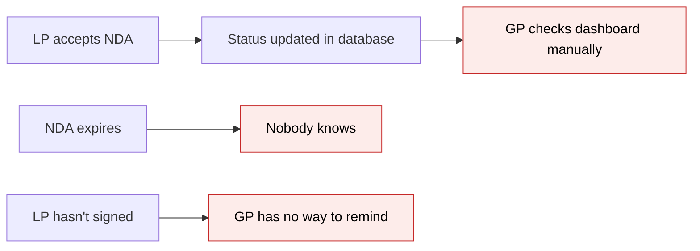
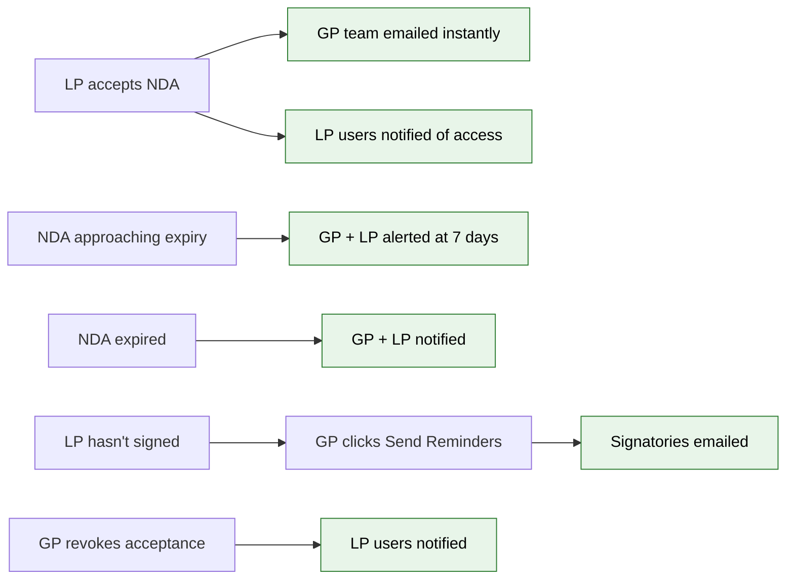

# NDA Module 8 — Notifications & Reminders — Proposal

> **Audience:** Business team, product, QA, support — non-technical.
> **Companion document:** [Design](design.md)

> **Planning phase — no code changes.** This document proposes and explains the change. Do not
> edit application code while writing it; implementation happens later, in the tasks phase.

---

## Why

Every NDA module built so far (Modules 1–5) defers email delivery to "Module 8 — Notifications." Today, when an LP accepts or declines an NDA, nobody is notified — the GP must manually check the NDA Status Dashboard to discover what happened, and the LP's colleagues have no idea their team's NDA was signed. NDAs can also expire silently, leaving both GP and LP unaware until someone tries to access the folder. Module 8 closes this gap with automated event notifications, scheduled expiry alerts, and GP-triggered reminders.

## What Changes

- **GP team receives instant email notifications** when an LP accepts, declines, or has their NDA expire — sent to the email addresses the GP configured in NDA Settings ("Notification Recipients")
- **LP users receive acceptance confirmations** — when one user signs the NDA on behalf of their investor, all other users of that investor with entity access are notified that they now have folder access
- **LP users receive expiry warnings** — NDA signatories are alerted 7 days before their acceptance expires, and again when it expires
- **GP can send bulk reminders** to pending investors — a "Send Reminders" button on the NDA Status Dashboard sends emails to NDA signatories of investors who haven't yet accepted
- **GP can revoke an accepted NDA** — a new "Revoke" button on the dashboard resets an investor's status with an optional reason, creating a full audit trail
- **LP users are notified on revocation** — when GP revokes, the investor's users learn they've lost access
- **LP users are notified on new NDA version** — when GP uploads a new NDA PDF (version bump), previously-accepted investors are told to re-sign

### Flow Diagram

**Before — no notifications in the NDA lifecycle:**



**After — automated notifications across the NDA lifecycle:**



---

## User Stories

### US-1: GP receives accept/decline notifications

**As a** GP team member,
**I want** to receive an email when an LP accepts or declines the NDA,
**So that** I can stay informed about investor NDA status without checking the dashboard.

**Acceptance criteria:**
- When an LP accepts an NDA, all email addresses in the NDA config's "Notification Recipients" field receive an email
- When an LP declines an NDA, the same recipients receive a decline notification email
- The email includes: investor name, folder name, NDA version, date/time, and who signed (for accept) or declined
- Emails are sent in the background (not blocking the LP's acceptance flow)

### US-2: LP users receive acceptance confirmation

**As an** LP user whose investor's NDA was accepted by a colleague,
**I want** to receive an email confirming that the NDA has been accepted,
**So that** I know I now have access to the Data Room folder.

**Acceptance criteria:**
- When User A accepts the NDA on behalf of Investor X, all other users of Investor X with entity access (via InvestorAccess) receive a confirmation email
- The signing user (User A) does not receive this notification (they already know)
- The email includes: folder name, who signed, date/time, and a link to the Data Room folder
- If the investor has no other users with entity access, no confirmation emails are sent

### US-3: GP receives expiry alerts

**As a** GP team member,
**I want** to be alerted when an NDA acceptance is approaching expiry or has expired,
**So that** I can proactively manage re-signing.

**Acceptance criteria:**
- A daily background job checks all NDA acceptances with time-based validity (fixed_period or specific_date)
- 7 days before an acceptance expires, the GP's notification recipients receive an "approaching expiry" email
- On the day an acceptance expires, the GP's notification recipients receive an "expired" email
- Each alert is sent only once per investor per expiry event (no duplicate emails on subsequent daily runs)
- NDAs with "until_revoked" validity are never checked for expiry

### US-4: LP signatories receive expiry alerts

**As an** NDA signatory for my investor,
**I want** to be alerted when our NDA acceptance is approaching expiry,
**So that** I can re-sign before losing access.

**Acceptance criteria:**
- 7 days before expiry, the investor's NDA signatories receive an "approaching expiry" email
- On expiry, the investor's NDA signatories receive an "expired" email with instructions to re-accept
- Only designated NDA signatories receive these alerts, not all users of the investor
- The email includes a link back to the Data Room folder where they can re-accept

### US-5: GP sends bulk reminders to pending investors

**As a** GP managing a Data Room folder,
**I want** to send NDA reminders to investors who haven't responded yet,
**So that** I can prompt them to sign without contacting each one manually.

**Acceptance criteria:**
- A "Send Reminders" button is visible on the NDA Status Dashboard page
- Clicking it shows a confirmation dialog: "Send NDA reminders to X pending investors (Y NDA-tagged users)?"
- On confirm, reminder emails are sent to NDA signatories of investors with "Pending" status only
- The reminder email directs the user back to the Data Room folder to review and accept the NDA
- After sending, a success flash message is shown: "Reminders sent to X users"
- If no investors are in Pending status, the button is disabled or a message "No pending investors to remind" is shown

### US-6: GP revokes an accepted NDA

**As a** GP managing NDA status,
**I want** to revoke an investor's accepted NDA,
**So that** they must re-accept the NDA before accessing the folder again.

**Acceptance criteria:**
- A "Revoke" button/action appears next to each investor with "Accepted" status on the NDA Status Dashboard
- Clicking it shows a confirmation dialog with an optional reason text field: "Revoke NDA acceptance for [Investor Name]?"
- On confirm, the investor's status changes to "Pending" (they must re-accept)
- A new NdaAcceptance audit row is created with status "revoked," recording the GP user, timestamp, and optional reason
- The revocation reason is visible in the NDA Status Dashboard and included in the export
- LP users of the revoked investor receive a notification that their access has been revoked

### US-7: LP users notified on NDA version change

**As an** LP user whose investor previously accepted the NDA,
**I want** to be notified when the NDA is updated to a new version requiring re-acceptance,
**So that** I know I need to re-sign to maintain access.

**Acceptance criteria:**
- When the GP uploads a new NDA PDF (which auto-increments the version), all users of previously-accepted investors receive a notification
- The email includes: folder name, old version number, new version number, and a link to re-accept
- Only investors whose acceptance is now stale (accepted an older version) receive this notification
- Exempt investors do not receive version change notifications

---

## UI Behavior

### NDA Status Dashboard — Revoke Action

```
+---------------------------------------------------------------------+
|  NDA Status — Financials                                            |
|                                                                     |
|  [Filter: Status v]  [Search...]  [Export]  [Send Reminders]        |
|                                                                     |
|  Investor     | Status   | Signed By | Date       | Actions         |
|  -------------|----------|-----------|------------|-----------------|
|  Acme Capital | Accepted | John D.   | 2 Oct 2026 | [Revoke]        |
|  Beta Fund    | Pending  | —         | —          | —               |
|  Gamma LLC    | Exempt   | —         | —          | —               |
|  Delta Inc    | Declined | Jane S.   | 3 Oct 2026 | —               |
|  Epsilon LP   | Revoked  | —         | 5 Oct 2026 | —               |
+---------------------------------------------------------------------+
```

**Behavior notes:**
- "Revoke" button appears only for investors with "Accepted" status
- "Send Reminders" button targets investors with "Pending" status only
- "Revoked" is a new visible status in the dashboard (distinct from Pending)
- After revocation, the investor must re-accept to return to "Accepted"

### Revoke Confirmation Dialog

```
+-------------------------------------------+
|  Revoke NDA Acceptance                  ✕  |
|                                            |
|  Are you sure you want to revoke the NDA   |
|  acceptance for Acme Capital?              |
|                                            |
|  All users will lose access to this folder |
|  until the NDA is re-accepted.             |
|                                            |
|  Reason (optional):                        |
|  [________________________________]        |
|                                            |
|  [Cancel]              [Revoke Access]     |
+-------------------------------------------+
```

### Send Reminders Confirmation Dialog

```
+-------------------------------------------+
|  Send NDA Reminders                     ✕  |
|                                            |
|  Send NDA reminders to 3 pending           |
|  investors (5 NDA-tagged users)?           |
|                                            |
|  [Cancel]              [Send Reminders]    |
+-------------------------------------------+
```

---

## What This Feature Does NOT Cover

| Excluded | Covered In |
|---|---|
| Per-event-type notification toggles (e.g. "only notify me on accept, not decline") | Future enhancement |
| In-app bell notifications for NDA events | Future enhancement — currently email only |
| WhatsApp delivery of NDA notifications | Future enhancement — infrastructure supports it via BaseNotifier |
| Customizable email templates for NDA notifications (via CustomNotification) | Future enhancement |
| NDA e-sign flow (Zoho Sign) | Module 6 |
| DocShare NDA gate | Module 7 |
| NDA inheritance logic | Module 5 |

---

## Validation Rules

| Field | Rule | Default |
|---|---|---|
| notification_emails (on NdaConfig) | Comma-separated valid email addresses, stored as JSON array | Empty (no notifications sent) |
| reason (on NdaAcceptance, for revocation) | Free text, nullable | NULL |
| NdaAcceptance.status | Must be one of: accepted, declined, revoked | — |

---

## Behavior Rules

| Scenario | What User Sees |
|---|---|
| LP accepts NDA and NdaConfig has notification_emails | GP team receives accept notification email |
| LP accepts NDA and NdaConfig has no notification_emails | No GP notification sent; LP confirmation still sent to investor's other users |
| LP accepts NDA but investor has only one user | No LP confirmation email sent (the signer already knows) |
| GP clicks "Send Reminders" with no pending investors | Button disabled or message "No pending investors to remind" |
| GP clicks "Send Reminders" but pending investor has no NDA signatories | No reminder sent for that investor; other pending investors with signatories still receive reminders |
| NDA with "until_revoked" validity | Never triggers expiry alerts |
| NDA with "fixed_period" validity | Expiry calculated per acceptance: created_at + validity_days |
| NDA with "specific_date" validity | Expiry is the same date for all acceptances |
| Expiry alert already sent for this investor/date | Not sent again (idempotent) |
| GP revokes accepted investor | Investor status becomes "Revoked" on dashboard; LP users notified; investor must re-accept |
| GP revokes investor that is already Pending/Declined | Revoke action not available (button hidden) |
| Exempt investor | Never receives reminders, expiry alerts, or version change notifications |
| GP uploads new NDA PDF (version bump) | Previously-accepted investors notified to re-sign |
| GP uploads new NDA PDF but no investors have accepted yet | No version change notifications sent |

---

## Resolved Design Decisions

| # | Decision | Resolution |
|---|---|---|
| 1 | notification_emails format | Keep as free-text comma-separated email input (existing Module 1 design). No per-event toggles. All NDA events for the folder go to these addresses. |
| 2 | LP acceptance confirmation recipients | All InvestorAccess users of that investor for the entity (not just the signer). The signer is excluded. |
| 3 | Expiry alert recipients (LP side) | NDA signatories only — they are the ones who can act on re-signing. Other LP users will see the NDA screen when they visit the folder. |
| 4 | Reminder recipients | NDA signatories of investors with "Pending" status only. Declined investors are not reminded (they made an active choice). |
| 5 | Expiry alert window | 7 days before expiry only. No 30-day pre-warning. |
| 6 | Revocation — new status vs reset | Add "revoked" as a third status in NdaAcceptance to maintain full audit trail. Append-only model preserved. |
| 7 | Revocation reason | Nullable "reason" text column on NdaAcceptance. Only meaningful for "revoked" status. |
| 8 | Where revocation feature lives | Revocation is a Module 3 (GP Dashboard) extension, built in the Module 8 branch alongside notifications. |
| 9 | Version change notification trigger | Hooks into Module 4's existing version bump (NdaConfig before_save callback). Module 8 adds the notification trigger. |
| 10 | Decline notification to LP users | Decline notifications go to GP team only. LP users of the declining investor are NOT notified (avoids alarm — another signatory could still accept). |

---

## Capabilities

### New Capabilities

- `nda/notifications`: NDA lifecycle event notifications — 8 email types covering accept, decline, revoke, version change, expiry approaching, expired, acceptance confirmation, and manual reminders
- `nda/revocation`: GP ability to revoke an investor's accepted NDA from the Status Dashboard with optional reason, creating an audit trail and resetting the investor's access

### Modified Capabilities

<!-- No existing specs are being modified — NDA capabilities are all new. -->

---

## Impact

- **NDA Status Dashboard** — gains a "Revoke" action per accepted investor, a "Send Reminders" button, and displays "Revoked" as a new status
- **NDA acceptance flow** — triggers notification emails after accept/decline (no change to the acceptance UI itself)
- **NDA Settings** — notification_emails field already exists; no changes needed
- **Background jobs** — new daily cron job for expiry checking added to Sidekiq schedule
- **Email delivery** — new NDA mailer with 8 email templates, delivered via the existing Noticed notification system
- **Database** — new "reason" column on nda_acceptances; new NdaExpiryReminder table for expiry alert idempotency

---

## Benefits

1. **GP stays informed automatically** — no more manual dashboard checks to discover accept/decline/expiry events
2. **LP users know when access is unlocked** — acceptance confirmations tell the whole investor team they can now access the Data Room
3. **Proactive expiry management** — 7-day advance warning prevents surprise access loss for both GP and LP
4. **Efficient follow-up** — bulk reminders save the GP from manually contacting each pending investor
5. **Full audit trail** — revocations are recorded with who, when, and why — critical for compliance
6. **Consistent NDA lifecycle** — every NDA event (setup, accept, decline, revoke, version, expire, remind) now has a corresponding notification

---

## FAQ

| Question | Answer |
|---|---|
| Who receives NDA event notifications? | The email addresses the GP entered in "Notification Recipients" when setting up the NDA. These are typically the GP's own team members (ops, legal, compliance). |
| Can the GP choose which events to be notified about? | Not in this version. All NDA events for that folder go to the configured recipients. Per-event toggles are a future enhancement. |
| Do LP users receive accept/decline notifications? | LP users of the same investor receive a confirmation when the NDA is accepted (so they know they have access). They do NOT receive decline notifications. |
| What happens when the GP clicks "Send Reminders"? | A confirmation dialog shows how many investors and users will be contacted. On confirm, emails are sent to NDA signatories of pending investors in the background. |
| Can reminders be sent to declined investors? | No — reminders target Pending investors only. A declined investor made an active choice. |
| How does revocation work? | The GP clicks "Revoke" next to an accepted investor, optionally enters a reason, and confirms. The investor's status changes to Revoked, and their users are notified. The investor must re-accept the NDA to regain access. |
| Is the revocation reason required? | No, it's optional. But when provided, it appears in the dashboard and export for compliance records. |
| How often does the expiry check run? | Once daily via a scheduled background job. It sends alerts for acceptances expiring within 7 days and for those that have already expired. |
| Will the same expiry alert be sent twice? | No. Each alert is tracked and sent only once per investor per expiry event. See design.md for the idempotency mechanism. |
| Does this affect existing NDA acceptance or configuration flows? | No. The acceptance UI, NDA settings form, and dashboard are unchanged except for the new "Revoke" button and "Revoked" status display. |

---

## Design Principle for the Next Phase

The design must reuse the existing `BaseNotifier` and `ApplicationMailer` infrastructure rather than inventing a parallel notification system. The `notification_emails` field on NdaConfig is free-text external emails (not system Users), which creates a dual-path delivery challenge: Noticed delivers to Users, but these external addresses need direct email. The design should solve this cleanly — likely by treating the NDA config creator as the Noticed recipient and external emails as CCs, following the `DocumentNotifier` pattern. The expiry idempotency model should follow the `ObligationReminder` pattern rather than building a new deduplication mechanism.
