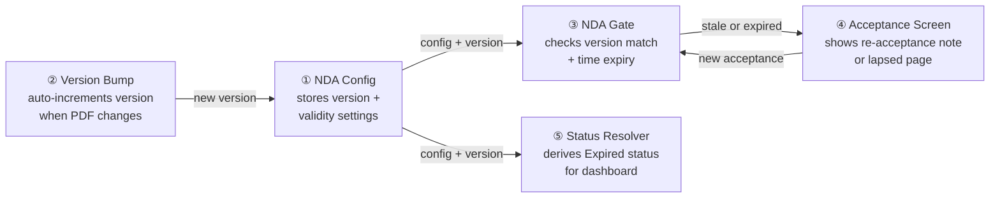
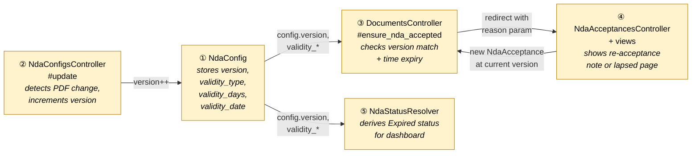
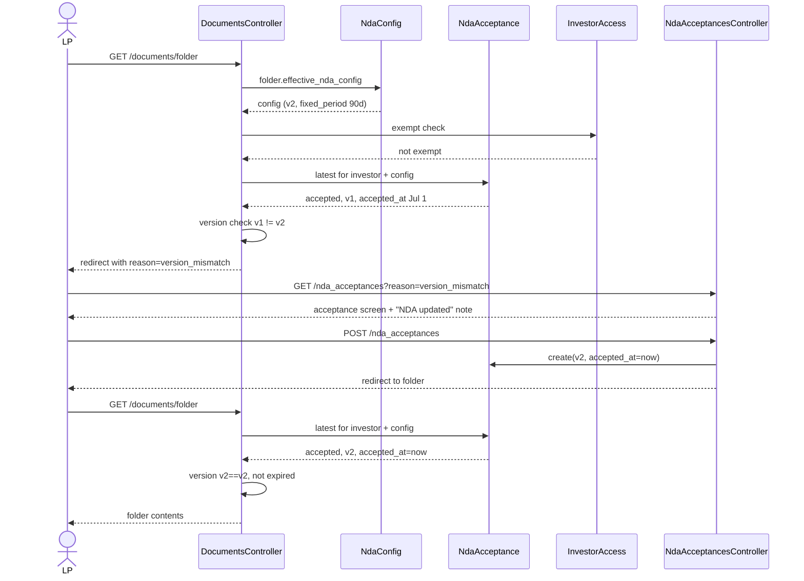
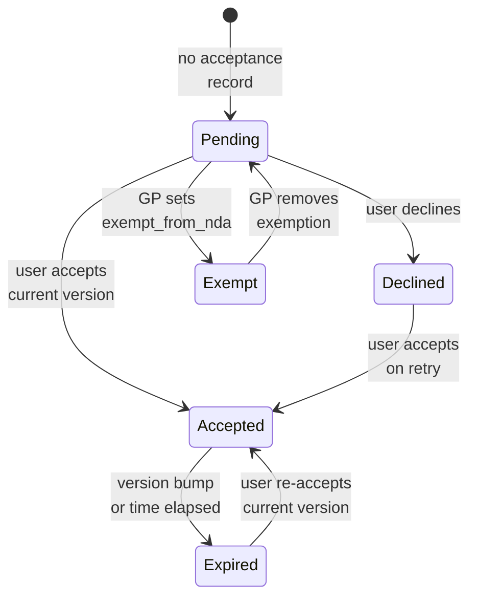
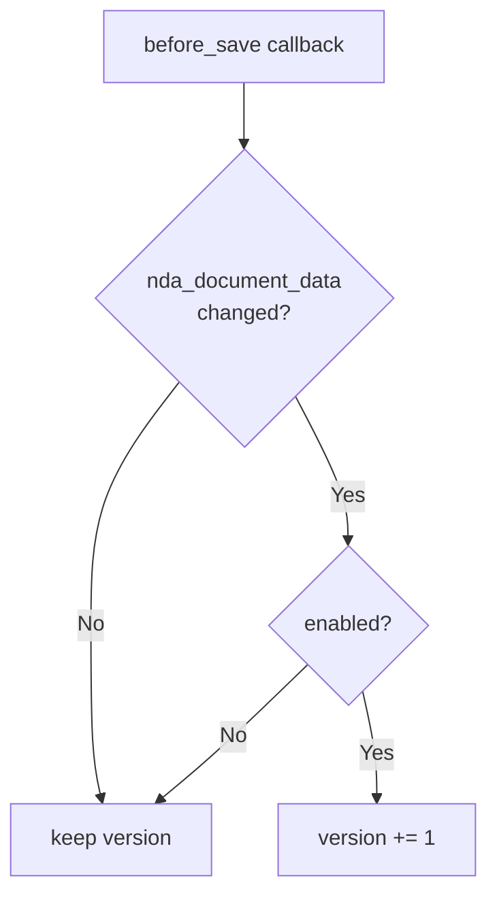
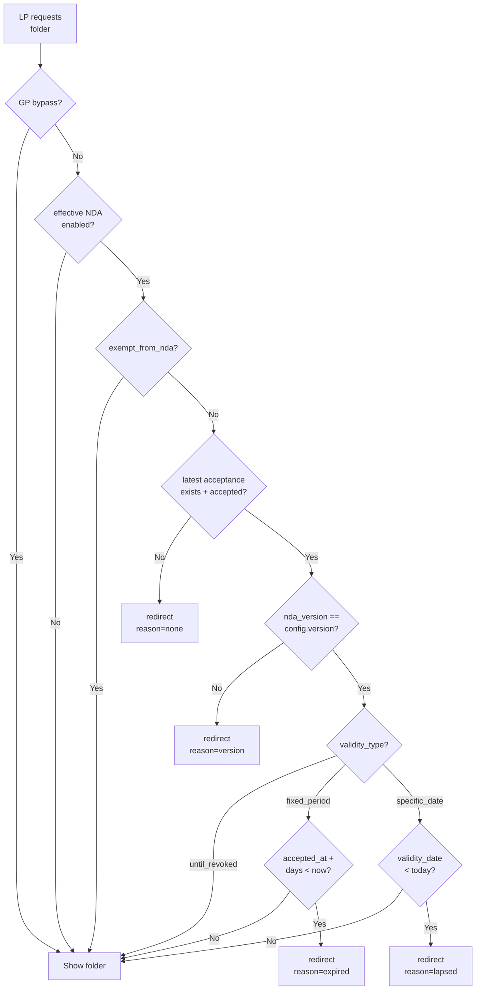
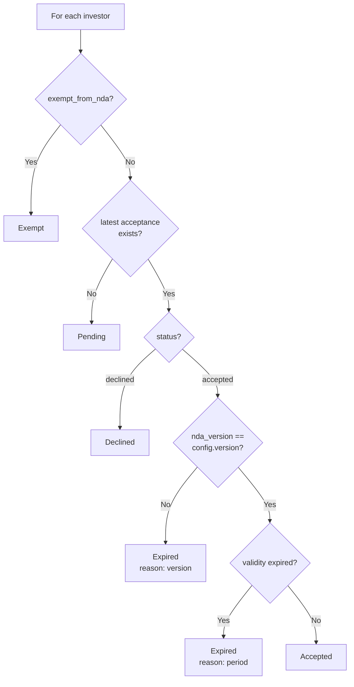
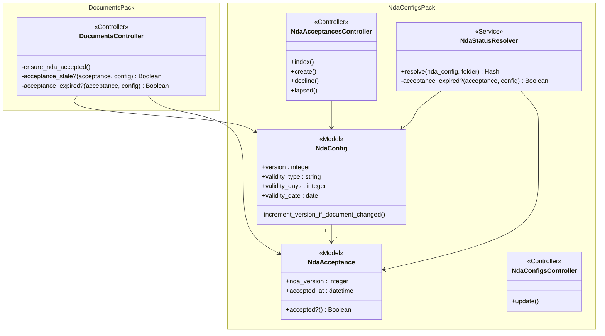

# NDA Module 4: Expiry Logic, Version Management & Re-acceptance — Design

> **Audience:** The engineering team implementing this feature.
> **Companion documents:** [Proposal](proposal.md) · [Spec](specs/) · [Tasks](tasks.md)

> **Planning phase — no code changes.** This document explains how to implement the feature.
> Implementation happens in the tasks phase.

> **Design, not code.** Explain the design with mermaid diagrams and tables. Do NOT paste Ruby/JS
> class bodies, migrations, route blocks or policy code. Put real class, method, table and path
> names inside the diagrams and tables instead.

---

## Contents

- [1. The idea](#1-the-idea)
  - [What this adds](#what-this-adds)
  - [The idea in one picture](#the-idea-in-one-picture)
  - [Walkthrough: one example, start to finish](#walkthrough-one-example-start-to-finish)
  - [Key ideas](#key-ideas)
- [2. The same picture with real names](#2-the-same-picture-with-real-names)
  - [Picture](#picture)
  - [What each box does](#what-each-box-does)
  - [One run, end to end](#one-run-end-to-end)
  - [Lifecycles](#lifecycles)
  - [What users see](#what-users-see)
  - [Design decisions](#design-decisions)
- [3. One card per box](#3-one-card-per-box)
  - [① NDA Config](#①-nda-config)
  - [② Version Bump](#②-version-bump)
  - [③ NDA Gate](#③-nda-gate)
  - [④ Acceptance Screen](#④-acceptance-screen)
  - [⑤ Status Resolver](#⑤-status-resolver)
- [4. Reference](#4-reference)
  - [Class diagram](#class-diagram)
  - [Data model and schema changes](#data-model-and-schema-changes)
  - [Component contracts](#component-contracts)
  - [Cross-cutting concerns](#cross-cutting-concerns)
  - [Worked examples](#worked-examples)
  - [Testing](#testing)
  - [Risks and open questions](#risks-and-open-questions)

---

## 1. The idea

### What this adds

Adds version-based and time-based expiry checks to the existing NDA acceptance gate, following the same `before_action` pattern in `DocumentsController`. When a GP uploads a new NDA PDF, the NDA config's `version` auto-increments, making all existing acceptances stale. When the configured validity period elapses, acceptances become expired. Both triggers redirect the LP to the existing acceptance screen with a contextual note explaining why they must re-sign.

### The idea in one picture



### Walkthrough: one example, start to finish

**Setup:** Alpha Ventures (GP) has folder "Deal Pipeline" with NDA-A, version 1, validity = fixed_period 90 days. Acme Capital (LP) accepted NDA-A v1 on July 1, 2026. Today is October 6, 2026 (98 days later).

**Legend:** ✓ = done, ● = current (waiting on this), ○ = not started.

| # | When | What happens | Behind the scenes | Result |
|---|---|---|---|---|
| 1 | Oct 6 | Acme's user visits Deal Pipeline | The gate (③) finds latest acceptance (v1, Jul 1). Checks version: v1 == v1 ✓. Checks expiry: Jul 1 + 90 days = Sep 29 < Oct 6 — expired. | ● LP sees NDA screen<br/>with "expired" note |
| 2 | Oct 6 | Acme's user accepts NDA-A | The acceptance screen (④) creates new NdaAcceptance: version=1, accepted_at=Oct 6. Gate rechecks: version match ✓, expiry Oct 6 + 90 = Jan 4 — valid. | ✓ Folder contents visible<br/>✓ New expiry: Jan 4 |
| 3 | Oct 10 | GP uploads new NDA PDF | The version bump (②) increments NDA-A from v1 to v2. GP sees warning: "1 accepted investor will need to re-accept." | ✓ NDA-A now version 2<br/>● Acme's v1 acceptance is stale |
| 4 | Oct 12 | Acme's user visits Deal Pipeline | The gate (③) finds latest acceptance (v1, Oct 6). Checks version: v1 != v2 — stale. | ● LP sees NDA screen<br/>with "updated" note |
| 5 | Oct 12 | Acme's user accepts NDA-A v2 | New NdaAcceptance: version=2, accepted_at=Oct 12. Gate: v2 == v2 ✓, Oct 12 + 90 = Jan 10 — valid. | ✓ Folder contents visible<br/>✓ New expiry: Jan 10 |
| 6 | Oct 12 | GP checks dashboard | The status resolver (⑤) sees Acme's latest acceptance is v2, not expired. | ✓ Acme status: Accepted |

```
What the LP sees at step 1:
+-------------------------------------------------------+
|  Non-Disclosure Agreement                             |
|  Entity: Alpha Ventures  |  Folder: Deal Pipeline     |
|                                                       |
|  +--------------------------------------------------+|
|  |  Your NDA acceptance has expired.                 ||
|  |  Please review and re-accept.                     ||
|  +--------------------------------------------------+|
|                                                       |
|  << NDA PDF document >>                               |
+-------------------------------------------------------+
```

**What to notice:**
- Re-acceptance resets the 90-day clock — Acme's new expiry is Jan 4, not Sep 29.
- Version bump at step 3 immediately makes the Oct 6 acceptance stale, even though it hadn't expired yet by time.
- The gate checks version first, then time — the first failure determines the redirect reason.
- No migrations, no new tables, no jobs — everything is synchronous read-time logic.

### Key ideas

| # | Idea | In one line | Card |
|---|---|---|---|
| 1 | Version tracks NDA content | Auto-increments on PDF upload, not on settings changes | [②](#②-version-bump) |
| 2 | Two expiry modes | fixed_period is per-acceptance; specific_date is per-NDA | [③](#③-nda-gate) |
| 3 | Lapsed NDA dead-end | specific_date past = no re-sign, contact GP | [④](#④-acceptance-screen) |
| 4 | Expired is a derived status | Read-time derivation like all other NDA statuses | [⑤](#⑤-status-resolver) |
| 5 | Re-acceptance resets the clock | New accepted_at becomes the new expiry baseline | [③](#③-nda-gate) |

**FAQ**

| Question | Answer |
|---|---|
| Why not a background job to mark acceptances as expired? | Expiry is a function of time — checking at gate time is always fresh. A job would need to run frequently and still leave a window where state is stale. |
| Why not a separate "Expired" and "Version Outdated" status? | The LP doesn't care about the distinction. The GP sees the reason in a tooltip. One status keeps the dashboard simpler. |

---

## 2. The same picture with real names

### Picture



Colour = footprint: **amber** modified. No new files, no reused-unchanged files.
Exact files are in [lld.md File Map](lld.md#file-map).

### What each box does

| # | Box | Real parts | What it does | When it runs | What it decides | Details |
|---|---|---|---|---|---|---|
| ① | NDA Config | `NdaConfig` model + `increment_version_if_document_changed` callback | Stores version and validity settings; auto-increments version when PDF changes | On save (before_save) | Whether the document changed (triggers version bump) | [card ①](#①-nda-config) |
| ② | Version Bump | `NdaConfigsController#update` + `_form.html.erb` | Detects new PDF upload, shows warning with accepted count, saves with version++ | GP saves NDA settings with new PDF | Whether to show the version warning | [card ②](#②-version-bump) |
| ③ | NDA Gate | `DocumentsController#ensure_nda_accepted` | Checks version match and time expiry after existing acceptance check | LP requests folder (before_action) | Whether acceptance is stale (version or time) and redirect reason | [card ③](#③-nda-gate) |
| ④ | Acceptance Screen | `NdaAcceptancesController` + `index.html.erb` + `lapsed.html.erb` | Renders re-acceptance note or lapsed NDA page | LP redirected by gate | Whether to show acceptance screen (re-sign) or lapsed page (dead-end) | [card ④](#④-acceptance-screen) |
| ⑤ | Status Resolver | `NdaStatusResolver` + dashboard views | Derives "Expired" status with reason for dashboard counters and table | GP views dashboard | Whether an acceptance is expired (version or time) | [card ⑤](#⑤-status-resolver) |

### One run, end to end



### Lifecycles

Investor NDA status is derived at read time (not stored). Module 4 adds the "Expired" state:



All states are derived from: `InvestorAccess.exempt_from_nda` (Exempt), `NdaAcceptance.status` (Accepted/Declined/Pending), `NdaAcceptance.nda_version` vs `NdaConfig.version` (version mismatch → Expired), `NdaAcceptance.accepted_at` vs validity settings (time expiry → Expired). No stored status column.

### What users see

**At a glance:**

| Where in CapHive | Today | After this change | Who sees it |
|---|---|---|---|
| NDA acceptance screen | No contextual note | Note banner for version update or expiry | LP users re-accepting |
| NDA acceptance gate | Checks acceptance exists + accepted | Also checks version match + time expiry | LP users visiting NDA folders |
| NDA lapsed page | Does not exist | Dead-end page for specific-date expired NDAs | LP users hitting lapsed NDA |
| NDA Settings modal | No version display, no warning | Shows version number + warning on PDF replacement | GP admins |
| NDA Status Dashboard | 4 statuses (Accepted, Pending, Declined, Exempt) | 5 statuses (+ Expired with reason) | GP admins |

**Main journey — LP re-accepts after version bump:**

```
NDA Acceptance Screen (re-acceptance)
+-------------------------------------------------------+
|  ① [Logo]                     [Back to Data Rooms]     |
|-------------------------------------------------------|
|  ② Non-Disclosure Agreement                           |
|  Entity: Alpha Ventures  |  Folder: Deal Pipeline      |
|                                                       |
|  ③ +--------------------------------------------------+
|     |  The NDA has been updated since you last signed. |
|     |  Please review and accept the new version.       |
|     +--------------------------------------------------+
|                                                       |
|  ④ << NDA PDF document >>                              |
|                                                       |
|  ⑤ [ ] I have read and agree to the terms...          |
|                                                       |
|  ⑥ [    Accept    ]           [ Decline ]              |
+-------------------------------------------------------+
```

| Step | The user... | They see |
|---|---|---|
| 1 | Navigates to an NDA-protected folder | Redirected to this screen instead of folder |
| 2 | Sees the context | ② title, entity, folder name |
| 3 | Reads the note | ③ "NDA has been updated" or "acceptance has expired" |
| 4 | Reviews the NDA | ④ PDF rendered inline |
| 5 | Checks the checkbox | ⑤ enables the Accept button |
| 6 | Clicks Accept | ⑥ redirected to the folder — contents now visible |

### Design decisions

1. **Version increments only on PDF change, not settings changes** — The version tracks NDA content (what the LP signs), not operational settings (validity, method, emails). Alternative: increment on any change. Rejected because: changing the validity period shouldn't force all investors to re-sign — the terms they agreed to haven't changed.

2. **Auto-increment, not manual publish** — Uploading a new PDF is the version bump. Alternative: separate "Publish New Version" button. Rejected because: the GP is intentionally replacing the document — an extra click adds friction without value.

3. **Single "Expired" status, not "Version Outdated" + "Time Expired"** — One status with a reason indicator. Alternative: two separate statuses. Rejected because: the LP flow is identical for both (re-accept), and splitting the status makes dashboard counters and filters more complex for no user benefit.

4. **Lapsed NDA dead-end for specific_date** — When `validity_date < today`, show a contact-GP page instead of the acceptance screen. Alternative: let LPs re-accept anyway. Rejected because: re-acceptance would create a record that is immediately expired again (the config's date hasn't changed), creating an infinite loop.

5. **Reason passed as query param, not derived client-side** — The gate passes `reason=version_mismatch` or `reason=expired` as a query param to the acceptance screen. Alternative: the acceptance screen queries for the latest acceptance and derives the reason. Rejected because: the gate already knows the reason, passing it is simpler and avoids a redundant query.

6. **Confirmation is a warning banner, not a blocking dialog** — The version bump warning appears in the form as an info banner, not as a separate confirmation modal. Alternative: JavaScript confirm dialog. Rejected because: a banner is consistent with the existing form patterns and doesn't require JS.

**FAQ**

| Question | Answer |
|---|---|
| Why not cache the accepted investor count for the warning? | The count is fetched with a single query on modal load. NDA settings is a low-frequency GP action — no caching needed. |
| What if the GP wants to upload a new PDF without bumping the version? | Not supported. The version is a legal audit trail — if the document changed, the version must reflect it. If the GP wants to upload a corrected PDF without re-acceptance, they should use a separate process. |

---

## 3. One card per box

### ① NDA Config

The NDA config model stores the version counter and validity settings. Module 4 adds a `before_save` callback that auto-increments `version` when the NDA document data changes.

| Owns | Reads / receives | Produces |
|---|---|---|
| `version` integer, `validity_type`, `validity_days`, `validity_date` | `nda_document_data` (Shrine) — detects change | Updated version number |

**Version increment logic:**



The `nda_document_data_changed?` check uses ActiveRecord's dirty tracking (Shrine stores JSON in a text column, so any document replacement changes the column value). Version only increments when the config is enabled — uploading a PDF on a disabled config doesn't bump version since the NDA isn't active.

**Worked examples:** H3, H7, E5, E7, E8

**FAQ**

| Question | Answer |
|---|---|
| Does version ever reset to 1? | No. Version is monotonically increasing. Even if the GP uploads the same PDF again, version increments. |
| What about soft-deleted configs? | Soft-deleted configs are invisible to the gate. If a config is restored, its version is whatever it was when deleted. |

### ② Version Bump

The NDA settings controller update action and form. Module 4 adds: version number display in the form, a warning banner when a new PDF is selected, and the accepted investor count for the warning text.

| Owns | Reads / receives | Produces |
|---|---|---|
| Version warning UI, accepted count query | `NdaConfig.version`, `NdaAcceptance` count | Updated config (version auto-incremented by model callback) |

**Warning display logic:**

The form shows the current version number ("Version 1") next to the current PDF filename. When a new PDF is selected via Uppy, a Stimulus action on `nda_settings_controller.js` shows a warning banner. The accepted investor count is pre-loaded into a data attribute on the form, fetched by the controller at render time.

**Routes:** No new routes. Existing `PATCH /folders/:folder_id/nda_config` handles the update with version auto-increment.

**Worked examples:** H3, H7, E5

**FAQ**

| Question | Answer |
|---|---|
| How does the warning know the accepted count? | The controller queries `NdaAcceptance` when rendering the edit form and passes the count as a data attribute. The Stimulus controller reads it to build the warning text. |
| What if the GP cancels after seeing the warning? | The warning is informational. The GP can remove the new file selection (revert to existing PDF) and the warning disappears. Version only bumps on save. |

### ③ NDA Gate

The existing `DocumentsController#ensure_nda_accepted` `before_action`. Module 4 adds two checks after the existing "is accepted?" check: version match and time expiry.

| Owns | Reads / receives | Produces |
|---|---|---|
| Version check, time expiry check, reason determination | `NdaConfig` (version, validity_*), `NdaAcceptance` (nda_version, accepted_at) | Redirect with `reason` param or pass-through |

**Enhanced gate decision flow:**



**Specific-date expiry is checked against the NDA config's date, not the acceptance.** When `validity_date < Date.current`, the gate redirects with `reason=lapsed`. The acceptance screen sees `reason=lapsed` and renders the dead-end page instead of the re-acceptance form.

**Worked examples:** H1, H2, H4, H5, H6, E1, E2, E3, E4, E6, E9, E10, X1

**FAQ**

| Question | Answer |
|---|---|
| Why check version before time expiry? | If both triggers are active, version mismatch is more actionable — the LP needs to read the new document. Time expiry after a version bump is moot because re-acceptance resets the clock anyway. |
| Does the gate add queries? | No new queries. The existing gate already fetches the latest NdaAcceptance and NdaConfig. The version and time checks compare columns already loaded. |
| What about inherited NDAs? | The gate uses `effective_nda_config` which resolves inheritance. The version and expiry checks apply to whichever config the folder inherits. |

### ④ Acceptance Screen

The existing NDA acceptance controller and views. Module 4 adds: a `reason` query param read from the redirect, a contextual note rendered in the acceptance screen view, and a new `lapsed.html.erb` view for the dead-end page.

| Owns | Reads / receives | Produces |
|---|---|---|
| Re-acceptance note rendering, lapsed NDA page | `reason` param from gate redirect, `NdaConfig` (validity_date, contact_email) | Rendered page (acceptance or lapsed) |

**Reason-to-view mapping:**

| reason param | What renders |
|---|---|
| (absent or none) | Standard acceptance screen, no note |
| `version_mismatch` | Acceptance screen + "NDA has been updated" note |
| `expired` | Acceptance screen + "acceptance has expired" note |
| `lapsed` | Lapsed NDA page (new `lapsed.html.erb`) — no Accept/Decline buttons |

**Lapsed NDA page:** Uses the same minimal layout as the decline page. Shows folder name, expiry date, contact email (if configured), and a "Back to Data Rooms" link. No form, no buttons.

**Routes:** No new routes for the acceptance screen — the existing `GET /nda_acceptances` now reads the `reason` param. For the lapsed page, the gate redirects to a new `GET /nda_acceptances/lapsed` route on `NdaAcceptancesController#lapsed`.

**Worked examples:** H1, H2, H4, H5, H6, E4

**FAQ**

| Question | Answer |
|---|---|
| Why a separate lapsed action instead of a conditional in index? | The lapsed page has no form, no checkbox, no Accept/Decline. Mixing it into the index action would add conditionals to both the controller and the view. A separate action is cleaner. |
| Can the LP bookmark the acceptance URL and bypass the reason? | Yes, but it doesn't matter. If they reach the acceptance screen without a reason param, no note is shown (first-time behavior). They can still accept, and the gate will validate the new acceptance on their next folder visit. |

### ⑤ Status Resolver

The existing `NdaStatusResolver` service. Module 4 modifies the status derivation to add "Expired" and passes the NDA config's version and validity settings into the derivation.

| Owns | Reads / receives | Produces |
|---|---|---|
| "Expired" status derivation with reason | `NdaConfig` (version, validity_*), `NdaAcceptance` (nda_version, accepted_at) | Status data with expired counters + reason |

**Enhanced status derivation:**



**Changes to `compute_counters`:** Adds `:expired` key to the counters hash. The dashboard views read this new counter for the "Expired" badge.

**Changes to `build_investor_rows`:** Each investor row gains an `:expiry_reason` field (`nil`, `"version"`, or `"period"`) for the dashboard reason indicator.

**Worked examples:** H8, H9, E6, E8, E10

**FAQ**

| Question | Answer |
|---|---|
| Does the resolver need the NDA config passed in? | It already receives it via `initialize(nda_config, folder)`. The version and validity settings are already accessible. |
| What about specific_date expiry on the dashboard? | If `validity_date < today`, ALL non-exempt accepted investors show as Expired with reason "period". This is correct — they would all be blocked by the gate. |

---

## 4. Reference

### Class diagram



### Data model and schema changes

N/A — No new tables or columns. All required columns exist:
- `nda_configs.version` (integer, default 1) — created in Module 1
- `nda_configs.validity_type`, `validity_days`, `validity_date` — created in Module 1
- `nda_acceptances.nda_version` (integer, default 1) — created in Module 2
- `nda_acceptances.accepted_at` (datetime) — created in Module 2

### Component contracts

| From → To | Contract | Direction rule |
|---|---|---|
| ② NdaConfigsController → ① NdaConfig | `update(nda_config_params)` triggers `before_save :increment_version_if_document_changed` | Controller writes via model |
| ③ DocumentsController → ① NdaConfig | `folder.effective_nda_config` returns config with `version`, `validity_type`, `validity_days`, `validity_date` | Gate reads, never writes |
| ③ DocumentsController → NdaAcceptance | Latest acceptance by `[nda_config_id, investor_id]` — reads `nda_version`, `accepted_at` | Gate reads, never writes |
| ③ DocumentsController → ④ NdaAcceptancesController | Redirect with `reason` query param (`version_mismatch`, `expired`, `lapsed`) | HTTP redirect |
| ④ NdaAcceptancesController → NdaAcceptance | Creates new acceptance at `nda_config.version` with current `accepted_at` | Controller writes via model |
| ⑤ NdaStatusResolver → ① NdaConfig | Reads `version`, `validity_type`, `validity_days`, `validity_date` from `@nda_config` | Service reads, never writes |
| ⑤ NdaStatusResolver → NdaAcceptance | Latest acceptance per investor — reads `nda_version`, `accepted_at` | Service reads, never writes |

### Cross-cutting concerns

#### Transactions and queries

| What is read | When | N+1 risk | How it stays cheap |
|---|---|---|---|
| NdaConfig version + validity fields | Gate check (every LP folder request) | No — already loaded by `effective_nda_config` | Memoized on Folder instance |
| NdaAcceptance.nda_version + accepted_at | Gate check | No — already loaded (latest acceptance query) | Single indexed query, already exists |
| NdaAcceptance count for version warning | NDA Settings modal edit | No — single count query | `NdaAcceptance.where(nda_config_id:, status: "accepted").where("nda_version = ?", config.version).select(:investor_id).distinct.count` |

No new queries in the gate hot path. The version and expiry checks use columns already fetched.

#### Performance and security

- **Performance:** Zero additional queries in the gate. The version and time checks are in-memory comparisons on already-loaded records. The NDA Settings modal adds one count query for the warning — low-frequency GP action.
- **Tenant isolation:** No change. The gate already scopes by `nda_config.entity_id` and `InvestorAccess.entity_id`.
- **Reason param sanitization:** The `reason` param is validated against a whitelist (`version_mismatch`, `expired`, `lapsed`). Any other value is treated as no reason (first-time acceptance).

### Worked examples

**ID legend:** **H** = Happy path · **E** = Edge case · **X** = Error (exception) case.

**Shared setup:**

| Record | Name | Key data |
|---|---|---|
| Entity | Alpha Ventures | id=100, enable_data_rooms=true |
| Folder | Deal Pipeline | id=11, entity_id=100, NDA-A (enabled, click_through, fixed_period 90 days, version=1) |
| Folder | Legal Docs | id=12, entity_id=100, NDA-B (enabled, click_through, specific_date 2026-12-31, version=1) |
| Folder | Evergreen | id=13, entity_id=100, NDA-C (enabled, click_through, until_revoked, version=1) |
| Investor | Acme Capital | LP, InvestorAccess approved. User Alice. |
| Investor | Beta Holdings | LP, InvestorAccess approved, exempt_from_nda=true. User Frank. |
| Investor | Gamma Fund | LP, InvestorAccess approved. User Gina. No acceptance for any NDA. |
| NdaAcceptance | Acme-NDA-A | investor=Acme, nda_config=NDA-A, nda_version=1, status=accepted, accepted_at=2026-07-01 |
| NdaAcceptance | Acme-NDA-B | investor=Acme, nda_config=NDA-B, nda_version=1, status=accepted, accepted_at=2026-10-01 |
| NdaAcceptance | Acme-NDA-C | investor=Acme, nda_config=NDA-C, nda_version=1, status=accepted, accepted_at=2025-01-01 |

#### Happy Path

| # | Scenario | Given | When | Then | Spec scenario | Feature |
|---|---|---|---|---|---|---|
| H1 | LP sees acceptance screen after fixed-period expiry | Acme accepted NDA-A v1 on Jul 1 (98 days ago, > 90d) | Alice visits Deal Pipeline on Oct 6 | NDA acceptance screen with "acceptance expired" note | Fixed-period acceptance expired | nda_expiry.feature |
| H2 | LP re-accepts after fixed-period expiry | H1 setup, Alice on acceptance screen | Alice accepts NDA-A | New acceptance: v1, accepted_at=Oct 6. Folder contents shown. New expiry: Jan 4. | Re-acceptance after fixed-period expiry resets clock | nda_expiry.feature |
| H3 | GP uploads new PDF, version bumps | NDA-A at v1, Acme accepted v1 | GP uploads new PDF and saves | NDA-A version becomes 2. Warning showed "1 accepted investor will need to re-accept." | New PDF upload increments version | nda_expiry.feature |
| H4 | LP sees acceptance screen after version bump | NDA-A at v2, Acme accepted v1 | Alice visits Deal Pipeline | NDA acceptance screen with "NDA updated" note | Acceptance at old version is rejected by gate | nda_expiry.feature |
| H5 | LP re-accepts after version bump | H4 setup, Alice on acceptance screen | Alice accepts NDA-A | New acceptance: v2, accepted_at=now. Folder contents shown. | Re-acceptance after version bump | nda_expiry.feature |
| H6 | LP accesses folder with valid acceptance | Acme accepted NDA-C v1 (until_revoked, 21 months ago) | Alice visits Evergreen | Folder contents shown immediately | Until-revoked acceptance never expires | nda_expiry.feature |
| H7 | GP sees warning with accepted count | NDA-A v1, Acme accepted | GP opens NDA Settings, selects new PDF | Warning: "1 accepted investor will need to re-accept." | Warning shown when new PDF selected | nda_expiry.feature |
| H8 | Dashboard shows Expired status for version mismatch | NDA-A v2, Acme accepted v1 | GP views dashboard | Acme status: Expired, reason: Version | Expired investor shown on dashboard | nda_expiry.feature |
| H9 | Dashboard shows Expired status for time expiry | NDA-A v1 fixed_period 90d, Acme accepted Jul 1 (98d ago) | GP views dashboard | Acme status: Expired, reason: Period | Dashboard counters include Expired | nda_expiry.feature |

#### Edge Cases

| # | Scenario | Given | When | Then | Spec scenario | Feature |
|---|---|---|---|---|---|---|
| E1 | Specific-date NDA not yet expired | Acme accepted NDA-B v1, validity_date=2026-12-31, today=Oct 6 | Alice visits Legal Docs | Folder contents shown | Specific-date not yet reached | nda_expiry.feature |
| E2 | Specific-date NDA lapsed — dead-end page | NDA-B validity_date=2026-12-31, today=2027-01-01 | Alice visits Legal Docs | Lapsed NDA page: "expired on 31 December 2026, contact fund manager" | Specific-date has passed — lapsed NDA | nda_expiry.feature |
| E3 | Exempt investor after version bump | NDA-A v2, Beta exempt | Frank visits Deal Pipeline | Folder contents shown (exempt bypasses version check) | Exempt investor after version bump | nda_expiry.feature |
| E4 | Lapsed NDA page shows contact email | NDA-B lapsed, contact_email=legal@alpha.com | Alice visits Legal Docs | Lapsed page shows "Questions? Contact: legal@alpha.com" | Lapsed NDA page content | nda_expiry.feature |
| E5 | Settings change without new PDF does not bump version | NDA-A v1 | GP changes validity from 90d to 180d, saves (no new PDF) | NDA-A version remains 1 | Settings change without new PDF does not increment version | nda_expiry.feature |
| E6 | Pending investor unaffected by version bump | Gamma has no acceptance, NDA-A v1 | GP uploads new PDF (NDA-A becomes v2) | Gamma status: Pending (unchanged) | Pending investor after version bump | nda_expiry.feature |
| E7 | Version bump on disabled config | NDA-A disabled, v1 | GP uploads new PDF and saves | Version stays 1 (no bump when disabled) | Version only bumps when enabled | nda_expiry.feature |
| E8 | Validity change applies retroactively | NDA-A until_revoked, Acme accepted 100d ago | GP changes to fixed_period 90d | Acme's acceptance is now expired (100 > 90). Dashboard: Expired. | Validity change retroactive | nda_expiry.feature |
| E9 | Version AND time expiry both apply | NDA-A v2 fixed_period 90d, Acme accepted v1 95d ago | Alice visits Deal Pipeline | Gate: version fails first → reason=version_mismatch (version checked before time) | Version check before time | nda_expiry.feature |
| E10 | Exempt investor after time expiry | NDA-A fixed_period 90d, Beta exempt, accepted 100d ago | Frank visits Deal Pipeline | Folder contents shown (exempt bypasses all checks) | Exempt investor after fixed-period expiry | nda_expiry.feature |
| E11 | Lapsed NDA without contact email | NDA-B lapsed, no contact_email | Alice visits Legal Docs | Lapsed page shows no contact email line | Lapsed NDA page without contact email | nda_expiry.feature |
| E12 | No warning when no accepted investors | NDA-A v1, no acceptances | GP selects new PDF | No warning banner shown | No warning when no accepted investors | nda_expiry.feature |
| E13 | Re-uploading same filename bumps version | NDA-A v1, existing PDF "NDA.pdf" | GP uploads new file also named "NDA.pdf" | Version becomes 2 | Re-uploading same filename still increments version | nda_expiry.feature |

#### Error Cases

| # | Scenario | Given | When | Then (what the user sees, who is alerted) | Spec scenario | Feature |
|---|---|---|---|---|---|---|
| X1 | Invalid reason param ignored | LP accesses acceptance screen with reason=malicious | Acceptance screen renders | No note shown (treated as first-time). No error. | First-time acceptance has no note | nda_expiry.feature |

### Testing

Cucumber only. Single feature file `features/core/nda_expiry.feature`, tagged `@nda`. Shared setup reuses existing step files: `nda_config_steps.rb` (entity, folder, NDA config), `nda_acceptance_steps.rb` (acceptance records), `investor_access_steps.rb` (InvestorAccess). New step definitions added to existing `nda_acceptance_steps.rb` for version bump, expiry, re-acceptance note, and lapsed page verification.

### Risks and open questions

- [Risk] Retroactive validity change (E8) may surprise GPs — changing from "until revoked" to "90 days" immediately expires old acceptances → Mitigation: the Settings modal already exists; GPs make this change intentionally. Module 8 (Notifications) will eventually alert affected investors.
- [Risk] `nda_document_data_changed?` may false-positive on Shrine metadata updates (e.g. promotion) → Mitigation: Shrine promotion happens asynchronously and doesn't go through the controller update path. Only controller-initiated saves trigger the callback.

| # | Open question | Current thinking | Status |
|---|---|---|---|
| — | All questions resolved during exploration | — | **Resolved** |

**FAQ**

| Question | Answer |
|---|---|
| Where do I start reviewing? | Start with the gate (③) — it's the core logic. Then version bump (②), then status resolver (⑤). The acceptance screen (④) and config model (①) are straightforward. |
| How many files change? | Approximately 8 files: NdaConfig model, NdaConfigsController, DocumentsController, NdaAcceptancesController, NdaStatusResolver, acceptance index view, NDA config form partial, one new lapsed view, and Stimulus controller. No migrations. |
