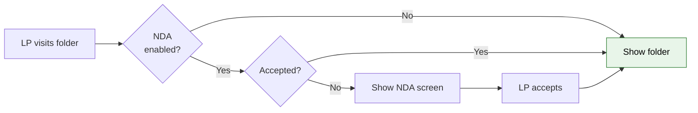
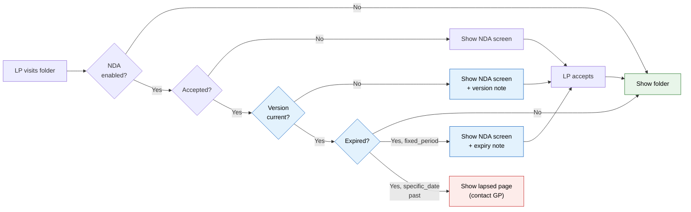

# NDA Module 4: Expiry Logic, Version Management & Re-acceptance — Proposal

> **Audience:** Business team, product, QA, support — non-technical.
> **Companion document:** [Design](design.md)

> **Planning phase — no code changes.** This document proposes and explains the change. Do not
> edit application code while writing it; implementation happens later, in the tasks phase.

---

## Why

Today, once an LP accepts an NDA, that acceptance is permanent — there is no way for it to expire
or become invalid when the NDA document changes. GPs configure validity settings (fixed period,
specific date) on the NDA, but those settings have no effect on existing acceptances. GPs also
cannot update the NDA document and require all investors to re-sign the new version. This means
GPs have no way to enforce annual NDA renewals or to ensure investors have agreed to updated NDA
terms after a legal revision.

---

## What Changes

- **NDA acceptances now expire.** When a GP configures a fixed-period validity (e.g. 90 days),
  each investor's acceptance expires 90 days after they signed. When a GP sets a specific expiry
  date, all acceptances expire on that date. "Until revoked" acceptances never expire (unchanged).

- **NDA version bumps on document replacement.** When a GP uploads a new NDA PDF document in the
  NDA Settings modal, the NDA version number increments automatically. All existing acceptances
  at the old version become stale — every investor must re-accept the new version.

- **GP sees a confirmation warning before version bump.** When the GP is about to replace the NDA
  document, a warning shows how many investors currently have valid acceptances and will need to
  re-sign.

- **LP sees a contextual note on re-acceptance.** When an LP is asked to re-accept (due to
  version update or expiry), a brief note at the top of the acceptance screen explains why they
  are seeing the NDA again.

- **Lapsed NDA blocks re-acceptance.** When a specific-date NDA has passed its expiry date and
  the GP has not extended it, LPs see a "this NDA has expired — contact the fund manager" page
  instead of the acceptance screen. This prevents an infinite re-sign loop.

- **Dashboard shows "Expired" status.** The GP Status Dashboard gains a fifth status —
  "Expired" — for investors whose acceptance is stale due to version mismatch or time expiry.
  The counter row adds an Expired badge.

### Flow Diagram

**Before — NDA gate (current):**



**After — NDA gate (Module 4):**



---

## User Stories

### US-1: GP updates NDA document and requires re-acceptance

**As a** fund manager (GP),
**I want** to upload a new version of the NDA document and have all previously accepted investors
required to re-sign,
**So that** all investors are always bound by the most current NDA terms.

**Acceptance criteria:**
- When I upload a new PDF in the NDA Settings modal, the version number increments
  automatically (e.g. from v1 to v2)
- Before saving, I see a warning: "Uploading a new document will require X accepted investors
  to re-accept the NDA. Continue?"
- After saving, the dashboard shows those investors as "Expired" (not "Accepted")
- Those investors see the NDA acceptance screen with a note: "The NDA has been updated. Please
  review and accept the new version."

### US-2: LP re-accepts after NDA document update

**As an** LP investor user,
**I want** to be told why I am seeing the NDA acceptance screen again,
**So that** I understand the NDA terms have changed and I need to review the new version.

**Acceptance criteria:**
- When I navigate to a folder whose NDA version has changed since I last accepted, I see the
  NDA acceptance screen
- A note at the top says: "The NDA has been updated since you last signed. Please review and
  accept the new version."
- After I accept, I can access the folder contents normally
- My new acceptance is recorded at the new NDA version

### US-3: LP re-accepts after fixed-period expiry

**As an** LP investor user,
**I want** to be prompted to re-accept the NDA when my previous acceptance has expired,
**So that** the fund manager's validity policy is enforced.

**Acceptance criteria:**
- When I navigate to a folder and my acceptance is older than the configured validity period
  (e.g. 90 days), I see the NDA acceptance screen
- A note at the top says: "Your NDA acceptance has expired. Please review and re-accept."
- After I accept, the validity period resets from today (not from the original acceptance date)
- My new acceptance replaces the old one as the "latest" for gate purposes

### US-4: LP sees lapsed NDA page when specific-date expiry has passed

**As an** LP investor user,
**I want** to see a clear message when the NDA itself has lapsed (specific date in the past),
**So that** I know I cannot re-sign until the fund manager extends or updates the NDA.

**Acceptance criteria:**
- When I navigate to a folder whose NDA has `validity_type = specific_date` and `validity_date`
  is in the past, I do NOT see the acceptance screen
- Instead I see a page saying: "This NDA has expired on [date]. Please contact the fund manager
  to request access."
- The page shows the GP's contact email if configured, plus a "Back to Data Rooms" link
- No Accept or Decline buttons are shown — I cannot re-sign a lapsed NDA

### US-5: GP views expired investors on the status dashboard

**As a** fund manager (GP),
**I want** to see which investors have expired NDA acceptances on the status dashboard,
**So that** I can track compliance and follow up as needed.

**Acceptance criteria:**
- The status dashboard counters show five statuses: Accepted, Pending, Declined, Expired, Exempt
- Investors whose latest acceptance is at an old NDA version show as "Expired"
- Investors whose latest acceptance has exceeded the validity period show as "Expired"
- The dashboard tooltip or detail on an "Expired" row indicates the reason (version mismatch
  or time expiry)
- Filtering by "Expired" shows only these investors

---

## UI Behavior

### NDA Settings Modal — Version Warning

```
NDA Settings — Deal Pipeline
+-------------------------------------------------------+
|  [Settings]  [Status]                             [x] |
|-------------------------------------------------------|
|                                                       |
|  Require NDA before access                            |
|  ○ No  ● Yes                                          |
|                                                       |
|  NDA Document (PDF)                                   |
|  Current: NDA_2026_v1.pdf (version 1)                 |
|  [Upload New NDA Document]                            |
|  New: NDA_2027_v2.pdf                                 |
|                                                       |
|  +--------------------------------------------------+|
|  |  WARNING: Uploading a new document will require   ||
|  |  12 accepted investors to re-accept the NDA.      ||
|  +--------------------------------------------------+|
|                                                       |
|  ... (validity, method, emails unchanged) ...         |
|                                                       |
|           [Cancel]           [Save Settings]          |
+-------------------------------------------------------+
```

**Behavior notes:**
- The warning appears only when a new PDF is selected while an existing one is already saved
- The accepted investor count is fetched from the current dashboard data
- If no investors have accepted yet, no warning is shown
- The version number displayed is read-only — it increments automatically on save

### NDA Acceptance Screen — Re-acceptance Note

```
NDA Acceptance Screen (re-acceptance variant)
+-------------------------------------------------------+
|  [Logo]                        [Back to Data Rooms]   |
|-------------------------------------------------------|
|                                                       |
|  Non-Disclosure Agreement                             |
|  Entity: Alpha Ventures  |  Folder: Deal Pipeline     |
|                                                       |
|  +--------------------------------------------------+|
|  |  The NDA has been updated since you last signed.  ||
|  |  Please review and accept the new version.        ||
|  +--------------------------------------------------+|
|                                                       |
|  << NDA PDF document >>                               |
|                                                       |
|  [ ] I have read and agree to the terms...            |
|                                                       |
|  [    Accept    ]           [ Decline ]               |
|                                                       |
|  Questions? Contact: legal@alpha.com                  |
+-------------------------------------------------------+
```

**Behavior notes:**
- The note text varies by reason:
  - Version mismatch: "The NDA has been updated since you last signed. Please review and accept
    the new version."
  - Fixed-period expiry: "Your NDA acceptance has expired. Please review and re-accept."
- The note is a simple alert/info banner above the PDF — not a blocking dialog
- The rest of the acceptance flow is identical to the first-time flow

### Lapsed NDA Page (specific-date expired)

```
NDA Expired (minimal layout)
+-------------------------------------------------------+
|  [Logo]                        [Back to Data Rooms]   |
|-------------------------------------------------------|
|                                                       |
|  This NDA Has Expired                                 |
|                                                       |
|  The Non-Disclosure Agreement for the folder           |
|  "Deal Pipeline" expired on 31 December 2026.         |
|                                                       |
|  You cannot access this folder's contents until        |
|  the fund manager extends or updates the NDA.          |
|                                                       |
|  Questions? Contact: legal@alpha.com                  |
|                                                       |
|  [  Back to Data Rooms  ]                             |
|                                                       |
+-------------------------------------------------------+
```

**Behavior notes:**
- This page is shown ONLY when `validity_type = specific_date` and `validity_date < today`
- No Accept or Decline buttons — the LP cannot act
- Uses the same minimal layout as the acceptance/decline screens
- Shows the contact email if configured on the NDA config

### Status Dashboard — Expired Status

```
+--------------------------------------------------------------+
|  NDA Status — Deal Pipeline                                  |
|  Accepted: 3  Pending: 1  Declined: 0  Expired: 2  Exempt: 1|
+--------------------------------------------------------------+
|  Investor        | Status   | Reason    | Signed By | Date   |
|  ----------------|----------|-----------|-----------|--------|
|  Acme Capital    | Accepted | —         | Alice     | Oct 3  |
|  Beta Holdings   | Expired  | Version   | Frank     | Sep 15 |
|  Gamma Fund      | Expired  | Period    | Gina      | Jul 1  |
|  Delta LP        | Exempt   | —         | —         | —      |
|  Epsilon Group   | Pending  | —         | —         | —      |
+--------------------------------------------------------------+
```

**Behavior notes:**
- "Expired" badge uses an amber/orange color (distinct from red "Declined")
- Reason column or tooltip shows "Version" (version mismatch) or "Period" (time expiry) for
  Expired rows
- Filtering by "Expired" is available alongside existing status filters
- Export XLSX includes the Expired status and reason

---

## What This Feature Does NOT Cover

| Excluded | Covered In |
|---|---|
| Email notifications for expiry events (to LP or GP) | Module 8 — Notifications |
| Bulk reminder emails to expired investors | Module 8 — Notifications |
| E-sign acceptance for re-acceptance flow | Module 6 — E-Sign |
| Automatic NDA version rollback or undo | Not planned |
| Per-investor validity period overrides | Not planned |
| DocShare NDA gate changes | Module 7 — DocShare Gate |

---

## Validation Rules

| Field | Rule | Default |
|---|---|---|
| NdaConfig.version | Integer, auto-incremented when NDA document is replaced. Read-only to GP. | 1 |
| NdaAcceptance.nda_version | Set to NdaConfig.version at time of acceptance. Immutable after creation. | 1 |
| NdaConfig.validity_date | Must be in the future when saving. Gate treats past date as "NDA lapsed". | nil |

---

## Behavior Rules

| Scenario | What User Sees |
|---|---|
| LP accepted v1, GP uploads new PDF (v2) | LP sees NDA acceptance screen with "NDA updated" note |
| LP accepted 91 days ago, config is fixed_period 90 days | LP sees NDA acceptance screen with "acceptance expired" note |
| LP re-accepts after expiry (fixed_period) | Validity clock resets from re-acceptance date |
| LP re-accepts after version bump | New acceptance recorded at new version |
| specific_date is 2026-12-31, today is 2027-01-01 | LP sees "NDA expired" lapsed page (no Accept button) |
| specific_date is 2026-12-31, today is 2026-12-30 | LP whose acceptance is current sees folder normally |
| GP uploads new PDF but doesn't change validity settings | Only version increments; validity settings unchanged |
| GP changes validity from until_revoked to fixed_period 90 days | No version bump. Existing acceptances now subject to time expiry from their original accepted_at |
| Exempt investor, NDA version bumped | Still exempt — exemption bypasses both version and expiry checks |
| Investor has no acceptance (Pending), NDA version bumped | Still Pending — version bump only affects accepted investors |

---

## Resolved Design Decisions

| # | Decision | Resolution |
|---|---|---|
| 1 | What triggers a version bump? | Only NDA document (PDF) replacement. Changing validity, acceptance method, contact email, or notification emails does NOT bump the version. The version tracks the NDA content/terms, not operational settings. |
| 2 | Is version bump automatic or manual? | Automatic on PDF replacement. No "Publish New Version" button — uploading a new PDF is the version bump. |
| 3 | Should the GP see a confirmation before version bump? | Yes. A warning banner in the modal shows the count of currently accepted investors who will need to re-sign. |
| 4 | Should the LP see why they are re-signing? | Yes. A brief contextual note at the top of the acceptance screen explains the reason (version update or expiry). |
| 5 | What happens when specific_date has passed? | The NDA is treated as "lapsed." LPs see a dead-end page directing them to contact the GP. No re-acceptance is possible until the GP updates the date or changes the validity type. This prevents an infinite re-sign loop. |
| 6 | Does re-acceptance reset the fixed_period clock? | Yes. The new acceptance's `accepted_at` becomes the new start date for the validity period. |
| 7 | Does changing validity settings (not the PDF) invalidate existing acceptances? | No. Only PDF replacement bumps the version. Changing from "until revoked" to "fixed period 90 days" applies the expiry check to existing acceptances retroactively from their `accepted_at`, but does not require re-acceptance on its own. |
| 8 | Is "Expired" a single dashboard status or split into "Version Expired" and "Time Expired"? | Single "Expired" status with a reason indicator (tooltip or sub-label). The LP doesn't care about the distinction; the GP sees the reason for operational follow-up. |

---

## Capabilities

### New Capabilities

- `nda-expiry-versioning`: Expiry enforcement, version management, re-acceptance gating, and
  lapsed NDA handling for NDA-protected Data Room folders.

### Modified Capabilities

- `nda-lp-acceptance` (change: `nda-data-room-module-2-lp-acceptance`): The NDA gate now checks
  version match and time expiry in addition to acceptance status. The acceptance screen gains a
  contextual re-acceptance note. A new "lapsed NDA" page is added for specific-date expiry.

- `nda-gp-status` (change: `nda-data-room-module-3-gp-dashboard`): The dashboard status
  derivation adds "Expired" as a fifth status covering both version mismatch and time expiry.
  Counters and filters gain the Expired badge. Export includes the Expired status and reason.

---

## Impact

- **NDA acceptance gate (Data Room folder access)** — Two new checks added to the existing
  gate: version match and time expiry. All LP users visiting NDA-protected folders are affected.
- **NDA Settings modal (GP admin)** — Version number display, document replacement warning,
  and auto-increment behavior added.
- **NDA acceptance screen (LP)** — Contextual re-acceptance note added. New lapsed NDA page
  added for specific-date expiry.
- **NDA Status Dashboard (GP admin)** — New "Expired" status in counters, filters, table rows,
  and XLSX export.
- **No database migrations** — All columns (`nda_configs.version`, `nda_acceptances.nda_version`,
  `validity_type`, `validity_days`, `validity_date`, `accepted_at`) already exist.
- **No new models, controllers, or jobs** — Changes are to existing files only.

---

## Benefits

1. **Compliance enforcement** — GPs can ensure investors always operate under the latest NDA
   terms by uploading an updated document and requiring re-acceptance.
2. **Time-based renewal** — GPs can enforce periodic NDA renewals (e.g. annually) without
   manual intervention, ensuring ongoing legal protection.
3. **Operational visibility** — The "Expired" status on the dashboard lets GPs immediately see
   which investors need to re-sign, enabling targeted follow-up.
4. **LP clarity** — Contextual notes on the acceptance screen prevent LP confusion ("I already
   signed this — why am I seeing it again?").
5. **Safety net for lapsed NDAs** — The specific-date lapsed page prevents the infinite
   re-acceptance loop and directs LPs to the right person.

---

## FAQ

| Question | Answer |
|---|---|
| Who can bump the NDA version? | Only GP admins who can manage the folder's NDA settings. The version bumps automatically when they upload a new PDF — there is no manual "bump version" action. |
| What happens to existing accepted investors when the GP uploads a new NDA document? | Their status changes from "Accepted" to "Expired" on the dashboard. The next time they visit the folder, they see the NDA acceptance screen with a note explaining the NDA was updated. |
| Does changing the validity period (e.g. from "until revoked" to "90 days") require everyone to re-sign? | No. Only uploading a new NDA document triggers re-acceptance. Changing validity settings applies the new expiry rules to existing acceptances retroactively. |
| What does "retroactively" mean for validity changes? | If an investor accepted 100 days ago and the GP changes validity to "90 days," that investor's acceptance is now expired (100 > 90). They will need to re-accept next time they visit the folder. |
| Do exempt investors need to re-accept after a version bump? | No. Exemption bypasses all NDA checks including version and expiry. |
| Will investors be notified when their NDA expires or a new version is uploaded? | Not in this module. Module 8 (Notifications) will add email alerts for expiry and version bump events. |
| Does this require any database changes? | No. All necessary columns were created in Module 1 (NdaConfig.version, validity fields) and Module 2 (NdaAcceptance.nda_version, accepted_at). |
| What happens if the GP sets a specific expiry date that is already past? | The NDA Settings modal validates that the specific date must be in the future. This validation already exists from Module 1. |

---

## Design Principle for the Next Phase

The gate enhancement adds two checks to an existing method — keep them as simple conditionals,
not a state machine or strategy pattern. The version bump is a `before_save` callback on
NdaConfig, not a service object — the logic is "if PDF changed, increment version." The
dashboard "Expired" status is derived at read time like all other statuses — no stored status
column, no background job to mark records as expired. The lapsed NDA page reuses the existing
minimal layout and follows the decline page pattern. Resist the urge to abstract — this module
touches many files but changes little in each.
