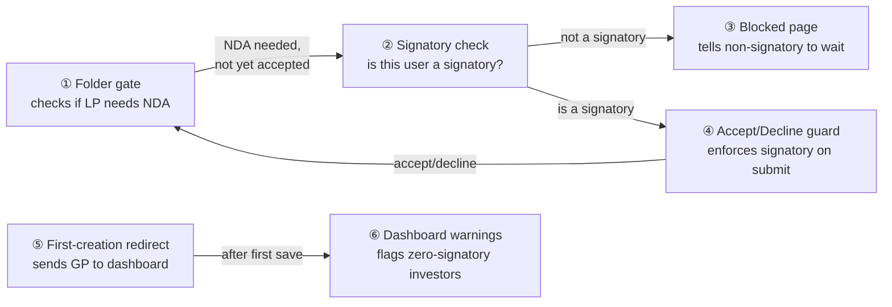
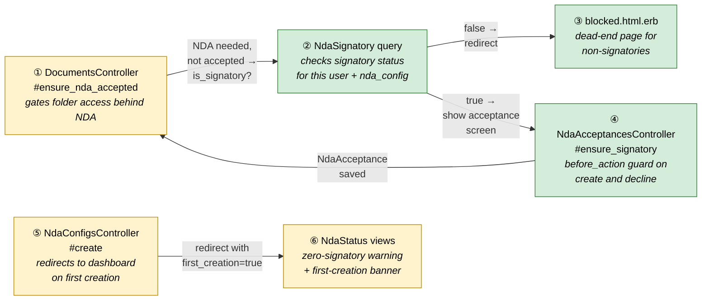
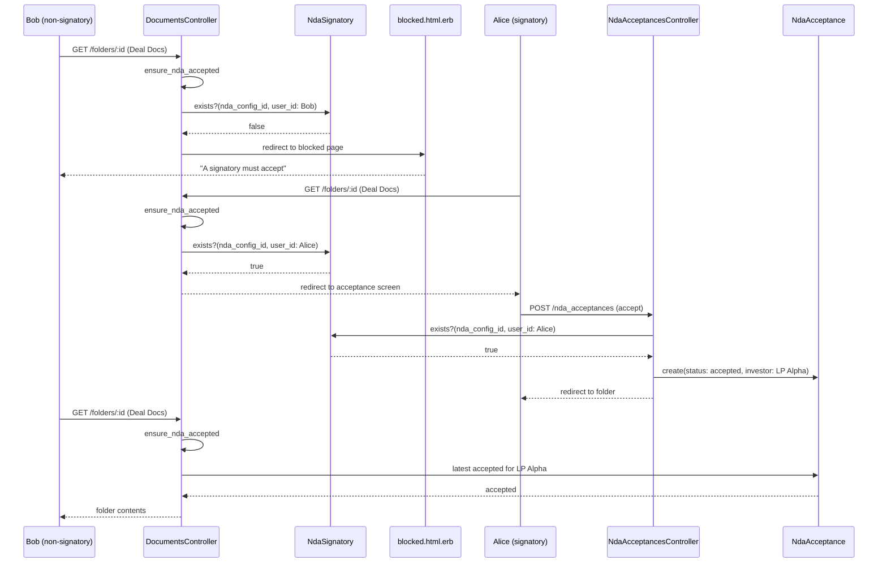
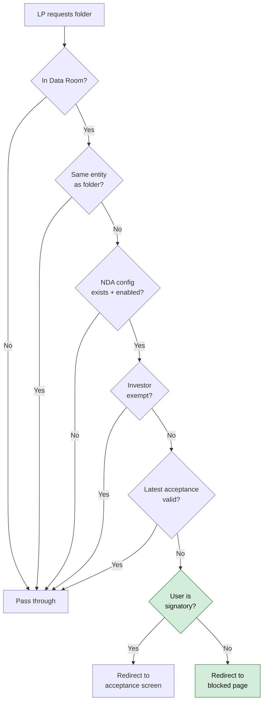
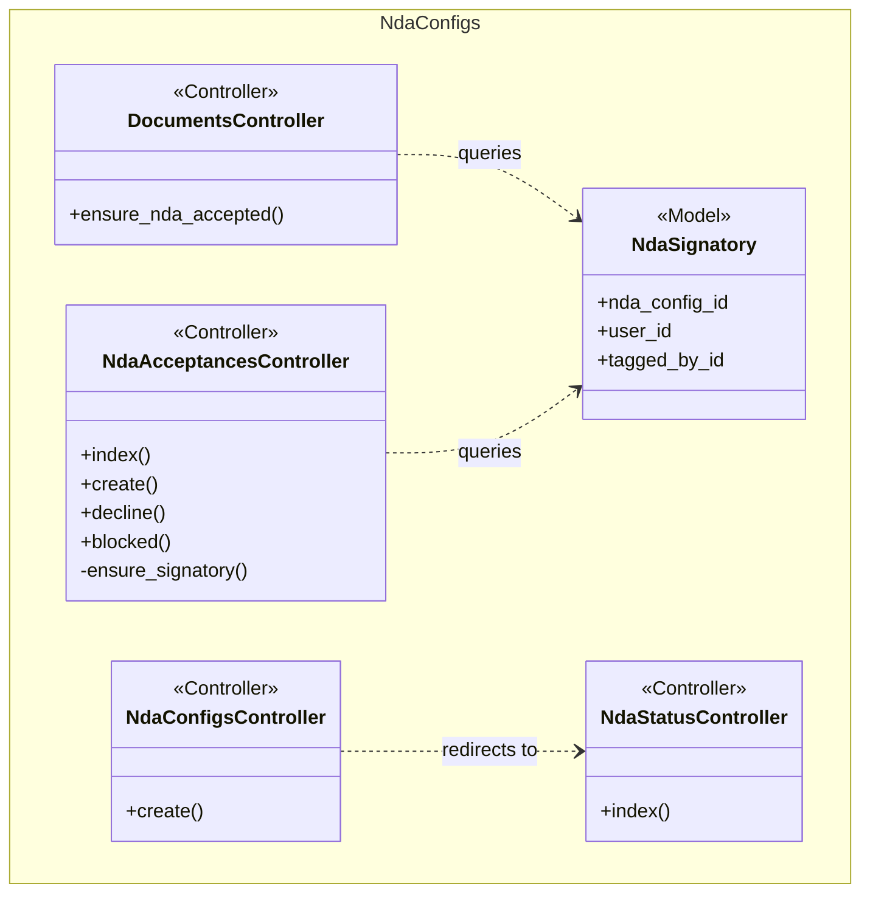

# NDA Module 9 — Signatory Gating & Enhancements — Design

> **Audience:** Engineering team.
> **Companion documents:** [Proposal](proposal.md) · [Spec](specs/)

> **Planning phase — no code changes.** This document explains HOW the proposal will be built.
> Do not edit application code while writing it; implementation happens later, in the tasks phase.

> **Design, not code.** Explain the design with mermaid diagrams and tables. Do NOT paste Ruby/JS
> class bodies, migrations, route blocks or policy code. Put real class, method, table and path
> names inside the diagrams and tables instead.

> **Zoom one picture.** The whole design hangs off ONE numbered picture. Part 1 draws it in plain
> words. Part 2 redraws the SAME picture, same shape and same numbers, with real names. Part 3 has
> one card per box, in the same order. Part 4 is reference material that spans several boxes. The
> numbers ①②③ mean the same box everywhere, so a reader always knows where they are.

> **FAQ per section.** Parts 1 and 2, every card in Part 3, and Part 4 each end with a FAQ table of
> the real "why", "why not X" and "what if" questions a reviewer will ask about that section.
> Answer from the design; no filler questions.

> **Scale to the change.** **CORE** sections are always present. **CONDITIONAL** sections say when
> they apply; otherwise keep the heading with `N/A — <reason>`. A small change has fewer boxes and
> shorter cards, not empty ones.

> **No repetition.** Each fact lives in one place. The proposal owns *what users see and the business
> rules*, the spec owns *requirements*, this document owns *how*. Cards link to Part 4 for shared
> tables (schema, class diagram) instead of copying them.

---

## Contents

- [1. The idea](#1-the-idea)
  - [What this adds](#what-this-adds)
  - [The idea in one picture](#the-idea-in-one-picture)
  - [Walkthrough: one example, start to finish](#walkthrough-one-example-start-to-finish)
  - [Key ideas](#key-ideas)
- [2. The same picture with real names](#2-the-same-picture-with-real-names)
  - [Picture](#picture)
  - [What each box does](#what-each-box-does)
  - [One run, end to end](#one-run-end-to-end)
  - [What users see](#what-users-see)
  - [Design decisions](#design-decisions)
- [3. One card per box](#3-one-card-per-box)
  - [① Folder gate](#①-folder-gate)
  - [② Signatory check](#②-signatory-check)
  - [③ Blocked page](#③-blocked-page)
  - [④ Accept/Decline guard](#④-acceptdecline-guard)
  - [⑤ First-creation redirect](#⑤-first-creation-redirect)
  - [⑥ Dashboard warnings](#⑥-dashboard-warnings)
- [4. Reference](#4-reference)
  - [Class diagram](#class-diagram)
  - [Data model and schema changes](#data-model-and-schema-changes)
  - [Component contracts](#component-contracts)
  - [Cross-cutting concerns](#cross-cutting-concerns)
  - [Worked examples](#worked-examples)
  - [Testing](#testing)
  - [Risks and open questions](#risks-and-open-questions)

---

## 1. The idea

### What this adds

This adds signatory enforcement to the NDA flow, following the existing pattern of `before_action` checks in controllers (like `ensure_nda_accepted` in `DocumentsController`). The `NdaSignatory` model and tagging UI already exist — this change wires the model into the acceptance gate and the accept/decline controller so only designated signatories can act, and guides the GP to tag signatories after the first NDA creation.

### The idea in one picture



### Walkthrough: one example, start to finish

**Setup:** Entity "Acme Fund" has a Data Room folder "Deal Docs" with NDA enabled (version 1, click-through, until-revoked). Investor "LP Alpha" has two users: Alice (signatory) and Bob (non-signatory). The GP (Grace) just created the NDA config for the first time.

**Legend:** ✓ = done · ● = current (waiting on this, not done yet) · ○ = not started

| # | When | What happens | Behind the scenes | Result&nbsp;&nbsp;&nbsp;&nbsp;&nbsp;&nbsp;&nbsp;&nbsp;&nbsp;&nbsp;&nbsp;&nbsp;&nbsp;&nbsp;&nbsp;&nbsp;&nbsp;&nbsp;&nbsp;&nbsp;&nbsp;&nbsp;&nbsp;&nbsp;&nbsp;&nbsp;&nbsp; |
|---|---|---|---|---|
| 1 | Grace saves first NDA | Modal submits, GP lands on dashboard | The first-creation redirect (⑤) detects this is a `create` action and redirects to the NDA Status Dashboard with `first_creation=true` | ✓&nbsp;NDA&nbsp;config&nbsp;saved<br/>●&nbsp;**Tag&nbsp;signatories** |
| 2 | Grace tags Alice | Grace clicks "Tag" next to Alice on the expanded investor row | Dashboard warnings (⑥) show ⚠ for LP Alpha until Alice is tagged. After tagging, the warning clears | ✓&nbsp;NDA&nbsp;config&nbsp;saved<br/>✓&nbsp;Alice&nbsp;tagged |
| 3 | Bob opens "Deal Docs" | Bob navigates to the NDA-protected folder | The folder gate (①) detects NDA not accepted. The signatory check (②) finds Bob is NOT a signatory. The blocked page (③) renders | Bob&nbsp;sees&nbsp;blocked&nbsp;page |
| 4 | Alice opens "Deal Docs" | Alice navigates to the same folder | The folder gate (①) detects NDA not accepted. The signatory check (②) finds Alice IS a signatory. Standard acceptance screen shown | Alice&nbsp;sees&nbsp;acceptance&nbsp;screen |
| 5 | Alice accepts | Alice checks the checkbox and clicks Accept | The accept/decline guard (④) verifies Alice is a signatory, creates NdaAcceptance, redirects to folder | ✓&nbsp;NDA&nbsp;accepted&nbsp;for&nbsp;LP&nbsp;Alpha |
| 6 | Bob opens "Deal Docs" again | Bob re-navigates to the folder | The folder gate (①) finds an accepted NdaAcceptance for LP Alpha. Folder opens | Bob&nbsp;sees&nbsp;folder&nbsp;contents |
| 7 | _(Mistake)_ Grace removes Alice's signatory tag, then bumps NDA version | Grace untags Alice, uploads new PDF | Version increments. Alice is no longer a signatory. LP Alpha's acceptance is now at old version | ●&nbsp;**No&nbsp;signatory&nbsp;for&nbsp;LP&nbsp;Alpha** |
| 8 | Alice opens "Deal Docs" | Alice navigates to folder, version mismatch detected | The folder gate (①) redirects for re-acceptance. The signatory check (②) finds Alice is NOT a signatory anymore. Blocked page shown | Alice&nbsp;sees&nbsp;blocked&nbsp;page |
| 9 | Grace re-tags Alice | Grace goes to dashboard, sees ⚠ for LP Alpha, tags Alice again | Dashboard warnings (⑥) clear. Alice can now re-accept | ✓&nbsp;Alice&nbsp;re-tagged |

```
┌─────────────────────────────────────────────────────┐
│  [Acme Fund Logo]              Back to Data Rooms ▸  │
│                                                      │
│  Non-Disclosure Agreement                            │
│  Acme Fund  |  Folder: Deal Docs                     │
│                                                      │
│  ┌─ alert-info ──────────────────────────────────┐   │
│  │ 🔒 NDA acceptance is pending. A designated    │   │
│  │    signatory for your organisation must accept │   │
│  │    the NDA before you can access this folder.  │   │
│  └───────────────────────────────────────────────┘   │
│                                                      │
│  Questions? Contact: nda@acmefund.com                │
│                                                      │
│  [ Back to Data Rooms ]                              │
└─────────────────────────────────────────────────────┘
```
_What Bob sees at step 3: the blocked page (③)._

**What to notice:**
- The signatory check (②) runs inside the existing folder gate (①) — no new before_action, just an additional branch
- Non-signatories are blocked before they ever see the acceptance screen — they cannot view the PDF
- First-creation redirect (⑤) is a one-time event on `create`, not on `update` — version bumps don't trigger it
- The same signatory check applies to re-acceptance scenarios (version mismatch, expiry, revocation)
- Dashboard warnings (⑥) give the GP immediate feedback when an investor has no signatories

### Key ideas

| # | Idea | In one line | Card |
|---|---|---|---|
| 1 | Signatory check inside the gate | A branch in the existing `ensure_nda_accepted` method, not a separate filter | [②](#②-signatory-check) |
| 2 | Controller-level guard on submit | `before_action` in `NdaAcceptancesController` prevents non-signatory form submission | [④](#④-acceptdecline-guard) |
| 3 | Blocked page as a dead-end view | New template following the declined/lapsed pattern, no buttons | [③](#③-blocked-page) |
| 4 | First-creation redirect | `NdaConfigsController#create` redirects to dashboard instead of turbo_stream on first save | [⑤](#⑤-first-creation-redirect) |
| 5 | Zero-signatory warning | `NdaStatusResolver` already computes signatory data — dashboard view adds a warning badge | [⑥](#⑥-dashboard-warnings) |

**FAQ**

| Question | Answer |
|---|---|
| Why not put the signatory check in `NdaAcceptancePolicy`? | Pundit policies answer "is this user allowed?" based on role/access. The signatory check is a business rule ("is this user designated?"), not an authorization rule. Mixing them would mean the policy needs to know about `NdaSignatory`, breaking the single-responsibility pattern used across all other policies. |
| Why not create a new `before_action` for signatory gating? | The gate already resolves the NDA config, investor IDs, and exemption status. Adding the signatory check there avoids duplicating those queries in a second filter. |

---

## 2. The same picture with real names

### Picture



Colour = footprint: **green** new, **amber** modified, **grey** reused unchanged. Exact files are in
[lld.md File Map](lld.md#file-map).

### What each box does

| # | Box | Real parts | What it does | When it runs | What it decides | Details |
|---|---|---|---|---|---|---|
| ① | Folder gate | `DocumentsController#ensure_nda_accepted` | Gates Data Room folder access behind NDA acceptance | Before `:folder` action, on every LP folder request | Whether to show folder, redirect to acceptance, or redirect to blocked page | [card ① →](#①-folder-gate) |
| ② | Signatory check | `NdaSignatory.exists?(nda_config_id:, user_id:)` query | Determines if the current LP user is a designated signatory for this NDA config | Called from within ① when NDA is not yet accepted / needs re-acceptance | Whether user sees acceptance screen or blocked page | [card ② →](#②-signatory-check) |
| ③ | Blocked page | `nda_acceptances/blocked.html.erb` | Dead-end view for non-signatories | When ② returns false | N/A — static view | [card ③ →](#③-blocked-page) |
| ④ | Accept/Decline guard | `NdaAcceptancesController#ensure_signatory` before_action | Prevents non-signatories from submitting accept/decline forms | Before `create` and `decline` actions | Whether to allow the form submission or redirect to blocked | [card ④ →](#④-acceptdecline-guard) |
| ⑤ | First-creation redirect | `NdaConfigsController#create` response branch | Redirects GP to NDA Status Dashboard after first NDA creation | After successful `NdaConfig.save` in `create` action only | Whether to respond with turbo_stream (update) or redirect (first create) | [card ⑤ →](#⑤-first-creation-redirect) |
| ⑥ | Dashboard warnings | `nda_status/index.html.erb`, `nda_status_controller.js` | Shows zero-signatory ⚠ icons and first-creation banner | On dashboard render | N/A — view-level conditional rendering | [card ⑥ →](#⑥-dashboard-warnings) |

### One run, end to end



### Lifecycles

N/A — no new stored or derived status. NDA acceptance lifecycle is unchanged from Module 2.

### What users see

**At a glance:**

| Where in CapHive | Today | After this change | Who sees it |
|---|---|---|---|
| NDA acceptance screen (PDF + buttons) | Any LP user with InvestorAccess | Only designated signatories | LP signatories |
| Blocked page | Does not exist | Non-signatories when NDA not accepted | LP non-signatories |
| NDA Status Dashboard | Shows investor/user rows with Tag/Untag | Adds ⚠ for zero-signatory investors + first-creation banner | GP |
| After first NDA creation | Modal closes, GP stays on Documents page | GP redirected to NDA Status Dashboard | GP |

**Main LP journey — non-signatory blocked, signatory accepts:**

```
Step 1: Bob clicks folder      Step 2: Bob sees blocked page     Step 3: Alice accepts
┌─────────────────────┐        ┌──────────────────────────┐      ┌─────────────────────┐
│ 📁 Deal Docs   🔒   │───────▶│ 🔒 NDA acceptance is    │      │ ☑ I have read...    │
│                     │        │    pending. A designated │      │ [Accept] [Decline]  │
│                     │        │    signatory must accept │      │                     │
│                     │        │ [ Back to Data Rooms ]   │      │ Alice clicks Accept │
└─────────────────────┘        └──────────────────────────┘      └─────────────────────┘
                                                                          │
Step 4: Bob clicks folder again ◀──────────── folder opens ◀──────────────┘
```

| Step | The user… | They see |
|---|---|---|
| 1 | Bob clicks "Deal Docs" in the folder tree | Folder gate runs, signatory check fails → blocked page |
| 2 | Bob reads the blocked message | Alert with lock icon, entity name, folder name, contact email, Back link |
| 3 | Alice clicks "Deal Docs" and accepts | Standard acceptance screen (PDF + buttons) → folder contents |
| 4 | Bob clicks "Deal Docs" again | Folder contents (acceptance exists for LP Alpha) |

### Design decisions

1. **Signatory check inside `ensure_nda_accepted`, not a separate `before_action`** — The gate already resolves investor IDs, exemption, and acceptance status. Adding the signatory branch there avoids a second query pass. Alternative: separate `before_action :ensure_signatory_or_accepted`. Rejected because it would duplicate the NDA config and investor resolution.

2. **New blocked view template, not conditional rendering in `index.html.erb`** — Clean separation: the acceptance screen has forms and JS behavior; the blocked page is static. Alternative: hide buttons with `if signatory?` in the existing template. Rejected because it would still serve the PDF iframe to non-signatories and increase template complexity.

3. **`before_action` guard on `NdaAcceptancesController`, not policy change** — The `NdaAcceptancePolicy` checks "is this an LP with access?" (role-based). Signatory status is a business designation, not a role. Alternative: add `signatory?` to the policy. Rejected because policies in this app are role-based, and mixing in business rules would set a precedent.

4. **First-creation detection by controller action, not model flag** — The `create` action fires once per NDA config lifetime (vs. `update` which fires on every edit). No migration needed. Alternative: add `first_created_at` column. Rejected because the controller action already distinguishes create from update.

5. **Dashboard redirect via `redirect_to` with query param, not turbo_stream** — First creation is a one-time event where a full page load to the dashboard is appropriate. The banner and auto-expand are driven by the `first_creation=true` query param read by the Stimulus controller. Alternative: turbo_stream append a banner. Rejected because the GP needs to land on the full dashboard, not stay in the modal.

**FAQ**

| Question | Answer |
|---|---|
| What about the `NdaAcceptancesController#index` action — should non-signatories be blocked there too? | Yes — the `ensure_signatory` before_action covers `index`, `create`, and `decline`. Non-signatories never see the acceptance screen even if they manually construct the URL. |
| Why redirect to blocked instead of raising Pundit::NotAuthorizedError? | The blocked page is informational ("someone else must sign"), not an access denial. A Pundit error would show a generic 403. The blocked page uses the same layout as declined/lapsed — entity logo, folder context, contact email. |
| What if the gate redirects to acceptance for a re-acceptance reason (version_mismatch, expired, revoked) but the user is not a signatory? | The signatory check runs before the redirect destination is determined. Non-signatories always get the blocked page, regardless of the re-acceptance reason. |

---

## 3. One card per box

> Same order and numbers as the picture.

### ① Folder gate

The existing `DocumentsController#ensure_nda_accepted` method. Modified to add a signatory branch: after confirming the NDA is not accepted (or needs re-acceptance), it checks whether the current user is a designated signatory before redirecting to the acceptance screen.

| Owns | Reads / receives | Produces |
|---|---|---|
| The NDA gate decision flow (accept/block/exempt) | `NdaConfig`, `InvestorAccess`, `NdaAcceptance`, `NdaSignatory` | Redirect to acceptance screen, blocked page, lapsed page, or pass-through |

**Decision flow (modified):**



The green nodes (signatory check + blocked redirect) are the new additions. Everything else is unchanged from Modules 1–8.

**Route for blocked page redirect:**

The gate redirects to a new route `GET /nda_acceptances/blocked` with the same query params as the acceptance screen (`nda_config_id`, `folder_id`).

**Worked examples:** H1, H2, E1, E2, E3, X1

**FAQ**

| Question | Answer |
|---|---|
| Does the signatory check add a DB query to every folder request? | Only when the NDA is not accepted and the user is not exempt — the existing early-returns (GP, no config, exempt, already accepted) all fire before the signatory check. |
| What about inherited NDA configs? | `effective_nda_config` already resolves inheritance. The signatory check uses whichever NdaConfig the gate resolves — it works identically for inherited and direct configs. |

### ② Signatory check

A single `NdaSignatory.exists?` query called from the folder gate (①) and the accept/decline guard (④). Not a separate class — just a query inlined at the two call sites.

| Owns | Reads / receives | Produces |
|---|---|---|
| Nothing (stateless query) | `nda_config_id`, `current_user.id` | Boolean: is this user a signatory? |

The query is `NdaSignatory.exists?(nda_config_id: nda_config.id, user_id: current_user.id)`. This hits the unique index `[nda_config_id, user_id]` on `nda_signatories` — single indexed lookup, negligible cost.

**Worked examples:** H1, H2, E1, E2, X1

**FAQ**

| Question | Answer |
|---|---|
| Should this be extracted to a helper method? | Not necessary — the query is a one-liner used in two places. If a third call site appears, extract to a private method on `ApplicationController` or a concern. |

### ③ Blocked page

A new view template `nda_acceptances/blocked.html.erb` that follows the same layout pattern as `declined.html.erb` and `lapsed.html.erb`: entity logo, title, folder context, message, contact email, and "Back to Data Rooms" link. No PDF iframe, no form, no buttons.

| Owns | Reads / receives | Produces |
|---|---|---|
| The blocked page markup | `@nda_config`, `@folder` | HTML rendered in `documents_frame` turbo-frame |

**Routes:**

| Verb and path | Action | Does | Responds with |
|---|---|---|---|
| `GET /nda_acceptances/blocked` | `NdaAcceptancesController#blocked` | Renders blocked page | HTML in `documents_frame` |

**Build notes:**
- Wrapped in `turbo_frame_tag "documents_frame"` like declined/lapsed
- Authorizes via `authorize @nda_acceptance, :show?` (same as `index`)
- Uses `layout "modernize"`
- No Stimulus controller needed — the page is static

**Worked examples:** H2, E2, E3

**FAQ**

| Question | Answer |
|---|---|
| Why a new action on `NdaAcceptancesController` instead of a standalone controller? | The blocked page shares the same `set_nda_config` and `set_folder` before_actions, the same layout, and the same `documents_frame` turbo-frame target. A separate controller would duplicate setup. |
| Why not render blocked inline from the gate without a redirect? | The gate is a before_action on `DocumentsController`. Rendering a view from a different controller's template directory requires cross-controller rendering. A redirect keeps it clean and matches the pattern used for declined/lapsed. |

### ④ Accept/Decline guard

A new `before_action :ensure_signatory` on `NdaAcceptancesController` that runs before `create`, `decline`, and `index`. Prevents non-signatories from submitting forms or viewing the acceptance screen even if they manually construct the URL.

| Owns | Reads / receives | Produces |
|---|---|---|
| The server-side enforcement that accept/decline requires signatory status | `@nda_config` (from `set_nda_config`), `current_user.id`, `NdaSignatory` | Redirect to blocked page, or pass-through |

**Guard logic:**
1. Query `NdaSignatory.exists?(nda_config_id: @nda_config.id, user_id: current_user.id)`
2. If false → redirect to `blocked_nda_acceptances_path(nda_config_id:, folder_id:)`
3. If true → continue to action

**Why it also covers `index`:** The `index` action renders the acceptance screen (PDF + buttons). Non-signatories should not see this screen — they should see the blocked page instead. The guard on `index` ensures URL-crafting cannot bypass the gate's signatory check.

**Worked examples:** H1, E1, X1

**FAQ**

| Question | Answer |
|---|---|
| Does this before_action run before or after `resolve_investor`? | Before. `resolve_investor` only runs on `create` and `decline`, and `ensure_signatory` must also cover `index`. The signatory check only needs `@nda_config` (from `set_nda_config`, which runs first). |
| What response does a non-signatory get if they POST to `/nda_acceptances`? | A redirect (302) to the blocked page. The redirect is safe because `skip_forgery_protection` is already set on these actions, so the redirect works cleanly. |

### ⑤ First-creation redirect

Modified `NdaConfigsController#create` to redirect the GP to the NDA Status Dashboard after the first NDA config save, instead of responding with turbo_stream to update the modal.

| Owns | Reads / receives | Produces |
|---|---|---|
| The post-creation redirect decision | `NdaConfig.save` success in `create` action | `redirect_to nda_status_path(nda_config_id:, folder_id:, first_creation: true)` |

**Detection:** This is the `create` action — it only runs when creating a new NdaConfig. The `update` action handles edits and version bumps. No model-level detection needed.

**Response change:**
- Current `create`: responds with `turbo_stream` (updates modal)
- New `create`: responds with `redirect_to` (full page load to dashboard) using `format.html`
- The turbo_stream format is removed from the `create` response — the modal is not updated, the GP leaves the Documents page entirely

**Worked examples:** H3, E4

**FAQ**

| Question | Answer |
|---|---|
| What about the folder tree lock icon update that the turbo_stream used to do? | The GP leaves the Documents page entirely on first creation. When they navigate back, the page loads fresh with the lock icon already reflecting the NDA config. No turbo_stream update needed. |
| What if the GP navigates directly to `?first_creation=true` on subsequent visits? | The banner is cosmetic — a dismissible alert and auto-expanded rows. No security or data impact. |

### ⑥ Dashboard warnings

Modified `nda_status/index.html.erb` and `nda_status_controller.js` to show:
1. A zero-signatory ⚠ warning icon per investor row when no signatories are tagged
2. A dismissible "Tag signatories" banner when `first_creation=true` is in the query params
3. Auto-expanded investor rows when `first_creation=true`

| Owns | Reads / receives | Produces |
|---|---|---|
| Dashboard warning UI | `status_data[:investor_rows]` (each row's `users` array has `nda_tagged`), `params[:first_creation]` | ⚠ icons, banner HTML, auto-expand JS |

**Zero-signatory detection:** The `NdaStatusResolver` already computes `nda_tagged` for each user row. The view checks: if no user in the investor's `users` array has `nda_tagged: true`, show the ⚠ icon.

**Banner and auto-expand:** The Stimulus controller reads `data-nda-status-first-creation-value` and, if true, shows the banner (initially hidden) and triggers `collapse('show')` on all investor detail rows.

**Worked examples:** H3, E4, E5

**FAQ**

| Question | Answer |
|---|---|
| Does the zero-signatory check require a new query? | No — `NdaStatusResolver` already batches signatory user IDs and marks each user row with `nda_tagged`. The view just checks the existing data. |
| What if an investor is exempt — should it still show ⚠? | No. Exempt investors bypass NDA entirely, so signatory tagging is irrelevant for them. The ⚠ only shows for non-exempt investors with zero signatories. |

---

## 4. Reference

> Whole-system material that spans several boxes.

### Class diagram



### Data model and schema changes

N/A — no DB migration. The `nda_signatories` table and `NdaSignatory` model already exist with the exact schema needed. The unique index on `[nda_config_id, user_id]` is already in place.

### Component contracts

| From → To | Contract | Direction rule |
|---|---|---|
| ① DocumentsController → ② NdaSignatory | `NdaSignatory.exists?(nda_config_id:, user_id:)` → Boolean | Gate calls signatory check only after confirming NDA needed + not exempt + not accepted |
| ① DocumentsController → ③ blocked.html.erb | Redirect to `blocked_nda_acceptances_path(nda_config_id:, folder_id:)` | Only when signatory check returns false |
| ② NdaSignatory → ④ NdaAcceptancesController | `NdaSignatory.exists?(nda_config_id:, user_id:)` → Boolean | Guard calls signatory check before allowing index/create/decline |
| ④ NdaAcceptancesController → ③ blocked.html.erb | Redirect to `blocked_nda_acceptances_path` | Only when guard finds non-signatory |
| ⑤ NdaConfigsController → ⑥ NdaStatus views | `redirect_to nda_status_path(nda_config_id:, folder_id:, first_creation: true)` | Only on `create` action, not `update` |

### Cross-cutting concerns

#### Transactions and queries

N/A — no new multi-table writes. The signatory check is a single `EXISTS` query on an indexed column pair. No N+1 risk — the check runs once per request, not in a loop.

#### Exception handling and monitoring

N/A — no new failure modes. The signatory check is a simple boolean query. The blocked page is a static render. The first-creation redirect is a standard Rails redirect.

#### Performance and security

- **Performance:** The `NdaSignatory.exists?` query uses the unique index `[nda_config_id, user_id]`. Single indexed lookup — negligible cost. It runs only when the NDA is not accepted and the user is not exempt, so the common case (folder access with accepted NDA) has zero additional cost.
- **Security:** The `ensure_signatory` before_action on `NdaAcceptancesController` is server-side enforcement — URL-crafting cannot bypass it. The blocked page does not expose the NDA PDF. The `first_creation` query param is cosmetic (banner + auto-expand) with no security impact. Entity scoping is maintained through the existing `NdaConfig.entity_id` chain.

### Worked examples

**ID legend:** **H** = Happy path · **E** = Edge case · **X** = Error (exception) case.

**Shared setup:**

| Record | Name | Key data |
|---|---|---|
| Entity | Acme Fund | id: 1 |
| Folder | Deal Docs | id: 10, entity_id: 1, in_data_room: true |
| NdaConfig | — | id: 100, owner: Deal Docs, entity_id: 1, enabled: true, version: 1 |
| Investor | LP Alpha | id: 200 |
| User (signatory) | Alice | id: 301, entity_id: 500 (different from Acme) |
| User (non-signatory) | Bob | id: 302, entity_id: 500 |
| InvestorAccess | Alice→Acme | user_id: 301, entity_id: 1, investor_id: 200, approved: true |
| InvestorAccess | Bob→Acme | user_id: 302, entity_id: 1, investor_id: 200, approved: true |
| NdaSignatory | Alice | nda_config_id: 100, user_id: 301 |
| User (GP) | Grace | id: 401, entity_id: 1 |
| Investor (exempt) | LP Beta | id: 210, exempt_from_nda: true |
| User (exempt) | Eve | id: 303, entity_id: 600, investor: LP Beta |

#### Happy Path

| # | Scenario | Given | When | Then | Spec scenario | Feature |
|---|---|---|---|---|---|---|
| H1 | Signatory accepts NDA | Alice is signatory for NdaConfig 100 | Alice visits Deal Docs folder | Alice sees acceptance screen, accepts, folder opens | Signatory accepts NDA successfully | nda_signatory_gating |
| H2 | Non-signatory sees blocked page | Bob is NOT signatory for NdaConfig 100, NDA not accepted | Bob visits Deal Docs folder | Bob sees blocked page with "A designated signatory must accept" message | Non-signatory visits NDA-protected folder with pending NDA | nda_signatory_gating |
| H3 | GP guided to tag after first creation | Grace is creating NDA on Deal Docs for the first time | Grace saves NDA settings | Grace redirected to dashboard with banner and auto-expanded rows | GP creates first NDA config on a folder | nda_signatory_gating |

#### Edge Cases

| # | Scenario | Given | When | Then | Spec scenario | Feature |
|---|---|---|---|---|---|---|
| E1 | Non-signatory POST attempt | Bob manually POSTs to /nda_acceptances | Bob submits accept form via URL crafting | Redirected to blocked page, no NdaAcceptance created | Non-signatory attempts to accept NDA | nda_signatory_gating |
| E2 | Non-signatory after version bump | NDA version bumped to 2, Bob's investor had accepted v1, Bob is not signatory | Bob visits Deal Docs | Blocked page shown (not acceptance screen with version_mismatch note) | Non-signatory sees blocked page after version bump | nda_signatory_gating |
| E3 | Exempt investor bypasses signatory gate | Eve's investor LP Beta is exempt_from_nda, Eve is not a signatory | Eve visits Deal Docs | Folder opens directly, no NDA screen or blocked page | Exempt investor user accesses NDA-protected folder | nda_signatory_gating |
| E4 | GP updates existing NDA settings | Grace edits NdaConfig 100 (changes validity_type) | Grace saves | Modal updates via turbo_stream, no redirect to dashboard | GP updates existing NDA settings | nda_signatory_gating |
| E5 | Zero-signatory warning on dashboard | Investor LP Gamma has no signatory tags for NdaConfig 100 | Grace views NDA Status Dashboard | ⚠ icon shown next to LP Gamma with tooltip | Investor with zero signatories on dashboard | nda_signatory_gating |

#### Error Cases

| # | Scenario | Given | When | Then (what the user sees, who is alerted) | Spec scenario | Feature |
|---|---|---|---|---|---|---|
| X1 | Non-signatory attempts to decline | Bob manually POSTs to /nda_acceptances/decline | Bob submits decline form via URL crafting | Redirected to blocked page, no NdaAcceptance created, no notification fired | Non-signatory attempts to decline NDA | nda_signatory_gating |

### Testing

Cucumber only. All scenarios share the setup defined above (Acme Fund entity, Deal Docs folder, NdaConfig, LP Alpha with Alice+Bob, NdaSignatory for Alice). Reuse existing step definitions from `features/step_definitions/nda_steps.rb` (folder access, NDA config creation, acceptance). New steps needed: signatory tagging, blocked page assertion, first-creation banner assertion, zero-signatory warning assertion. One feature file: `features/nda_signatory_gating.feature`.

### Risks and open questions

- [Risk] Non-signatories blocked from viewing NDA PDF may frustrate users who want to read before their signatory signs → Mitigation: The blocked page includes contact email and clear messaging. If feedback demands it, a future enhancement could show a read-only PDF without buttons.
- [Risk] GP forgets to tag signatories even with the prompt → Mitigation: The dashboard ⚠ warning persists. Module 8 reminders already target signatories, so GPs will notice when reminders go to zero users.

| # | Open question | Current thinking | Status |
|---|---|---|---|
| — | — | — | — |

No open questions — all design decisions are resolved.

**FAQ**

| Question | Answer |
|---|---|
| Where do I start reviewing? | Start with card ① (folder gate) — that's where the signatory check is inserted into the existing flow. Then card ④ (accept/decline guard) for server-side enforcement. Cards ⑤ and ⑥ are independent GP-facing changes. |
| What's the testing strategy? | One Cucumber feature file with scenarios mapping 1:1 to the worked examples table. Reuse existing NDA step definitions, add ~4 new steps for signatory-specific assertions. |
