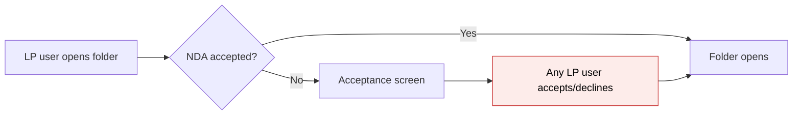
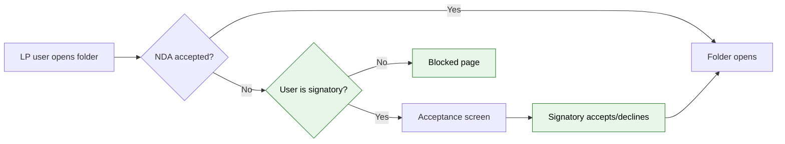
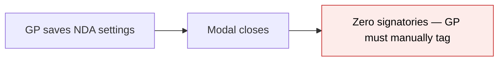
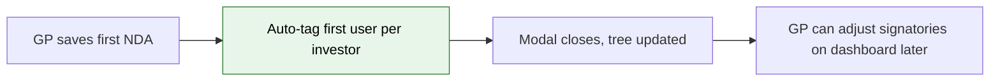

# NDA Module 9 — Signatory Gating & Enhancements — Proposal

> **Audience:** Business team, product, QA, support — non-technical.
> **Companion document:** [Design](design.md)

> **Planning phase — no code changes.** This document proposes and explains the change. Do not
> edit application code while writing it; implementation happens later, in the tasks phase.

---

## Why

The NDA signatory tagging system exists — GPs can tag specific LP users as designated signatories from the NDA Status Dashboard — but it is purely informational. Any LP user with investor access can accept or decline the NDA regardless of whether they are tagged. This defeats the purpose of signatory tagging: compliance requires that only authorised persons sign binding agreements. Additionally, after a GP creates an NDA for the first time, there is no prompt to tag signatories, so investors default to having zero signatories and no one can sign.

---

## What Changes

- **Signatory gating on accept/decline:** Only users tagged as NDA signatories can accept or decline the NDA. Non-signatories who navigate to an NDA-protected folder see a blocked page explaining that a designated signatory must accept on their behalf.
- **Auto-tag default signatories on NDA creation:** When a GP creates an NDA config, the first (oldest) approved user per investor is automatically tagged as the default signatory. GPs can adjust on the dashboard later.
- **Zero-signatory warning on dashboard:** Investors with no tagged signatories show a warning icon on the dashboard so GPs can spot and fix the gap (safety net for edge cases where an investor has no approved users at creation time).
- **Folder access unchanged:** Once any signatory accepts, folder access opens for all users under that investor (existing stakeholder-level behaviour, unchanged).

### Flow Diagram

**LP accessing NDA-protected folder — before vs. after signatory gating:**





**GP first NDA creation — before vs. after auto-tagging:**





---

## User Stories

### US-1: Signatory accepts NDA

**As a** designated NDA signatory,
**I want** to review and accept the NDA when I access a protected folder,
**So that** the folder opens for all users under my investor.

**Acceptance criteria:**
- Tagged signatory sees the existing NDA acceptance screen (PDF + accept/decline buttons)
- After acceptance, all users under the same investor can access the folder (unchanged stakeholder-level behaviour)
- The acceptance record stores the signatory user who signed

### US-2: Non-signatory sees blocked page

**As an** LP user who is not tagged as an NDA signatory,
**I want** to see a clear message when I access an NDA-protected folder that hasn't been accepted yet,
**So that** I understand someone else must sign on my behalf.

**Acceptance criteria:**
- Non-signatory sees a blocked page with: entity logo, folder name, message "Please ensure that the authorised signatory has signed the NDA to access the documents.", contact email (if configured), and "Back to Data Rooms" link
- No accept or decline buttons are shown — no action at all for non-signatories
- Once a signatory accepts, the non-signatory can access the folder on next visit (no page refresh needed beyond re-navigating)

### US-3: Default signatory auto-tagged on NDA creation

**As a** GP user,
**I want** the first approved user of each investor to be automatically tagged as the default NDA signatory when I create an NDA,
**So that** investors can start accepting right away without manual tagging.

**Acceptance criteria:**
- After saving NDA settings for the first time (new NDA config creation), the system auto-tags the oldest approved user (by `InvestorAccess.created_at`) per investor as the default signatory
- Auto-tagging happens silently — no redirect, no banner. The modal closes and tree updates as usual
- Auto-tagging does NOT happen on NDA settings updates or version bumps — only on first creation
- GP can later go to the NDA Status Dashboard to change or add signatories

### US-4: GP sees zero-signatory warning

**As a** GP user viewing the NDA Status Dashboard,
**I want** to see a warning when an investor has no tagged signatories,
**So that** I know no one can sign the NDA for that investor.

**Acceptance criteria:**
- Investors with zero tagged signatories show a warning icon (⚠) and tooltip "No signatories tagged — no one can accept the NDA for this investor" in the Status column
- The warning is visible in all status filter views (All, Pending, Declined, etc.)

### US-5: Exempt investors bypass signatory gating

**As an** LP user whose investor is marked exempt from NDA,
**I want** to access the folder without any NDA screen,
**So that** the exemption continues to work as before.

**Acceptance criteria:**
- NDA-exempt investors bypass the gate entirely (unchanged behaviour)
- Signatory gating does not apply to exempt investors

---

## UI Behavior

### Blocked Page (Non-Signatory LP)

```
┌─────────────────────────────────────────────────────┐
│  [Entity Logo]                Back to Data Rooms ▸   │
│                                                      │
│  Non-Disclosure Agreement                            │
│                                                      │
│  [Entity Name]  |  Folder: [Folder Name]             │
│                                                      │
│  ┌─ alert-info ───────────────────────────────────┐  │
│  │ 🔒 Please ensure that the authorised signatory │  │
│  │    has signed the NDA to access the documents. │  │
│  └────────────────────────────────────────────────┘  │
│                                                      │
│  Questions? Contact: nda@fund.com                    │
│                                                      │
│  [ Back to Data Rooms ]                              │
│                                                      │
└─────────────────────────────────────────────────────┘
```

**Behavior notes:**
- Rendered inside `documents_frame` turbo-frame (same as declined/lapsed pages)
- Uses the same layout pattern as the existing declined and lapsed views (logo, entity context, message, contact, back link)
- No PDF iframe, no accept/decline buttons — no action at all for non-signatories
- Shown to non-signatories only when no signatory has accepted yet for their investor

### NDA Status Dashboard — Zero-Signatory Warning

Zero-signatory warning icon appears in the status column whenever an investor has no tagged signatories. This is a safety net for edge cases — with auto-tagging on creation, most investors will have a default signatory.

---

## What This Feature Does NOT Cover

| Excluded | Covered In |
|---|---|
| E-sign / Zoho integration for NDA signing | Future module (post-MVP) |
| Multi-signatory requirement (e.g., 2-of-3 must sign) | Future enhancement if needed |
| Notification changes for signatory gating | Existing Module 8 notifications already target signatories |
| NDA settings UI changes (form fields, validation types) | Modules 1/4/5 (already shipped) |

---

## Validation Rules

| Field | Rule | Default |
|---|---|---|
| Signatory status | User must have an `NdaSignatory` record for this `NdaConfig` to accept/decline | No signatory = blocked |
| Exemption | `InvestorAccess.exempt_from_nda` bypasses signatory gating entirely | `false` |
| First-creation detection | NDA config `create` action (not `update`) triggers auto-tagging of default signatories | N/A |

---

## Behavior Rules

| Scenario | What User Sees |
|---|---|
| Signatory LP visits NDA-protected folder, NDA not yet accepted | Standard NDA acceptance screen with PDF + accept/decline |
| Non-signatory LP visits NDA-protected folder, NDA not yet accepted | Blocked page: "Please ensure that the authorised signatory has signed the NDA to access the documents." |
| Non-signatory LP visits NDA-protected folder, NDA already accepted by a signatory | Folder opens normally (stakeholder-level access) |
| Exempt LP visits NDA-protected folder | Folder opens normally (exemption bypasses everything) |
| GP creates first NDA on a folder | Auto-tags first user per investor as default signatory. Modal closes normally |
| GP updates existing NDA settings (edit, version bump) | Normal modal close, no auto-tagging |
| Investor has zero tagged signatories | Dashboard shows ⚠ warning icon with tooltip |
| Signatory declines NDA | Decline recorded, other signatories for that investor can still accept |
| All signatories decline | Non-signatories remain blocked until a signatory accepts or GP tags new signatories |

---

## Resolved Design Decisions

| # | Decision | Resolution |
|---|---|---|
| 1 | Where does signatory gating happen — controller or policy? | Controller-level `before_action` in `NdaAcceptancesController` + gate logic in `DocumentsController#ensure_nda_accepted`. Policy remains "LP with access" — signatory check is a separate concern. |
| 2 | What do non-signatories see? | A dedicated blocked page (new view template), not a modified acceptance screen. Clean separation avoids conditional UI complexity. |
| 3 | When does auto-tagging happen? | Only on `create` action for NdaConfig (first NDA on a folder). Updates, version bumps, and edits do not trigger it. Detected by controller action, not model state. |
| 4 | Should non-signatories be able to view the NDA PDF without signing? | No — the blocked page does not show the PDF. The PDF is only shown to designated signatories on the acceptance screen. |
| 5 | What if an investor has zero signatories? | Rare with auto-tagging (only if investor has no approved users at NDA creation time). Dashboard shows a warning. GP must tag at least one signatory manually. |
| 6 | Does signatory gating apply to exempt investors? | No — exemption bypasses the entire NDA gate, including signatory checks. |

---

## Capabilities

### New Capabilities

- `nda/signatory-gating`: Restricts NDA accept/decline to designated signatories; shows blocked page to non-signatories; auto-tags first user per investor as default signatory on NDA creation; adds zero-signatory warnings on GP dashboard.

### Modified Capabilities

_(none — no existing specs are affected)_

---

## Impact

- **NDA acceptance flow:** The LP-facing acceptance screen and folder gate both gain signatory checks. Non-signatories see a new blocked page.
- **NDA Status Dashboard:** Gains zero-signatory warning icons (safety net for edge cases).
- **NDA settings save flow:** First-time creation auto-tags default signatories. Modal closes normally (no redirect).
- **NDA acceptance policy:** Unchanged — signatory check is a controller concern, not a Pundit policy change.
- **Notifications:** No changes — Module 8 notifications already route to signatories.

---

## Benefits

1. **Compliance enforcement** — Only authorised signatories can bind their organisation to the NDA, closing the gap where any LP user could sign.
2. **Guided GP workflow** — Post-creation prompt ensures signatories are tagged immediately, preventing the "NDA enabled but no one can sign" problem.
3. **Visibility** — Zero-signatory warnings on the dashboard give GPs a clear signal to fix the gap before LPs encounter it.
4. **Non-disruptive for LPs** — Non-signatories see a clear explanation instead of a confusing form they can't use. Once a signatory accepts, access opens automatically for everyone under that investor.

---

## FAQ

| Question | Answer |
|---|---|
| Who can tag signatories? | GP employees of the entity — from the NDA Status Dashboard (unchanged from current). |
| What happens to investors who already accepted before this change? | Their acceptance stands. Signatory gating only applies to new accept/decline actions going forward. Existing accepted investors keep folder access. |
| Can an investor have multiple signatories? | Yes. Any one of them accepting opens access for the whole investor. |
| What if all signatories decline? | The investor remains in "Pending/Declined" state. Non-signatories stay blocked. The GP can tag new signatories or follow up. |
| Does this affect email notifications? | No. Module 8 notifications already target signatories for reminders and expiry alerts. |
| Is there a migration needed? | No DB migration — the `nda_signatories` table and model already exist. Only controller/view changes. |
| How is the "first user" determined for auto-tagging? | The oldest approved `InvestorAccess` record (by `created_at`) for each investor in this entity. This is the first user who was granted access to the entity. |
| Does the blocked page show the NDA PDF? | No. Non-signatories see only the message and contact info. |

---

## Design Principle for the Next Phase

- **Reuse the existing view pattern:** The blocked page should follow the same layout as the `declined.html.erb` and `lapsed.html.erb` templates (logo, entity context, message, contact, back link). No new layout or component framework needed.
- **Keep signatory check in the controller, not the policy:** The Pundit policy (`NdaAcceptancePolicy`) answers "is this user an LP with access?" The signatory check is a separate business rule that belongs in a `before_action`. This avoids coupling policy logic to NdaSignatory queries.
- **Auto-tag in the controller action, not a model callback:** Auto-tagging runs in `NdaConfigsController#create` after save, not as an `after_create` callback on `NdaConfig`. This keeps the side effect visible and testable at the controller level, avoids triggering on seed/import creates, and matches the existing pattern where controller actions orchestrate business logic.
