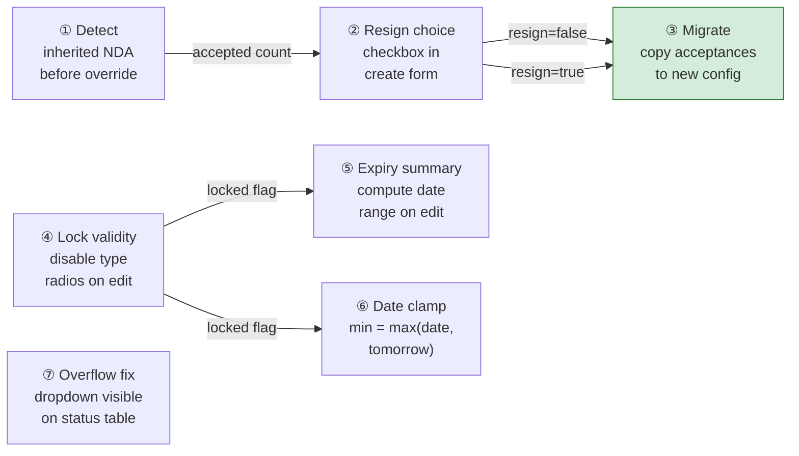
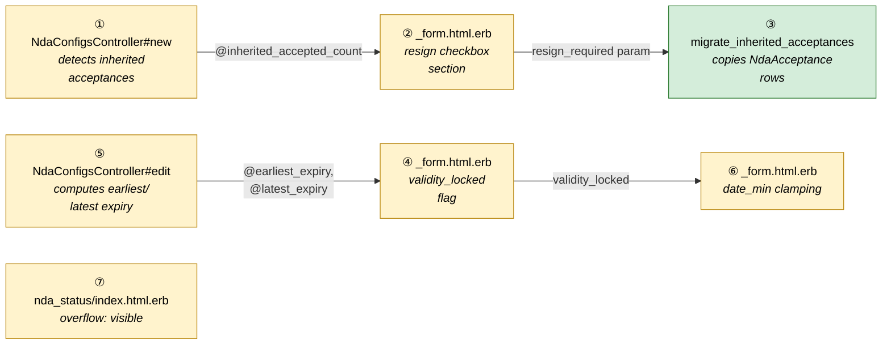
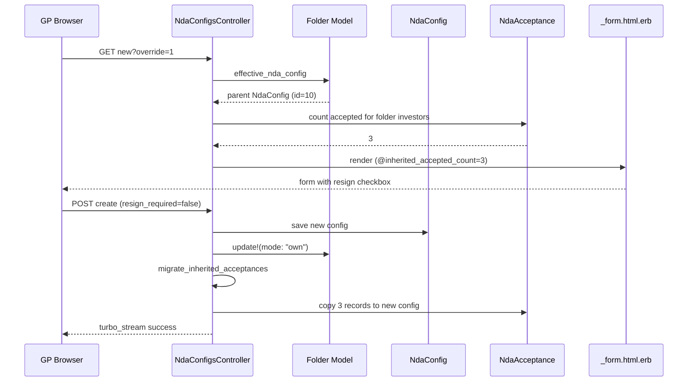
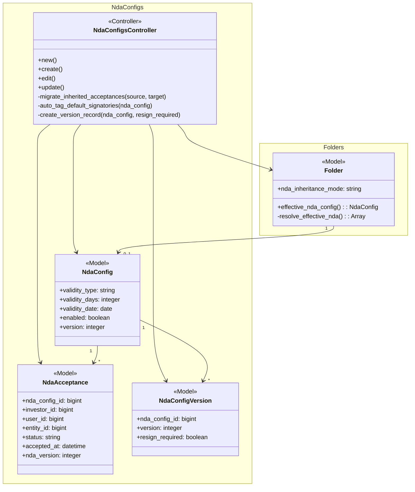

# NDA Settings Enhancements — Design

> **Audience:** Engineering team.
> **Companion documents:** [Proposal](proposal.md) · [Spec](specs/nda/settings-enhancements/spec.md)

> **Note:** This change is already implemented on branch `fix/nda-resign-on-override-inheritance`.
> This design documents the implemented approach.

---

## Contents

- [1. The idea](#1-the-idea)
  - [What this adds](#what-this-adds)
  - [The idea in one picture](#the-idea-in-one-picture)
  - [Walkthrough](#walkthrough-one-example-start-to-finish)
  - [Key ideas](#key-ideas)
- [2. The same picture with real names](#2-the-same-picture-with-real-names)
  - [Picture](#picture)
  - [What each box does](#what-each-box-does)
  - [One run, end to end](#one-run-end-to-end)
  - [What users see](#what-users-see)
  - [Design decisions](#design-decisions)
- [3. One card per box](#3-one-card-per-box)
  - [① Inheritance detector](#①-inheritance-detector)
  - [② Resign checkbox](#②-resign-checkbox)
  - [③ Acceptance migrator](#③-acceptance-migrator)
  - [④ Validity locker](#④-validity-locker)
  - [⑤ Expiry computer](#⑤-expiry-computer)
  - [⑥ Date clamper](#⑥-date-clamper)
  - [⑦ Overflow fixer](#⑦-overflow-fixer)
- [4. Reference](#4-reference)

---

## 1. The idea

### What this adds

Four improvements to the NDA settings workflow, all following the existing controller–form–modal pattern in the `core/nda_configs` pack. The resign-on-override feature adds acceptance migration logic to the existing `create` action. Validity locking and expiry summary add view-layer guards and computed values to the existing `edit` action. The dropdown and date fixes are CSS/HTML-only.

### The idea in one picture

### Walkthrough: one example, start to finish

**Setup:** GP entity "Ace Fund" has a Data Room with parent folder "Main DR" (NdaConfig id=10, enabled, until_revoked). Child folder "Subfund A DR" inherits (mode=inherit). LP investor "Capital Partners" has accepted Config 10, giving them access to both folders.

**Legend:** ✓ = done · ● = current step · ○ = not started

#### Phase 1 — Override inherited NDA

| # | When | What happens | Behind the scenes | Result |
|---|---|---|---|---|
| 1 | GP opens Subfund A NDA settings | Inherited info panel shown | `new` action detects mode=inherit | ○ Override |
| 2 | GP clicks "Set Own NDA" | Form loads with resign checkbox | Detector (①) resolves effective NDA (Config 10), counts 1 accepted investor scoped to this folder | "1 investor has already signed the inherited NDA" |
| 3 | GP leaves resign unchecked, uploads PDF, saves | New NdaConfig id=22 created | Create action: saves config → sets mode=own → auto-tags signatories → migrator (③) copies acceptance from Config 10 to Config 22 | ✓ Config created ✓ Acceptance migrated ✓ LP shows "Accepted" |

#### Phase 2 — Edit with locked validity

| # | When | What happens | Behind the scenes | Result |
|---|---|---|---|---|
| 4 | GP opens edit on Config 22, changes validity to fixed_period 90 days | Radios enabled (0 acceptances via new config yet — migrated counts) | Locker (④) checks accepted_count | Radios enabled |
| 5 | LP accepts Config 22 | Acceptance recorded | NdaAcceptance created | 1 accepted |
| 6 | GP opens edit again | Radios locked, expiry shown | Locker (④) disables radios, computer (⑤) computes expiry = accepted_at + 90 days | 🔒 "Locked" + "Earliest expiry: Jan 14, 2027 · Latest expiry: Jan 14, 2027" |

#### Phase 3 — Edit expired NDA

| # | When | What happens | Behind the scenes | Result |
|---|---|---|---|---|
| 7 | Time passes, NDA expires | LP blocked from documents | Gate finds expired acceptance | LP sees NDA gate |
| 8 | GP opens edit, picks new date 2027-06-01, saves | Form submits successfully | Clamper (⑥) sets min=tomorrow, server validation skips unchanged → accepts new date | ✓ NDA renewed |

**What to notice:**
- Detector (①) runs before mode switches to "own" — after the switch, effective_nda_config would resolve to the new (empty) config
- Migrator (③) copies records one-by-one with entity_id, rescuing duplicates for idempotency
- Locker (④) is view-only — disabled radios don't submit, so the server never sees a changed validity_type
- Clamper (⑥) uses Ruby's `max` — simple, no JS changes needed

### Key ideas

| # | Idea | In one line | Card |
|---|---|---|---|
| 1 | Capture before override | Resolve effective NDA before mode switch destroys the reference | [①](#①-inheritance-detector) |
| 2 | Acceptance migration | Copy NdaAcceptance rows from parent to child, scoped to folder investors | [③](#③-acceptance-migrator) |
| 3 | View-only locking | Disabled radios prevent type change without any model validation | [④](#④-validity-locker) |
| 4 | Date clamping | `[date, tomorrow].max` prevents hidden-input validation failure | [⑥](#⑥-date-clamper) |

**FAQ**

| Question | Answer |
|---|---|
| Why not add a model validation to prevent validity type changes? | View-only locking is simpler and sufficient — disabled radios don't submit, so the type is never changed. A model validation would add complexity for the same result. |
| Why copy acceptances instead of sharing them? | Sharing would mean one NdaAcceptance unlocks multiple NdaConfigs. The existing gate queries by nda_config_id — sharing would require changing the gate logic across all controllers. Copying preserves the existing query pattern. |

---

## 2. The same picture with real names

### Picture

Colour = footprint: **green** new, **amber** modified, **grey** reused unchanged.

### What each box does

| # | Box | Real parts | What it does | When it runs | What it decides | Details |
|---|---|---|---|---|---|---|
| ① | Inheritance detector | `NdaConfigsController#new` | Resolves `effective_nda_config` via `Folder#resolve_effective_nda`, counts accepted investors scoped to folder | GET new with `override` param | Whether to show resign checkbox (count > 0) | [card ①](#①-inheritance-detector) |
| ② | Resign checkbox | `_form.html.erb` resign section | Renders info banner + checkbox when `!persisted? && inherited_accepted_count > 0` | Form render on create | — (GP decides) | [card ②](#②-resign-checkbox) |
| ③ | Acceptance migrator | `NdaConfigsController#migrate_inherited_acceptances` | Copies accepted NdaAcceptance rows from source to target NDA, scoped to folder investors | POST create, after save | Whether to copy (resign=false) or skip (resign=true) | [card ③](#③-acceptance-migrator) |
| ④ | Validity locker | `_form.html.erb` validity section | Disables validity type radios, filters period dropdown, sets date min | Form render on edit | Whether to lock (accepted_count > 0) | [card ④](#④-validity-locker) |
| ⑤ | Expiry computer | `NdaConfigsController#edit` | Queries accepted_at dates, computes min/max + validity_days | GET edit | Whether to show summary (fixed_period + accepted dates exist) | [card ⑤](#⑤-expiry-computer) |
| ⑥ | Date clamper | `_form.html.erb` date_min logic | Clamps date input min to `[validity_date, Date.tomorrow].max` | Form render on edit | — (computation only) | [card ⑥](#⑥-date-clamper) |
| ⑦ | Overflow fixer | `nda_status/index.html.erb` | Adds `overflow: visible` on table-responsive and table, `data-bs-display="static"` on kebab | NDA Status page render | — (CSS only) | [card ⑦](#⑦-overflow-fixer) |

### One run, end to end

### Lifecycles

N/A — no new stored or derived status introduced. NdaAcceptance status (accepted/declined/revoked) is unchanged.

### What users see

**At a glance:**

| Where in CapHive | Today | After this change | Who sees it |
|---|---|---|---|
| NDA Settings modal › create on override | No resign choice, LP silently blocked | Resign checkbox with accepted count | GP |
| NDA Settings modal › edit | Validity type freely changeable | Radios locked when accepted_count > 0 | GP |
| NDA Settings modal › edit | No expiry context | Earliest/latest expiry dates shown | GP |
| NDA Settings modal › edit expired NDA | Save does nothing | Save works, date min = tomorrow | GP |
| NDA Status dashboard | Kebab clipped on single row | Dropdown fully visible | GP |

### Design decisions

1. **View-only locking over model validation** — Disabled radios prevent submission of changed validity_type. Alternative: model validation rejecting type changes. Rejected because: adds complexity, disabled radios are the standard UX pattern, and the server already preserves the type when the param is absent.

2. **Copy acceptances over shared lookup** — Acceptance records are duplicated from parent to child NDA. Alternative: querying by effective NDA chain. Rejected because: the gate in DocumentsController queries by `nda_config_id` — changing it would touch a critical security path across all document access.

3. **Ruby `max` clamping over JS fix** — Date min clamped server-side via `[date, tomorrow].max`. Alternative: JS to remove the min attribute or skip validation. Rejected because: server-side is simpler and the locale-date controller's hidden inputs inherit the attribute from the source.

4. **Inline overflow:visible over global CSS change** — Added inline styles on the specific table. Alternative: change `styled_table.scss` globally. Rejected because: global change could break other DataTable layouts that rely on overflow:hidden.

**FAQ**

| Question | Answer |
|---|---|
| Why not use a hidden field for locked validity_type? | Disabled radios already preserve the value — the server uses the existing DB value when the param is absent. A hidden field would be redundant. |
| Could the migrator create duplicates? | No — it rescues `RecordNotUnique` and `RecordInvalid`, skipping silently. The unique index on NdaAcceptance prevents true duplicates. |

---

## 3. One card per box

### ① Inheritance detector

Resolves the effective NDA before the folder's mode switches to "own". After the switch, `effective_nda_config` would return the new (empty) config, losing the parent reference.

| Owns | Reads / receives | Produces |
|---|---|---|
| Inheritance detection logic in `new` action | `Folder#effective_nda_config`, `Investor.owner_access_rights` | `@inherited_accepted_count` for the form |

**Detail:** Runs only when `params[:override]` is present. Calls `@folder.effective_nda_config` which walks ancestors via `resolve_effective_nda` (Folder model, private method). Counts accepted investors using `nda_acceptances.where(investor_id: folder_investor_ids, status: "accepted").select(:investor_id).distinct.count`.

**Worked examples:** H1, E1

**FAQ**

| Question | Answer |
|---|---|
| Why scope to folder investors? | An investor may have accepted the parent NDA for a different folder. Only investors with AccessRight on *this* child folder should count. |

### ② Resign checkbox

Renders the resign choice section in the create form when inherited acceptances exist.

| Owns | Reads / receives | Produces |
|---|---|---|
| Resign checkbox HTML section | `@inherited_accepted_count` from controller | `nda_config[resign_required]` param on submit |

**Detail:** Uses `check_box_tag` (not `form.check_box`) because `resign_required` is not an NdaConfig model attribute — it's a controller-only parameter. Visible condition: `!nda_config.persisted? && inherited_accepted_count > 0`. Default: unchecked (false). Separate from the version-bump resign checkbox which appears on edit.

**Worked examples:** H1, H2, E1

**FAQ**

| Question | Answer |
|---|---|
| Why not use form builder for the checkbox? | `resign_required` is not persisted on NdaConfig — it's a one-time decision that affects the create action only. `check_box_tag` keeps it as a standalone param. |

### ③ Acceptance migrator

Copies accepted NdaAcceptance rows from the inherited NDA to the newly created child NDA.

| Owns | Reads / receives | Produces |
|---|---|---|
| `migrate_inherited_acceptances` private method | Source NdaConfig, target NdaConfig, folder investor IDs | New NdaAcceptance records on target |

**Detail:**
- Scopes source acceptances to `folder_investor_ids` via `Investor.owner_access_rights(@folder, nil).pluck(:id)`
- Iterates with `find_each`, creating copies with `nda_version: 1`, preserved `accepted_at`, and `entity_id` from source
- Rescues `RecordNotUnique` and `RecordInvalid` for idempotency
- Original records on source NDA are untouched

**Entity_id is required:** NdaAcceptance has `belongs_to :entity` — Rails validates presence by default. The original migration attempt failed silently because the rescue block swallowed the validation error. Fixed by copying `entity_id` from the source acceptance.

**Worked examples:** H1, E2, X1

**FAQ**

| Question | Answer |
|---|---|
| What if the source acceptance was soft-deleted? | `find_each` uses the default scope which excludes soft-deleted records (acts_as_paranoid). Only active acceptances are copied. |
| Why `find_each` instead of `each`? | Safer for large datasets — processes in batches of 1000. Unlikely to matter in practice but follows Rails best practices. |

### ④ Validity locker

Disables validity type radio buttons when LPs have already accepted, preventing retroactive type changes.

| Owns | Reads / receives | Produces |
|---|---|---|
| Locked radios, filtered dropdown, lock message | `@accepted_count` from controller | `validity_locked` boolean for form |

**Detail:**
- `validity_locked = nda_config.persisted? && accepted_count > 0`
- All three radio buttons get `disabled: validity_locked`
- Fixed period dropdown: `all_period_options.select { |_, v| v >= current_days }`
- Lock message with tabler icon `ti-lock`

**Worked examples:** H3, E3

**FAQ**

| Question | Answer |
|---|---|
| What if GP needs to switch type urgently? | Upload a new PDF with resign checkbox checked — creates a new version where all settings are unlocked because accepted_count resets to 0 on the new version. |

### ⑤ Expiry computer

Computes earliest and latest expiry dates for fixed_period validity type.

| Owns | Reads / receives | Produces |
|---|---|---|
| Expiry computation in `edit` action | NdaAcceptance accepted_at dates, NdaConfig validity_days | `@earliest_expiry`, `@latest_expiry` |

**Detail:**
- Only for `fixed_period` with `validity_days` present
- Queries: `nda_acceptances.where(status: "accepted").pluck(:accepted_at).compact`
- Computes: `min + validity_days.days`, `max + validity_days.days`
- For `specific_date`: no computation needed — `validity_date` displayed directly in the form

**Worked examples:** H3, E4

**FAQ**

| Question | Answer |
|---|---|
| Why not compute per-investor expiry? | The summary only needs the range. Per-investor expiry is already shown on the NDA Status dashboard. |

### ⑥ Date clamper

Clamps the date input `min` attribute to prevent expired dates from blocking form submission.

| Owns | Reads / receives | Produces |
|---|---|---|
| `date_min` computation in form | `nda_config.validity_date`, `validity_locked` flag | `min` attribute on date input |

**Detail:**
- Before fix: `date_min = nda_config.validity_date.to_s` when locked
- After fix: `date_min = [nda_config.validity_date, Date.tomorrow].max.to_s`
- Root cause: the `locale-date` Stimulus controller creates hidden shadow `<input type="date">` elements (width:0, height:0). When value < min, browser's HTML5 validation blocks submission but can't show the tooltip because the input is not focusable.

**Worked examples:** H4, E5

**FAQ**

| Question | Answer |
|---|---|
| Why does the server-side validation not also block? | NdaConfig#validity_date_must_be_future fires only on `new_record?` or `will_save_change_to_validity_date?`. If the GP doesn't change the date, the validation is skipped — correct behavior. |

### ⑦ Overflow fixer

Adds CSS overrides to prevent dropdown clipping on the NDA Status table.

| Owns | Reads / receives | Produces |
|---|---|---|
| Inline overflow styles, `data-bs-display` attribute | — | Visible dropdown |

**Detail:**
- Root cause: `table.dataTable` has `overflow: hidden` in `styled_table.scss:143`, and `.table-responsive` adds `overflow-x: auto`
- Fix: inline `style="overflow: visible;"` on both the `.table-responsive` div and the `table` element, plus `data-bs-display="static"` on the kebab button
- `data-bs-display="static"` alone was insufficient because the table's overflow:hidden still clips absolutely-positioned elements

**Worked examples:** H5

**FAQ**

| Question | Answer |
|---|---|
| Why not fix styled_table.scss globally? | Other tables may rely on overflow:hidden for horizontal scrolling. The inline override is scoped to this one table. |

---

## 4. Reference

### Class diagram

### Data model and schema changes

N/A — no database schema changes. All changes use existing tables and columns.

### Component contracts

| From → To | Contract | Direction rule |
|---|---|---|
| ① → ② | `@inherited_accepted_count` (integer) | Controller sets instance variable, form reads it |
| ② → ③ | `params[:nda_config][:resign_required]` ("1" or absent) | Form submits checkbox param, controller reads and casts to boolean |
| ③ → NdaAcceptance | `NdaAcceptance.create!(nda_config:, investor_id:, user_id:, entity_id:, nda_version: 1, status: "accepted", accepted_at:)` | Controller creates records |
| ⑤ → ④ | `@accepted_count`, `@earliest_expiry`, `@latest_expiry` | Controller sets instance variables, form reads them |
| ④ → ⑥ | `validity_locked` (boolean, computed in form) | Same ERB template, shared local variable |

### Cross-cutting concerns

#### Transactions and queries

- **Acceptance migration:** Not wrapped in a transaction — each `NdaAcceptance.create!` is independent with `rescue` for idempotency. Partial failure leaves some acceptances migrated, which is acceptable (GP can check NDA Status).
- **N+1 risk:** `Investor.owner_access_rights(@folder, nil).pluck(:id)` runs one query. `source_nda.nda_acceptances.where(...)` runs one query. `find_each` batches. No N+1.
- **Expiry computation:** `pluck(:accepted_at)` loads only timestamps, not full records. `min`/`max` computed in Ruby (small dataset — typically < 100 acceptances per NDA).

#### Exception handling and monitoring

N/A — no new notification or alerting paths. Existing `Rails.logger.error` patterns in `create_version_record` and `notify_version_change` are unchanged.

#### Performance and security

- **Volume:** Acceptance migration runs once per override, typically < 50 records. No performance concern.
- **Tenant isolation:** All queries scope through `@folder` which is verified against `current_user.entity_id` in `set_owner`. `Investor.owner_access_rights(@folder, nil)` inherently scopes to the folder's entity.
- **Authorization:** `authorize @nda_config` via Pundit runs before any data access or mutation.

### Worked examples

**Shared setup:**

| Record | Name | Key data |
|---|---|---|
| Entity | Ace Fund | id=1097, GP entity |
| Folder | Main DR | id=100, NdaConfig id=10, mode=own |
| Folder | Subfund A DR | id=200, mode=inherit, parent=100 |
| Investor | Capital Partners | id=42, accepted Config 10 |
| Investor | Growth LP | id=43, not accepted |
| User | GP Admin | id=344, entity=1097, role=company_admin |
| User | LP User | id=500, entity=LP entity |

#### Happy Path

| # | Scenario | Given | When | Then | Spec scenario | Feature |
|---|---|---|---|---|---|---|
| H1 | Override with resign unchecked | Subfund A inherits Config 10, Capital Partners accepted | GP clicks Set Own NDA, leaves resign unchecked, saves | New Config 22 created, acceptance copied, LP shows Accepted | Resign unchecked migrates acceptances | nda_settings_enhancements |
| H2 | Override with resign checked | Same as H1 | GP checks resign box, saves | Config 22 created, no migration, LP shows Pending | Resign checked starts fresh | nda_settings_enhancements |
| H3 | Edit locked validity | Config 22 has accepted_count=1, fixed_period 90 days | GP opens edit | Radios disabled, dropdown shows 90/180/365, expiry shown | Validity radios disabled when acceptances exist | nda_settings_enhancements |
| H4 | Save expired NDA | Config 22 has validity_date=2026-10-08 (expired) | GP opens edit, picks 2027-01-01, saves | Form submits, date updated | Save expired NDA with new future date | nda_settings_enhancements |
| H5 | Single-row dropdown | NDA Status with 1 investor | GP clicks kebab | Dropdown renders fully visible | Single investor row shows dropdown | nda_settings_enhancements |

#### Edge Cases

| # | Scenario | Given | When | Then | Spec scenario | Feature |
|---|---|---|---|---|---|---|
| E1 | Override with no inherited acceptances | Subfund A inherits Config 10, no acceptances | GP clicks Set Own NDA | Form shows, no resign checkbox | Override without inherited acceptances hides resign checkbox | nda_settings_enhancements |
| E2 | Duplicate acceptance on migration | Acceptance already exists on target config (e.g., re-run) | Migrator runs | RecordNotUnique rescued, skipped silently | Resign unchecked migrates acceptances | nda_settings_enhancements |
| E3 | Edit with no acceptances | Config 22 has accepted_count=0 | GP opens edit | Radios enabled, no lock message, no expiry | Validity radios enabled when no acceptances | nda_settings_enhancements |
| E4 | Fixed period no accepted dates | Config has fixed_period but no accepted investors | GP opens edit | No expiry summary shown | No accepted investors shows no expiry summary | nda_settings_enhancements |
| E5 | Expired date with other field change | Config has expired validity_date | GP changes only contact_email, saves | Form submits, email updated, date unchanged | Save expired NDA without changing date | nda_settings_enhancements |

#### Error Cases

| # | Scenario | Given | When | Then | Spec scenario | Feature |
|---|---|---|---|---|---|---|
| X1 | Missing entity_id on acceptance copy | Source acceptance has entity_id | Migrator copies without entity_id | RecordInvalid rescued, skipped | Resign unchecked migrates acceptances | nda_settings_enhancements |

### Testing

Cucumber feature file `nda_settings_enhancements.feature` in `features/core/`. Reuses existing NDA setup steps from `nda_config_steps.rb` and `nda_acceptance_steps.rb`. New steps needed for: resign checkbox interaction, validity locking assertion, expiry summary assertion, expired NDA save.

### Risks and open questions

- **Debug logging in controller** → Remove all `Rails.logger.info("[NDA_DEBUG]...")` lines before merge. Currently 4 lines in the create action.
- **Inherited info panel wording** → Still says "this folder's contents" instead of "any folder that shares this NDA." Deferred to a follow-up.

| # | Open question | Current thinking | Status |
|---|---|---|---|
| 1 | Should we add cucumber tests for all scenarios? | Yes, but can be done in a follow-up PR to keep this one focused on the fixes | Deferred |

**FAQ**

| Question | Answer |
|---|---|
| Where do I start reviewing? | Start with the controller (`nda_configs_controller.rb`) — the `new` action shows inheritance detection, `create` shows migration logic, `edit` shows expiry computation. Then the form (`_form.html.erb`) for the UI changes. |
| What needs cleanup before merge? | Remove the 4 `[NDA_DEBUG]` logger lines from the create action. Also delete the `docs/nda_settings_enhancements/` directory (replaced by these openspec docs). |
