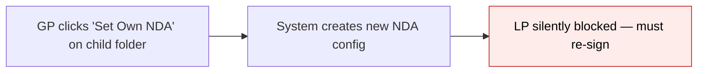
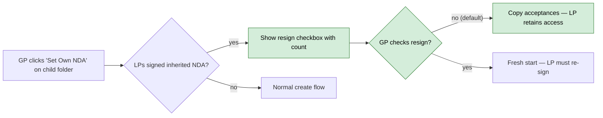
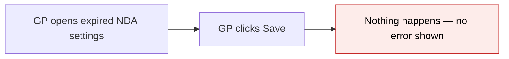
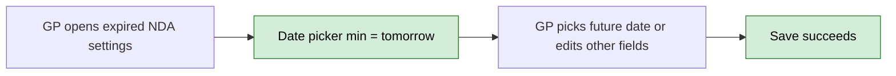
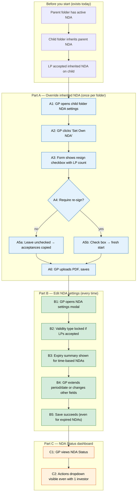

# NDA Settings Enhancements — Proposal

> **Audience:** Business team, product, QA, support — non-technical.
> **Companion document:** [Design](design.md)
> **New to this? Start with the [Workflow Journey](#workflow-journey)** — every action, in order, from start to the outcome.

> **Planning phase — no code changes.** This document proposes and explains the change.

---

## Why

When a GP manages NDA settings across a folder hierarchy, four usability problems block or confuse their workflow: (1) the Actions dropdown is invisible when only one investor exists, (2) overriding an inherited NDA silently blocks LPs who had already signed, (3) the GP can accidentally change validity type after LPs accepted — retroactively breaking their access, and (4) editing an expired NDA silently does nothing on save. These issues erode GP trust in the NDA workflow and cause unnecessary LP access disruptions.

## What Changes

- **Actions dropdown visibility:** The kebab menu on the NDA Status dashboard now renders fully visible even with a single investor row, instead of being clipped behind the table boundary.
- **Resign checkbox on override:** When a GP clicks "Set Own NDA" on a folder that previously inherited its parent's NDA, the form now shows how many LPs already signed the inherited NDA and offers a checkbox: "Require them to re-sign the new NDA." Unchecked (default) = carry forward acceptances. Checked = fresh start.
- **Validity type locking:** Once any LP has accepted an NDA, the validity type (Until Revoked / Fixed Period / Specific Date) is locked. The GP can still extend within the same type (longer period, later date) but cannot switch types. A lock icon with explanation appears.
- **Expiry summary:** When editing an NDA with Fixed Period or Specific Date validity, the form shows when existing acceptances expire — a date range for Fixed Period, a single date for Specific Date.
- **Expired NDA edit fix:** GPs can now save changes to an expired NDA. The date picker allows selecting any future date for renewal, instead of silently blocking the form.

### Flow Diagram

**Before — Override inherited NDA:**



**After — Override inherited NDA:**



**Before — Edit expired NDA:**



**After — Edit expired NDA:**



---

## Workflow Journey

### Who is involved

| Person | Role | What they do in the journey |
|---|---|---|
| GP Admin | Fund manager with entity admin access | Manages NDA settings on Data Room folders |
| LP User | Limited partner investor | Signs NDAs to access folder contents |

### The journey on one page



### Before you start

| Needed | Why | Where it comes from |
|---|---|---|
| Parent folder with active NDA | The NDA to inherit from | GP created NDA on parent folder |
| Child folder in inherit mode | The folder being overridden | Default mode for child folders |
| LP accepted inherited NDA | Demonstrates the resign choice | LP signed NDA via document access gate |
| LP has folder-level access right | Scoping for acceptance migration | GP granted folder access to LP's investor |

### Part A — Override inherited NDA (once per folder)

| Step | Who | Where | Action | What the system does | What you see |
|---|---|---|---|---|---|
| A1 | GP | Documents page › child folder › NDA settings | Opens NDA settings modal | Detects folder inherits parent NDA | Inherited info panel with "Set Own NDA" button |
| A2 | GP | NDA modal › "Set Own NDA" button | Clicks override | Resolves effective NDA from ancestry, counts accepted investors scoped to this folder | NDA form with resign checkbox |
| A3 | GP | NDA form | Reads resign banner | Shows count of LPs who signed | "3 investors have already signed the inherited NDA for this folder" |
| A4 | GP | NDA form › resign checkbox | Decides whether to require re-sign | — | Checkbox: "Require them to re-sign the new NDA" |
| A5a | GP | NDA form (checkbox unchecked) | Leaves default | After save: copies accepted NdaAcceptance records from parent NDA to child NDA | NDA Status shows LPs as "Accepted" |
| A5b | GP | NDA form (checkbox checked) | Checks resign box | After save: no migration, fresh start | NDA Status shows LPs as "Pending" |
| A6 | GP | NDA form › upload + Save | Uploads PDF and saves | Creates NdaConfig, sets folder mode to "own", auto-tags signatories, migrates acceptances if applicable | Success flash, lock icon on folder |

### Part B — Edit NDA settings (every time)

| Step | Who | Where | Action | What the system does | What you see |
|---|---|---|---|---|---|
| B1 | GP | Documents page › folder › NDA settings | Opens edit modal | Loads NDA config, counts accepted investors, computes expiry dates | NDA settings form |
| B2 | GP | NDA form › Validity section | Views validity type | If accepted_count > 0, radio buttons are disabled | Lock icon: "Validity type is locked because investors have already accepted" |
| B3 | GP | NDA form › below validity options | Views expiry info | Computes earliest/latest expiry from accepted_at + days | "Earliest expiry: Jan 15, 2027 · Latest expiry: Mar 22, 2027" |
| B4 | GP | NDA form | Changes period/date or other fields | Validates: can only extend (longer period, later date) | Dropdown filtered to >= current period; date min = current date |
| B5 | GP | NDA form › Save | Saves changes | For expired NDAs: date min clamped to tomorrow so form submits | Success flash |

### Part C — NDA Status dashboard

| Step | Who | Where | Action | What the system does | What you see |
|---|---|---|---|---|---|
| C1 | GP | NDA Status page | Views investor table | Renders table with status, kebab dropdown per row | Investor rows with status badges |
| C2 | GP | NDA Status › Actions column | Clicks kebab on single-row table | Dropdown renders with overflow:visible and static positioning | Full dropdown menu visible (not clipped) |

### What you see

**Resign checkbox on "Set Own NDA":**

```
┌─────────────────────────────────────────────────────┐
│  NDA Settings — Subfund A Data Room               ✕  │
│                                                      │
│  ┌──────────────────────────────────────────────┐   │
│  │ ℹ Overriding inherited NDA.                  │   │
│  │ The parent folder "Main Data Room" has an    │   │
│  │ active NDA. Setting an NDA here will replace │   │
│  │ it for this folder.                          │   │
│  └──────────────────────────────────────────────┘   │
│                                                      │
│  NDA Document (PDF only)                             │
│  [Choose file...]                                    │
│                                                      │
│  ┌──────────────────────────────────────────────┐   │
│  │ ℹ 3 investors have already signed the        │   │
│  │   inherited NDA for this folder.             │   │
│  │                                              │   │
│  │   ☐ Require them to re-sign the new NDA      │   │
│  └──────────────────────────────────────────────┘   │
│                                                      │
│  Validity: ● Until revoked                           │
│                                                      │
│                          [Cancel]  [Save Settings]   │
└─────────────────────────────────────────────────────┘
```

**Locked validity with expiry summary (edit mode):**

```
┌─────────────────────────────────────────────────────┐
│  NDA Settings — Subfund A Data Room               ✕  │
│                                                      │
│  Validity                                            │
│  🔒 Validity type is locked because investors have   │
│     already accepted. To change type, upload a new   │
│     NDA version with re-sign required.               │
│                                                      │
│  ○ Until revoked          (disabled)                 │
│  ● Fixed period           (disabled)                 │
│    [90 days ▾]  (only >= 90 shown)                   │
│    🕐 Earliest expiry: Jan 15, 2027                  │
│       Latest expiry: Mar 22, 2027                    │
│  ○ Specific expiry date   (disabled)                 │
│                                                      │
│                          [Cancel]  [Save Settings]   │
└─────────────────────────────────────────────────────┘
```

### What goes wrong

**Failing path — GP tries to change validity type after LPs accepted:**
GP opens NDA settings, sees "Fixed Period" selected with lock icon. Radio buttons are disabled — GP cannot switch to "Until Revoked" or "Specific Date." The explanation says: "To change type, upload a new NDA version with re-sign required." GP uploads new PDF, checks the resign box → new version created, all LPs must re-sign, and the new version can have a different validity type.

### Summary: the minimum actions

| # | Action | Who | How often |
|---|---|---|---|
| 1 | Choose resign option when overriding inherited NDA | GP | Once per folder override |
| 2 | Review expiry summary when editing time-based NDA | GP | Every NDA edit |
| 3 | Extend validity period/date (cannot switch type) | GP | As needed |

---

## User Stories

### US-1: Actions Dropdown Visibility

**As a** GP viewing the NDA Status dashboard with a single investor,
**I want** the Actions dropdown to render fully visible,
**So that** I can manage that investor's NDA status without UI obstruction.

**Acceptance criteria:**
- Kebab dropdown renders outside table boundaries when only 1 row exists
- Works with multiple rows as before (no regression)

### US-2: Resign Choice on Inherited NDA Override

**As a** GP setting up a folder-specific NDA on a child folder that previously inherited its parent's NDA,
**I want to** choose whether existing signatories must re-sign,
**So that** I don't unnecessarily block LP access when only the NDA scope changed.

**Acceptance criteria:**
- When clicking "Set Own NDA" on a folder with inherited acceptances, form shows: "[count] investors have already signed the inherited NDA for this folder"
- Checkbox: "Require them to re-sign the new NDA" (unchecked by default)
- Unchecked: accepted investors' records are copied to the new NDA config — they appear as "Accepted" on the child's NDA Status
- Checked: no migration — investors appear as "Pending" on the child's NDA Status
- Original acceptances on the parent NDA are untouched — LP retains access to other inheriting folders
- Checkbox only appears when inherited accepted count > 0
- Version record stores the actual resign_required value

### US-3: Validity Type Locking

**As a** GP editing NDA settings after LPs have accepted,
**I want** the validity type to be locked,
**So that** I don't accidentally change how expiry is calculated for existing acceptances.

**Acceptance criteria:**
- All three validity type radio buttons are disabled when accepted_count > 0
- Lock icon with explanation: "Validity type is locked because investors have already accepted. To change type, upload a new NDA version with re-sign required."
- GP can still extend within the same type:
  - Fixed Period: dropdown shows only options >= current period (e.g., if 90 days, shows 90/180/365)
  - Specific Date: date picker min = current validity_date (can only push forward)
- Disabled radios are not submitted — existing validity_type is preserved

### US-4: Expiry Date Summary

**As a** GP editing an NDA with time-based validity,
**I want to** see when existing acceptances expire,
**So that** I can decide whether to extend the NDA before LPs lose access.

**Acceptance criteria:**
- Fixed Period: "Earliest expiry: [date] · Latest expiry: [date]" shown below the period dropdown
- Specific Date: "All NDAs expire on: [date]" shown below the date field
- Only shown when NDA is persisted (edit mode) and has accepted investors
- Dates formatted as "Mon DD, YYYY"

### US-5: Expired NDA Edit Fix

**As a** GP editing an NDA that has expired,
**I want** the Save button to work,
**So that** I can extend the expiry date or update other settings.

**Acceptance criteria:**
- Clicking Save submits the form (no silent failure)
- Date picker min is set to tomorrow (GP can pick any future date to renew)
- If GP changes only non-date fields (email, notifications), save succeeds without touching the expired date
- Server-side validation only fires when the date is actually being changed

---

## UI Behavior

### NDA Status Dashboard — Actions Dropdown

**Behavior notes:**
- `overflow: visible` set on both `.table-responsive` div and `table` element
- `data-bs-display="static"` on kebab dropdown toggle prevents Popper.js repositioning issues inside scrollable containers

### NDA Settings Form — Override Resign Checkbox

**Behavior notes:**
- Resign checkbox section is visible immediately on form load (not behind PDF upload trigger)
- Only shown when: creating new NDA (`!persisted?`) AND `inherited_accepted_count > 0`
- Uses `check_box_tag` (not form builder) — `resign_required` is not an NdaConfig model attribute
- Separate from the version-bump resign checkbox (which appears on edit when uploading new PDF)

### NDA Settings Form — Validity Locking

**Behavior notes:**
- `validity_locked` computed as: `persisted? && accepted_count > 0`
- Disabled radio buttons are not submitted by the browser, preserving existing `validity_type`
- Period dropdown options filtered: `all_period_options.select { |_, v| v >= current_days }`
- Date field `min` attribute: current `validity_date` when not expired, `Date.tomorrow` when expired

---

## What This Feature Does NOT Cover

| Excluded | Covered In |
|---|---|
| Inherited info panel wording fix | Future enhancement |
| E-signature acceptance method | NDA Module roadmap |
| Bulk NDA override across multiple folders | Not planned |
| Automated NDA renewal/extension | Not planned |

---

## Validation Rules

| Field | Rule | Default |
|---|---|---|
| validity_type radios | Disabled when accepted_count > 0 | Current type preserved |
| validity_days dropdown | Only shows options >= current value when locked | Current period |
| validity_date min | max(current_validity_date, Date.tomorrow) | Tomorrow |
| resign_required checkbox | Only shown on create when inherited_accepted_count > 0 | Unchecked (false) |

---

## Behavior Rules

| Scenario | What User Sees |
|---|---|
| Set Own NDA, no inherited acceptances | Normal create form, no resign checkbox |
| Set Own NDA, 3 LPs signed inherited NDA | Banner: "3 investors have already signed…" + resign checkbox |
| Override with resign unchecked | Child NDA Status shows LPs as Accepted |
| Override with resign checked | Child NDA Status shows LPs as Pending |
| Edit NDA, 0 accepted | Validity radios enabled, no expiry summary |
| Edit NDA, 5 accepted, fixed_period 90 days | Radios locked, dropdown shows 90/180/365, expiry range shown |
| Edit expired NDA (specific_date in past) | Date min = tomorrow, form submits on Save |
| 1 investor in NDA Status table | Actions dropdown renders fully visible |

---

## Resolved Design Decisions

| # | Decision | Resolution |
|---|---|---|
| 1 | Should resign default to checked or unchecked? | Unchecked — most overrides are scope changes, not term changes. LP friction should be opt-in. |
| 2 | Should GP be able to switch validity type after acceptances? | No — retroactive type change is dangerous. Lock the type, allow extension only within same type. To switch type, upload new PDF with resign required. |
| 3 | Where to show expiry summary? | Below the validity options in the form, only on edit mode with accepted investors. |
| 4 | How to fix expired NDA edit? | Clamp date input `min` to max(validity_date, tomorrow). Server-side validation already skips when date unchanged. |

---

## Capabilities

### New Capabilities

- `nda/settings-enhancements`: NDA settings form improvements — resign-on-override checkbox, validity type locking, expiry summary display, expired NDA edit fix, and status dashboard dropdown clipping fix.

### Modified Capabilities

_(none — these are new behaviors, no existing spec requirements change)_

---

## Impact

- **NDA Settings form** — new resign checkbox section, locked validity radios, expiry summary display, date min clamping
- **NDA Settings controller** — new logic in `new` (inheritance detection), `create` (acceptance migration), and `edit` (expiry computation) actions
- **NDA Status dashboard** — overflow CSS fix on the investor table
- **No database changes** — uses existing NdaAcceptance, NdaConfig, NdaConfigVersion tables
- **No API changes** — all changes are within the existing form submission flow

---

## Benefits

1. **Reduced LP friction** — GPs can override inherited NDAs without forcing unnecessary re-sign
2. **Data integrity** — validity type cannot be changed retroactively after LPs accepted
3. **Better GP decision-making** — expiry summaries give context for timing NDA revisions
4. **Unblocked workflow** — expired NDAs can be edited and renewed instead of silently failing
5. **Dashboard usability** — Actions menu works correctly regardless of row count

---

## FAQ

| Question | Answer |
|---|---|
| Does carrying forward acceptances affect the parent NDA? | No. Original acceptance records on the parent NDA are untouched. LPs retain access to all other folders inheriting from the parent. |
| Can the GP unlock the validity type? | Not directly. To change type, upload a new NDA PDF and check the resign box — this creates a new version where the type can be set freely. |
| What if the GP wants to shorten the validity period? | Not allowed when locked. The dropdown only shows options >= the current period. To shorten, upload a new version with resign required. |
| Does the expiry summary update in real time? | It's computed each time the GP opens the edit modal. It reflects the latest accepted_at timestamps. |
| Can LPs tell their acceptance was migrated? | No visible difference. The acceptance appears the same as if they signed the child's NDA directly. The accepted_at date is preserved from the original. |

---

## Design Principle for the Next Phase

The acceptance migration is a one-time copy at override time — no ongoing sync between parent and child NDA acceptances. If future requirements need bidirectional sync (e.g., LP signs on parent after override, child auto-updates), that would be a separate feature with different architecture. The current design deliberately avoids this complexity.
