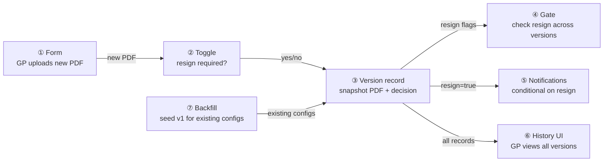
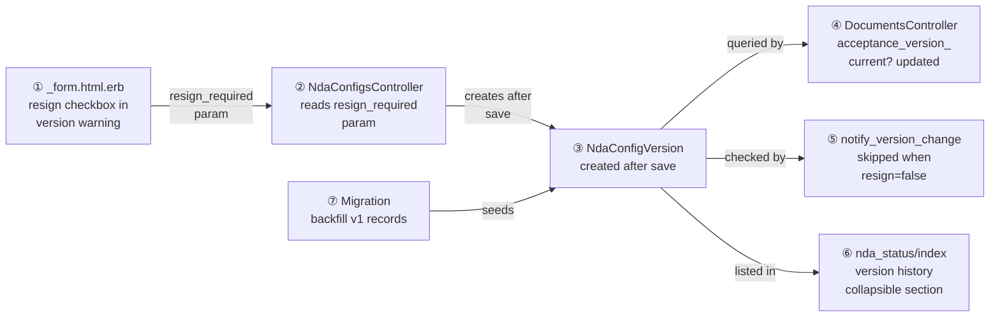

# NDA Version History & Resign Control — Design

> **Audience:** Engineering team.
> **Companion documents:** [Proposal](proposal.md) · [Spec](specs/nda/version-history/spec.md)

> **Planning phase — no code changes.** This document explains HOW the proposal will be built.
> Do not edit application code while writing it; implementation happens later, in the tasks phase.

> **Design, not code.** Explain the design with mermaid diagrams and tables. Do NOT paste Ruby/JS
> class bodies, migrations, route blocks or policy code. Put real class, method, table and path
> names inside the diagrams and tables instead.

---

## Contents

- [1. The idea](#1-the-idea)
  - [What this adds](#what-this-adds)
  - [The idea in one picture](#the-idea-in-one-picture)
  - [Walkthrough: one example start to finish](#walkthrough-one-example-start-to-finish)
- [2. The idea with real names](#2-the-idea-with-real-names)
- [3. Cards](#3-cards)
  - [① Version history table](#①-version-history-table)
  - [② Resign toggle on form](#②-resign-toggle-on-form)
  - [③ Version record creation](#③-version-record-creation)
  - [④ Conditional acceptance check](#④-conditional-acceptance-check)
  - [⑤ Conditional notifications](#⑤-conditional-notifications)
  - [⑥ Version history UI](#⑥-version-history-ui)
  - [⑦ Backfill migration](#⑦-backfill-migration)
- [4. Reference](#4-reference)
  - [Schema](#schema)
  - [File map](#file-map)
  - [Queries and indexes](#queries-and-indexes)

---

## 1. The idea

### What this adds

Adds an `NdaConfigVersion` table that records each NDA PDF upload as a versioned snapshot, a resign toggle on the NDA settings form, and a conditional acceptance gate — following the same pattern as the existing `before_save :increment_version_if_document_changed` callback and `acceptance_version_current?` check in `DocumentsController`, but making the version-mismatch invalidation conditional on a per-version `resign_required` flag.

### The idea in one picture

### Walkthrough: one example start to finish

A GP has an NDA on folder "Q3 Reports" at version 2. Three investors have accepted at version 2.

1. The GP opens NDA Settings, uploads a corrected PDF (typo fix). The version warning banner appears with a checkbox "Require existing signatories to re-sign this version" — it defaults to checked. The GP unchecks it and clicks Save.
2. `NdaConfig` saves: version increments to 3 (the `before_save` callback runs as today). An `NdaConfigVersion` record is created with `version: 3, resign_required: false, nda_document_data: <new PDF>`.
3. No notifications are sent (resign not required).
4. An LP whose investor accepted at version 2 visits the folder. The gate finds their acceptance at version 2. It queries `NdaConfigVersion` for any version between 3 and 3 (exclusive of 2, inclusive of 3) where `resign_required: true`. None found — access granted.
5. Later, the GP uploads a materially changed NDA with resign checked. Version bumps to 4. `NdaConfigVersion` created with `resign_required: true`. Notifications fire.
6. The same LP visits again. Gate finds acceptance at version 2, queries versions 3–4 for resign. Version 4 has `resign_required: true` — acceptance is stale, LP redirected to acceptance screen.

| Question | Answer |
|---|---|
| Why always increment version even without resign? | Audit trail — every PDF gets a unique version number. The resign flag controls invalidation, not versioning. |
| Why not store resign on nda_config directly? | Per-version decision. If GP uploads v3 (no resign) then v4 (resign), the decision for v3 must be preserved to evaluate acceptance validity across ranges. |

---

## 2. The idea with real names

| Question | Answer |
|---|---|
| Why controller-level creation, not model callback? | Matches existing project pattern — `auto_tag_default_signatories` is in the controller, not a callback. Keeps side effects visible and avoids triggering on seed/import. |
| Why modify `acceptance_version_current?` rather than adding a new gate? | It's the single point where version mismatch is evaluated. Adding a resign check there keeps the gate logic in one place. |

---

## 3. Cards

### ① Version history table

**What:** New `nda_config_versions` table stores one record per version of an NDA config.

**Schema:** See [Schema](#schema) in Part 4.

**Associations:**
- `NdaConfig has_many :nda_config_versions, dependent: :destroy`
- `NdaConfigVersion belongs_to :nda_config`
- `NdaConfigVersion belongs_to :uploaded_by, class_name: "User"`

**Model:** `NdaConfigVersion` in `app/packs/core/nda_configs/models/nda_config_version.rb`

| Question | Answer |
|---|---|
| Why store `nda_document_data` on the version and on the config? | `nda_config.nda_document_data` is the current PDF (used by Shrine for URL generation). The version record preserves the historical copy. They point to the same S3 object — no duplication. |
| Why not use PaperTrail or Audited? | Too heavy for one column. A purpose-built table is simpler, queryable, and stores exactly what we need. |

---

### ② Resign toggle on form

**What:** A checkbox inside the existing version warning banner (`data-nda-settings-target="versionWarning"`) that lets the GP choose whether re-signing is required.

**Location:** `app/packs/core/nda_configs/views/nda_configs/_form.html.erb`, inside the `alert-warning` div at lines 103–112.

**Behavior:**
- Only shown when editing an existing NDA config (not on create)
- Only shown when the version warning banner is visible (new PDF uploaded)
- Checkbox label: "Require existing signatories to re-sign this version"
- Default: checked (resign required)
- The checkbox value is submitted as `nda_config[resign_required]` — a virtual attribute, not persisted on `nda_config`

**Controller change:** `NdaConfigsController#update` reads `params[:nda_config][:resign_required]` after save, passes it to the version record creation logic.

**Permitted params:** Add `:resign_required` to `nda_config_params`. Since it's a virtual attribute (not a DB column), it won't be mass-assigned to the model — it's read separately in the controller.

| Question | Answer |
|---|---|
| Why a virtual attribute instead of a separate form field? | Keeps the param inside the `nda_config` namespace for form consistency. The controller extracts it after save. |
| Why default to checked? | Preserves current behavior — existing users expect version bumps to require re-signing. Opt-out is the new capability. |

---

### ③ Version record creation

**What:** After `NdaConfig#save` in the controller, if the version changed, create an `NdaConfigVersion` record.

**Trigger:** `@nda_config.saved_change_to_version?` — same check already used for `notify_version_change`.

**In `NdaConfigsController#update`:**
1. After `@nda_config.update(nda_config_params)` succeeds
2. Check `@nda_config.saved_change_to_version?`
3. If true, create `NdaConfigVersion` with:
   - `nda_config_id`: the config
   - `version`: `@nda_config.version` (the new version)
   - `nda_document_data`: `@nda_config.nda_document_data` (Shrine JSON — snapshot of current file reference)
   - `resign_required`: from params (default `true`)
   - `uploaded_by`: `current_user`
4. Then conditionally call `notify_version_change` only if `resign_required`

**In `NdaConfigsController#create`:**
- After successful save, create a version 1 record with `resign_required: false` (first version — no resign applicable).

**Private method:** `create_version_record(nda_config, resign_required:)`

| Question | Answer |
|---|---|
| Why check `saved_change_to_version?` instead of `will_save_change_to_nda_document_data?`? | Version increment is the authoritative signal — it accounts for all edge cases in the `before_save` callback (enabled check, same-file re-upload, etc.). |
| What if the version record creation fails? | Rescue and log, like `notify_version_change`. The NDA config update is already saved — version history is non-blocking. |

---

### ④ Conditional acceptance check

**What:** Modify `DocumentsController#acceptance_version_current?` to query `NdaConfigVersion` for resign-required versions in the gap.

**Current logic (line 624–626 of documents_controller.rb):**
`acceptance.nda_version == nda_config.version` — strict equality.

**New logic:**
1. If `acceptance.nda_version == nda_config.version` → return `true` (exact match, no change)
2. If versions differ, query: `NdaConfigVersion.where(nda_config_id: nda_config.id).where(version: (acceptance.nda_version + 1)..nda_config.version).where(resign_required: true).exists?`
3. If any resign-required version exists in the range → return `false` (stale)
4. If none → return `true` (all intermediate versions were non-resign)

**Fallback:** If no `NdaConfigVersion` records exist for the range (e.g., data created before this feature, backfill missed), fall back to strict version equality (current behavior). This ensures safety — missing records default to "resign required."

| Question | Answer |
|---|---|
| Why a range query instead of checking only the current version? | An LP who signed v2 must re-sign if v4 required it, even if v3 and v5 didn't. The range catches any resign-required version between acceptance and current. |
| Performance concern with the range query? | The query hits `nda_config_id` + `version` range + `resign_required` boolean. With the composite index on `[nda_config_id, version]`, this is a fast index scan. NDA configs rarely have more than 10 versions. |
| Why fallback to strict equality? | Safety net — if backfill is incomplete or records are missing, we don't accidentally grant access. Existing behavior is the safe default. |

---

### ⑤ Conditional notifications

**What:** Version change notifications fire only when `resign_required: true`.

**Current trigger:** `NdaConfigsController#update` calls `notify_version_change if @nda_config.saved_change_to_version?`

**New trigger:** `notify_version_change if @nda_config.saved_change_to_version? && resign_required`

Where `resign_required` is the value extracted from params (defaulting to `true`).

**No changes to:**
- `NdaNotificationRecipients` — recipient resolution is unchanged
- `NdaMailer` — email template and content unchanged
- `NdaEventNotifier` — notification pipeline unchanged

| Question | Answer |
|---|---|
| Should we notify LPs that a new version was uploaded even without resign? | Not in this feature. Non-resign updates are minor corrections — no LP action needed. A future enhancement could add an informational notification. |

---

### ⑥ Version history UI

**What:** A collapsible section on the NDA Status Dashboard showing all versions.

**Location:** `app/packs/core/nda_configs/views/nda_status/index.html.erb` — new section below the status counters, above the table.

**Data:** `NdaStatusController#index` loads `@nda_config.nda_config_versions.order(version: :desc)` and passes to the view.

**Display per row:**
| Column | Source |
|---|---|
| Version | `version` (e.g., "v3") with "(current)" badge for latest |
| Uploaded | `created_at` formatted with `l(..., format: :short)` |
| Uploaded By | `uploaded_by.full_name` |
| Resign Required | "Yes" / "No" badge, or "(Initial)" for version 1 |
| Download | Link to PDF via Shrine URL from stored `nda_document_data` |

**Shrine URL generation for historical PDFs:** Create a `FileUploader::UploadedFile` from the stored `nda_document_data` JSON to generate a download URL. This is Shrine's standard pattern for reconstructing a file object from serialized data.

**Collapsible:** Bootstrap collapse component, collapsed by default. Toggle button: "Version History (N versions)".

| Question | Answer |
|---|---|
| Why on the Status Dashboard instead of the Settings modal? | The modal is for editing settings. Version history is read-only audit information — it belongs on the dashboard where the GP reviews NDA state. |
| Why collapsed by default? | Most GPs visit the dashboard for status/signatory management, not version history. Collapsed keeps the page clean. |

---

### ⑦ Backfill migration

**What:** Data migration that creates a version 1 `NdaConfigVersion` record for every existing `NdaConfig` that has a document uploaded.

**Logic:**
- Select all `NdaConfig` records where `nda_document_data` is not null
- For each, create `NdaConfigVersion` with:
  - `version`: `nda_config.version` (usually 1, but could be higher if already bumped)
  - `nda_document_data`: current `nda_config.nda_document_data`
  - `resign_required`: `false` (historical — no decision was made)
  - `uploaded_by_id`: `nda_config.created_by_id`
  - `created_at`: `nda_config.created_at`
- Use `insert_all` for performance, skip duplicates

**Note:** This only creates one record per config — the current version. Historical PDFs before this feature are lost (S3 objects exist but there's no mapping). This is acceptable as a pragmatic starting point.

| Question | Answer |
|---|---|
| What about configs that have been through multiple version bumps? | Only the current version/PDF is backfilled. Previous versions' PDFs cannot be recovered from the config (only the current `nda_document_data` is stored). Acceptances at older versions will use the fallback strict-equality check. |
| Should the backfill be reversible? | Yes — the down migration deletes all `NdaConfigVersion` records. The table itself is dropped in the schema migration's down method. |

---

## 4. Reference

### Schema

**New table: `nda_config_versions`**

| Column | Type | Null | Default | Notes |
|---|---|---|---|---|
| `id` | bigint | no | auto | PK |
| `nda_config_id` | bigint | no | — | FK → `nda_configs.id` |
| `version` | integer | no | — | Version number at time of upload |
| `nda_document_data` | text | no | — | Shrine JSON (pointer to S3 object) |
| `resign_required` | boolean | no | `true` | GP's resign decision for this version |
| `uploaded_by_id` | bigint | no | — | FK → `users.id` |
| `created_at` | datetime | no | auto | When this version was created |
| `updated_at` | datetime | no | auto | Rails convention |

**Indexes:**
| Name | Columns | Unique | Purpose |
|---|---|---|---|
| `idx_nda_config_versions_config_version` | `[nda_config_id, version]` | yes | Lookup + uniqueness |
| `idx_nda_config_versions_config_resign` | `[nda_config_id, resign_required]` | no | Gate query: resign-required versions for a config |

### File map

| File | Change |
|---|---|
| `db/migrate/XXXX_create_nda_config_versions.rb` | Schema migration |
| `db/migrate/XXXX_backfill_nda_config_versions.rb` | Data migration |
| `app/packs/core/nda_configs/models/nda_config_version.rb` | New model |
| `app/packs/core/nda_configs/models/nda_config.rb` | Add `has_many :nda_config_versions` |
| `app/packs/core/nda_configs/views/nda_configs/_form.html.erb` | Add resign checkbox in version warning |
| `app/packs/core/nda_configs/controllers/nda_configs_controller.rb` | Version record creation, conditional notification |
| `app/packs/core/documents/controllers/documents_controller.rb` | Update `acceptance_version_current?` |
| `app/packs/core/nda_configs/views/nda_status/index.html.erb` | Version history collapsible section |
| `app/packs/core/nda_configs/controllers/nda_status_controller.rb` | Load version records for dashboard |
| `app/javascript/controllers/nda_settings_controller.js` | No change needed — checkbox is standard HTML, no Stimulus logic required |

### Queries and indexes

**Gate query (card ④):**
`NdaConfigVersion.where(nda_config_id: X, version: (acceptance_version + 1)..current_version, resign_required: true).exists?`
Uses index `idx_nda_config_versions_config_version` for the range scan.

**Dashboard query (card ⑥):**
`NdaConfigVersion.where(nda_config_id: X).order(version: :desc)`
Uses index `idx_nda_config_versions_config_version` for ordered lookup.

**Backfill query (card ⑦):**
`NdaConfig.where.not(nda_document_data: nil).find_each { ... }`
Full table scan — runs once, offline.

| Question | Answer |
|---|---|
| N+1 risk on the dashboard? | `@nda_config.nda_config_versions` is a single query. The `uploaded_by` association should be eager-loaded: `.includes(:uploaded_by)`. |
| N+1 risk on the gate? | No — the gate query is a single `.exists?` call, no association traversal. |
