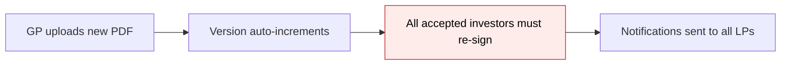
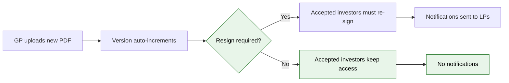

# NDA Version History & Resign Control — Proposal

> **Audience:** Business team, product, QA, support — non-technical.
> **Companion document:** [Design](design.md)

> **Planning phase — no code changes.** This document proposes and explains the change. Do not
> edit application code while writing it; implementation happens later, in the tasks phase.

---

## Why

When a GP uploads a new NDA PDF, the system auto-increments the version number and forces every previously accepted investor to re-sign — there is no choice. Some PDF updates are minor (typo fix, formatting) and should not force re-signing. Additionally, there is no version history: the system tracks only the current version number and the current PDF. If a GP needs to know what PDF was version 2 or who uploaded it, that information is lost. For compliance and audit, every version of a legally binding document should be preserved with metadata about who uploaded it and whether re-signing was required.

---

## What Changes

- **GP chooses whether re-signing is required:** When uploading a new NDA PDF, the GP sees a toggle — "Require existing signatories to re-sign this version?" (default: yes). This choice is recorded per version.
- **Version always increments:** Every new PDF gets a new version number, preserving the audit trail regardless of the resign decision.
- **Version history table:** Each version bump creates a history record storing the version number, the PDF file reference, who uploaded it, when, and whether resign was required.
- **Conditional acceptance check:** When the GP chose "no resign required," existing accepted investors keep access even though the version number changed. New/pending investors see the latest PDF.
- **Conditional notifications:** Version change notifications only fire when resign is required.

### Flow Diagram

**GP uploads new NDA PDF — before:**



**GP uploads new NDA PDF — after:**



---

## User Stories

### US-1: GP uploads new PDF without requiring re-sign

**As a** GP user,
**I want** to upload a corrected NDA PDF without forcing existing signatories to re-sign,
**So that** minor document corrections don't disrupt investor access.

**Acceptance criteria:**
- When uploading a new PDF in NDA settings, a toggle appears: "Require existing signatories to re-sign this version?"
- Default is "Yes" (current behavior preserved)
- When set to "No" and saved, the version increments but existing accepted investors keep folder access
- No version change notification is sent to LPs or GPs
- New/pending investors see the latest PDF on the acceptance screen

### US-2: GP uploads new PDF requiring re-sign

**As a** GP user,
**I want** to upload a materially changed NDA and require all investors to re-sign,
**So that** compliance is maintained when the agreement terms change.

**Acceptance criteria:**
- When the toggle is set to "Yes" (default), the current behavior is preserved
- Version increments, accepted investors must re-sign next time they access the folder
- Version change notifications are sent to all affected LPs and GP notification emails

### US-3: GP views version history

**As a** GP user,
**I want** to see a history of all NDA versions for a folder,
**So that** I can audit what was uploaded, when, by whom, and whether re-signing was required.

**Acceptance criteria:**
- The NDA Status Dashboard (or NDA settings modal) shows a version history section
- Each entry shows: version number, upload date, uploaded by (user name), and whether resign was required
- The PDF for each version is downloadable
- The current (latest) version is highlighted

### US-4: Audit trail for signed versions

**As a** compliance officer reviewing NDA records,
**I want** to know which PDF a specific investor actually signed,
**So that** I can verify what agreement is in effect.

**Acceptance criteria:**
- By joining the acceptance record's version number with the version history, it is possible to determine which PDF was signed
- Historical PDFs are preserved in storage even after newer versions are uploaded

---

## UI Behavior

### NDA Settings Form — Version Bump Toggle

```
┌─────────────────────────────────────────────────────┐
│  NDA Settings                                     ✕  │
│                                                      │
│  NDA Document                                        │
│  ┌────────────────────────────────────────────────┐  │
│  │ 📄 updated_nda_v2.pdf                    [⬆]  │  │
│  └────────────────────────────────────────────────┘  │
│                                                      │
│  ┌─ alert-warning ────────────────────────────────┐  │
│  │ ⚠ Uploading a new document will create a new  │  │
│  │   version. X investors have already accepted.  │  │
│  │                                                │  │
│  │ ☐ Require existing signatories to re-sign     │  │
│  │   this version                                 │  │
│  └────────────────────────────────────────────────┘  │
│                                                      │
│  [Save]                                              │
└─────────────────────────────────────────────────────┘
```

**Behavior notes:**
- The warning banner and checkbox appear only when editing an existing NDA config and uploading a new PDF (not on first creation)
- The checkbox defaults to checked (re-sign required)
- The checkbox is inside the version warning banner for visual association
- If no new PDF is uploaded, the checkbox is not shown

### NDA Status Dashboard — Version History Section

```
┌─────────────────────────────────────────────────────┐
│  Version History                                     │
│  ┌────────────────────────────────────────────────┐  │
│  │ v3 (current) │ 07 Oct 2026 │ GP User │ ⬇      │  │
│  │              │ Resign: Required               │  │
│  │ v2           │ 15 Sep 2026 │ GP User │ ⬇      │  │
│  │              │ Resign: Not required           │  │
│  │ v1           │ 01 Sep 2026 │ GP User │ ⬇      │  │
│  │              │ (Initial upload)               │  │
│  └────────────────────────────────────────────────┘  │
└─────────────────────────────────────────────────────┘
```

**Behavior notes:**
- Shown as a collapsible section on the NDA Status Dashboard
- Each row has a download link for that version's PDF
- Most recent version is at the top and marked "(current)"
- Version 1 is marked "(Initial upload)" — no resign decision applies

---

## What This Feature Does NOT Cover

| Excluded | Covered In |
|---|---|
| Full NDA audit trail dashboard (timeline of all events per investor) | Future audit trail feature |
| Ability to roll back to a previous version | Not planned |
| Side-by-side PDF comparison between versions | Not planned |
| Versioned notification email templates | Module 8 (already shipped) |

---

## Validation Rules

| Field | Rule | Default |
|---|---|---|
| `resign_required` | Boolean, only relevant when a new PDF is uploaded on an existing NDA config | `true` |
| Version history record | Created automatically on every version bump — not user-editable | N/A |

---

## Behavior Rules

| Scenario | What User Sees |
|---|---|
| GP uploads new PDF with "Require re-sign" checked | Version increments, accepted investors must re-sign, notifications sent |
| GP uploads new PDF with "Require re-sign" unchecked | Version increments, accepted investors keep access, no notifications |
| GP edits NDA settings without uploading a new PDF | No version change, no resign toggle shown |
| First NDA creation (no previous version) | No resign toggle shown — not applicable |
| LP visits folder after non-resign version bump, previously accepted | Folder opens normally |
| LP visits folder after resign-required version bump, previously accepted | Acceptance screen shown with version mismatch note |
| New LP visits folder after any version bump | Sees latest PDF on acceptance screen |

---

## Resolved Design Decisions

| # | Decision | Resolution |
|---|---|---|
| 1 | Should version always increment, or skip increment when resign is not required? | Always increment — preserves audit trail. The resign flag controls whether acceptances are invalidated, not whether versions are tracked. |
| 2 | Where is the resign choice stored? | On a per-version history record, not on the nda_config row. Each version bump has its own resign decision. |
| 3 | How does the acceptance check handle non-resign versions? | The gate checks whether any version between the acceptance's version and the current version required resign. If none did, the acceptance is still valid. |
| 4 | Should there be a version history UI? | Yes — a collapsible section on the NDA Status Dashboard with download links for each version's PDF. |
| 5 | What about existing NDA configs with no version history? | A backfill migration creates a version 1 record for each existing NDA config using current data. |

---

## Capabilities

### New Capabilities

- `nda/version-history`: Tracks every NDA PDF version with metadata (uploader, timestamp, resign decision). Provides a GP-facing version history view with downloadable PDFs. Controls whether a version bump invalidates existing acceptances or preserves them.

### Modified Capabilities

_(none — no existing specs are affected)_

---

## Impact

- **NDA settings form:** Gains a resign toggle checkbox in the version warning banner when a new PDF is uploaded on an existing config.
- **NDA acceptance gate:** Version mismatch check becomes conditional — tolerates version gaps when no intermediate version required resign.
- **NDA Status Dashboard:** Gains a version history section with downloadable PDFs.
- **NDA notifications:** Version change notifications become conditional on `resign_required`.
- **Database:** New `nda_config_versions` table. Backfill migration for existing configs.
- **File storage:** Historical PDFs are retained in S3 (Shrine does not delete old uploads by default).

---

## Benefits

1. **GP control** — GPs can correct minor PDF issues without disrupting investor access or triggering unnecessary re-signing workflows.
2. **Audit trail** — Every NDA version is preserved with metadata, enabling compliance review of what was signed, when, and by whom.
3. **Reduced LP friction** — Minor PDF corrections no longer force all investors through the re-acceptance flow.
4. **Foundation for audit dashboard** — Version history records provide the data backbone for a future full NDA audit trail feature.

---

## FAQ

| Question | Answer |
|---|---|
| What happens to existing NDA configs? | A one-time migration creates a version 1 history record for each existing config. No investor access is affected. |
| Can a GP change the resign decision after saving? | Not in this feature. Once saved, the resign decision for that version is recorded. The GP can upload another new PDF to create a new version with a different resign choice. |
| Does this change how notifications work? | Only in timing — notifications are sent only when resign is required. The notification content and recipients are unchanged (Module 8). |
| What if a GP uploads multiple versions without resign, then one with resign? | The acceptance check looks at whether any version after the LP's signed version required resign. If version 4 required it, an LP who signed version 2 must re-sign even if version 3 did not require it. |
| Are old PDFs deleted from storage? | No — Shrine retains uploaded files in S3. The version history table stores the Shrine file reference so each version's PDF remains downloadable. |
| Can non-GP users see the version history? | In this feature, version history is visible only to GP users on the NDA Status Dashboard. LPs see only the current version on the acceptance screen. |

---

## Design Principle for the Next Phase

- **Reuse the version warning banner:** The resign toggle goes inside the existing `showVersionWarning` banner in the NDA settings form. No new UI component needed — just a checkbox addition.
- **Version history as data, not file duplication:** Each version record stores a Shrine file reference (JSON pointer to the S3 object), not a copy of the file. Shrine already retains old uploads.
- **Acceptance check must handle version gaps:** The gate logic must check the resign decision across multiple versions (not just the current one). Design this as a single query, not a loop. Keep it simple — if any version in the gap required resign, the acceptance is stale.
