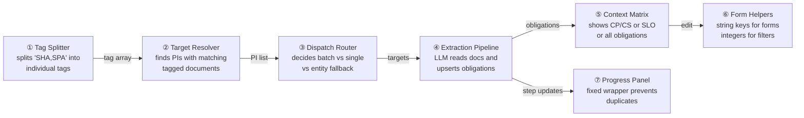
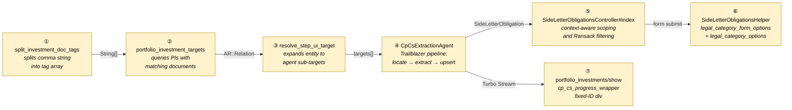
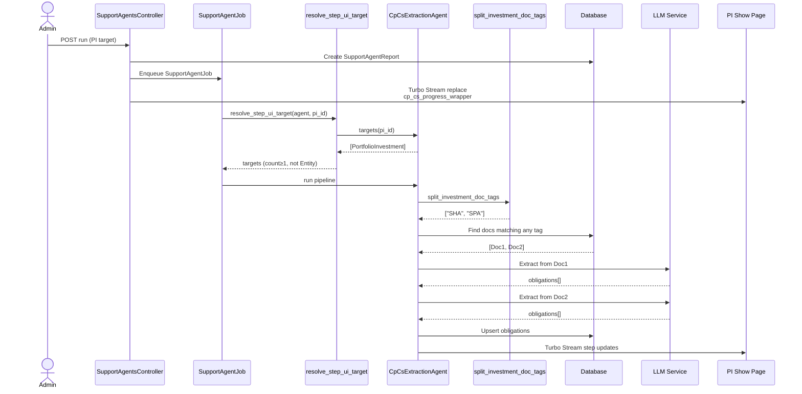
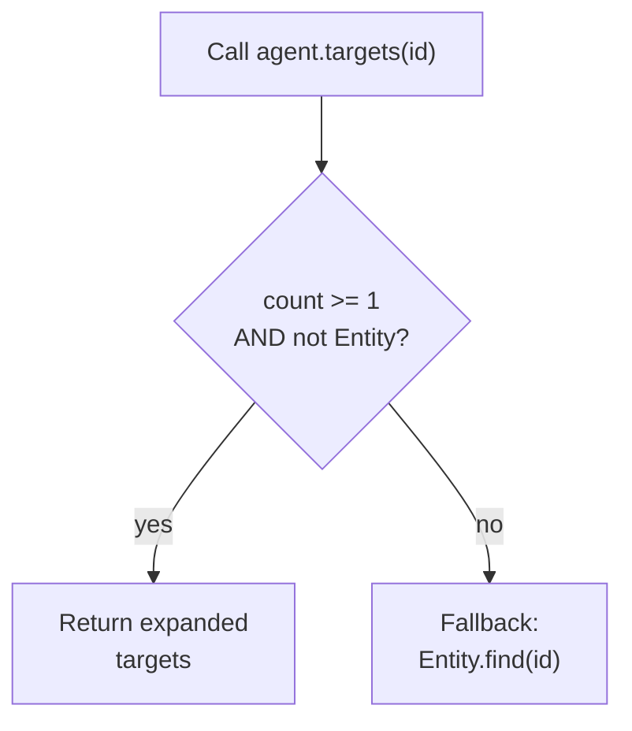
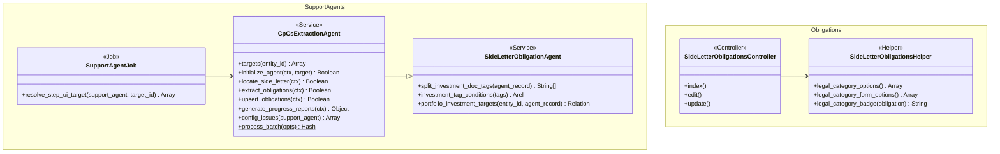

# Obligation Matrix Fixes — Design

> **Audience:** Engineering team.
> **Companion documents:** [Proposal](proposal.md) · [Spec](specs/)

> **Planning phase — no code changes.** This document explains HOW the proposal will be built.
> Do not edit application code while writing it; implementation happens later, in the tasks phase.

> **Design, not code.** Explain the design with mermaid diagrams and tables. Do NOT paste Ruby/JS
> class bodies, migrations, route blocks or policy code. Put real class, method, table and path
> names inside the diagrams and tables instead.

---

## Contents

- [1. The idea](#1-the-idea)
  - [What this adds](#what-this-adds)
  - [The idea in one picture](#the-idea-in-one-picture)
  - [Walkthrough: one example, start to finish](#walkthrough-one-example-start-to-finish)
  - [Key ideas](#key-ideas)
- [2. The same picture with real names](#2-the-same-picture-with-real-names)
  - [Picture](#picture)
  - [What each box does](#what-each-box-does)
  - [One run, end to end](#one-run-end-to-end)
  - [Lifecycles](#lifecycles)
  - [What users see](#what-users-see)
  - [Design decisions](#design-decisions)
- [3. One card per box](#3-one-card-per-box)
  - [① Tag splitter](#①-tag-splitter)
  - [② Target resolver](#②-target-resolver)
  - [③ Dispatch router](#③-dispatch-router)
  - [④ Extraction pipeline](#④-extraction-pipeline)
  - [⑤ Context-aware matrix](#⑤-context-aware-matrix)
  - [⑥ Form helpers](#⑥-form-helpers)
  - [⑦ Progress panel](#⑦-progress-panel)
- [4. Reference](#4-reference)
  - [Class diagram](#class-diagram)
  - [Data model and schema changes](#data-model-and-schema-changes)
  - [Component contracts](#component-contracts)
  - [Notifications](#notifications)
  - [Cross-cutting concerns](#cross-cutting-concerns)
  - [Worked examples](#worked-examples)
  - [Testing](#testing)
  - [Risks and open questions](#risks-and-open-questions)

---

## 1. The idea

### What this adds

This change fixes the CP/CS Extraction Agent and the Obligation Matrix so they work end-to-end on staging. It follows the existing SupportAgent pattern (Trailblazer pipeline with step broadcasting) and the existing Ransack + Pagy matrix pattern. The core fixes are: splitting comma-separated document tags for document lookup, fixing the dispatch router so it doesn't collapse multiple sub-targets into an Entity fallback, and splitting the matrix into context-aware scopes via a query parameter.

### The idea in one picture



### Walkthrough: one example, start to finish

**Setup:** Entity 157 has the CP/CS agent enabled with `investment_doc_tag = "SHA,SPA"`. There are 5 portfolio investments; 3 have documents tagged "SHA" or "SPA". An admin wants to extract obligations from a single PI ("Acme Corp") which has one SHA document and one SPA document.

**Legend:** ✓ = done, ● = in progress, ○ = not started.

| # | When | What happens | Behind the scenes | Result |
|---|---|---|---|---|
| 1 | Admin opens Acme Corp PI page | Sees "Run CP/CS Agent" button and empty progress wrapper | The view checks for an existing SupportAgentReport; none found, so the wrapper div renders empty | Button visible |
| 2 | Admin clicks "Run CP/CS Agent" | Modal opens; admin optionally enters estimated closing date and submits | Controller `run` action creates a SupportAgentReport, enqueues SupportAgentJob | Progress panel appears:<br/>● Initialize<br/>○ Locate&nbsp;Document<br/>○ Extract&nbsp;Obligations<br/>○ Save&nbsp;For&nbsp;Review<br/>○ Generate&nbsp;Report |
| 3 | Job dispatches | Dispatch router (③) calls `targets(pi)` which returns `[pi]` since input is a PortfolioInvestment | `resolve_step_ui_target` sees count=1, which is ≥1 and not Entity, so returns the PI directly | ✓ Initialize<br/>● Locate&nbsp;Document<br/>○ Extract&nbsp;Obligations<br/>○ Save&nbsp;For&nbsp;Review<br/>○ Generate&nbsp;Report |
| 4 | Locate step runs | Tag splitter (①) splits "SHA,SPA" into `["SHA", "SPA"]`. Target resolver (②) finds 2 documents on Acme Corp | Both documents collected into `pi_docs` | ✓ Initialize<br/>✓ Locate&nbsp;Document&nbsp;—&nbsp;SHA,&nbsp;SPA&nbsp;(1/1)<br/>● Extract&nbsp;Obligations<br/>○ Save&nbsp;For&nbsp;Review<br/>○ Generate&nbsp;Report |
| 5 | Extract step runs | Extraction pipeline (④) sends SHA doc to LLM → 8 obligations. Sends SPA doc → 4 obligations. Total 12, all with source_clause | Dedup on source_clause ensures no duplicates across docs | ✓ Initialize<br/>✓ Locate&nbsp;Document<br/>✓ Extract&nbsp;Obligations&nbsp;—&nbsp;Extracted&nbsp;12&nbsp;(1/1)<br/>● Save&nbsp;For&nbsp;Review<br/>○ Generate&nbsp;Report |
| 6 | Upsert step saves | 12 obligations created as `pending_review` with `extracted_by = ai`, `legal_category` set by LLM | `upsert_portfolio_obligations` matches on source_clause for idempotency | ✓ Initialize<br/>✓ Locate&nbsp;Document<br/>✓ Extract&nbsp;Obligations<br/>✓ Save&nbsp;For&nbsp;Review&nbsp;—&nbsp;Saved&nbsp;12&nbsp;(1/1)<br/>● Generate&nbsp;Report |
| 7 | Report step | Report generated, progress panel shows "View results" link to CP/CS matrix | Redirect URL includes `context=cp_cs` | All steps ✓ |
| 8 | Admin navigates away, then back | One progress panel visible (not two) | Turbo cache restores the wrapper div; the fixed ID `cp_cs_progress_wrapper` ensures only one target | Single panel |
| 9 | Counsel opens CP/CS matrix | Sees "CP/CS Obligation Matrix" title, 12 new pending obligations | Controller pre-filters to `condition_precedent` and `condition_subsequent` | Filtered matrix |
| 10 | Counsel edits one obligation, changes category from CP to CS | Form submits `legal_category = "condition_subsequent"` (string key) | Form helper `legal_category_form_options` returns string keys; Rails enum setter accepts it | Obligation saved |

**What a mistake looks like:** If the admin had configured the tag as just "SHA", the SPA documents would not be found. The progress panel would show "no document" for any PI with only SPA-tagged documents. The admin edits the agent config to "SHA,SPA" and re-runs.

**What to notice:**
- The tag splitter (①) is the fix that unblocks document discovery on staging
- The dispatch router (③) fix (`count >= 1` instead of `count == 1`) prevents the Entity fallback crash
- The context parameter on the matrix (⑤) is preserved across filter submissions
- The form helper (⑥) dual-helper pattern prevents the legal_category ArgumentError
- The fixed wrapper ID (⑦) prevents duplicate progress panels

### Key ideas

| # | Idea | In one line | Card |
|---|---|---|---|
| 1 | Comma split on tags | Split once in the agent, reuse everywhere targets are resolved | [①](#①-tag-splitter) |
| 2 | Sub-target expansion | Agent's `targets()` method returns domain-specific records; dispatch trusts the count | [②](#②-target-resolver) / [③](#③-dispatch-router) |
| 3 | Context parameter | One controller, one view, three modes — driven by a query parameter | [⑤](#⑤-context-aware-matrix) |
| 4 | Dual form helpers | String keys for form submission, integer values for Ransack filters | [⑥](#⑥-form-helpers) |
| 5 | Fixed wrapper ID | Turbo Stream replaces a predictable target instead of appending | [⑦](#⑦-progress-panel) |

**FAQ**

| Question | Answer |
|---|---|
| Why fix all these together instead of separate PRs? | They share root causes (tag splitting affects both document lookup and target resolution; the matrix context affects both the controller scope and the form helpers) and are all needed for staging to work |
| Could the tag splitting live in a shared utility? | It could, but it's only used in `SideLetterObligationAgent` and consumed by `CpCsExtractionAgent` via inheritance. No need for an abstraction yet |

---

## 2. The same picture with real names

### Picture



Colour = footprint: **green** new, **amber** modified, **grey** reused unchanged.

### What each box does

| # | Box | Real parts | What it does | When it runs | What it decides | Details |
|---|---|---|---|---|---|---|
| ① | Tag Splitter | `SideLetterObligationAgent#split_investment_doc_tags` | Splits comma-separated tag string into trimmed array | During target resolution | Nothing — pure transform | [card ①](#①-tag-splitter) |
| ② | Target Resolver | `SideLetterObligationAgent#portfolio_investment_targets`, `#investment_tag_conditions` | Builds WHERE clause with OR conditions per tag, returns PIs with matching docs | During `targets()` call | Which PIs have at least one matching document | [card ②](#②-target-resolver) |
| ③ | Dispatch Router | `SupportAgentJob#resolve_step_ui_target` | Expands entity_id to agent-specific sub-targets for step-UI runs | When SupportAgentJob dispatches a single-target run | Whether to use expanded targets or fall back to Entity | [card ③](#③-dispatch-router) |
| ④ | Extraction Pipeline | `CpCsExtractionAgent` (initialize, locate, extract, upsert, report steps) | Multi-document extraction per PI with step broadcasting | On agent run (batch or single) | How many docs per PI, dedup by source_clause | [card ④](#④-extraction-pipeline) |
| ⑤ | Context Matrix | `SideLetterObligationsController#index`, `index.html.erb`, `_matrix.html.erb` | Scopes query by context param, adapts title/banner/filters/columns | On page load | Which legal categories to include; which UI elements to show | [card ⑤](#⑤-context-aware-matrix) |
| ⑥ | Form Helpers | `SideLetterObligationsHelper` | Provides form options (string keys) and filter options (integer values) | On form render and filter render | Which value type to use based on consumer | [card ⑥](#⑥-form-helpers) |
| ⑦ | Progress Panel | `portfolio_investments/show.html.erb`, `_progress_panel.html.erb` | Fixed-ID wrapper div; dual Turbo Stream replace targets | On PI page render and agent run response | Nothing — structural fix | [card ⑦](#⑦-progress-panel) |

### One run, end to end



### Lifecycles

N/A — no new stored or derived statuses introduced. The existing `review_status` and `status` lifecycles on `SideLetterObligation` are unchanged.

### What users see

**At a glance:**

| Where in CapHive | Today | After this change | Who sees it |
|---|---|---|---|
| PI show page | No agent button | "Run CP/CS Agent" button + progress panel | Fund managers, ops |
| Obligation matrix | All obligations mixed, no context | Three modes: CP/CS, SLO, or All | Counsel, fund managers |
| Obligation edit form | ArgumentError on save | Saves correctly; CP/CS forms hide MFN and SLO option | Counsel |
| Matrix breadcrumb | Shows "Side Letters" link for CP/CS | Context-preserving breadcrumb, no misleading links | All users |
| Matrix table | No client-side sorting | Column sorting via DataTables | All users |

**Main everyday journey:**

```
PI Show Page                            Obligation Matrix (CP/CS)
┌─────────────────────────┐            ┌──────────────────────────────┐
│ Acme Corp / Fund Alpha  │            │ CP/CS Obligation Matrix      │
│                         │     ①      │                              │
│ [🤖 Run CP/CS Agent]───┼────────────┤  ② Legal Category: [CP ▾]   │
│                         │            │                              │
│ ┌─── Progress ────────┐ │            │  Investor │ Cat │ Title │ ⚙ │
│ │ ✓ Initialize    ③   │ │            │  ─────────┼─────┼───────┼───│
│ │ ✓ Locate Document   │ │            │  Acme     │ CP  │ Board │ ✎ │
│ │ ✓ Extract           │ │            │           │     │       │   │
│ │ ✓ Save For Review   │ │            │  ④ Click Edit → form with  │
│ │ ✓ Generate Report   │ │            │     string keys, no MFN     │
│ └─────────────────────┘ │            └──────────────────────────────┘
└─────────────────────────┘
```

| Step | The user... | They see |
|---|---|---|
| ① | Clicks "Run CP/CS Agent" on PI page | Progress panel with step indicators |
| ② | Opens CP/CS matrix from agent results link | Filtered matrix with CP/CS title and adapted filters |
| ③ | Navigates away and returns to PI page | Same single progress panel (no duplicate) |
| ④ | Clicks Edit on a CP obligation | Form with string-key legal category, no MFN checkbox |

### Design decisions

1. **One controller with context param vs separate controllers** — One controller with a `context` query parameter. Alternative: separate `CpCsObligationsController`. Rejected because the query logic, views, and lifecycle actions are identical; a context param keeps it DRY.

2. **String keys for forms, integer for Ransack vs one helper for both** — Two helpers. Alternative: one smart helper detecting usage. Rejected because the consumer context differs at render time (form vs filter) and a single smart helper would need the caller to signal intent, adding complexity.

3. **Fixed wrapper ID vs `data-turbo-temporary`** — Fixed wrapper ID with dual Turbo Stream replace. Alternative: marking the panel `data-turbo-temporary` so it's stripped from cache. Rejected because `data-turbo-temporary` would remove the panel entirely on cache restore, losing the "last known state" UX.

4. **`count >= 1` vs checking record type** — `count >= 1` with not-Entity check. Alternative: checking if results are the expected type. Chose the simpler threshold check since the existing pattern already checks `is_a?(Entity)`.

5. **OR matching for comma-separated tags vs AND** — OR matching (any tag matches). Alternative: AND (all tags must match one document). Rejected because documents are tagged with one type each; AND would match nothing.

**FAQ**

| Question | Answer |
|---|---|
| Why not use a scope on the model for context filtering? | The context filtering is simple enough for the controller; a scope would just move the same two `where` clauses. Not worth the abstraction for three conditions |
| Does the context param leak into other pages? | No — it's a query parameter, not a session variable. Each navigation resets it |

---

## 3. One card per box

### ① Tag Splitter

The method that splits a comma-separated tag config string into an array of trimmed individual tags. Used by the target resolver (②) to build document-matching queries.

| Owns | Reads / receives | Produces |
|---|---|---|
| `split_investment_doc_tags` method on `SideLetterObligationAgent` | `investment_doc_tag` from agent's `json_fields` | `Array<String>` of trimmed tag strings |

The method splits on comma, strips whitespace from each tag, and rejects blanks. A single tag (no comma) returns a one-element array, preserving backward compatibility.

**Worked examples:** H1, H2, E1, E2

**FAQ**

| Question | Answer |
|---|---|
| What if the tag field is empty? | `config_issues` catches this and warns the admin; at runtime, the targets query returns no results |
| Why split in the agent and not in a shared utility? | Only the SLO/CP-CS agents use this pattern; extracting it is premature |

### ② Target Resolver

Builds a database query that finds portfolio investments with at least one document matching any of the split tags. Returns an `ActiveRecord::Relation`.

| Owns | Reads / receives | Produces |
|---|---|---|
| `portfolio_investment_targets`, `investment_tag_conditions` on `SideLetterObligationAgent` | Tag array from ①, entity_id, agent record | `ActiveRecord::Relation<PortfolioInvestment>` |

`investment_tag_conditions` builds OR-combined LIKE conditions (one per tag) for the `tag_list` column on `Document`. `portfolio_investment_targets` joins through the document relation and applies these conditions with entity scoping.

**Worked examples:** H1, H2, E1, E3, E4

**FAQ**

| Question | Answer |
|---|---|
| Why LIKE instead of exact match on tag_list? | tag_list is a comma-separated string column (ActsAsTaggable), so LIKE with wildcards is needed to match individual tags within it |
| Is this N+1 safe? | Yes — one query returns all matching PIs; documents are preloaded in the locate step |

### ③ Dispatch Router

The `resolve_step_ui_target` method in `SupportAgentJob` that expands an entity ID into agent-specific sub-targets for step-UI (single-target) runs. The fix changes the fallback condition from `count == 1` to `count >= 1`.

| Owns | Reads / receives | Produces |
|---|---|---|
| `resolve_step_ui_target` on `SupportAgentJob` | SupportAgent record, target_id | `Array` of target records |

The decision logic:



**Before fix:** `count == 1` meant that 0 targets AND >1 targets both fell through to Entity fallback. With >1 targets, the pipeline received an Entity instead of PortfolioInvestments, causing the "CapitalCommitment expected, got Entity" crash.

**After fix:** `count >= 1` means the fallback only fires when the agent truly returns nothing (e.g. tag mismatch on staging before the comma-split fix).

**Worked examples:** H1, H3, E3, X1

**FAQ**

| Question | Answer |
|---|---|
| Does this affect the SLO agent too? | Yes — `resolve_step_ui_target` is shared. But the SLO agent's `targets()` returns CapitalCommitments which is the expected type, so the fix is safe for both |
| What happens if targets returns 0? | Falls back to Entity.find(target_id), which is the pre-existing behavior for when no documents match |

### ④ Extraction Pipeline

The CpCsExtractionAgent's Trailblazer pipeline — initialize, locate, extract, upsert, report. Modified to support multi-document extraction per PI (one LLM call per document, dedup on source_clause across documents on the same PI).

| Owns | Reads / receives | Produces |
|---|---|---|
| `CpCsExtractionAgent` steps: `initialize_agent`, `locate_side_letter`, `extract_obligations`, `upsert_obligations`, `generate_progress_reports` | PI targets from ③, tag array from ①, LLM service | `SideLetterObligation` records (pending_review), `SupportAgentReport` |

The locate step iterates PIs and collects all matching documents (not just the first). The extract step iterates documents per PI, calling the LLM for each. The upsert step deduplicates by source_clause within each PI.

**Worked examples:** H1, H2, H3, E4, E5, X2

**FAQ**

| Question | Answer |
|---|---|
| Why one LLM call per document instead of batching? | The LLM reads the document as a file attachment; each document is a separate file |
| What if the LLM call fails for one document? | The error is caught, logged, and the step is marked failed. Other documents and PIs continue |

### ⑤ Context-Aware Matrix

The obligation matrix controller and views, modified to support three context modes via a query parameter: `cp_cs` (conditions precedent/subsequent only), `side_letter` (side letter obligations only), and no context (all).

| Owns | Reads / receives | Produces |
|---|---|---|
| `SideLetterObligationsController#index`, `index.html.erb`, `_matrix.html.erb` | `context` param, Ransack params, fund_id, stakeholder_id | Rendered matrix page with context-specific title, banner, filters, columns |

Context-driven behavior:

| Aspect | `cp_cs` | `side_letter` | No context |
|---|---|---|---|
| Title | "CP/CS Obligation Matrix" | "Side Letter Obligation Matrix" | "LP Obligation Matrix" |
| Scope | `legal_category IN (cp, cs)` | `legal_category = slo` | All |
| Legal category column | Visible | Hidden | Visible |
| Legal category filter | CP and CS only | Hidden | All options |
| Info banner | CP/CS explanation | SLO explanation | SLO explanation |
| Context preserved | In hidden field + breadcrumb | In hidden field + breadcrumb | N/A |

The controller also supports fund_id and stakeholder_id filtering via subqueries (not joins) to avoid polymorphic association conflicts.

DataTables is wired via the existing Stimulus `datatable` controller for client-side sorting.

**Worked examples:** H4, E6, E7

**FAQ**

| Question | Answer |
|---|---|
| Why subqueries for fund filtering instead of joins? | `sourceable` is polymorphic; Rails can't LEFT JOIN a polymorphic association. Subqueries avoid the issue |
| Can the context be set from a bookmark? | Yes — it's a query parameter in the URL |

### ⑥ Form Helpers

Two helper methods for legal_category dropdowns: `legal_category_form_options` (string keys for form submission) and `legal_category_options` (integer values for Ransack filter queries).

| Owns | Reads / receives | Produces |
|---|---|---|
| `SideLetterObligationsHelper#legal_category_form_options`, `#legal_category_options` | `SideLetterObligation.legal_categories` enum hash | `Array<Array(String, String\|Integer)>` |

The root cause: Rails enum setters reject stringified integers. When a form select sends value "0" for `condition_precedent`, Rails raises `ArgumentError: '0' is not a valid legal_category`. The fix: form selects send "condition_precedent" (the string key), which Rails accepts.

The Ransack filter must continue using integer values because Ransack's `_eq` predicate compares against the database column value (an integer), not the enum key.

Additionally, the edit forms for CP/CS obligations hide the MFN checkbox (via `unless is_cp_cs`) and exclude the "Side Letter Obligation" option from the legal category dropdown (via `reject`).

**Worked examples:** H4, H5, E7, X3

**FAQ**

| Question | Answer |
|---|---|
| Why not just use string keys everywhere including Ransack? | Ransack generates SQL `WHERE legal_category = ?` — if you pass the string "condition_precedent", the DB comparison against the integer column fails |
| Does the inline edit row also use the new helper? | Yes — both `_form.html.erb` and `_inline_edit_row.html.erb` use `legal_category_form_options` |

### ⑦ Progress Panel

The progress panel wrapper on the PI show page, changed from a dynamically-IDed div to a fixed-ID wrapper (`cp_cs_progress_wrapper`) so Turbo Stream replaces work predictably.

| Owns | Reads / receives | Produces |
|---|---|---|
| `portfolio_investments/show.html.erb` wrapper div, controller `run` Turbo Stream response | SupportAgentReport, SupportAgent | HTML with fixed wrapper ID; dual Turbo Stream replace targets |

The controller's `run` action responds with two `turbo_stream.replace` calls: one targeting `progress_panel_#{report.id}` (for re-runs where the panel already has its report-specific ID) and one targeting `cp_cs_progress_wrapper` (for first runs and Turbo cache restores).

**Worked examples:** H1, E8

**FAQ**

| Question | Answer |
|---|---|
| Why two replace targets instead of one? | On first run, only `cp_cs_progress_wrapper` exists. On re-run, `progress_panel_#{id}` exists inside the wrapper. Dual targets cover both cases |
| Does this affect SLO agent progress panels? | No — the SLO agent's progress panel is on the capital commitment page, which uses a different wrapper pattern |

---

## 4. Reference

### Class diagram



### Data model and schema changes

N/A — no new tables or columns. All changes are behavioral (code-level), not schema-level.

### Component contracts

| From → To | Contract | Direction rule |
|---|---|---|
| ① Tag Splitter → ② Target Resolver | `String[]` of trimmed, non-blank tags | ① produces, ② consumes |
| ② Target Resolver → ③ Dispatch Router | `ActiveRecord::Relation<PortfolioInvestment>` | ② produces, ③ consumes via `targets()` |
| ③ Dispatch Router → ④ Pipeline | `Array<PortfolioInvestment>` (or `Array<Entity>` fallback) | ③ produces, ④ consumes |
| ④ Pipeline → ⑤ Matrix | `SideLetterObligation` records in DB | ④ writes, ⑤ reads |
| ⑤ Matrix → ⑥ Form Helpers | Helper method call with enum hash | ⑤ renders, ⑥ provides options |
| ④ Pipeline → ⑦ Progress Panel | Turbo Stream broadcasts via `SupportAgentReport` | ④ broadcasts, ⑦ receives |
| Controller `run` → ⑦ Progress Panel | `turbo_stream.replace` with two target IDs | Controller produces, ⑦ DOM receives |

### Notifications

This change sends no new notifications, does not modify any existing notification, and does not suppress any. The enforcement pipeline (daily due-date alerts) is part of the existing `obligation-due-date-alerts` spec and is unchanged by this fix. The extraction pipeline produces only `SupportAgentReport` records and Turbo Stream broadcasts (UI-only, not persistent notifications).

### Cross-cutting concerns

#### Transactions and queries

- **Tag matching query:** One query with OR-combined LIKE conditions per tag. No N+1 risk — returns a relation.
- **Fund/stakeholder filtering:** Uses subqueries (`WHERE id IN (SELECT ...)`) to avoid polymorphic JOIN issues. Tested with up to 135 PIs on staging.
- **Obligation upsert:** Each PI's obligations are upserted in a single transaction (existing behavior, unchanged).

#### Exception handling and monitoring

- **LLM extraction failure:** Caught by `rescue StandardError` in `extract_obligations`, logged to Rails logger, step marked failed on the report. Other PIs continue processing.
- **Entity fallback in dispatch:** When `resolve_step_ui_target` falls back to Entity (0 targets), the pipeline receives an Entity which is handled gracefully (empty report, no crash).

#### Performance and security

- **Performance:** Tag splitting is O(n) where n = number of comma-separated tags (typically 1-3). No additional queries introduced beyond what the single-tag version already ran.
- **Security:** Entity scoping is enforced at every level — `policy_scope` on the controller, `entity_id` filtering in target resolution, and Pundit authorization on each action. The `context` parameter accepts only `cp_cs`, `side_letter`, or nil; no injection risk.

### Worked examples

**ID legend:** **H** = Happy path · **E** = Edge case · **X** = Error (exception) case.

**Shared setup:**

| Record | Name | Key data |
|---|---|---|
| Entity | Entity 157 | Licensed for CP/CS agent |
| SupportAgent | Agent 79 | `agent_type = CpCsExtractionAgent`, `investment_doc_tag = "SHA,SPA"`, entity 157 |
| PortfolioInvestment | Acme Corp PI | Entity 157, has SHA doc + SPA doc |
| PortfolioInvestment | Beta Ltd PI | Entity 157, has SHA doc only |
| PortfolioInvestment | Gamma Inc PI | Entity 157, has no matching docs |
| PortfolioInvestment | Delta Co PI | Entity 157, has SPA doc only |
| Document | SHA Doc (Acme) | tag_list: "SHA", owner: Acme Corp PI |
| Document | SPA Doc (Acme) | tag_list: "SPA", owner: Acme Corp PI |
| Document | SHA Doc (Beta) | tag_list: "SHA", owner: Beta Ltd PI |
| Document | SPA Doc (Delta) | tag_list: "SPA", owner: Delta Co PI |
| SideLetterObligation | CP Obligation 1 | legal_category: condition_precedent, sourceable: Acme Corp PI |

#### Happy Path

| # | Scenario | Given | When | Then | Spec scenario | Feature |
|---|---|---|---|---|---|---|
| H1 | Single PI extraction with multi-tag | Agent 79 configured, Acme Corp PI has SHA+SPA docs | Admin runs CP/CS agent from Acme Corp PI page | Agent finds both docs, extracts obligations from each, saves as pending_review | Multiple tags find documents of different types | `cp_cs_extraction_agent.feature` |
| H2 | Batch extraction with comma tags | Agent 79 configured with "SHA,SPA" | Admin runs batch for entity 157 | Agent processes Acme (2 docs), Beta (1 doc), Delta (1 doc); skips Gamma (0 docs) | Batch mode resolves all matching PIs | `cp_cs_extraction_agent.feature` |
| H3 | Run from PI show page | Agent 79 enabled, Acme Corp PI exists | Admin clicks "Run CP/CS Agent" on PI page | Progress panel appears, steps complete, obligations created | Running from PI page shows progress | `cp_cs_extraction_agent.feature` |
| H4 | View CP/CS matrix | CP obligations exist for Acme | Counsel opens matrix with context=cp_cs | Only CP and CS obligations shown, title is "CP/CS Obligation Matrix" | CP/CS context scopes to CP and CS only | `side_letter_matrix.feature` |
| H5 | Edit CP obligation legal category | CP Obligation 1 exists | Counsel changes legal_category to "condition_subsequent" | Form submits string key, saves successfully | Edit form saves legal category without error | `side_letter_obligation_e2e.feature` |

#### Edge Cases

| # | Scenario | Given | When | Then | Spec scenario | Feature |
|---|---|---|---|---|---|---|
| E1 | Single tag (no comma) | Agent configured with "SHA" (no comma) | Batch run | Only SHA-tagged documents matched; SPA docs ignored | Single tag still works | `cp_cs_extraction_agent.feature` |
| E2 | Tags with whitespace | Agent configured with "SHA , SPA" | Batch run | Both "SHA" and "SPA" matched after trimming | Tags with whitespace are trimmed | `cp_cs_extraction_agent.feature` |
| E3 | Zero targets (tag mismatch) | Agent configured with "XYZ", no documents match | Single PI run | Dispatch falls back to Entity, pipeline produces empty report | Agent returns zero sub-targets | `cp_cs_extraction_agent.feature` |
| E4 | PI with no matching documents | Gamma Inc PI has no SHA/SPA docs | Batch run includes Gamma | Gamma skipped with "no document" in progress | No matching documents on a PI | `cp_cs_extraction_agent.feature` |
| E5 | Dedup across docs on same PI | Acme has SHA and SPA docs, both mention same clause | Extraction from both docs | Obligation created once (dedup on source_clause) | Two documents on one PI yield deduplicated obligations | `cp_cs_extraction_agent.feature` |
| E6 | Side letter context hides legal category column | SLO obligations exist | Counsel opens matrix with context=side_letter | Legal category column not visible, title is "Side Letter Obligation Matrix" | Side letter context scopes to SLO only | `side_letter_matrix.feature` |
| E7 | Context preserved across filter | Viewing CP/CS matrix | Counsel applies a filter | Context=cp_cs preserved in form submission | Context preserved across filter submission | `side_letter_matrix.feature` |
| E8 | Navigate away and return to PI | Agent was run, progress panel shown | Admin navigates away, returns via back button | One progress panel visible (Turbo cache) | Navigate away and return | `cp_cs_extraction_agent.feature` |

#### Error Cases

| # | Scenario | Given | When | Then (what the user sees, who is alerted) | Spec scenario | Feature |
|---|---|---|---|---|---|---|
| X1 | Dispatch with Entity fallback | Tag mismatch, targets() returns 0 | Agent dispatched from PI page | Empty report, no crash; admin sees "no documents found" step | Agent returns zero sub-targets | `cp_cs_extraction_agent.feature` |
| X2 | LLM extraction failure | Valid document exists | LLM API call fails | Step marked failed on report, error logged; admin sees failed step | N/A (infrastructure error) | `cp_cs_extraction_agent.feature` |
| X3 | Old form submits integer value | Legacy cached form page | Form submits legal_category=0 | ArgumentError (fixed by new helper; stale cache edge case) | Edit form saves legal category without error | `side_letter_obligation_e2e.feature` |

### Testing

Cucumber only. The `cp_cs_extraction_agent.feature` file (10 scenarios, already on the branch) covers the agent pipeline. `side_letter_matrix.feature` covers context-aware matrix. `side_letter_obligation_e2e.feature` covers the edit form fix. Shared step file: `cp_cs_extraction_agent_steps.rb`. Reused step files: existing `support_agent_steps.rb` for common agent setup.

### Risks and open questions

- **Stale Turbo cache on staging** → The dual replace targets mitigate this; a hard refresh clears any remaining stale state.
- **LLM cost for multi-document PIs** → Each document triggers a separate LLM call. For a PI with many matching docs (unlikely — typically 1-2), costs scale linearly. Mitigated by the typical tag setup matching 1-2 docs per PI.
- **LIKE query performance on large document tables** → The LIKE conditions on `tag_list` are not indexed. For entities with thousands of documents, this could be slow. Mitigated by entity_id scoping which limits the set.

No open questions — all design decisions resolved during the debugging session.

**FAQ**

| Question | Answer |
|---|---|
| Where do I start reviewing? | Start with the tag splitter (①) and target resolver (②) — they fix the root cause. Then the dispatch router (③) for the crash fix. The matrix (⑤) and form (⑥) fixes are independent |
| Can I deploy these fixes independently? | The tag fix (①②) and dispatch fix (③) are independent. The matrix (⑤) and form (⑥) fixes are independent of the agent fixes but depend on each other for the full experience |
