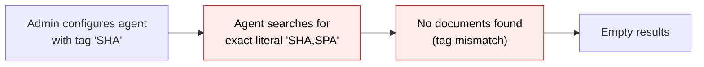
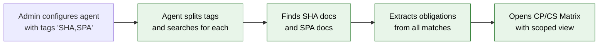
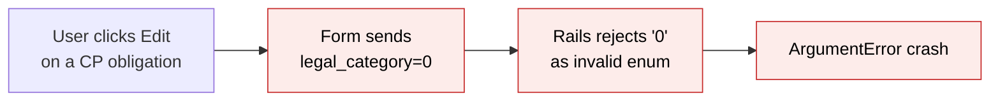
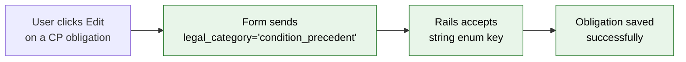
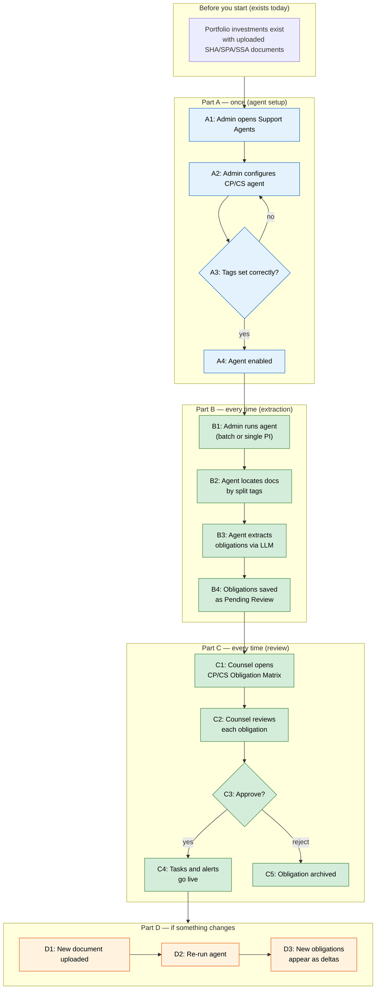

# Obligation Matrix Fixes — Proposal

> **Audience:** Business team, product, QA, support — non-technical.
> **Companion document:** [Design](design.md)
> **New to this? Start with the [Workflow Journey](#workflow-journey)** — every action, in order, from start to the outcome.

> **Planning phase — no code changes.** This document proposes and explains the change. Do not
> edit application code while writing it; implementation happens later, in the tasks phase.

---

## Why

The CP/CS Extraction Agent and the Obligation Matrix shipped with several interacting bugs that blocked production use: the agent could not find documents tagged with multiple types (e.g. "SHA,SPA"), running the agent from a portfolio investment page crashed when the dispatch logic fell back to the wrong record type, the obligation matrix had no context-aware scoping so CP/CS and side-letter obligations were always mixed together, and editing an obligation's legal category on the form threw an error because Rails rejected the stringified-integer enum value. These issues made the feature unusable on staging and needed to be fixed together because several share root causes in how the extraction engine resolves targets and how the matrix routes between obligation types.

## What Changes

- **Comma-separated document tags**: The CP/CS agent can now be configured with multiple document tags (e.g. "SHA,SPA,SSA") so it finds all matching investment agreements instead of treating the whole string as one literal tag.
- **Agent dispatch crash fix**: Running the CP/CS agent from a single portfolio investment page no longer crashes — the dispatch logic correctly expands sub-targets before deciding whether to fall back to the entity.
- **Context-aware obligation matrix**: The matrix page now supports three modes — CP/CS only, Side Letter only, or All — driven by a `context` parameter. Title, info banner, filters, and column visibility adapt to the selected context.
- **Legal category form fix**: Editing an obligation no longer throws an `ArgumentError` — form selects now send string enum keys instead of integer values.
- **Edit form scoping for CP/CS**: When editing a CP/CS obligation, the form hides the MFN checkbox and the "Side Letter Obligation" option from the legal category dropdown, since those only apply to commitment-sourced obligations.
- **Run CP/CS Agent button on PI page**: A "Run CP/CS Agent" button now appears on each portfolio investment's show page, letting users trigger extraction for a single investment without navigating to the batch page.
- **Progress panel duplication fix**: Navigating away from and back to a portfolio investment page no longer shows duplicate progress panels — the panel uses a fixed wrapper ID that Turbo replaces cleanly.
- **DataTables sorting on the matrix**: The obligation matrix table now supports client-side column sorting via DataTables.
- **Breadcrumb and filter fixes**: The matrix breadcrumb no longer shows a misleading "Side Letters" link, and the legal category filter uses integer enum values so Ransack queries match correctly.

### Flow Diagram

**Before — running the CP/CS agent and viewing results:**



**After — running the CP/CS agent and viewing results:**



**Before — editing a CP/CS obligation:**



**After — editing a CP/CS obligation:**



---

## Workflow Journey

### Who is involved

| Person | Role | What they do in the journey |
|---|---|---|
| Admin | Fund manager or ops lead | Configures the CP/CS agent with the correct document tags |
| Counsel | Legal counsel | Reviews, edits, approves or rejects extracted obligations |
| System | Automated | Runs extraction, generates reports, sends due-date alerts |

### The journey on one page



### Before you start

| Needed | Why | Where it comes from |
|---|---|---|
| Portfolio investments with documents | Agent needs documents to extract from | Uploaded by the ops team under each PI |
| Documents tagged SHA, SPA, or SSA | Agent identifies documents by tag | Set when uploading or editing the document |
| CP/CS agent enabled for the entity | Agent must be licensed and configured | Support Agents settings page |

### Part A — once (agent setup)

| Step | Who | Where | Action | What the system does | What you see |
|---|---|---|---|---|---|
| A1 | Admin | Support Agents page | Opens CP/CS Extraction Agent settings | Loads agent config form | Config form with tag field, model, schedule |
| A2 | Admin | Agent config form | Sets "investment_doc_tag" to "SHA,SPA" | Saves comma-separated tags | Config saved confirmation |
| A3 | Admin | Agent config form | Verifies tags match document labels | Validates tag string is non-empty | Warning if tag is blank |
| A4 | Admin | Agent config form | Enables the agent | Agent becomes runnable | "Enabled" badge on agent card |

### Part B — every time (extraction run)

| Step | Who | Where | Action | What the system does | What you see |
|---|---|---|---|---|---|
| B1 | Admin | PI show page › "Run CP/CS Agent" button, or batch from agent page | Clicks Run | Creates SupportAgentReport, enqueues job | Progress panel appears with step indicators |
| B2 | System | Background | Locates documents | Splits configured tags on comma, searches each PI for documents matching any tag | "Locate Document" step shows "SHA — Company A (1/5)" |
| B3 | System | Background | Extracts obligations | Sends each matching document to LLM, parses structured obligations | "Extract Obligations" step shows "Extracted 12 from 2 doc(s) — Company A (1/5)" |
| B4 | System | Background | Saves for review | Upserts obligations with dedup on source_clause | "Save For Review" step shows "Saved 12 — Company A (1/5)" |

### Part C — every time (counsel review)

| Step | Who | Where | Action | What the system does | What you see |
|---|---|---|---|---|---|
| C1 | Counsel | Agent show page › "CP/CS Obligation Matrix" tab, or standalone matrix page with context=cp_cs | Opens matrix | Loads obligations filtered to CP and CS only | Matrix with columns: Investor, Type, Title, Legal Category, Owner, Due Date, Status |
| C2 | Counsel | Matrix row › Edit | Reviews and edits obligation fields | Form shows CP/CS-scoped options (no MFN, no SLO category) | Inline edit row or full edit form |
| C3 | Counsel | Matrix row › Approve/Reject | Approves or rejects | Sets review_status; if approved, creates tasks per trigger type | Status badge changes to "Active" or "Rejected" |

### What you see

```
┌────────────────────────────────────────────────────────────────┐
│  CP/CS Obligation Matrix                                       │
│                                                                │
│  ℹ Conditions precedent and subsequent extracted from          │
│    investment documents, across all portfolio investments.     │
│                                                                │
│  Fund: [All funds ▾]  Type: [All ▾]  Legal category: [All ▾]  │
│  Review status: [All ▾]  Due from: [____]  Due until: [____]  │
│  Stakeholder: [All ▾]  [Filter] [Clear]                       │
│                                                                │
│  Investor    │ Type      │ Cat │ Title           │ Due    │ ⚙  │
│  ────────────┼───────────┼─────┼─────────────────┼────────┼────│
│  Acme Corp   │ Reporting │ CP  │ Board approval  │ 15 Dec │ ✎  │
│  Acme Corp   │ Filing    │ CS  │ Reg filing      │ Armed  │ ✎  │
│  Beta Ltd    │ Notice    │ CP  │ Closing notice  │ 01 Jan │ ✎  │
│                                                                │
│  Sortable columns (▲▼) via DataTables                          │
└────────────────────────────────────────────────────────────────┘
```

### What goes wrong

**Scenario: Document tagged "SPA" but agent configured with only "SHA"**

The agent runs but finds zero documents for that portfolio investment. The progress panel shows "no document" for that PI. The admin notices, opens the agent config, changes the tag to "SHA,SPA", and re-runs the agent. The agent now finds documents with either tag and extraction proceeds normally.

**Scenario: Duplicate progress panels after navigation**

Previously, navigating away and back showed two progress panels because Turbo cached the page with the injected panel. Now the panel lives inside a wrapper div with a fixed ID (`cp_cs_progress_wrapper`), so re-running the agent replaces the existing panel instead of appending a new one.

### Summary: the minimum actions

| # | Action | Who | How often |
|---|---|---|---|
| 1 | Configure agent tags | Admin | Once (or when document types change) |
| 2 | Run extraction | Admin | Every time new documents are uploaded |
| 3 | Review obligations | Counsel | Every time new extractions appear |
| 4 | Approve/reject | Counsel | Per obligation |

---

## User Stories

### US-1: Comma-separated document tags

**As a** fund operations admin,
**I want** to configure the CP/CS agent with multiple document tags like "SHA,SPA",
**So that** the agent finds all relevant investment agreements regardless of how they were tagged.

**Acceptance criteria:**
- Agent config accepts a comma-separated string in the `investment_doc_tag` field
- Each tag is trimmed of whitespace before matching
- A PI with a document matching any one of the configured tags is included in targets
- Documents matching different tags on the same PI are all extracted from

### US-2: Context-aware obligation matrix

**As** legal counsel,
**I want** the obligation matrix to show only CP/CS obligations when I arrive from the CP/CS agent, and only side-letter obligations when I arrive from the SLO agent,
**So that** I don't have to manually filter out irrelevant obligation types.

**Acceptance criteria:**
- Matrix page accepts a `context` query parameter: `cp_cs`, `side_letter`, or absent (all)
- Page title, info banner text, and filter options adapt to the context
- Legal category column is hidden in the `side_letter` context (all are SLO), visible in `cp_cs` and default
- Legal category filter in CP/CS context excludes the "Side Letter Obligation" option
- The `context` parameter is preserved across filter submissions and breadcrumb navigation

### US-3: Run CP/CS Agent from PI page

**As a** fund operations admin,
**I want** a "Run CP/CS Agent" button on each portfolio investment's show page,
**So that** I can trigger extraction for a single investment without navigating to the batch page.

**Acceptance criteria:**
- Button appears only when the CP/CS agent is enabled for the entity
- Clicking the button triggers extraction for that single portfolio investment
- A progress panel appears showing step-by-step progress
- Re-running replaces the existing progress panel (no duplicates)

### US-4: Legal category form fix

**As** legal counsel editing an obligation,
**I want** to change the legal category without getting an error,
**So that** I can correct misclassified obligations.

**Acceptance criteria:**
- The legal category dropdown on both the full edit form and inline edit row sends string keys (e.g. "condition_precedent"), not integer values
- Saving an obligation with a changed legal category succeeds without an `ArgumentError`
- The Ransack filter dropdown on the matrix index page still uses integer values (required for correct DB queries)

### US-5: Agent dispatch crash fix

**As** a system running the CP/CS agent on a single portfolio investment,
**I want** the dispatch logic to correctly expand sub-targets,
**So that** the extraction pipeline receives `PortfolioInvestment` records instead of an `Entity` fallback.

**Acceptance criteria:**
- Running the agent from a single PI page dispatches correctly even when `targets()` returns more than one result
- The `resolve_step_ui_target` method falls back to Entity only when the agent returns zero sub-targets
- No `CapitalCommitment expected, got Entity` errors in Sidekiq logs

### US-6: Edit form scoping for CP/CS obligations

**As** legal counsel editing a CP/CS obligation,
**I want** the form to hide options that only apply to side-letter obligations,
**So that** the form is not confusing.

**Acceptance criteria:**
- MFN checkbox is hidden when editing a CP or CS obligation
- "Side Letter Obligation" is removed from the legal category dropdown when editing a CP/CS obligation
- These restrictions apply on both the full edit form and inline edit row

---

## UI Behavior

### Portfolio Investment Show Page — Run Button and Progress Panel

```
┌──────────────────────────────────────────────────┐
│  Portfolio Investment: Acme Corp / Fund Alpha     │
│                                                   │
│  [Documents] [Obligations] [Details]              │
│                                                   │
│  ┌─ CP/CS Agent ────────────────────────────────┐ │
│  │  [🤖 Run CP/CS Agent]                        │ │
│  │                                               │ │
│  │  ┌─ Progress ──────────────────────────────┐  │ │
│  │  │ ✓ Initialize                            │  │ │
│  │  │ ✓ Locate Document — SHA (1/1)           │  │ │
│  │  │ ⏳ Extract Obligations                   │  │ │
│  │  │ ○ Save For Review                       │  │ │
│  │  │ ○ Generate Report                       │  │ │
│  │  └─────────────────────────────────────────┘  │ │
│  └───────────────────────────────────────────────┘ │
└──────────────────────────────────────────────────┘
```

**Behavior notes:**
- The progress panel is wrapped in a `<div id="cp_cs_progress_wrapper">` with a fixed ID
- On first run, the Turbo Stream response replaces both the wrapper div and the panel's own ID
- On page re-visit (Turbo cache restore), only one panel is ever shown
- Re-running replaces the existing panel in place

### Obligation Matrix — Context Modes

**CP/CS context:** Title is "CP/CS Obligation Matrix", info banner explains CP/CS, legal category column is visible (to distinguish CP vs CS), legal category filter excludes SLO option.

**Side Letter context:** Title is "Side Letter Obligation Matrix", info banner explains side letters, legal category column is hidden (all are SLO).

**No context (default):** Title is "LP Obligation Matrix", all columns and filter options shown.

---

## What This Feature Does NOT Cover

| Excluded | Covered In |
|---|---|
| Automated re-extraction when a document is re-uploaded | Future: auto_extract_on_upload config field |
| Bulk approve/reject from the matrix | Future enhancement |
| Cross-fund obligation comparison | Future analytics feature |
| WhatsApp/Telegram notifications for due-date alerts | Existing enforcement pipeline (already works) |

---

## Validation Rules

| Field | Rule | Default |
|---|---|---|
| investment_doc_tag (agent config) | Non-empty string; comma-separated tags trimmed | None (agent won't run without it) |
| legal_category (form) | Must be a valid string enum key | "side_letter_obligation" |
| source_clause (extraction) | Must be non-empty for an extracted obligation to be saved | None (discarded if missing) |
| context (matrix URL) | Must be "cp_cs", "side_letter", or absent | Absent (show all) |

---

## Behavior Rules

| Scenario | What User Sees |
|---|---|
| Agent configured with "SHA,SPA" | Both SHA-tagged and SPA-tagged documents are found and extracted |
| Agent configured with just "SHA" | Only SHA-tagged documents found; SPA documents silently skipped |
| Run agent from PI page, navigate away, come back | One progress panel visible (not duplicated) |
| Edit CP obligation, change category to CS | Saves successfully; "Side Letter Obligation" not in dropdown |
| Filter matrix by legal_category in CP/CS context | Only CP and CS options shown; filter works correctly |
| Run agent when targets() returns 0 (tag mismatch) | Falls back to Entity; no crash (but also no extraction — empty report) |
| Run agent when targets() returns 3 | All 3 portfolio investments processed; no Entity fallback |

---

## Resolved Design Decisions

| # | Decision | Resolution |
|---|---|---|
| 1 | Should comma-separated tags use OR or AND matching? | OR — a PI is included if any document matches any one tag |
| 2 | Should the matrix have separate pages for CP/CS vs SLO? | No — one page with a context parameter; simpler to maintain |
| 3 | How to prevent duplicate progress panels? | Fixed wrapper div ID + dual Turbo Stream replace targets |
| 4 | Form selects: integer enum values or string keys? | String keys for form submission (Rails enum setter); integer values only for Ransack filter queries |
| 5 | Where to place the Run CP/CS Agent button? | On the PI show page, below the documents section |
| 6 | Should `resolve_step_ui_target` check `count == 1` or `count >= 1`? | `count >= 1` — fall back to Entity only when the agent returns zero sub-targets |

---

## Capabilities

### New Capabilities

- `cp-cs-extraction-agent`: Registers and runs the CP/CS Extraction Agent — the counterpart to the SLO agent for portfolio investment agreements. Covers agent config, comma-separated tag matching, target resolution, multi-document extraction per PI, and step-UI progress broadcasting.

### Modified Capabilities

- `side-letter-obligations`: The obligation matrix now supports context-aware scoping (CP/CS, Side Letter, or All), DataTables sorting, legal category filter fix (integer enum values for Ransack), and edit form scoping that hides MFN and SLO options for CP/CS obligations. The `legal_category_form_options` helper is a new addition for safe form submission.
- `obligation-extraction-agent`: The `resolve_step_ui_target` dispatch method is fixed so the Entity fallback only fires when the agent returns zero sub-targets, not when it returns one or more.

---

## Impact

- **Obligation matrix page**: Title, filters, columns, and info banner now adapt based on context parameter
- **Agent dispatch pipeline**: `resolve_step_ui_target` condition changed from `count == 1` to `count >= 1`
- **Document tag matching**: `split_investment_doc_tags` and `investment_tag_conditions` now split on comma
- **Form helpers**: New `legal_category_form_options` added; existing `legal_category_options` unchanged (used by Ransack)
- **PI show page**: New section with Run button and progress panel wrapper
- **Edit forms**: Both `_form.html.erb` and `_inline_edit_row.html.erb` use the new form helper
- **Cucumber tests**: 10 scenarios added for CP/CS agent; existing SLO tests pass with the form fix

---

## Benefits

1. **Unblocks production use**: The CP/CS agent can now find documents, run without crashing, and show results correctly — the feature moves from "broken on staging" to "usable."
2. **Context-aware matrix**: Counsel can focus on CP/CS obligations or side-letter obligations without manual filtering, reducing cognitive load.
3. **Single-PI extraction**: Admins can re-run extraction for one investment without triggering a full batch, saving time and LLM cost.
4. **Reliable editing**: Counsel can edit obligation fields without encountering crashes, building trust in the tool.
5. **Clean navigation**: No duplicate panels, correct breadcrumbs, and working sorting make the matrix feel polished.

---

## FAQ

| Question | Answer |
|---|---|
| Who can run the CP/CS agent? | Any user with access to the Support Agents page for the entity. The agent must be enabled and licensed. |
| What happens to existing obligations when we deploy? | Nothing changes — existing obligations are untouched. The fixes only affect new extraction runs and how the matrix displays data. |
| Can I use "SHA, SPA" with spaces after the comma? | Yes — each tag is trimmed of whitespace before matching. |
| Why are there two legal category helpers? | `legal_category_options` (integer values) is needed for Ransack filter queries that compare against the database column. `legal_category_form_options` (string keys) is needed for Rails enum setters that reject stringified integers. See [Design](design.md) for details. |
| Does this change notifications or alerts? | No — the enforcement pipeline (daily due-date alerts) is unchanged. These fixes are about extraction and the matrix UI. |
| Can the matrix be bookmarked with a filter? | Yes — all filters including the context parameter are in the URL query string. |

---

## Design Principle for the Next Phase

The dual-helper pattern for legal_category (`legal_category_options` for Ransack, `legal_category_form_options` for forms) is a workaround for a Rails enum quirk. If more enum fields hit this issue, consider a single generic helper that detects the usage context. The context-aware matrix uses a simple query parameter — avoid evolving this into a full routing scheme with separate controllers; one controller with a context param keeps things DRY.
