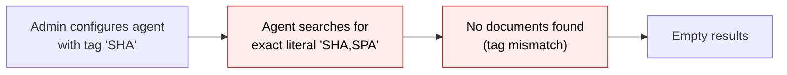
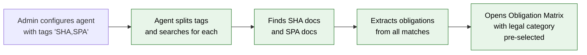
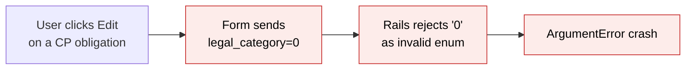
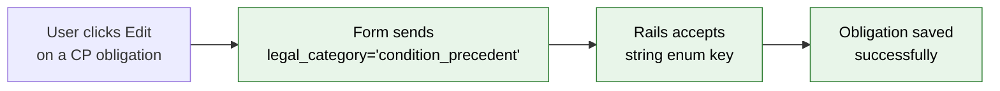
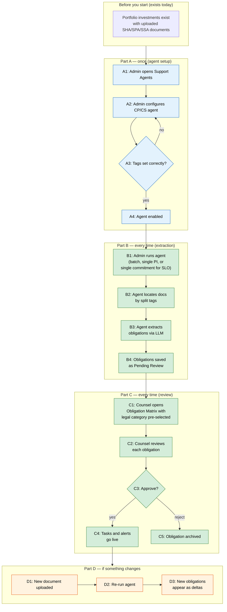

# Obligation Matrix Fixes — Proposal

> **Audience:** Business team, product, QA, support — non-technical.
> **Companion document:** [Design](design.md)
> **New to this? Start with the [Workflow Journey](#workflow-journey)** — every action, in order, from start to the outcome.

> **Planning phase — no code changes.** This document proposes and explains the change. Do not
> edit application code while writing it; implementation happens later, in the tasks phase.

---

## Why

The CP/CS Extraction Agent and the Obligation Matrix shipped with several interacting bugs that blocked production use: the agent could not find documents tagged with multiple types (e.g. "SHA,SPA"), running the agent from a portfolio investment page crashed when the dispatch logic fell back to the wrong record type, editing an obligation's legal category on the form threw an error because Rails rejected the stringified-integer enum value, and the matrix had no way to quickly scope to just CP/CS or just SLO obligations. These issues made the feature unusable on staging and needed to be fixed together because several share root causes in how the extraction engine resolves targets and how the matrix presents obligations.

Additionally, product feedback identified that the matrix should be one unified page with the legal category filter as the primary scoping mechanism (rather than a separate `context` parameter creating three virtual pages), that the stakeholder filter should adapt based on the selected legal category, and that agents should link to the matrix with the appropriate filter pre-selected. Two new entry points are also needed: running the SLO agent from a capital commitment page, and auto-filtering the matrix by stakeholder after a CP/CS single-company run.

## What Changes

- **Comma-separated document tags**: The CP/CS agent can now be configured with multiple document tags (e.g. "SHA,SPA,SSA") so it finds all matching investment agreements instead of treating the whole string as one literal tag.
- **Agent dispatch crash fix**: Running the CP/CS agent from a single portfolio investment page no longer crashes — the dispatch logic correctly expands sub-targets before deciding whether to fall back to the entity.
- **Unified obligation matrix with legal category filter**: One matrix page ("LP Obligation Matrix") for all obligation types. The legal category dropdown filter is the primary scoping mechanism — agents link to the matrix with the relevant legal category value pre-selected (e.g. `?q[legal_category_eq]=0` for Condition Precedent). No separate `context` parameter or mode-switching.
- **Stakeholder filter scoped by legal category**: When the legal category filter is set to CP or CS, the stakeholder dropdown shows portfolio companies (since CP/CS obligations are sourced from portfolio investments). When set to SLO, the stakeholder dropdown shows LPs/investors (since SLO obligations are sourced from side letters on capital commitments). When no legal category is selected, all stakeholders are shown.
- **Agent "Open Obligation Matrix" buttons**: Agent completion pages and tabs show an "Open Obligation Matrix" button that links to the matrix with the appropriate `legal_category_eq` Ransack filter pre-selected. The CP/CS agent pre-selects CP; the SLO agent pre-selects SLO.
- **Legal category form fix**: Editing an obligation no longer throws an `ArgumentError` — form selects now send string enum keys instead of integer values.
- **Edit form scoping for CP/CS**: When editing a CP/CS obligation, the form hides the MFN checkbox and the "Side Letter Obligation" option from the legal category dropdown, since those only apply to commitment-sourced obligations.
- **Run CP/CS Agent button on PI page**: A "Run CP/CS Agent" button now appears on each portfolio investment's show page, letting users trigger extraction for a single investment without navigating to the batch page.
- **Run SLO Agent button on capital commitment page**: A "Run SLO Agent" button now appears on each capital commitment's show page, letting users trigger SLO extraction for a single commitment without navigating to the batch page.
- **CP/CS single-company redirect with stakeholder pre-filter**: After running the CP/CS agent for a single portfolio company, the "View results" link redirects to the obligation matrix with both `legal_category_eq` (CP) and `stakeholder_id` (that company) pre-selected, so counsel sees only that company's CP/CS obligations.
- **Progress panel duplication fix**: Navigating away from and back to a portfolio investment page no longer shows duplicate progress panels — the panel uses a fixed wrapper ID that Turbo replaces cleanly.
- **Trigger type icons on matrix rows**: Each obligation row in the matrix now shows a small icon next to the obligation type indicating its trigger shape — recurring (repeat icon), one-time (calendar icon), or event-driven/armed (bolt icon). This lets counsel see at a glance whether an obligation is recurring before approving, without opening the edit form. Applies to both CP/CS and SLO obligations.
- **DataTables sorting on the matrix**: The obligation matrix table now supports client-side column sorting via DataTables.
- **Breadcrumb fix**: The matrix breadcrumb no longer shows a misleading "Side Letters" link for obligations sourced from portfolio investments.

### Flow Diagram

**Before — running the CP/CS agent and viewing results:**



**After — running the CP/CS agent and viewing results:**



**Before — editing a CP/CS obligation:**



**After — editing a CP/CS obligation:**



---

## Workflow Journey

### Who is involved

| Person | Role | What they do in the journey |
|---|---|---|
| Admin | Fund manager or ops lead | Configures the CP/CS agent with the correct document tags |
| Counsel | Legal counsel | Reviews, edits, approves or rejects extracted obligations |
| System | Automated | Runs extraction, generates reports, sends due-date alerts |

### The journey on one page



### Before you start

| Needed | Why | Where it comes from |
|---|---|---|
| Portfolio investments with documents | Agent needs documents to extract from | Uploaded by the ops team under each PI |
| Documents tagged SHA, SPA, or SSA | Agent identifies documents by tag | Set when uploading or editing the document |
| CP/CS agent enabled for the entity | Agent must be licensed and configured | Support Agents settings page |

### Part A — once (agent setup)

| Step | Who | Where | Action | What the system does | What you see |
|---|---|---|---|---|---|
| A1 | Admin | Support Agents page | Opens CP/CS Extraction Agent settings | Loads agent config form | Config form with tag field, model, schedule |
| A2 | Admin | Agent config form | Sets "investment_doc_tag" to "SHA,SPA" | Saves comma-separated tags | Config saved confirmation |
| A3 | Admin | Agent config form | Verifies tags match document labels | Validates tag string is non-empty | Warning if tag is blank |
| A4 | Admin | Agent config form | Enables the agent | Agent becomes runnable | "Enabled" badge on agent card |

### Part B — every time (extraction run)

| Step | Who | Where | Action | What the system does | What you see |
|---|---|---|---|---|---|
| B1 | Admin | PI show page › "Run CP/CS Agent" button, commitment show page › "Run SLO Agent" button, or batch from agent page | Clicks Run | Creates SupportAgentReport, enqueues job | Progress panel appears with step indicators |
| B2 | System | Background | Locates documents | Splits configured tags on comma, searches each PI for documents matching any tag | "Locate Document" step shows "SHA — Company A (1/5)" |
| B3 | System | Background | Extracts obligations | Sends each matching document to LLM, parses structured obligations | "Extract Obligations" step shows "Extracted 12 from 2 doc(s) — Company A (1/5)" |
| B4 | System | Background | Saves for review | Upserts obligations with dedup on source_clause | "Save For Review" step shows "Saved 12 — Company A (1/5)" |

### Part C — every time (counsel review)

| Step | Who | Where | Action | What the system does | What you see |
|---|---|---|---|---|---|
| C1 | Counsel | Agent show page › "Open Obligation Matrix" button (pre-selects legal category), or standalone matrix page | Opens matrix | Loads all obligations; legal category filter pre-selected if arriving from an agent | Matrix with columns: Investor, Type, Title, Legal Category, Owner, Due Date, Status |
| C2 | Counsel | Matrix row › Edit | Reviews and edits obligation fields | Form shows CP/CS-scoped options (no MFN, no SLO category) for CP/CS obligations | Inline edit row or full edit form |
| C3 | Counsel | Matrix row › Approve/Reject | Approves or rejects | Sets review_status; if approved, creates tasks per trigger type | Status badge changes to "Active" or "Rejected" |

### What you see

```
┌────────────────────────────────────────────────────────────────┐
│  LP Obligation Matrix                                          │
│                                                                │
│  ℹ All obligations across your LPs and portfolio investments.  │
│    Use the Legal Category filter to focus on CP/CS or SLO.     │
│                                                                │
│  Fund: [All funds ▾]  Type: [All ▾]                           │
│  Legal category: [Condition precedent ▾]  ← pre-selected      │
│  Review status: [All ▾]  Due from: [____]  Due until: [____]  │
│  Stakeholder: [Acme Corp ▾]  ← scoped to portfolio companies  │
│  [Filter] [Clear]                                              │
│                                                                │
│  Investor    │ Type      │ Cat │ Title           │ Due    │ ⚙  │
│  ────────────┼───────────┼─────┼─────────────────┼────────┼────│
│  Acme Corp   │ Reporting │ CP  │ Board approval  │ 15 Dec │ ✎  │
│  Acme Corp   │ Filing    │ CS  │ Reg filing      │ Armed  │ ✎  │
│  Beta Ltd    │ Notice    │ CP  │ Closing notice  │ 01 Jan │ ✎  │
│                                                                │
│  Sortable columns (▲▼) via DataTables                          │
└────────────────────────────────────────────────────────────────┘
```

### What goes wrong

**Scenario: Document tagged "SPA" but agent configured with only "SHA"**

The agent runs but finds zero documents for that portfolio investment. The progress panel shows "no document" for that PI. The admin notices, opens the agent config, changes the tag to "SHA,SPA", and re-runs the agent. The agent now finds documents with either tag and extraction proceeds normally.

**Scenario: Duplicate progress panels after navigation**

Previously, navigating away and back showed two progress panels because Turbo cached the page with the injected panel. Now the panel lives inside a wrapper div with a fixed ID (`cp_cs_progress_wrapper`), so re-running the agent replaces the existing panel instead of appending a new one.

### Summary: the minimum actions

| # | Action | Who | How often |
|---|---|---|---|
| 1 | Configure agent tags | Admin | Once (or when document types change) |
| 2 | Run extraction (from PI page, commitment page, or batch) | Admin | Every time new documents are uploaded |
| 3 | Review obligations | Counsel | Every time new extractions appear |
| 4 | Approve/reject | Counsel | Per obligation |

---

## User Stories

### US-1: Comma-separated document tags

**As a** fund operations admin,
**I want** to configure the CP/CS agent with multiple document tags like "SHA,SPA",
**So that** the agent finds all relevant investment agreements regardless of how they were tagged.

**Acceptance criteria:**
- Agent config accepts a comma-separated string in the `investment_doc_tag` field
- Each tag is trimmed of whitespace before matching
- A PI with a document matching any one of the configured tags is included in targets
- Documents matching different tags on the same PI are all extracted from

### US-2: Unified obligation matrix with legal category filter

**As** legal counsel,
**I want** one obligation matrix page where the legal category dropdown filter is the primary way to scope between CP/CS and SLO obligations,
**So that** I can switch between obligation types without navigating to different pages or losing my place.

**Acceptance criteria:**
- The matrix page title is always "LP Obligation Matrix" regardless of filters applied
- The legal category dropdown filter is always visible and shows all options: Condition Precedent, Condition Subsequent, Side Letter Obligation
- Selecting a legal category value filters the table to that type (standard Ransack `_eq` behavior)
- Agents link to the matrix with the relevant `legal_category_eq` value pre-selected via Ransack query params (e.g. `?q[legal_category_eq]=0` for CP)
- The legal category column is always visible (since all types can appear in one view)
- There is no `context` query parameter; the Ransack filter replaces context-based scoping entirely

### US-3: Run CP/CS Agent from PI page

**As a** fund operations admin,
**I want** a "Run CP/CS Agent" button on each portfolio investment's show page,
**So that** I can trigger extraction for a single investment without navigating to the batch page.

**Acceptance criteria:**
- Button appears only when the CP/CS agent is enabled for the entity
- Clicking the button triggers extraction for that single portfolio investment
- A progress panel appears showing step-by-step progress
- Re-running replaces the existing progress panel (no duplicates)

### US-4: Legal category form fix

**As** legal counsel editing an obligation,
**I want** to change the legal category without getting an error,
**So that** I can correct misclassified obligations.

**Acceptance criteria:**
- The legal category dropdown on both the full edit form and inline edit row sends string keys (e.g. "condition_precedent"), not integer values
- Saving an obligation with a changed legal category succeeds without an `ArgumentError`
- The Ransack filter dropdown on the matrix index page still uses integer values (required for correct DB queries)

### US-5: Agent dispatch crash fix

**As** a system running the CP/CS agent on a single portfolio investment,
**I want** the dispatch logic to correctly expand sub-targets,
**So that** the extraction pipeline receives `PortfolioInvestment` records instead of an `Entity` fallback.

**Acceptance criteria:**
- Running the agent from a single PI page dispatches correctly even when `targets()` returns more than one result
- The `resolve_step_ui_target` method falls back to Entity only when the agent returns zero sub-targets
- No `CapitalCommitment expected, got Entity` errors in Sidekiq logs

### US-6: Edit form scoping for CP/CS obligations

**As** legal counsel editing a CP/CS obligation,
**I want** the form to hide options that only apply to side-letter obligations,
**So that** the form is not confusing.

**Acceptance criteria:**
- MFN checkbox is hidden when editing a CP or CS obligation
- "Side Letter Obligation" is removed from the legal category dropdown when editing a CP/CS obligation
- These restrictions apply on both the full edit form and inline edit row

### US-7: Stakeholder filter scoped by legal category

**As** legal counsel,
**I want** the stakeholder dropdown on the obligation matrix to show relevant stakeholders based on the selected legal category,
**So that** I see portfolio companies when filtering CP/CS obligations and LPs when filtering SLO obligations.

**Acceptance criteria:**
- When legal category filter is set to Condition Precedent or Condition Subsequent, the stakeholder dropdown shows only portfolio companies (investors linked via portfolio investments)
- When legal category filter is set to Side Letter Obligation, the stakeholder dropdown shows only LPs/investors (linked via capital commitments and side letters)
- When no legal category is selected, the stakeholder dropdown shows all stakeholders (both portfolio companies and LPs)
- Changing the legal category filter value refreshes the stakeholder options accordingly

### US-8: Run SLO Agent from capital commitment page

**As a** fund operations admin,
**I want** a "Run SLO Agent" button on each capital commitment's show page,
**So that** I can trigger SLO extraction for a single commitment without navigating to the batch page.

**Acceptance criteria:**
- Button appears only when the SLO agent is enabled for the entity
- Clicking the button triggers extraction for that single capital commitment
- A progress panel appears showing step-by-step progress
- After completion, the "Open Obligation Matrix" link pre-selects `legal_category_eq` for SLO

### US-9: CP/CS single-company redirect with stakeholder pre-filter

**As** legal counsel,
**I want** the CP/CS agent's "View results" link to open the obligation matrix pre-filtered to the specific portfolio company that was just processed,
**So that** I land directly on the relevant obligations without manual filtering.

**Acceptance criteria:**
- After running the CP/CS agent for a single portfolio company, the results link opens the matrix with both `legal_category_eq` (Condition Precedent) and `stakeholder_id` (that company's ID) pre-selected
- The pre-selected filters can be cleared by the user via the "Clear" button
- After a batch run (not scoped to one company), only `legal_category_eq` is pre-selected (no stakeholder)

---

## UI Behavior

### Portfolio Investment Show Page — Run Button and Progress Panel

```
┌──────────────────────────────────────────────────┐
│  Portfolio Investment: Acme Corp / Fund Alpha     │
│                                                   │
│  [Documents] [Obligations] [Details]              │
│                                                   │
│  ┌─ CP/CS Agent ────────────────────────────────┐ │
│  │  [🤖 Run CP/CS Agent]                        │ │
│  │                                               │ │
│  │  ┌─ Progress ──────────────────────────────┐  │ │
│  │  │ ✓ Initialize                            │  │ │
│  │  │ ✓ Locate Document — SHA (1/1)           │  │ │
│  │  │ ⏳ Extract Obligations                   │  │ │
│  │  │ ○ Save For Review                       │  │ │
│  │  │ ○ Generate Report                       │  │ │
│  │  └─────────────────────────────────────────┘  │ │
│  └───────────────────────────────────────────────┘ │
└──────────────────────────────────────────────────┘
```

**Behavior notes:**
- The progress panel is wrapped in a `<div id="cp_cs_progress_wrapper">` with a fixed ID
- On first run, the Turbo Stream response replaces both the wrapper div and the panel's own ID
- On page re-visit (Turbo cache restore), only one panel is ever shown
- Re-running replaces the existing panel in place

### Capital Commitment Show Page — Run SLO Agent Button

```
┌──────────────────────────────────────────────────┐
│  Capital Commitment: LP Alpha / Fund Beta         │
│                                                   │
│  [Side Letter] [Obligations] [Details]            │
│                                                   │
│  ┌─ SLO Agent ──────────────────────────────────┐ │
│  │  [🤖 Run SLO Agent]                          │ │
│  │                                               │ │
│  │  ┌─ Progress ──────────────────────────────┐  │ │
│  │  │ ✓ Initialize                            │  │ │
│  │  │ ✓ Locate Side Letter                    │  │ │
│  │  │ ⏳ Extract Obligations                   │  │ │
│  │  │ ○ Save For Review                       │  │ │
│  │  │ ○ Generate Report                       │  │ │
│  │  └─────────────────────────────────────────┘  │ │
│  └───────────────────────────────────────────────┘ │
└──────────────────────────────────────────────────┘
```

**Behavior notes:**
- Same fixed-wrapper pattern as the PI page (`slo_progress_wrapper`)
- After completion, "Open Obligation Matrix" link goes to `?q[legal_category_eq]=2` (SLO)

### Obligation Matrix — Filter Pre-selection

The matrix is always the same page. Agents arrive with filters pre-selected:

| Arriving from | Pre-selected filters | Stakeholder dropdown shows |
|---|---|---|
| CP/CS agent (batch) | `legal_category_eq=0` (Condition Precedent) | Portfolio companies |
| CP/CS agent (single company) | `legal_category_eq=0` + `stakeholder_id=<company>` | Portfolio companies |
| SLO agent (batch) | `legal_category_eq=2` (Side Letter Obligation) | LPs/investors |
| SLO agent (single commitment) | `legal_category_eq=2` | LPs/investors |
| Direct navigation | No pre-selection | All stakeholders |

The user can always change or clear any filter. The "Clear" button removes all filter selections.

---

## What This Feature Does NOT Cover

| Excluded | Covered In |
|---|---|
| Automated re-extraction when a document is re-uploaded | Future: auto_extract_on_upload config field |
| Bulk approve/reject from the matrix | Future enhancement |
| Cross-fund obligation comparison | Future analytics feature |
| WhatsApp/Telegram notifications for due-date alerts | Existing enforcement pipeline (already works) |
| Dynamic stakeholder dropdown refresh via Stimulus (JS) | Phase 2 — initial implementation uses page reload on filter submit |

---

## Validation Rules

| Field | Rule | Default |
|---|---|---|
| investment_doc_tag (agent config) | Non-empty string; comma-separated tags trimmed | None (agent won't run without it) |
| legal_category (form) | Must be a valid string enum key | "side_letter_obligation" |
| source_clause (extraction) | Must be non-empty for an extracted obligation to be saved | None (discarded if missing) |
| legal_category_eq (matrix filter) | Must be a valid integer enum value (0, 1, 2) or blank | Blank (show all) |

---

## Behavior Rules

| Scenario | What User Sees |
|---|---|
| Agent configured with "SHA,SPA" | Both SHA-tagged and SPA-tagged documents are found and extracted |
| Agent configured with just "SHA" | Only SHA-tagged documents found; SPA documents silently skipped |
| Run agent from PI page, navigate away, come back | One progress panel visible (not duplicated) |
| Edit CP obligation, change category to CS | Saves successfully; "Side Letter Obligation" not in dropdown |
| Filter matrix by legal_category = Condition Precedent | Only CP obligations shown; stakeholder dropdown shows portfolio companies |
| Filter matrix by legal_category = Side Letter Obligation | Only SLO obligations shown; stakeholder dropdown shows LPs |
| Clear all filters on matrix | All obligation types shown; stakeholder dropdown shows all stakeholders |
| Run agent when targets() returns 0 (tag mismatch) | Falls back to Entity; no crash (but also no extraction — empty report) |
| Run agent when targets() returns 3 | All 3 portfolio investments processed; no Entity fallback |
| CP/CS agent single-company run completes | "View results" link opens matrix with legal_category=CP and stakeholder=that company |
| Click "Run SLO Agent" on commitment page | SLO extraction runs for that commitment; progress panel shows steps |

---

## Resolved Design Decisions

| # | Decision | Resolution |
|---|---|---|
| 1 | Should comma-separated tags use OR or AND matching? | OR — a PI is included if any document matches any one tag |
| 2 | Should the matrix have separate pages, a context parameter, or use the existing filter? | Use the existing legal category Ransack filter as the primary scope. One page, one title, no `context` parameter. Agents pre-select the filter value in their links. Simpler to understand and maintain. |
| 3 | How to prevent duplicate progress panels? | Fixed wrapper div ID + dual Turbo Stream replace targets |
| 4 | Form selects: integer enum values or string keys? | String keys for form submission (Rails enum setter); integer values only for Ransack filter queries |
| 5 | Where to place the Run CP/CS Agent button? | On the PI show page, below the documents section |
| 6 | Should `resolve_step_ui_target` check `count == 1` or `count >= 1`? | `count >= 1` — fall back to Entity only when the agent returns zero sub-targets |
| 7 | How should the stakeholder filter adapt to legal category? | When CP/CS is selected, show portfolio companies; when SLO is selected, show LPs. When no filter, show all. Initial implementation uses page reload; dynamic JS refresh is Phase 2. |
| 8 | Where to place the Run SLO Agent button? | On the capital commitment show page, mirroring the CP/CS button on the PI page |
| 9 | What should the CP/CS single-company redirect include? | Both `legal_category_eq` and `stakeholder_id` pre-selected so counsel lands on that company's CP/CS obligations |

---

## Capabilities

### New Capabilities

- `cp-cs-extraction-agent`: Registers and runs the CP/CS Extraction Agent — the counterpart to the SLO agent for portfolio investment agreements. Covers agent config, comma-separated tag matching, target resolution, multi-document extraction per PI, and step-UI progress broadcasting.

### Modified Capabilities

- `side-letter-obligations`: The obligation matrix uses the legal category Ransack filter as the primary scoping mechanism (replacing the `context` parameter). The stakeholder filter adapts based on the selected legal category. Agent completion pages link to the matrix with pre-selected filters. DataTables sorting is added. The `legal_category_form_options` helper is a new addition for safe form submission. A "Run SLO Agent" button is added to the capital commitment show page.
- `obligation-extraction-agent`: The `resolve_step_ui_target` dispatch method is fixed so the Entity fallback only fires when the agent returns zero sub-targets. Agent report redirect URLs now include Ransack filter params (`legal_category_eq`) and optionally `stakeholder_id` instead of a `context` parameter.

---

## Impact

- **Obligation matrix page**: Legal category filter is always visible and serves as primary scoping; no `context` parameter. Stakeholder dropdown adapts to selected legal category.
- **Agent dispatch pipeline**: `resolve_step_ui_target` condition changed from `count == 1` to `count >= 1`
- **Document tag matching**: `split_investment_doc_tags` and `investment_tag_conditions` now split on comma
- **Form helpers**: New `legal_category_form_options` added; existing `legal_category_options` unchanged (used by Ransack)
- **PI show page**: New section with Run button and progress panel wrapper
- **Capital commitment show page**: New section with "Run SLO Agent" button and progress panel wrapper
- **Agent redirect URLs**: Now use `legal_category_eq` Ransack param and optional `stakeholder_id` instead of `context`
- **Edit forms**: Both `_form.html.erb` and `_inline_edit_row.html.erb` use the new form helper
- **Cucumber tests**: Updated for filter-based matrix scoping; new scenarios for SLO button and stakeholder scoping

---

## Benefits

1. **Unblocks production use**: The CP/CS agent can now find documents, run without crashing, and show results correctly — the feature moves from "broken on staging" to "usable."
2. **Unified matrix**: One page for all obligation types. Counsel uses the legal category filter to focus — no confusing mode switching or three virtual pages.
3. **Smart stakeholder scoping**: The stakeholder dropdown shows relevant stakeholders based on the obligation type, reducing noise and making it faster to find the right obligations.
4. **Single-PI and single-commitment extraction**: Admins can re-run extraction for one investment or one commitment without triggering a full batch, saving time and LLM cost.
5. **Pre-filtered agent links**: After an agent run, clicking "Open Obligation Matrix" lands counsel directly on the relevant obligations — no manual filtering needed.
6. **Reliable editing**: Counsel can edit obligation fields without encountering crashes, building trust in the tool.
7. **Clean navigation**: No duplicate panels, correct breadcrumbs, and working sorting make the matrix feel polished.

---

## FAQ

| Question | Answer |
|---|---|
| Who can run the CP/CS agent? | Any user with access to the Support Agents page for the entity. The agent must be enabled and licensed. |
| What happened to the `context` parameter? | Removed. The legal category Ransack filter replaces it — simpler, more flexible, and the user can switch scopes without reloading. |
| What happens to existing obligations when we deploy? | Nothing changes — existing obligations are untouched. The fixes only affect new extraction runs and how the matrix displays data. |
| Can I use "SHA, SPA" with spaces after the comma? | Yes — each tag is trimmed of whitespace before matching. |
| Why are there two legal category helpers? | `legal_category_options` (integer values) is needed for Ransack filter queries that compare against the database column. `legal_category_form_options` (string keys) is needed for Rails enum setters that reject stringified integers. See [Design](design.md) for details. |
| Does this change notifications or alerts? | No — the enforcement pipeline (daily due-date alerts) is unchanged. These fixes are about extraction and the matrix UI. |
| Can the matrix be bookmarked with a filter? | Yes — all filters are in the URL query string. Pre-selected legal category and stakeholder values are standard Ransack params. |
| Will the stakeholder dropdown update dynamically when I change the legal category? | In the initial implementation, you need to click "Filter" to refresh the page and update the stakeholder options. A future enhancement may add dynamic JS refresh via Stimulus. |

---

## Design Principle for the Next Phase

The dual-helper pattern for legal_category (`legal_category_options` for Ransack, `legal_category_form_options` for forms) is a workaround for a Rails enum quirk. If more enum fields hit this issue, consider a single generic helper that detects the usage context. The stakeholder filter scoping by legal category could be enhanced with a Stimulus controller that fetches options via Turbo Frame on legal category change — avoid building this until the page-reload approach proves too slow.
