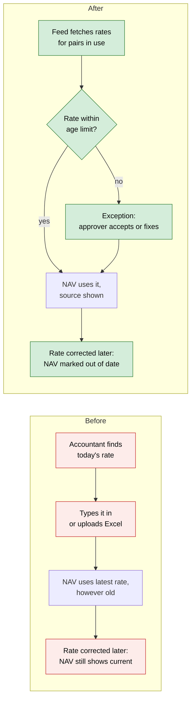
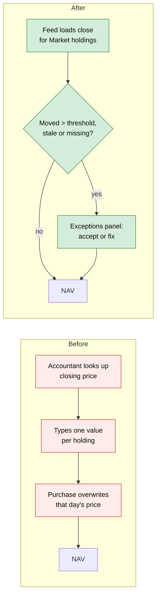
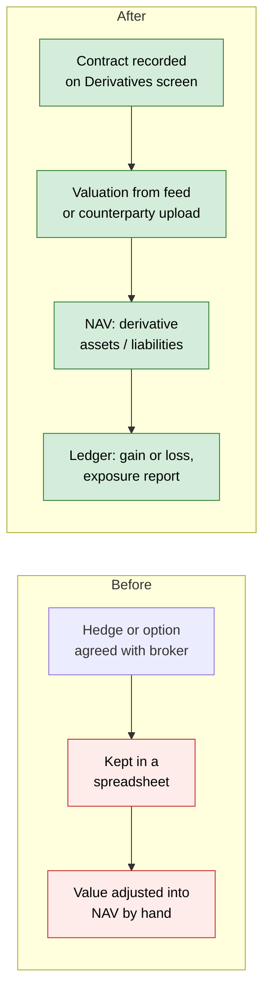
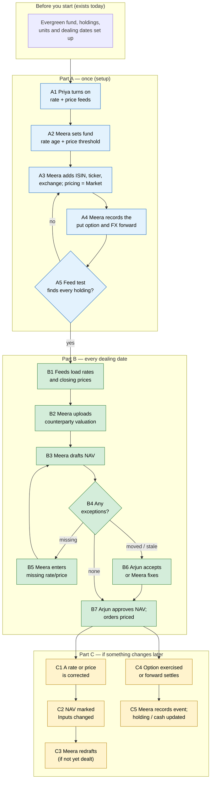

# Open-Ended Funds: FX Rates, Market Prices and Derivatives — Proposal

> **Audience:** Business team, product, QA, support — non-technical.
> **Companion document:** Design — *not written yet; this change is at proposal stage only.*
> **New to this? Start with the [Workflow Journey](#workflow-journey)** — every action, in order, from start to the outcome.

> **Planning phase — no code changes.** This document proposes and explains the change. Do not
> edit application code while writing it; implementation happens later, in the tasks phase.

---

## Why

An open-ended (evergreen) fund publishes a NAV on every dealing date, and investors subscribe and
redeem at that price. CapHive's NAV is only as good as the three inputs behind its "investments at
fair value" line, and today all three are weak for a fund that holds more than private companies:

1. **FX rates are typed in by hand.** Every rate is entered on the Exchange Rates screen or
   uploaded from Excel. There is no daily feed, no record of where a rate came from, no reverse or
   cross rate (a EUR→INR rate is not worked out from EUR→USD and USD→INR), and no limit on how old
   a rate may be. Worse, **correcting a rate after a NAV is drafted does not mark the NAV out of
   date** — the NAV still shows as current although its fair value used the old rate.
2. **There is no price feed for listed securities.** A listed share is priced exactly like a
   private company: one hand-entered value per share per date. A weekly-dealing fund holding 40
   listed names means 40 prices typed in every week. There is no ticker or exchange on a holding,
   and the ISIN lives only in a custom field. Each purchase also overwrites that day's price with
   the purchase price — wrong for a listed share, whose price that day is the market close.
3. **Derivatives cannot be held at all.** There is nowhere to record an option, future, FX forward
   or swap — no strike, expiry, notional, counterparty or collateral — and a NAV line cannot go
   negative, which a derivative's value often does. Funds that hedge currency (and the hedged
   share classes already planned in *Share Classes*, item 4) have nothing to book the hedge in.

The business asked (10 Oct 2026) how FX, prices and derivatives will work for open-ended funds
that also hold public-market securities and some derivatives. This proposal is the answer.

## What Changes

Three parts, delivered in this order because each builds on the one before.

**Part 1 — FX rates you can trust**
1. **Daily rate feed.** CapHive fetches closing reference rates every business day for the
   currency pairs the entity actually uses (fund currencies × holding currencies × investor
   currencies). Manual entry and Excel upload stay; **a hand-entered rate always wins** over a fed
   one for the same date.
2. **Every rate says where it came from**: *Source* (Manual, Upload, or the feed's name) and *Rate
   type* (Closing or Reference).
3. **Reverse and cross rates.** When the direct rate is missing, CapHive works it out — USD→INR
   from INR→USD, or EUR→INR via USD — and labels it *Derived*.
4. **Rate age limit.** Each fund sets how old a rate may be (default 3 business days). A NAV draft
   that would use an older rate lists it as an exception the approver must accept.
5. **NAV goes out of date when a rate changes.** Adding or correcting a rate the NAV used marks the
   draft (or approved NAV) "Inputs changed", exactly as a changed valuation does today.
6. **Gain split into price and currency.** Holding screens and reports show unrealised and
   realised gain as *price effect* + *currency effect* (see the worked figures below).

**Part 2 — Market prices for listed securities**
1. **Holdings get identifiers and a pricing method.** Each instrument gets ISIN, ticker and exchange
   fields, and a *Pricing method*: **Market** (priced from a feed), **Model** (valuation report),
   **Manual**, or **Cost**. Existing instruments become **Manual**, so nothing changes until someone
   switches an instrument to Market.
2. **Daily price feed** for Market instruments, run after each exchange closes. Indian listed
   equity, debt and mutual funds come from the exchanges' and AMFI's free daily files; other
   markets from a licensed data vendor the client already holds a licence for.
3. **Prices land where valuations live today**, tagged with their *Source* and *Price type*
   (Close, Bid, Mid), so every existing screen, report and NAV reads them unchanged.
4. **Price exceptions before approval.** On the NAV draft, an *Exceptions* panel lists each price
   that moved more than the fund's threshold (default 10%) since the previous price, each stale
   price, and each missing price. The approver accepts or fixes each one; acceptances are recorded.
   A missing price still blocks the NAV, as today — never a zero.
5. **A purchase no longer overwrites a Market instrument's price** with the purchase price.
   Private holdings keep today's behaviour.
6. **Private marks show their age.** The NAV breakdown shows, per holding, the date of the mark
   used and how many days old it is.
7. **Corporate actions are suggested, not applied.** When the feed reports a split or dividend, it
   appears as a suggestion; a person confirms it into the existing Stock Adjustment or income
   screens.

**Part 3 — Derivatives**
1. **A new Derivatives screen per fund** to record contracts: type (option, warrant, future,
   forward, FX forward, interest-rate swap, cross-currency swap, total-return swap, credit-default
   swap), underlying (a holding, a currency pair or an index), long/short, notional and its
   currency, strike, expiry or maturity, lot size, exchange or counterparty, and the ISDA/CSA
   agreement in the fund's documents.
2. **Events on each contract**: trade (and premium paid or received), valuation (mark-to-market),
   periodic settlement (swap coupon or reset), margin or collateral posted or received, exercise,
   expiry, close-out. **Exercising an option into shares creates the share holding**, the way a
   stock conversion does today.
3. **Where values come from**: listed contracts take the exchange settlement price from the price
   feed; OTC contracts take the counterparty's or administrator's valuation, uploaded. CapHive does
   **not** build its own pricing models.
4. **NAV gains two lines**: *Derivative assets* (contracts worth more than zero) and *Derivative
   liabilities* (contracts worth less than zero). Collateral posted shows under *Other assets*.
5. **Ledger entries** for premium, unrealised and realised derivative gain or loss, and swap income
   or expense — new entry names in the existing fund ledger.
6. **Hedge link.** A contract can be marked as hedging a holding or a share class. This is the
   building block the planned hedged share class needs; the class itself stays in its own change.
7. **Exposure report**: gross notional exposure and, for options, delta-adjusted exposure, as a
   multiple of NAV, against the fund's limit.

Nothing is **BREAKING**:
- Existing rates, valuations and approved NAVs stay as they are.
- Existing instruments default to **Manual** pricing, so their figures are unchanged.
- A fund with no foreign holdings and no derivatives sees no new NAV lines with a value.

### Later — TBD (not built in this change)

| # | Item | What it would add | Why it's separate | Status |
|---|---|---|---|---|
| L1 | **Cash held in other currencies** | A USD broker account in an INR fund, shown in USD and revalued at each NAV date, with an FX revaluation entry | Changes how the fund ledger holds money — needs its own decision | **TBD** |
| L2 | **Share classes in other currencies and hedged classes** | Item 4 of *Share Classes*: a USD class in an INR fund; a hedged class bears its own hedge gain or cost | Already planned in its own change; uses Part 3's hedge link | **TBD** |
| L3 | **In-house pricing models** | Option and swap valuation inside CapHive | Funds and auditors rely on independent valuations; a large separate product | **Not planned** |

### Flow Diagram

**Getting an FX rate into a NAV**



**Pricing a listed share**



**A derivative in the NAV**



---

## Workflow Journey

One worked journey: **Horizon Evergreen Fund**, an INR open-ended fund dealing weekly, holds a
private company, a listed Indian share, a US-listed share, a Nifty put option and a USD→INR
forward that hedges the US share. We follow it from set-up to the NAV approved for dealing on
**Friday 30 Oct 2026**.

### Who is involved

| Person | Role | What they do in the journey |
|---|---|---|
| Priya | CapHive support / entity admin | Turns on the rate and price feeds for the entity, sets the vendor licence key |
| Meera | Fund accountant (fund write access) | Sets up instruments and derivatives, uploads counterparty valuations, drafts the NAV |
| Arjun | Fund CFO (NAV approver) | Reviews exceptions on the NAV draft and approves the NAV |
| The investors | LPs in the fund | See the published NAV per unit — nothing new for them |

### The journey on one page



### Before you start

| Needed | Why | Where it comes from |
|---|---|---|
| An evergreen fund with dealing dates and units | The NAV this journey produces | Open-ended funds change (exists) |
| Holdings recorded in CapHive | Quantities the prices multiply | Portfolio Investments screen (exists) |
| A data-vendor licence (only for non-Indian listed holdings) | Licensed prices for US/other markets | The client's own vendor contract |
| ISDA/CSA agreement uploaded (only for OTC derivatives) | Linked from the contract | Fund documents (exists) |

### Part A — once (setup)

| Step | Who | Where (screen › button) | Action | What the system does | What you see |
|---|---|---|---|---|---|
| A1 | Priya | Entity › Settings › Market Data | Turns on *FX rate feed* and *Price feed*; enters the vendor licence key | Saves the settings; works out the currency pairs in use (INR, USD) | "Feeds on. Pairs tracked: USD→INR. Next run: today 18:30 IST" |
| A2 | Meera | Fund › Evergreen Settings | Sets *Max rate age* = 3 business days, *Price move threshold* = 10% | Saves on the fund's evergreen settings | Both values shown on the settings card |
| A3 | Meera | Portfolio › Instruments › Edit | For the listed share: ISIN, ticker `ACMEIND`, exchange NSE, *Pricing method* = Market. Same for the US share on NASDAQ | Checks the ISIN format and that the ticker is unique on that exchange | Instrument shows a *Market* badge |
| A4 | Meera | Fund › Derivatives › New | Records **Nifty put**: long 1 lot (lot size 75), strike 24,000, expiry 26 Nov 2026, premium ₹40,000, NSE. Records **FX forward**: sell USD 1,00,000 at 84.00, maturity 29 Jan 2027, counterparty Bank X, *Hedges* = US share | Creates the contracts and their trade events; books the premium in the ledger | Two rows on the Derivatives screen, each with a *Hedges*/*Listed* label |
| A5 | Meera | Entity › Settings › Market Data › Test feed | Runs a test fetch | Looks up every Market instrument and every contract with a listed price | "4 of 4 found" — or the ones not found, with the reason |

### Part B — every dealing date

| Step | Who | Where (screen › button) | Action | What the system does | What you see |
|---|---|---|---|---|---|
| B1 | — (scheduled) | — | — | After close: loads USD→INR (Reference, 85.00), NSE close for ACMEIND (₹1,250), NASDAQ close for the US share ($120), NSE settlement price for the put (₹333.33) | Exchange Rates and Valuations screens show the new rows with *Source* = feed name |
| B2 | Meera | Fund › Derivatives › FX forward › Upload valuation | Uploads Bank X's statement: value −₹1,50,000 at 30 Oct | Records a valuation event; negative values allowed | Contract shows *Value −₹1,50,000 (Bank X, 30 Oct)* |
| B3 | Meera | Fund › NAVs › Draft NAV | Drafts the NAV for 30 Oct | Prices every holding and contract; checks rate ages and price moves | Draft with breakdown and the Exceptions panel (mockup below) |
| B4 | — | — | — | Sorts exceptions: **missing** blocks, **moved/stale** need acceptance | Exceptions panel: "1 to review" |
| B5 | Meera | Exceptions panel › Enter price | (Only if something is missing.) Enters the rate or price by hand | Saves it as *Manual*; redrafts | Exception disappears |
| B6 | Arjun | Exceptions panel › Accept | ACMEIND moved +22.5% (₹1,020 → ₹1,250) — confirms it is a real move (results day) and accepts | Records who accepted, when, and the note | Row turns *Accepted by Arjun* |
| B7 | Arjun | NAV › Approve | Approves the NAV | Locks the NAV; dealing orders for 30 Oct are priced at ₹108.44 | NAV *Approved*; orders show their units |

### Part C — if something changes later

| Step | Who | Where (screen › button) | Action | What the system does | What you see |
|---|---|---|---|---|---|
| C1 | Meera | Exchange Rates › Edit | Corrects 30 Oct USD→INR from 85.00 to 84.80 (feed published a revision) | Saves as *Manual* (wins over the feed) | Rate row shows *Manual, corrected* |
| C2 | — | — | — | The 30 Oct NAV's inputs no longer match | NAV shows the *Inputs changed* badge, as it does today for a changed valuation |
| C3 | Meera | NAV › Redraft | (Draft only.) Redrafts | Rebuilds with 84.80 | New figures. An approved, dealt NAV is never rebuilt — the badge stays as a flag for review |
| C4 | Meera | Derivatives › Put › Add event › Expiry | On 26 Nov the put expires worthless | Books the realised loss (premium ₹40,000 less nothing received) | Contract *Closed*; leaves the NAV |
| C5 | Meera | Derivatives › FX forward › Add event › Settlement | On 29 Jan the forward settles | Books realised gain or loss and the cash | Contract *Closed* |

### What you see

**NAV draft, Horizon Evergreen Fund, 30 Oct 2026**

```
┌────────────────────────────────────────────────────────────────────────────┐
│ NAV draft — 30 Oct 2026                                  Status: Draft      │
├──────────────────────────────────────────┬─────────────────────────────────┤
│ Investments at fair value                │                    ₹4,02,00,000 │
│   Private Co A  10,000 × ₹500            │   ₹50,00,000  mark 30 Sep (30d) │
│   ACMEIND (NSE) 20,000 × ₹1,250          │ ₹2,50,00,000  NSE close         │
│   US share (NASDAQ) 1,000 × $120 × 85.00 │ ₹1,02,00,000  vendor · RBI ref  │
│ Derivative assets                        │                        ₹25,000  │
│   Nifty 24000 put  1 lot × 75 × ₹333.33  │                  NSE settlement │
│ Cash                                     │                      ₹30,00,000 │
│ Other assets (collateral at Bank X)      │                       ₹5,00,000 │
│ Derivative liabilities                   │                    − ₹1,50,000  │
│   FX forward sell USD 1,00,000 @ 84.00   │                  Bank X upload  │
│ Management fee payable                   │                    − ₹2,00,000  │
├──────────────────────────────────────────┼─────────────────────────────────┤
│ NAV                                      │                    ₹4,33,75,000 │
│ Units outstanding                        │                        4,00,000 │
│ NAV per unit                             │                        ₹108.44  │
├──────────────────────────────────────────┴─────────────────────────────────┤
│ Exceptions (1 to review)                                                   │
│  ⚠ ACMEIND moved +22.5% (₹1,020 → ₹1,250); threshold 10%   [Accept] [Fix]  │
└────────────────────────────────────────────────────────────────────────────┘
```

The arithmetic:
- Investments = 50,00,000 + 2,50,00,000 + 1,02,00,000 = **₹4,02,00,000**
- Put = 1 lot × 75 × ₹333.33 ≈ **₹25,000**
- Gross assets = 4,02,00,000 + 25,000 + 30,00,000 + 5,00,000 = **₹4,37,25,000**
- Liabilities = 1,50,000 + 2,00,000 = **₹3,50,000**
- NAV = 4,37,25,000 − 3,50,000 = **₹4,33,75,000**; ÷ 4,00,000 units = **₹108.4375 → ₹108.44**

**Holding screen — US share, gain split into price and currency**

```
┌────────────────────────────────────────────────────────────────┐
│ US share — 1,000 shares                                         │
│ Cost      1,000 × $100 at 83.00  =   ₹83,00,000                 │
│ Value     1,000 × $120 at 85.00  = ₹1,02,00,000                 │
│ Unrealised gain                  =   ₹19,00,000                 │
│   Price effect     (120 − 100) × 1,000 × 85.00 = ₹17,00,000     │
│   Currency effect  $1,00,000 cost × (85.00 − 83.00) = ₹2,00,000 │
│ Hedged by: FX forward, sell USD 1,00,000 @ 84.00  (−₹1,50,000)  │
└────────────────────────────────────────────────────────────────┘
```

17,00,000 + 2,00,000 = 19,00,000 ✓. The forward's −₹1,50,000 offsets most of the ₹2,00,000
currency gain, which is the point of the hedge.

### What goes wrong

**The US rate isn't published.** On Thursday 29 Oct the rate feed returned nothing (a US holiday at
the source, or the feed was down), and on 30 Oct Meera drafts the NAV before that evening's run.
- **What is shown:** the draft is refused: *"No USD→INR rate within 3 business days of 30 Oct 2026
  (latest: 26 Oct). Enter a rate or wait for the feed."* Meera and Priya also received the internal
  email *"FX feed: no rates loaded for 29 Oct"* the night before.
- **Why:** the latest rate is older than the fund's age limit; CapHive never prices a NAV on a rate
  it can't vouch for, and never substitutes zero.
- **Fix:** Meera enters 85.00 by hand with the note "RBI reference 30 Oct" (*Source* = Manual) and
  redrafts — or waits for the evening run. Either way the draft goes through.

**A listed price is missing.** The US share was renamed and the vendor no longer recognises the
ticker. The test in A5 would have caught it; if it happens later, the draft is blocked with
*"No price for US share on 30 Oct — ticker not found at vendor"*, and Meera fixes the ticker on
the instrument (A3) and redrafts.

### Summary: the minimum actions

| # | Action | Who | How often |
|---|---|---|---|
| 1 | Turn on feeds, enter licence key | Priya | Once per entity |
| 2 | Set rate age and price threshold | Meera | Once per fund |
| 3 | Add identifiers, set Market pricing | Meera | Once per listed holding |
| 4 | Record each derivative contract | Meera | Once per contract |
| 5 | Upload OTC counterparty valuations | Meera | Every dealing date (OTC only) |
| 6 | Draft the NAV | Meera | Every dealing date |
| 7 | Review exceptions, approve | Arjun | Every dealing date |
| 8 | Record exercise / expiry / settlement | Meera | When it happens |

---

## User Stories

### US-1: Rates arrive on their own

**As** Meera, **I want** each day's closing rates loaded automatically for the currencies my funds
use, **so that** I don't type rates before every NAV.

**Acceptance criteria:**
- With the feed on, a rate for each pair in use appears for every business day, with *Source* =
  feed name and *Rate type* = Reference or Closing.
- A pair starts being fetched the day a fund, holding or investor in that currency is added.
- A hand-entered rate for the same pair and date is never overwritten by the feed.
- If the run loads nothing for a pair, the entity's fund accountants get the internal email
  "FX feed: no rates loaded for {date}" listing the pairs.

### US-2: Missing direct rates are worked out

**As** Meera, **I want** CapHive to derive a rate when the direct one is missing, **so that** a
EUR holding in an INR fund prices without me loading EUR→INR.
- With USD→INR and EUR→USD present but no EUR→INR, the holding prices at EUR→USD × USD→INR.
- With only INR→USD, USD→INR is used as 1 ÷ INR→USD.
- The derived rate is shown as *Derived (via USD)* wherever its source is shown.

### US-3: A rate that changes marks the NAV

**As** Arjun, **I want** a NAV to show *Inputs changed* when a rate it used is corrected, **so
that** I never approve figures built on a rate that has since changed.

### US-4: Gain split into price and currency

**As** Arjun, **I want** unrealised and realised gain split into price effect and currency effect,
**so that** I can explain performance to investors and auditors.
- Price effect + currency effect always equals total gain, to the paisa/cent.

### US-5: Listed holdings price themselves

**As** Meera, **I want** Market holdings priced from the exchange close every day, **so that** a
NAV with 40 listed names needs no typing.
- A Market holding's purchase no longer creates a price at the purchase cost.
- A Manual, Model or Cost holding behaves exactly as today.

### US-6: Unusual prices need a second look

**As** Arjun, **I want** big moves, stale prices and missing prices listed before I approve,
**so that** a bad feed value never reaches the dealing price.
- Missing → the NAV cannot be drafted until fixed.
- Moved more than the threshold, or older than the rate/price age limit → listed; approval is
  disabled until each is accepted (with a note) or fixed.

### US-7: Record a derivative

**As** Meera, **I want** to record options, futures, forwards and swaps with their terms, **so
that** they are in the NAV and the ledger rather than a spreadsheet.
- Required fields depend on type (see [Validation Rules](#validation-rules)).
- A contract's value may be negative; it shows under *Derivative liabilities*.

### US-8: Exercise an option into shares

**As** Meera, **I want** exercising a call option to create the share holding, **so that** the
fund's holdings stay complete.
- Exercising 1 lot of 75 at strike ₹1,000 creates a purchase of 75 shares at ₹1,000 plus the
  premium paid per share, and closes the option.

### US-9: Exposure against the limit

**As** Arjun, **I want** to see derivative exposure as a multiple of NAV, **so that** I can keep
the fund within its limit.

---

## UI Behavior

### Entity › Settings › Market Data (new card)

```
┌────────────────────────────────────────────────────────────┐
│ Market Data                                                 │
│ FX rate feed      [● On ]  Source: RBI / FBIL reference     │
│ Price feed        [● On ]  NSE · BSE · AMFI · Vendor        │
│ Vendor licence    ••••••••••••  [Change]                    │
│ Pairs tracked     USD→INR, EUR→INR (derived via USD)        │
│ Last run          30 Oct 2026 18:32 — 2 rates, 41 prices    │
│ [Test feed]                                                 │
└────────────────────────────────────────────────────────────┘
```
- *Test feed* opens a popup listing each Market instrument / listed contract and whether it was
  found, using the existing action-summary popup style.

### Exchange Rates screen (existing)
- New columns *Source* and *Rate type*; derived rates are not stored, so they don't appear as rows.

### Fund › Derivatives (new screen)

```
┌──────────────────────────────────────────────────────────────────────────────┐
│ Derivatives — Horizon Evergreen Fund                         [New contract]  │
│ [Open ▾]                                                                     │
├──────────────┬───────┬─────────────┬──────────┬────────────┬────────────────┤
│ Contract     │ Side  │ Notional    │ Expiry   │ Value      │ Source         │
├──────────────┼───────┼─────────────┼──────────┼────────────┼────────────────┤
│ Nifty 24000P │ Long  │ 75 × 24,000 │ 26 Nov 26│   ₹25,000  │ NSE settlement │
│ FX fwd USD   │ Short │ USD 1,00,000│ 29 Jan 27│ −₹1,50,000 │ Bank X · 30 Oct│
│  Hedges: US share                                                            │
└──────────────┴───────┴─────────────┴──────────┴────────────┴────────────────┘
```
- The status filter defaults to *Open*.
- Row actions are buttons: *Add event*, *Upload valuation*, *Edit*.

### NAV draft (existing) — additions
- New lines *Derivative assets* and *Derivative liabilities*.
- *Source* and age column on every priced line.
- *Exceptions* panel above the Approve button; Approve is disabled while any exception is open.

---

## What This Feature Does NOT Cover

| Excluded | Covered In |
|---|---|
| Cash held in other currencies | Later — L1 |
| Share classes in other currencies; hedged classes | *Share Classes* change, item 4 (L2) |
| Pricing options or swaps inside CapHive | Not planned (L3) |
| Real-time / intraday prices | Not planned — NAV is end-of-day |
| Feeding prices to closed-ended funds | Works for any fund's Market holdings, but this change only adds checks to the evergreen NAV |
| Regulatory filing of derivative positions | Existing SEBI reports, unchanged |

---

## Validation Rules

| Field | Rule | Default |
|---|---|---|
| Max rate age | Whole business days, 0–30 | 3 |
| Price move threshold | 1–100% | 10% |
| ISIN | 12 characters, valid check digit | — |
| Ticker + exchange | Unique per entity | — |
| Pricing method | Market requires ticker + exchange (or ISIN for AMFI funds) | Manual |
| Option | Strike, expiry, lot size, call/put, underlying required | — |
| Future | Expiry, lot size, underlying required | — |
| Forward / FX forward | Notional, currency (pair), forward rate, maturity required | — |
| Swap | Notional, currency, maturity, counterparty, agreement required | — |
| OTC contract | Counterparty required | — |
| Valuation event | May be negative; date not before trade date | — |

---

## Behavior Rules

| Scenario | What User Sees |
|---|---|
| Feed and manual rate for the same date | Manual one used; feed value kept as history |
| No direct rate, derivable via USD | Derived rate used, labelled *Derived (via USD)* |
| Rate older than limit | NAV draft lists it as an exception to accept |
| No rate at all | Draft refused with the missing pair named |
| Rate corrected after NAV drafted | *Inputs changed* badge on the NAV |
| Price move above threshold | Exception to accept or fix; Approve disabled until done |
| Market holding bought | No cost-price valuation created; feed price used |
| Manual holding bought | As today: a valuation at cost on the trade date |
| Feed reports split / dividend | Suggestion shown; nothing changes until confirmed |
| Contract value below zero | Shown under *Derivative liabilities* |
| Option exercised | Share purchase created; option closed |
| Contract expires worthless | Realised loss = premium paid; contract closed |
| Feed run loads nothing | Internal email to the entity's fund accountants |

---

## Resolved Design Decisions

| # | Decision | Resolution |
|---|---|---|
| 1 | New prices table, or reuse valuations? | **Reuse valuations**, adding source and price type. Every screen, report and NAV already reads them. |
| 2 | Who wins, feed or hand-entered? | **Hand-entered**, always, for the same date. |
| 3 | Build option/swap pricing? | **No.** Exchange settlement prices or counterparty/administrator valuations only. |
| 4 | Missing price or rate? | **Block** the NAV, as today. Never zero. |
| 5 | Derivatives as instruments, or their own records? | **Their own records.** A derivative has no "quantity × price = cost", can be worth less than zero, and has events (margin, resets, exercise) a holding doesn't. |
| 6 | Whose vendor licence? | **The client's.** Vendor terms usually forbid sharing one licence across clients. |

### Open questions (to settle before design)

| # | Question | Why it matters |
|---|---|---|
| Q1 | Do target funds trade derivatives, or only hedge with FX forwards? | If hedging only, Part 3 shrinks to FX forwards. |
| Q2 | Which vendor(s) for non-Indian prices and rates? | Decides the first feed adapters. |
| Q3 | Exposure limits per fund — which rules? | SEBI allows Cat III AIFs leverage up to 2× NAV, and Cat I/II AIFs derivatives for hedging only; to be confirmed against current circulars. |

---

## Capabilities

### New Capabilities

- `funds/fx-rates`: rate feed, source and rate type, reverse and cross rates, rate age limit, gain
  split into price and currency effect.
- `funds/market-prices`: instrument identifiers and pricing method, price feed, price exceptions,
  corporate-action suggestions.
- `funds/derivative-contracts`: contract types and terms, events, valuations, hedge link, ledger
  entries, exposure report.

### Modified Capabilities

None in `openspec/specs/`. The evergreen NAV requirements live in the in-flight
`open-ended-funds` change (`specs/funds/fund-nav`): this change adds the derivative lines, the
exceptions panel and FX to the "Inputs changed" check there.

---

## Impact

- **Existing records gaining fields** (flagged for approval before design):
  - Exchange rates — source, rate type.
  - Instruments — ISIN, ticker, exchange, pricing method.
  - Valuations — source, price type.
  - Fund NAV — derivative assets and liabilities lines.
  - The NAV "Inputs changed" check — now also watches rates.
  - The purchase flow — skips the cost-price valuation for Market holdings.
- **New:** Market Data settings, rate and price feed jobs, the Derivatives screen and its events,
  the exposure report, new fund ledger entry names.
- **External services:** RBI/FBIL reference rates, NSE/BSE daily files, AMFI NAV file; a licensed
  vendor for other markets.
- **Notifications:** internal email on a failed or empty feed run, and on exceptions still open on
  the morning of a dealing date. Nothing new is sent to investors.
- **Uploads:** the Exchange Rates and Valuations Excel uploads accept the new Source/Price type
  columns (optional); a new upload for counterparty valuations.

---

## Benefits

1. No typing of rates or listed prices before every NAV.
2. Every figure in the NAV says where it came from and how old it is — what auditors ask first.
3. A bad feed value or a big move can't reach the dealing price without someone accepting it.
4. A corrected rate can no longer leave a NAV quietly out of date.
5. Investors and auditors see performance split into price and currency.
6. Derivatives and hedges move out of spreadsheets into the NAV, the ledger and an exposure report.

---

## FAQ

| Question | Answer |
|---|---|
| Who can turn on the feeds? | An entity admin (usually CapHive support), on Entity › Settings › Market Data. |
| Does this change existing figures? | No. Existing instruments default to Manual pricing; approved NAVs are never rebuilt. |
| What does a vendor feed cost? | Indian exchange and AMFI files are free. Other markets need the client's own vendor licence. |
| What if the feed is down on a dealing date? | The accountant gets an email; the NAV draft names the missing rate or price; enter it by hand and carry on. |
| Can I override a fed price? | Yes — enter it by hand for that date; it wins and is labelled Manual. |
| Why is a 22% move flagged if it's real? | The check can't tell a results-day jump from a bad tick. Accepting takes one click and leaves an audit record. |
| How are OTC swaps valued? | From the counterparty's or administrator's statement, uploaded. CapHive doesn't price them itself. |
| Can a fund in INR have a USD class? | Not in this change — that is item 4 of the *Share Classes* change, which will use the hedge link built here. |
| Will investors notice anything? | No. The NAV per unit they see is published as today. |
| Do closed-ended funds benefit? | Yes for rates and Market prices on any fund; the exceptions panel is on the evergreen NAV only. |

---

## Design Principle for the Next Phase

Keep it DRY and simple:
- **Reuse valuations for prices** (Decision 1), and the existing rate lookup for derived rates —
  no parallel price or rate store.
- **One feed framework** for rates and prices, with a small adapter per source; don't build one
  pipeline per vendor.
- **Reuse the existing NAV "Inputs changed" fingerprint** — add rates to it; don't build a second
  staleness mechanism.
- **Option exercise reuses the stock-conversion path** to create the share holding.
- Risks to handle head-on in design:
  - Derived rates must give the same answer everywhere (NAV, holdings, reports) — one lookup only.
  - The gain split must add up exactly after rounding; decide where the rounding lands.
  - Feed runs touch many valuations at once; each saved valuation today recomputes the holdings
    of its company — batch this so one feed run doesn't recompute the same company 40 times.
  - Ledger entries for derivatives must not need any change to how the ledger itself works; if
    they do, stop and raise it.
