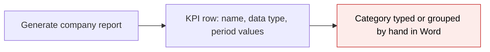
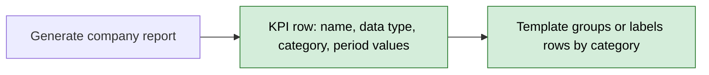
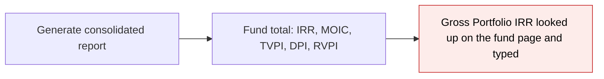
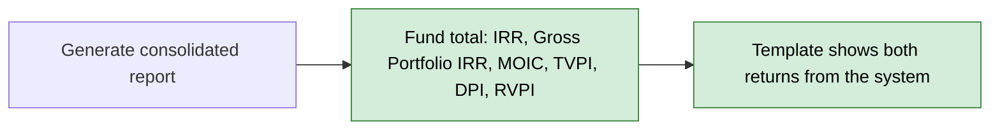
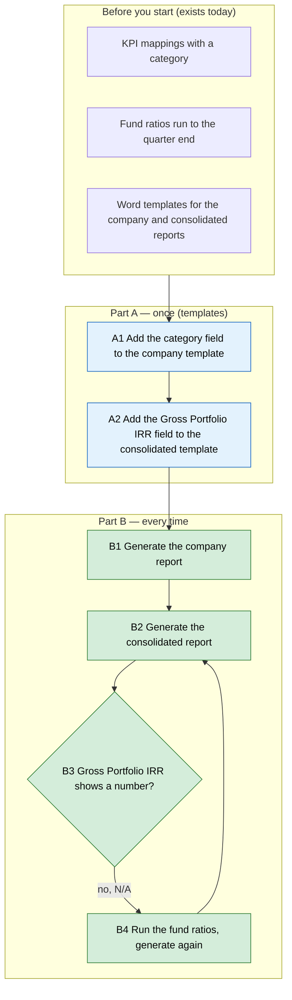

# Portfolio Report Category and Gross Portfolio IRR — Proposal

> **Audience:** Business team, product, QA, support — non-technical.
> **Companion document:** [Design](design.md)
> **New to this? Start with the [Workflow Journey](#workflow-journey)** — every action, in order, from start to the outcome.

> **Planning phase — no code changes.** This document proposes and explains the change. Do not
> edit application code while writing it; implementation happens later, in the tasks phase.

---

## Why

Two figures a report template needs are not available to it. The per-company report's KPI rows carry each KPI's data type but not its category, so a template cannot group or label rows by category. The consolidated report's fund totals show the fund's net IRR but not its Gross Portfolio IRR (the return on the portfolio investments before fund fees and expenses), which the system already works out and shows on the fund pages. Admins type both into Word by hand today.

## What Changes

- **Per-company report:** every KPI row also carries its **category**, next to the data type it already carries. The row is the same in the all-KPIs list and in each category's own list.
- **Consolidated report:** each fund's total gains a **Gross Portfolio IRR**, next to the fund's IRR. It is the latest stored run on or before the end date, or "N/A" when the ratio was never run.
- Nothing changes for templates that do not use the new fields.
- The per-company fund lines, the per-company fund data and the AI-drafted report's Word export do not get Gross Portfolio IRR or category (see *What This Feature Does NOT Cover*).

### Flow Diagram

*Caption: how a KPI row reaches the per-company template, before and after.*





*Caption: how a fund's total reaches the consolidated template, before and after.*





---

## Workflow Journey

### Who is involved

| Person | Role | What they do in the journey |
|---|---|---|
| Meera | Fund admin (company admin) | Adds the new fields to the Word templates once, then generates the quarterly reports |
| Business reviewer | Finance / investor relations | Checks the figures against the fund page |

### The journey on one page



### Before you start

| Needed | Why | Where it comes from |
|---|---|---|
| KPI mappings with a category, shown in the report | The category on each KPI row | The company's KPI mappings |
| A Gross Portfolio IRR ratio run for the fund on or before the end date | The value in the fund total | Fund ratios run (it already appears on the fund page) |
| The report templates | Where the new fields are placed | Portfolio report templates |

### Part A — once (templates)

| Step | Who | Where | Action | What the system does | What you see |
|---|---|---|---|---|---|
| A1 | Meera | Word, company template | Add the category field inside the KPI loop | Nothing yet | The template holds the field |
| A2 | Meera | Word, consolidated template | Add the Gross Portfolio IRR field inside the fund-totals loop | Nothing yet | The template holds the field |

### Part B — every time

| Step | Who | Where | Action | What the system does | What you see |
|---|---|---|---|---|---|
| B1 | Meera | Portfolio company › Generate report | Generate the company report | Adds the category to each KPI row | Each KPI row shows its category |
| B2 | Meera | Portfolio reports › Generate consolidated | Generate the consolidated report | Reads each fund's latest Gross Portfolio IRR on or before the end date | Each fund total shows the value |
| B3 | Meera | The generated document | Check the number | None | A number, or "N/A" |
| B4 | Meera | Fund › Ratios | Run the fund ratios to the end date, then repeat B2 | Stores the ratio | The fund total shows the number |

### What you see

```
Fund totals                                   End date 30 Sep 2026
--------------------------------------------------------------
Fund                IRR      Gross Portfolio IRR     MOIC
Alpha Fund I        14.2 %   18.0 %                  1.6 x
Alpha Fund II       N/A      N/A                     N/A        <- ratios never run

Company KPI rows
--------------------------------------------------------------
KPI          Category     Data type    Q1 FY26     Q2 FY26
Revenue      Financial    money        120         135
Churn        Customer     percentage   0.04        0.05
```

Both figures are read from what is stored: nothing is computed in the report. 18.0 % is the value on the fund page for the latest run on or before 30 Sep 2026.

### What goes wrong

Alpha Fund II shows "N/A" for Gross Portfolio IRR. The fund ratios were never run for it on or before the end date, so there is no stored value. Meera runs the fund ratios up to the end date and generates the report again.

### Summary: the minimum actions

| # | Action | Who | How often |
|---|---|---|---|
| 1 | Add the category field to the company template | Meera | Once |
| 2 | Add the Gross Portfolio IRR field to the consolidated template | Meera | Once |
| 3 | Run the fund ratios to the report end date | Meera | Every period |
| 4 | Generate the reports | Meera | Every period |

---

## User Stories

### US-1: Category on each KPI row

**As a** fund admin,
**I want** each KPI row in the company report to carry its category,
**So that** the template can label or group rows by category without typing.

**Acceptance criteria:**
- Each row in the all-KPIs list has the category of its KPI mapping.
- The same row in a category's own list has the same category.
- A KPI mapping with no category gives a blank, not an error.

### US-2: Gross Portfolio IRR in the fund total

**As a** fund admin,
**I want** each fund total in the consolidated report to show its Gross Portfolio IRR beside its IRR,
**So that** the investor report shows the gross and the net return without typing.

**Acceptance criteria:**
- The value is the fund's latest stored Gross Portfolio IRR on or before the end date, in the Default scenario.
- A run after the end date is not used.
- A fund with no stored run shows "N/A".

---

## UI Behavior

There is no screen change. The only visible change is in the generated Word documents, once the new fields are placed in the templates.

**Behavior notes:**
- A template that does not use the new fields renders exactly as before.
- A template that uses a field before the system provides it fails to fill it; after this change the field is always present.

---

## What This Feature Does NOT Cover

| Excluded | Covered In |
|---|---|
| Gross Portfolio IRR on each company's fund line or the company page's fund data (the fund's value would repeat for every company) | Not planned |
| Labelled Gross Portfolio IRR formulas and the tracking-currency version | Not planned; same as the fund's other returns |
| Category and data type in the AI-drafted report's Word export | Not planned |
| Valuing the change in fair market value on a per-share basis | Deferred; see the open decision in [portfolio-report-fund-metrics design](../archive/2026-10-27-portfolio-report-fund-metrics/design.md#open-decision-per-share-basis-for-fmv-change-percent) |
| Editing the Word templates | Done by the admin (Part A) |

---

## Validation Rules

| Field | Rule | Default |
|---|---|---|
| `category` | The KPI mapping's category as saved (up to 40 characters), not changed in case | Blank |
| `gross_portfolio_irr` | Latest Default-scenario run named "Gross Portfolio IRR" for the fund, dated on or before the end date | "N/A" |

---

## Behavior Rules

| Scenario | What User Sees |
|---|---|
| KPI mapping has a category | The category on its row |
| KPI mapping has no category | A blank category |
| Row in a category's own list | The same category as in the all-KPIs list |
| Two Gross Portfolio IRR runs, one before and one after the end date | The one before |
| Run in a scenario other than Default | Ignored |
| Fund has no Gross Portfolio IRR run | "N/A" |

---

## Resolved Design Decisions

| # | Decision | Resolution |
|---|---|---|
| 1 | Where does Gross Portfolio IRR go? | The consolidated fund totals only (confirmed). It is a fund-level ratio, so a per-company line would repeat the same value. |
| 2 | Which Gross Portfolio IRR? | The plain "Gross Portfolio IRR" run, as the fund's other returns read their plain names. |
| 3 | Is category changed in case? | No. Data type is lowercased for formatting; category is a display name and is kept as saved. |
| 4 | Does the FMV per-share work belong here? | No. It is deferred and noted in the fund-metrics design. |

---

## Capabilities

### New Capabilities

- `funds/portfolio-report-category-gross-irr`: the KPI row category in the company report and the fund total's Gross Portfolio IRR in the consolidated report.

### Modified Capabilities

None. This is a new capability that builds on the fund totals from `portfolio-report-fund-metrics`, which is being archived separately; this change is treated as new and independent of that archive.

---

## Impact

- The per-company portfolio report and the consolidated portfolio report, both generated as Word documents.
- The Word templates, which need the new fields to show them.
- No change to fund ratio runs, KPI mappings, screens, permissions or stored data.

---

## Benefits

1. The company report can group or label KPI rows by category without manual work.
2. The investor report shows gross and net fund returns side by side from the system.
3. The values match the fund page, so there is one figure to defend.

---

## FAQ

| Question | Answer |
|---|---|
| Do existing templates change? | No. They render as before until the new fields are added. |
| Why not on each company's fund line? | Gross Portfolio IRR exists only for the fund; a company line would repeat the same number. |
| Why "N/A" for a fund? | The fund ratios were not run to the end date. Run them and generate again. |
| Is any data migrated? | No. |
| Does this change notifications or billing? | No. |

How it is built is in [design.md](design.md).

---

## Design Principle for the Next Phase

Keep it to two small additions that reuse what is there: the existing KPI row and the existing one-query read of the fund's returns. Do not add a new query, class or setting.
