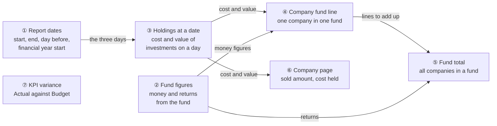
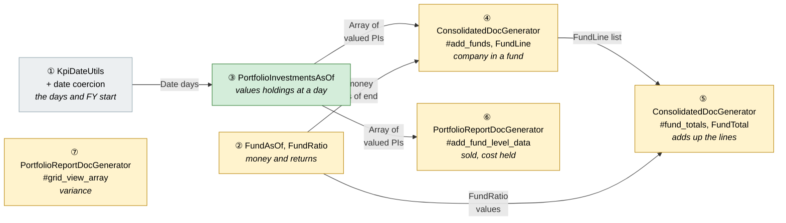
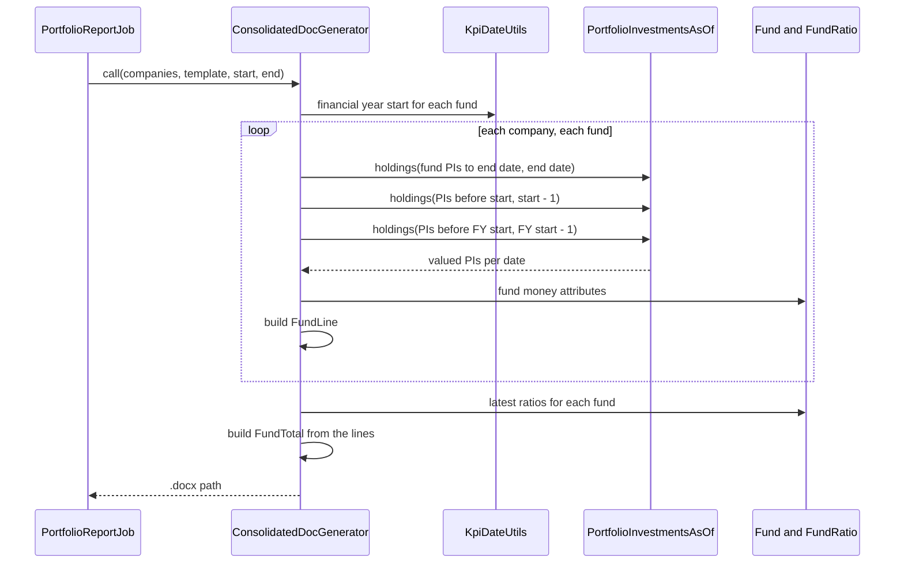
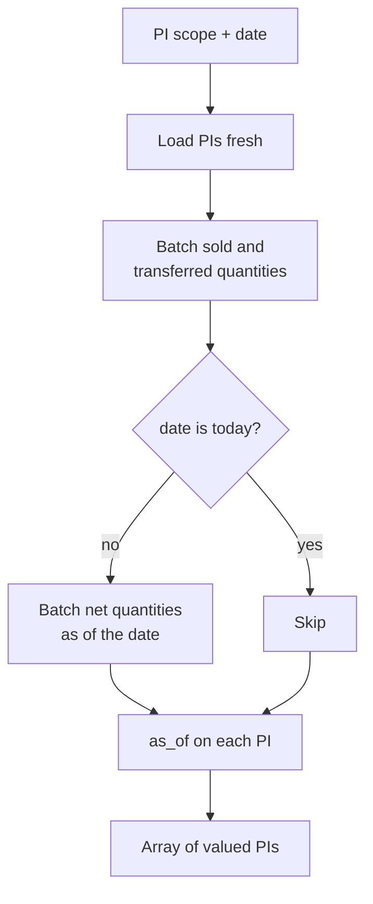
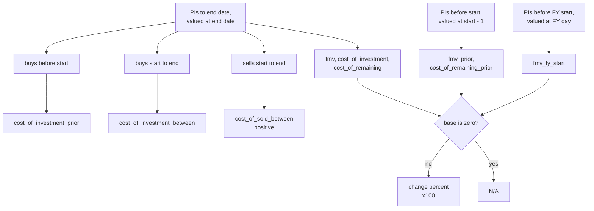
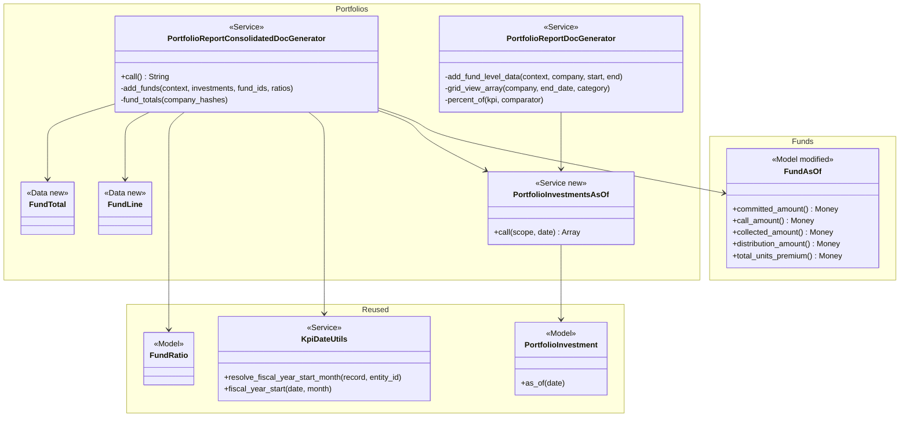

# Portfolio Report Fund Metrics — Design

> **Audience:** Engineering team.
> **Companion documents:** [Proposal](proposal.md) · [Spec](specs/)

> **Planning phase — no code changes.** This document explains HOW the proposal will be built.
> Do not edit application code while writing it; implementation happens later, in the tasks phase.

> **Design, not code.** Explain the design with mermaid diagrams and tables. Do NOT paste Ruby/JS
> class bodies, migrations, route blocks or policy code. Put real class, method, table and path
> names inside the diagrams and tables instead.

> **Zoom one picture.** The whole design hangs off ONE numbered picture. Part 1 draws it in plain
> words. Part 2 redraws the SAME picture, same shape and same numbers, with real names. Part 3 has
> one card per box, in the same order. Part 4 is reference material that spans several boxes. The
> numbers ①②③ mean the same box everywhere, so a reader always knows where they are.

> **Scale to the change.** **CORE** sections are always present. **CONDITIONAL** sections say when
> they apply; otherwise the heading carries `N/A — <reason>`. This change has no screen, table or
> job of its own, so it is short.

---

## Contents

- [1. The idea](#1-the-idea)
  - [What this adds](#what-this-adds)
  - [The idea in one picture](#the-idea-in-one-picture)
  - [Walkthrough: one example, start to finish](#walkthrough-one-example-start-to-finish)
  - [Key ideas](#key-ideas)
- [2. The same picture with real names](#2-the-same-picture-with-real-names)
  - [Picture](#picture)
  - [What each box does](#what-each-box-does)
  - [One run, end to end](#one-run-end-to-end)
  - [Lifecycles](#lifecycles)
  - [What users see](#what-users-see)
  - [Design decisions](#design-decisions)
- [3. One card per box](#3-one-card-per-box)
  - [① Report dates](#①-report-dates)
  - [② Fund figures](#②-fund-figures)
  - [③ Holdings at a date](#③-holdings-at-a-date)
  - [④ Company fund line](#④-company-fund-line)
  - [⑤ Fund total](#⑤-fund-total)
  - [⑥ Company page fund data](#⑥-company-page-fund-data)
  - [⑦ KPI variance](#⑦-kpi-variance)
- [4. Reference](#4-reference)
  - [Class diagram](#class-diagram)
  - [Data model and schema changes](#data-model-and-schema-changes)
  - [Component contracts](#component-contracts)
  - [Notifications](#notifications)
  - [Cross-cutting concerns](#cross-cutting-concerns)
  - [Worked examples](#worked-examples)
  - [Testing](#testing)
  - [Risks and open questions](#risks-and-open-questions)

---

## 1. The idea

### What this adds

The two portfolio report builders (`PortfolioReportConsolidatedDocGenerator` for all companies, `PortfolioReportDocGenerator` for one company) gain more numbers in the data they hand to the Word template. Investments are valued at up to three dates through one shared helper, the per-fund shapes become `Data.define` value objects (as `KycDocGenerator::KycAmounts` already is), and no table, screen or job changes.

### The idea in one picture



⑦ stands alone: it only needs the KPI reports.

### Walkthrough: one example, start to finish

**Setup.** Meera generates the report for Inflexor Technology Discovery Fund 1, start 1 Jul 2026, end 30 Sep 2026. Company A and Company B are selected. Shared data is in [Worked examples](#worked-examples).

**Legend.** ✓ done · ● we are here (working on it, not done) · ○ not started.

| # | When | What happens | Behind the scenes | Result |
|---|---|---|---|---|
| 1 | Report starts | The three days are worked out: 30 Jun 2026 (day before start) and 31 Mar 2026 (day before the financial year) | Report dates (①) turns the text dates into dates and picks the financial year start | ✓ Report dates<br/>● Company A<br/>○ Company B<br/>○ Fund total |
| 2 | Company A, fund 1 | Cost and value are worked out at 30 Sep, 30 Jun and 31 Mar | Company fund line (④) asks holdings at a date (③) for each day; fund figures (②) give committed and collected | ✓ Report dates<br/>**● Company A**<br/>○ Company B<br/>○ Fund total |
| 3 | Company A, fund 1 | Roll-forward 40 + 10 − 5 = 45 cost, value 50 → 60 (+20.0%) | Same line (④), from the 30 Sep set: purchases and sales split by date | Same as row 2 |
| 4 | Company B, fund 1 | No valuation before 1 Jul: prior value 0, change "N/A" | Company fund line (④) divides only when the base is not zero | ✓ Report dates<br/>✓ Company A<br/>**● Company B**<br/>○ Fund total |
| 5 | Fund total | Cost and value are added up: 70 + 10 − 5 = 75, value 74 → 81 (+9.5%) | Fund total (⑤) sums the lines (④) and reads the fund's own ratios (②) | ✓ Report dates<br/>✓ Company A<br/>✓ Company B<br/>**● Fund total** |
| 6 | Mistake | Meera's fund has no TVPI run yet | Fund total (⑤) shows "N/A" instead of failing | Same as row 5 |
| 7 | Fix | She runs the fund ratios and regenerates | The new run is the latest on or before the end date | ✓ all |

```
  Roll-forward as the template sees it (Cr)
  Company   Jun-26  Invested  Exits  Sep-26      FMV Jun  FMV Sep  Change
  A          40.0     10.0     5.0    45.0         50.0     60.0    20.0
  B          30.0      0.0     0.0    30.0         24.0     21.0   -12.5
  Total      70.0     10.0     5.0    75.0         74.0     81.0     9.5
```

**What to notice**

- Holdings are valued by one helper at each date, never inline.
- A record valued at one date is frozen; each date loads its own set.
- Totals are built from the lines, never from the database again.
- Fund-level figures come from the fund, not from the sum of companies.

### Key ideas

| # | Idea | In one line | Card |
|---|---|---|---|
| 1 | One helper values holdings at a date | Fresh load, batched, one pass per date | [③](#③-holdings-at-a-date) |
| 2 | Cost net of exits is the sum of cost of remaining | Foots with purchases and exits | [④](#④-company-fund-line) |
| 3 | Totals are sums of lines | Percent changes are recomputed from the sums | [⑤](#⑤-fund-total) |
| 4 | Fund money is as of the end date, not summed | `FundAsOf` gives it once per fund | [②](#②-fund-figures) |
| 5 | Financial year start reuses the KPI rule | Fund, then entity, then country default | [①](#①-report-dates) |
| 6 | Fixed shapes become `Data.define` | Missing key fails loudly | [④](#④-company-fund-line) |

**FAQ**

| Question | Answer |
|---|---|
| Does anything block the user? | No. Missing data shows "N/A" or 0; generation does not fail. |
| Does this touch the database schema? | No. |

---

## 2. The same picture with real names

### Picture



Colour = footprint: **green** new, **amber** modified, **grey** reused unchanged. Exact files are in [lld.md File Map](lld.md#file-map).

### What each box does

| # | Box | Real parts | What it does | When it runs | What it decides | Details |
|---|---|---|---|---|---|---|
| ① | Report dates | `KpiDateUtils.resolve_fiscal_year_start_month`, `.fiscal_year_start`; `Date` coercion in both generators | Turns start and end into dates; gives start − 1 day and financial-year-start − 1 day | Once per generator run | Which month the year starts | [card](#①-report-dates) |
| ② | Fund figures | `FundAsOf` (gains the money figures), `FundRatio.default` | Reads the fund's money as of the end date and its latest ratios on or before the end date | Once per fund | Which rows count as of the date; which ratio row is the latest | [card](#②-fund-figures) |
| ③ | Holdings at a date | `PortfolioInvestmentsAsOf` (new), `PortfolioInvestment.with_buy_quantities`, `.with_net_quantities_on`, `#as_of` | Loads a fund's PIs fresh and values them as of a day | Once per fund per distinct date | Nothing; returns valued PIs | [card](#③-holdings-at-a-date) |
| ④ | Company fund line | `#add_funds`, `FundLine` (`Data.define`) | Builds one company-in-one-fund line with cost, exits, value, changes and fund money | Per company, per fund | Which PIs fall before, in and after the period | [card](#④-company-fund-line) |
| ⑤ | Fund total | `#fund_totals`, `FundTotal` (`Data.define`) | Adds up lines per fund; adds collected %, company count, fund returns | Once per run | Zero-base → "N/A" | [card](#⑤-fund-total) |
| ⑥ | Company page fund data | `#add_fund_level_data` | Adds `sold_amount` and `cost_of_remaining` to each fund's data | Per fund | Sells vs buys | [card](#⑥-company-page-fund-data) |
| ⑦ | KPI variance | `#grid_view_array`, `#percent_of` | Adds `<label>_vs_budget_compute_percent` beside the existing percent | Per KPI row | Missing or zero Budget → "N/A" | [card](#⑦-kpi-variance) |

### One run, end to end



### Lifecycles

N/A — nothing stored or derived has a status; every figure is worked out per run.

### What users see

N/A — no screen changes. The figures appear in the Word output; the visible result is in the proposal's [What you see](proposal.md#what-you-see).

### Design decisions

1. **One shared helper for valuing holdings** — `PortfolioInvestmentsAsOf`, used by both generators for every date. Alternative: inline `.map { |pi| pi.as_of(date) }` at each date as the generators do today. Rejected: it repeats the per-PI query cost three times and invites reusing a frozen set. The helper loads fresh and batches the way `AggregatePortfolioInvestment#as_of` already does.
2. **Reuse the KPI financial-year rule** — `KpiDateUtils` (record override, entity setting, country default). Alternative: `Fund#start_of_financial_year_date`, which skips the entity setting. Rejected: two rules would disagree.
3. **Net cost as new fields** — `cost_of_remaining`, `cost_of_remaining_prior`; `cost_of_investment` untouched. Alternative: redefine `cost_of_investment` as net. Rejected: the fund snapshot and LP page would change silently.
4. **`Data.define` for fixed shapes, `OpenStruct` for custom-field sums** — keys of the sums are form-field names known only at run time.
5. **Percent fields are numbers ×100, "N/A" on a zero base** — matches the existing `percent_of`; the template adds "%".
6. **Totals from lines** — the roll-forward total foots because it is the sum of the lines. Alternative: query per fund again. Rejected: slower and could disagree with the lines.
7. **Fund figures per company-fund line** — the fund is already loaded there; ratios are read per fund once in the total. Few funds make a repeat acceptable.
8. **Fund money as of the end date, in `FundAsOf`** — that class already filters commitments, remittances, payments and distributions by date; it gains the money figures so the capital call and distribution letters that use it stay unchanged. Alternative: a private calculation in the report builder (as `FundDocGenerator#amounts` does). Rejected: a second copy of the same sums. Collected is counted from payments, not from the remittance's running total, so a payment made after the date is not counted early.
9. **Dropped: aggregate PI as-of figures** — no template reads them; `sold_amount` comes from the PIs already loaded.

**FAQ**

| Question | Answer |
|---|---|
| Why not use the fund's stored totals? | They are running totals as of today; a report for a past quarter would show later drawdowns. |
| Why not a database table for these figures? | They are cheap to compute per run and a stored copy could go stale. |

---

## 3. One card per box

> Same order and numbers as the picture.

### ① Report dates

Turns the job's text dates into dates and works out the two extra days: the day before the start, and the day before the financial year starts.

| Owns | Reads / receives | Produces |
|---|---|---|
| Date coercion; financial-year-start lookup | `start_date`, `end_date` (text from the job), the fund | `start`, `end`, `prior_day`, `fy_day` as `Date` |

- Strictly before the start date means `investment_date < start`, not `..start`. Note `PortfolioInvestment.before` is on-or-before despite its name; the helper takes explicit scopes.
- If the quarter starts on the financial year start, `fy_day == prior_day`, and the second valuation is reused.

**Worked examples:** H1, H2, E3, E4, E5, X2.

**FAQ**

| Question | Answer |
|---|---|
| What if the fund has no setting and the entity has none? | The country default (April for IN, January for US). |
| Why per fund, not per report? | A fund can override the year start. |

### ② Fund figures

Reads the fund's own numbers: money as of the end date and stored ratios.

| Owns | Reads / receives | Produces |
|---|---|---|
| Money as of a date (in `FundAsOf`); latest-ratio lookup | `FundAsOf` rows already filtered by date; `FundRatio` rows with owner type `Fund`, Default scenario | Money figures; `irr` (from XIRR), `moic`, `tvpi`, `dpi`, `rvpi` or "N/A" |

| Figure | As of a date means | Same source as the fund's running total |
|---|---|---|
| committed (and tracking) | commitments with `commitment_date` up to the date | commitments' committed amount |
| call (and tracking) | remittances of calls dated up to the date | remittances' call amount |
| collected (and tracking) | payments with `payment_date` up to the date, on verified remittances | verified remittances' collected amount (the sum of their payments) |
| distribution | distribution payments with `payment_date` up to the date, gross payable | distribution payments' gross payable |
| tracking distribution | the same, completed payments only, tracking net payable | completed payments' tracking net payable |
| total units premium | fund units with `issue_date` up to the date | fund units' premium |
| target committed | not dated; the fund's own value | — |

- The fund's own running total is a counter rolled up from the same rows, so for today's date the two agree (H18).
- Verification is read as it is now: a payment verified later still counts as collected on its payment date.
- Commitment adjustments made after the date are not rolled back; the commitment's current amount counts if it is dated on or before the date.

- Latest means highest `end_date` on or before the end date, then highest id.
- The company's own IRR and MOIC (owner type `Investor`) stay as they are on ④.

**Worked examples:** H3, H12, H13, H18, E6, E20, E21, E22, E27–E31.

**FAQ**

| Question | Answer |
|---|---|
| Why XIRR for `irr`? | Fund-level IRR is stored as XIRR; there is no plain IRR at fund level. |
| Is the ratio value already a percent? | Yes, XIRR is stored ×100; the template adds "%". |

### ③ Holdings at a date

The one place that values a set of investments as of a day.

| Owns | Reads / receives | Produces |
|---|---|---|
| Fresh load, batching, calling `as_of` | A PI scope for one fund and a `Date` | Array of valued, frozen PIs |



- A PI valued at one date is frozen; calling `as_of` again on the same objects raises `FrozenError`. The helper never takes already-loaded records.
- Sums use Enumerable on the result: `fmv_cents`, `cost_of_remaining_cents` (zero for sells), `amount_cents` (buys), `cost_of_sold_cents` (sells, stored negative).

**Worked examples:** H1, X1.

**FAQ**

| Question | Answer |
|---|---|
| Why not call `AggregatePortfolioInvestment#as_of`? | It reloads the same PIs and no template reads it. |
| Is the batch needed? | Without it each buy runs its own sum queries per date; three dates triple that. |

### ④ Company fund line

One company in one fund: the fund's money, cost and value across the dates, and the changes.

| Owns | Reads / receives | Produces |
|---|---|---|
| Splitting PIs by date; the percent changes | ③'s arrays for end, prior and FY days; ②'s money | `FundLine` per fund |



- `cost_of_investment_prior` and `_between` come from the end-date set by date; no extra pass.
- `cost_of_remaining_prior + cost_of_investment_between − cost_of_sold_between = cost_of_remaining`; a stock conversion in the period is a known edge.
- Money fields: committed, call, collected, distribution, target committed, units premium and the four tracking ones.

**Worked examples:** H3–H8, E6–E14.

**FAQ**

| Question | Answer |
|---|---|
| Why do buys use the as-of amount? | A buy's `amount_cents` does not change with the date; reading it after `as_of` matches today's code. |
| Does `cost_of_investment_prior` need a pass? | No, only value and cost of remaining at the prior day do. |

### ⑤ Fund total

Adds up the lines for each fund and reads the fund-level figures.

| Owns | Reads / receives | Produces |
|---|---|---|
| Summing; collection percentages; company count | `FundLine`s; ②'s money and ratios | `FundTotal` per fund |

- Money fields are taken once from the fund (first line), never summed.
- `company_count` is the number of lines for the fund; a company appears only if it has a PI on or before the end date.
- `fmv_change_percent` is recomputed from the summed `fmv` and `fmv_prior`.
- Custom-field sums keep their existing `OpenStruct`.

**Worked examples:** H9–H13, E15–E22.

**FAQ**

| Question | Answer |
|---|---|
| Why not average the companies' percentages? | It would not equal the change of the total. |
| What if two funds share a name? | Totals are grouped by fund id, as today. |

### ⑥ Company page fund data

Adds `sold_amount` and `cost_of_remaining` to each fund's data on the per-company page.

| Owns | Reads / receives | Produces |
|---|---|---|
| Sell sum | ③'s array for the end date | `sold_amount` (positive), `cost_of_remaining` |

- `sold_amount` is the sum of the sells' `amount_cents`, which is what the aggregate investment rolls up, so no aggregate is needed.

**Worked examples:** H14, H15, E23, E24.

**FAQ**

| Question | Answer |
|---|---|
| Why the same helper as the consolidated report? | One way to value holdings; the per-company generator gets the batching for free. |

### ⑦ KPI variance

Adds the percentage change of Actual against Budget next to the existing percent-of.

| Owns | Reads / receives | Produces |
|---|---|---|
| The variance rule | Actual KPI, Budget KPI of the same name, period and date | `<label>_vs_budget_compute_percent` |

- The comparator loop already runs for `COMPARATOR_TAGS`; the new key is written in the same place.
- "N/A" when either figure is missing or Budget is zero; the sign follows the signed Budget.

**Worked examples:** H16, H17, E25, E26.

**FAQ**

| Question | Answer |
|---|---|
| Why a second field when `_vs_budget_percent` exists? | The template cannot do arithmetic; the existing field is Actual ÷ Budget. |

---

## 4. Reference

### Class diagram



### Data model and schema changes

N/A — no table or column changes. Field lists of `FundLine` and `FundTotal` are in [lld.md Method Contracts](lld.md#method-contracts).

### Component contracts

| From → To | Contract | Direction rule |
|---|---|---|
| ① → ③ | `Date` for each of end, prior day, FY day | Dates are plain `Date`, never text |
| ③ → ④ | `Array` of valued PIs per date | Valued PIs are read-only; never revalued |
| ② → ④ | `FundAsOf` money figures (`Money`) | As of the end date |
| ④ → ⑤ | `FundLine` list per company | Totals read only from lines |
| ② → ⑤ | Ratio values or "N/A" | Latest Default run on or before the end date |
| ③ → ⑥ | `Array` of valued PIs at the end date | Same helper as ④ |

### Notifications

N/A — the change sends no email, in-app alert or WhatsApp message to investors or internal users; the existing generation toast is unchanged.

### Cross-cutting concerns

#### Transactions and queries

No writes. Reads per run: per company and fund, up to three PI loads (end, prior, FY day) plus their batched quantity sums; one ratio query per fund. The FY-day load is skipped when it equals the prior day.

#### Exception handling and monitoring

N/A — no new failure path: zero bases give "N/A", missing ratios give "N/A", and nothing is rescued.

#### Performance and security

- Performance: batching keeps the per-PI queries off the loop; the work scales with companies × funds × dates (typically few funds).
- Security: no new access; reads stay within the selected companies' entity (the job already scopes them).

### Worked examples

**ID legend:** **H** = Happy path · **E** = Edge case · **X** = Error (exception) case.

**Shared setup:**

| Record | Name | Key data |
|---|---|---|
| Fund | Inflexor Technology Discovery Fund 1 | INR; as of 30-Sep: committed 502 Cr, collected 125.5 Cr (verified); later: commitment 20 Cr dated 2026-10-10 and verified payment 5 Cr on 2026-10-05; no year-start setting; default April |
| Period | Q2 FY27 | start 2026-07-01, end 2026-09-30 |
| Company A | Company A | buys: 40 Cr (2026-02-10), 10 Cr (2026-08-15); sell 2026-09-10 (sale price 7 Cr, cost 5 Cr); valuations: 45 Cr at 31-Mar, 50 Cr at 30-Jun, 60 Cr at 30-Sep |
| Company B | Company B | buy 30 Cr (2026-01-20); valuations: 28 Cr at 31-Mar, 24 Cr at 30-Jun, 21 Cr at 30-Sep |
| Fund ratios | — | TVPI 1.1 (30-Jun), 1.2 (30-Sep); XIRR 18.5; MOIC 1.4; DPI none |
| KPI | Revenue | YTD 2026-06-30 Actual 92, Budget 100; Quarter Actual 75, Budget 60 |

#### Happy Path

| # | Scenario | Given | When | Then | Spec scenario | Feature |
|---|---|---|---|---|---|---|
| H1 | Prior value uses the day before the start | Company A valued 50 Cr at 30-Jun | consolidated report built | `fmv_prior` = 50 Cr | Prior value uses the day before the start date | portfolio_report_company_fund_lines |
| H2 | April financial year | Fund has no setting, default April, end 30-Sep | report built | `fmv_fy_start` = value at 31-Mar | April financial year | portfolio_report_company_fund_lines |
| H3 | Fund money on the company line | Fund committed 502 Cr, collected 125.5 Cr | report built | line shows both | Fund money figures on the company fund line | portfolio_report_company_fund_lines |
| H4 | Purchases split around the start | Company A buys 40 Cr (before) and 10 Cr (Aug) | report built | prior 40, between 10, `cost_of_investment` 50 | Purchases split around the start date | portfolio_report_company_fund_lines |
| H5 | Exits are positive | Company A sells at cost 5 Cr on 10-Sep | report built | `cost_of_sold_between` = 5 Cr | Exits in the quarter are positive | portfolio_report_company_fund_lines |
| H6 | Roll-forward adds up | Company A | report built | remaining prior 40, now 45; 40 + 10 − 5 = 45 | Roll-forward adds up | portfolio_report_company_fund_lines |
| H7 | Value rises | Company A 50 → 60 | report built | `fmv_change_percent` = 20 | Value rises | portfolio_report_company_fund_lines |
| H8 | Change since FY start | Company A 45 → 60 | report built | `fmv_fy_start_change_percent` = 33.3 | Change since the financial year start | portfolio_report_company_fund_lines |
| H9 | Collection percentages | Fund 502 / 125.5 | report built | collected 25, uncollected 376.5 Cr and 75 | Collection percentages | portfolio_report_fund_totals |
| H10 | Totals add up | Companies A and B | report built | `fmv_prior` 74, `fmv` 81, change 9.5 | Totals add up the companies | portfolio_report_fund_totals |
| H11 | Roll-forward total adds up | Companies A and B | report built | 70, 10, 5, 75 | Roll-forward total adds up | portfolio_report_fund_totals |
| H12 | Latest fund ratio | TVPI 1.1 and 1.2 | report built | `tvpi` = 1.2 | Latest fund ratio on or before the end date | portfolio_report_fund_totals |
| H13 | IRR from XIRR | XIRR 18.5 | report built | `irr` = 18.5 | IRR comes from the fund's XIRR | portfolio_report_fund_totals |
| H14 | Sold amount | Company A sale 7 Cr on 10-Sep | company report built | `sold_amount` = 7 Cr | Sold amount | portfolio_report_company_fund_data |
| H15 | Cost of remaining on the company page | Bought 50, cost sold 5 | company report built | `cost_of_remaining` 45, `cost_of_investment` 50 | Cost of remaining on the company page | portfolio_report_company_fund_data |
| H16 | Actual below Budget | YTD Actual 92, Budget 100 | rows built to 30-Jun | compute percent −8; percent-of still 92 | Actual below Budget | portfolio_report_kpi_budget_variance |
| H18 | Fund's as-of figures match its own today | Fund with commitments, payments, distributions, units | figures asked as of today | each equals the fund's own figure | As of today matches the fund's own figures | fund_as_of_amounts |
| H17 | Actual above Budget | Quarter Actual 75, Budget 60 | rows built | compute percent 25 | Actual above Budget | portfolio_report_kpi_budget_variance |

#### Edge Cases

| # | Scenario | Given | When | Then | Spec scenario | Feature |
|---|---|---|---|---|---|---|
| E1 | Buy on the start date | Buy dated 2026-07-01 | report built | in `cost_of_investment_between`, not prior | Purchase on the start date counts as in the period | portfolio_report_company_fund_lines |
| E2 | Buy on the end date | Buy dated 2026-09-30 | report built | in `cost_of_investment_between` | Purchase on the end date counts as in the period | portfolio_report_company_fund_lines |
| E3 | January year on the fund | Fund year starts January | report built | `fmv_fy_start` as of 31-Dec-2025 | January financial year on the fund | portfolio_report_company_fund_lines |
| E4 | Entity setting used | Fund none, entity January | report built | as of 31-Dec of the previous year | Entity setting used when the fund has none | portfolio_report_company_fund_lines |
| E5 | Quarter starts at FY start | Start 2026-04-01, end 2026-06-30 | report built | `fmv_fy_start` = `fmv_prior` | Quarter starts at the financial year start | portfolio_report_company_fund_lines |
| E6 | Money as of a past end date | Fund collected more after 30-Sep | report for 30-Sep built | amounts as of 30-Sep, later collection not included | Past end date shows the money figures as of that date | portfolio_report_company_fund_lines |
| E7 | No exits | No sale in the quarter | report built | remaining = prior + between | No exits | portfolio_report_company_fund_lines |
| E8 | Gross cost unchanged by exits | Bought 50, cost sold 5 | report built | `cost_of_investment` 50 | Gross cost is unchanged by exits | portfolio_report_company_fund_lines |
| E9 | No holding before start | First buy in the quarter | report built | `cost_of_remaining_prior` 0 | No holding before the start date | portfolio_report_company_fund_lines |
| E10 | Value falls | Company B 24 → 21 | report built | change −12.5 | Value falls | portfolio_report_company_fund_lines |
| E11 | Purchase raises the change | 10 Cr, buy 10 Cr, no revaluation | report built | change 100 | A purchase in the quarter raises the change | portfolio_report_company_fund_lines |
| E12 | No prior value | No valuation before start | report built | change "N/A" | No prior value | portfolio_report_company_fund_lines |
| E13 | No value at FY start | No valuation before 31-Mar | report built | FYTD "N/A" | No value at the financial year start | portfolio_report_company_fund_lines |
| E14 | Existing template unchanged | Template reads old fields only | report built | same output as before | Existing consolidated template | portfolio_report_company_fund_lines |
| E15 | Money not multiplied | Two companies in one fund | report built | committed 502 Cr, not 1,004 | Money figures not multiplied by the number of companies | portfolio_report_fund_totals |
| E16 | Zero commitment | Committed 0 | report built | percentages "N/A" | Zero commitment | portfolio_report_fund_totals |
| E17 | Company count | Three selected, two in the fund | report built | `company_count` 2 | Company count counts only companies in the fund | portfolio_report_fund_totals |
| E18 | Investment after end date | Only PI dated after end | report built | not counted | Investment after the end date is not counted | portfolio_report_fund_totals |
| E19 | Total with no prior | Summed `fmv_prior` 0 | report built | change "N/A" | Total change with no prior value | portfolio_report_fund_totals |
| E20 | Run after end date | Latest run 15-Oct | report built | earlier run used | Run after the end date ignored | portfolio_report_fund_totals |
| E21 | Ratio never run | No DPI | report built | `dpi` "N/A" | Ratio never run | portfolio_report_fund_totals |
| E22 | Other scenarios | Ratio only in another scenario | report built | "N/A" | Other scenarios ignored | portfolio_report_fund_totals |
| E23 | Sale after end date | Sale 5-Oct | company report built | not in `sold_amount` | Sale after the end date ignored | portfolio_report_company_fund_data |
| E24 | No sales | None | company report built | `sold_amount` 0 | No sales | portfolio_report_company_fund_data |
| E25 | No Budget | None for the period | rows built | "N/A" | No Budget | portfolio_report_kpi_budget_variance |
| E26 | Zero Budget | Budget 0 | rows built | "N/A" | Zero Budget | portfolio_report_kpi_budget_variance |
| E27 | Commitment after the date | Commitment of 20 Cr dated 2026-10-10 | committed asked as of 2026-09-30 | does not include it | Commitment after the date is not counted | fund_as_of_amounts |
| E28 | Collection after the date | Verified payment of 5 Cr on 2026-10-05 | collected as of 2026-09-30 | does not include it | Collection after the date is not counted | fund_as_of_amounts |
| E29 | Unverified collection | Payment of 3 Cr on 2026-09-15, remittance not verified | collected as of 2026-09-30 | does not include it | Unverified collection is not counted | fund_as_of_amounts |
| E30 | Distribution after the date | Distribution payment dated 2026-10-05 | distribution as of 2026-09-30 | does not include it | Distribution after the date is not counted | fund_as_of_amounts |
| E31 | Units premium by issue date | Units issued 2026-09-01 (2 Cr) and 2026-11-01 (1 Cr) | total units premium as of 2026-09-30 | 2 Cr | Units premium counts units issued up to the date | fund_as_of_amounts |

#### Error Cases

| # | Scenario | Given | When | Then (what the user sees, who is alerted) | Spec scenario | Feature |
|---|---|---|---|---|---|---|
| X1 | Three dates in one run | Prior, end and FY days all differ | report built | No error; each date valued from a fresh load (no `FrozenError`) | — | portfolio_report_holdings_at_dates |
| X2 | Dates arrive as text | Job passes `"2026-07-01"` and `"2026-09-30"` | report built | Works; the day before the start is 30-Jun | — | portfolio_report_holdings_at_dates |
| X3 | Already-loaded records refused | A relation that was already loaded is handed to the holdings helper | helper called | Refused with an error naming the problem; nothing is valued twice | — | portfolio_report_holdings_at_dates |

### Testing

Cucumber only. New feature files and step file are listed in [lld.md Test Plumbing](lld.md#test-plumbing); the Feature column above is the mapping. `portfolio_report_kpi_budget_variance` is a new file that reuses the existing KPI steps; the existing `portfolio_report_kpi_vs_budget` is untouched. Shared setup is one Given building the fund, two companies, their PIs and valuations. Every scenario carries a comment naming its H/E/X ID and path; code comments name the IDs of the paths they implement.

### Risks and open questions

- Valuing at three dates is the slowest part of a run → one helper that batches, and the FY pass is skipped when it equals the prior day.
- A valued PI cannot be re-valued → the helper only takes a scope and loads fresh (X1).
- Fund money as of a date mirrors each running total's source rows, but verification and commitment adjustments are read as they are now → documented limit.
- Stock conversions in the period can make the roll-forward differ by the shares moved → documented edge, not built for.
- The snapshot's "Invested in portfolio" is gross and the roll-forward's Sep-26 cost is net, so they differ after an exit → accepted by the business, no change.

| # | Open question | Current thinking | Status |
|---|---|---|---|
| 1 | Should the snapshot's "Invested in portfolio" be renamed or switched to net? | No change: stays gross (`cost_of_investment`) with its current label (business answer) | Resolved |

**FAQ**

| Question | Answer |
|---|---|
| Where do I start reviewing? | ③, the helper; then ④ and ⑤. |
| Why no unit specs? | Cucumber is the only test framework in this repo. |
