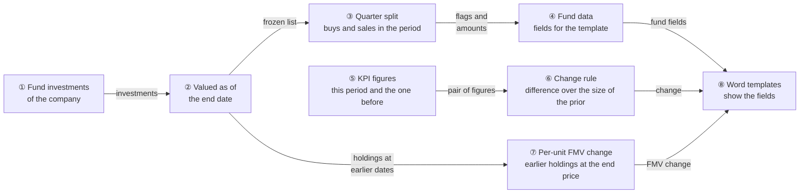
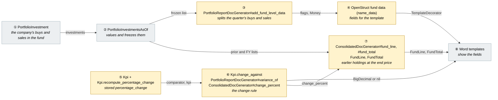
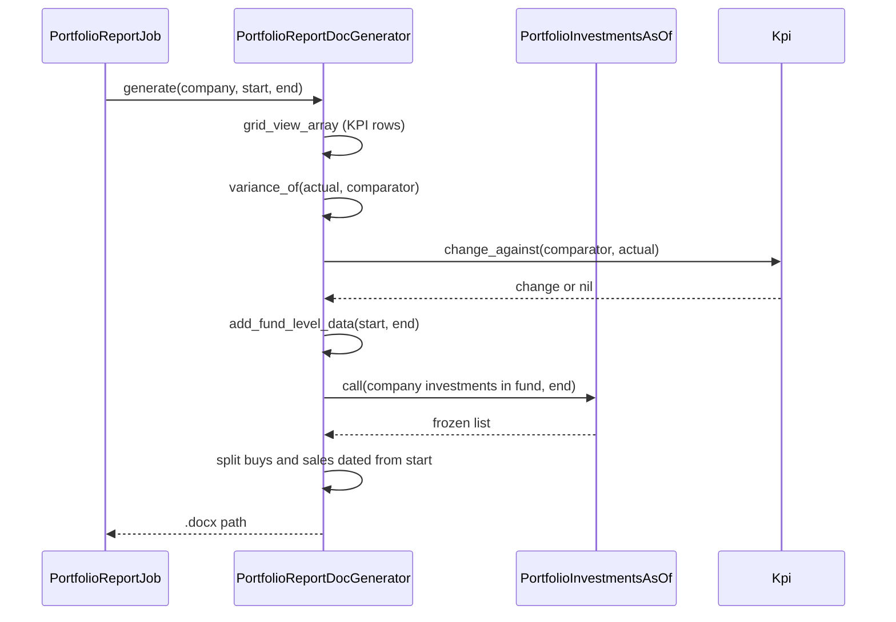
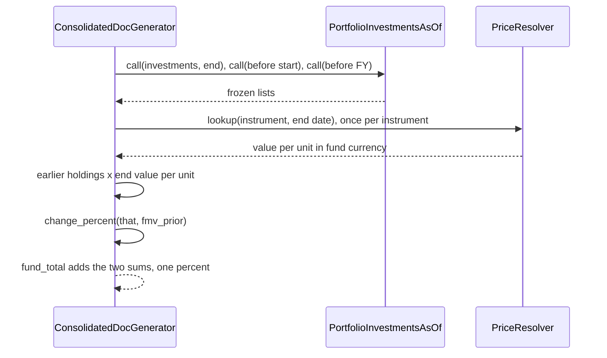
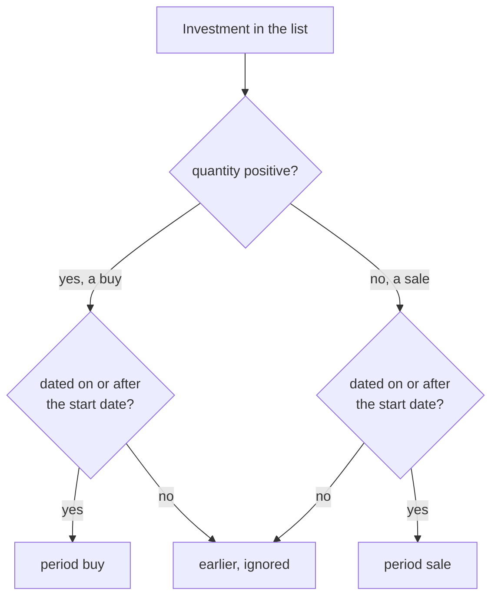
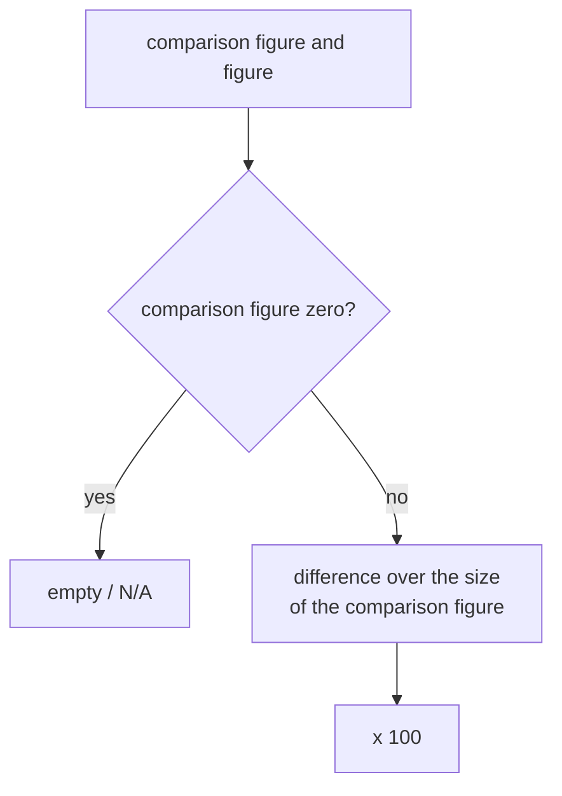
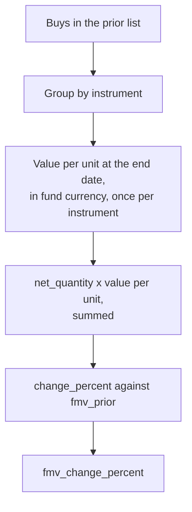
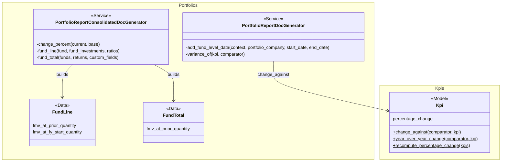

# Portfolio Report Quarter Activity and KPI Change Direction — Design

> **Audience:** Engineering team.
> **Companion documents:** [Proposal](proposal.md) · [Specs](specs/)

> **Planning phase — no code changes.** This document explains HOW the proposal will be built.
> Do not edit application code while writing it; implementation happens later, in the tasks phase.

> **Small change.** One new set of fields on an existing builder, one corrected formula, and a per-unit basis for the fair market value change. No new table, job, screen or class. Sections that do not apply keep their heading with `N/A — <reason>`. More report changes may be added to this bundle before it is built; each gets its own box and card.

---

## Contents

- [1. The idea](#1-the-idea)
  - [What this adds](#what-this-adds)
  - [The idea in one picture](#the-idea-in-one-picture)
  - [Walkthrough: one example, start to finish](#walkthrough-one-example-start-to-finish)
  - [Key ideas](#key-ideas)
- [2. The same picture with real names](#2-the-same-picture-with-real-names)
  - [Picture](#picture)
  - [What each box does](#what-each-box-does)
  - [One run, end to end](#one-run-end-to-end)
  - [Lifecycles](#lifecycles)
  - [What users see](#what-users-see)
  - [Design decisions](#design-decisions)
- [3. One card per box](#3-one-card-per-box)
  - [① and ② Investments valued as of the end date](#①-and-②-investments-valued-as-of-the-end-date)
  - [③ Quarter split](#③-quarter-split)
  - [④ Fund data](#④-fund-data)
  - [⑤ KPI figures](#⑤-kpi-figures)
  - [⑥ Change rule](#⑥-change-rule)
  - [⑦ Per-unit fair market value change](#⑦-per-unit-fair-market-value-change)
  - [⑧ Word templates](#⑧-word-templates)
- [4. Reference](#4-reference)
  - [Class diagram](#class-diagram)
  - [Data model and schema changes](#data-model-and-schema-changes)
  - [Component contracts](#component-contracts)
  - [Notifications](#notifications)
  - [Cross-cutting concerns](#cross-cutting-concerns)
  - [Worked examples](#worked-examples)
  - [Testing](#testing)
  - [Risks and open questions](#risks-and-open-questions)

---

## 1. The idea

### What this adds

Two read-only additions for the report. The company report's per-fund data gets the quarter's purchases and sales, worked out from the same valued investment list it already builds, using the buy and sell split the consolidated report already uses. One change rule, "divide by the size of the prior figure", replaces the plain division that flips sign on a negative base, in the stored KPI change, the report's budget difference and the fair market value change; percentage KPIs use the difference in points instead. And the consolidated report's fair market value change becomes the weighted average change in value per unit, by revaluing the earlier holdings at the end date's value per unit.

### The idea in one picture



### Walkthrough: one example, start to finish

Meera generates Company A's report for 1 Jul to 30 Sep 2026. Company A bought 4,000 shares for 40 Cr on 10 Feb, 500 for 10 Cr on 15 Aug, and sold 500 for 7 Cr (cost 5 Cr) on 10 Sep. Its EBITDA was (3.15) a year ago and is (3.80) now. Legend: ● we are here.

| # | When | What happens | Behind the scenes | Result |
|---|---|---|---|---|
| 1 | Fund data | The company's investments in the fund are loaded and valued | ① and ② give the frozen list up to 30 Sep | Three investments |
| 2 | Quarter split | Buys and sales dated 1 Jul to 30 Sep are picked | ③ keeps the 15 Aug buy and the 10 Sep sale, drops the 10 Feb buy | Buy 10 Cr, sale cost 5 Cr |
| 3 | Fund data | Fields are stored on the fund data | ④ | `buy_pis_present` true, `cost_of_investment_between` 10 Cr, `sell_pis_present` true, `cost_of_sold_between` 5 Cr |
| 4 | KPI change | EBITDA is compared with a year ago | ⑤ gives (3.15) and (3.80); ⑥ divides the difference by 3.15 | -20.5% |
| 5 | Mistake | The 15 Aug purchase had been entered as 30 Jun | ③ treats it as before the quarter | Buy flag false, sentence missing |
| 6 | Fix | Meera corrects the date and generates again | ③ counts it | Buy flag true, 10 Cr |
| 7 | Stall | The KPI change still shows +20.5% | The stored change is read, and the recompute has not run | Old sign until Meera runs the recompute |
| 8 | Fix | Meera runs the recompute | ⑥ rewrites the stored change | -20.5% |
| 9 | Consolidated | Company A held 10 units at 100 on 30 Jun, bought 5 in the quarter, and the price is 110 on 30 Sep | ⑦ values the 10 earlier units at 110 and sets 1,100 against `fmv_prior` 1,000 | `fmv_change_percent` +10% (was +65%); `fmv` 1,650 and `fmv_prior` 1,000 as before |
| 10 | Percentage KPI | EBITDA % was (63.2)% and is (55.7)% | ⑥ applies the same rule to a percentage KPI | +11.87 |

```
Fund data of Company A (after step 3)
buy_pis_present  cost_of_investment_between  sell_pis_present  cost_of_sold_between
true             10.0 Cr                     true              5.0 Cr
```

**What to notice**
- The quarter is a slice of the list the report already builds; it adds no query.
- The change rule has one home; the report's budget difference calls it.
- Nothing stored is touched until the existing recompute is run.

### Key ideas

| # | Idea | In one line | Card |
|---|---|---|---|
| 1 | Reuse the buy and sell split | Same partition as the consolidated fund line | [③](#③-quarter-split) |
| 2 | Plain booleans and Money | The template tests the flag and merges the amount | [④](#④-fund-data) |
| 3 | One change rule | Divide by the size of the prior figure | [⑥](#⑥-change-rule) |
| 4 | The recompute is the migration | No data script; the existing job is run once | [⑤](#⑤-kpi-figures) |
| 5 | Percentage KPIs follow the same rule | The KPI's data type does not change the arithmetic | [⑥](#⑥-change-rule) |
| 6 | FMV change is a weighted average of unit-value changes | The earlier holdings revalued at the end price, against the earlier value | [⑦](#⑦-per-unit-fair-market-value-change) |

**FAQ**

| Question | Answer |
|---|---|
| Does anything block users? | No. A missing figure reads as zero, false, "N/A" or empty as before. |
| Is stored data changed by the deploy? | No. Only the recompute rewrites stored changes. |

---

## 2. The same picture with real names

### Picture



Colour = footprint: **green** new, **amber** modified, **grey** reused unchanged. Exact files are in [lld.md File Map](lld.md#file-map).

### What each box does

| # | Box | Real parts | What it does | When it runs | What it decides | Details |
|---|---|---|---|---|---|---|
| ① | Investments | `PortfolioInvestment` of the company and fund up to the end date | Holds the buys (positive quantity) and sales (negative) | Each company report job | Nothing here | [card](#①-and-②-investments-valued-as-of-the-end-date) |
| ② | Valued list | `PortfolioInvestmentsAsOf.call` | Values and freezes each investment, returns an Array | Each fund of each company report | Nothing here | [card](#①-and-②-investments-valued-as-of-the-end-date) |
| ③ | Quarter split | `add_fund_level_data` | Picks the buys and sales dated from the start date | Each fund of each company report | Which are in the quarter | [card](#③-quarter-split) |
| ④ | Fund data | The struct decorated by `TemplateDecorator` | Carries the four new fields beside the existing ones | Each company report job | Flags are real booleans | [card](#④-fund-data) |
| ⑤ | KPI figures | `Kpi`, `Kpi.recompute_percentage_change`, `KpiPercentageChangeJob` | Pairs each figure with its comparison figure and stores the change | Approval, cumulation, the recompute | Which figure to compare with (unchanged) | [card](#⑤-kpi-figures) |
| ⑥ | Change rule | `Kpi.change_against`, `variance_of`, `change_percent` | Works out the change | Wherever a change is needed | Divide by the size of the prior figure, for every KPI | [card](#⑥-change-rule) |
| ⑦ | Per-unit FMV change | `PortfolioReportConsolidatedDocGenerator#fund_line`, `#fund_total`, `FundLine`, `FundTotal`, `PriceResolver`, `Valuation#per_share_value_in` | Values the earlier holdings at the end date's value per unit and works the change from that | Each fund line and fund total of the consolidated report | Which units count (those held at the earlier date) | [card](#⑦-per-unit-fair-market-value-change) |
| ⑧ | Word templates | Sablon templates | Show the fields | Document merge | Nothing | [card](#⑧-word-templates) |

### One run, end to end



The consolidated report's fair market value change:



### Lifecycles

N/A — no status is stored or derived. The stored KPI change is an existing derived value, rewritten by the recompute; no state is added.

### What users see

N/A — no screen, email or alert changes. The generated document and the KPI screens show the same fields as before, with the corrected sign; examples are in the proposal's [What you see](proposal.md#what-you-see).

### Design decisions

1. **Reuse the buy and sell split** — Alternative: a new SQL query for the quarter. Rejected because `add_fund_level_data` already holds the frozen list; filtering it adds no query and matches the consolidated line's numbers.
2. **Names match the consolidated report** — `cost_of_investment_between` and `cost_of_sold_between` are the consolidated fund line's names, so a template author learns them once.
3. **Plain booleans for the flags** — Alternative: the strings "Yes"/"No". Rejected because the template engine's condition tests the value itself.
4. **One change rule in `Kpi.change_against`, called by `variance_of`** — Alternative: patch each copy. Rejected as three places to drift; `variance_of` has the same inputs and guards. The FMV `change_percent` takes plain amounts, so it gets the same one-line rule in place.
5. **Divide by the absolute value, keep the rest** — Alternative: flip the sign only when the prior is negative. Equivalent but harder to read.
6. **Ratio (`percent_of`) left alone** — Actual as a percentage of Budget is a ratio; -80 of -100 is 80%.
7. **Recompute by hand** — Alternative: a data migration. Rejected: the existing recompute job already exists, is per company and notifies; running it once is the least risk.
8. **Percentage KPIs follow the same rule** — Alternative: the difference in percentage points (+7.5 for EBITDA %). Tried first and replaced: the report's other change cells (revenue, budget) are percent changes, and the stored field is named percent, so one rule reads the same in every cell. The sign fix alone stops a margin that improves from reading as a fall.
9. **FMV change is "option A" of the fund-metrics design** — the earlier holdings revalued at the end date's value per unit, against the actual earlier value. This is the weighted average of per-unit changes, each weighted by its earlier value. Alternative, option B (restate the earlier amounts at today's units): rejected because `fmv_prior` would no longer match what last quarter's report showed.
10. **Fund currency for the FMV change** — Alternative: the instrument's currency. Rejected so the percent matches the money shown.
11. **Fund total from sums** — the fund total carries the two new sums and works its percent from them, as it does for the other percentages.

**FAQ**

| Question | Answer |
|---|---|
| Why not read the quarter's buys straight from the database? | The report already values the list as of the end date; reusing it keeps one source of truth. |
| Why are three places edited for one rule? | The three work on different inputs (KPI records, report rows, plain amounts); two call the shared rule and the amount one gets the same line. |
| Why does the change of a percentage KPI use the relative rule? | One rule for every cell: a margin move from (63.2)% to (55.7)% is "+11.9%", measured against the size of the earlier margin, and never negative. |

---

## 3. One card per box

### ① and ② Investments valued as of the end date

Reused unchanged. `add_fund_level_data` loads the company's investments dated up to the end date and values each fund's with `PortfolioInvestmentsAsOf`, which returns a frozen Array, so only Enumerable methods apply.

| Owns | Reads / receives | Produces |
|---|---|---|
| Valuation and freezing | Company investments in the fund up to the end date | Array of investments with `quantity`, `investment_date`, `amount_cents`, `cost_of_sold_cents` |

**Worked examples:** H1, H6, E10

**FAQ**

| Question | Answer |
|---|---|
| Why only Enumerable methods? | The list is frozen and no longer a relation; see the comment in the generator. |

### ③ Quarter split

Splits the frozen list: a buy has a positive quantity, a sale a negative one; the quarter runs from the start date to the end date, both included.

| Owns | Reads / receives | Produces |
|---|---|---|
| The quarter test | Frozen list, start date, end date | Period buys, period sales |



- The end date is already applied by the list (investments dated after it are not loaded).
- The start date can arrive as text from the job, so it is converted to a date before comparing (X1).
- The consolidated report counts a sale in the period as dated on or after the start date, and so do we.

**Worked examples:** H1, H2, H3, H4, H5, E1–E10, X1

**FAQ**

| Question | Answer |
|---|---|
| Why a sale means negative quantity? | That is how the system stores a sale; the consolidated report does the same. |
| What if the start date is after the end date? | Nothing is in the period, so the flags are false and amounts zero. |

### ④ Fund data

The struct built per fund gets four fields beside `cost_of_investment`, `cost_of_remaining`, `sold_amount`, `irr` and `moic`.

| Owns | Reads / receives | Produces |
|---|---|---|
| The struct's keys | Period buys and sales from ③ | `buy_pis_present`, `sell_pis_present` (booleans); `cost_of_investment_between`, `cost_of_sold_between` (Money, fund currency) |

- `cost_of_sold_between` sums `cost_of_sold_cents.abs`, as the consolidated line does, so the amount is positive and is the cost, not the proceeds.
- `<fund>_data` keeps its other fields; a fund the company has no investment in has no block, as before.

**Worked examples:** H1–H6, E1–E10

**FAQ**

| Question | Answer |
|---|---|
| Why booleans and amounts both? | The flag lets the template drop a whole sentence; the amount fills it. |
| Why not put it on the latest-PI object? | That object is one investment; the quarter is a sum. |

### ⑤ KPI figures

Stored KPI changes are pairs of figures: Month, Quarter and Year against the previous figure, YTD against the one a year earlier. Which figure is compared with is unchanged; only the arithmetic changes in ⑥.

| Owns | Reads / receives | Produces |
|---|---|---|
| `percentage_change` (decimal 6,2) | Figures grouped by period, name, owner, tags | A stored change or nil |

- The recompute is `KpiPercentageChangeJob`, run per company from "Recompute percentage change", and after every approval or cumulation that asks for it.
- Rollout: after deploy the recompute is run once for the companies with negative figures. Until then stored changes keep their old sign.
- The threshold colours in `kpi_percentage_class` compare the stored change, so they follow the new sign with no code change.

**Worked examples:** H12, H14, E13, E15, E16

**FAQ**

| Question | Answer |
|---|---|
| Can the recompute be run for everything at once? | The job accepts nil company ids to run for every company the user can see; the plan is per company to keep the notifications readable. |

### ⑥ Change rule

One rule for every KPI, a percentage KPI (such as EBITDA %, values stored as fractions) included: (current − prior) ÷ |prior| × 100, empty when the prior is zero.

| Owns | Reads / receives | Produces |
|---|---|---|
| The formula | Comparison figure and figure | BigDecimal, or nil / "N/A" |



- `Kpi.change_against` is edited; the YTD wrapper (`year_over_year_change`) and its 9,999.99 limit are unchanged because the absolute value does not alter the size of the result.
- `variance_of` keeps its guard for a missing figure and returns `Kpi.change_against(comparator, kpi)`, or "N/A" when that is nil (the zero-comparator guard now lives in `change_against`).
- `percent_of` is untouched.
- `change_percent` (consolidated fair market value) gets `base.abs` in its denominator and keeps "N/A" for a zero base; card ⑦ feeds it.

**Worked examples:** H7–H11, H13, H15–H18, E11, E12, E14, E17–E19, E22–E24

**FAQ**

| Question | Answer |
|---|---|
| Does a positive prior change anything? | No: the size of a positive figure is the figure itself. |
| Does the data type matter? | No. A percentage KPI, a money KPI and a numeric KPI with the same figures give the same change. |

### ⑦ Per-unit fair market value change

`fund_line` already loads the company's investments in the fund valued at the end date, the day before the start and the day before the financial year start. The change is worked out from the earlier two lists: each holds its buys with `net_quantity` set for that date (the quantity behind its `fmv_cents`).

| Owns | Reads / receives | Produces |
|---|---|---|
| The revaluation of earlier holdings | Prior and FY lists; value per unit at the end date, once per instrument | `fmv_at_prior_quantity`, `fmv_at_fy_start_quantity` on `FundLine`; the sum of the first on `FundTotal`; the percents |



- The value per unit at the end date is `PriceResolver.lookup(instrument:, owner: portfolio_company, as_of: @end_date, policy: SourcePolicy.for(fund))` then `per_share_value_in(fund.currency, @end_date, fund:)`, as `latest_valuation_on` does for an investment, but once per instrument and not once per investment.
- The financial year percent does the same with the FY list and `fmv_fy_start`.
- `fmv`, `fmv_prior` and `fmv_fy_start` are not touched, so the amounts footing to the roll-forward stay as before.
- A fund total adds the lines' `fmv_at_prior_quantity` (one more entry in `FUND_LINE_SUMS`, and a new `FundTotal` member) and works its percent from the sums, not from the lines' percents. The fund total has no financial year start percent today, so `fmv_at_fy_start_quantity` is on the line only.
- A buy made after the earlier date is not in the earlier list, so it has no weight; a sale after it leaves the earlier buy's `net_quantity` as it was, so the holding is not read as a loss.
- A purchase stores its price as the value per unit until a valuation exists (the resolver accepts the cost price), so a holding always has a value per unit; with nothing held at the earlier date `fmv_prior` is 0 and the percent is "N/A", as today.

**Worked examples:** H19–H24, E25–E32

**FAQ**

| Question | Answer |
|---|---|
| Is this a weighted average? | Yes: summing quantity x end price over quantity x earlier price is the average of each instrument's change in value per unit, weighted by its earlier value. |
| Why not weight by units? | Units of different instruments are not comparable; value is. |
| Do the percent and the amounts now disagree? | By design: 1,650 against 1,000 is not 10%. The proposal's FAQ says so. |
| Is a second valuation pass needed? | No: the earlier lists exist already; only a price lookup per instrument is new. |

### ⑧ Word templates

Templates are uploaded Word files; nothing in the repo reads the new fields yet.

| Owns | Reads / receives | Produces |
|---|---|---|
| Template merge fields | Fund data and KPI row fields | The rendered document |

- In the company template, inside the fund's data block, a condition on `buy_pis_present` wraps the sentence and `cost_of_investment_between` is the merge field (formatted with the existing money formatters); the same for `sell_pis_present` and `cost_of_sold_between`. The condition follows the pattern the existing templates use for `compare_...:if`.
- The sample templates in `public/final_portfolio_report_docs/` are not changed here.

**Worked examples:** none (outside the automated checks; see [qa-checklist.md](qa-checklist.md)).

**FAQ**

| Question | Answer |
|---|---|
| Will existing templates break? | No. Unused fields are ignored. |

---

## 4. Reference

### Class diagram



### Data model and schema changes

N/A — no table, column or index changes; `percentage_change` keeps its type and range.

### Component contracts

| From → To | Contract | Direction rule |
|---|---|---|
| ① → ② | Company's investments in the fund up to the end date | Read only |
| ② → ③ | Frozen Array of investments | Enumerable methods only |
| ③ → ④ | Period buys and sales | Booleans and Money in the fund's currency |
| ④ → ⑧ | Decorated struct | Existing keys never change |
| ⑤ → ⑥ | `comparator`, `kpi` with `value` | Read only; nil comparator stays nil |
| ⑥ → ⑧ | BigDecimal, nil or "N/A" | Same shape as before |
| ② → ⑦ | Prior and FY frozen lists; buys carry `net_quantity` at their date | Read only; the lists are not re-valued |
| ⑥ → ⑦ | `change_percent(current, base)` | Same rule as the other changes |
| ⑦ → ⑧ | `FundLine` (two new amounts) and `FundTotal` (one new amount), with the percents | Existing keys never change |

### Notifications

None sent, added, changed or suppressed. The existing recompute job already sends its own progress and completion toasts to the user who starts it; this change does not add to them. No email, in-app alert or WhatsApp message goes to investors or other internal users.

### Cross-cutting concerns

#### Transactions and queries

Reads only for the report; no query is added (the list is already loaded). The recompute writes through the existing `kpi.save` per row, unchanged.

#### Exception handling and monitoring

N/A — nothing new can raise. A zero or missing comparison figure is nil or "N/A" as before; the start date is converted with `to_date` before use (X1).

#### Performance and security

- Volume: filtering an in-memory list per fund; negligible. The recompute walks every approved KPI of a company, as today.
- Tenant isolation: the investment list is already scoped to the company; `KpiPercentageChangeJob` already scopes by the user's policy and entity.

### Worked examples

**ID legend:** **H** = Happy path · **E** = Edge case · **X** = Error (exception) case.

**Shared setup:**

| Record | Name | Key data |
|---|---|---|
| Fund | Inflexor Technology Discovery Fund 1 | INR; quarter 1 Jul to 30 Sep 2026 |
| Company A | Company A | Buys: 4,000 shares for 40 Cr (10 Feb), 500 for 10 Cr (15 Aug). Sale: 500 shares for 7 Cr, cost 5 Cr (10 Sep) |
| Company B | Company B | Buy: 1,000 shares for 30 Cr (20 Jan) |
| KPI | EBITDA | Monthly or YTD figures with the values in each row |
| KPI | EBITDA % | A percentage KPI, values stored as fractions (0.12 is 12%) |
| Per-unit setup | Company P | An INR fund; one instrument with valuations and units as in each row (H19 to E32); separate from the Inflexor data |

#### Happy Path

| # | Scenario | Given | When | Then | Spec scenario | Feature |
|---|---|---|---|---|---|---|
| H1 | Purchase in the quarter | Company A as above | Company report data for 1 Jul to 30 Sep | `buy_pis_present` true, `cost_of_investment_between` 10 Cr | Purchase in the quarter | portfolio_report_company_quarter_activity |
| H2 | Several purchases | Also a buy of 4 Cr on 20 Sep | Built | 14 Cr | Several purchases in the quarter | portfolio_report_company_quarter_activity |
| H3 | Sale in the quarter | As above | Built | `sell_pis_present` true, `cost_of_sold_between` 5 Cr (not 7) | Sale in the quarter | portfolio_report_company_quarter_activity |
| H4 | Buy and sale together | As above | Built | Both flags true, 10 Cr and 5 Cr | Buy and sale in the same quarter | portfolio_report_company_quarter_activity |
| H5 | Each fund has its own | Company A also bought 3 Cr in a second fund on 1 Sep | Built | Inflexor 10 Cr; second fund 3 Cr | Funds and companies are kept apart | portfolio_report_company_quarter_activity |
| H6 | Existing fund data unchanged | As above | Built | cost of investment 50 Cr, cost of remaining 45 Cr, sold amount 7 Cr as before | Existing fund data fields | portfolio_report_company_quarter_activity |
| H7 | Positive prior unchanged | Prior 100, now 120 | Recomputed | 20 | Positive comparison figure | kpi_change_direction |
| H8 | Loss shrinks | Prior -100, now -80 | Recomputed | 20 | Loss shrinks | kpi_change_direction |
| H9 | Loss grows | Prior -100, now -125 | Recomputed | -25 | Loss grows | kpi_change_direction |
| H10 | Negative to positive | Prior -50, now 25 | Recomputed | 150 | Negative to positive | kpi_change_direction |
| H11 | Positive to negative | Prior 50, now -25 | Recomputed | -150 | Positive to negative | kpi_change_direction |
| H12 | YTD against negative year earlier | Jun 2025 YTD -3.154, Jun 2026 YTD -3.8 | Recomputed | -20.48 | YTD against a negative year-earlier figure | kpi_change_direction |
| H13 | Percentage KPI margin improves | EBITDA % prior -0.632, now -0.557 | Recomputed | 11.87 | Margin improves | kpi_change_direction |
| H14 | Recompute corrects a stored change | A figure holds +20.48 stored under the old rule | Recompute runs | -20.48 | Recompute corrects a stored change | kpi_change_direction |
| H15 | Budget difference, smaller loss | Actual -80, Budget -100 | Report rows built | `_compute_percent` 20 | Loss smaller than budgeted | portfolio_report_change_direction |
| H16 | Budget difference, larger loss | Actual -125, Budget -100 | Built | -25 | Loss larger than budgeted | portfolio_report_change_direction |
| H17 | FMV change, negative base | Base -100, current -60 | Change worked out | 40 | Negative base value | portfolio_report_change_direction |
| H18 | Percentage KPI against budget | EBITDA % Actual 0.15, Budget 0.20 | Report rows built | `_compute_percent` -25 | Percentage KPI against budget | portfolio_report_change_direction |
| H19 | Price rises and units are bought | 10 units at 100 on 30 Jun, 5 bought in the quarter, 110 on 30 Sep | Consolidated data built 1 Jul to 30 Sep | `fmv_change_percent` 10; `fmv_prior` 1,000; `fmv` 1,650 | Price rises and units are bought | portfolio_report_fmv_per_unit_change |
| H20 | Price rises and units are sold | 10 units at 100, 4 sold in the quarter, 110 on 30 Sep | Built | 10 | Price rises and units are sold | portfolio_report_fmv_per_unit_change |
| H21 | Several instruments weighted by prior value | Instrument A 10 units, 100 to 110 (1,000); instrument B 30 units, 100 to 80 (3,000) | Built | -12.5 | Several instruments are weighted by prior value | portfolio_report_fmv_per_unit_change |
| H22 | Fund total from the sums | Two companies in one fund, as in H21 (one instrument each) | Built | Lines show 10 and -20; the fund total shows -12.5, not -5 | Fund total from the companies' figures | portfolio_report_fmv_per_unit_change |
| H23 | Financial year start | 8 units at 90 on the day before the financial year, 100 on 30 Jun, 108 on 30 Sep | Built | `fmv_fy_start_change_percent` 20; `fmv_change_percent` 8 | Financial year start | portfolio_report_fmv_per_unit_change |
| H24 | Amounts unchanged | H19 and H20 setups | Built | `fmv`, `fmv_prior` and `fmv_fy_start` are the units held at each date at that date's value per unit | Amounts unchanged | portfolio_report_fmv_per_unit_change |

#### Edge Cases

| # | Scenario | Given | When | Then | Spec scenario | Feature |
|---|---|---|---|---|---|---|
| E1 | No trades in the quarter | Company B | Built | Both flags false, both amounts zero | Only an earlier purchase | portfolio_report_company_quarter_activity |
| E2 | Only earlier trades | Company A | Built for 11 Sep to 30 Sep | Buy false and zero; sale false and zero | Sale before the quarter | portfolio_report_company_quarter_activity |
| E3 | Buy on the start date | Company A | Built for 15 Aug to 30 Sep | The 15 Aug buy is counted | Purchase on the start date or the end date | portfolio_report_company_quarter_activity |
| E4 | Buy on the end date | Company A | Built for 1 Jul to 15 Aug | The 15 Aug buy is counted | Purchase on the start date or the end date | portfolio_report_company_quarter_activity |
| E5 | Day before the start | Company A | Built for 16 Aug to 30 Sep | The 15 Aug buy is not counted | Purchase outside the period | portfolio_report_company_quarter_activity |
| E6 | Day after the end | Company A | Built for 1 Jul to 14 Aug | The 15 Aug buy and the sale are not counted | Purchase outside the period | portfolio_report_company_quarter_activity |
| E7 | Sale only | Company A | Built for 1 Sep to 30 Sep | Buy false and zero; sale true, 5 Cr | Sale only | portfolio_report_company_quarter_activity |
| E8 | Sale on the end date | Company A | Built for 1 Jul to 10 Sep | The 10 Sep sale is counted | Sale on the start date or the end date | portfolio_report_company_quarter_activity |
| E9 | Another company's buy | Company B also bought 3 Cr on 1 Sep | Company A's report built | Company A still 10 Cr | Funds and companies are kept apart | portfolio_report_company_quarter_activity |
| E10 | Exited before the quarter | Company A fully sold before 1 Jul | Built | Fund data present, flags false, zeros | Fully exited before the quarter | portfolio_report_company_quarter_activity |
| E11 | Equal negative figures | Prior -100, now -100 | Recomputed | 0 | Unchanged figure | kpi_change_direction |
| E12 | Prior zero | Prior 0, now -5 | Recomputed | Empty | Comparison figure zero | kpi_change_direction |
| E13 | Negative prior on a Quarter series | Quarter figures -100 then -80 | Recomputed | 20 | Loss shrinks | kpi_change_direction |
| E14 | Too large to store | Prior -0.01, now 100 | Recomputed | Empty | Change too large to store | kpi_change_direction |
| E15 | Growing loss is red | Stored -25, lower threshold 10 | The change is coloured | Shown red | Growing loss below the lower threshold | kpi_change_direction |
| E16 | Not recomputed yet | A stored +20.48 and no recompute | Shown | +20.48 as stored | Not recomputed yet | kpi_change_direction |
| E17 | Ratio unchanged | Actual -80, Budget -100 | Built | `_vs_budget_percent` 80 | Ratio is not changed | portfolio_report_change_direction |
| E18 | Positive budget | Actual 92, Budget 100 | Built | `_compute_percent` -8 | Positive budget | portfolio_report_change_direction |
| E19 | Comparator missing or zero | No Budget, or Budget 0 | Built | "N/A" | Comparator missing or zero | portfolio_report_change_direction |
| E20 | FMV positive base | Base 100, current 120 | Worked out | 20 | Positive base value | portfolio_report_change_direction |
| E21 | FMV base zero | Base 0 | Worked out | "N/A" | Base value zero | portfolio_report_change_direction |
| E22 | Percentage KPI against zero | EBITDA % prior 0, now 0.05 | Recomputed | Empty | Percentage KPI against zero | kpi_change_direction |
| E23 | Percentage KPI falls | EBITDA % prior 0.20, now 0.15 | Recomputed | -25 | Percentage KPI falls | kpi_change_direction |
| E24 | Same figures on a numeric KPI | A numeric KPI -0.632 then -0.557 | Recomputed | 11.87 | Same figures on a numeric KPI | kpi_change_direction |
| E25 | Price unchanged | 10 units at 100, still 100 | Built | 0 | Price unchanged or falling | portfolio_report_fmv_per_unit_change |
| E26 | Price falls | 10 units at 100, now 90 | Built | -10 | Price unchanged or falling | portfolio_report_fmv_per_unit_change |
| E27 | Holding sold entirely in the period | 10 units at 100, all sold in the quarter, 110 on 30 Sep | Built | 10, not -100 | Holding sold entirely in the period | portfolio_report_fmv_per_unit_change |
| E28 | Older valuation used | The only valuation before the start is dated 20 Jun (100) | Built for 1 Jul to 30 Sep | 100 is the value per unit at the earlier date | Older valuation is used | portfolio_report_fmv_per_unit_change |
| E29 | Fund currency | USD instrument in an INR fund, USD value per unit flat, rate rises 5% | Built | 5 | Fund currency | portfolio_report_fmv_per_unit_change |
| E30 | Purchase price before any valuation | 10 units bought at 100 each before the start, no valuation until 110 at the end | Built | 10; `fmv_prior` 1,000 | Purchase price before any valuation | portfolio_report_fmv_per_unit_change |
| E31 | Bought only in the period | The only buy is dated in the quarter | Built | "N/A" | Bought only in the period | portfolio_report_fmv_per_unit_change |
| E32 | New instrument beside an old one | A held since before the start (+10%); B bought in the quarter | Built | 10: B has no weight | Price rises and units are bought | portfolio_report_fmv_per_unit_change |
| E33 | Percentage KPI year over year | EBITDA % June 2025 YTD -0.632, June 2026 YTD -0.557 | Recomputed | 11.87 | Percentage KPI year over year | kpi_change_direction |

#### Error Cases

| # | Scenario | Given | When | Then | Spec scenario | Feature |
|---|---|---|---|---|---|---|
| X1 | Dates arrive as text | The job passes "2026-07-01" and "2026-09-30" | Built | Same result as with dates (H1, H3) | Dates given as text | portfolio_report_company_quarter_activity |

No permission or direct-request case: no entry point, screen or route is added.

### Testing

Cucumber only. Four new feature files: `portfolio_report_company_quarter_activity`, `kpi_change_direction`, `portfolio_report_change_direction` and `portfolio_report_fmv_per_unit_change`. They reuse the Inflexor quarter data, the company report data builder step and the KPI recompute steps (`kpi_percentage_change_steps.rb`); the new steps are in [lld.md Test Plumbing](lld.md#test-plumbing). Every scenario carries a comment naming its H/E/X ID and path; code comments name the IDs of the paths they implement.

### Risks and open questions

- Colours on the KPI screens change for negative-base KPIs once recomputed → intended and described in the proposal; the QA checklist covers it.
- Stored changes keep the old sign until the recompute runs → the recompute is a rollout step per company (tasks, QA).
- A report generated before the recompute mixes corrected budget differences with old stored changes → rollout order: deploy, recompute, then report.
- `kpi.value` could be nil on a row without a value → `change_against` is only called for approved rows with values, as today.
- The fair market value change would only meet a negative base on an unusual valuation → low risk, same rule.
- The FMV percent no longer divides to the amounts shown (1,650 against 1,000 is not 10%) → intended, stated in the proposal FAQ; the amounts stay as the earlier reports showed them.
- Price lookups: one `PriceResolver` call per instrument for the end date, where the amounts use one per investment → no more than today, usually fewer. Lookups for the two earlier dates are already made by the lists.
- A frozen buy's `net_quantity` must be the quantity held at the list's date → confirmed in `compute_buy_metrics` (`set_buy_quantities(date)`); the first task of the FMV phase proves it with a scenario (H19, E27) before relying on it.
- Thresholds keep their meaning (a percent change), but a change from a negative figure now has the other sign → QA checks the colours.

| # | Open question | Current thinking | Status |
|---|---|---|---|
| 1 | Show percentage KPIs (EBITDA %) as a difference in percentage points instead of a relative change? | Relative change, like every other KPI (points were first chosen, then replaced) | Resolved |
| 2 | Per-unit basis for the FMV change? | Option A: the earlier holdings revalued at the end date's value per unit; weighted by earlier value; fund currency | Resolved |
| 3 | Add more report changes to this bundle? | Yes, more are planned | Open, before the build |

**FAQ**

| Question | Answer |
|---|---|
| Where do I start reviewing? | Card ⑥ (the rule), then ③. |
| Why no unit specs? | Cucumber is the only test framework in this repo. |
