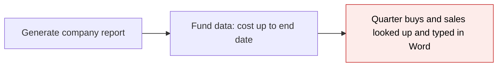
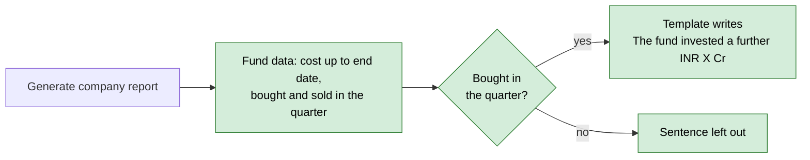
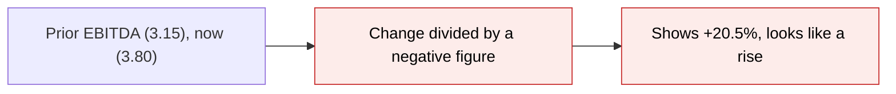
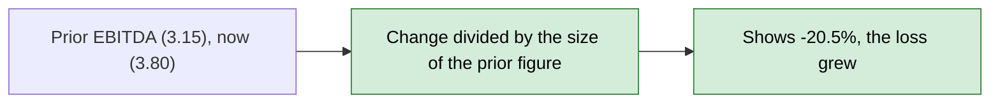
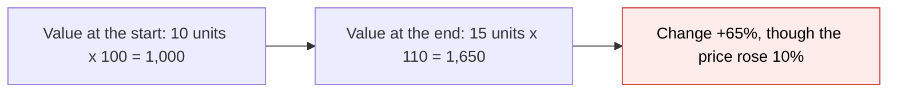
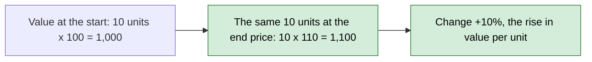
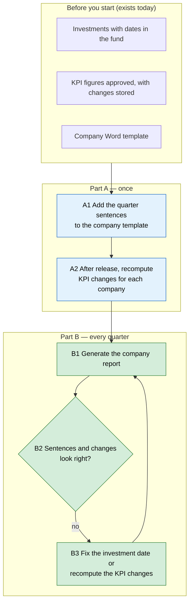

# Portfolio Report Quarter Activity and KPI Change Direction — Proposal

> **Audience:** Business team, product, QA, support — non-technical.
> **Companion document:** [Design](design.md)
> **New to this? Start with the [Workflow Journey](#workflow-journey)** — every action, in order, from start to the outcome.

> **Planning phase — no code changes.** This document proposes and explains the change. Do not
> edit application code while writing it; implementation happens later, in the tasks phase.

> **Bundle.** Three report changes built and released together. More report changes may be added to this bundle before it is built.

---

## Why

Two things in the company portfolio report are wrong or missing. First, the report cannot say what the fund did **in the quarter**: a template can show the cost up to the end date, but not "the fund invested X in the quarter" or "the fund sold Y in the quarter", so admins type these by hand. Second, a percentage change measured from a **negative** figure shows the wrong way round: a smaller loss reads as a fall and a bigger loss reads as a rise (a client's key metrics table showed EBITDA up 20.5% when the loss had widened, and EBITDA margin down 11.9% in red when it had improved). Third, the **fair market value change** in the consolidated report moves when units are bought or sold, not only when their value moves: buying units in the quarter can read as a large gain.

## What Changes

- **Company report, each fund's data:** adds whether the company was bought or sold in the quarter, and how much was bought and sold at cost in the quarter, so a template can write "The fund invested a further INR X Cr during the quarter" only when it did.
- **KPI changes ("vs PQ", "vs PYTD", month-on-month and similar) and the "vs budget" difference:** when the figure being compared with is negative, the change now reads in the direction of the movement. A smaller loss is a rise; a bigger loss is a fall.
- **Percentage KPIs (such as EBITDA %):** the change is shown as the difference in percentage points, so a margin that goes from (63.2)% to (55.7)% shows **+7.5**, never a negative number.
- **Fair market value change (consolidated report):** the change is the weighted average of the instruments' change in value per unit, weighted by each instrument's value at the earlier date. Buying or selling units no longer moves it. The amounts shown (`fmv`, prior and financial year start) do not change.
- **BREAKING (visible):** stored KPI changes for negative figures and for percentage KPIs change once they are recomputed, red/green threshold colours on the KPI screens follow, and the fair market value change reads differently whenever units were bought or sold in the period. Changes from a positive figure on a money or numeric KPI do not change.
- Nothing changes for templates that do not use the new quarter fields.

### Flow Diagram

*Caption: how the quarter's investment reaches the company template, before and after.*





*Caption: how a change from a negative figure reads, before and after.*





*Caption: how the fair market value change is worked out, before and after.*





---

## Workflow Journey

### Who is involved

| Person | Role | What they do in the journey |
|---|---|---|
| Meera | Fund admin (company admin) | Adds the new fields to the company Word template once, recomputes KPI changes once after release, then generates the quarterly company and consolidated reports |
| Business reviewer | Finance / investor relations | Checks the sentences and the changes against the records |

### The journey on one page



### Before you start

| Needed | Why | Where it comes from |
|---|---|---|
| Investments of the company in the fund, with their dates | The quarter's purchases and sales | Portfolio investments of the fund |
| Approved KPI figures | The changes in the key metrics table | KPI reports |
| The company report template | Where the new fields are placed | Portfolio report templates |

### Part A — once

| Step | Who | Where | Action | What the system does | What you see |
|---|---|---|---|---|---|
| A1 | Meera | Word, company template | Inside each fund's block, add a condition on "bought in the quarter" around the sentence "The fund invested a further [currency] [amount] Cr during the quarter", and the same for sales | Nothing yet | The template holds the fields |
| A2 | Meera | KPI report › Recompute percentage change, for each company | Start the recompute | Recalculates every stored KPI change with the corrected rule | "Computation started", then the changes update |

### Part B — every quarter

| Step | Who | Where | Action | What the system does | What you see |
|---|---|---|---|---|---|
| B1 | Meera | Portfolio company › Generate report, start 1 Jul, end 30 Sep | Generate the company report | Works out, for each fund, the purchases and sales dated in the quarter, and the KPI changes | Sentences only for funds that bought or sold; changes in the key metrics table |
| B2 | Meera | The generated document | Read the sentences and the changes | None | See below |
| B3 | Meera | Portfolio investments, or KPI report › Recompute percentage change | Correct a wrong investment date, or recompute | Stores the fix | The next report is right |

### What you see

Company A in Inflexor Fund 1, quarter 1 Jul – 30 Sep 2026 (the fund bought 500 shares for 10 Cr on 15 Aug and sold 500 shares at a cost of 5 Cr on 10 Sep). Company B did not trade in the quarter.

```
Company A
  The fund invested a further INR 10.0 Cr during the quarter.
  The fund sold INR 5.0 Cr of investments (at cost) during the quarter.
Company B
  (no sentence)
```

Key metrics (figures in millions; the arithmetic is shown below the table)

```
Metric     Current   vs PYTD before   vs PYTD after
EBITDA     (3.8)     +20.5%           -20.5%       loss grew from (3.15) to (3.8)
EBITDA %   (55.7)%   (11.9)%          +7.5 points  margin improved from (63.2)% to (55.7)%
Revenue    6.8       +36.8%           +36.8%       positive base, unchanged
```

EBITDA: (-3.80 − -3.15) ÷ |-3.15| = -0.65 ÷ 3.15 = -20.5%. EBITDA % (a percentage KPI): -55.7 − -63.2 = +7.5 percentage points.

Consolidated report, Company A in Inflexor Fund 1 (10 units at 100 on 30 Jun, 5 more bought in the quarter, 110 per unit on 30 Sep). Cr is crore.

```
                      before     after
fmv_prior             1,000      1,000      (10 x 100, unchanged)
fmv                   1,650      1,650      (15 x 110, unchanged)
fmv_change_percent    +65.0%     +10.0%     (10 x 110 = 1,100 against 1,000)
```

### What goes wrong

The quarter sentence for Company A is missing. The purchase was entered with a date of 30 Jun, one day before the quarter, so it counts as an earlier purchase. Meera corrects the date on the investment and generates again.

### Summary: the minimum actions

| # | Action | Who | How often |
|---|---|---|---|
| 1 | Add the quarter sentences to the company template | Meera | Once |
| 2 | Recompute KPI changes for each company after release | Meera | Once |
| 3 | Generate the company report | Meera | Every quarter |

---

## User Stories

### US-1: Say what the fund invested in the quarter

**As a** fund admin,
**I want** each fund's data in the company report to say whether the fund bought in the quarter and how much,
**So that** the template can write "The fund invested a further INR X Cr during the quarter" only when it did.

**Acceptance criteria:**
- "Bought in the quarter" is true when the company has a purchase in that fund dated from the quarter start to the end date, both included.
- The amount bought is the cost of those purchases, in the fund's currency; zero when there are none.
- A purchase before the start date or after the end date is not counted.
- Other funds and other companies are not mixed in.

### US-2: Say what the fund sold in the quarter

**As a** fund admin,
**I want** the same for sales, with the cost of what was sold,
**So that** the template can write "The fund sold INR X Cr of investments (at cost) during the quarter".

**Acceptance criteria:**
- "Sold in the quarter" is true when the company has a sale in that fund dated in the quarter.
- The cost of sold is shown as a positive amount, the cost of the shares sold and not the money received.
- Zero and false when there are no sales in the quarter.

### US-3: A change from a negative figure reads the right way

**As a** finance reviewer,
**I want** a percentage change measured from a negative figure to show up when the figure improves and down when it worsens,
**So that** the key metrics table matches what happened.

**Acceptance criteria:**
- A loss that shrinks from (100) to (80) shows +20%. A loss that grows from (100) to (125) shows -25%.
- A percentage KPI (such as EBITDA %) shows the difference in percentage points: from (63.2)% to (55.7)% shows +7.5; from 20% to 15% shows -5. A prior figure of zero still gives a change for a percentage KPI.
- A figure that goes from negative to positive shows a rise; from positive to negative shows a fall.
- A positive prior figure gives the same change as today.
- A prior figure of zero still gives no change ("-" or "N/A") for a money or numeric KPI.
- The same rules apply to month, quarter, year and year-to-date changes and to the difference from budget.
- "Actual as a percentage of budget" is a ratio, not a change, and is not altered.

### US-4: Existing figures are corrected

**As a** fund admin,
**I want** the stored KPI changes corrected for figures already entered,
**So that** old reports regenerated today are right.

**Acceptance criteria:**
- After the existing "Recompute percentage change" runs for a company, its stored changes follow the new rule.
- Nothing is corrected until it runs.

### US-5: Fair market value change reflects value per unit

**As a** finance reviewer,
**I want** the fair market value change in the consolidated report to be the change in value per unit,
**So that** buying or selling units does not read as a gain or a loss.

**Acceptance criteria:**
- With 10 units at 100 and 5 more bought in the quarter, a price of 110 gives +10%, not +65%.
- With 4 of 10 units sold, a price of 110 gives +10%, not -34%.
- With several instruments, each is weighted by its value at the start: 1,000 up 10% and 3,000 down 20% give -12.5%.
- A fund total is worked out from the sums of its companies, not by averaging their percentages.
- The same rule applies against the financial year start.
- The amounts `fmv`, `fmv_prior` and `fmv_fy_start` are unchanged.
- No value at the start (nothing held or no valuation) gives "N/A".

---

## UI Behavior

There is no new screen. Visible changes:

- **Generated company report:** the new fields are available to the Word template.
- **Generated consolidated report:** the fair market value change fields hold the new figure; the fields keep their names.
- **KPI screens (grid, KPI page, list):** a change from a negative figure shows with its new sign after the recompute, and the red or green threshold colour follows that sign.

**Behavior notes:**
- A template that does not use the new fields renders as before.
- Until the recompute runs, stored changes keep their old sign and the report shows them as stored.

---

## What This Feature Does NOT Cover

| Excluded | Covered In |
|---|---|
| Quarter fields on the consolidated report's fund lines (they already have cost of investment and cost of sold between) | Already there |
| Restating the `fmv_prior` and `fmv_fy_start` amounts at today's units | Not planned; the amounts stay as the earlier report showed them (the per-share change is "option A" of the [fund-metrics design](../archive/2026-10-27-portfolio-report-fund-metrics/design.md#open-decision-per-share-basis-for-fmv-change-percent)) |
| Gain on units bought during the period | Not in the change by design; it shows in `fmv` and `cost_of_investment_between` |
| A fair market value change in the instrument's own currency (without exchange rate moves) | Not planned; the change is in the fund's currency, like the amounts |
| Editing the Word templates | Done by the admin (Part A) |
| Other report changes the team may add to this bundle | Added here before the build |

---

## Validation Rules

| Field | Rule | Default |
|---|---|---|
| Bought in the quarter | At least one purchase in the fund dated from the start date to the end date, both included | false |
| Sold in the quarter | At least one sale in the fund dated from the start date to the end date, both included | false |
| Amount bought in the quarter | Cost of those purchases, fund currency | 0 |
| Cost sold in the quarter | Cost of the shares sold, shown positive, fund currency | 0 |
| Change from a figure (money or numeric KPI) | (current − prior) ÷ size of the prior figure × 100; empty when the prior figure is zero | Empty |
| Change from a figure (percentage KPI) | (current − prior) × 100, in percentage points; empty only when there is no prior figure | Empty |
| Fair market value change | Weighted average, over the instruments held at the earlier date, of the change in value per unit to the end date, weighted by the value at the earlier date; "N/A" when that value is zero | "N/A" |

---

## Behavior Rules

| Scenario | What User Sees |
|---|---|
| Purchase in the quarter | Flag true and the amount |
| Only an earlier purchase | Flag false and zero |
| Purchase on the start date or the end date | Counted |
| Sale in the quarter | Sold flag true and a positive cost |
| Loss shrinks | A positive change |
| Loss grows | A negative change |
| Negative to positive | A positive change |
| Prior figure zero (money or numeric KPI) | No change shown |
| Percentage KPI improves from (63.2)% to (55.7)% | +7.5 |
| Percentage KPI against a prior figure of zero | The difference in points |
| Units bought in the quarter, price up 10% | Fair market value change +10% |
| Units sold in the quarter, price up 10% | Fair market value change +10% |
| Nothing held or no valuation at the start | Fair market value change "N/A" |
| Positive prior figure | Same as before |

---

## Resolved Design Decisions

| # | Decision | Resolution |
|---|---|---|
| 1 | Where do the quarter fields go? | Each fund's data in the company report, beside cost of investment. They reuse the consolidated report's names. |
| 2 | Do sales get an amount? | Yes, the cost of sold (confirmed). |
| 3 | How is the sign fixed? | Divide by the size of the prior figure, in one place for KPI changes and the budget difference. |
| 3a | How are percentage KPIs shown? | As a difference in percentage points (confirmed). It cannot read as a fall when the margin improved, and a prior figure of zero still gives a change. |
| 4 | Is "Actual as a percentage of budget" changed? | No, it is a ratio. |
| 5 | Are old stored changes corrected automatically? | No. The existing recompute is run once per company; the code change alone does not touch stored values. |
| 6 | How is the fair market value change worked out? | As the weighted average change in value per unit, weighted by value at the earlier date (confirmed). The earlier holdings are valued at the end date's value per unit and set against the earlier value. |
| 7 | Do the fair market value amounts change? | No. Only the percentage does (option A of the fund-metrics design). |
| 8 | In which currency? | The fund's, as the amounts are, so a percentage includes exchange rate moves of a foreign-currency instrument. |
| 9 | Do thresholds on percentage KPIs change meaning? | Yes. They are held against points after the recompute; owners may need to review them. |

---

## Capabilities

### New Capabilities

- `funds/portfolio-report-quarter-activity`: the bought and sold flags and amounts for the quarter in each fund's data of the company report.
- `startups/kpi-change-direction`: the direction of a change from a negative figure, and percentage points for percentage KPIs, for stored KPI changes and the budget difference in the report.
- `funds/portfolio-report-fmv-change`: the consolidated report's fair market value change as the weighted average change in value per unit, and its direction from a negative value.

### Modified Capabilities

None. The existing `startups/kpi-cumulation` requirements say what a change is measured against, not how it is calculated, and stay as they are.

---

## Impact

- The company portfolio report (Word) and the consolidated portfolio report's fair market value change, on each company's fund line and on the fund total.
- KPI screens, which show the stored changes and colour them against the thresholds.
- The AI portfolio assistant, which quotes stored changes.
- Stored KPI changes for figures with a negative prior value and for percentage KPIs, corrected by the existing recompute. Thresholds on percentage KPIs are then held against points.
- No new screens, permissions or tables.

---

## Benefits

1. The report says what the fund did in the quarter without manual lookups.
2. Changes from losses read the right way, so the key metrics table is not misleading.
3. Threshold colours on loss-making KPIs mean what they say.
4. A margin that improves shows a positive number, in points.
5. The fair market value change reflects the price of the holdings, not the units bought or sold.

---

## FAQ

| Question | Answer |
|---|---|
| Do existing templates change? | No, until the new fields are added. |
| Will past reports change? | Reports already generated do not. A report generated again shows the corrected changes once the recompute has run. |
| Will KPI colours change? | Only for KPIs with a negative prior figure, and only after the recompute. |
| Why does EBITDA % show "+7.5" and not a percentage? | It is a percentage KPI, so the change is the difference in percentage points: (55.7)% less (63.2)% is 7.5 points. The template can add "pts". |
| Why does the fair market value change differ from the amounts shown? | The percentage is the change in value per unit; the amounts include units bought and sold. 1,650 against 1,000 is not the 10% shown. |
| Will thresholds on percentage KPIs still work? | They are held against points after the recompute, so a threshold of 10 now means 10 points. Owners may want to review them. |
| Is any data migrated? | No migration. The existing recompute rewrites stored changes. |
| Does this change notifications or billing? | No. |

How it is built is in [design.md](design.md).

---

## Design Principle for the Next Phase

Keep it small and reuse what is there: the existing quarter buy and sell logic of the consolidated report, one shared change rule instead of one copy per place, and the valued investment lists the consolidated line already loads. The fair market value change is the part most at risk of complexity: one value-per-unit lookup per instrument per date, not one per investment, and no second valuation pass. Do not add a table, job or setting. The recompute is the existing job, run by hand.
