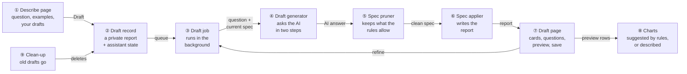
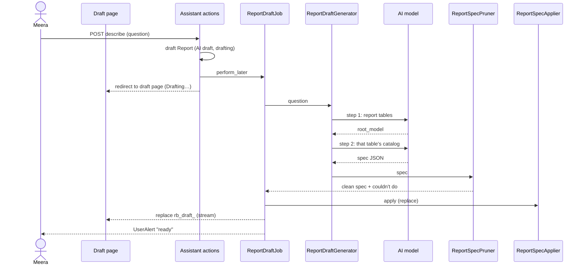
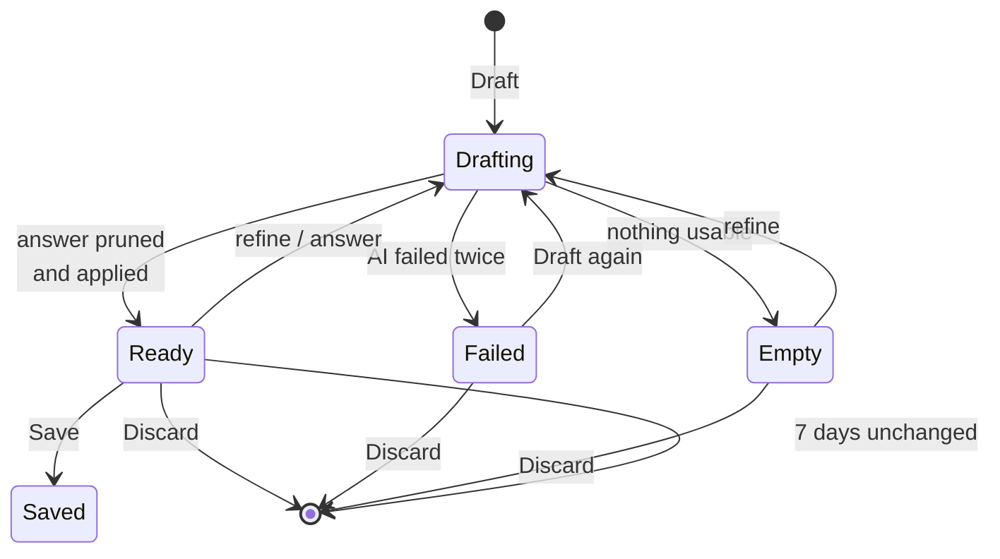
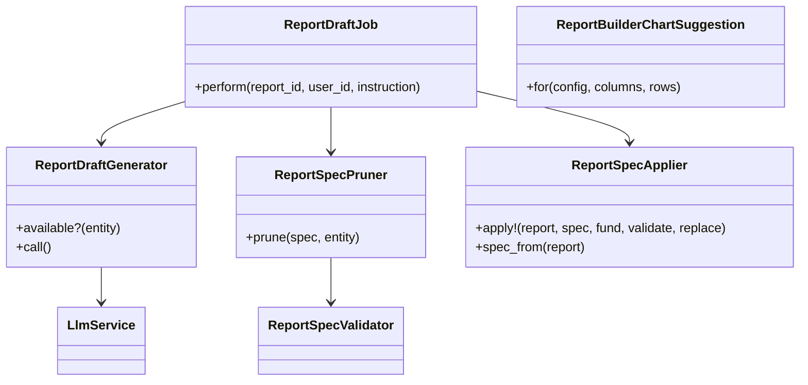

# Report Builder assistant — Design

> **Audience:** Engineers. **Companion documents:** [Proposal](proposal.md) · [Business rules](business-rules.md) · [Spec](specs/reports/report-builder-assistant/spec.md) · [LLD](lld.md) · [QA checklist](qa-checklist.md)

Phase 4 of the [usability plan](../../../docs/modules/reports/report_builder_usability_plan.md) (§5.3). Builds on report-builder-trust (engine, formatter, totals), report-builder-live-builder (preview frame, report check, guided setup cards), report-builder-starting-points (spec format, `ReportSpecValidator`, `ReportSpecApplier`, `ReportBuilderFundTarget`, templates) and report-builder-delivery (report page).

## Contents

- [1. The idea](#1-the-idea)
  - [What this adds](#what-this-adds)
  - [The idea in one picture](#the-idea-in-one-picture)
  - [Walkthrough: one example, start to finish](#walkthrough-one-example-start-to-finish)
  - [Key ideas](#key-ideas)
- [2. The same picture with real names](#2-the-same-picture-with-real-names)
  - [Picture](#picture)
  - [What each box does](#what-each-box-does)
  - [One run, end to end](#one-run-end-to-end)
  - [Lifecycles](#lifecycles)
  - [What users see](#what-users-see)
  - [Design decisions](#design-decisions)
- [3. One card per box](#3-one-card-per-box)
  - [① Describe page](#-describe-page)
  - [② Draft record](#-draft-record)
  - [③ Draft job](#-draft-job)
  - [④ Draft generator](#-draft-generator)
  - [⑤ Spec pruner](#-spec-pruner)
  - [⑥ Spec applier](#-spec-applier)
  - [⑦ Draft page](#-draft-page)
  - [⑧ Charts](#-charts)
  - [⑨ Clean-up](#-clean-up)
- [4. Reference](#4-reference)
  - [Class diagram](#class-diagram)
  - [Data model and schema changes](#data-model-and-schema-changes)
  - [Component contracts](#component-contracts)
  - [Policy](#policy)
  - [Notifications](#notifications)
  - [Cross-cutting concerns](#cross-cutting-concerns)
  - [Worked examples](#worked-examples)
  - [Testing](#testing)
  - [Risks and open questions](#risks-and-open-questions)

---

## 1. The idea

### What this adds

A question becomes a **report spec** — the same short format templates and Duplicate already use (Phase 3) — written by the company's AI model and then **pruned part by part with the existing `ReportSpecValidator`**, so what reaches the report is exactly what a template could contain. The draft is an ordinary report marked as a draft, so the existing preview, report check and guided-setup cards show it unchanged. It follows `ChartAgentService`'s pattern (entity's model via `LlmService.ruby_llm_chat`, JSON-only answer, one retry) and the export job's pattern of updating the page over the user's alert stream.

### The idea in one picture

| # | Box | One line |
|---|---|---|
| ① | Describe page | Question box, examples (template questions), your drafts; says when no AI model is set up |
| ② | Draft record | A `Report` with category "AI draft" and `template.draft`; the assistant's state in `template.ai` |
| ③ | Draft job | Runs ④ → ⑤ → ⑥, stores questions/assumptions/couldn't-do, updates the page, sends the alert |
| ④ | Draft generator | Step 1 picks the table; step 2 writes the spec; JSON only; one retry |
| ⑤ | Spec pruner | Checks each part with `ReportSpecValidator`; failing parts go to "Couldn't do" |
| ⑥ | Spec applier | Phase 3's applier, now able to replace an existing report's spec |
| ⑦ | Draft page | Guided setup's cards, the AI's questions, assumptions, couldn't-do, refine, preview, chart, save |
| ⑧ | Charts | Rules pick a chart from the columns; "Describe a chart" uses `ChartAgentService`; the report page draws it |
| ⑨ | Clean-up | Daily: drafts unchanged for 7 days are deleted |

### Walkthrough: one example, start to finish

**Setup.** Meera at Acme ([shared setup](business-rules.md#shared-setup)). **Legend:** ✓ done · ● here, not done · ○ not started.

| # | When | What happens | Behind the scenes | Result |
|---|---|---|---|---|
| 1 | Reports | New report › **Describe it** | ① checks a model is set up | Describe ● |
| 2 | Describe | "Which LPs still owe money on calls? Biggest first." › **Draft** | ② report "Draft — Which LPs still owe money on calls? Bigg" (category AI draft, `ai.status` drafting); ③ queued | Describe ✓ **Drafting ●** |
| 3 | Background | — | ④ step 1 → `Investor`; step 2 → spec + `pick_fund` question; ⑤ all parts allowed; ⑥ writes columns | Drafting ✓ **Draft page ●** — cards, *Which fund?* |
| 4 | Draft page | Picks Growth Fund II | No AI call: `ReportBuilderFundTarget` puts `fund_id_eq` on the commitments; ⑥ re-applies | Card *Only capital commitments in Growth Fund II* |
| 5 | Mistake | Refines "show IRR too" | ④ answers with `cannot: IRR isn't a reportable column` | Couldn't do lists it; report unchanged otherwise |
| 6 | Stall | Refines again; the AI times out twice | ④ raises after the retry; ③ stores `ai.status` failed | "Couldn't draft this right now — try again in a moment"; the last good draft stays |
| 7 | Draft page | Refines "also show what was distributed" | ③ sends `spec_from(report)` (with the fund) + instruction; ⑤ ⑥ | New column Distributed; GF2 kept |
| 8 | Preview | — | ⑦ preview frame (20 rows) + report check; ⑧ rule: Investor (text) + Committed (money) → bar | Chart *Bar — Committed by Investor* |
| 9 | Save | Name "LPs owing — GF2" › **Save and open** | ② cleared: category nil, `template.draft` removed, `description` = question, `template.chart` kept | **Report ✓** on the report page with the chart |

**What to notice**
- Every AI answer goes through ⑤: the AI can never add a column, table or filter the builder wouldn't allow (X5).
- Refinements send the **current report** (`ReportSpecApplier.spec_from`), not the chat, so hand edits in the builder survive (E5).
- The fund question never reaches the AI. The options and the placement come from the database (`ReportBuilderFundTarget`).

### Key ideas

| Idea | In one line | Card |
|---|---|---|
| One spec format | The AI writes the Phase 3 spec, so templates, Duplicate and the assistant share ⑥ | [④](#-draft-generator) |
| Prune, don't trust | Every part is checked with the template validator; failures become "Couldn't do" | [⑤](#-spec-pruner) |
| A draft is a report | Preview, report check and cards work unchanged | [②](#-draft-record) |
| Two short AI steps | The table first, then only that table's catalog | [④](#-draft-generator) |
| Charts by rules | No AI call for the suggestion | [⑧](#-charts) |

**FAQ**

| Question | Answer |
|---|---|
| Why not let the AI write Ransack or SQL? | The spec is checked against the builder's own catalog, and the engine always scopes by company. Anything wrong becomes "Couldn't do", never a wrong report. |
| Why a draft `Report` instead of an in-memory preview? | The engine reads columns from `GridViewPreference` rows; a real report reuses it unchanged. |
| Why one page instead of four wizard steps? | Cards, questions and preview change together after each answer; one page avoids back-and-forth. |

---

## 2. The same picture with real names

### Picture

```mermaid
flowchart LR
    P["① report_builder/describe.html.erb<br/>ReportBuilder::Assistant#describe"]
    R["② Report category 'AI draft'<br/>template.ai"]
    J["③ ReportDraftJob"]
    G["④ ReportDraftGenerator<br/>LlmService.ruby_llm_chat"]
    V["⑤ ReportSpecPruner<br/>ReportSpecValidator"]
    A["⑥ ReportSpecApplier.apply!<br/>(replace: true)"]
    D["⑦ report_builder/draft.html.erb<br/>_draft_state"]
    C["⑧ ReportBuilderChartSuggestion<br/>ChartAgentService"]
    X["⑨ ReportDraftCleanupJob"]
    P -- "POST describe" --> R
    R -- "perform_later" --> J
    J -- "question,<br/>spec_from" --> G
    G -- "spec, questions,<br/>cannot" --> V
    V -- "clean spec" --> A
    A -- "template +<br/>GVPs" --> D
    D -- "POST refine" --> J
    D -- "rows" --> C
    X -- "destroy" --> R
```

### What each box does

| # | Real name | Owns | Reads | Produces |
|---|---|---|---|---|
| ① | `ReportBuilder::Assistant#describe` / `#describe_create`, `describe.html.erb` | Entry, availability, examples | `ReportBuilderTemplates.available_for(entity)` questions, the user's drafts, `ReportDraftGenerator.available?(entity)` | Draft report; redirect to ⑦ |
| ② | `Report` (`category: "AI draft"`, `template["draft"] = true`, `template["ai"]`) | State: `question`, `status`, `started_at`, `questions`, `assumptions`, `cannot`, `turns`, `fund_id`, `error` | — | — |
| ③ | `ReportDraftJob#perform(report_id, user_id, instruction = nil)` | Order ④→⑤→⑥, state, broadcast, alert | ② | Updated ②; `broadcast_replace_to "user_alert_<id>"` target `rb_draft_<id>`; `UserAlert` |
| ④ | `ReportDraftGenerator#call` | Prompts, two steps, JSON parse, retry | `ReportBuilderModelDiscovery.roots` + `pack_enabled_for?`, `ReportBuilderColumnCatalog`, `associations_for`, template examples | `{ spec, questions, assumptions, cannot, name }` or `ReportDraftGenerator::Failed` |
| ⑤ | `ReportSpecPruner.prune(spec, entity:)` | Part-by-part keep/drop, value check | `ReportSpecValidator`, `ReportBuilderFilterField#options` | `[clean_spec, problems]` |
| ⑥ | `ReportSpecApplier.apply!(report:, spec:, fund:, validate: false, replace: true)` | Template + GVPs | spec | Report |
| ⑦ | `ReportBuilder::Assistant#draft` + `draft.html.erb`, `_draft_state.html.erb` | Page; `fund`, `refine`, `chart`, `save`, `discard` actions | ②, `load_builder_state` | Cards (`wizard/_summary_cards`), preview frame, report check, chart |
| ⑧ | `ReportBuilderChartSuggestion.for(config:, columns:, rows:)`, `describe_chart` → `ChartAgentService` + `AgentChart` | Chart config | Rows, column types | Chart.js config; `template["chart"]` |
| ⑨ | `ReportDraftCleanupJob` (sidekiq-cron daily) | Deleting stale drafts | `Report.where(category: "AI draft")` | — |

### One run, end to end

### Lifecycles

| Transition | What happens |
|---|---|
| → Drafting | `ai.status = "drafting"`, `ai.started_at = now`; another Draft within 2 minutes is ignored (X6) |
| Drafting → Ready | Clean spec applied; `questions`, `assumptions`, `cannot` stored |
| Drafting → Failed | `ai.error` "Couldn't draft this right now — try again in a moment"; the previous spec (if any) stays applied |
| Drafting → Empty | `cannot` only; no columns (X3) |
| Ready → Saved | `category` nil, `template.draft` removed, name set, `description` = question |

### What users see

| Step | Screen | User does | Sees |
|---|---|---|---|
| J1.1 | Reports | New report › **Describe it** | Describe page |
| J1.2 | Describe | Types a question or clicks an example › **Draft** | Draft page, "Drafting…" |
| J1.3 | Draft page | Waits | Cards, questions, assumptions, Couldn't do, refine box, preview, chart, Save |
| J1.4 | Draft page | Picks a fund | Card updates; preview updates |
| J1.5 | Draft page | Refines | "Drafting…", then the new draft |
| J1.6 | Draft page | Changes the chart / Describe a chart | Chart updates |
| J1.7 | Draft page | **Save and open** / **Fine-tune in builder** / **Discard** | Report page / builder / Describe |
| J1.8 | Report page | — | Chart above the table, **Hide chart** |

### Design decisions

| Decision | Chosen | Rejected | Why |
|---|---|---|---|
| Draft storage | `Report` with `category: "AI draft"` | New table; Rails cache | No migration; engine needs GVPs; category is an indexed-enough string the scope can filter |
| Privacy | `ReportPolicy::Scope` + `show?/update?` check draft owner | Controller filters | Authorization lives in policies |
| Prompt size | Two steps | Whole catalog in one prompt | Catalog of ~18 tables × columns is large; step 2 sends one table's columns and its related data |
| Validation | Prune by part with the validator | New rule set | One source of truth (Phase 3) |
| Chart data | Suggested chart rebuilt from current rows (`template.chart` = kind + keys); described chart stored as `AgentChart` spec | Snapshot everything | A suggested chart stays live with the report; a described chart is the AI's config, shown with its date |

**FAQ**

| Question | Answer |
|---|---|
| Why category and not `is_view`? | `is_view` belonged to Save as View (removed in Phase 5); reusing it would confuse. Category is free text, shown on cards as the report's category ("AI draft"), which is accurate. |
| What if the AI picks a table the company can't use? | Step 1 only lists the company's tables; ⑤ also rejects a root whose pack is off (E4). |

---

## 3. One card per box

### ① Describe page

| | |
|---|---|
| Route | `GET /report_builder/describe` (`describe`), `POST /report_builder/describe` (`describe_create`) |
| Auth | `authorize Report.new(entity: current_user.entity), :create?` |
| Shows | Question textarea (5–1,000 chars), examples = `ReportBuilderTemplates.available_for(entity)` questions (click fills the box), *Your drafts* (`policy_scope(Report).where(category: "AI draft", user_id: current_user.id)`), or the not-set-up message |
| Available | `ReportDraftGenerator.available?(entity)` = entity's `default_llm_model` or `ENV["DEFAULT_MODEL"]` present |
| Menu | `reports/_new_report.html.erb` gains **Describe it** (`ti-sparkles`) |

**FAQ**

| Question | Answer |
|---|---|
| Why examples from templates? | They are reviewed questions the catalog can answer. |

### ② Draft record

| Field | Value |
|---|---|
| `name` | "Draft — " + question first 40 chars |
| `category` | "AI draft" (`ReportBuilder::Assistant::DRAFT_CATEGORY`) |
| `report_builder`, `url` | true, "/report_builder" |
| `template["draft"]` | true |
| `template["ai"]` | `question`, `status` (drafting / ready / failed / empty), `started_at`, `questions` [{kind, text, options?}], `assumptions` [String], `cannot` [String], `turns` [{instruction, at}], `fund_id`, `error`, `name` (suggested) |

**FAQ**

| Question | Answer |
|---|---|
| What does a draft look like before step 3? | No root yet; the draft page shows "Drafting…" only. |

### ③ Draft job

| Step | |
|---|---|
| 1 | Load report + user; current spec = `spec_from(report)` when it has columns |
| 2 | `ReportDraftGenerator.new(entity:, question:, spec:, instruction:).call` |
| 3 | `ReportSpecPruner.prune` → clean + problems; `cannot` = AI's + problems |
| 4 | Clean spec has a root and ≥ 1 column → `apply!(replace: true, fund: ai.fund_id fund)`; else status empty |
| 5 | Store state; broadcast `rb_draft_<id>` (`_draft_state`); `UserAlert` "Your draft report is ready" (link) |
| Fail | `Failed` → status failed, error message; broadcast; danger alert "Couldn't draft <question>" |

**FAQ**

| Question | Answer |
|---|---|
| Why always send the alert? | Whether the user is still on the page isn't known server-side; the alert is harmless when they are. |

### ④ Draft generator

| Part | Decision |
|---|---|
| Model | `LlmService.ruby_llm_chat(entity:)` (entity model and keys) |
| Step 1 | System: JSON-only, `{ "root_model": "<one of>" , "cannot": [] }`; list = company's roots with labels |
| Step 2 | System: the spec format (from `ReportSpecApplier` doc), rules (totals only on related data, formulas reference column keys, dates fixed + assumption, `pick_fund` question instead of guessing a fund), 2 template specs as examples, the table's catalog: own columns (key, label, type), related data (relation, many/one) and their stored columns |
| Refine | Step 2 only, with the current spec and the instruction; step 1 skipped (table fixed) |
| Parse | Strip code fences; first `{…}`; `JSON.parse` |
| Retry | One more ask after an exception or unparsable answer; then `Failed` |
| Never sent | Rows, fund names, investor names, amounts |

**FAQ**

| Question | Answer |
|---|---|
| Why not reuse `ChartAgentService#parse_json`? | It's private to that class and Chart.js-specific; a 6-line parser here is clearer. |

### ⑤ Spec pruner

| Part | Kept when | Problem text |
|---|---|---|
| Root | a report table and its pack is on | "<tables> aren't available in reports for your account" |
| Join | `ReportSpecValidator` with only that join passes | validator message |
| Column | validator with that column (+ its join) passes | validator message (e.g. "x isn't a column of investors") |
| Formula | validator with it and the kept columns passes | validator message |
| Filter | validator passes, field isn't `entity_id`, and the value exists: for a field with a value list every value is one of them; other stored text fields one `EXISTS` (also on the largest tables) | "No <table> have <Field> <value>" (+ " — values: a, b, c" when listed) |
| Sort / grouping | validator passes with the kept columns | validator message |

### ⑥ Spec applier

`apply!` gains `replace: false`. With `replace: true` the report's GVPs are deleted inside the same transaction before the new ones are written, and the template is replaced except `draft`, `ai` and `chart`.

### ⑦ Draft page

| Section | Source |
|---|---|
| Question | `ai.question` |
| Cards | `report_builder/wizard/_summary_cards` (no Change links on a draft: they link to the builder tab instead) |
| Questions | `ai.questions`: `pick_fund` → fund select (POST `fund`); `choice`/`text` → answer field (POST `refine` with "Answer to …: …") |
| Assumptions / Couldn't do | lists |
| Refine | textarea + **Refine** |
| Preview | `report_builder_preview` frame (20 rows) + `_health` |
| Chart | ⑧ |
| Save | name (suggested), **Save and open**, **Fine-tune in builder**, **Discard** (Immediate Actions popup) |

### ⑧ Charts

| Rule (first match) | Chart.js |
|---|---|
| A pivot join | `bar`, stacked, one dataset per pivot column |
| A date column + an amount column | `line`, labels = dates (sorted), data = first amount |
| A text column + an amount column | `bar`, `indexAxis: "y"`, top 15 rows by the amount |
| Otherwise | none |

`template["chart"]` = `{ "kind": "suggested" }` (rebuilt from rows each time), `{ "kind": "none" }`, or `{ "kind": "agent", "agent_chart_id": … }`. The report page renders it with `chart_renderer` above the table, in a Bootstrap collapse with **Hide chart**.

**FAQ**

| Question | Answer |
|---|---|
| Which rows feed the report page chart? | The rows on the page, the same as the totals row. |

### ⑨ Clean-up

`ReportDraftCleanupJob`: `Report.where(category: "AI draft").where(updated_at: ...7.days.ago).find_each(&:destroy)`. Registered in `config/initializers/sidekiq.rb` daily at 02:30 UTC.

---

## 4. Reference

### Class diagram

### Data model and schema changes

No schema changes.

| Column | Use | Why |
|---|---|---|
| `reports.category` | "AI draft" while a draft | Privacy scope and badge |
| `reports.template` (json) | `draft`, `ai`, `chart` keys | Assistant state, chart choice |
| `reports.description` | The question, on save | Existing |
| `agent_charts.report_id/spec/prompt/status` | A described chart | Existing |

### Component contracts

| Route | Action | Auth |
|---|---|---|
| `GET describe` | `describe` | `create?` |
| `POST describe` | `describe_create` | `create?` |
| `GET :id/draft` | `draft` | `update?` (owner) |
| `POST :id/draft/refine` | `draft_refine` | `update?` |
| `POST :id/draft/fund` | `draft_fund` | `update?` |
| `PATCH :id/draft/chart` | `draft_chart` | `update?` |
| `POST :id/draft/chart` | `draft_describe_chart` | `update?` |
| `PATCH :id/draft/save` | `draft_save` | `update?` |
| `DELETE :id/draft` | `draft_discard` | `update?` |

### Policy

| Role | Saved reports | AI drafts |
|---|---|---|
| Draft's maker | As today | List, open, refine, save, discard |
| Other user, same company | As today | Not listed; refused |
| Another company | Refused | Refused |

`ReportPolicy::Scope#resolve` adds "not someone else's AI draft"; `show?` and `update?` add "and, for an AI draft, the maker". **Changes an existing policy** (flagged).

### Notifications

| Notification | Trigger | Recipients | Channel | Customisable | Default | Sent once? |
|---|---|---|---|---|---|---|
| **Draft ready** *(new)* | Draft job finishes | The draft's maker | `UserAlert` + page stream | No | On | Once per draft/refine |
| **Draft failed** *(new)* | AI failed twice | The draft's maker | `UserAlert` danger | No | On | Once |
| Investors | — | None. The assistant is fund-side only | — | — | — | — |

### Cross-cutting concerns

| Concern | Handling |
|---|---|
| Tenant scope | Engine scopes by entity; ⑤ drops `entity_id` filters; catalog per entity's packs |
| Data sent to AI | Names of tables and columns, the question, the spec; rows only for Describe a chart (stated in the UI) |
| Cost | ≤ 2 calls per draft (+1 retry each); 1 per refine |
| Large tables | Preview is 20 rows; value lists via `ReportBuilderFilterField` (never on the large tables) |
| Dates | Fixed dates from the AI, listed as an assumption |

### Worked examples

28 rows (H1–H9, E1–E12, X1–X7) in [business-rules.md](business-rules.md).

### Testing

| Feature | IDs |
|---|---|
| `features/core/report_builder/assistant.feature` | H1–H4, H6, H9, E1–E5, E7–E10, X1–X7 |
| `features/core/report_builder/assistant_chart.feature` | H5, H7, H8, E6, E11, E12 |

The AI is stubbed at `LlmService.ruby_llm_chat` with a fake chat that answers step 1 / step 2 / chart by the prompt's marker and records every prompt.

### Risks and open questions

| Risk | Handling |
|---|---|
| AI answers drift from the spec format | ⑤ prunes; the template examples anchor the format |
| A draft left mid-way | ⑨ deletes it after 7 days |
| Open questions | None |
