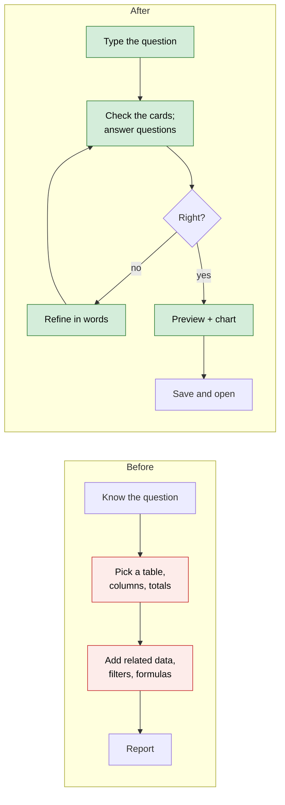
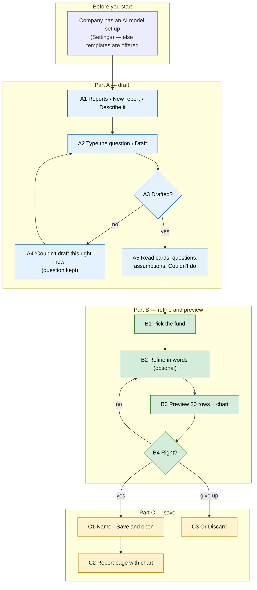

# Report Builder assistant ("Describe it") — Proposal

> **Audience:** Business team, product, QA, support — non-technical.
> **Companion documents:** [Design](design.md) · [Business rules](business-rules.md)
> **New to this? Start with the [Workflow Journey](#workflow-journey)** — every action, in order, from start to the outcome.

> **Planning phase — no code changes.**

Phase 4, the last phase, of the [Report Builder usability plan](../../../docs/modules/reports/report_builder_usability_plan.md) (§5.3). Phases 1, 2, 3 and 5 are built in the same branch.

---

## Why

Building a report still means knowing CapHive's tables and fields. Most users can say what they want ("which LPs still owe money on calls, biggest first?") but not which table, related data, totals and formula give it. Templates cover ten common questions. Everything else needs the guided setup or the builder.

## What Changes

- **New report › Describe it.** Type a question in plain words, or click an example. The assistant drafts a report: which rows, which columns and totals, which filters, any formula, and the order.
- **Check my understanding.** The draft is shown as plain cards ("Each row is an investor", "Committed — total of capital commitments", "Only investors where Category is LP"). Next to the cards are:
  - **Questions** the assistant needs answered, such as *Which fund?*, with the company's funds to pick from.
  - **Assumptions** it made, such as "last quarter = 1 Jul – 30 Sep 2026".
  - **Couldn't do**: anything it couldn't include, and why, such as "IRR isn't a reportable column".
- **Refine in words** ("also show what was distributed"). The assistant changes the current draft and keeps what you already changed.
- **Preview.** 20 formatted rows with the totals row and the report check. A **suggested chart** is picked by simple rules, with no AI call; you can change its type, choose **No chart**, or **Describe a chart** in words.
- **Save.** Accept or change the name, then **Save and open** (the report page) or **Fine-tune in builder**. The question is kept as the report's description. **Discard** deletes the draft.
- **Charts on the report page.** A saved chart shows above the table, with **Hide chart**.
- **Drafts are private.** An unsaved draft shows only to the person who made it, with a *Draft* badge. Drafts not saved within 7 days are deleted.
- The assistant can only use what the builder can: the same tables, columns and rules, scoped to your company. Anything else lands in **Couldn't do**, never in the report.

### Flow Diagram



---

## Workflow Journey

### Who is involved

| Person | Role | What they do |
|---|---|---|
| Meera | Fund-side user at Acme Capital | Asks the question, answers, refines, saves |
| Ravi | Fund-side user at Acme Capital | Opens the saved report later |
| The assistant | The company's configured AI model | Drafts and refines the report description; never sees row data while drafting |

### The journey on one page



### Before you start

| Needed | Why | Where it comes from |
|---|---|---|
| An AI model for the company | The assistant uses the company's own model and keys | Entity settings (default AI model), or the platform default |
| Report data (funds, investors, commitments…) | Something to report on | As today |

### Part A — draft

| Step | Who | Where | Action | What the system does | What you see |
|---|---|---|---|---|---|
| A1 | Meera | Reports › **New report** › **Describe it** | Opens | — | "Describe your report" box, examples (the template questions), *Your drafts* |
| A2 | Meera | Same | Types "Which LPs still owe money on calls? Biggest first." › **Draft** | Saves a private draft; asks the AI in the background | "Drafting…" (the Draft button is disabled) |
| A5 | Meera | Draft page | Waits ~5–20 s | The draft is checked against the builder's rules | Cards: *Each row is an investor* · *Committed, Called, Collected — totals of capital commitments* · *Unpaid = Called − Collected* · *Only investors where Category is LP* · *Sorted by Unpaid, highest first*. Question: **Which fund?** [Growth Fund II ▾] |

### Part B — refine and preview

| Step | Who | Where | Action | What the system does | What you see |
|---|---|---|---|---|---|
| B1 | Meera | Questions › **Which fund?** | Picks Growth Fund II | Limits the commitments to that fund (no AI call) | Card *Only capital commitments in Growth Fund II* |
| B2 | Meera | **Refine** | "also show what was distributed" | Sends the current draft and the instruction | Column *Distributed — total of capital commitments* |
| B3 | Meera | **Preview** | — | Runs 20 rows | Aditi Rao · Committed 5,00,00,000.00 · Called 2,00,00,000.00 · Collected 1,80,00,000.00 · Unpaid 20,00,000.00 … Totals row. Chart: horizontal bar of Committed by Investor |

### Part C — save

| Step | Who | Where | Action | What the system does | What you see |
|---|---|---|---|---|---|
| C1 | Meera | **Save** | Name "LPs owing on calls — GF2" › **Save and open** | Clears the draft mark; keeps the question as the description | The report page, chart above the table |
| C2 | Ravi | Reports | Opens it | — | The same report (it's no longer private) |
| C3 | Meera | **Discard** | Instead of saving | Deletes the draft | Back to "Describe your report" |

### What you see

```
 Describe your report                                           [Draft]
 ┌─────────────────────────────────────────────────────────────────────┐
 │ Which LPs still owe money on calls? Biggest first.                   │
 └─────────────────────────────────────────────────────────────────────┘
 What I understood                          Questions
 ▸ Each row is an investor                  Which fund?  [Growth Fund II ▾]
 ▸ Committed · Called · Collected           Assumptions
   (totals of capital commitments)           • "owe money" = Called − Collected
 ▸ Unpaid = Called − Collected              Couldn't do
 ▸ Only investors where Category is LP       (nothing)
 ▸ Sorted by Unpaid, highest first
 Refine: [also show what was distributed        ] [Refine]

 Preview — 3 of 3 rows
 Investor     Committed     Called       Collected    Unpaid
 Aditi Rao    5,00,00,000   2,00,00,000  1,80,00,000  20,00,000
 Kiran Mehta  2,50,00,000   1,00,00,000  1,00,00,000  0
 Nova LP      0             0            0            0
 Total        7,50,00,000   3,00,00,000  2,80,00,000  20,00,000
 Chart: [Bar — Committed by Investor ▾]   [Describe a chart…]
 Name [LPs owing on calls — GF2]   [Save and open] [Fine-tune in builder] [Discard]
```

Unpaid for Aditi: 2,00,00,000 called − 1,80,00,000 collected = **20,00,000**. Totals: 2 + 1 = 3 Cr called, 1.8 + 1 = 2.8 Cr collected, so total Unpaid is 0.2 Cr = 20,00,000.

### What goes wrong

**The AI model doesn't answer in time.** The assistant tries once more. If that fails too, the page says "Couldn't draft this right now — try again in a moment", and your question stays in the box. Click **Draft** again.

**Part of the question isn't possible.** "Show IRR by fund" gives a draft without IRR, and **Couldn't do** reads "IRR isn't a reportable column", with a suggestion where the AI has one.

### Summary: the minimum actions

| # | Action | Who | How often |
|---|---|---|---|
| 1 | Type the question › Draft | Meera | Every report |
| 2 | Answer the fund question | Meera | When asked |
| 3 | Save and open | Meera | Every report |

---

## User Stories

### US-1: Ask in words
**As a** fund-side user, **I want** to describe a report in a sentence, **so that** I don't need to know CapHive's tables.
- **New report › Describe it** opens a box with examples (the template questions). Clicking an example fills the box.
- **Draft** is disabled while drafting, and a second click doesn't start a second draft.
- Without an AI model the page says "AI drafting isn't set up for your account" and links to the templates.

### US-2: Check the draft
**As a** user, **I want** the draft explained in plain words, **so that** I can tell whether it answers my question.
- Cards for rows, columns (with their totals), related data and its filters, the report's own filters, formulas and sort.
- Questions: *Which fund?* lists the company's funds; other questions take an answer that is sent as a refinement.
- Assumptions are listed as the AI gave them.
- **Couldn't do** lists every part left out, with the reason: a column that doesn't exist, a value that matches nothing ("No investors have Category Partner — values: Co-Investor, LP"), or data that isn't in reports for the account.

### US-3: Refine
**As a** user, **I want** to change the draft in words, **so that** I don't start over.
- The refinement goes to the AI with the current draft, including changes made by hand in the builder, so they're kept.

### US-4: Preview and chart
**As a** user, **I want** to see real rows and a chart before saving, **so that** I know what I'll get.
- 20 rows, the totals row and the report check.
- Suggested chart:
  - a text column and an amount column → a horizontal bar of the first amount, top 15
  - a date column and an amount column → a line over the date
  - a pivot → stacked bars
  - otherwise none
- The chart type can be changed, or set to **No chart**.
- **Describe a chart** sends the 20 preview rows to the company's AI model; the page says so next to the button.

### US-5: Save, fine-tune or discard
- **Save and open** names the report, keeps the question as its description and opens the report page. Other users now see it.
- **Fine-tune in builder** saves the same way and opens the builder.
- **Discard** deletes the draft.

### US-6: Private drafts
- A draft is listed only for its maker, with a *Draft* badge. Others are refused if they try to open it.
- Drafts not saved within 7 days are deleted.

---

## UI Behavior

See the mockup in [What you see](#what-you-see). Notes:
- The draft page updates in place when the AI answers, with no reload. If you have left the page, an alert "Your draft report is ready" links back to it.
- The cards, questions and preview update together after every answer or refinement.

---

## What This Feature Does NOT Cover

| Excluded | Covered In |
|---|---|
| Relative dates that roll forward ("always last quarter") | Later; dates are fixed and shown as an assumption |
| Chat history beyond the current draft | Not planned |
| Secondaries and approvals | Not reportable today |
| The old grid "prompt" on standard reports | Left as is (plan §11) |

---

## Validation Rules

| Field | Rule | Default |
|---|---|---|
| Question | 5–1,000 characters | — |
| Refinement | 3–500 characters | — |
| Name on save | Required; a blank name keeps the suggestion | The AI's suggested name |
| Fund answer | One of the company's funds | — |

---

## Behavior Rules

| Scenario | What User Sees |
|---|---|
| No AI model | "AI drafting isn't set up for your account" + **Start from a template** |
| AI fails twice | "Couldn't draft this right now — try again in a moment"; question kept |
| Nothing usable | Only the **Couldn't do** list; no preview, no Save |
| Value matches nothing | Couldn't do: "No <table> have <Field> <value> — values: …" |
| Not reportable | Couldn't do: "<thing> isn't available in reports for your account" |
| Unknown column | Couldn't do: "<key> isn't a column of <table>" |
| Draft ready after leaving | Alert "Your draft report is ready" with a link |

---

## Resolved Design Decisions

| # | Decision | Resolution |
|---|---|---|
| D2 | Wizard and assistant | The assistant uses the wizard's cards (summary cards), sample and report check; a single page instead of four steps, since the cards and preview update together |
| D3 | Drafts | Private with a *Draft* badge; deleted after 7 days |
| D4 | Describe a chart | Allowed; sends the 20 preview rows, and says so |
| — | What the AI sees | The question, refinements, the catalog of tables/columns (names only) and the current draft. No row data, except for **Describe a chart** |
| — | Where the draft lives | A report marked as a draft (no new tables) |

---

## Capabilities

### New Capabilities
- `reports/report-builder-assistant`: describing a report in words, the draft page (cards, questions, assumptions, couldn't-do, refine), preview with suggested charts, saving/discarding, private drafts and their clean-up, and charts on the report page.

### Modified Capabilities
None.

---

## Impact

- Reports page: **New report** gains **Describe it**; drafts show with a badge for their maker only.
- A new Describe page and a draft page.
- The report page can show a chart.
- Uses the company's AI model through the existing AI service. No new providers.
- A daily clean-up of old drafts.
- No database changes.

---

## Benefits

1. A report from a sentence, checked against the same rules as the builder.
2. You see exactly what was understood and what was left out, before anything is saved.
3. Charts without building them.

---

## FAQ

| Question | Answer |
|---|---|
| Does the AI see our data? | Not while drafting. It sees table and column names and your words. **Describe a chart** sends the 20 preview rows, and the page says so. |
| Can it show another company's data? | No. Every report runs inside your company, whatever the AI writes. |
| Which AI model? | Your company's default model from its settings, with its own keys. |
| Does it cost anything? | Each draft or refinement is one or two AI calls on your company's account. |
| What if I close the page while drafting? | The draft keeps going; an alert links back to it. |
| Who can use it? | Anyone who can create reports. |
| Are drafts shared? | No, until saved. |

---

## Design Principle for the Next Phase

- Reuse the Phase 3 **spec applier and validator**, the wizard's **summary cards**, **sample** and **report check**, `LlmService`, `ChartAgentService` and `chart_renderer`.
- Risk: the prompt size of the catalog. Ask in two short steps: first the table, then the full spec with only that table's columns and related data.
- Risk: validating parts. Prune part by part with the existing validator rather than writing new rules.
