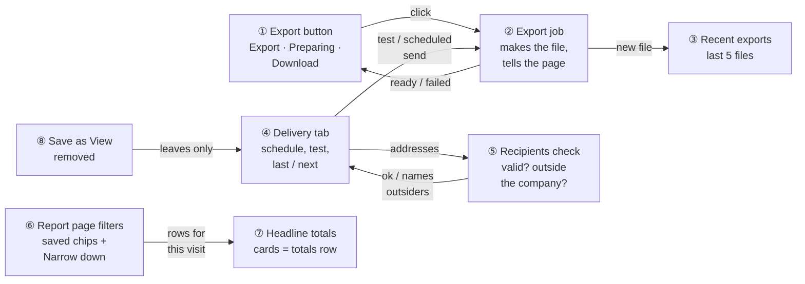
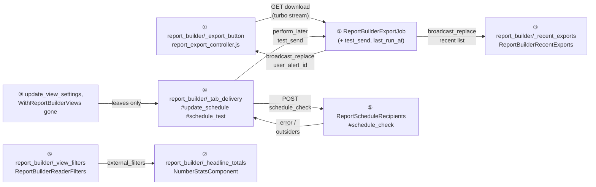
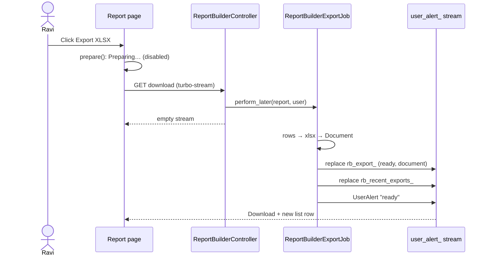
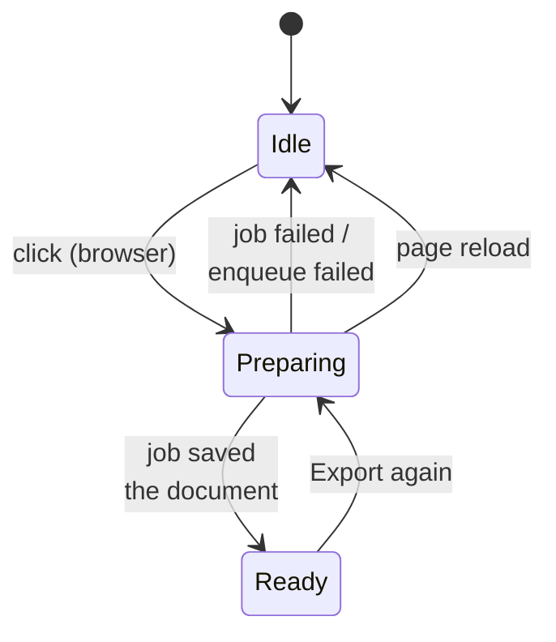
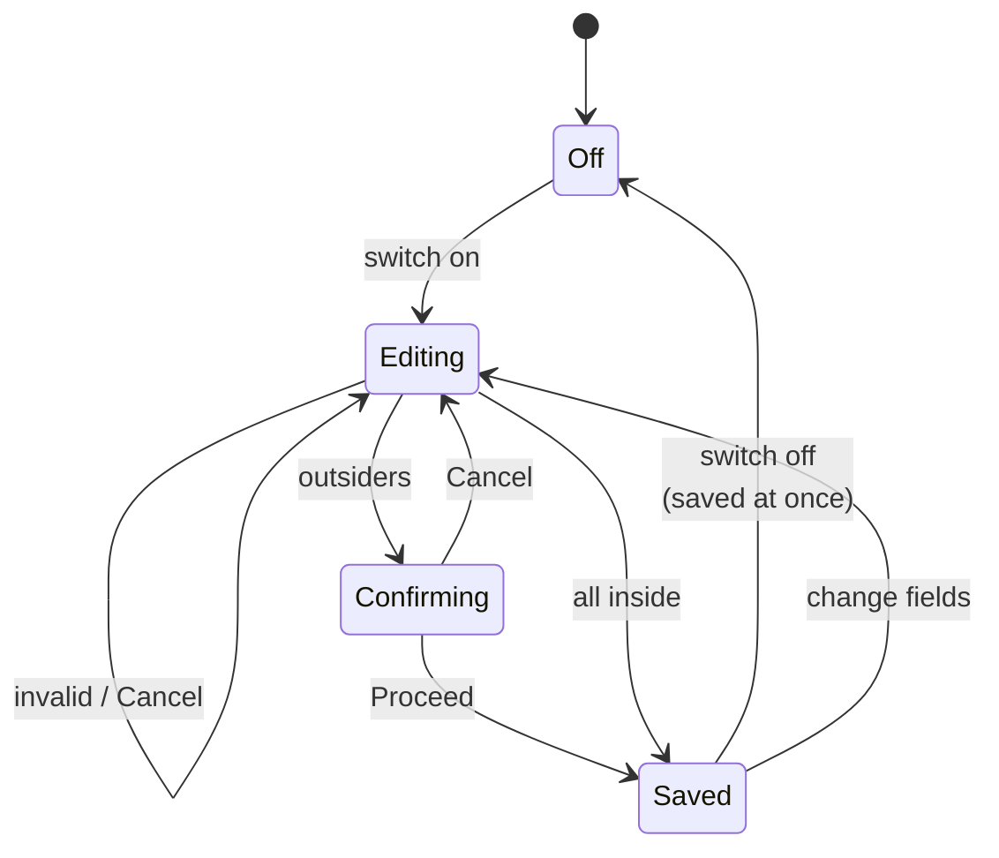
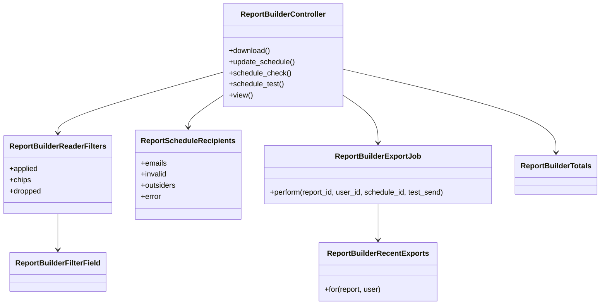

# Report Builder delivery — Design

> **Audience:** Engineers. **Companion documents:** [Proposal](proposal.md) · [Business rules](business-rules.md) · [Spec](specs/reports/report-builder-delivery/spec.md) · [LLD](lld.md) · [QA checklist](qa-checklist.md)

Phase 5 of the [usability plan](../../../docs/modules/reports/report_builder_usability_plan.md). Builds on report-builder-trust (formatter, totals, report page), report-builder-live-builder (settings panel streams, filter fields, Immediate Actions popup) and report-builder-starting-points, all implemented in this branch.

## Contents

- [1. The idea](#1-the-idea)
  - [What this adds](#what-this-adds)
  - [The idea in one picture](#the-idea-in-one-picture)
  - [Walkthrough: one example, start to finish](#walkthrough-one-example-start-to-finish)
  - [Key ideas](#key-ideas)
- [2. The same picture with real names](#2-the-same-picture-with-real-names)
  - [Picture](#picture)
  - [What each box does](#what-each-box-does)
  - [One run, end to end](#one-run-end-to-end)
  - [Lifecycles](#lifecycles)
  - [What users see](#what-users-see)
  - [Design decisions](#design-decisions)
- [3. One card per box](#3-one-card-per-box)
  - [① Export button](#-export-button)
  - [② Export job](#-export-job)
  - [③ Recent exports](#-recent-exports)
  - [④ Delivery tab](#-delivery-tab)
  - [⑤ Recipients check](#-recipients-check)
  - [⑥ Report page filters](#-report-page-filters)
  - [⑦ Headline totals](#-headline-totals)
  - [⑧ Save as View removal](#-save-as-view-removal)
- [4. Reference](#4-reference)
  - [Class diagram](#class-diagram)
  - [Data model and schema changes](#data-model-and-schema-changes)
  - [Component contracts](#component-contracts)
  - [Policy](#policy)
  - [Notifications](#notifications)
  - [Cross-cutting concerns](#cross-cutting-concerns)
  - [Worked examples](#worked-examples)
  - [Testing](#testing)
  - [Risks and open questions](#risks-and-open-questions)

---

## 1. The idea

### What this adds

Delivery and reading get the same "say what is happening" treatment the builder got in Phase 2. The export job already saves a document and broadcasts a `UserAlert` over the user's alert stream; it now also replaces the Export button and the Recent exports list over **that same stream**, the way `UserAlert#broadcast` replaces `#user_alert`. The schedule gets one recipients checker, used both before the popup and on save, and the report page reuses guided setup's filter sentences, the builder's typed filter inputs and the Phase 1 totals for cards.

### The idea in one picture

| # | Box | One line |
|---|---|---|
| ① | Export button | One partial, three states, the same on the report page and in the builder header |
| ② | Export job | Unchanged file making; now replaces ① and ③ over the user's alert stream, sends tests, records "last sent" |
| ③ | Recent exports | The report's last 5 "Generated" documents the user may open |
| ④ | Delivery tab | Frequency, time zone, recipients, **Save schedule**, **Send test to me**, "Last sent · Next" |
| ⑤ | Recipients check | Splits, tidies and checks addresses; names those outside the company |
| ⑥ | Report page filters | The report's saved filters as chips; reader filters (Narrow down) for this visit |
| ⑦ | Headline totals | Up to 4 stats cards, figures taken from the totals row |
| ⑧ | Save as View removal | The unused view-settings action, route, JS and concern go |

### Walkthrough: one example, start to finish

**Setup.** Meera and Ravi at Acme ([shared setup](business-rules.md#shared-setup)); report "LPs". **Legend:** ✓ done · ● we are here, not done yet · ○ not started.

| # | When | What happens | Behind the scenes | Result |
|---|---|---|---|---|
| 1 | Builder › Delivery | Meera turns the schedule on, Weekly, IST, recipients `meera@acme.test, lp@gmail.com, bob@`, **Save schedule** | ④ asks ⑤ (`schedule_check`): `bob@` invalid | Schedule **● (not saved)** — "bob@ isn't an email address" under the field |
| 2 | Same | Removes `bob@`, saves again | ⑤: valid; `lp@gmail.com` isn't an Acme user | Popup ●: "Emails 1 person outside Acme Capital" |
| 3 | Popup | Clicks **Cancel** (mistake: meant Proceed) | Nothing sent to the server | Schedule ○ (nothing saved) |
| 4 | Same | Saves again, **Proceed** | `update_schedule` re-checks with ⑤ and `outsiders_ok=1`; saves; `next_run_at` worked out | Schedule ✓ — "Schedule saved — weekly on Monday at 09:00 IST to 2 people"; "Not sent yet · Next 02 Nov 2026 09:00 IST" |
| 5 | Same | **Send test to me** | `schedule_test` → ② with `test_send`; mails Meera only | Test ✓ — "A test is on its way to meera@acme.test" |
| 6 | Report page | Ravi opens "LPs" | ⑥ chips from the saved filters; ⑦ cards from the totals | Chips *Category is LP* · *Only capital commitments in Growth Fund II*; cards Committed · Called |
| 7 | Same | **Narrow down** City is Mumbai | ⑥ reader filter in `q`; the engine runs with it for this visit | Rows Aditi only; chip *City is Mumbai ✕*; cards narrow |
| 8 | Same | **Export XLSX** | ① shows *Preparing…* in the browser; ② runs | ① **Preparing ●** |
| 9 | Same | — | ② saves the document; replaces ① and ③ on `user_alert_<Ravi>` | ① Download ✓; ③ gains "LPs · Ravi · 01 Nov 2026 10:04" |
| 10 | Monday 09:00 IST | Scheduled send | Scheduler → ②; after mailing, `last_run_at` = now | "Last sent 02 Nov 2026 09:00 IST · Next 09 Nov 2026 09:00 IST" |
| 11 | Stall | An export can't be saved (no folder) | ② rescues; replaces ① with the idle button; danger alert | ① Export XLSX again; "Couldn't export LPs: …" |

**What to notice**
- The popup is a hint and the server is the guard: ⑤ runs twice, so a request that skips the popup is still refused (X4).
- The export (step 9) is the whole report. Ravi's Mumbai filter narrowed only the screen.
- ② never tells a page to show *Preparing…*. The browser does that on click, so an export that finishes first can't be overwritten.

### Key ideas

| Idea | In one line | Card |
|---|---|---|
| The page listens on a stream it already has | `user_alert_<user id>`; no new channel or subscription | [②](#-export-job) |
| One recipients checker, two callers | Pre-save check and save itself | [⑤](#-recipients-check) |
| Readers narrow, they don't edit | `q` params for the visit; saved filters win | [⑥](#-report-page-filters) |
| Cards are the totals row | Same `ReportBuilderTotals` + `display` | [⑦](#-headline-totals) |

**FAQ**

| Question | Answer |
|---|---|
| Why not poll for the export? | The page already subscribes to the user's alert stream, and the job already broadcasts there; a second replace is free. |
| Why does the browser set *Preparing…* instead of the server's answer? | Jobs can finish before the request returns (inline in tests, fast in production), and a later "Preparing" would overwrite "Download". |
| Why doesn't Narrow down change the export? | The export is the report everyone gets, including scheduled recipients. A per-visit narrowing in the file would make two people's "same report" differ. The page says so. |

---

## 2. The same picture with real names

### Picture

### What each box does

| # | Real name | Owns | Reads | Produces |
|---|---|---|---|---|
| ① | `_export_button` partial (states `idle` / `ready`), `report_export_controller.js#prepare` | The button's DOM id `rb_export_<report id>` and its look | `report`, optional `document` | GET `download` with `Accept: turbo-stream`; the *Preparing…* state in the browser |
| ② | `ReportBuilderExportJob#perform(report_id, user_id, schedule_id = nil, test_send: false)` | File, Document, mail, alerts | Report, user, schedule | Document; `Turbo::StreamsChannel.broadcast_replace_to("user_alert_#{user.id}", …)` for ① and ③; `last_run_at` after a scheduled mail |
| ③ | `_recent_exports` partial, `ReportBuilderRecentExports.for(report, user)` | Which 5 documents to list | `Document.where(owner: report, owner_tag: "Generated")`, `DocumentPolicy#show?` | List rows or the empty text |
| ④ | `_tab_delivery` + `report_builder_controller.js#saveSchedule/#toggleSchedule`; actions `update_schedule`, `schedule_check`, `schedule_test` | Form state, the popup trigger, wording | `ReportSchedule`, `AgentSchedule::CURATED_TIMEZONES` | Saved schedule; builder stream answer |
| ⑤ | `ReportScheduleRecipients.new(text, entity:)` | Split, tidy, validity, outsiders, messages | `User.where(entity_id:)` emails | `emails`, `invalid`, `outsiders`, `error` |
| ⑥ | `_view_filters` partial, `ReportBuilderReaderFilters`, `wizard_filter_sentences` | Saved chips, reader chips, Narrow down row | `ReportBuilderConfig`, `params[:q]`, `ReportBuilderFilterField` | `applied` (→ engine `external_filters`), `chips`, `dropped` |
| ⑦ | `_headline_totals` partial | Which columns become cards | `@totals.call`, `@columns`, `@formatter` | Up to 4 `NumberStatsComponent`s |
| ⑧ | — | — | — | Fewer lines: `update_view_settings`, its route, JS handlers, `viewSettingsUrl`, `WithReportBuilderViews` |

### One run, end to end

### Lifecycles

Export button:

| Transition | What happens |
|---|---|
| Idle → Preparing | `report_export_controller#prepare` disables the link, shows the spinner text; Turbo still sends the GET |
| Preparing → Ready | ② replaces the partial with `state: :ready, document:` |
| Preparing → Idle (failed) | ② replaces with `state: :idle` and sends the danger `UserAlert` |
| Preparing → Idle (reload) | No state is stored; the alert still arrives |

Schedule (Delivery tab):

### What users see

**J1 — Export (report page or builder header)**

| Step | Screen | User does | Sees |
|---|---|---|---|
| J1.1 | Report page | Clicks **Export XLSX** | *Preparing…* (spinner, disabled) |
| J1.2 | Same | Waits | **Download** + **Export again**; green alert "Your report LPs is ready"; Recent exports gains the file |
| J1.3 | Same | Clicks **Download** | The document page with the file |
| J1.4 | Builder header | Clicks **Export XLSX** | Same as J1.1–J1.2 in the header |

**J2 — Schedule**

| Step | Screen | User does | Sees |
|---|---|---|---|
| J2.1 | Builder › Delivery | Switches on | Frequency, Time zone (IST for a new schedule), Recipients, **Save schedule**, **Send test to me** |
| J2.2 | Same | Types a bad address, **Save schedule** | "bob@ isn't an email address" under Recipients |
| J2.3 | Same | Fixes it; includes an outsider; Save | Immediate Actions popup naming them |
| J2.4 | Popup | **Proceed** | "Schedule saved — weekly on Monday at 09:00 IST to 2 people" |
| J2.5 | Delivery | **Send test to me** | "A test is on its way to meera@acme.test" |
| J2.6 | Delivery | Later | "Last sent … IST · Next … IST" |
| J2.7 | Delivery | Switches off | "Schedule turned off" |

**J3 — Read**

| Step | Screen | User does | Sees |
|---|---|---|---|
| J3.1 | Report page | Opens | Cards; "This report shows only:" chips; Narrow down; table; Recent exports |
| J3.2 | Same | Narrow down › field | The row redraws with that field's operators and input |
| J3.3 | Same | Apply | Rows, cards and totals narrow; reader chip with ✕ |
| J3.4 | Same | ✕ | Back to the report's rows |

### Design decisions

| Decision | Chosen | Rejected | Why |
|---|---|---|---|
| How the page hears the job | Existing `user_alert_<id>` stream | New `turbo_stream_from @report` | Already subscribed on every page in `modernize`; per-user, so nobody else's button flips |
| Where *Preparing…* is set | Browser on click | Server response | Avoids the inline-job race (see FAQ above) |
| Outsider confirmation | `schedule_check` JSON + existing `confirm#popup` with `action_summary` cards | Server-rendered second step | Reuses Phase 2's popup; the server re-checks anyway |
| Reader filter input | Plain GET form (`nf`, `nop`, `nv`) turned into `q` | JS filter builder | No new JS beyond "submit on field change"; bookmarkable URLs |
| Typed inputs | Extract `_filter_value_input` from `_filter_row` | Copy the switch | One place decides date / Yes-No / fund / list / number / text |
| Test sends | Through ② with `test_send` | Separate mailer call in the controller | Same file, same document, same subject |

**FAQ**

| Question | Answer |
|---|---|
| Does the Export link still work without JavaScript? | Yes. The HTML response of `download` is unchanged (redirect back with a notice). |
| What if two tabs show the same report? | Both get the ready replace (same user stream). Both now show Download, which is right. |
| What about the old free-text "Search…" box? | Narrow down replaces it, since "Investor contains" is one of its choices. |

---

## 3. One card per box

### ① Export button

| | |
|---|---|
| Files | `report_builder/_export_button.html.erb` (new); `report_export_controller.js` (new, ~15 lines); used in `view.html.erb` and `_builder_header.html.erb` |
| States | `idle`: link "Export XLSX" (`ti-file-spreadsheet`) to `download_report_builder_path`, `data-turbo-stream`, `data-action="click->report-export#prepare"`. `ready`: "Download" (`ti-download`) to `document_path(document)` + "Export again" (idle link, outline). |
| Look | Page: `btn btn-success`; header: `btn btn-outline-success btn-sm` (`size: :sm` local), the classes each place uses today |
| Removed | `startExport` and the `exportBtn` target in `report_builder_controller.js` |

**FAQ**

| Question | Answer |
|---|---|
| Why a new Stimulus controller rather than the builder's? | The report page has no `report-builder` controller; one tiny controller serves both places. |
| What does `download` answer to the stream request? | An empty `turbo_stream` on success. If enqueuing raises, it answers with the idle button plus a flash-style danger message. |

### ② Export job

| Step | Change |
|---|---|
| Arguments | `test_send: false` keyword added (old 3-argument jobs still run) |
| Mail | `schedule` → recipients (unchanged); `test_send` → `[user.email]` |
| After a scheduled mail | `schedule.update_columns(last_run_at: Time.current)` |
| Not scheduled | Broadcast replace `rb_export_<report id>` (ready, document) and `rb_recent_exports_<report id>` |
| Ready alert | Unchanged for exports; test: "A test of <b>LPs</b> was emailed to <email>" |
| Failure | Broadcast idle button; alert "Couldn't export <b>LPs</b>: <reason>" (was "Failed to generate report …") |

**FAQ**

| Question | Answer |
|---|---|
| Why not broadcast on scheduled runs? | The owner isn't on the page, and a scheduled run shouldn't flip a button the owner is about to click. The alert is sent as before. |
| Doesn't the scheduler already set `last_run_at`? | It sets it when it enqueues. The job now sets it again once the email has actually gone, which is what "Last sent" claims. |

### ③ Recent exports

| | |
|---|---|
| Query | `Document.where(owner: report, owner_tag: "Generated").includes(:user).order(created_at: :desc, id: :desc).limit(25)`, then `DocumentPolicy.new(user, doc).show?`, first 5 |
| Row | name · `user.full_name` · `l(created_at, format: :abbr_date_time)` · **Download** (`document_path`) |
| Empty | "No exports yet — Export XLSX makes one." |
| Where | Report page, a card below the table, DOM id `rb_recent_exports_<report id>` |

**FAQ**

| Question | Answer |
|---|---|
| Why 25 then 5? | Policy checks are per document; 25 bounds the work while tolerating a few hidden ones. |
| Why not in the builder too? | The builder is for changing the report; the plan puts history on the report page. |

### ④ Delivery tab

| Control | Behaviour |
|---|---|
| Switch | On: shows the form (nothing saved). Off: submits `enabled=false` at once when a schedule exists → "Schedule turned off" |
| Frequency | `daily` / `weekly` / `monthly` labelled "Daily at 09:00", "Weekly on Monday at 09:00", "Monthly on the 1st at 09:00" |
| Time zone | `AgentSchedule::CURATED_TIMEZONES`; new schedule → `Asia/Kolkata`; existing → stored value |
| Recipients | Textarea; a field error from ⑤ shows as `is-invalid` + `invalid-feedback`, keeping the typed text |
| Save schedule | `saveSchedule`: POST `schedule_check` → error → field error; outsiders → set `outsiders_ok=1`, `data-msg` = summary → `confirm#popup`; else submit the hidden form |
| Send test to me | `button_to schedule_test` inside the settings frame → builder stream answer |
| History | `report_schedule_history(schedule)` → "Last sent … · Next …" / "Not sent yet · Next …" |

The hidden form `#rb_schedule_form` carries `enabled`, `frequency`, `timezone`, `recipients` and `outsiders_ok` as hidden inputs with `data-turbo-frame="report_builder_settings"`, so `confirm#popup` copies them and the confirmed PATCH answers with the builder streams (the Phase 2 pattern for removing related data).

**FAQ**

| Question | Answer |
|---|---|
| Why stop autosaving recipients on blur? | A save that can raise a popup can't run on blur; one button makes the check visible. |
| Why can't the user pick the hour? | Out of scope; the 09:00 slot is the existing behaviour (`run_at_time` default). |

### ⑤ Recipients check

| Method | Returns |
|---|---|
| `emails` | Split on `/[\s,;]+/`, stripped, lower-cased, unique, blanks dropped |
| `invalid` | `emails` not matching `URI::MailTo::EMAIL_REGEXP` or with no `.` after `@` |
| `outsiders` | `emails - User.where(entity_id: entity.id).where("LOWER(email) IN (?)", emails).pluck(:email).map(&:downcase)` |
| `error` | "Add at least one email" · "bob@ isn't an email address" · "a@ and b@ aren't email addresses" · nil |

Used by `schedule_check` (JSON) and `update_schedule` (guard: `error` → 422; `outsiders.any?` without `outsiders_ok` → 422 "Confirm sending to people outside <entity> first").

**FAQ**

| Question | Answer |
|---|---|
| Why the report's entity, not the user's? | The schedule runs as the report's company (fix-tenant-isolation R4); "outside" is relative to that. |
| Why a new class rather than a model validation? | `ReportSchedule` is an existing model; this stays additive (no model change), and the check is needed before a record exists. |

### ⑥ Report page filters

| Part | Source |
|---|---|
| Saved chips | `wizard_filter_sentences(@config, entity)` → `badge bg-secondary-subtle text-secondary` with `ti-filter`; "Change in builder" (`edit_report_builder_path`) when `policy(@report).update?` |
| Reader filters | `ReportBuilderReaderFilters.new(config:, entity:, q: params[:q])`: keeps `q` keys whose field is in `ReportBuilderColumnCatalog.filter_columns_for(root)` and whose op is in `KNOWN_OP_SUFFIXES`; drops keys whose field the report's `root_filters` already use (→ `dropped` message) |
| Reader chips | `ReportBuilderFilterField.describe` → `badge bg-primary-subtle text-primary` + ✕ link to the same page without that key |
| Narrow down | GET form: `nf` (field select, submits on change), then the field's operators (`nop`) and `_filter_value_input` (`nv`/`nv[]`); **Apply** sends `apply=1`; the action merges `nf_nop => nv` into `q` and redirects |
| Note | "Doesn't change the report or its export" (`text-muted small`) |

**FAQ**

| Question | Answer |
|---|---|
| Why only root fields? | Related-data filters change totals inside each row; that's an edit of the report, not a narrowing. |
| Why drop a reader filter on a saved field instead of combining? | `ransack(root_filters.merge(q))` would replace the saved value. Dropping keeps "the report shows only LPs" true. |

### ⑦ Headline totals

| | |
|---|---|
| Columns | the first 4 of `@columns` whose key has a non-nil value in `@totals.call` |
| Figure | `@formatter.display(totals[c.key], c)` (identical to the totals row cell) |
| Subtitle | column label; footnote "this page" when `@totals.label == "Total (this page)"` |
| Component | `NumberStatsComponent.new(path: nil, amount:, subtitle:, progress_bar_color: "info", footnote:)` in a `row` |

**FAQ**

| Question | Answer |
|---|---|
| Why the first four, not the biggest? | Column order is the editor's choice of importance; "biggest" mixes counts and money. |
| Short units ("Cr")? | No. The figure is the totals row's text, so card and row match exactly (stats cards = grid totals). |

### ⑧ Save as View removal

| Removed | File |
|---|---|
| `update_view_settings` action + `set_report` entry | `report_builder_controller.rb` |
| `patch ':id/view_settings'` | `config/routes/core.rb` |
| `toggleView`, `updateViewTarget`, `toggleShared`, `viewSettingsUrl`, `viewTarget` target | `report_builder_controller.js` |
| `data-report-builder-view-settings-url-value` | `edit.html.erb` |
| `WithReportBuilderViews` (included nowhere) | `controllers/concerns/with_report_builder_views.rb` |

The `reports.is_view`, `view_target` and `shared` columns stay (no migration).

**FAQ**

| Question | Answer |
|---|---|
| Is anything reading `is_view`? | Only the removed concern. Reports with it set are ordinary reports (E14). |

---

## 4. Reference

### Class diagram

### Data model and schema changes

No schema changes. Columns used:

| Table.column | What | Why here |
|---|---|---|
| `report_schedules.timezone` | Existing, default `UTC` | Now chosen in the form |
| `report_schedules.last_run_at` | Existing | Also set after a scheduled mail went out |
| `report_schedules.next_run_at` | Existing, worked out by `Schedulable` | "Next …" |
| `documents.owner_type/owner_id/owner_tag` | Existing; export sets `owner: report`, `"Generated"` | Recent exports |
| `reports.is_view/view_target/shared` | Existing, now unused | Left in place (no migration) |

### Component contracts

| Endpoint | Auth | In | Out |
|---|---|---|---|
| `GET /report_builder/:id/download` | `show?` | — | turbo-stream: empty (or idle button on enqueue error); HTML: redirect back (unchanged) |
| `POST /report_builder/:id/schedule_check` | `update?` | `recipients` | JSON `{ error, outsiders, summary_html }` |
| `PATCH /report_builder/:id/schedule` | `update?` | `enabled`, `frequency`, `timezone`, `recipients`, `outsiders_ok` | Builder streams + message (422 on refusal); JSON for other callers |
| `POST /report_builder/:id/schedule_test` | `update?` | — | Builder streams + "A test is on its way to …" |
| `GET /report_builder/:id/view` | `show?` | `q`, `nf`, `nop`, `nv`, `apply` | Page; with `apply` a redirect to the page with `q` merged |

### Policy

| Role | Export / Recent exports / Narrow down | Schedule / test |
|---|---|---|
| User of the report's company | Yes (`show?`) | Yes (`update?`) |
| User of another company | Access denied | Access denied |
| Investor / LP users | Not offered (Report Builder is fund-side) | — |

### Notifications

| Notification | Trigger | Recipients | Channel | Customisable | Default | Sent once? |
|---|---|---|---|---|---|---|
| Report ready *(exists; now also flips ① and ③)* | Export saved | The user who exported | `UserAlert` + stream replace | No | On | Once per export |
| Export failed *(reworded)* | Job raises | The user who exported | `UserAlert` danger | No | On | Once |
| Scheduled report *(exists)* | Schedule due | Schedule recipients | Email `ReportMailer.scheduled_report` | Recipients, frequency, time zone | Off until enabled | Once per run |
| **Test send** *(new)* | Send test to me | The signed-in editor only | Same email + `UserAlert` "A test of … was emailed to …" | No | — | Once per click |
| Investors | — | None. Report Builder is internal; an investor's address reaches a schedule only after the outsider popup | — | — | — | — |

### Cross-cutting concerns

| Concern | Handling |
|---|---|
| Tenant scope | Reports looked up through `set_report` (entity-scoped); recipients' "inside" = report's entity; recent exports filtered by `DocumentPolicy` |
| Large tables | No new row queries; Narrow down's value lists use `ReportBuilderFilterField` (never lists values on the four large tables) |
| Dates | `l(…, format: :abbr_date_time)` for screens; the email is unchanged |
| Stream names | `user_alert_<user id>` is what `modernize` subscribes to (`turbo_stream_from "user_alert_#{current_user.id}"`) |
| Security | Reader filters go through Ransack (`ransackable_attributes`) and the catalog allow-list; nothing new is interpolated into SQL |

### Worked examples

All 31 rows (H1–H12, E1–E14, X1–X5) live in [business-rules.md](business-rules.md). Code comments cite these IDs.

### Testing

| Feature | IDs | Driver |
|---|---|---|
| `features/core/report_builder/delivery_export.feature` | H1, H2, H3, E1, E2, X1 | Playwright for H1, H2, X1 (stream replace); rack for H3, E1, E2 |
| `features/core/report_builder/delivery_schedule.feature` | H4–H8, E3–E7, X2–X5 | Playwright for the popup rows (H5, E3); HTTP for X4, X5 |
| `features/core/report_builder/delivery_reading.feature` | H9–H12, E8–E14 | Rack (server-rendered) |

Existing `scheduling.feature`, `mailer.feature` and `builder_ui.feature` must stay green.

### Risks and open questions

| Risk / question | Handling |
|---|---|
| A user with the report open in a non-`modernize` layout gets no stream | All Report Builder pages use `modernize` (ApplicationController default) |
| Old job payloads in Sidekiq at deploy (3 args) | The new argument has a default, so they still run |
| Open questions | None. D1 (remove Save as View) is decided in the plan's recommendation. |

**FAQ**

| Question | Answer |
|---|---|
| Rollback? | Revert the code; schedules keep their (possibly IST) time zone, which the old code ignored for display but `NextRunCalculator` already honoured. |
