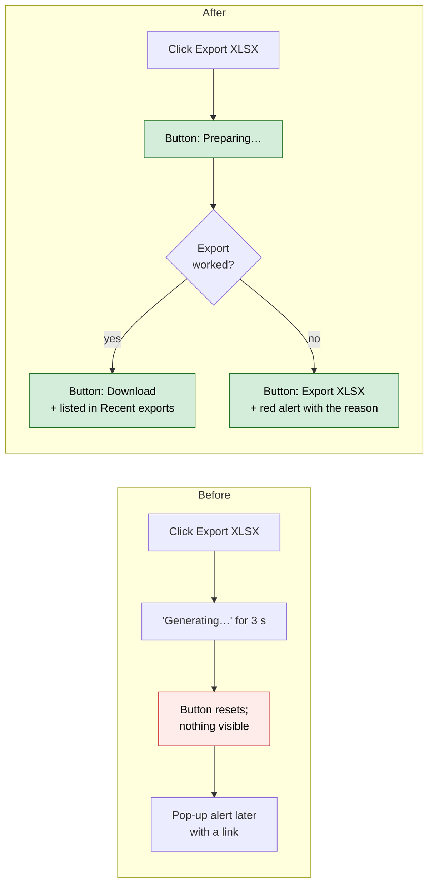
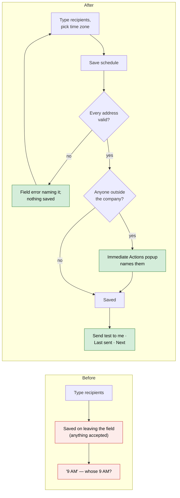
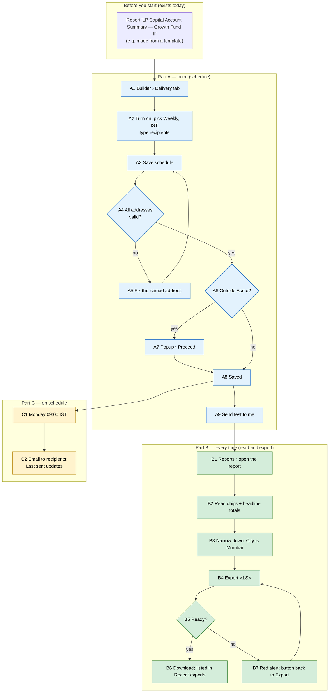

# Report Builder delivery — Proposal

> **Audience:** Business team, product, QA, support — non-technical.
> **Companion documents:** [Design](design.md) · [Business rules](business-rules.md)
> **New to this? Start with the [Workflow Journey](#workflow-journey)** — every action, in order, from start to the outcome.

> **Planning phase — no code changes.** This document proposes and explains the change.

Phase 5 of the [Report Builder usability plan](../../../docs/modules/reports/report_builder_usability_plan.md). Phases 1–3 (trust, live builder, starting points) are built in the same branch.

---

## Why

Once a report is built, getting it out is still guesswork. **Export XLSX** shows "Generating…" for three seconds and then nothing until a pop-up alert. Past exports are saved but never listed. The schedule takes any text as recipients, doesn't say which time zone "9 AM" is, can't send a test, and never says when it last ran. The report page shows one search box on a column it picks itself, and it never says which filters the report applies. On top of that, a "Save as View" feature has code but no screen, so nobody can use it.

## What Changes

- **Export shows its progress.** Clicking **Export XLSX** turns the button into *Preparing…*. When the file is ready, it becomes **Download** with no page reload, and the existing alert still appears. If the export fails, the button goes back to **Export XLSX** and a red alert says why.
- **Recent exports.** The report page lists the last 5 exported files, newest first, with who made each one, when, and a Download link. A new export joins the list as soon as it's ready.
- **A schedule you can trust:**
  - Recipients are checked when you click **Save schedule**. A bad address is named under the field and nothing is saved.
  - Saving to someone who isn't a user of your company first shows an **Immediate Actions** popup naming them.
  - You pick a time zone, and the page says "09:00 IST".
  - **Send test to me** emails the report to you alone.
  - "Last sent … · Next …" shows the schedule's history and next run.
- **The report's filters, in words.** The report page shows the report's own filters as chips ("Category is LP", "Only capital commitments in Growth Fund II").
- **Narrow down.** Readers can add their own filters (pick a field, then a typed value) without changing the report. Each reader filter shows as a chip with a ✕, and none of them is saved.
- **Headline totals.** Up to four stats cards above the table show the first four totals, the same figures as the totals row.
- **BREAKING (internal):** the unused "Save as View" code goes, including its web address `PATCH /report_builder/:id/view_settings`. No screen used it, and no report changes.

### Flow Diagram

Export, before and after:



Schedule, before and after:



---

## Workflow Journey

### Who is involved

| Person | Role | What they do in the journey |
|---|---|---|
| Meera | Fund-side user at Acme Capital, can edit reports | Exports the report, sets the schedule, sends a test |
| Ravi | Fund-side user at Acme Capital | Reads the report, narrows it down to Mumbai |
| lp@gmail.com | Outside Acme | Receives the scheduled email |

### The journey on one page



### Before you start

| Needed | Why | Where it comes from |
|---|---|---|
| A Report Builder report | Something to export, schedule and read | Builder, guided setup, a template or Duplicate (Phases 2–3) |
| A "Reports" folder or the company's top folder | Exports are saved as documents there (unchanged) | Exists for every company |
| A user of the report's company (Meera) | The Delivery tab is in the builder | Company user permissions |

### Part A — once (schedule)

| Step | Who | Where | Action | What the system does | What you see |
|---|---|---|---|---|---|
| A1 | Meera | Report › Edit › **Delivery** tab | Opens the tab | — | "Email this report on a schedule" switch, off |
| A2 | Meera | Delivery tab | Turns it on; Frequency **Weekly**, Time zone **India Standard Time (IST)**; Recipients `meera@acme.test, ravi@acme.test, lp@gmail.com, bob@` | Nothing saved yet | The form, with "Weekly on Monday at 09:00 IST" |
| A3 | Meera | Delivery tab › **Save schedule** | Clicks | Checks each address | Under the field: "bob@ isn't an email address". Nothing saved. |
| A5 | Meera | Recipients | Removes `bob@`, clicks **Save schedule** | Checks again: lp@gmail.com isn't an Acme user | Popup "Immediate Actions": *Emails 1 person outside Acme Capital — lp@gmail.com* · *Weekly on Monday at 09:00 IST* · *Sends the full report as Excel* |
| A7 | Meera | Popup › **Proceed** | Confirms | Saves 3 recipients, weekly, Asia/Kolkata; works out the next run | Green "Schedule saved — weekly on Monday at 09:00 IST to 3 people"; "Next 02 Nov 2026 09:00 IST" |
| A9 | Meera | Delivery tab › **Send test to me** | Clicks | Exports and emails only Meera | "A test is on its way to meera@acme.test"; the email arrives with the Excel file |

### Part B — every time (read and export)

| Step | Who | Where | Action | What the system does | What you see |
|---|---|---|---|---|---|
| B1 | Ravi | Reports › report name | Opens it | Runs the report | Report page |
| B2 | Ravi | Report page | Reads | — | Chips: *Category is LP* · *Only capital commitments in Growth Fund II*; cards: Committed ₹7.50 Cr · Called ₹3.00 Cr · Collected ₹2.80 Cr · Distributed ₹0.00 |
| B3 | Ravi | **Narrow down** › Field *City* › *is* › *Mumbai* › **Apply** | Adds a filter | Runs with City is Mumbai for this visit only | Chip *City is Mumbai ✕*; rows and cards narrow; the report's saved filters don't change |
| B4 | Ravi | **Export XLSX** | Clicks | Starts the export | Button: *Preparing…* (disabled) |
| B6 | Ravi | Same page | Waits | File saved as a document | Button: **Download**; green alert; Recent exports gains "LP Capital Account Summary — Growth Fund II · Ravi · 01 Nov 2026 10:04" |

The export always covers the whole report. A reader's own filter is for this visit's screen only, as today. That is why the Narrow down box says "Doesn't change the report or its export".

### Part C — on schedule

| Step | Who | Where | Action | What the system does | What you see |
|---|---|---|---|---|---|
| C1 | System | — | Monday 09:00 IST | Exports and emails the 3 recipients (unchanged) | Email "Scheduled Report: LP Capital Account Summary — Growth Fund II" |
| C2 | Meera | Delivery tab | Opens later | — | "Last sent 02 Nov 2026 09:00 IST · Next 09 Nov 2026 09:00 IST" |

### What you see

```
 LP Capital Account Summary — Growth Fund II              [Edit] [Duplicate] [Export XLSX]
 ┌──────────────┐ ┌──────────────┐ ┌──────────────┐ ┌──────────────┐
 │ ₹7.50 Cr     │ │ ₹3.00 Cr     │ │ ₹2.80 Cr     │ │ ₹0.00        │
 │ Committed    │ │ Called       │ │ Collected    │ │ Distributed  │
 └──────────────┘ └──────────────┘ └──────────────┘ └──────────────┘
 This report shows only:  [Category is LP]  [Only capital commitments in Growth Fund II]
 Narrowed by you:         [City is Mumbai ✕]
 Narrow down: [Field ▾] [is ▾] [value]  [Apply]   Doesn't change the report or its export
 ┌───────────────┬──────────┬──────────────┬──────────────┬─────────────┐
 │ Investor      │ Category │ Committed    │ Called       │ Collected   │
 │ Aditi Rao     │ LP       │ 5,00,00,000  │ 2,00,00,000  │ 1,80,00,000 │
 │ Kiran Mehta   │ LP       │ 2,50,00,000  │ 1,00,00,000  │ 1,00,00,000 │
 │ Total         │          │ 7,50,00,000  │ 3,00,00,000  │ 2,80,00,000 │
 └───────────────┴──────────┴──────────────┴──────────────┴─────────────┘
 Recent exports
   LP Capital Account Summary — Growth Fund II · Ravi · 01 Nov 2026 10:04   [Download]
```

The arithmetic: Committed is 5 Cr (Aditi) + 2.5 Cr (Kiran) = **7.50 Cr**, which is the card's figure and the totals row's figure. Called is 2 + 1 = **3.00 Cr**.

### What goes wrong

**The export fails** (for example, the company has no folder to save it in). The button goes back to **Export XLSX**, and a red alert reads "Couldn't export LP Capital Account Summary — Growth Fund II: …" with the reason. Fix the cause (here, create the folder) and click Export again.

**A mistyped recipient.** "bob@ isn't an email address" appears under Recipients, and the saved schedule stays as it was. Correct the address and save again.

### Summary: the minimum actions

| # | Action | Who | How often |
|---|---|---|---|
| 1 | Set the schedule (frequency, time zone, recipients) and save | Meera | Once |
| 2 | Send test to me | Meera | Once (optional) |
| 3 | Open the report and read it | Anyone who can see reports | Every time |
| 4 | Export XLSX → Download | Anyone who can see reports | When needed |

---

## User Stories

### US-1: See the export happen

**As a** fund-side user, **I want** the Export button to show when my file is ready, **so that** I don't have to wait for an alert or search the documents.

**Acceptance criteria:**
- Clicking **Export XLSX** turns the button into *Preparing…*, which is disabled.
- When the file is ready, the button becomes **Download**, which opens the document, and **Export again** sits next to it.
- On failure the button reads **Export XLSX** again, and a red alert names the report and the reason.
- The same happens in the builder header and on the report page.

### US-2: Find past exports

**As a** fund-side user, **I want** the last few exports listed on the report page, **so that** I can pick up the file a colleague made this morning.
- Shows up to 5, newest first: name, who made it, when, and **Download**.
- Lists only exports of this report, and only those the user may open.
- With none yet: "No exports yet — Export XLSX makes one."

### US-3: Schedule with confidence

**As a** report editor, **I want** my schedule's recipients checked and the time zone named, **so that** the report reaches the right people at the right hour.
- Addresses can be separated by commas, semicolons or new lines. They're stored lower-case, without duplicates.
- A bad address shows "x isn't an email address" (or "x and y aren't email addresses") under the field, and nothing is saved.
- An empty list with the schedule on: "Add at least one email".
- Anyone who isn't a user of the company triggers the Immediate Actions popup before saving.
- The Frequency list reads "Daily at 09:00", "Weekly on Monday at 09:00" and "Monthly on the 1st at 09:00". The Time zone list is the one used by agent schedules.
- Turning the switch off saves at once ("Schedule turned off"). Turning it on only opens the form.

### US-4: Test before it goes out

**As a** report editor, **I want** to send the report to myself, **so that** I can see what recipients get.
- **Send test to me** emails only the signed-in user, with the same subject and attachment as the scheduled email.
- It works whether or not a schedule is saved.

### US-5: Know when it last went

**As a** report editor, **I want** "Last sent" and "Next", **so that** I know the schedule is working.
- Both are shown in the schedule's time zone, for example "Last sent 02 Nov 2026 09:00 IST · Next 09 Nov 2026 09:00 IST".
- Never sent: "Not sent yet".

### US-6: Read a report's filters and narrow it

**As a** reader, **I want** to see what the report includes and narrow it for myself, **so that** I trust the figures and find what I need.
- Saved filters appear as chips in words. They can't be removed here; a "Change in builder" link is shown to those who can edit the report.
- **Narrow down** offers the report's own fields with typed inputs (date picker, Yes/No, fund list, value list, number, text).
- Each reader filter is a chip with ✕. Removing it goes back to the unnarrowed report.
- A reader filter can't override a saved filter on the same field. The saved one stays, and the reader's is dropped with "Category is already set by the report".

### US-7: Headline totals

**As a** reader, **I want** the main totals at the top, **so that** I see the answer without scrolling.
- Up to four cards: the first four columns, in report order, that have a total in the totals row.
- Each card shows exactly the totals row's text. On a paged report each card says "this page", as the totals row does.
- No totals means no cards.

---

## UI Behavior

### Builder › Delivery tab

```
┌ Delivery ─────────────────────────────────────────────┐
│ [●] Email this report on a schedule                    │
│ Frequency  [Weekly on Monday at 09:00    ▾]            │
│ Time zone  [India Standard Time (IST)    ▾]            │
│ Recipients                                             │
│ ┌────────────────────────────────────────────────────┐ │
│ │ meera@acme.test, ravi@acme.test, lp@gmail.com      │ │
│ └────────────────────────────────────────────────────┘ │
│ Separate emails with commas. People outside Acme       │
│ Capital get a warning first.                           │
│ [Save schedule]  [Send test to me]                     │
│ Last sent 02 Nov 2026 09:00 IST · Next 09 Nov 2026     │
│ 09:00 IST                                              │
└────────────────────────────────────────────────────────┘
```

**Behavior notes:**
- **Save schedule** answers in the builder's usual way: a green or red message, with the panel updated in place and no page reload.
- The outsider popup uses the app's Immediate Actions cards, not a browser confirm.
- A field error keeps what you typed.

### Report page

See the mockup in [What you see](#what-you-see).
- The Export button sits where it does today. *Preparing…* has a spinner.
- The **Narrow down** row replaces the old single "Search…" box.
- Choosing a field redraws the row with that field's operators and input.

---

## What This Feature Does NOT Cover

| Excluded | Covered In |
|---|---|
| Choosing the send time (always 09:00 in the chosen time zone) or the weekday/day of month | Later, if asked for |
| Exporting only the reader's narrowed rows | Later; the export stays the whole report |
| Charts on the report page | Phase 4 (assistant) |
| Sharing a report with named people or making "views" | Dropped with Save as View (decision D1) |
| Schedule delivery history (one line per send) | Later; "Last sent" only |

---

## Validation Rules

| Field | Rule | Default |
|---|---|---|
| Recipients | At least one when the schedule is on. Each must look like an email (`name@domain.tld`). Commas, semicolons and new lines separate them. Stored lower-case, without duplicates. | — |
| Frequency | Daily, weekly or monthly | Daily |
| Time zone | One of the agent schedule time zones | India Standard Time for a new schedule; an existing one keeps its own (often UTC) |
| Reader filter field | One of the report's own filter fields; never a field the report already filters on | — |

---

## Behavior Rules

| Scenario | What User Sees |
|---|---|
| Export clicked | *Preparing…*, then **Download** |
| Export fails | **Export XLSX** again + red alert "Couldn't export <name>: <reason>" |
| Page left during Preparing | The alert still arrives; the button isn't kept |
| Recipient outside the company | Immediate Actions popup before saving |
| Invalid address | Error under the field; nothing saved |
| Schedule off | Saved at once; "Schedule turned off" |
| Send test to me | "A test is on its way to <your email>" |
| Reader filter on a saved field | Dropped; message "<Field> is already set by the report" |
| Paged report | Cards and totals row both say "this page" |

---

## Resolved Design Decisions

| # | Decision | Resolution |
|---|---|---|
| 1 | Save as View (plan D1) | Remove the code; the columns stay in the database, untouched |
| 2 | Does Narrow down change the export? | No. The export is the report; the screen is narrowed for this visit only, and the page says so |
| 3 | Which users count as "in the company" for the warning? | Users of the report's company, by email, ignoring case |
| 4 | Do test sends count as exports? | Yes. A test makes the same file, so it's listed in Recent exports |
| 5 | "Last sent" source | The time the scheduled email actually went out (set after sending) |
| 6 | Time zone for existing schedules | Kept as stored (UTC). The page says "09:00 UTC", so nothing moves silently |

---

## Capabilities

### New Capabilities

- `reports/report-builder-delivery`: export progress, recent exports, the checked schedule (time zone, outsider warning, test send, last/next), filter chips and Narrow down, headline totals, and the removal of Save as View.

### Modified Capabilities

None. The report page's formatting, totals and sorting from Phase 1 are unchanged; this change adds to the page.

---

## Impact

- Report page: Export button, chips, Narrow down, cards, Recent exports.
- Builder: the header's Export button and the Delivery tab.
- The export job: tells the page when it's done or failed, sends test emails, and records when a scheduled email went out.
- No database changes. No change to who can see or edit reports.

---

## Benefits

1. You can see an export from click to download, with no waiting for an alert.
2. Past exports are one click away.
3. Schedules go to valid addresses, at a stated hour, and outsiders are flagged first.
4. Readers can see what a report includes and narrow it without asking an editor.
5. The answer sits at the top of the page.

---

## FAQ

| Question | Answer |
|---|---|
| Who can schedule or send a test? | People who can edit the report (users of the report's company), the same as today's Delivery tab. |
| Who can export and narrow down? | Anyone who can see the report. |
| Does anything go to investors? | Only if an editor types an investor's address as a recipient, and then the outsider popup asks first. |
| Will existing schedules change time? | No. They keep their stored time zone, and the page now names it. |
| Do readers' filters change the report for others? | No. They live in the page address for that visit only. |
| What happens to reports someone marked as a "view"? | Nothing. They stay ordinary reports; the view setting had no effect. |
| Any migration or rollout step? | None. Code only. |

---

## Design Principle for the Next Phase

- **One export button partial** used by the builder and the report page. The job updates it over the stream the page already listens to for alerts, so no new channel is needed.
- **One recipients checker** used by the pre-save check and the save itself, so the popup and the server can't disagree.
- **Reuse:** filter sentences from guided setup (`wizard_filter_sentences`), typed inputs from the builder's filter field, stats cards from `NumberStatsComponent`, the totals and formatter from Phase 1, and the Immediate Actions popup from Phase 2.
- **Risk:** Narrow down could grow into a second filter builder. It stays root fields only, one row at a time, with no OR/groups.
