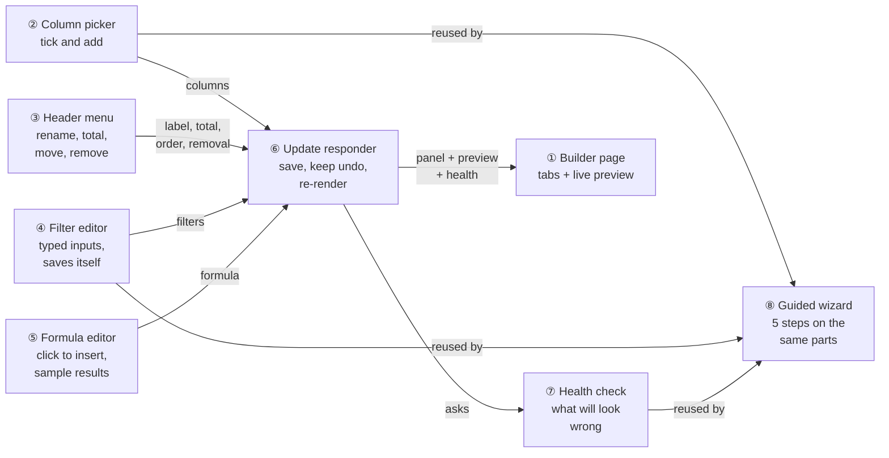
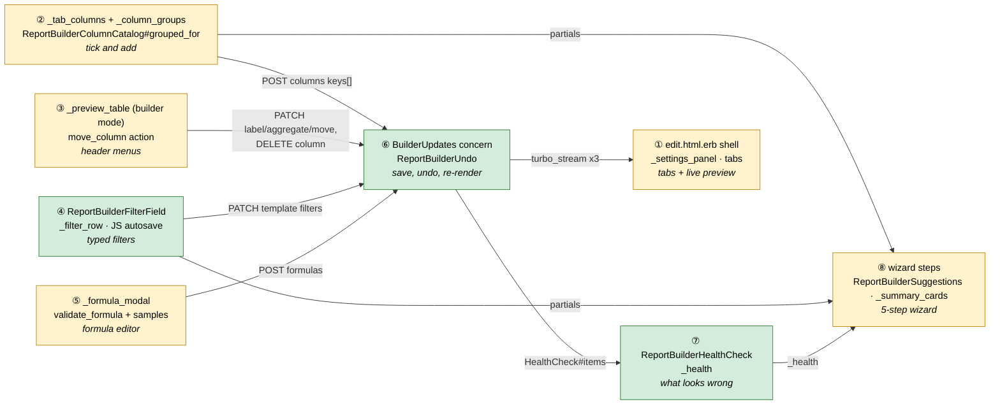
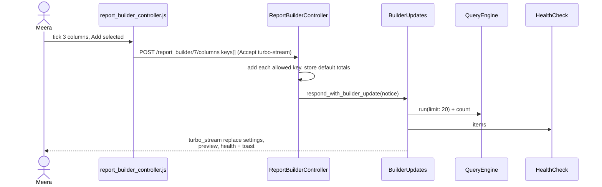
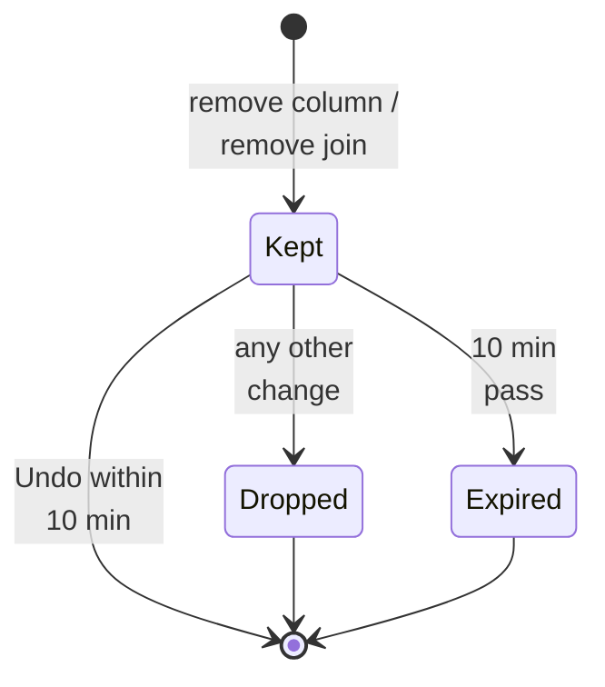
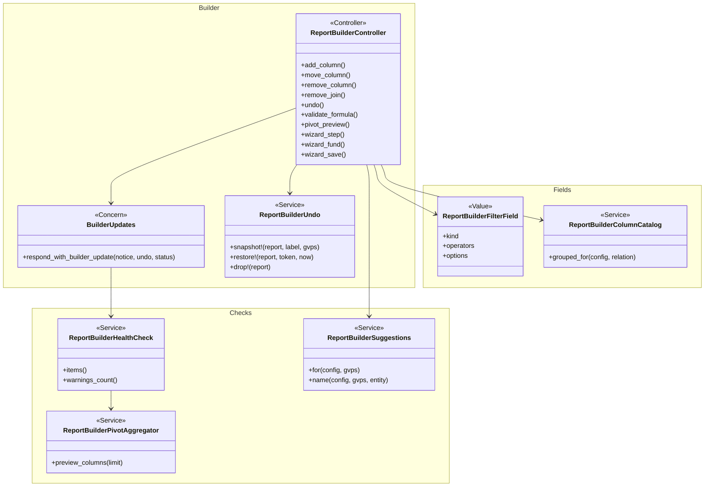

# Report Builder with live preview, and a reworked guided wizard — Design

> **Audience:** Engineering team.
> **Companion documents:** [Proposal](proposal.md) · [Spec](specs/) · [Business rules and worked examples](business-rules.md) · [LLD](lld.md) · [QA checklist](qa-checklist.md)
> **Builds on:** [report-builder-trust](../report-builder-trust/design.md) (Phase 1).

> **Planning phase — no code changes.**

---

## Contents

- [1. The idea](#1-the-idea)
  - [What this adds](#what-this-adds)
  - [The idea in one picture](#the-idea-in-one-picture)
  - [Walkthrough: one example, start to finish](#walkthrough-one-example-start-to-finish)
  - [Key ideas](#key-ideas)
- [2. The same picture with real names](#2-the-same-picture-with-real-names)
  - [Picture](#picture)
  - [What each box does](#what-each-box-does)
  - [One run, end to end](#one-run-end-to-end)
  - [Lifecycles](#lifecycles)
  - [What users see](#what-users-see)
  - [Design decisions](#design-decisions)
- [3. One card per box](#3-one-card-per-box)
  - [① Builder page](#-builder-page)
  - [② Column picker](#-column-picker)
  - [③ Header menu](#-header-menu)
  - [④ Filter editor](#-filter-editor)
  - [⑤ Formula editor](#-formula-editor)
  - [⑥ Update responder and undo](#-update-responder-and-undo)
  - [⑦ Health check](#-health-check)
  - [⑧ Guided wizard](#-guided-wizard)
- [4. Reference](#4-reference)
  - [Class diagram](#class-diagram)
  - [Data model and schema changes](#data-model-and-schema-changes)
  - [Component contracts](#component-contracts)
  - [Notifications](#notifications)
  - [Cross-cutting concerns](#cross-cutting-concerns)
  - [Worked examples](#worked-examples)
  - [Testing](#testing)
  - [Risks and open questions](#risks-and-open-questions)

---

## 1. The idea

### What this adds

Every builder change goes through **one responder** that answers with Turbo Streams: the settings panel, the preview and the health badge, re-rendered together. The 800-line `edit.html.erb` becomes a shell plus one partial per tab, so a stream can replace exactly what changed. On top of that come a column picker with bulk add, header menus, typed autosaving filters, a formula editor with sample results, a one-slot undo kept in the report's template, and a health check service. The wizard is rebuilt on the same partials.

It reuses Phase 1: `ReportBuilderColumnCatalog` for column lists, `ReportBuilderColumnType` for kinds and totals, `ReportBuilderValueFormatter` and `ReportBuilderTotals` for the preview, and the honest `_save` feedback in `report_builder_controller.js`.

### The idea in one picture



| # | Box | One line |
|---|---|---|
| ① | Builder page | A shell with the settings tabs on the left and the live preview on the right |
| ② | Column picker | Columns grouped by source and kind; tick several, Add selected |
| ③ | Header menu | Rename, Total, Move, Remove from each preview column |
| ④ | Filter editor | The right input and plain-word operators per field; saves after a pause |
| ⑤ | Formula editor | Inserts columns; shows the first five results while typing |
| ⑥ | Update responder | Saves the change, keeps the last removal for undo, re-renders panel, preview and health |
| ⑦ | Health check | Lists what will come out blank or misleading, each with a Fix link |
| ⑧ | Guided wizard | Five steps built from ②, ④, ⑦ and the preview |

### Walkthrough: one example, start to finish

**Setup.** Meera builds "LPs and their calls" on Acme ([shared setup](business-rules.md#shared-setup)). **Legend:** ✓ done · ● we are here, not done yet · ○ not started.

| # | When | What happens | Behind the scenes | Result&nbsp;&nbsp;&nbsp;&nbsp;&nbsp;&nbsp;&nbsp;&nbsp;&nbsp;&nbsp;&nbsp;&nbsp;&nbsp;&nbsp;&nbsp;&nbsp; |
|---|---|---|---|---|
| 1 | 10:00 | Opens the builder | The builder page (①) renders the shell; the preview frame loads by itself | **●&nbsp;Add&nbsp;columns**<br>○&nbsp;Add&nbsp;filters<br>○&nbsp;Add&nbsp;formula<br>○&nbsp;Check&nbsp;health |
| 2 | 10:01 | Ticks four investor fields and two commitment amounts, **Add selected (6)** | The column picker (②) posts `keys[]`; the update responder (⑥) adds the join, saves Sum for the amounts, and streams the panel, preview and health | Same as row 1; preview shows 6 columns |
| 3 | 10:03 | **Mistake:** removes *Capital commitments*; the popup lists Committed and Called; she proceeds | The update responder (⑥) keeps a snapshot of the template and the two columns in `template.undo` | Same as row 2 |
| 4 | 10:03 | Clicks **Undo** | The update responder (⑥) restores the snapshot — join, filter, columns, totals, positions | Same as row 2 |
| 5 | 10:05 | Filters Category *is* **LP** from the pick-list | The filter editor (④) saves after 600 ms; the update responder (⑥) streams | ✓&nbsp;Add&nbsp;columns<br>**●&nbsp;Add&nbsp;filters**<br>○&nbsp;Add&nbsp;formula<br>○&nbsp;Check&nbsp;health |
| 6 | 10:07 | Builds *Called %* by clicking Called and Committed | The formula editor (⑤) validates and shows five sample results | ✓&nbsp;Add&nbsp;columns<br>✓&nbsp;Add&nbsp;filters<br>**●&nbsp;Add&nbsp;formula**<br>○&nbsp;Check&nbsp;health |
| 7 | 10:08 | **Stall:** Health turns amber — "Committed adds amounts in INR and USD" | The health check (⑦) finds two fund currencies under the Sum column | ✓&nbsp;Add&nbsp;columns<br>✓&nbsp;Add&nbsp;filters<br>✓&nbsp;Add&nbsp;formula<br>**●&nbsp;Check&nbsp;health** |
| 8 | 10:09 | **Fix** › adds Fund *is* Growth Fund II | The filter editor (④) → the update responder (⑥) → the health check (⑦) is clean | ✓&nbsp;Add&nbsp;columns<br>✓&nbsp;Add&nbsp;filters<br>✓&nbsp;Add&nbsp;formula<br>✓&nbsp;Check&nbsp;health |

Snapshot at row 7:

```
[Health ⚠ 1] ── Committed adds amounts in INR and USD — pick a fund or split by fund   [Fix]
Preview · All 3 rows   Stakeholder │ Category │    Committed │ Called % ▾
                       Aditi Rao   │ LP       │ 5,10,00,000.00 ← 5 Cr INR + 0.1 Cr USD
```

**What to notice**

- Every change, the undo and the fix used the same responder (⑥); nothing refreshed the page.
- Undo needed no new table: the snapshot lives in the report's template.
- The health check (⑦) caught a total the Phase 1 formatter would have shown confidently.

### Key ideas

| # | Idea | In one line | Card |
|---|---|---|---|
| 1 | One update path | Every mutating action answers the builder with the same three Turbo Streams | [⑥](#-update-responder-and-undo) |
| 2 | Shell + tab partials | `edit.html.erb` becomes a shell; each tab is a partial a stream can replace | [①](#-builder-page) |
| 3 | Field kinds from Phase 1 types | `ReportBuilderFilterField` maps `ReportBuilderColumnType#base_type` to an input and operators | [④](#-filter-editor) |
| 4 | One-slot undo in the template | `template.undo` holds the last removal for 10 minutes and dies on any other change | [⑥](#-update-responder-and-undo) |
| 5 | The wizard reuses the parts | Column groups, filter rows, health and preview partials are shared | [⑧](#-guided-wizard) |

**FAQ**

| Question | Answer |
|---|---|
| Why not a JS-rendered builder? | The app is Turbo + Stimulus. Streams reuse the server's formatter and totals, so the preview never disagrees with the report page. |
| Does the report page change? | No. Header menus are added only when the preview partial is rendered in builder mode. |
| Is the old wizard kept anywhere? | No. Its step URLs redirect to the new steps. |

---

## 2. The same picture with real names

### Picture



Colour = footprint: **green** new, **amber** modified, **grey** reused unchanged. Exact files are in [lld.md File Map](lld.md#file-map).

### What each box does

| # | Box | Real parts | What it does | When it runs | What it decides | Details |
|---|---|---|---|---|---|---|
| ① | Builder page | `report_builder/edit.html.erb` (shell), `_settings_panel`, `_tab_columns`, `_tab_related`, `_tab_filters`, `_tab_sort`, `_tab_formulas`, `_tab_delivery`, `_builder_header` | Layout, tabs, header actions; preview frame with `src` | Request | Which tab is open (`?tab=`) | [card ①](#-builder-page) |
| ② | Column picker | `_column_groups`, `ReportBuilderColumnCatalog#grouped_for`, `add_column` (keys[]) | Grouped list; bulk add with server-side labels | Request | Group and hint per column | [card ②](#-column-picker) |
| ③ | Header menu | `_preview_table` (`builder: true`), `move_column` | Rename, Total, Move, Remove per column | Request | Which entries a column gets | [card ③](#-header-menu) |
| ④ | Filter editor | `ReportBuilderFilterField`, `_filter_row`, JS `filterChanged` | Input kind, operators, options, validation | Request / browser | Pick-list or text box | [card ④](#-filter-editor) |
| ⑤ | Formula editor | `_formula_modal`, `validate_formula` | Insert keys, five sample results | Browser / request | Valid or not | [card ⑤](#-formula-editor) |
| ⑥ | Update responder | `ReportBuilder::BuilderUpdates` (controller concern), `ReportBuilderUndo`, `undo` action | Saves, snapshots removals, answers with streams | Request | Stream vs redirect; undo allowed | [card ⑥](#-update-responder-and-undo) |
| ⑦ | Health check | `ReportBuilderHealthCheck`, `_health` | Bounded checks → items with severity and fix tab | Request | Which items apply | [card ⑦](#-health-check) |
| ⑧ | Guided wizard | `wizard_new`, `wizard_step` (`show`, `fund_filters`, `order`, `check`), `wizard_save`, `ReportBuilderSuggestions`, `_summary_cards` | Five steps, suggestions, suggested name | Request | Fund target; suggestions | [card ⑧](#-guided-wizard) |

### One run, end to end



### Lifecycles

**Undo snapshot** (stored in `reports.template["undo"]`):



| State | Stored? | Meaning |
|---|---|---|
| Kept | Stored: `{token, at, label, template, gvps}` | Undo restores it |
| Dropped | Removed from the template on the next save | "the report has changed since" |
| Expired | Still stored until the next save; refused by time | "removals can be undone for 10 minutes" |

### What users see

| Where in CapHive | Today | After this change | Who sees it |
|---|---|---|---|
| Builder | Three columns of cards; preview below; reloads per change | Tabs + live preview; streams | Builders |
| Builder › preview headers | Plain | Menu per column | Builders |
| Builder › filters | Text boxes + Save All Filters | Typed inputs, autosave | Builders |
| Builder › header | Build/View toggle | Health, Guide, ⌘K, Open report | Builders |
| Wizard | 7 screens, custom style | 5 steps, live sample, app style | Builders |

Main journey: see the [proposal's Part A](proposal.md#part-a--meera-in-the-builder) wireframe; the step table there is the journey.

### Design decisions

1. **One responder concern, not per-action JS.** Choice: `respond_with_builder_update` renders three streams for any HTML-form or fetch request that accepts Turbo Streams; other requests keep today's redirects (the wizard, scripts, tests). Alternative: JSON from each action and client rendering. Rejected: duplicates formatting and totals in JS.
2. **Undo in `template["undo"]`.** Alternative: `Rails.cache`. Rejected: test and some development set-ups use `:null_store`, and a multi-box deploy needs a shared cache. A new table was rejected as heavier than one JSON key.
3. **Labels from the catalog on bulk add.** The server looks up each key's label in `ReportBuilderColumnCatalog`, so the browser can't send a wrong or HTML label.
4. **Pick-lists bounded in SQL.** `distinct ... limit 31` on the root's entity scope, and never on `account_entries`, `capital_remittances`, `capital_distribution_payments` or `documents` (CLAUDE.md large tables). Alternative: a datalist from all values. Rejected for memory.
5. **Health check always on.** Each check is one bounded query; it runs inside the same request as the preview. Alternative: a separate request. Rejected: two round trips, and the badge could lag the preview.
6. **The wizard keeps its own controller actions** but renders the shared partials. Alternative: drive the wizard through the builder's streams. Rejected: the wizard is page-per-step on purpose (bookmarkable steps, back button).

**FAQ**

| Question | Answer |
|---|---|
| What about `update_template` (filters, grouping, currency)? | It becomes stream-aware like the others; the JS `_save` already sends `Accept: application/json` — the builder now sends `text/vnd.turbo-stream.html` instead, and the JSON path stays for API callers. |
| Can two tabs fight? | The stream replaces the panel with the server's view; the open tab is sent as a param and kept. |

---

## 3. One card per box

### ① Builder page

The shell: header (name, root badge, **? Guide**, **⌘K**, **Health**, **Templates**, **Guided setup**, **Export XLSX**, **Open report**), the settings panel (`nav-pills` tabs, `turbo_frame_tag "report_builder_settings"`) and the preview card (`turbo_frame_tag "report_builder_preview", src: preview_report_builder_path(builder: 1)`).

| Owns | Reads / receives | Produces |
|---|---|---|
| Layout, tab state, header actions | `@report`, `@config`, catalog lists (②), health (⑦) | The page; frames that ⑥ replaces |

| Tab | Partial | Content |
|---|---|---|
| Columns | `_tab_columns` | Search, ② groups, Add selected |
| Related data | `_tab_related` | Join cards (only-with-rows switch, pivot form with its "This will create N columns" line, Remove with popup), Add relation |
| Filters | `_tab_filters` | ④ rows per scope |
| Sort | `_tab_sort` | Default sort, Excel grouping, display currency |
| Formulas | `_tab_formulas` | List + ⑤ modal |
| Delivery | `_tab_delivery` | Schedule (unchanged behaviour) |

Build notes: one type scale (no `fs-1` uppercase labels), `table table-bordered` without `table-dark`, badges `badge bg-X-subtle text-X`, outline buttons with `ti` icons, `aria-label` + `title` on every icon-only button; Cmd+K button opens the existing `command-palette` modal; Guide links to `/user_guides/report_builder_user_guide` (the in-app guide route). The Build/View toggle and `switchMode` go.

**Worked examples:** H1, H17, E19, E20

**FAQ**

| Question | Answer |
|---|---|
| Why keep the preview in a frame with `src`? | It loads after the page paints, so a slow report doesn't hold the settings back (E19 error card stays inside the frame). |

### ② Column picker

| Owns | Reads / receives | Produces |
|---|---|---|
| Grouping and hints | `columns_for` (root), `related_columns_for` per join, `ColumnType#base_type` | Groups: source → kind → columns; `POST :id/columns keys[]` |

| Rule | Detail |
|---|---|
| Kinds | money/number/integer → Amounts; date/datetime → Dates; boolean → Yes/No; else Names & text |
| Hidden | keys ending `_id` (except none) and `_cents` |
| Same label | when two columns share a label (case-insensitive) each gets the key as a muted hint |
| Bulk add | each key: skip if present; refuse if `column_key_allowed?` fails (named in the error); join added automatically when a related key's relation isn't configured yet and resolves to a curated association (wizard and builder) |

**Worked examples:** H3, H4, E1, E2, E3

**FAQ**

| Question | Answer |
|---|---|
| Why add joins automatically? | The wizard's step 2 shows related columns before any join exists; adding the column implies the relation. The builder only lists related columns of configured joins, so nothing changes there. |

### ③ Header menu

`_preview_table` gains `builder:` mode: each header becomes a dropdown.

| Column | Entries |
|---|---|
| Root / related many-per-row | Rename, Total (select of `AGGREGATES` with `aggregate_label`), Move left/right, Remove |
| One-per-row related | Rename, Move, Remove |
| Formula | Move, Edit in Formulas (opens tab) |
| Pivot column | Move block (moves the `pivot:` position row) |

| Verb and path | Action | Does | Responds with |
|---|---|---|---|
| `PATCH /report_builder/:id/columns/:gvp_id/move` | `move_column` (new) | `direction` left/right → `insert_at(position ± 1)` within bounds | streams (⑥) / 422 |
| `PATCH /report_builder/:id/columns/:gvp_id` | `update_column_label` (changed) | as today | streams |
| `PATCH /report_builder/:id/aggregate` | `update_aggregate` (changed) | as Phase 1 | streams |
| `DELETE /report_builder/:id/columns/:gvp_id` | `remove_column` (changed) | snapshot then delete | streams with Undo toast |

**Worked examples:** H2, H5, H6, E4, E5, E6, X3

**FAQ**

| Question | Answer |
|---|---|
| Why not drag in the preview? | Drag stays in the Columns tab (existing `draggable-row`); menus give a precise keyboard-accessible alternative. |

### ④ Filter editor

`ReportBuilderFilterField.new(config:, relation:, key:, entity:)` describes one filter field.

| Kind (from `base_type`) | Input | Operators (label → Ransack predicate) | Options |
|---|---|---|---|
| date / datetime | `date_field_tag` (locale-date) | is on → `eq`; is on or after → `gteq`; is on or before → `lteq`; is empty → `null`; is not empty → `not_null` | — |
| boolean | select Yes/No | is → `eq`; is empty → `null` | `true`, `false` |
| fund (`fund_id`) | select | is → `eq`; is any of → `in` | entity funds by name |
| money/number/integer | number input | is → `eq`; is at least → `gteq`; is at most → `lteq`; is empty → `null` | — |
| text, ≤ 30 values, not a large table | select | is → `eq`; is not → `not_eq`; is any of → `in` (multi) ; is empty → `null` | `distinct.limit(31)` |
| text otherwise | text | contains → `cont`; is → `eq`; is any of → `in`; is not → `not_eq`; is empty → `null` | — |

Autosave: `filterChanged` (debounced 600 ms) validates each row (value present unless empty-ops; date parsed from the hidden ISO input) and calls the Phase 1 `_save` with the template filters patch, `Accept: text/vnd.turbo-stream.html`. Invalid rows are marked, not sent. The "Save All Filters" button goes.

**Worked examples:** H7, H8, E7, E8, E9, E10

**FAQ**

| Question | Answer |
|---|---|
| Why 30? | A select beyond ~30 options is harder than typing; 31 lets us detect "more than 30" in the same query. |

### ⑤ Formula editor

| Owns | Reads / receives | Produces |
|---|---|---|
| Column buttons, cursor insert, sample table | Selected columns + formulas; `POST :id/validate_formula` | `{ok, error, samples: [{row:, value:}]}` |

`validate_formula` runs the engine with `limit: 5`, evaluates the expression on each row with `ReportBuilderFormulaService`, labels each sample with the row's first column formatted by `ReportBuilderValueFormatter`.

**Worked examples:** H9, H10, E11

**FAQ**

| Question | Answer |
|---|---|
| Five rows of the full report on every keystroke? | Debounced 300 ms (as today) and `limit: 5`. |

### ⑥ Update responder and undo

`ReportBuilder::BuilderUpdates` (concern in `ReportBuilderController`):

| Method | Does |
|---|---|
| `respond_with_builder_update(notice:, undo: nil, status: :ok)` | `format.turbo_stream` → replace `report_builder_settings` (with `params[:tab]`), replace `report_builder_preview` (preview partial in builder mode), replace `report_builder_health`, append a toast; `format.html` → today's redirect; `format.json` → `{ok: true}` |
| `builder_request?` | `request.format.turbo_stream?` |

`ReportBuilderUndo` (PORO on a report):

| Method | Does |
|---|---|
| `.snapshot!(report, label:, gvps:)` | Writes `template["undo"] = {token, at, label, template (without "undo"), gvps (attributes)}` |
| `.restore!(report, token, now:)` | Checks token, age ≤ 10 min, and that nothing else changed (template minus `undo` equals the post-removal state recorded as `after_digest`); restores template and recreates GVPs with their sequence; clears `undo` |
| `.drop!(report)` | Called by every other mutating action (via a `before_action` on mutating actions except `undo`) to remove a stale snapshot |

| Verb and path | Action | Responds with |
|---|---|---|
| `POST /report_builder/:id/undo` | `undo` (new; `token`) | streams + "Restored <label>" / 422 with the reason |

Removing related data is confirmed with the Immediate Actions popup (`ReportBuilderHelper#remove_join_summary`, listing its columns).

**Worked examples:** H11, H12, H13, E12, E13, X1

**FAQ**

| Question | Answer |
|---|---|
| Why a digest instead of `updated_at`? | Touches that don't change the definition (e.g. `last_run_at`) shouldn't kill an undo. |

### ⑦ Health check

`ReportBuilderHealthCheck.new(report:, entity:).items` → `[{level: :warning|:info, message:, tab:}]`.

| Check | How (bounded) | Level |
|---|---|---|
| Blank column | `strategy_for` nil, or key not in catalog lists | warning |
| Formula reference | `[key]` not among GVP keys / formula keys | warning |
| Mixed currencies | for each Sum money column: grouped join whose child has `fund_id` → `Fund.where(id: child_scope.select(:fund_id)).distinct.count(:currency) > 1`; root with `fund_id` likewise on the root scope | warning |
| Filter matches nothing | only when `count == 0`: each root filter alone → `count` | warning |
| Large pivot | `PivotAggregator#column_count` (distinct count) > 20 | warning |
| Large export | `count > EXPORT_INFO_ROWS` (50,000) | info |
| Default totals | related many-per-row column with no stored total | info |

**Worked examples:** H14, H15, E14, E15, E16, E17, E18

**FAQ**

| Question | Answer |
|---|---|
| Can it slow the builder on big roots? | Each check is one `COUNT`/`DISTINCT` over the entity-scoped root or child; the filter check only runs when the report is empty. |

### ⑧ Guided wizard

| Step | Route `step` | Uses |
|---|---|---|
| 1 Each row | `wizard_new` / `wizard_create` (no name → "Untitled Report") | Cards: `WIZARD_MODEL_META` (examples for every root) |
| 2 What to show | `show` | ② groups for root + every curated association's stored columns; Add selected (auto-joins); inline total select |
| 3 Fund and filters | `fund_filters` | Fund picker → `wizard_fund` action; ④ rows (one-at-a-time form) with sentence read-back |
| 4 Order and calculations | `order` | Sort form; `ReportBuilderSuggestions#for(config, gvps)` → Add posts `add_formula` |
| 5 Check and save | `check` | `_summary_cards`, `_health`, preview frame, name field → `wizard_save` |

Live sample: `turbo_frame_tag "wizard_sample", src: preview_report_builder_path(limit: 5)` on steps 2–5.

Fund target: root has `fund_id` → root filter `fund_id_eq`; else each grouped join whose child has `fund_id` → child filter. "All funds" removes them.

Suggestions (`ReportBuilderSuggestions`):

| Name | Needs (same source) | Expression |
|---|---|---|
| Called % | `call_amount`, `committed_amount` | `IF([c] > 0, [call] / [c] * 100, 0)` |
| Unpaid | `call_amount`, `collected_amount` | `[call] - [collected]` |
| Uncalled | `committed_amount`, `call_amount` | `[committed] - [call]` |
| DPI | `distribution_amount`, `collected_amount` | `IF([collected] > 0, [distribution] / [collected], 0)` |

Suggested name: `"<root label plural> — <first two non-root-name column labels> — <fund name>"`, fund part only when a fund filter is set.

Old step redirects: `columns|joins|aggregates → show`, `filters → fund_filters`, `sort → order`, `review → check`. The wizard stylesheet `report_builder_wizard.scss` is removed; the step bar uses Bootstrap utilities.

**Worked examples:** H18–H30, E21–E26, X4, X5

**FAQ**

| Question | Answer |
|---|---|
| Where do Describe it / From a template go? | Phase 3 and Phase 4 add them to step 1. |

---

## 4. Reference

### Class diagram



### Data model and schema changes

N/A — no tables or columns change. New JSON key `reports.template["undo"]` ([card ⑥](#-update-responder-and-undo)).

**Changes to existing models:** none.

### Component contracts

| From → To | Contract | Direction rule |
|---|---|---|
| ② → ⑥ | `POST :id/columns` `keys[]`, `tab` | Labels are looked up server-side |
| ③ → ⑥ | `PATCH label/aggregate/move`, `DELETE column` | Same responder |
| ④ → ⑥ | `PATCH :id/template` `{template: {root_filters, joins}}` | Only valid rows are sent |
| ⑤ → ⑥ | `POST :id/formulas` | Validated first by `validate_formula` |
| ⑥ → ⑦ | `ReportBuilderHealthCheck#items` | ⑦ never writes |
| ⑥ → ① | three `turbo_stream.replace` + toast | Targets `report_builder_settings`, `report_builder_preview`, `report_builder_health` |
| ②④⑦ → ⑧ | partials `_column_groups`, `_filter_row`, `_health`, `_preview_table` | The wizard renders them; it does not re-implement them |

### Notifications

Nothing is sent, added, changed or suppressed. The builder's toasts are in-page feedback, not notifications. **Internal users:** export-ready and scheduled-report messages unchanged. **Investors:** no investor-facing screens or messages in Report Builder.

| Notification | Trigger | Recipients | Channel | Customisable | Default | Sent once? |
|---|---|---|---|---|---|---|
| — (none new or changed) | — | — | — | — | — | — |

### Cross-cutting concerns

#### Transactions and queries

- Bulk add, remove + snapshot, undo restore: one `Report.transaction` each.
- Pick-lists: `root_scope.distinct.limit(31).pluck(col)` (unscoped order, per the SQLite/MySQL DISTINCT note) only for allowed tables.
- Health: see [⑦](#-health-check); preview: 20 rows as Phase 1.

#### Exception handling and monitoring

| Failure | Handling | Who sees it |
|---|---|---|
| Preview raises | Error card in the preview frame (E19); warning logged with report id | Builder |
| Undo refused | 422 stream with the reason | Builder |
| Health check raises | Logged; badge shows "Health unavailable" (never blocks the page) | Builder |

#### Performance and security

- Each builder change costs the save + one 20-row preview + health queries; changes in quick succession are debounced in JS.
- All new actions `authorize @report, :update?` (preview/health `show?`); the engine's entity scoping is unchanged; undo restores only rows of the same report.

### Worked examples

The H/E/X tables (61 rows) are in **[business-rules.md](business-rules.md)** with the shared setup, spec scenario and feature for every row.

### Testing

Cucumber only. Server behaviour (streams, bulk add, undo, health, filters' kinds, suggestions, wizard steps) is tested over HTTP with `ActionDispatch::Integration::Session` and Nokogiri, reusing the Phase 1 Acme fixture; browser behaviour (H1, H5, H7, H9, E9, E10) uses `@javascript` Playwright in `editor_live.feature`. Every scenario carries `# <ID> — …`; code comments name the IDs they implement.

### Risks and open questions

- Splitting `edit.html.erb` regresses an existing behaviour → the existing report_builder features run after each task; the split is done before any behaviour change.
- Streams from `button_to` inside frames target the wrong frame → every builder form posts with `data-turbo-stream` and no frame target; covered by H2.
- Health check cost on very large roots → bounded queries; the filter check only on empty reports; badge degrades to "Health unavailable" on error.
- Undo digest false negatives (unrelated template writes) → digest excludes `undo` and is computed from the definition keys only.

| # | Open question | Current thinking | Status |
|---|---|---|---|
| — | None | — | — |

**FAQ**

| Question | Answer |
|---|---|
| Where do I start reviewing? | [⑥](#-update-responder-and-undo), then [④](#-filter-editor) — everything else hangs off them. |
