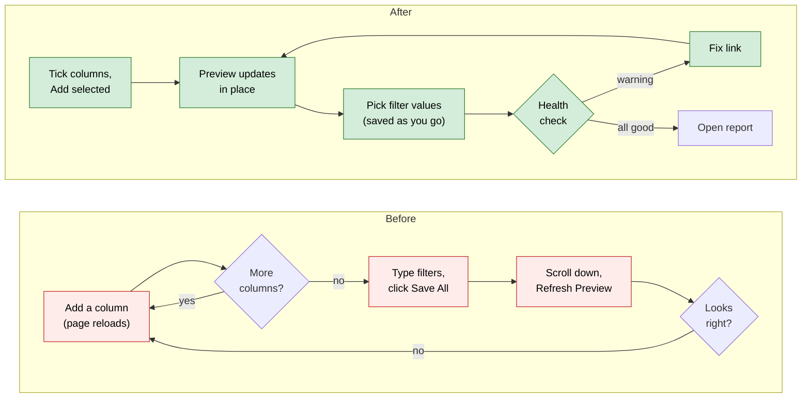
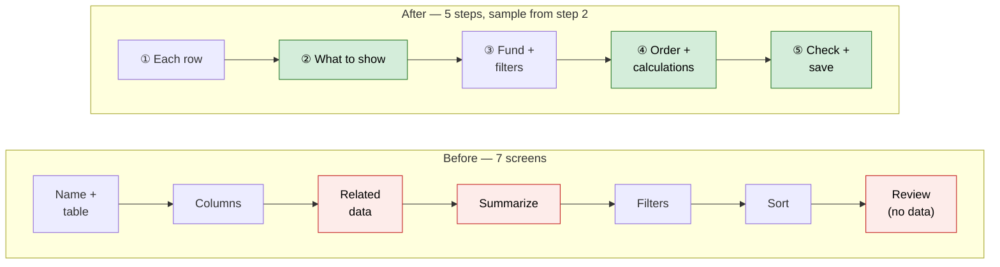
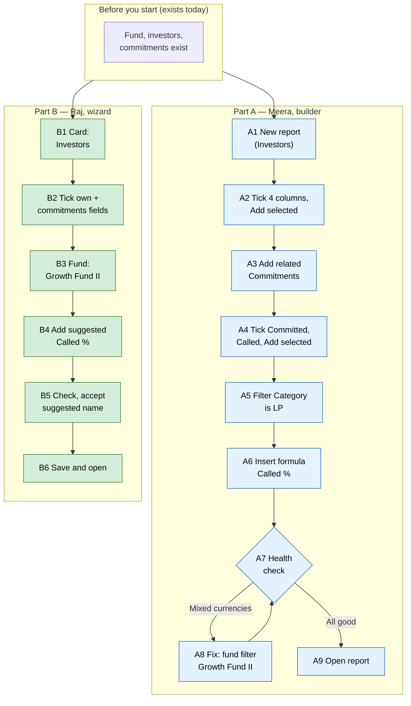

# Report Builder with live preview, and a reworked guided wizard — Proposal

> **Audience:** Business team, product, QA, support — non-technical.
> **Companion documents:** [Design](design.md) · [Business rules and worked examples](business-rules.md)
> **New to this? Start with the [Workflow Journey](#workflow-journey)** — every action, in order, from start to the outcome.
> **Part of:** Phase 2 of the [Report Builder usability plan](../../../docs/modules/reports/report_builder_usability_plan.md) (items BU1–BU3, BU5–BU10, CS1, CS2, CS4, WZ1–WZ8). Builds on [Report Builder you can trust](../report-builder-trust/proposal.md) (Phase 1).

> **Planning phase — no code changes.**

---

## Why

Building a report today means working blind:

- The preview sits below the fold and is empty until you click **Refresh Preview**. Every add or remove reloads the page and wipes it.
- Adding six columns takes six page reloads.
- Filters are plain text boxes, and they are lost unless you click **Save All Filters**.
- Removing related data deletes its columns with no undo.
- Nothing warns you before you export a report with a blank column or totals that add up two currencies.

The guided wizard has the same problems plus its own:

- It asks for a name before you know what the report is.
- Columns are picked in two places, with a step in between.
- You see no data until you leave the wizard.
- It looks different from the rest of the app.

Phase 1 made the numbers right. This phase makes building a report fast and visible.

## What Changes

**Builder**

- **The preview is the page.** It loads straight away and updates after every change, without reloading the page. Settings move into a panel with tabs: *Columns · Related data · Filters · Sort · Formulas · Delivery*. The Build/View toggle goes. **Open report** goes to the report page.
- **Each preview column has a menu:** **Rename**, **Total** (Sum, Count …), **Move left / right**, **Remove**.
- **Tick several columns, then Add selected.** One update instead of a reload per column. Columns are grouped as *Amounts · Dates · Yes/No · Names & text* with type icons. Internal id and cents fields are hidden, and look-alike labels are told apart.
- **Filters save as you change them** ("Save All Filters" goes), and each one gets the right kind of input:
  - a date picker in your date format;
  - Yes/No for yes/no fields;
  - a pick-list of the values that exist (e.g. Category: LP, Co-Investor);
  - a fund picker;
  - a number box for amounts.

  Operators are in plain words ("is on or after", "is any of", "is empty").
- **Formula editor:** click a column to insert it, instead of typing `[capital_commitments.call_amount]`. See the result for the first 5 rows as you type.
- **Undo.** "Removed Committed — **Undo**" for 10 minutes after removing a column or related data. Removing related data first shows an Immediate Actions popup listing the columns that go with it.
- **Health check.** A **Health** button turns amber with a count when something needs attention:
  - a column that will be blank;
  - a formula pointing at a removed column;
  - money added up across currencies;
  - a filter that matches no rows;
  - a pivot that would create more than 20 columns;
  - a very large export.

  Each item has a **Fix** link to the tab that fixes it.
- **Pivot preview.** Before **Apply**, it says "This will create 14 columns: First Close · A, First Close · B, …".
- **Looks like the rest of the app:**
  - standard tables and badges;
  - one type scale, with no tiny uppercase labels;
  - labels on icon-only buttons for screen readers;
  - a **?** link to the user guide;
  - the command palette as a visible button;
  - empty states that say what to do next.

**Guided wizard: 5 steps instead of 7, with a live sample from step 2 on**

1. **What is each row?** Cards for each table, each with an icon and an example question. No name yet.
2. **What to show.** One picker for the row's own fields *and* related data, grouped by source ("About the investor", "From their commitments"). The total is chosen inline and saved. **Add selected**.
3. **Which fund and filters.** A fund picker when the data has a fund ("All funds" allowed). Filters read as sentences: "Only include investors where **Category** is **LP**".
4. **Order and calculations.** Sort, plus **suggested calculations** based on the columns you picked: *Called %*, *Unpaid*, *Uncalled*, *DPI*. One click adds each.
5. **Check and save.** A plain-language summary (cards you can click to go back to that step), the health check, the preview with totals, a suggested name, then **Save and open** or **Fine-tune in builder**.

The wizard's own stylesheet goes; it uses the app's standard components. Old wizard links (Columns, Related Data, Summarize, Filters, Sort, Review) still work and go to the matching new step.

### Flow Diagram

Building a report in the builder:



The guided wizard:



---

## Workflow Journey

### Who is involved

| Person | Role | What they do in the journey |
|---|---|---|
| Meera | Fund operations, builds reports often | Builds "LPs and their calls" in the builder |
| Raj | Fund accountant, builds a report now and then | Uses the guided wizard for a quick commitments summary |

### The journey on one page



### Before you start

| Needed | Why | Where it comes from |
|---|---|---|
| Funds Growth Fund II (INR) and Global Fund (USD), investors and commitments | Data to report on | Existing fund set-up |
| Permission to create and edit reports | Building | Existing Reports permissions |

### Part A — Meera in the builder

| Step | Who | Where | Action | What the system does | What you see |
|---|---|---|---|---|---|
| A1 | Meera | Reports › Builder Report | Picks *Investor*, names it "LPs and their calls" | Creates the report, opens the builder | Settings panel on the left (Columns tab), the preview on the right: "Add columns to see data here" |
| A2 | Meera | Columns tab | Ticks Stakeholder, Category, City, Tags; clicks **Add selected (4)** | Saves all 4 at once; refreshes the panel and the preview | 4 columns in the preview, briefly highlighted; "All 4 rows" |
| A3 | Meera | Related data tab | Picks *Capital commitments*, **Add** | Saves the related data | A "From capital commitments" group appears on the Columns tab |
| A4 | Meera | Columns tab | Ticks Committed and Called under "From capital commitments", **Add selected (2)** | Saves both with Sum | Two new columns with totals |
| A5 | Meera | Filters tab | **Add filter** › Category › *is* › picks **LP** from the list | Saves as she picks | Preview drops Zeta Holdings (Co-Investor) |
| A6 | Meera | Formulas tab | **Add Formula**, label "Called %", clicks *Called* then types ` / `, clicks *Committed*, types ` * 100` | Checks the formula and shows the result for the first 5 rows | "Aditi Rao 40.00 · Kiran Mehta 40.00 …" before saving |
| A7 | Meera | Header › **Health 1** (amber) | Opens the health panel | Lists one warning | "Committed adds amounts in INR and USD — pick a fund or split by fund" **Fix** |
| A8 | Meera | Fix › Filters tab | Adds a capital commitments filter Fund *is* **Growth Fund II** (fund picker) | Saves; health re-checks | Health button turns green: "All good" |
| A9 | Meera | Header › **Open report** | Opens the report page | — | Formatted report with totals (Phase 1) |

### Part B — Raj in the wizard

| Step | Who | Where | Action | What the system does | What you see |
|---|---|---|---|---|---|
| B1 | Raj | Reports › New Custom Report | Clicks the **Investors** card ("e.g. Which LPs still owe money on calls?") | Creates an untitled report | Step ② What to show |
| B2 | Raj | ② What to show | Ticks Stakeholder (About the investor) and Committed, Called (From their commitments), **Add selected (3)** | Adds the related data and columns, saves Sum for both amounts | A 5-row sample on the right with totals |
| B3 | Raj | ③ Fund and filters | Picks **Growth Fund II** | Saves the fund filter on commitments | Card "Only commitments in Growth Fund II"; sample updates |
| B4 | Raj | ④ Order and calculations | Clicks **Add** on the suggestion *Called % = Called ÷ Committed × 100* | Saves the formula | Called % in the sample |
| B5 | Raj | ⑤ Check and save | Reads the summary cards; the name box shows "Investors — Committed, Called — Growth Fund II" | Runs the health check | "All good"; preview with totals |
| B6 | Raj | ⑤ › **Save and open** | Accepts the name | Saves the name | The report page |

### What you see

Builder (Part A, after A6):

```
┌ LPs and their calls · Investors ──── [? Guide] [⌘K] [Health ✓] [Templates] [Export XLSX] [Open report] ┐
│ ┌ Columns │ Related data │ Filters │ Sort │ Formulas │ Delivery ┐ ┌ Preview · All 3 rows ─────────────────────┐ │
│ │ Search columns [            ]                                  │ │ Stakeholder ▾│ Category ▾│ Committed ▾│ Called ▾│ Called % ▾│
│ │ About the investor                                             │ │ Aditi Rao    │ LP        │5,00,00,000.00│2,00,00,000.00│40.00│
│ │  ☑ Stakeholder  ☑ Category  ☑ City  ☑ Tags                    │ │ Kiran Mehta  │ LP        │2,50,00,000.00│1,00,00,000.00│40.00│
│ │ From capital commitments                                       │ │ Nova LP      │ LP        │        0.00│     0.00│ 0.00│
│ │  Amounts   ☑ Committed  ☑ Called  ☐ Collected                 │ │ Total        │           │7,50,00,000.00│3,00,00,000.00│40.00│
│ │  Dates     ☐ Commitment date                                   │ │ Committed ▾ menu: Rename · Total: Sum ▾ ·  │
│ │  Yes/No    ☐ Onboarding completed                              │ │                   Move ← → · Remove        │
│ │ [Add selected (0)]                                             │ └────────────────────────────────────────────┘
│ └────────────────────────────────────────────────────────────────┘                                             │
└───────────────────────────────────────────────────────────────────────────────────────────────────────────────┘
```

The arithmetic, after the Growth Fund II filter, with Category = LP (Aditi, Kiran, Nova):

- **Committed:** 5,00,00,000 + 2,50,00,000 + 0 = **7,50,00,000**.
- **Called:** 2,00,00,000 + 1,00,00,000 + 0 = **3,00,00,000**.
- **Called % in the totals row** = 3,00,00,000 ÷ 7,50,00,000 × 100 = **40.00**.

Wizard step ⑤ (Part B):

```
┌ New report · Guided setup ─────────────────────────────────────────────────────────────┐
│ ✓ Each row ── ✓ What to show ── ✓ Fund & filters ── ✓ Order ── ● Check & save            │
├──────────────────────────────────────────────┬────────────────────────────────────────────┤
│ One row per · Investor                [edit] │ Health ✓ All good                          │
│ Columns · Stakeholder; Committed (Sum of     │ Preview · All 4 rows                       │
│   commitments); Called (Sum of commitments); │ Stakeholder │ Committed      │ Called %   │
│   Called %                           [edit] │ Aditi Rao   │ 5,00,00,000.00 │   40.00    │
│ Only include · Commitments in Growth Fund II │ …                                          │
│                                      [edit] │ Total       │ 8,50,00,000.00 │   40.00    │
│ Sorted by · natural order            [edit] │                                            │
│ Name [Investors — Committed, Called — Growth Fund II ]                                     │
│                         [Fine-tune in builder]  [Save and open →]                         │
└──────────────────────────────────────────────┴────────────────────────────────────────────┘
```

### What goes wrong

**Undoing a removal.** Meera removes *Capital commitments* by mistake. The popup listed its 3 columns and she clicked **Proceed** anyway. The message "Removed Capital commitments and 3 columns — **Undo**" appears. She clicks **Undo** within 10 minutes, and the related data, its columns, totals and filters come back exactly as they were. After 10 minutes, or after another change, **Undo** says "Too late to undo — the report has changed since".

**A filter that matches nothing.** Raj types a value by hand in a text filter ("Overdu"). Health turns amber: "No rows match *Status is Overdu*". **Fix** opens that filter.

### Summary: the minimum actions

| # | Action | Who | How often |
|---|---|---|---|
| 1 | Pick a table | Meera / Raj | Once per report |
| 2 | Tick columns, Add selected | Meera / Raj | Once per group of columns |
| 3 | Pick filter values / fund | Meera / Raj | As needed |
| 4 | Open report / Save and open | Meera / Raj | Once |

---

## User Stories

### US-1: See the data while building
**As a** report builder, **I want** the preview to load on its own and update after every change, **so that** I see what I'm building.

**Acceptance criteria:**
- Opening the builder shows the preview without clicking **Refresh Preview**.
- Adding, removing, moving, renaming, changing a total, a filter, the sort, a formula or related data updates the settings panel and the preview without reloading the page.
- A preview error shows inside the preview area, and the settings stay usable.

### US-2: Add many columns at once
**As a** report builder, **I want** to tick several columns and add them together, **so that** building takes seconds.

**Acceptance criteria:**
- Columns are grouped *Amounts · Dates · Yes/No · Names & text*, under "About the <row>" and "From <related data>", with type icons.
- **Add selected (n)** is disabled at 0. It adds every ticked column in one request and skips ones already in the report.
- Internal `…_id` and `…_cents` fields aren't listed. Two fields with the same label are told apart ("Net bought amount · net_bought_amount").
- A column that isn't allowed is refused and named in a red message; the others are added.

### US-3: Manage a column from its header
**As a** report builder, **I want** a menu on each preview column, **so that** I can rename, total, move or remove it where I see it.

**Acceptance criteria:**
- **Rename** saves the new header. Leaving it blank restores the original.
- **Total** is shown only for many-per-row related columns. The choices use plain words (Sum, Count, Average, Latest date, Any yes …).
- **Move left / right** moves the column (a pivot moves as a block) and is disabled at the ends.
- **Remove** removes it and offers **Undo**. Formula columns offer **Edit in Formulas** instead of Rename/Total.

### US-4: Filters that fit the data and save themselves
**As a** report builder, **I want** each filter to offer the right input and save as I change it, **so that** I don't type ISO dates or lose filters.

**Acceptance criteria:**
- **Dates:** the locale date input. Operators: *is on*, *is on or after*, *is on or before*, *is empty*, *is not empty*.
- **Yes/No:** a Yes/No choice. Operators: *is*, *is empty*.
- **Fund:** a picker of the entity's funds by name.
- **Text with few values:** a pick-list of up to 30 existing values, offered only on tables that aren't among the very large ones. Anything else gets a text box (*contains*, *is*, *is any of*, *is not*, *is empty*).
- **Amounts and numbers:** a number box (*is*, *is at least*, *is at most*, *is empty*).
- A change saves after a short pause.
- A row with no value isn't saved and says "needs a value". An unreadable date says "Enter a date like 19/08/2026".

### US-5: Write formulas without typing keys
**Acceptance criteria:**
- The formula editor lists the report's columns. Clicking one inserts it at the cursor.
- While typing, the result for the first 5 rows is shown, or the error in plain words.
- **Add Formula** stays disabled until the formula works.

### US-6: Undo a removal
**Acceptance criteria:**
- After removing a column or related data, "Removed <name> — Undo" appears.
- **Undo** within 10 minutes, before any other change, restores everything removed (columns with their labels, totals and positions; related data with its filters and pivot).
- Otherwise it says "Too late to undo — the report has changed since" or "Too late to undo — removals can be undone for 10 minutes".
- Removing related data first shows an Immediate Actions popup listing the columns that go with it.

### US-7: Know before exporting
**Acceptance criteria:** the Health button shows "All good" or the number of warnings. The panel lists, each with a **Fix** link:

- columns that will be blank;
- formulas using a column that isn't in the report;
- money added up across currencies (naming them);
- filters that match no rows;
- pivots creating more than 20 columns;
- an export over 50,000 rows (info);
- columns using a default total (info).

### US-8: Pivot preview
**Acceptance criteria:** after choosing categories and a value, the form shows "This will create N columns: <first 5> …" before **Apply**, and warns over 20.

### US-9: Guided wizard in 5 steps
**Acceptance criteria:**
- **Step 1:** a card per reportable table, each with an icon and an example question.
- **Step 2:** the row's own fields and each related data's stored fields, grouped by source. Related columns are added with their default total, shown and changeable inline.
- **Step 3:** a fund picker when the row or a related data has a fund. Picking a fund filters the right one. "All funds" removes it. Filters read as sentences.
- **Step 4:** sort, and suggested calculations from the picked columns. Each is added with one click, and already-added ones show *Added*.
- **Step 5:** the summary cards (each opens its step), the health check, the preview with totals, and a suggested name. **Save and open** saves the name and opens the report page. **Fine-tune in builder** opens the builder.
- From step 2 on, a 5-row sample with totals sits beside the step.
- Old step links redirect to the matching new step.

### US-10: Looks and reads like the rest of the app
**Acceptance criteria:**
- No uppercase 0.65rem labels, inline widths or hand-coloured tables in the builder or wizard.
- Icon-only buttons have a title and an aria-label.
- **?** opens the user guide. **⌘K** is a visible button.
- Empty states name the next action.

---

## UI Behavior

### Builder

```
┌ <Report name> · <Table> ── [? Guide] [⌘K Search] [Health ⚠ 2] [Templates] [Guided setup] [Export XLSX] [Open report] ┐
│ ┌ Settings (tabs) ─────────────────────┐ ┌ Preview ───────────────────────────────────────────────────────────┐ │
│ │ Columns | Related data | Filters |    │ │ 20 of 1,284 rows                                                  │ │
│ │ Sort | Formulas | Delivery           │ │ <header ▾ menus>                                                  │ │
│ │ …tab content…                         │ │ <rows>                                                             │ │
│ └───────────────────────────────────────┘ │ Total (these 20 rows)                                             │ │
│                                           └────────────────────────────────────────────────────────────────────┘ │
└───────────────────────────────────────────────────────────────────────────────────────────────────────────────────┘
```

**Behavior notes:**
- The panel and the preview update together after each change; the page doesn't reload. The active tab stays open.
- The preview header menus appear in the builder only, not on the report page.
- Messages: green "<setting> saved", red "<setting> wasn't saved — <reason>" (Phase 1), plus "Removed <name> — Undo".

### Health panel

```
┌ Health · 2 warnings ─────────────────────────────────────────────┐
│ ⚠ Committed adds amounts in INR and USD — pick a fund   [Fix]   │
│ ⚠ No rows match "Status is Overdu"                       [Fix]   │
│ ⓘ Export will have 52,310 rows                                   │
└──────────────────────────────────────────────────────────────────┘
```

---

## What This Feature Does NOT Cover

| Excluded | Covered In |
|---|---|
| One "New report" entry, starting from a template, the 10 templates, Duplicate | Phase 3 |
| Export progress and history, schedule validation and test send, Save as View, filter chips on the report page, stats cards | Phase 5 |
| Describe your report (AI assistant) and its "Describe it" door on wizard step 1 | Phase 4 (last) |
| Relative date filters ("last quarter") | Later |
| Fund names as columns on the report page's quick search | Not planned |

---

## Validation Rules

| Field | Rule | Default |
|---|---|---|
| Add selected | At least one ticked; each key must be an allowed column | Disabled at 0 |
| Column rename | Blank restores the original label | Original label |
| Move | left / right only; not past either end | — |
| Filter value | Required except for *is empty* / *is not empty*; dates must parse in the user's format; numbers must be numbers | — |
| Pick-list | Only for text fields with ≤ 30 distinct values, on tables other than the very large ones | Text box otherwise |
| Undo | Within 10 minutes of the removal and before any other change | — |
| Formula | Must evaluate on the sample rows | Add disabled until it does |
| Wizard name | Blank uses the suggested name | Suggested name |

---

## Behavior Rules

| Scenario | What User Sees |
|---|---|
| A change saves | Panel and preview update; green "<setting> saved" |
| A change is refused | Red message with the reason; control reverts (Phase 1) |
| Remove a column | "Removed <name> — Undo" |
| Remove related data | Immediate Actions popup listing its columns, then "Removed <name> and N columns — Undo" |
| Undo too late | "Too late to undo — removals can be undone for 10 minutes" |
| Undo after another change | "Too late to undo — the report has changed since" |
| Filter row without a value | Row marked "needs a value"; nothing saved |
| Unreadable date | "Enter a date like 19/08/2026" |
| Pivot over 20 columns | "This will create 23 columns — consider fewer categories" |
| Money across currencies | Health: "<column> adds amounts in INR and USD — pick a fund or split by fund" |
| Wizard step for a root with no fund | Step 3 shows filters only |
| Old wizard link | Opens the matching new step |

---

## Resolved Design Decisions

| # | Decision | Resolution |
|---|---|---|
| 1 | Where does undo keep what was removed? | In the report itself (one "last removal" snapshot, 10 minutes). No new table, and it works whatever the cache set-up. |
| 2 | Live preview: second request or same response? | The same response returns the new settings panel *and* the new preview, so they can't disagree. |
| 3 | Which text fields get a pick-list? | Up to 30 distinct values, and never on the very large tables (account entries, remittances, distribution payments, documents), where listing values would be slow. |
| 4 | Health check: on demand or always? | Always. It runs with every update; each check is one bounded query. |
| 5 | The wizard's "Describe it" and "From a template" doors | Not in this phase: templates come in Phase 3, the assistant in Phase 4. Step 1 is the table cards only. |
| 6 | Keep the wizard's custom look? | No. It moves to the app's standard components; its stylesheet is removed. |
| 7 | Keep the Build/View toggle? | No. The report page is the view. |

---

## Capabilities

### New Capabilities

- `reports/report-builder-editor`: the builder page — live preview, settings tabs, column picker and bulk add, header menus, typed autosaving filters, formula editor, undo, health check, pivot preview, accessibility and help.
- `reports/report-builder-wizard`: the 5-step guided wizard — table cards, combined column picking, fund and filters, suggested calculations, check and save with a live sample.

### Modified Capabilities

None. The Phase 1 capabilities (`reports/report-builder-engine`, `reports/report-builder-display`) aren't archived yet; their requirements are unchanged.

---

## Impact

- **Report Builder:** the builder page and the guided wizard are reworked; the report page is unchanged.
- **Reports list:** unchanged (Phase 3 changes the entry points).
- **Excel export and scheduled emails:** unchanged.
- **Existing reports:** open in the new builder as they are. Wizard links keep working.
- **No database changes.**

---

## Benefits

1. A report takes a handful of clicks, with the data visible throughout.
2. Filters can't be lost or typed wrong.
3. Mistakes are reversible (Undo) and visible before export (Health).
4. The wizard is shorter, shows data from step 2, and suggests the calculations people ask for most.
5. One look across the app; usable with a screen reader.

---

## FAQ

| Question | Answer |
|---|---|
| Who can use this? | Anyone who can build reports today. |
| Do existing reports need changes? | No. They open in the new builder as they are. |
| Does it change what readers see or export? | No. The report page, Excel and scheduled emails are as in Phase 1. |
| How long can I undo? | 10 minutes, and only the last removal, until you make another change. |
| Why doesn't every text filter have a pick-list? | Listing values on the largest tables would be slow; those get a text box. |
| Do suggested calculations use AI? | No. They're fixed rules based on the columns you picked. |
| Is there anything new for investors or notifications? | No. |

---

## Design Principle for the Next Phase

- **One update path.** Every builder change goes through one responder that re-renders the settings panel, the preview and the health badge. Don't give each action its own JavaScript.
- **Reuse Phase 1 pieces:** `ReportBuilderColumnCatalog` (column lists), `ReportBuilderColumnType` (types, totals, filter kinds), `ReportBuilderValueFormatter` and `ReportBuilderTotals` (preview), and the Phase 1 save feedback in `report_builder_controller.js`.
- **The wizard and the builder share partials** for column groups, filter rows, summary cards, health and preview. The wizard isn't a second implementation.
- **Risk to handle in design:** the edit page is one 800-line template; splitting it into tab partials without changing behaviour needs care. The health check must stay bounded on large roots.
