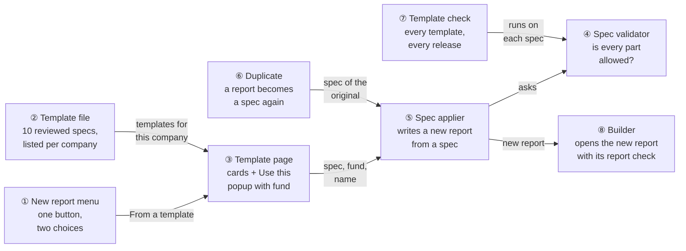
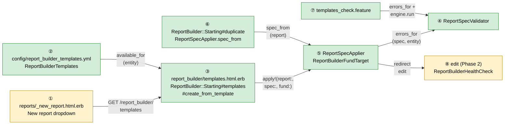
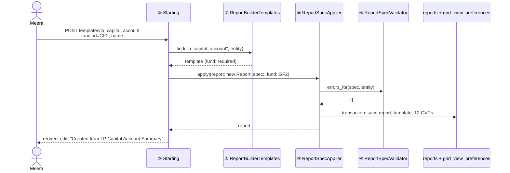
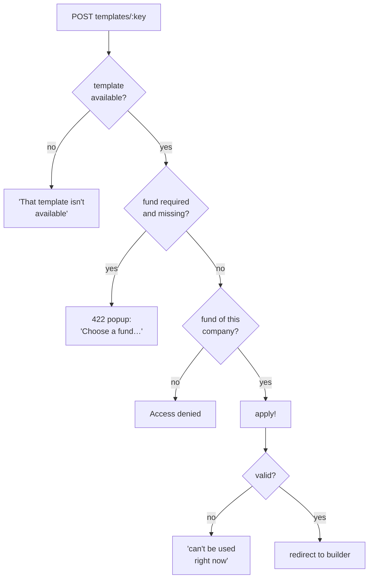
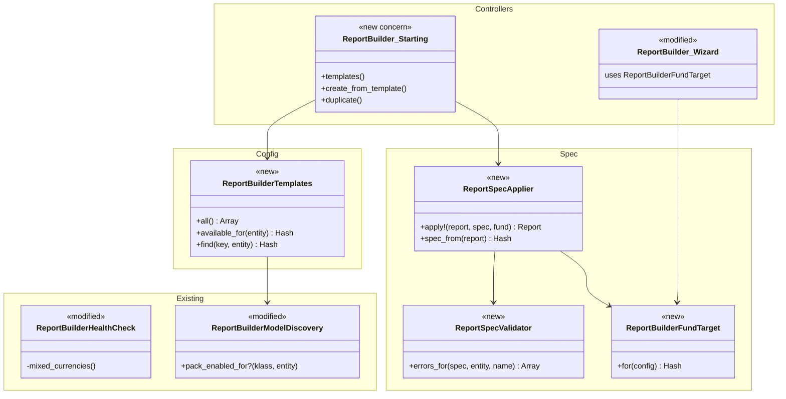

# Report Builder starting points — Design

> **Audience:** Engineers. **Companion documents:** [Proposal](proposal.md) · [Business rules](business-rules.md) · [Spec](specs/reports/report-builder-starting-points/spec.md) · [LLD](lld.md) · [QA checklist](qa-checklist.md)

Phase 3 of the [usability plan](../../../docs/modules/reports/report_builder_usability_plan.md). Builds on report-builder-trust (engine, catalog, formatter) and report-builder-live-builder (builder page, guided setup, report check), both implemented in this branch.

## Contents

- [1. The idea](#1-the-idea)
  - [What this adds](#what-this-adds)
  - [The idea in one picture](#the-idea-in-one-picture)
  - [Walkthrough: one example, start to finish](#walkthrough-one-example-start-to-finish)
  - [Key ideas](#key-ideas)
- [2. The same picture with real names](#2-the-same-picture-with-real-names)
  - [Picture](#picture)
  - [What each box does](#what-each-box-does)
  - [One run, end to end](#one-run-end-to-end)
  - [Lifecycles](#lifecycles)
  - [What users see](#what-users-see)
  - [Design decisions](#design-decisions)
- [3. One card per box](#3-one-card-per-box)
  - [① New report menu](#-new-report-menu)
  - [② Template file and catalogue](#-template-file-and-catalogue)
  - [③ Template page](#-template-page)
  - [④ Spec validator](#-spec-validator)
  - [⑤ Spec applier](#-spec-applier)
  - [⑥ Duplicate](#-duplicate)
  - [⑦ Template check](#-template-check)
  - [⑧ Builder and report check](#-builder-and-report-check)
- [4. Reference](#4-reference)
  - [Class diagram](#class-diagram)
  - [Data model and schema changes](#data-model-and-schema-changes)
  - [Component contracts](#component-contracts)
  - [Notifications](#notifications)
  - [Cross-cutting concerns](#cross-cutting-concerns)
  - [Worked examples](#worked-examples)
  - [Testing](#testing)
  - [Risks and open questions](#risks-and-open-questions)

---

## 1. The idea

### What this adds

A report can now be started three ways — from a template, from the guided setup (Phase 2), or by copying an existing report — and the first and third go through **one spec applier**: a small "report spec" (table, columns with totals, related data, filters, formulas, pivots, sort) is checked by **one validator** and written into a new report the same way the builder writes it. It follows the existing pattern of `ReportBuilderColumnCatalog` / `ReportBuilderColumnType` being the single source of what a report may contain, and of reviewed YAML product content checked by a Cucumber drift guard (`mcp_ontology.feature`).

### The idea in one picture



| # | Box | One line |
|---|---|---|
| ① | New report menu | Replaces "New Custom Report" and "Builder Report" with one menu: From a template, Guided setup |
| ② | Template file | Ten specs in a reviewed file; lists those whose tables the company's features allow |
| ③ | Template page | Cards grouped by area; **Use this** asks for a name and, where needed, a fund |
| ④ | Spec validator | Says whether every table, column, total, filter, formula, pivot and sort in a spec is allowed |
| ⑤ | Spec applier | Validates, places the fund, then writes the report's template and columns in one transaction |
| ⑥ | Duplicate | Reads a report back into a spec and hands it to ⑤ with a new name |
| ⑦ | Template check | A Cucumber feature that validates and runs every template |
| ⑧ | Builder | Opens the new report; the report check now notes when only the totals row mixes fund currencies |

### Walkthrough: one example, start to finish

**Setup.** Meera at Acme ([shared setup](business-rules.md#shared-setup)) wants LP capital accounts for Growth Fund II, then the same for Global Fund. **Legend:** ✓ done · ● we are here, not done yet · ○ not started.

| # | When | What happens | Behind the scenes | Result |
|---|---|---|---|---|
| 1 | Reports page | Meera opens **New report › From a template** | ① links to ③; ② lists the 10 templates (Acme has Funds and Deals) | Menu ✓<br/>**Template page ●**<br/>Report ○ |
| 2 | Template page | **Use this** on *LP Capital Account Summary*, clicks **Create** without a fund | ③ refuses before ⑤: the template's fund is `required` | Same as row 1, with "Choose a fund — this template adds up amounts" |
| 3 | Popup | Picks Growth Fund II, **Create** | ⑤ asks ④ (valid), adds `fund_id_eq` to the capital commitments' filters (the Investor rows have no fund), writes template + 12 column rows in one transaction | Menu ✓<br/>Template page ✓<br/>**Report "LP Capital Account Summary — Growth Fund II" ●** |
| 4 | Builder | Builder opens | ⑧ live preview and report check (Phase 2) | Report ✓ — preview rows Aditi, Kiran, Nova; badge All good |
| 5 | Reports page | Card ⋮ › **Duplicate** | ⑥ reads the report into a spec (no schedule, no undo), ⑤ writes "Copy of LP Capital Account Summary — Growth Fund II" | **Copy ●** opens in the builder |
| 6 | Builder (copy) | Changes the commitments' Fund to Global Fund, renames | Phase 2 filter autosave | Copy ✓; original still GF2 |
| 7 | Release | A teammate renames a commitment column in the code | ⑦ fails: "LP Capital Account Summary: capital_commitments.call_amount isn't a column of capital commitments" | Stall — fixed by updating the template before merge |

Key moment (row 3 → 4), the template written into the report:

```
template:
  root_model: Investor
  joins:  [capital_commitments  child_filters: { fund_id_eq: "<GF2 id>" }]
  root_filters: { category_eq: "LP" }
  aggregates: { capital_commitments.committed_amount: sum, …, capital_commitments.folio_id: count }
  formulas: [ Called %, Unpaid, Uncalled ]   sort: { key: <Unpaid key>, dir: desc }
columns (sequence): investor_name, category, city, tag_list, committed, called, collected,
                    distributed, # commitments, formula:Called %, formula:Unpaid, formula:Uncalled
```

**What to notice**
- Templates and Duplicate share ⑤ — a copy is "apply the original's spec".
- The fund is placed by the same rule as guided setup step 3 (root rows if they have a fund, else each related data).
- ⑦ and ⑤ use the same ④, so a template that passes the check can't fail at create time unless the code changed underneath (X5 covers that).

### Key ideas

| Idea | In one line | Card |
|---|---|---|
| One spec format | Templates, Duplicate and (Phase 4) the assistant all describe a report the same way | [⑤](#-spec-applier) |
| One validator | Allowed = what the builder itself would allow (catalog + column types) | [④](#-spec-validator) |
| Always a new report | Templates never touch an existing report; the builder's Templates button goes | [③](#-template-page) |
| Fund on create | Money templates require a fund; placement reuses guided setup's rule | [⑤](#-spec-applier) |
| Checked every release | A failing template names itself and the column | [⑦](#-template-check) |

**FAQ**

| Question | Answer |
|---|---|
| Why not keep "apply a template to this report"? | It silently replaced the report's set-up, and with a new-report flow there is no case it serves that Duplicate + template don't. |
| Why a spec format instead of copying the template JSON? | The JSON has derived parts (join `model`/`fk`, position rows, labels) that the applier fills from the catalog; a spec stays short, reviewable and identical for templates, Duplicate and Phase 4. |
| Why YAML and not a table? | Templates are product content reviewed in PRs and checked by ⑦; company-made templates can come later as a table next to it. |

---

## 2. The same picture with real names

### Picture



- ① *Replaces two builder buttons with one dropdown (modified).*
- ② *Loads and filters the ten templates (new).*
- ③ *Lists cards, shows the popup, refuses a missing required fund, calls ⑤ (new).*
- ④ *Returns a list of problems for a spec (new).*
- ⑤ *Validates, places the fund, writes `reports.template` and `grid_view_preferences` in one transaction (new).*
- ⑥ *Builds the spec of an existing report and applies it to a new one (new).*
- ⑦ *Cucumber drift guard over every template (new).*
- ⑧ *The Phase 2 builder; `ReportBuilderHealthCheck` learns the fund-rows note (modified).*

### What each box does

| # | Box | Real parts | What it does | When it runs | What it decides | Details |
|---|---|---|---|---|---|---|
| ① | New report menu | `reports/_new_report.html.erb`, `_cards.html.erb`, `_index.html.erb` | One dropdown | Reports page render | Shown only with `ReportPolicy#create?` | [①](#-new-report-menu) |
| ② | Template file | `config/report_builder_templates.yml`, `ReportBuilderTemplates` | Loads, groups, filters by features | Template page, create | Which templates a company sees | [②](#-template-file-and-catalogue) |
| ③ | Template page | `ReportBuilder::Starting#templates`, `#create_from_template`, `report_builder/templates.html.erb`, `_template_modal` | Cards, popup, create | User clicks | Required fund present; fund is the company's | [③](#-template-page) |
| ④ | Spec validator | `ReportSpecValidator` | Problems in a spec | Every apply; the check | Allowed or not, and why | [④](#-spec-validator) |
| ⑤ | Spec applier | `ReportSpecApplier`, `ReportBuilderFundTarget` | Writes a report from a spec | Create from template; Duplicate | Fund placement; column rows and positions | [⑤](#-spec-applier) |
| ⑥ | Duplicate | `ReportBuilder::Starting#duplicate`, `ReportSpecApplier.spec_from` | Copies a report | Card menu / report page | Unique "Copy of" name | [⑥](#-duplicate) |
| ⑦ | Template check | `features/core/report_builder/templates_check.feature` | Validates and runs each template | CI | Pass / fail with names | [⑦](#-template-check) |
| ⑧ | Builder | `ReportBuilderController#edit`, `ReportBuilderHealthCheck` | Opens the report | After create / duplicate | Fund-rows note vs warning | [⑧](#-builder-and-report-check) |

### One run, end to end



### Lifecycles

N/A — no stored or derived status. A template has no state; a created report is an ordinary report.

### What users see

| Screen | Change |
|---|---|
| Reports page | One **New report** dropdown (From a template, Guided setup); card menu gains **Duplicate**, "Guided Wizard" → **Guided setup** |
| Template page (new) | Cards grouped by area, search, **Use this** popup |
| Report page | **Duplicate** next to **Edit Builder** |
| Builder | No **Templates** button; "Guided setup" naming |
| Guided setup | Page titles "Guided setup" |

Main journey — the template page (mockup in the [proposal](proposal.md#what-you-see)):

```
┌ Start from a template ─────────────────────────────── [Search…] ┐
│ Investors                                                        │
│ ┌ LP Capital Account Summary ─────────────────┐                  │
│ │ Which LPs owe us money…?                    │ ①               │
│ │ [Starts from Investors] [Needs a fund]      │ ②               │
│ │ Includes: 3 formulas · sorted by Unpaid     │                  │
│ │                               [Use this] ③  │                  │
│ └─────────────────────────────────────────────┘                  │
└──────────────────────────────────────────────────────────────────┘
```

| Step | The user… | They see |
|---|---|---|
| ① | reads the question | What the report answers |
| ② | sees the badges | Starting table; Needs a fund / Fund optional |
| ③ | clicks Use this | Popup with name and fund; Create opens the builder |

### Design decisions

| Choice | Alternative | Why rejected |
|---|---|---|
| One applier for templates and Duplicate | Duplicate by `dup` of the report and its GVPs | `dup` copies schedule, undo and stale derived fields; going through the spec drops them by construction and tests the applier on every Duplicate |
| Validator = catalog + column types | A separate allow-list in the YAML | Two sources of truth drift; the builder's own rules are the right ones |
| Fund placement via `ReportBuilderFundTarget`, shared with guided setup | Each template names where the fund goes | The rule is the same everywhere and already proven in Phase 2 |
| Templates as a new page | A modal on the Reports page | Ten cards with questions need room; a page is linkable and testable over HTTP |
| Remove `apply_template` and the gallery | Keep both | Plan ST3: templates must never wipe a report |
| Fund-rows note in the report check | Leave the mixed-currency warning on fund-level reports | Each row is one fund; only the totals row mixes, so a warning saying "pick a fund" is wrong advice |

**FAQ**

| Question | Answer |
|---|---|
| Does the guided setup use the applier? | No — it edits a report step by step through the builder's own actions. Phase 4's assistant will, through the same ④ and ⑤. |
| What if a template is valid but returns no rows for a company? | It's created anyway; the builder's preview and report check say so. The check (⑦) runs on the Acme fixture, which has rows for the fund templates. |

---

## 3. One card per box

### ① New report menu

The Reports page (`reports/_new_report.html.erb`, rendered by `_cards` and `_index`) replaces **New Custom Report** and **Builder Report** with one Bootstrap dropdown button **New report**, items **From a template** (`report_builder_templates_path`) and **Guided setup** (`wizard_report_builder_path`). The standard reports `select_tag` stays.

| Owns | Reads / receives | Produces |
|---|---|---|
| The dropdown markup | `policy(Report.new(entity:)).create?` | Two links |

**Worked examples:** H1, H11

**FAQ**

| Question | Answer |
|---|---|
| Where does the one-page blank form go? | It keeps its route; guided setup step 1 links to it ("Open the builder instead"). |
| Why "Guided setup" and not "From scratch"? | It's the name used everywhere else (plan ST2). |

### ② Template file and catalogue

`config/report_builder_templates.yml` holds ten entries keyed by a slug (`lp_capital_account`, …). Each entry: `name`, `area`, `question`, `includes` (short phrases for the card), `fund` (`required` / `optional` / `none`) and `spec` (the format in [Component contracts](#component-contracts)). `ReportBuilderTemplates` loads it once per process (reset with the catalog cache in `config/initializers/report_builder.rb`), and lists a template for an entity only when every table it uses — root and each related data — passes `ReportBuilderModelDiscovery.pack_enabled_for?` (made public for this).

| Owns | Reads / receives | Produces |
|---|---|---|
| The ten specs, areas, questions | The YAML; the entity's feature flags | `all`, `available_for(entity)` grouped by area, `find(key, entity)` |

Area order: Investors, Capital calls, Distributions, Fund overview, Portfolio, Compliance. Per-template settings: [lld.md › Template file](lld.md#template-file).

**Worked examples:** H2, E2

**FAQ**

| Question | Answer |
|---|---|
| Why check features per table and not per template flag? | The tables already know their pack; a hand-written flag would drift. |
| How are labels like "Called %" kept? | A column may carry `label:`; otherwise the catalog's label is used, as the builder's bulk add does. |

### ③ Template page

New concern `ReportBuilder::Starting` (in `ReportBuilderController`, like Phase 2's `ReportBuilder::Wizard`):

| Route | Action | Authorize | Does |
|---|---|---|---|
| `GET /report_builder/templates` | `templates` | `Report.new(entity:) create?` | Cards from `available_for(entity)` |
| `POST /report_builder/templates/:key` | `create_from_template` | `create?` on the new report | Finds the template (else "That template isn't available"); required fund present (else re-render with "Choose a fund — this template adds up amounts", 422); fund from `Fund.where(entity_id:)` (else Access denied, the app's not-found handling); name; `ReportSpecApplier.apply!`; redirect to the builder |

Name rule: typed name if changed and present; otherwise `"<template name> — <fund name>"` with a fund, or the template name. The popup is a Bootstrap modal per card (`_template_modal`), a plain form (no JS beyond Bootstrap), fund `<select>` with **All funds** first only for `optional`.

**Removed with it:** `ReportBuilderController#apply_template`, `#report_templates`, the `apply_template` route, the builder header's **Templates** button and `#templateModal` in `_builder_modals`, and `ReportBuilderHelper#apply_template_summary`.



**Worked examples:** H2, H3, H4, H5, H6, H7, H8, E1, E6, E7, E8, X2, X3, X5

**FAQ**

| Question | Answer |
|---|---|
| Why a modal per card rather than one shared modal filled by JS? | Ten small forms render server-side and test over HTTP; no JS state to keep in sync. |
| What does the user see on X5? | The template page with an alert; the error list goes to the log, not the screen. |

### ④ Spec validator

`ReportSpecValidator.errors_for(spec, entity:, name:)` returns problems as sentences prefixed with `name:`. It asks only existing classes:

| Part | Allowed when |
|---|---|
| `root_model` | In `ReportBuilderModelDiscovery.roots` |
| Related data | `ReportBuilderColumnType#strategy_for(relation)` is not nil |
| Column | In `ReportBuilderColumnCatalog.columns_for(root)` (own) or `related_columns_for(related_class)` (related) |
| Total | In `ReportBuilderColumnType::AGGREGATES`, and only on many-per-row related columns |
| Filter | Field in `filter_columns_for` of its table; operator in `ReportBuilderHelper::KNOWN_OP_SUFFIXES` |
| Formula | Every `[key]` is a column of the spec; expression passes `ReportBuilderFormulaService.validate` on zeros |
| Pivot | Categories and value are stored columns of the related table |
| Sort | A column or formula key of the spec |
| Excel grouping | A stored own column |

**Worked examples:** X1, X5, H12

**FAQ**

| Question | Answer |
|---|---|
| Why not reuse `add_column`'s checks directly? | They live in a controller action; the catalog calls underneath are what ④ reuses. |
| Does it run SQL? | No. ⑦ runs the engine separately. |

### ⑤ Spec applier

`ReportSpecApplier.apply!(report:, spec:, fund: nil)` — in one `Report.transaction`: validate (raise `ReportSpecApplier::Invalid` with the errors), place the fund, build `template` (joins get `model`/`fk` from the reflection, `aggregates` from column totals or `ReportBuilderColumnType#default_aggregate`, formulas get keys `formula_<slug>`), save the report, create `grid_view_preferences` in spec order — formula and pivot positions as the Phase 1 rows `formula:<key>` / `pivot:<relation>`. `spec_from(report)` reads a report back into the same format (ignores `template["undo"]`).

**Fund placement** — new `ReportBuilderFundTarget.for(config)` returns `{root: true}` when the root table has `fund_id`, else `{relations: [...]}` for many-per-row related data whose rows have `fund_id`; `apply!` adds `fund_id_eq` there. Guided setup's `wizard_fund_targets` is replaced by it (same rule, one place).

| Concern | Choice |
|---|---|
| Transaction | Report save + GVP creates in one transaction; any error rolls back (X5) |
| Idempotency | Not idempotent by design — each call creates a report |
| Labels | Spec `label:` or `ReportBuilderColumnCatalog.label_for` |

**Worked examples:** H4, H5, H6, H7, H9, X5

**FAQ**

| Question | Answer |
|---|---|
| Why raise instead of returning errors? | Callers (③, ⑥) only need "it failed"; raising inside the transaction guarantees nothing is left behind. |
| Why `formula_<slug>` keys and not timestamps? | Stable keys keep sort references in the YAML readable; Duplicate keeps the original keys. |

### ⑥ Duplicate

`POST /report_builder/:id/duplicate` → `ReportBuilder::Starting#duplicate`: `authorize @report, :update?` (same company; `show?` also allows shared entity-less reports, which aren't builder reports), refuse non-builder reports, `authorize new_report, :create?`, `spec_from(@report)`, `apply!(validate: false)` — a copy keeps an imperfect report as it is and the report check shows what's wrong, rather than refusing to copy — with name `"Copy of <name>"` made unique among the company's reports (`(2)`, `(3)`…), copy `description`, redirect to the builder with "Copied from <name>". Schedule fields stay at their defaults.

| Owns | Reads / receives | Produces |
|---|---|---|
| Copy name | The report and its GVPs | A new report |

Entry points: report card menu (builder reports only) and the report page header next to **Edit Builder** — `button_to`, POST.

**Worked examples:** H9, H10, E4, E5, X4

**FAQ**

| Question | Answer |
|---|---|
| Why `update?` rather than `show?` on the original? | `show?` also passes for entity-less shared reports; `update?` means "a report of my company". |
| Why no confirmation popup? | Duplicate creates something new and changes nothing; it is undone by deleting the copy. |

### ⑦ Template check

`templates_check.feature` on the Acme fixture: for each template, `ReportSpecValidator.errors_for` is empty, then `apply!` to a fresh report (with Growth Fund II where a fund is needed) and `ReportBuilderQueryEngine#run(limit: 5)` raises nothing. X1 feeds a copy of a template with a bad column to the validator and expects the named error.

**Worked examples:** H12, X1

**FAQ**

| Question | Answer |
|---|---|
| Why on the Acme fixture and not an empty DB? | The engine paths (pivots, aggregates) only run with rows; Acme has commitments, calls and remittances. |
| Portfolio and KPI templates have no Acme rows — are they checked? | They validate and run (empty result, no error); that is what can break. |

### ⑧ Builder and report check

No change to the builder beyond removing **Templates** and the naming. `ReportBuilderHealthCheck#mixed_currencies`: when the root table is `Fund` (each row is one fund), mixed currencies become one **info** item "The totals row adds funds in INR and USD", tab `sort` (display currency), instead of a warning per column.

**Worked examples:** E3, E9, E7

**FAQ**

| Question | Answer |
|---|---|
| Why only for Fund rows? | That is the only table where each row is exactly one fund; elsewhere a row can still sum two funds. |

---

## 4. Reference

### Class diagram



### Data model and schema changes

N/A — no tables or columns change. A report made from a template or by Duplicate is an ordinary `reports` row with `grid_view_preferences`.

### Component contracts

**Spec format** (YAML `spec:` and `spec_from` output):

| Key | Shape | Notes |
|---|---|---|
| `root_model` | String | A report root |
| `columns` | `[{key:, label:?, total:?} \| {formula: key} \| {pivot: relation}]` | Order = column order |
| `joins` | `[{relation:, child_filters: {}?, only_with_rows: bool?, pivot: {group_bys:, value_col:, aggregate:}?}]` | `model`/`fk` filled by ⑤ |
| `root_filters` | `{ "<field>_<op>" => value }` | Ransack predicates as today |
| `formulas` | `[{key:, label:, expression:}]` | Keys referenced from `columns` and `sort` |
| `sort` | `{key:, dir: asc\|desc}` | |
| `group_rows_by`, `currency` | String | Optional |

Routes and contracts per action: [lld.md](lld.md#controllers-params-and-responses).

### Notifications

None. Creating or duplicating a report sends nothing; the schedule is never copied, so a copy can't start emailing anyone. (Existing scheduled-report emails are unchanged.)

### Cross-cutting concerns

| Concern | How |
|---|---|
| Tenant isolation | Templates listed per entity features; funds from `Fund.where(entity_id: current_user.entity.id)`; Duplicate needs `update?` on the original (same entity) |
| Authorization | `ReportPolicy#create?` for the page and creates; existing policy, no new rules |
| Performance | Template page: YAML in memory + one fund query per page; create: one transaction, ~15 inserts |
| Security | Template key looked up in the loaded hash (no constantize); spec tables only from `ReportBuilderModelDiscovery.roots` and reflections |
| Audit | `reports` and GVP writes as today |

### Worked examples

All H/E/X rows live in [business-rules.md](business-rules.md); each card lists its IDs.

### Testing

| Feature | Covers |
|---|---|
| `starting_points.feature` | H1, H11, E7 |
| `templates.feature` | H2–H8, E1–E3, E6, E8, E9, X2, X3, X5 |
| `templates_check.feature` | H12, X1 |
| `duplicate.feature` | H9, H10, E4, E5, X4 |
| `builder_ui.feature` (trust) | Its Apply Template scenarios (trust H23, E26) are removed with the feature |

### Risks and open questions

| Risk | Mitigation |
|---|---|
| Appendix A columns checked by name only | Checked against the live catalog while writing this design; ⑦ keeps them honest |
| KPI and portfolio templates have no fixture rows | ⑦ still runs the engine; QA checks them on a dev copy of real data |
| Removing Apply Template breaks a habit | Duplicate + New report › From a template cover both uses; user guide updated |
