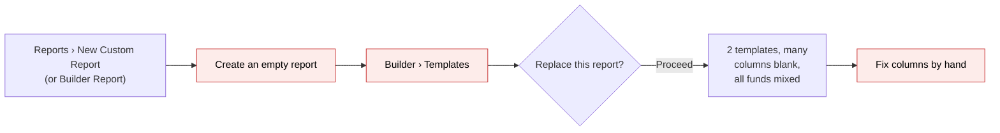
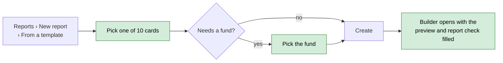
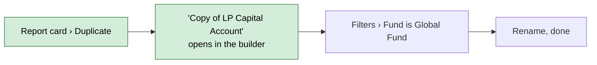
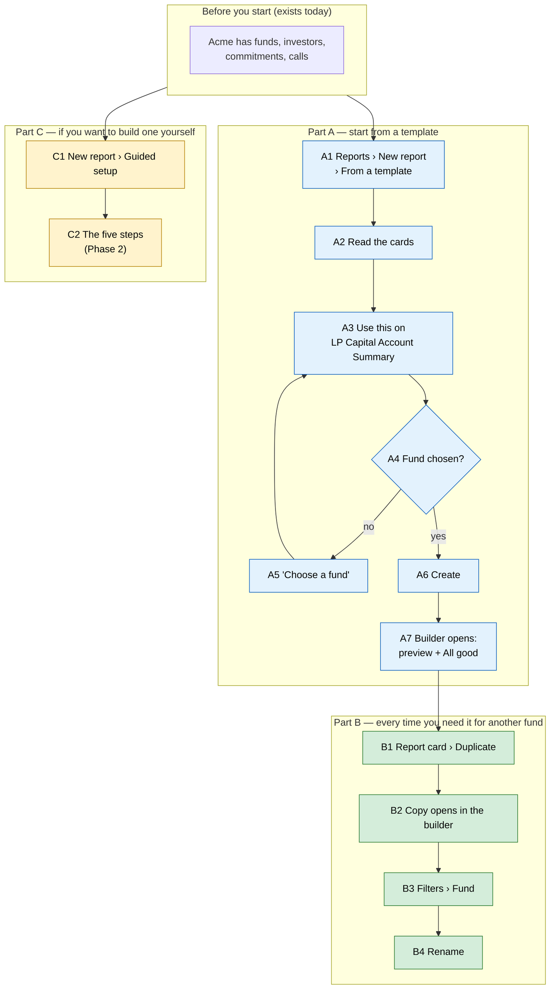

# Report Builder starting points: one New report, ten starter templates, Duplicate — Proposal

> **Audience:** Business team, product, QA, support — non-technical.
> **Companion document:** [Design](design.md) · [Business rules and worked examples](business-rules.md)
> **New to this? Start with the [Workflow Journey](#workflow-journey)** — every action, in order, from start to the outcome.

> **Planning phase — no code changes.** This document proposes and explains the change. Do not
> edit application code while writing it; implementation happens later, in the tasks phase.

Phase 3 of the [Report Builder usability plan](../../../docs/modules/reports/report_builder_usability_plan.md) (ST1–ST6, DS4). Phases 1 (trust) and 2 (live builder and guided setup) are built.

---

## Why

Starting a report is the hardest part, and today it has three doors with three names ("New Custom Report", "Builder Report", the legacy "New Report" list), two starter templates that come out mostly blank, and a **Templates** button inside the builder that silently replaces the report you are editing. People who want "the same report for another fund" rebuild it from nothing. With Phases 1 and 2 in place the builder can now produce good reports — this phase gives people a good place to start.

## What Changes

- **One "New report" button** on the Reports page with two choices: **From a template** and **Guided setup**. The old "New Custom Report" and "Builder Report" buttons go. The legacy "New Report" list of standard reports stays as it is.
- **Ten starter templates** ([list](#the-ten-templates)) on their own page, grouped by area, each card showing the question it answers, the table it starts from and what it shows off (pivot, formulas, Excel grouping). They show real CapHive work: LP capital accounts, call collection, overdue chase lists, distribution statements, portfolio MOIC, KPI matrices.
- **A fund on create.** Templates that sum money ask for a fund first, so an INR fund and a USD fund are never added together. "All funds" is offered only where the totals can't mix currencies.
- **A template always creates a new report.** **BREAKING:** the **Templates** button inside the builder is removed, together with its "replace this report" popup — applying a template can no longer wipe a report you built.
- **Duplicate** on any builder report: a "Copy of …" with the same columns, totals, filters, formulas, pivots and order, opened in the builder. This is how you make "the same report for Fund II".
- **One name everywhere:** "Report builder" for the editor and "Guided setup" for the step-by-step flow. "Advanced builder", "Custom report" and "Guided Wizard" go.
- **Templates are checked automatically.** A test applies every template and fails if any column, total, filter or formula no longer exists, naming the template and the column — so a template can't quietly go blank after a data change.

### Flow Diagram

Starting a report from a template — before:



After:



The same report for another fund — before: rebuild it by hand. After:



---

## Workflow Journey

### Who is involved

| Person | Role | What they do in the journey |
|---|---|---|
| Meera | Fund operations at Acme Capital (any user who can create reports) | Creates a report from a template, then duplicates it for another fund |
| Omar | A user of another company | Tries to open Meera's report — refused (shown under What goes wrong) |

### The journey on one page



### Before you start

| Needed | Why | Where it comes from |
|---|---|---|
| Permission to create reports | Every step creates a report | Any user of the company (as today) |
| Funds with commitments and calls | The templates report on them | Normal fund set-up |
| The Funds feature for fund templates | Templates that use funds, calls or portfolio data are listed only when the company has it | Company settings (as today) |

### Part A — start from a template

| Step | Who | Where | Action | What the system does | What you see |
|---|---|---|---|---|---|
| A1 | Meera | Reports › **New report** | Chooses **From a template** | Lists the templates her company can use | The template page, grouped: Investors, Capital calls, Distributions, Fund overview, Portfolio, Compliance |
| A2 | Meera | Template page | Reads the cards | — | Each card: name, the question it answers, "Starts from Investors", what it includes, and **Needs a fund** / **Fund optional** |
| A3 | Meera | Card *LP Capital Account Summary* › **Use this** | Opens it | — | A popup with **Report name** (filled: *LP Capital Account Summary*) and **Fund** |
| A4–A5 | Meera | Popup › **Create** without a fund | — | Refuses | "Choose a fund — this template adds up amounts" under Fund; nothing created |
| A6 | Meera | Popup | Picks **Growth Fund II**, clicks **Create** | Creates a new report: columns, totals, formulas, sort and the fund filter; named *LP Capital Account Summary — Growth Fund II* | — |
| A7 | Meera | Builder | — | Opens the builder for the new report; runs the preview and the report check | Message "Created from LP Capital Account Summary"; preview filled; badge **All good** |

### Part B — the same report for another fund

| Step | Who | Where | Action | What the system does | What you see |
|---|---|---|---|---|---|
| B1 | Meera | Reports › report card ⋮ › **Duplicate** (or the report page › **Duplicate**) | Clicks it | Copies the report: columns, labels, totals, order, related data, filters, formulas, pivots, sort and Excel settings. The email schedule is **not** copied. | — |
| B2 | Meera | Builder | — | Opens the copy | "Copy of LP Capital Account Summary — Growth Fund II"; message "Copied from LP Capital Account Summary — Growth Fund II" |
| B3 | Meera | Builder › **Filters** › capital commitments › Fund | Changes **Growth Fund II** to **Global Fund** | Saves; preview follows | Only Global Fund commitments |
| B4 | Meera | Builder › report name | Renames to *LP Capital Account Summary — Global Fund* | Saves | New name |

### Part C — build one yourself

| Step | Who | Where | Action | What the system does | What you see |
|---|---|---|---|---|---|
| C1 | Meera | Reports › **New report** › **Guided setup** | Starts the five-step setup | As built in Phase 2 | Step 1, one card per table |

### What you see

The template page (A1–A2):

```
┌ Start from a template ─────────────────────────────────────────────────────────────┐
│ Ten ready-made reports. Each creates a new report you can change.  [Search…     ]  │
│                                                                                    │
│ Investors                                                                          │
│ ┌──────────────────────────────────────┐ ┌──────────────────────────────────────┐  │
│ │ LP Capital Account Summary           │ │ LP Holdings by Unit Class            │  │
│ │ Which LPs owe us money, and how much │ │ What does each LP hold in each unit  │  │
│ │ of each commitment is called?        │ │ class?                               │  │
│ │ [Starts from Investors] [Needs a fund]│ │ [Starts from Investors] [Needs a fund]│ │
│ │ Includes: 3 formulas · sort by Unpaid│ │ Includes: pivot · totals            │  │
│ │                          [Use this]  │ │                          [Use this]  │  │
│ └──────────────────────────────────────┘ └──────────────────────────────────────┘  │
│ Capital calls   …                                                                  │
└────────────────────────────────────────────────────────────────────────────────────┘
```

The builder after A6, *LP Capital Account Summary — Growth Fund II* (Acme; amounts in ₹):

```
Stakeholder   Category  Committed      Called        Collected     Unpaid       Called %  Uncalled
Aditi Rao     LP        5,00,00,000.00 2,00,00,000.00 1,80,00,000.00 20,00,000.00  40.00    3,00,00,000.00
Kiran Mehta   LP        2,50,00,000.00 1,00,00,000.00 1,00,00,000.00       0.00    40.00    1,50,00,000.00
Nova LP       LP                 0.00           0.00           0.00        0.00     0.00             0.00
Total                   7,50,00,000.00 3,00,00,000.00 2,80,00,000.00 20,00,000.00  40.00    4,50,00,000.00
```

- Unpaid = Called − Collected: Aditi 2,00,00,000 − 1,80,00,000 = 20,00,000.
- Called % = Called ÷ Committed × 100: 2,00,00,000 ÷ 5,00,00,000 × 100 = 40.00; the totals row recalculates it, 3,00,00,000 ÷ 7,50,00,000 × 100 = 40.00. Nova has nothing committed, so 0.
- Uncalled = Committed − Called: 5,00,00,000 − 2,00,00,000 = 3,00,00,000.
- Only LPs (Category is LP), only Growth Fund II commitments; sorted by Unpaid, highest first. Zeta Holdings is a Co-Investor and isn't listed.
- City, Tags, Distributed and # Commitments are also in the report; they're left out here to fit the page.

### What goes wrong

1. **No fund chosen (A4–A5).** Meera clicks **Create** with Fund empty. The popup says "Choose a fund — this template adds up amounts" and no report is made. She picks a fund and creates it.
2. **Another company.** Omar, of another company, opens the Duplicate link of Meera's report. He is refused and nothing is copied — reports belong to their company.

### Summary: the minimum actions

| # | Action | Who | How often |
|---|---|---|---|
| 1 | New report › From a template › Use this › pick fund › Create | Meera | Once per report |
| 2 | Duplicate › change the fund › rename | Meera | Once per extra fund |

---

## User Stories

### US-1: One way to start

**As a** fund user, **I want** one New report button, **so that** I don't have to guess between buttons with different names.

**Acceptance criteria:**
- The Reports page shows one **New report** button (for users who can create reports) with **From a template** and **Guided setup**.
- "New Custom Report" and "Builder Report" are gone. The legacy **New Report** list of standard reports is unchanged.
- The step-by-step flow is called **Guided setup** everywhere (Reports card menu, builder header, page titles).

### US-2: Start from a template

**As a** fund user, **I want** ready-made reports that answer common questions, **so that** I get a useful report in a minute.

**Acceptance criteria:**
- The template page lists the templates grouped by area; each card shows its name, its question, the table it starts from, what it includes and whether it needs a fund.
- **Use this** opens a popup with the report name (filled with the template name) and, where needed, a fund.
- **Create** makes a new report and opens it in the builder with the message "Created from <template>"; the report's name gets " — <fund>" when a fund is chosen and the name wasn't changed.
- Templates that use tables of a feature the company doesn't have are not listed.

### US-3: Never mix currencies by accident

**As a** fund user, **I want** templates that add money to ask for a fund, **so that** INR and USD amounts are never summed together.

**Acceptance criteria:**
- Templates marked **Needs a fund** have no "All funds" choice and refuse to create without one.
- Templates marked **Fund optional** offer **All funds**; the report check then warns if amounts in different currencies are summed.
- The fund list shows only the company's own funds.

### US-4: Duplicate a report

**As a** fund user, **I want** to copy a report, **so that** I can make the same report for another fund without rebuilding it.

**Acceptance criteria:**
- **Duplicate** is on each builder report's card menu and on its report page.
- The copy is named "Copy of <name>" ("Copy of <name> (2)", "(3)"… if that name is taken) and opens in the builder.
- It has the same columns (labels, totals, order), related data, filters, formulas, pivots, sort, Excel grouping and display currency.
- The email schedule, its recipients and any pending Undo are not copied. The original is unchanged.

### US-5: Templates that stay correct

**As** the product team, **we want** every template checked automatically, **so that** a data change can't make a template come out blank.

**Acceptance criteria:**
- A test applies every template and fails, naming the template and the problem, if a table, related data, column, total, filter field, formula column or sort column doesn't exist.

---

## UI Behavior

### Reports page

```
┌ Reports ───────────────────────────────────────────────────────────────┐
│ [Search…]  [New Report ▾ (standard reports)]  [Filter ▾]  [New report ▾]│
│                                                     ┌──────────────────┐│
│                                                     │ From a template  ││
│                                                     │ Guided setup     ││
│                                                     └──────────────────┘│
└────────────────────────────────────────────────────────────────────────┘
```

### Use this popup

```
┌ LP Capital Account Summary ───────────────────────────────┐
│ Which LPs owe us money, and how much of each commitment   │
│ is called?                                                │
│                                                           │
│ Report name  [LP Capital Account Summary              ]   │
│ Fund         [Growth Fund II                        ▾]    │
│              This template adds up amounts, so it needs   │
│              one fund.                                    │
│                                      [Cancel] [Create]    │
└───────────────────────────────────────────────────────────┘
```

**Behavior notes:**
- The popup is a standard Bootstrap modal; nothing is created until **Create**.
- Templates without a fund show no Fund field; **Fund optional** ones list **All funds** first.
- Report card menu: **Show · Edit · Guided setup · Duplicate** (Duplicate only on builder reports). The report page header gets **Duplicate** next to **Edit Builder**.

---

## The ten templates

| # | Template | Question it answers | Starts from | Includes | Fund |
|---|---|---|---|---|---|
| 1 | LP Capital Account Summary | Which LPs owe us money, and how much of each commitment is called? | Investors | Totals from commitments, 3 formulas, sort by a formula | Needs |
| 2 | Fund Scorecard | One line per fund: raised, called, returned, invested | Funds | 4 related data, latest dates, lists | — |
| 3 | Fundraising by Close | How much did each close raise, per unit class? | Funds | Pivot on two categories | — |
| 4 | Capital Call Collection Tracker | For each call, how much is paid, pending or overdue? | Capital calls | Pivot by remittance status | Needs |
| 5 | Overdue Remittances Chase List | Who do we chase, and what have they paid so far? | Capital remittances | "Is any of" filter, money formula, Excel grouping | Needs |
| 6 | Distribution Statement by Folio | What did each folio receive, what was deducted, what's the DPI? | Capital commitments | Filter on related rows, two related data, DPI | Needs |
| 7 | LP Holdings by Unit Class | What does each LP hold in each unit class? | Investors | Pivot next to plain totals | Needs |
| 8 | Unverified KYC: Money at Stake | Which unverified KYCs hold the most committed money? | Investor KYCs | Compliance filter, sort by a related total | Optional |
| 9 | Portfolio Performance (MOIC) | What has each investment returned? | Portfolio holdings | First/last dates, Excel grouping, MOIC | Needs |
| 10 | Portfolio KPI Matrix | Each company's latest KPIs, one column per KPI | KPI reports | Latest-value pivot | — |

Full settings per template: [plan, Appendix A](../../../docs/modules/reports/report_builder_usability_plan.md#appendix-a--the-10-starter-templates).

---

## What This Feature Does NOT Cover

| Excluded | Covered In |
|---|---|
| "Describe your report" (AI assistant) as a third choice under New report | Phase 4 — it appears in the same menu then |
| Saving your own report as a template | Later; Duplicate covers "the same report again" |
| Export progress, recent exports, schedule checks, filter chips, stats cards | Phase 5 |
| The legacy standard reports (the **New Report** list) | Unchanged |
| Changing a report's starting table | Not possible today or after; start a new report |

---

## Validation Rules

| Field | Rule | Default |
|---|---|---|
| Report name (template popup) | Required; blank uses the template name | Template name (+ " — fund" when a fund is chosen) |
| Fund (template needing one) | Required; one of the company's funds | None |
| Fund (optional template) | One of the company's funds, or All funds | All funds |
| Template | One of the templates listed for the company | — |
| Duplicate name | "Copy of <name>"; " (2)", " (3)"… added while a report of the company has that name | — |

---

## Behavior Rules

| Scenario | What User Sees |
|---|---|
| Template needing a fund, Create with no fund | "Choose a fund — this template adds up amounts"; nothing created |
| Fund optional template, All funds, funds in INR and USD | Report created; report check warns "Committed adds amounts in INR and USD — pick a fund or split by fund" |
| Company without the Funds feature | Only templates that don't use fund tables are listed (KPI Matrix) |
| A template link that no longer exists | "That template isn't available"; nothing created |
| Duplicate a report with an email schedule | Copy has no schedule; the original keeps sending |
| Duplicate right after removing a column | The copy has the report as it is now; its Undo isn't carried over |
| Opening an old builder link to Templates | The Templates button is gone; the report is untouched |

---

## Resolved Design Decisions

| # | Decision | Resolution |
|---|---|---|
| 1 | Show "Describe it" before Phase 4 exists? | **No.** A disabled teaser is noise; it joins the New report menu in Phase 4. |
| 2 | Where does the blank one-page form go? | It stays reachable from Guided setup step 1 ("Open the builder instead"), with no button of its own. |
| 3 | Apply a template to an existing report? | **No** — a template always creates a new report (plan ST3). The builder's Templates button and its replace popup are removed. |
| 4 | When must a template have a fund? | Required for the 7 templates that sum money across funds; optional for KYC (warned by the report check); none for the 2 fund-level ones and KPIs (plan D6). |
| 5 | Templates stored where? | A reviewed file in the code (`config/report_builder_templates.yml`), checked by an automatic test. Not editable by users. |
| 6 | Copy the schedule on Duplicate? | **No.** A copy that starts emailing people is a surprise; schedule it on purpose. |

---

## Capabilities

### New Capabilities

- `reports/report-builder-starting-points`: the single New report entry, the template page and create-from-template with the fund picker, the template check, Duplicate, and the naming of the builder and Guided setup.

### Modified Capabilities

- `reports/report-builder-display` (from report-builder-trust): the requirement "Applying a template asks first" is removed — templates no longer apply to an existing report.

---

## Impact

- **Reports page:** the two builder buttons become one New report menu; report cards get Duplicate.
- **Report page:** gets a Duplicate button.
- **Report builder:** the Templates button and its popup go; titles say "Report builder" and "Guided setup".
- **New template page** under the report builder, and a template file reviewed in pull requests.
- **The guided setup** keeps working as built in Phase 2; only its name changes.
- **User guide:** Creating a report, templates, Duplicate, FAQs.
- No database changes, no emails, no new permissions.

---

## Benefits

1. A useful, correct report in under a minute for the ten most common questions.
2. No accidental currency mixing: money templates are always for one fund.
3. "Same report, another fund" is two clicks instead of a rebuild.
4. Templates can't silently break — the check names the problem before release.
5. One button and one vocabulary instead of three.

---

## FAQ

| Question | Answer |
|---|---|
| Who can use templates and Duplicate? | Anyone who can create reports in the company, as today. |
| What happens to reports built from the two old templates? | Nothing — they keep working. Only the way to start a new one changes. |
| Can a template change an existing report? | No. A template always makes a new report; the builder's Templates button is removed. |
| Does Duplicate send anything? | No. The schedule isn't copied and no one is notified. |
| Can we add our own templates? | Not yet. Duplicate a report you like instead; company templates may come later. |
| Does this change billing, data or emails? | No database changes, no billing, no notifications. |
| Why does a template show for one company and not another? | Templates using funds, calls or portfolio data are listed only for companies with the Funds feature. |

---

## Design Principle for the Next Phase

Keep it small and reuse Phase 2:
- **One applier for every way of filling a report.** Templates, Duplicate and (in Phase 4) the assistant all write a report through one applier, and one validator decides what's allowed. The applier must reuse the existing column catalog, default totals and formula/pivot position rows — not re-implement them.
- **The template check is the same validator**, run over every template in a test — no separate rule list.
- **Fund placement** reuses the guided setup's fund rule (root rows if they have a fund, else each related data that has one).
- **Risk:** some Appendix A columns may have been read from the plan rather than checked against the current tables. The design lists each template's columns against the catalog, and the check will catch any that are wrong.
