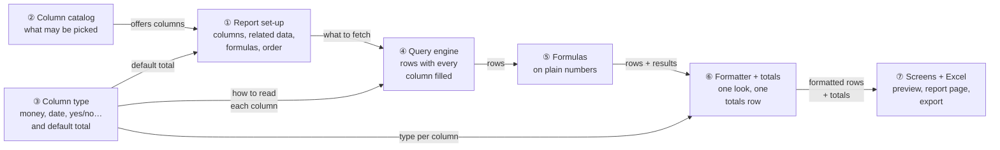
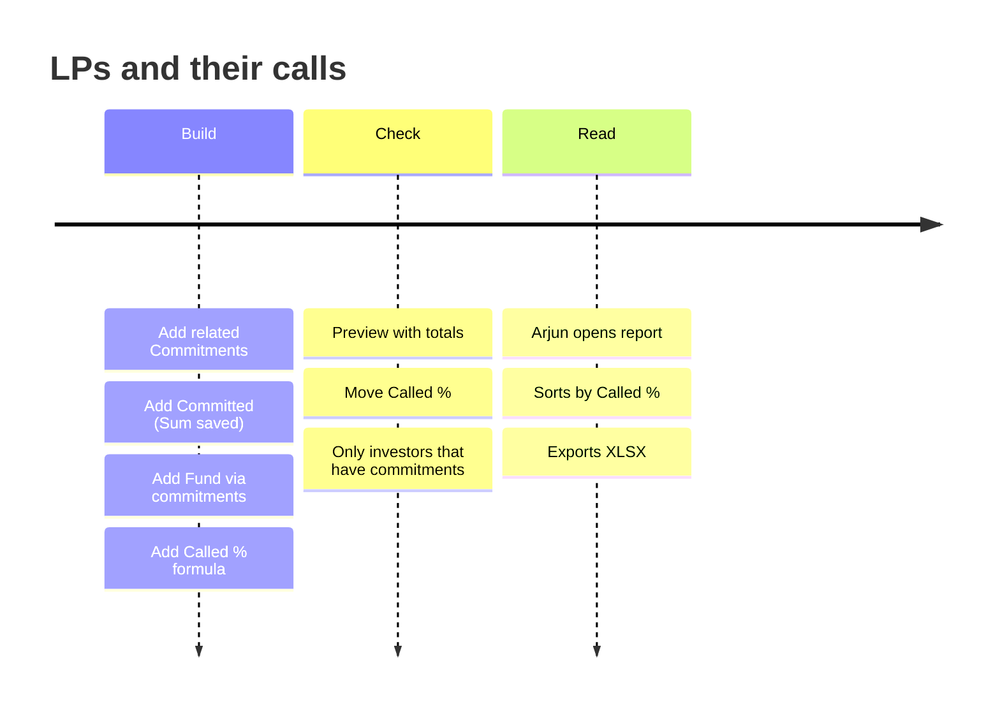
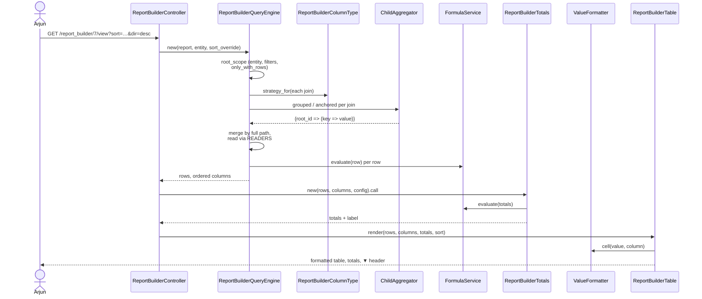
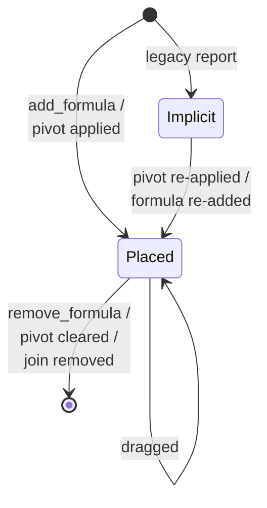
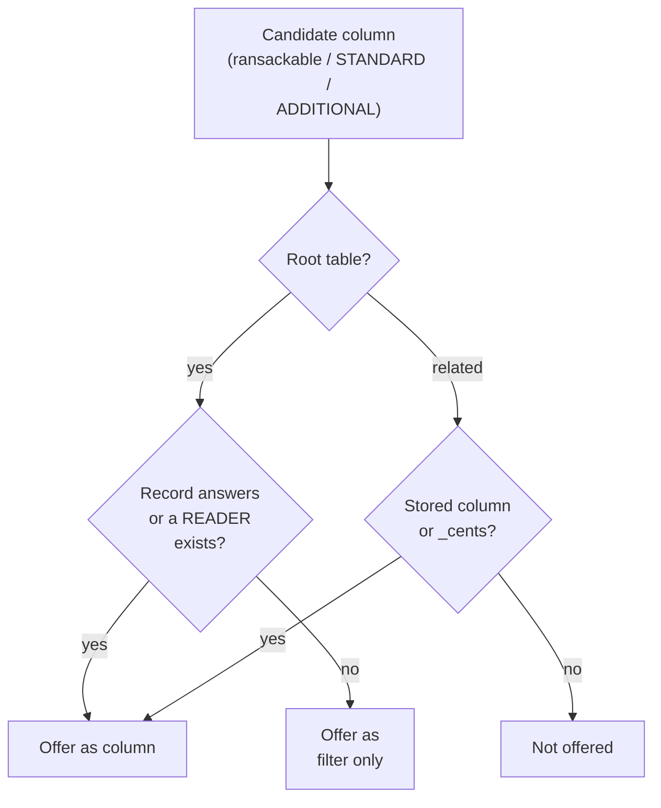
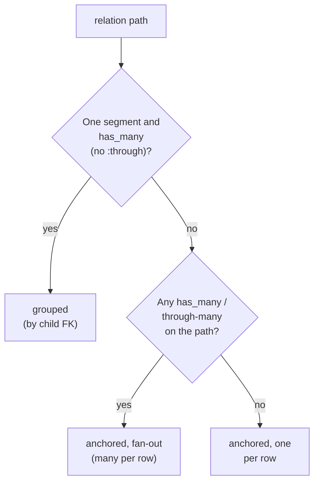
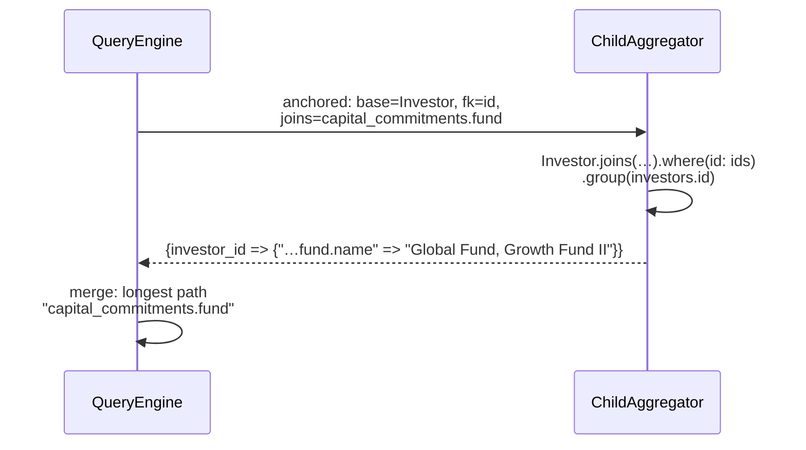
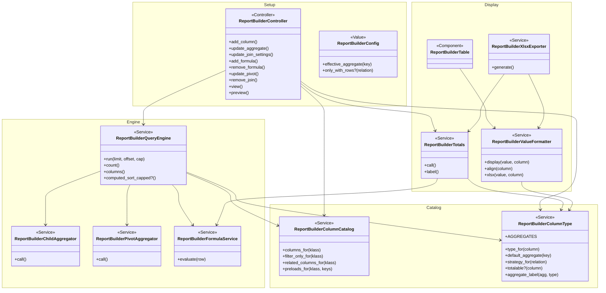

# Report Builder you can trust — Design

> **Audience:** Engineering team.
> **Companion documents:** [Proposal](proposal.md) · [Spec](specs/) · [LLD](lld.md) · [QA checklist](qa-checklist.md)
> **Plan:** Phase 1 of [report_builder_usability_plan.md](../../../docs/modules/reports/report_builder_usability_plan.md).

> **Planning phase — no code changes.** This document explains HOW the proposal will be built.

---

## Contents

- [1. The idea](#1-the-idea)
  - [What this adds](#what-this-adds)
  - [The idea in one picture](#the-idea-in-one-picture)
  - [Walkthrough: one example, start to finish](#walkthrough-one-example-start-to-finish)
  - [Key ideas](#key-ideas)
- [2. The same picture with real names](#2-the-same-picture-with-real-names)
  - [Picture](#picture)
  - [What each box does](#what-each-box-does)
  - [One run, end to end](#one-run-end-to-end)
  - [Lifecycles](#lifecycles)
  - [What users see](#what-users-see)
  - [Design decisions](#design-decisions)
- [3. One card per box](#3-one-card-per-box)
  - [① Report set-up](#-report-set-up)
  - [② Column catalog](#-column-catalog)
  - [③ Column type](#-column-type)
  - [④ Query engine](#-query-engine)
  - [⑤ Formulas](#-formulas)
  - [⑥ Formatter and totals](#-formatter-and-totals)
  - [⑦ Screens and Excel](#-screens-and-excel)
- [4. Reference](#4-reference)
  - [Class diagram](#class-diagram)
  - [Data model and schema changes](#data-model-and-schema-changes)
  - [Component contracts](#component-contracts)
  - [Notifications](#notifications)
  - [Cross-cutting concerns](#cross-cutting-concerns)
  - [Worked examples](#worked-examples)
  - [Testing](#testing)
  - [Risks and open questions](#risks-and-open-questions)

---

## 1. The idea

### What this adds

Phase 1 makes every Report Builder column return a value and look the same wherever it is shown. It fixes the existing two-pass engine (`ReportBuilderQueryEngine`: root query, then one aggregator per join) rather than replacing it. Two small new pieces carry the shared decisions: **one column-type resolver** and **one value formatter**, which today are guessed separately by the preview, the report page and the exporter. Ordering formulas and pivots reuses the existing `GridViewPreference` sequence and drag-to-reorder; the totals row reuses `ReportBuilderFormulaService`.

### The idea in one picture



| # | Box | One line |
|---|---|---|
| ① | Report set-up | The saved definition: columns in order (now including formula and pivot positions), related data, totals, filters |
| ② | Column catalog | Decides which columns can be offered for a table: readable ones as columns, filter-only ones as filters |
| ③ | Column type | Says what any column is (money, number, date, yes/no, text) and what total it gets by default |
| ④ | Query engine | Fetches the rows and fills every column, including parent, two-step and polymorphic related data |
| ⑤ | Formulas | Evaluates formulas on plain numbers, for rows and for the totals row |
| ⑥ | Formatter + totals | Turns values into what people see, and works out the totals row |
| ⑦ | Screens + Excel | Preview, report page, Excel, Reports list link, save messages, template popup |

### Walkthrough: one example, start to finish

**Setup.** Meera (fund ops) builds "LPs and their calls" on Acme Capital (see [shared setup](#worked-examples)). Commitments are limited to Growth Fund II with a related filter.

**Legend:** ✓ done · ● we are here, not done yet · ○ not started.



**Phase 1 — Build**

| # | When | What happens | Behind the scenes | Result&nbsp;&nbsp;&nbsp;&nbsp;&nbsp;&nbsp;&nbsp;&nbsp;&nbsp;&nbsp;&nbsp;&nbsp;&nbsp;&nbsp;&nbsp;&nbsp; |
|---|---|---|---|---|
| 1 | 10:00 | Meera adds Committed from capital commitments | The column catalog (②) allows `capital_commitments.committed_amount`; the column type (③) says *money*, so the report set-up (①) saves the total **sum** | **●&nbsp;Add&nbsp;columns**<br>○&nbsp;Add&nbsp;related&nbsp;fund<br>○&nbsp;Add&nbsp;formula<br>○&nbsp;Check&nbsp;preview |
| 2 | 10:02 | Adds Fund through commitments | The query engine (④) treats `capital_commitments.fund` as a *two-step* join anchored on investors; the column type (③) gives text in a two-step join the default **list** | ✓&nbsp;Add&nbsp;columns<br>**●&nbsp;Add&nbsp;related&nbsp;fund**<br>○&nbsp;Add&nbsp;formula<br>○&nbsp;Check&nbsp;preview |
| 3 | 10:04 | Adds formula Called % | The report set-up (①) appends a `formula:` placeholder row at the end of the column order | ✓&nbsp;Add&nbsp;columns<br>✓&nbsp;Add&nbsp;related&nbsp;fund<br>**●&nbsp;Add&nbsp;formula**<br>○&nbsp;Check&nbsp;preview |
| 4 | 10:05 | **Mistake:** she drags Called % to the very first column, then drags it back after Called | Same drag-and-sequence mechanism as other columns; nothing else changes | Same as row 3 |

**Phase 2 — Check**

| # | When | What happens | Behind the scenes | Result&nbsp;&nbsp;&nbsp;&nbsp;&nbsp;&nbsp;&nbsp;&nbsp;&nbsp;&nbsp;&nbsp;&nbsp;&nbsp;&nbsp;&nbsp;&nbsp; |
|---|---|---|---|---|
| 5 | 10:06 | Refreshes the preview | The query engine (④) returns rows; formulas (⑤) evaluate on plain numbers; the formatter (⑥) formats and builds "Total" | ✓&nbsp;Add&nbsp;columns<br>✓&nbsp;Add&nbsp;related&nbsp;fund<br>✓&nbsp;Add&nbsp;formula<br>**●&nbsp;Check&nbsp;preview** |
| 6 | 10:07 | Sees Nova LP with zeros; turns on **Only investors that have commitments** | The report set-up (①) saves `only_with_rows`; the query engine (④) restricts root rows to those with matching commitments | Same as row 5; preview now "All 3 rows" |
| 7 | 10:08 | **Stall:** her session has expired when she changes the sort | The screen (⑦) gets a non-2xx response and shows a red message; the dropdown reverts | Same as row 5 |
| 8 | 10:10 | Signs in again, changes the sort | Saved; green message | ✓&nbsp;Add&nbsp;columns<br>✓&nbsp;Add&nbsp;related&nbsp;fund<br>✓&nbsp;Add&nbsp;formula<br>✓&nbsp;Check&nbsp;preview |

**Phase 3 — Read**

| # | When | What happens | Behind the scenes | Result |
|---|---|---|---|---|
| 9 | 11:00 | Arjun clicks the report's name on the Reports list | The Reports list (⑦) links to `view_report_builder_path` | Report page |
| 10 | 11:01 | Clicks *Called %* twice | `?sort=formula_…&dir=desc` is passed to the query engine (④), which uses its in-memory sort | Sorted, ▼ on the header |
| 11 | 11:02 | Exports | The exporter (⑦) uses the formatter (⑥) for real number/date cells and a bold last totals row | Excel file |

Snapshot at row 5:

```
Preview · All 4 rows                                        [Refresh Preview]
 Stakeholder   │ Category │ Fund           │   Committed │      Called │ Called %
 Aditi Rao     │ LP       │ Growth Fund II │ 5,00,00,000 │ 2,00,00,000 │    40.00
 Kiran Mehta   │ LP       │ Growth Fund II │ 2,50,00,000 │ 1,00,00,000 │    40.00
 Zeta Holdings │ Co-Inv.  │ Growth Fund II │ 1,00,00,000 │   40,00,000 │    40.00
 Nova LP       │ LP       │                │        0.00 │        0.00 │
 Total         │          │                │ 8,50,00,000 │ 3,40,00,000 │    40.00
```

**What to notice**

- The default total was decided once, by the column type (③), and *saved*, so the wizard, builder and engine agree.
- Two-step related data needed no new engine: it's the existing aggregator anchored on the root rows.
- The formula's position is an ordinary column-order row, so the drag "mistake" and its fix needed nothing new.
- Totals recompute Called % from the total columns: 3,40,00,000 ÷ 8,50,00,000 × 100 = 40.00.
- The failed save was visible, and the control went back to the truth.

### Key ideas

| # | Idea | In one line | Card |
|---|---|---|---|
| 1 | One type resolver | Every "what is this column" question (default total, format, alignment, Excel cell, totalable) asks ③ | [③](#-column-type) |
| 2 | Two join strategies | *Grouped by child* for first-level has-many (today's path); *anchored on root rows* for parents, one-to-one, through and two-step | [④](#-query-engine) |
| 3 | Placeholders for order | Formula and pivot positions are `GridViewPreference` rows with `formula:`/`pivot:` keys, expanded by the engine | [①](#-report-set-up) |
| 4 | Plain-text readers for decorator-only columns | Root columns the grids show through a Draper decorator are read by a small `READERS` map in ② that mirrors the decorator as plain text, with preloads | [②](#-column-catalog) |
| 5 | One formatter, totals recomputed | Preview, report page and Excel use ⑥; formulas in the totals row are re-evaluated | [⑥](#-formatter-and-totals) |

**FAQ**

| Question | Answer |
|---|---|
| Is this a rewrite of the engine? | No. Pass 1 / pass 2 / merge stay. Pass 2 gains a second strategy (anchored) built from the same `ReportBuilderChildAggregator`, and merge looks up results by full relation path. |
| Do saved reports need migrating? | No. Old reports work as before; columns that were blank start filling, related columns without a stored total get the type default at run time, and reports without placeholders keep formulas and pivots last. |
| Why not fix "Investing Entity" etc. in the models? | Those values deliberately live on decorators for the grids. A Report Builder reader map gives the same text with no model change. (Calling the decorators themselves was tried during apply and rejected: they return HTML links and some need `current_user`, which a background export doesn't have.) |

---

## 2. The same picture with real names

### Picture

```mermaid
flowchart LR
    classDef new fill:#d4edda,stroke:#2e7d32,color:#000
    classDef mod fill:#fff3cd,stroke:#b8860b,color:#000
    classDef reuse fill:#eceff1,stroke:#90a4ae,color:#000
    S["① Report#template +<br/>GridViewPreference<br/>ReportBuilderController<br/><i>stores the definition</i>"]:::mod
    C["② ReportBuilderColumnCatalog<br/><i>offers readable columns</i>"]:::new
    T["③ ReportBuilderColumnType<br/><i>type + default total</i>"]:::new
    E["④ ReportBuilderQueryEngine<br/>ChildAggregator · PivotAggregator<br/><i>fills every column</i>"]:::mod
    F["⑤ ReportBuilderFormulaService<br/><i>plain-number formulas</i>"]:::mod
    O["⑥ ReportBuilderValueFormatter<br/>ReportBuilderTotals<br/><i>display + totals row</i>"]:::new
    V["⑦ _preview_table · ReportBuilderTable<br/>ReportBuilderXlsxExporter · reports/_card<br/>edit · wizard/aggregates · JS<br/><i>shows and exports</i>"]:::mod
    C -- "columns_for(klass)<br/>related_columns_for" --> S
    T -- "default_aggregate" --> S
    S -- "template + GVPs" --> E
    T -- "strategy, type" --> E
    E -- "rows: Hash" --> F
    F -- "rows + formula keys" --> O
    T -- "type_for(column)" --> O
    O -- "cells + totals Hash" --> V
    click S "#-report-set-up" "Open card ①"
    click C "#-column-catalog" "Open card ②"
    click T "#-column-type" "Open card ③"
    click E "#-query-engine" "Open card ④"
    click F "#-formulas" "Open card ⑤"
    click O "#-formatter-and-totals" "Open card ⑥"
    click V "#-screens-and-excel" "Open card ⑦"
```



Colour = footprint: **green** new, **amber** modified, **grey** reused unchanged. Exact files are in [lld.md File Map](lld.md#file-map).

### What each box does

| # | Box | Real parts | What it does | When it runs | What it decides | Details |
|---|---|---|---|---|---|---|
| ① | Report set-up | `Report#template` (JSON), `GridViewPreference`, `ReportBuilderController` actions `add_column`, `update_aggregate`, `add_formula`, `remove_formula`, `update_pivot`, `remove_join`, new `update_join_settings` | Saves columns, totals, placeholders and join settings | Request | Which total is stored; placeholder lifecycle; allowed totals | [card ①](#-report-set-up) |
| ② | Column catalog | `ReportBuilderColumnCatalog` (extracted from `ReportBuilderController#columns_for_model`) | Lists columns per table: readable, filter-only, related (stored fields only) | Request | Is a column offered as a column, a filter, or not at all | [card ②](#-column-catalog) |
| ③ | Column type | `ReportBuilderColumnType` | Resolves type for any key (root, joined, two-step, pivot, formula) and the join strategy for a relation | Request / job | Default total; totalable; one-per-row vs many | [card ③](#-column-type) |
| ④ | Query engine | `ReportBuilderQueryEngine`, `ReportBuilderChildAggregator`, `ReportBuilderPivotAggregator`, `ReportBuilderDynamicColumn` | Root rows, related values, merge, order, sort | Request / export job | Strategy per join; which root rows (only-with-rows); column order | [card ④](#-query-engine) |
| ⑤ | Formulas | `ReportBuilderFormulaService` | Evaluates formulas per row and on totals | Request / job | Money → BigDecimal; errors → nil | [card ⑤](#-formulas) |
| ⑥ | Formatter + totals | `ReportBuilderValueFormatter`, `ReportBuilderTotals` | Display string, alignment, Excel value + format; totals row + label | Request / job | Format per type; which columns total | [card ⑥](#-formatter-and-totals) |
| ⑦ | Screens + Excel | `report_builder/_preview_table`, `ReportBuilderTable` component, `ReportBuilderXlsxExporter`, `reports/_card`, `report_builder/edit`, `wizard/aggregates`, `report_builder_controller.js` | Renders, sorts by header, exports, links, save feedback, template popup | Request / browser / job | Header sort param; success vs error toast | [card ⑦](#-screens-and-excel) |

### One run, end to end



### Lifecycles

**Formula / pivot placeholder** (stored as a `GridViewPreference` row):



| State | Stored? | Meaning |
|---|---|---|
| Placed | Stored (`grid_view_preferences` row, key `formula:<key>` or `pivot:<relation>`) | Column takes this position in the order |
| Implicit | Derived (no row) | Legacy report: the engine appends pivots, then formulas, after all other columns (today's order) |

No other statuses are added.

### What users see

| Where in CapHive | Today | After this change | Who sees it |
|---|---|---|---|
| Reports list › report name | Opens the builder | Opens the report page | Everyone who can see the report |
| Report page | Raw values; no totals; static headers | Formatted; totals row; sortable headers | Readers |
| Builder preview | Raw values; "up to 50 rows" | Formatted; totals row; "20 of N rows" | Builders |
| Builder › related data card | Pivot settings only | + "Only … that have …" switch | Builders |
| Builder › save messages | Always green | Green on success, red on failure | Builders |
| Builder › Apply Template | Applies straight away | Immediate Actions popup first | Builders |
| Wizard › Summarize | Shows "Sum", stores nothing | Shows and stores the real total | Builders |
| Excel export | Text dates; Totals sheet | Date and number cells; bold last-row totals | Readers, schedule recipients |

Main journey (report page):

```
┌ LPs and their calls ─────────────────────────────── ①[Edit] [Export XLSX] ┐
│ ②Stakeholder ↕ │ Committed ▼ │ Called ↕ │ Called % ↕                         │
│  Aditi Rao     │ 5,00,00,000 │ 2,00,00,000 │ 40.00                           │
│  …                                                                         │
│ ③Total         │ 8,50,00,000 │ 3,40,00,000 │ 40.00                           │
│ ④Showing 3 of 3 records.                                                   │
└────────────────────────────────────────────────────────────────────────────┘
```

| Step | The user… | They see |
|---|---|---|
| ① | arrives from the Reports list | The report page with Edit and Export as outline buttons |
| ② | clicks a header | Rows re-sorted; arrow on that header |
| ③ | reads the totals | "Total" or "Total (this page)" |
| ④ | changes page | Sort kept |

### Design decisions

1. **Anchored strategy reuses `ReportBuilderChildAggregator`.** For parents, one-to-one, through and multi-step paths, the aggregator is run with `base_class` = the root class, `fk` = `id` and `joins` = the relation path, grouping by the root id. Alternative considered: a new `ParentAggregator`. Rejected because the SQL is the same GROUP BY with a JOIN; a second class would duplicate column validation, money handling and `latest`.
2. **First-level has-many keeps the grouped-by-child path.** Its related filters are Ransack conditions on the child class, and existing reports rely on that. Rejected moving it to anchored, which would change filter semantics and outer-join behaviour for every saved report.
3. **Placeholder rows for order.** Formula and pivot positions are `GridViewPreference` rows. Alternative: a `position` attribute in the template JSON. Rejected because it needs a second ordering UI and merge logic, while drag-to-reorder (`draggable-row` → `update_column_sequence`) already works on GVPs.
4. **Plain-text readers in the catalog, not model changes or decorator calls.** Alternatives: add `entity_name`, `investing_entity_name` etc. to models (rejected: touches several existing models for a Report Builder concern, plan §8); call the Draper decorators (rejected during apply: they return `link_to` HTML and `AggregatePortfolioInvestmentDecorator` reads `h.current_user`, which doesn't exist in `ReportBuilderExportJob`).
5. **Totals on screen are for the rows shown, labelled.** Alternative: whole-report totals on every page view. Rejected: needs an unpaginated engine run (or a second SQL path per aggregate and formula) on every view; Excel already has all rows.
6. **Formulas in the totals row are re-evaluated**, using the same `ReportBuilderFormulaService`. Alternative: sum the formula column. Rejected: wrong for ratios.
7. **Defaults stored and applied.** `add_column` stores the default; `ReportBuilderConfig#effective_aggregate` applies it when nothing is stored. Alternative: store only, plus a data migration. Rejected: a migration over every report's JSON for a value that can be derived.
8. **"Any yes" / "All yes" are labels, not new totals.** Boolean `max`/`min` display as "Any yes"/"All yes"; stored values stay in the existing list. Alternative: new aggregate keys. Rejected: more SQL branches for no gain.
9. **Excel totals become the last row.** Alternative: keep the Totals sheet. Rejected: two places for the same numbers, and the sheet ignored formulas.

**FAQ**

| Question | Answer |
|---|---|
| Why not anchor every join and drop the grouped path? | It would change how related filters work for every saved report and how zero rows are treated. Grouped stays for first-level has-many; anchored covers what grouped can't do. |
| What if someone drags a placeholder on a legacy report? | Legacy reports have no placeholder rows until a formula is added or a pivot applied again; from then on the new row is placed. The engine always appends any formula or pivot without a placeholder after the placed ones, so nothing disappears. |
| Do the readers cost queries? | They can (e.g. `investing_entity_name` loads the KYC). Each reader declares its preload; see [②](#-column-catalog) and [Performance](#performance-and-security). |

---

## 3. One card per box

### ① Report set-up

The saved definition (`Report#template` JSON + `GridViewPreference` rows) and the controller actions that change it.

| Owns | Reads / receives | Produces |
|---|---|---|
| Stored totals, placeholder rows, `only_with_rows` per join, allowed-total validation | Column offers (②), default totals (③), user requests | `template` JSON and ordered GVP rows for the engine (④) |

**Template additions** (JSON, no schema change):

| Key | Where | Values | Meaning |
|---|---|---|---|
| `joins[].only_with_rows` | per join | `true` / absent | Restrict root rows to those with ≥1 matching related row (first-level has-many only) |
| `include_zero_rows` | per join | ignored | Left in old JSON, never read (as today) |

**Placeholder GVP rows:**

| Key | Created by | Removed by | Label |
|---|---|---|---|
| `formula:<formula key>` | `add_formula` | `remove_formula` | the formula label |
| `pivot:<relation>` | `update_pivot` (activate) | `update_pivot` (clear), `remove_join` | "<relation label> (pivot)" |

**Actions**

| Verb and path | Action | Does | Responds with |
|---|---|---|---|
| `POST /report_builder/:id/columns` | `add_column` (changed) | After creating the GVP, if the key is on a many-per-row join and no total is stored, stores `ReportBuilderColumnType#default_aggregate` | redirect back (unchanged) |
| `PATCH /report_builder/:id/aggregate` | `update_aggregate` (changed) | Refuses any total not in `ReportBuilderColumnType::AGGREGATES` | JSON 422 / HTML redirect with alert |
| `POST /report_builder/:id/formulas` | `add_formula` (changed) | + placeholder at `max(sequence)+1` | unchanged |
| `DELETE /report_builder/:id/formulas/:key` | `remove_formula` (changed) | + deletes placeholder | unchanged |
| `PATCH /report_builder/:id/pivot` | `update_pivot` (changed) | + creates / deletes the pivot placeholder | unchanged |
| `DELETE /report_builder/:id/join` | `remove_join` (changed) | + deletes `pivot:<relation>` and also related keys of deeper paths starting with `<relation>.` | unchanged |
| `PATCH /report_builder/:id/join_settings` | `update_join_settings` (new) | Sets/clears `only_with_rows` on one join; refuses one-per-row joins | JSON `{ok: true}` / 422 |

Access: every action keeps `authorize @report, :update?` (entity scoping via `ReportPolicy#belongs_to_entity?`).

**Worked examples:** H7, H10, H11, E3, E7, E8, E9, E10, X2, X8, X9

**FAQ**

| Question | Answer |
|---|---|
| Why not save `only_with_rows` through `update_template`? | Its deep merge replaces the whole `joins` array (the filter JS rebuilds it from the DOM). A small action that edits one join is safer. |
| Do placeholder keys confuse other GVP consumers? | `column_key_allowed?` isn't called for them (created server-side). Aggregators only take keys starting with `<relation>.`. The sort dropdown lists formula placeholders (sorting by formula already works) and skips pivot placeholders. |

### ② Column catalog

Decides which columns a table offers, extracted from `ReportBuilderController#columns_for_model` so the controller, wizard and drift guard share it.

| Owns | Reads / receives | Produces |
|---|---|---|
| Offer rules; `READERS` (plain-text reader + preload per decorator-only column) | `ransackable_attributes`, `STANDARD_COLUMNS`, `ADDITIONAL_COLUMNS`, `column_names`, a blank instance | `columns_for`, `filter_only_for`, `filter_columns_for`, `related_columns_for`, `preloads_for`, `read(record, key)` |



| Rule | Example |
|---|---|
| Root column the record answers | `committed_amount` |
| Root column only a grid decorator answers → column via a `READERS` entry, with preload | `investing_entity_name` (KYC full name, else investor name; preload `:investor_kyc`), `investor_kyc_full_name` (`:investor_kyc`), `investment_instrument_name` (`:investment_instrument`), KPI `entity_name` (portfolio company, else entity; `[:portfolio_company, :entity]`) and `user_name` (`:user`), KYC `expired` (`expired?`) |
| Root ransacker with no reader → filter only | `carry`, `units_amount_minus_collected`, `foreign_currency_commitment`, `tracking_committed_amount`, Document `capital_call_id`… |
| Related column must be stored (or `_cents`) | `capital_commitments.investor_kyc_full_name` not offered |

`column_key_allowed?` (the existing gate for `add_column`) asks the catalog, so a key outside it is refused as today.

**Worked examples:** H6, E12, E13, E14

**FAQ**

| Question | Answer |
|---|---|
| Why probe a blank instance? | `respond_to?` on `klass.new` tells attributes and methods from ransackers without touching data; it is cached per class. |
| What about the `_id` / `_cents` clean-up from the plan? | Phase 2 (column picker). Phase 1 only removes what can never show a value. |

### ③ Column type

One resolver for "what is this column".

| Owns | Reads / receives | Produces |
|---|---|---|
| `AGGREGATES` list, type rules, default-total rules, strategy rules | Root class, relation paths, `columns_hash`, `_cents` columns, the config's aggregates and pivots | `type_for(column)`, `default_aggregate(key)`, `strategy_for(relation)`, `totalable?(column)`, `aggregate_label(agg, type)` |

**Strategy per relation**



**Type and default total**

| Base type (from stored column) | grouped default | anchored fan-out default | one-per-row |
|---|---|---|---|
| money (`_cents`) / number | `sum` | `sum` | value (no total) |
| date / datetime | `max` ("Latest date") | `max` | value |
| boolean | `max` ("Any yes") | `max` | value |
| text / other | `latest` | `list` (`latest` isn't offered for fan-out) | value |

**Type after the total:** `count` → number; `list` → text; `avg`/`sum` keep base; `min`/`max`/`latest` keep base (so booleans stay yes/no). Pivot columns take the type of `value_col` after the pivot's aggregate. Formula columns → number. Root method-only columns → `unknown` (the formatter falls back to the value's class).

**Totalable:** type money/number **and** (root column, or total `sum`/`count`, or pivot `sum`/`count`). Formula columns are recomputed, not summed.

**Worked examples:** H7, E2, E3, E4, E5, E28, X6

**FAQ**

| Question | Answer |
|---|---|
| Why does fan-out text default to `list`, not `latest`? | "Latest" needs the newest row per root, which the anchored GROUP BY can't pick cheaply across a join chain; `list` (distinct values) is what people want for "which funds". |
| Isn't `sum` on a fan-out path a double count? | It sums each linked row once per path; for investor → commitments → fund units that's correct. For values that repeat per path (a fund's own totals reached via commitments) it overcounts, so the catalog only offers stored columns of the *last* table and the [risk](#risks-and-open-questions) is noted for Phase 2's health check. |
| Why keep `wizard_type_icon_for`? | It becomes a thin wrapper over `type_for` (one source). |

### ④ Query engine

Today's two passes, with the fixes.

| Owns | Reads / receives | Produces |
|---|---|---|
| Root scope (entity + filters + only-with-rows), strategies, merge, reader-based root reads, order expansion, sort override | Template + GVPs (①), strategy and types (③), preloads (②) | Ordered columns and `Array<Hash>` rows |

**Pass 2 per join**

| Strategy | Aggregator call | Groups by | Related filters | Polymorphic |
|---|---|---|---|---|
| grouped | `ChildAggregator(base_class: child, fk: reflection.foreign_key, joins: nil)` | child FK | Ransack on the child (as today) | adds `reflection.type = root.polymorphic_name` (EN3) |
| anchored (fan-out / one-per-row) | `ChildAggregator(base_class: root_class, fk: "id", joins: relation path)` | root `id` | not offered | n/a (join conditions come from AR) |

- **`bare_col` (two-step fix, EN7):** strip only the first segment for grouped deep keys; for anchored keys the column path is the whole key, resolved by the existing `db_col` reflection walk.
- **Merge (EN7):** a dotted key's results are looked up under the *longest configured relation path* that prefixes it (not the first segment).
- **Pivot (EN4):** `ReportBuilderDynamicColumn` label becomes `"<relation label> · <value> (<agg>)"`.
- **Root columns (EN10):** read with `ReportBuilderColumnCatalog.read` (the record's own attribute/method, else its `READERS` entry); preloads from ② are applied to the root scope when such columns are present.
- **Only with rows (EN6):** `root_scope` adds `id IN (child scope with related filters).select(fk)` for each join with `only_with_rows`; `count` uses the same `root_scope`.
- **Order (EN5):** `columns` walks GVPs by sequence; `formula:` rows become formula columns, `pivot:` rows become that pivot's dynamic columns; unplaced pivots, then unplaced formulas, are appended (today's order).
- **Default totals at run (EN8):** aggregates passed to aggregators use `ReportBuilderConfig#effective_aggregate`.
- **Sort override (RD4):** `sort_override: {key:, dir:}` is accepted only when `key` matches an output column; it replaces `config.sort` for this run. The existing computed-sort path (cap 20,000) is reused; `computed_sort_capped?` tells ⑦ to show the note.



**Worked examples:** H1, H2, H3, H4, H5, H6, H12, H13, H14, H20, E1, E11, E22, E23, E28, X1, X4

**FAQ**

| Question | Answer |
|---|---|
| Why no related filters on anchored joins? | A filter there would be a Ransack condition on the root through the association, which changes which root rows appear, not which related rows are combined. Root filters can already do that. |
| What does a missing parent produce? | The anchored join is an INNER JOIN, so the root id is absent from the result and merge yields `nil` → blank cell (E1). |
| Does only-with-rows slow the root query? | One `IN (subquery)` on an indexed FK per enabled join; the subquery is scoped by the related filters and the root ids' entity. |

### ⑤ Formulas

| Owns | Reads / receives | Produces |
|---|---|---|
| Expression evaluation | A row (or the totals hash) | The row with formula keys filled |

- Before evaluation, `Money` values become `BigDecimal` (`to_d`); everything else is unchanged.
- Any evaluation error (division by zero, bad syntax) gives `nil` for that formula on that row, as today; later formulas can use the result.
- `ReportBuilderTotals` calls the same `evaluate` with the totals hash.

**Worked examples:** H8, H9, H18, E6, E31, X7

**FAQ**

| Question | Answer |
|---|---|
| Will existing formulas change? | Only those over root money columns: `₹250.00` becomes `250.00`, and `ROUND` stops failing. |

### ⑥ Formatter and totals

`ReportBuilderValueFormatter` turns a value plus its column into what is displayed (HTML) or written (Excel). `ReportBuilderTotals` builds the totals row.

| Owns | Reads / receives | Produces |
|---|---|---|
| Display rules per type; totals rules and label | Value, column, `type_for` (③), config currency | `display(value, column)`, `align(column)`, `xlsx(value, column) → [value, format_code]`; totals `{key => value}` + label |

| Type | Screen | Excel |
|---|---|---|
| money | `number_with_precision(…, precision: 2, delimiter: ",")`, currency prefix if `config.currency_symbol` and monetized, right | numeric cell, `#,##0.00` (or `"₹"#,##0.00`) |
| number | same without currency, right | numeric, `#,##0.00` |
| date / datetime | `l(value)` (screen format per locale) | date cell, `dd-mmm-yyyy` / `dd-mmm-yyyy hh:mm` |
| boolean | Yes / No (1/0, true/false, "1"/"0") | "Yes" / "No" |
| text | as is | as is |
| unknown | by value class: Money/Numeric → number rules; Date/Time → date; true/false → Yes/No; else text | same |

**Totals:** sum each totalable column (nil → 0), then `FormulaService#evaluate` over the totals hash for formula keys. Label: `:all` → "Total", `:page` → "Total (this page)", `:sample` → "Total (these N rows)". No totalable column → no row.

**Worked examples:** H15, H16, H17, H18, H19, E15, E16, E17, E18, E19, E20, E30, E31, X6

**FAQ**

| Question | Answer |
|---|---|
| Why a PORO and not a helper? | The exporter runs in a job without a view context; the formatter uses `ActiveSupport::NumberHelper` and `I18n.l` directly, so both views and the job call it. |
| Which locale for Excel dates? | Excel shows dates by cell format, so the value is a real date; the format code is fixed (`dd-mmm-yyyy`, as today). |

### ⑦ Screens and Excel

| Owns | Reads / receives | Produces |
|---|---|---|
| Markup, header sort links, toasts, popups, Excel layout | Rows, ordered columns, totals (⑥), `computed_sort_capped?` (④) | Pages and the XLSX file |

| Part | Change |
|---|---|
| `reports/_card.html.erb:8` | Builder report name → `view_report_builder_path`; Edit stays |
| `ReportBuilderTable` (+ `.html.erb`) | Cells via ⑥; right-aligned numbers; header links `?sort=&dir=` keeping `q` and `page`; arrows ↕/▲/▼; totals `<tfoot>`; capped-sort note |
| `ReportBuilderController#view` | Reads `sort`/`dir`, passes `sort_override`; builds totals with label `:all` or `:page` |
| `ReportBuilderController#preview` + `_preview_table` | `PREVIEW_LIMIT = 20`; cells via ⑥; totals with `:all` / `:sample`; "N of M rows" / "All N rows" |
| `edit.html.erb` | Preview copy says 20; "Only … that have …" switch on grouped join cards; Apply Template uses `confirm#popup` with action-summary cards (`ReportBuilderHelper#apply_template_summary`, modelled on `DocChecksHelper#doc_check_action_summary`) |
| `wizard/aggregates.html.erb` | Select shows `effective_aggregate`; labels via `aggregate_label` (Any yes / Latest date) |
| `report_builder_controller.js` | `_patch` rejects on non-2xx with the server message; callers show red toast and restore `data-saved-value`; new `toggleOnlyWithRows` |
| `ReportBuilderXlsxExporter` | Values and formats via ⑥; bold totals as the last row; `add_totals_sheet` removed |

Build notes: the toast stays Bootstrap (`text-bg-success` / `text-bg-danger`); the popup is the shared `#confirmModal` filled through `data-msg` (escaped HTML via `tag`/`safe_join`).

**Worked examples:** H19, H20, H21, H22, H23, H24, H25, H26, E18, E20, E21, E22, E23, E24, E25, E26, X3, X5

**FAQ**

| Question | Answer |
|---|---|
| Why keep header sort out of the saved report? | Readers sorting shouldn't change the report for others; the builder still sets the saved sort. |
| Does the preview get header sorting too? | No. The builder's sort control already sets the saved sort. |

---

## 4. Reference

### Class diagram



### Data model and schema changes

N/A — no tables or columns change. New settings live in `reports.template` (JSON) and placeholders are ordinary `grid_view_preferences` rows (see [card ①](#-report-set-up)).

**Changes to existing models:** none. (`KpiReport::STANDARD_COLUMNS` is *not* changed: "For" is read through `KpiReportDecorator#entity_name`.)

### Component contracts

| From → To | Contract | Direction rule |
|---|---|---|
| ② → ① | `columns_for(klass)` / `related_columns_for(klass)` → `[{key, raw_key, label}]`; `column_key_allowed?` asks ② | ① never offers a column ② didn't |
| ③ → ① | `default_aggregate(key)` → one of `AGGREGATES` or `nil` (one-per-row) | Only ③ decides defaults |
| ① → ④ | `Report#template` + GVP rows ordered by `sequence, id` | ④ never writes ① |
| ③ → ④ | `strategy_for(relation)` → `:grouped` / `:anchored_many` / `:anchored_one`; `type_for` | ④ never infers strategy itself |
| ④ → ⑤ | Row `Hash` keyed by raw column key | ⑤ only adds formula keys |
| ⑤ → ⑥ | Rows with formula results; `evaluate(totals)` | ⑥ calls ⑤ for totals, never re-implements |
| ③ → ⑥ | `type_for(column)`, `totalable?(column)` | ⑥ never inspects keys for `amount`/`num-col` |
| ⑥ → ⑦ | `display`/`align`/`xlsx`; totals `{key => value}` + `label` | ⑦ never formats values itself |

### Notifications

Nothing is sent, added, changed or suppressed:

- **Internal users:** the export-ready and export-failed `UserAlert`s (from `ReportBuilderExportJob`) are unchanged; the scheduled report email (`ReportMailer.scheduled_report`) is unchanged except that its attached file uses the new Excel layout.
- **Investors:** Report Builder has no investor-facing screens or notifications; schedule recipients get the same email as before.

| Notification | Trigger | Recipients | Channel | Customisable | Default | Sent once? |
|---|---|---|---|---|---|---|
| — (none new or changed) | — | — | — | — | — | — |

### Cross-cutting concerns

#### Transactions and queries

- **Only-with-rows:** one `IN (SELECT fk …)` per enabled join, applied in `root_scope` so `count` and `run` agree.
- **Anchored joins:** one GROUP BY query per anchored join over the page's root ids (same shape as the grouped path).
- **Decorator columns:** potential N+1, mitigated by `preloads_for` (②) adding `includes` on the root scope. Without a known preload, the column is still read (correct but slower); the drift guard lists such columns.
- **Placeholders:** created/removed in the same request as the formula or pivot change, inside the existing `update!`; no multi-table transaction beyond today's.
- No `blank?`/`present?` on relations; `account_entries` is never a related table here.

#### Exception handling and monitoring

| Failure | Handling | Who sees it |
|---|---|---|
| A relation path no longer resolves | Aggregator logs a warning and returns `{}`; column blank | Builder (blank column); logs |
| Formula error | `nil` for that cell; warning logged (as today) | Reader (blank cell) |
| Save refused / network error | Red toast with server message | Builder |
| Export job error | Existing `UserAlert` danger message | Exporting user |

#### Performance and security

- **Volume:** the report page still pages 100 rows; the preview 20; the export unbounded but unchanged. Totals add an O(rows × columns) pass. Header sort on computed columns reuses the existing 20,000-row cap.
- **Security:** all actions keep `authorize @report`; the engine still scopes the root by `entity_id`. Anchored joins start from those root ids, so related data never crosses entities. `sort` is checked against the report's own columns before use (no raw SQL from params). `update_join_settings` accepts only a relation already in the template.

### Worked examples

**ID legend:** **H** = Happy path · **E** = Edge case · **X** = Error (exception) case. Feature paths are under `features/core/report_builder/`.

**Shared setup:**

| Record | Name | Key data |
|---|---|---|
| Entity | Acme Capital | Funds enabled |
| Users | Meera (can edit), Arjun (can view) | Both in Acme Capital; Omar in Beta Partners (other entity) |
| Funds | Growth Fund II (INR), Global Fund (USD) | |
| Investors | Aditi Rao (LP), Kiran Mehta (LP), Zeta Holdings (Co-Investor), Nova LP (LP) | Nova has no commitments |
| Commitments | C1 Aditi–GF2 ₹5,00,00,000 · called ₹2,00,00,000 · collected ₹1,80,00,000 · onboarding ✓ · unit A · 2026-01-15<br>C2 Kiran–GF2 ₹2,50,00,000 · ₹1,00,00,000 · ₹1,00,00,000 · onboarding ✗ · unit A · 2026-02-10<br>C3 Zeta–GF2 ₹1,00,00,000 · ₹40,00,000 · ₹0 · onboarding ✓ · unit B · 2026-03-05<br>C4 Aditi–Global $10,00,000 · $4,00,000 · $4,00,000 · onboarding ✗ · unit A · 2026-04-01 | |
| KYCs | K1 "Aditi Rao Family Trust" (C1), K2 "Mehta HUF" (C2) | |
| Calls | "Call 1 — GF2", "Call 2 — GF2" | R1, R3, R4 on Call 1; R2 on Call 2 (a commitment has one remittance per call) |
| Remittances | R1 C1 Paid ₹1,00,00,000/₹1,00,00,000 · R2 C1 Overdue ₹1,00,00,000/₹80,00,000 · R3 C2 Paid ₹1,00,00,000/₹1,00,00,000 · R4 C3 Pending ₹40,00,000/₹0 | |
| Payments | P1 on R1 2026-03-01 "UTR001" · P2 on R2 2026-04-01 "UTR002" | |
| Fund units | U1 Aditi unit A qty 1,000 amount ₹1,000 · U2 Kiran unit A qty 500 amount ₹500 | |
| Distribution payment | DP1 Aditi (C1) gross payable ₹13,00,000 · net payable ₹12,34,567 · units quantity 100 · completed ✓ | |
| Documents | D1 owner C1 · D2 owner a CapitalRemittance whose id equals C1's id · D3 with no capital commitment | |
| KPI report | KR1, entity "Orbit Labs", user Meera | |
| Report "LPs" | Root Investor; commitments joined with related filter fund = GF2 | Used where noted |

#### Happy Path

| # | Scenario | Given | When | Then | Spec scenario | Feature |
|---|---|---|---|---|---|---|
| H1 | Parent value | Commitment report with `fund.name` | Run | C1–C3 "Growth Fund II", C4 "Global Fund" | Parent value shown | related_data |
| H2 | One-to-one through | Payment report with `capital_call.name` | Run | P1 "Call 1 — GF2"; P2 "Call 2 — GF2" | One-to-one through another record | related_data |
| H3 | Two-step list | Investor report, `capital_commitments.fund.name` List | Run | Aditi "Global Fund, Growth Fund II"; Kiran "Growth Fund II" | Two-step related data | related_data |
| H4 | Two-step with first-level | H3 + `capital_commitments.committed_amount` Sum | Run | Kiran ₹2,50,00,000 and "Growth Fund II" | First-level and two-step together | related_data |
| H5 | Polymorphic count | Commitment report, `documents.id` Count | Run | C1 shows 1 (D2 excluded) | Documents of another owner type excluded | related_data |
| H6 | Decorator column | Remittance report with Investing Entity | Run | R1 "Aditi Rao Family Trust" | Display-layer column has a value | column_catalog |
| H7 | Default Sum saved | Report "LPs" | `add_column capital_commitments.committed_amount` | Stored total `sum`; Aditi ₹5,00,00,000 | Amount defaults to Sum and is saved | aggregation |
| H8 | Ratio of amounts | Commitment report, `ROUND([committed_amount] / [call_amount], 2)` | Run | C1 `2.5` (BigDecimal) | Ratio of two amounts | formulas |
| H9 | Own minus related | Commitment report, `[committed_amount] - [capital_remittances.collected_amount]` | Run | C1 3,20,00,000 (5,00,00,000 − 1,80,00,000) | Own amount minus related total | formulas |
| H10 | Formula moved | Report "LPs" with Called, Called % | Move placeholder after Called | Preview, page and Excel order: Called, Called % | Formula moved next to its input | column_order |
| H11 | Pivot block moved | Investor report, commitments pivot by unit type | Move placeholder to 2nd | Pivot columns A, B appear from position 2 | Pivot block moves as one | column_order |
| H12 | Two pivots named | Investor report: commitments pivot by unit type; fund units pivot by unit type | Run | Headers "Capital commitments · A (sum)", "Fund units · A (sum)" | Two pivots with the same values | related_data |
| H13 | Only with rows | Report "LPs", only_with_rows on | Run and count | Nova absent; count 3 | Investors without commitments left out | only_rows |
| H14 | Only with rows + filter | Investor report, remittances join filter status = Overdue, only_with_rows on | Run | Only Aditi | Respects the related data's filters | only_rows |
| H15 | Same formatting | Report with committed (money), commitment date, onboarding | Preview, then report page | Same strings: "5,00,00,000.00", locale date, "Yes"; numbers right-aligned | Same values in preview and report page | display_formatting |
| H16 | Excel cell types | Same report | Export | Committed numeric with `#,##0.00`; date cell; "Yes" | Excel cell types | xlsx_exporter |
| H17 | Sum totalled | Report "LPs" | Report page | Total Committed 8,50,00,000 | Sum column totalled | totals |
| H18 | Ratio recalculated | Report "LPs" + Called % | Report page | Total Called % 40.00 | Ratio formula recalculated | totals |
| H19 | Excel totals row | Report "LPs" | Export | Last row bold totals; no Totals sheet | Excel totals | xlsx_exporter |
| H20 | Header sort | Report "LPs" | Click Committed twice | Aditi, Kiran, Zeta; ▼ | Sort by an amount | view_sort |
| H21 | Name opens report | Reports list | Click "LPs" | Report page | Builder report | view_sort |
| H22 | Save confirmed | Builder | Change sort | Green "Sort saved" | Saved | builder_ui |
| H23 | ~~Template confirmed~~ — removed by report-builder-starting-points (templates always create a new report) | Builder with 5 columns | Apply Template, confirm | Template's columns replace them | Confirm | — |
| H24 | Preview count | Investor report, 25 investors | Preview | "20 of 25 rows"; "Total (these 20 rows)" | More rows than shown | display_formatting |
| H25 | Wizard Sum saved | Wizard Summarize | Add Committed | Dropdown "Sum"; stored `sum` | Newly added column | wizard |
| H26 | Wizard change saved | H25 | Change to Count, reload | Shows "Count"; stored `count` | Changed total | wizard |

#### Edge Cases

| # | Scenario | Given | When | Then | Spec scenario | Feature |
|---|---|---|---|---|---|---|
| E1 | Missing parent | Document report with `capital_commitment.folio_id` | Run | D3 blank; report renders | Missing parent | related_data |
| E2 | Date / yes-no / text defaults | Report "LPs" | Add commitment date, onboarding, unit type | `max` (Latest date), `max` (Any yes), `latest` | Date, yes/no and text defaults | aggregation |
| E3 | Legacy without total | Report saved with `capital_commitments.committed_amount` and no aggregate | Run | Aditi ₹5,00,00,000 (sum applied) | Legacy column without a total | aggregation |
| E4 | Minimum of yes/no | Investor report, onboarding `min`, no fund filter | Run | Aditi "No" (C1 ✓, C4 ✗); Zeta "Yes" | Minimum of yes/no | aggregation |
| E5 | Count of yes/no | Same with `count` | Run | Aditi 2 | Count of yes/no | aggregation |
| E6 | Division by zero | Commitment report, `[call_amount] / [collected_amount]` | Run | C3 blank; C1 1.11 | Division by zero | formulas |
| E7 | Legacy order | Report with a formula and pivot, no placeholders | Run | Pivot columns, then the formula, after all others (today's order) | Legacy order unchanged | column_order |
| E8 | Remove formula | H10 | Remove Called % | No placeholder row; order intact | Removing a formula or pivot removes its position | column_order |
| E9 | Clear pivot | H11 | Clear pivot | No placeholder | Removing a formula or pivot removes its position | column_order |
| E10 | Remove join with pivot | H11 | Remove commitments join | Placeholder and its columns gone | Removing a formula or pivot removes its position | column_order |
| E11 | Off by default | Report "LPs", only_with_rows off | Run | Nova present, Committed 0.00 | Off by default | only_rows |
| E12 | Filter-only field | Capital Distribution | Column list / filter list | Carry absent / present | Filter-only field not offered as a column | column_catalog |
| E13 | Related columns stored only | Commitments as related data | Related column list | No Investing Entity | Related column list offers only stored fields | column_catalog |
| E14 | Drift guard | Every root in `ROOT_MODELS` | Read every offered column on a factory record | No error for any | Every offered column resolves | column_catalog |
| E15 | Amounts not named amount | Distribution payment report: Gross Payable, Net Payable, Units quantity | Report page | DP1 "13,00,000.00", "12,34,567.00", "100.00", right-aligned | Amounts not named "amount" are formatted | display_formatting |
| E16 | Currency on money only | Fund units report, currency INR | Report page | Amount "₹ 1,000.00"; Quantity "1,000.00" | Currency label only on amounts | display_formatting |
| E17 | Non-summing blank | Report with avg, latest, min, max, list columns | Report page | Their totals cells blank | Non-summing totals left blank | totals |
| E18 | Paged label | Report "LPs" with `per_page=2` | Report page 1 | "Total (this page)" = 7,50,00,000 (Aditi + Kiran) | Paged report label | totals |
| E19 | No totalable columns | Investor report: name, category | Report page | No totals row | No totalable columns | totals |
| E20 | Few rows | Report "LPs" | Preview | "All 4 rows"; "Total" | Fewer than 20 rows | display_formatting |
| E21 | Saved sort kept | H20, then Meera opens it | Report page | Saved order | Saved sort unchanged | view_sort |
| E22 | Sort across pages | H20 with `per_page=2` | Page 2 link | Page 2 keeps `sort`/`dir`: Zeta, then Nova | Sort kept across pages | view_sort |
| E23 | Capped computed sort | Cap stubbed to 3, 4 investors | Sort by related Committed | Note "Sorted within the first 3 rows" (cap shown) | Large report computed sort | view_sort |
| E24 | Other report link | Legacy grid report on list | Click name | Opens as today | Other report | view_sort |
| E25 | Network error | Builder, network offline | Change sort | Red "wasn't saved"; dropdown reverts | Network error | builder_ui |
| E26 | ~~Template cancel~~ — removed by report-builder-starting-points | Builder with 5 columns | Apply Template, Cancel | Still 5 columns | Cancel | — |
| E28 | Fan-out text default | Report "LPs" | Add `capital_commitments.fund.name` | Stored `list` | Two-step related data | aggregation |
| E30 | Nil in sum column | A related Sum column nil for Nova | Totals | Nil counted as 0; cell blank | Sum column totalled | totals |
| E31 | Difference recalculated | Report "LPs" + Unpaid = Called − Collected | Report page | Total Unpaid 60,00,000 (3,40,00,000 − 2,80,00,000) | Ratio formula recalculated | totals |

(E27 and E29 were merged into H15 and X6 while drafting; the IDs aren't reused.)

#### Error Cases

| # | Scenario | Given | When | Then (what the user sees, who is alerted) | Spec scenario | Feature |
|---|---|---|---|---|---|---|
| X1 | Chain gone | Template with join `capital_commitments.no_such` | Run | That column blank; rest renders; warning logged | Chain no longer resolves | related_data |
| X2 | Unknown total | Report "LPs" | `PATCH aggregate` with `aggregate=median` | 422; stored total unchanged | Unknown total refused | aggregation |
| X3 | Refused save | Builder | Sort select forced to an invalid value → 422 | Red toast with reason; no green; select shows saved value | Refused | builder_ui |
| X4 | Unknown sort | Report page | `?sort=not_a_column` | Saved order; no error | Unknown sort column ignored | view_sort |
| X5 | Other entity | Omar (Beta Partners) | GET Acme's report page with `sort` | Refused as today | Another entity's report | view_sort |
| X6 | Unknown type | Root column whose reader returns an object | Report page and export | Shown as text; export completes | Unknown type falls back to text | display_formatting |
| X7 | Bad formula | Formula saved with `[committed_amount] / ` | Run | Formula cells blank; report renders | Division by zero | formulas |
| X8 | Other entity edits join | Omar | `PATCH join_settings` on Acme's report | Refused (policy) | Only-rows setting changed by another entity's user is refused | only_rows |
| X9 | One-per-row toggle | Commitment report with `fund` | `PATCH join_settings` relation `fund` | 422; template unchanged | Not offered on one-per-row related data | only_rows |

### Testing

Cucumber only, extending `features/step_definitions/report_builder_steps.rb` (direct Ruby + `ActionDispatch::Integration::Session` + Roo, no browser) for every feature except `builder_ui.feature` and the click parts of `view_sort.feature`, which use the existing Playwright `@javascript` setup with new steps in `report_builder_ui_steps.rb`. The shared setup above becomes one `Given the Acme report builder data` step. Every scenario carries `# H7 — Happy path: …` above it, and code comments name the IDs of the paths they implement (`# Worked examples H1, E1 — openspec/changes/report-builder-trust/design.md#worked-examples`).

### Risks and open questions

- Reader columns cause N+1 on large exports → every `READERS` entry declares its preload; the drift guard fails on a preload that isn't a real association.
- Fan-out `sum` can overcount repeated parent values → only last-table stored columns offered; Phase 2 health check warns; documented in the FAQ.
- Placeholder rows surprise other GVP code → keys use a `formula:`/`pivot:` prefix no real column can have; aggregators filter by `<relation>.`; the sort dropdown handles both.
- Excel totals move off their sheet → noted as BREAKING (minor) in the proposal; scheduled-report recipients see the same numbers in the last row.
- Existing feature expectations (e.g. a Totals sheet in `xlsx_exporter.feature`) → updated in the same change.
- *Found during apply:* the report page ignored `per_page` (Pagy 9 takes `limit:`, not `items:`), so pages held 20 rows instead of 100 → `ReportBuilderController#view` passes `limit:`; E18 covers it.
- *Found during apply:* aggregators instantiated models from a partial `SELECT`, and `Document`'s `after_initialize` raised on an unselected column (blank document columns) → aggregates are read as plain rows (`select_all`) and cast by the target column's type; H5 and E1 cover it.
- *Found during apply:* the shared `confirm#popup` replays the button's form as `DELETE` unless `data-method` is set → Apply Template passes `method: "post"`; H23 covers it.

| # | Open question | Current thinking | Status |
|---|---|---|---|
| — | None | — | — |

**FAQ**

| Question | Answer |
|---|---|
| Where do I start reviewing? | [③ Column type](#-column-type) and [④ Query engine](#-query-engine): every other box depends on their decisions. |
| What is most likely to regress? | Saved reports with deep joins or reader columns, which change from blank to filled; and Excel consumers expecting the Totals sheet. |
