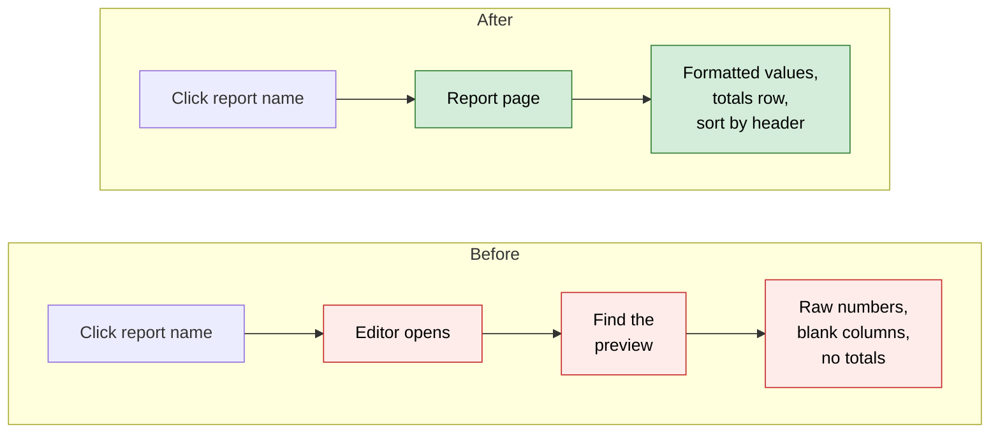
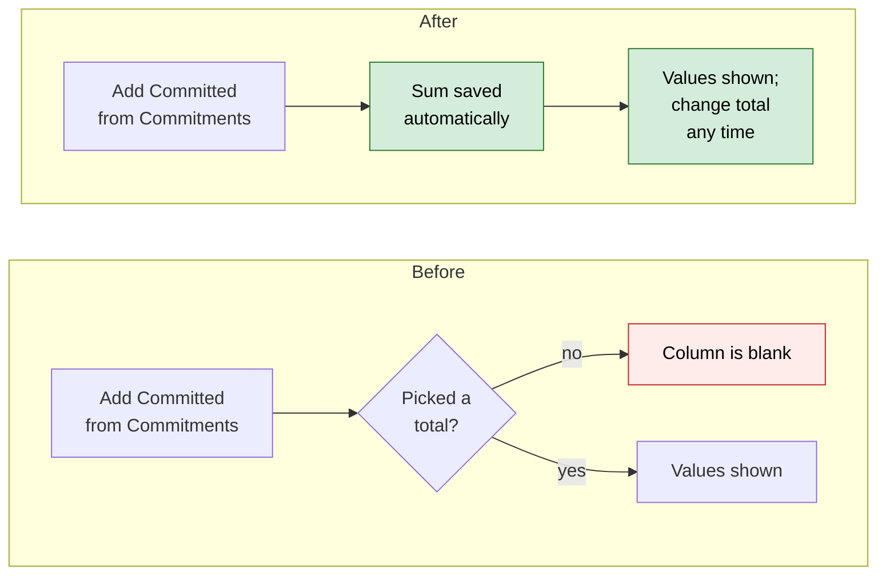
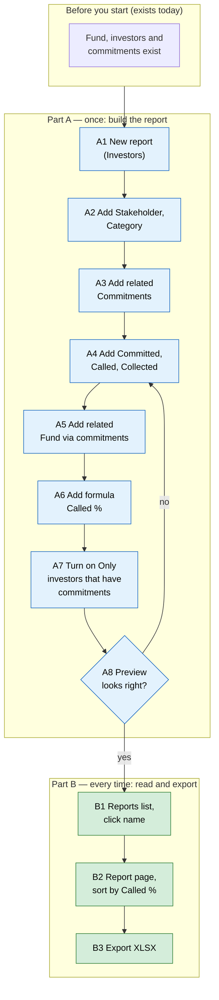

# Report Builder you can trust — Proposal

> **Audience:** Business team, product, QA, support — non-technical.
> **Companion document:** [Design](design.md)
> **New to this? Start with the [Workflow Journey](#workflow-journey)** — every action, in order, from start to the outcome.
> **Part of:** Phase 1 of the [Report Builder usability plan](../../../docs/modules/reports/report_builder_usability_plan.md). Problem IDs (P…, W…) refer to that plan.

> **Planning phase — no code changes.** This document proposes and explains the change. Do not
> edit application code while writing it; implementation happens later, in the tasks phase.

---

## Why

Today a Report Builder report can show **blank columns, raw unformatted numbers and a "Saved" message for changes that were not saved**, and nothing on screen says so. Examples:

- the fund name on a capital-call report;
- "Investing Entity" on a remittance report;
- a "Sum" the wizard displays but never stores.

Before we add templates and an AI assistant on top (later phases), the reports have to be right and readable.

## What Changes

- **Related data that comes back empty today now shows values:**
  - the parent record, e.g. the fund on a commitment or the call on a payment (P31);
  - data two steps away, e.g. an investor's funds via their commitments (P38);
  - documents attached to a record, which today count other records' documents too (P33).
- **Columns that read from the display layer show their values.** "Investing Entity", "Instrument", "KYC Expired" and the KPI report's "For" and "User" no longer come out blank (P37). Fields that can only be filtered on, such as "Carry", are no longer offered as columns.
- **Every related column gets a sensible total by default:**
  - amounts and numbers → **Sum**;
  - dates → **Latest date**;
  - yes/no → **Any yes**;
  - text → **Latest value**.

  The total is saved when the column is added, and the wizard's Summarize step finally saves the "Sum" it shows (W1, P20). Older reports with no total stored behave the same way.
- **Formulas work on amounts.** `ROUND(Committed / Called, 2)` gives `2.50`, not `₹2.50` or an error (P32).
- **Formula and pivot columns stay where you put them** instead of always jumping to the end (P22).
- **Pivot headers say which related data they came from**: "Commitments · A (sum)" (P34).
- **New "Only rows that have …" switch** per related data, e.g. *only investors that have overdue remittances*. It replaces an option that was saved but never used (P35).
- **One look for numbers everywhere**, in the preview, the report page and Excel (P16):
  - amounts with thousands separators, right-aligned;
  - dates in the user's date format;
  - Yes/No instead of `true`/`1`.
- **A totals row** on the preview, the report page and at the bottom of the Excel sheet (P17). Calculated columns are recalculated from the totals, so *Called %* in the totals row is total called ÷ total committed, not a sum of percentages. **BREAKING (minor):** Excel's separate "Totals" sheet goes. The totals are the last row of the Data sheet instead.
- **Click a column header** on the report page to sort by it. The report's saved order stays as the default (P18).
- **Clicking a report's name on the Reports list opens the report**, not the editor (P15).
- **Honest save messages:** green only when the change was saved; red, naming what failed, otherwise (P1).
- **Applying a template asks first** with the standard "Immediate Actions" popup, because it replaces the whole report (P2).
- **The preview says how many rows it shows**: "20 of 1,284 rows" (P4).

### Flow Diagram

Reading a report:



Adding a total from related data:



---

## Workflow Journey

### Who is involved

| Person | Role | What they do in the journey |
|---|---|---|
| Meera | Fund operations, can create and edit reports | Builds an "LPs and their calls" report and shares it |
| Arjun | Fund accountant, can view reports | Opens the report, sorts it, exports it |

### The journey on one page



### Before you start

| Needed | Why | Where it comes from |
|---|---|---|
| A fund with investors and commitments | Data to report on | Existing fund set-up |
| Permission to create reports (Meera) / view reports (Arjun) | Report access | Existing Reports permissions |

### Part A — once: build the report

| Step | Who | Where | Action | What the system does | What you see |
|---|---|---|---|---|---|
| A1 | Meera | Reports › New Custom Report | Picks *Investor*, names it "LPs and their calls" | Creates the report | Wizard step 1 |
| A2 | Meera | Columns | Adds Stakeholder, Category | Saves the columns | Both listed |
| A3 | Meera | Related Data | Adds *Capital commitments* | Saves the related data | Added chip |
| A4 | Meera | Summarize | Adds Committed, Called, Collected | Saves each with **Sum** (the default for amounts) | Each shows *Sum*, and it really is saved |
| A5 | Meera | Builder › Add new relation | Picks *Capital commitments › Fund* (two steps away) | Saves it; fund name defaults to **Latest value**, which she changes to **List** | Fund column shows "Growth Fund II" |
| A6 | Meera | Builder › Formulas › Add Formula | Label "Called %", expression `IF([capital_commitments.committed_amount] > 0, [capital_commitments.call_amount] / [capital_commitments.committed_amount] * 100, 0)` | Validates and saves; places the column after Called | "Valid formula"; column shows next to Called |
| A7 | Meera | Builder › Capital commitments card | Turns on **Only investors that have commitments** | Investors without any commitment drop out | Row count falls from 4 to 3 |
| A8 | Meera | Builder › Refresh Preview | Checks the numbers | Runs the report on 20 rows | Formatted preview with a totals row; "All 3 rows" |

### Part B — every time: read and export

| Step | Who | Where | Action | What the system does | What you see |
|---|---|---|---|---|---|
| B1 | Arjun | Reports list | Clicks "LPs and their calls" | Opens the **report page** | The report, not the editor |
| B2 | Arjun | Report page › "Called %" header | Clicks the header twice | Sorts by Called %, highest first, for this visit only | Rows reorder; the saved order is unchanged for others |
| B3 | Arjun | Report page › Export XLSX | Clicks it | Builds the file in the background; alerts when ready | Excel with real number and date cells and a bold totals row at the bottom |

### What you see

Report page, Growth Fund II (₹):

```
LPs and their calls                                         [Edit] [Export XLSX]
┌────────────────┬──────────┬────────────────┬──────────────┬──────────────┬──────────┬────────────────┐
│ Stakeholder    │ Category │ Fund           │    Committed │       Called │ Called % │      Collected │
├────────────────┼──────────┼────────────────┼──────────────┼──────────────┼──────────┼────────────────┤
│ Aditi Rao      │ LP       │ Growth Fund II │ 5,00,00,000  │ 2,00,00,000  │    40.00 │  1,80,00,000   │
│ Kiran Mehta    │ LP       │ Growth Fund II │ 2,50,00,000  │ 1,00,00,000  │    40.00 │  1,00,00,000   │
│ Zeta Holdings  │ Co-Inv.  │ Growth Fund II │ 1,00,00,000  │   40,00,000  │    40.00 │          0.00  │
├────────────────┼──────────┼────────────────┼──────────────┼──────────────┼──────────┼────────────────┤
│ Total          │          │                │ 8,50,00,000  │ 3,40,00,000  │    40.00 │  2,80,00,000   │
└────────────────┴──────────┴────────────────┴──────────────┴──────────────┴──────────┴────────────────┘
Showing 3 of 3 records.
```

The arithmetic:

- **Committed:** 5,00,00,000 + 2,50,00,000 + 1,00,00,000 = **8,50,00,000**.
- **Called:** 2,00,00,000 + 1,00,00,000 + 40,00,000 = **3,40,00,000**.
- **Called % in the totals row** = 3,40,00,000 ÷ 8,50,00,000 × 100 = **40.00**. It is worked out again from the totals, not added up from the rows (40 + 40 + 40 = 120 would be wrong).
- **Collected:** 1,80,00,000 + 1,00,00,000 + 0 = **2,80,00,000**.

### What goes wrong

**The save fails.** Meera changes the sort while her session has expired. Today she gets a green "Sort saved" and the change is gone. After this change she sees a red **"Sort wasn't saved — your session has expired. Sign in again and retry."** The dropdown goes back to the saved value. She signs in again and repeats the change.

**She applies a template by mistake.** She clicks *Apply Template* on "Investor Commitment Summary". Instead of wiping her report straight away, an Immediate Actions popup explains:

- **Replaces all columns:** your 7 columns are removed;
- **Replaces related data and formulas;**
- **Can't be undone.**

She clicks **Cancel** and nothing changes.

### Summary: the minimum actions

| # | Action | Who | How often |
|---|---|---|---|
| 1 | Build the report (A1–A8) | Meera | Once |
| 2 | Open the report from its name | Arjun | Every time |
| 3 | Sort / export | Arjun | As needed |

---

## User Stories

### US-1: Related data shows values

**As a** report builder, **I want** the fund on a commitment, the call on a payment, and data two steps away to show their values, **so that** my report isn't full of blank columns.

**Acceptance criteria:**
- Adding *Fund* to a Capital Commitment report shows each commitment's fund name.
- Adding *Capital commitments › Fund* to an Investor report shows the investor's funds, either as a list or as the latest one.
- A *Documents* count on a commitment counts only that commitment's documents.
- A missing parent (e.g. no fund set) shows an empty cell, not an error.

### US-2: Columns from the display layer show values

**As a** report builder, **I want** every column I can pick to show a value, **so that** I don't add "Investing Entity" and get a blank column.

**Acceptance criteria:**
- "Investing Entity" (commitments, remittances, distribution payments), "Instrument" (portfolio investments), "Expired" (KYC), "For" and "User" (KPI reports) show values.
- Filter-only fields ("Carry", "Units amount minus collected", "Foreign currency commitment", "Tracking committed amount") aren't offered as columns. They are still offered as filters.

### US-3: A total is always chosen

**As a** report builder, **I want** a related column to get a sensible total when I add it, **so that** it's never silently blank.

**Acceptance criteria:**
- Amounts and numbers default to Sum; dates to Latest date; yes/no to Any yes; text to Latest value.
- The default is saved, and the wizard's Summarize dropdown shows the saved value.
- Changing it (e.g. to Count) saves the new choice.
- Reports created before this change show the same defaults for columns that never had a total stored.

### US-4: Formulas work on amounts

**As a** report builder, **I want** formulas over amount columns to produce plain numbers, **so that** ratios and rounding work.

**Acceptance criteria:**
- `ROUND([committed_amount] / [call_amount], 2)` on 5,00,00,000 and 2,00,00,000 shows `2.50`.
- Root amounts can be mixed with related totals in one formula.
- Dividing by zero gives an empty cell, not an error.

### US-5: Columns stay in order

**As a** report builder, **I want** formula and pivot columns to stay where I drag them, **so that** "Called %" can sit next to "Called".

**Acceptance criteria:**
- A new formula appears at the end and can be dragged anywhere; the position is the same in preview, report page and Excel.
- A pivot's columns move together as one block.
- Reports made before this change keep their current layout (formulas and pivots last).

### US-6: Only rows that have related data

**As a** report builder, **I want** to keep only rows that have matching related data, **so that** I can make "investors with overdue remittances".

**Acceptance criteria:**
- Each many-per-row related data card has a switch **Only {root plural} that have {related}**, off by default.
- With the switch on and a related filter (Status = Overdue), only investors with at least one overdue remittance are listed, and the row count and pages match.

### US-7: Numbers look the same everywhere, with totals

**As a** report reader, **I want** amounts, dates and yes/no values to look the same in the preview, on the report page and in Excel, with a totals row, **so that** I can read and check the report.

**Acceptance criteria:**
- Amounts: thousands separators, 2 decimals, right-aligned; the currency label when the report has one.
- Dates in the user's date format; Yes/No for yes/no values.
- In Excel, numbers are number cells and dates are date cells.
- The totals row sums amount and number columns (Sum or Count totals and plain amount columns). Average, Latest, Min and Max columns are left blank in the totals row. Formula columns are worked out again from the totals.
- The totals row is labelled **Total** when every row is on screen and **Total (this page)** or **Total (these 20 rows)** when not. Excel always totals every row.

### US-8: Sort by clicking a header

**As a** report reader, **I want** to click a column header to sort, **so that** I can find the biggest or oldest without editing the report.

**Acceptance criteria:**
- The first click sorts lowest first, the second highest first, and the arrow shows which.
- The saved sort is untouched; the next visit shows the saved order.
- Sorting a related or formula column on a report with over 20,000 rows shows "Sorted within the first 20,000 rows".

### US-9: Opening and saving behave as expected

**As a** report user, **I want** the report name to open the report, and save messages to be truthful, **so that** I'm not misled.

**Acceptance criteria:**
- On the Reports list, a Report Builder report's name opens its report page; *Edit* opens the builder.
- A green message appears only when the server confirms the save. Otherwise a red message names the setting and the reason.
- *Apply Template* shows the Immediate Actions popup; Cancel changes nothing.
- The preview header and its note say "Showing up to 20 rows", and the preview says "20 of N rows" or "All N rows".

---

## UI Behavior

### Report page

```
┌ LPs and their calls ──────────────────────────────────── [Edit] [Export XLSX] ┐
│  Stakeholder ↕ │ Committed ▼ │ Called ↕ │ Called % ↕ │                         │
│  …rows…                                                                      │
│  Total (this page)   8,50,00,000   3,40,00,000   40.00                       │
│  Showing 100 of 1,284 records.            ‹ 1 2 3 … 13 ›                     │
└──────────────────────────────────────────────────────────────────────────────┘
```

**Behavior notes:**
- Headers are links: ↕ unsorted, ▲ lowest first, ▼ highest first. Changing pages keeps the sort.
- The label changes to **Total** when the report fits on one page.
- Numbers are right-aligned in body, totals and headers.

### Builder: related data card

```
┌ capital_commitments · CapitalCommitment ─────────────────────── ✕ ┐
│  [■] Only investors that have capital commitments                 │
│  Pivot Configuration …                                            │
└───────────────────────────────────────────────────────────────────┘
```

**Behavior notes:**
- The switch saves on change and refreshes the preview.
- It isn't shown on one-per-row related data (fund, call), where each row has at most one.

### Save messages

- Green toast: "Sort saved". Only after the server confirms.
- Red toast: "Sort wasn't saved — {reason}". The control goes back to its saved value.

---

## What This Feature Does NOT Cover

| Excluded | Covered In |
|---|---|
| Live-preview layout, header menus, bulk add, typed filters, health check | Phase 2 (builder + wizard) |
| Reworked wizard steps | Phase 2 |
| New report entry, the 10 templates, Duplicate | Phase 3 |
| Export progress, export history, schedule improvements, Save as View | Phase 5 |
| Describe your report (AI assistant) | Phase 4 (last) |
| Stats cards above the table | Phase 5 |

---

## Validation Rules

| Field | Rule | Default |
|---|---|---|
| Total (aggregate) | One of Sum, Count, Average, Minimum, Maximum, Latest, List; anything else is refused | By column type (see US-3) |
| Only rows that have … | On / off; only on many-per-row related data | Off |
| Header sort | Must be a column in the report; anything else is ignored | The report's saved sort |
| Sort direction | Lowest first / highest first | Lowest first on first click |

---

## Behavior Rules

| Scenario | What User Sees |
|---|---|
| Parent record missing (commitment with no fund) | Empty cell |
| Formula divides by zero | Empty cell |
| A related column was saved before this change without a total | The type default is used and shown |
| Report spans several pages | Totals row labelled "Total (this page)" |
| Report has no amount or number columns | No totals row |
| Header sort on a related/formula column over 20,000 rows | Note "Sorted within the first 20,000 rows" |
| Save rejected or network error | Red message naming the setting; control reverts |
| Apply Template | Immediate Actions popup first |

---

## Resolved Design Decisions

| # | Decision | Resolution |
|---|---|---|
| 1 | Fix the "For"/"Investing Entity"-type columns in each model, or in the Report Builder? | In the Report Builder: read display-layer columns through the record's display wrapper. No change to existing models. |
| 2 | Totals on the report page: whole report or the page shown? | The rows on screen, labelled honestly ("Total (this page)"). Excel totals everything. Whole-report totals on screen would mean running the full report on every page view. |
| 3 | Formula totals: add up the column or recalculate? | Recalculate from the totals, so ratios and differences are both right. |
| 4 | Keep Excel's separate "Totals" sheet? | No. One bold totals row at the bottom of the Data sheet. |
| 5 | Default totals: stored, or only applied when shown? | Both. Saved when the column is added, and applied when shown for older reports. |
| 6 | Header sort: save it? | No. It lasts for this visit (kept across pages); the saved sort stays the default. |

---

## Capabilities

### New Capabilities

- `reports/report-builder-engine`: what a Report Builder report returns: related data of every kind, column availability, default totals, formulas, column order, "only rows that have".
- `reports/report-builder-display`: how report results are shown and handled on screen and in Excel: formatting, totals, header sort, opening from the list, save feedback, template confirmation, preview row count.

### Modified Capabilities

None. No Report Builder spec exists yet.

---

## Impact

- **Report Builder screens:** builder, guided wizard (Summarize step), preview, report page.
- **Reports list:** where a Report Builder report's name links to.
- **Excel export of Report Builder reports:** cell types and number formats; the Totals sheet becomes a totals row.
- **Scheduled report emails:** same Excel changes (same file).
- **Existing reports:** columns that were blank start showing values; nothing that works today changes, except the Excel totals moving to the Data sheet.
- **No database changes.**

---

## Benefits

1. Reports stop showing blank columns, so readers can trust that blank means "no data".
2. Numbers read the same on screen and in Excel, with totals people would otherwise add up by hand.
3. Readers land on the report, not in the editor.
4. Builders are told the truth when a change didn't save, and can't wipe a report by one mis-click.
5. Formulas like *Called %* and *Unpaid* work and sit next to their inputs.

---

## FAQ

| Question | Answer |
|---|---|
| Who can use this? | Anyone who can use Report Builder today; access is unchanged. |
| Will existing reports change? | Columns that came out blank start showing values; related columns without a total get the default; Excel totals move from a separate sheet to the last row. Everything else looks the same, now formatted. |
| Do we need to re-create reports? | No. |
| Do investors see anything new? | No. Report Builder is internal. Scheduled report emails carry the improved Excel. |
| Any new notifications? | No. Existing export-ready and scheduled-report messages are unchanged. |
| Does sorting by a header change the report for others? | No. It only lasts for your visit. |
| Why is the on-screen total "this page"? | To stay fast on large reports. Excel always has the total for every row. See [design](design.md#design-decisions). |

---

## Design Principle for the Next Phase

- **One place decides a column's type.** Default totals, formatting, alignment, Excel cell types and which columns get a total all depend on it. The design must have exactly one resolver, not one per screen. Today the preview, the report page and the exporter each guess differently (P16).
- **One way to fetch related data.** Fix the join paths inside the existing aggregator rather than adding a second engine. Parent, two-step and through joins should share one "anchored on the report's rows" path.
- **Ordering formulas and pivots** must reuse the existing column ordering (drag and the stored sequence), not invent a second ordering scheme.
- **The totals row** must reuse the formula evaluation already used for rows.
