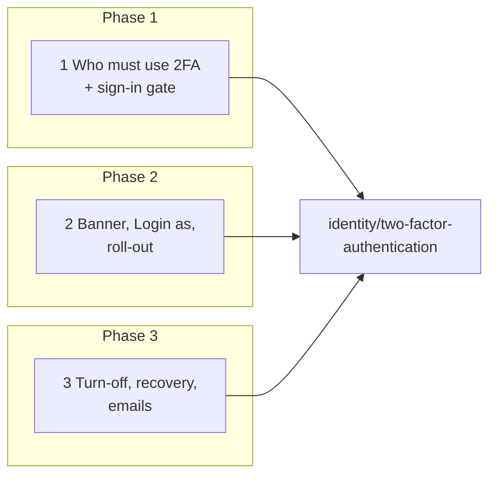
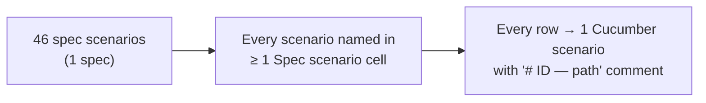

# Require Two-Factor for Support and Super — Business Rules (H/E/X)

> **Audience:** Product, QA, developers. Every row becomes exactly one Cucumber scenario.
> **Companions:** [Proposal](proposal.md) · [Design](design.md) · [Specs](specs/)
>
> **Scope (user decision, 2026-11-09):** 2FA is required for **support** and **super** only
> (`REQUIRED_2FA_ROLES = %i[support super]`). Company admins of fund and investor firms are **not**
> required. Turning 2FA off needs password + code for **every** user who has it on.

---

## Contents

- [How to read this](#how-to-read-this)
- [Shared setup](#shared-setup)
- [1. Who must use 2FA and the sign-in gate — Phase 1](#1-who-must-use-2fa-and-the-sign-in-gate--phase-1)
- [2. Banner, Set up now, Login as and roll-out — Phase 2](#2-banner-set-up-now-login-as-and-roll-out--phase-2)
- [3. Turning two-factor off, recovery and emails — Phase 3](#3-turning-two-factor-off-recovery-and-emails--phase-3)
- [Coverage](#coverage)

---

## How to read this

- **ID legend:** **H** = happy path · **E** = edge case · **X** = error (exception) case. IDs run across the whole file.
- **Spec scenario** column: `TFA: <scenario name>` — TFA = `specs/identity/two-factor-authentication/spec.md`.
- **Feature** column, short names:
  - **RR** = `features/login/two_factor_required_roles.feature`
  - **RO** = `features/login/two_factor_required_rollout.feature`
  - **TO** = `features/login/two_factor_turn_off.feature`
  - **SEC** = `features/security/two_factor_required_roles.feature` (refusals, direct requests)
- Every scenario carries a comment above it: `# E12 — Edge case: …`.
- Times are in the app time zone (`New Delhi`). Unless a row says otherwise: enforcement date env = `2026-12-01`, now = **2 Dec 2026 10:00 IST** (stage enforced).
- Screen dates follow the locale (`01/12/2026` for `en`); email dates read `Dec 02, 2026`.

---

## Shared setup

| Record | Name | Key data |
|---|---|---|
| Firm (Company) | **CapHive** | CapHive's own entity |
| Support | **Ravi** (CapHive) | 2FA off; no phone; remember-me cookie from 28 Nov; API token "Ravi scripts" made 20 Nov; mapping to Sahyadri enabled with Login as allowed |
| Support | **Anita** (CapHive) | 2FA on, authenticator; same mapping; API token "Anita reports" |
| Super | **Sam** (CapHive) | super only (no support role); 2FA off |
| Support + investor | **Vikram** (CapHive) | 2FA off; also holds the investor role (LP mobile app) |
| Employee | **Isha** (CapHive) | 2FA off; textable US number; later granted support |
| Company admin | **Leela** (CapHive) | 2FA on, authenticator — not required |
| Firm (Investment Fund) | **Sahyadri Capital** | GP firm, IN |
| Company admin | **Meera** (Sahyadri) | 2FA off — not required |
| Company admin | **Neha** (Sahyadri) | 2FA on voluntarily, authenticator |
| Company admin | **Omkar** (Sahyadri) | 2FA flag on since Oct, never enrolled (no method) |
| Employees | **Arjun** (2FA off), **Dev** (authenticator), **Lena** (flag on, no method), **Tom** (sms, +1 415 555 0142; SMS_OTP_ENABLED=true in the scenario) | Sahyadri |
| Firm (Investor) | **Priya Family Office** | LP firm |
| Investor | **Priya** | 2FA on, WhatsApp, +91 98xxxxx805, `whatsapp_enabled` |
| Company admins | **Rahul**, **Sunita** (Priya Family Office) | 2FA on, authenticator |
| Other firm | **Western Ghats Ventures** | **Tara**, company admin, 2FA on |

---

## 1. Who must use 2FA and the sign-in gate — Phase 1

### Happy path

| # | Scenario | Given | When | Then | Spec scenario | Feature |
|---|---|---|---|---|---|---|
| H1 | Support user meets set-up | Ravi, 2FA off | signs in with password | not signed in; "Set Up Two-Factor Authentication" with "Two-factor authentication is required for your role (Support). Choose a method to finish signing in." | TFA: Support user without a method signs in after the date | RR |
| H2 | Required set-up completes | H1 | picks Authenticator app, scans, types the current code | signed in; "Two-factor authentication is now enabled."; flag true, mode authenticator; email "Two-factor authentication was turned on for your account" dated Dec 02, 2026 | TFA: Confirmation switches two-factor on · TFA: Switched on email | RR |
| H3 | Support user with a method | Anita | signs in, types code | code screen, then signed in | TFA: Support user with a method signs in after the date | RR |

### Edge cases

| # | Scenario | Given | When | Then | Spec scenario | Feature |
|---|---|---|---|---|---|---|
| E1 | One minute before the date | now 30 Nov 23:59 IST | Ravi signs in | signed in with password only | TFA: Support user signs in before the date | RR |
| E2 | Exactly on the date | now 1 Dec 00:00 IST | Ravi signs in | set-up screen (as H1) | TFA: Support user without a method signs in after the date | RR |
| E3 | No date configured | env unset | Ravi signs in | signed in with password only; no banner | TFA: No enforcement date configured | RR |
| E4 | Unparseable date fails closed | env `2026-13-01`, now 20 Nov | Ravi signs in | set-up screen; log "REQUIRED_2FA_ENFORCE_FROM unparseable — enforcing" | TFA: Support user without a method signs in after the date | RR |
| E5 | Support role granted after the date | Kiran grants Isha support on 2 Dec | Isha signs in | set-up screen | TFA: Support role granted after the date | RR |
| E6 | Support role removed before set-up | Ravi's support role removed on 2 Dec | Ravi signs in | signed in with password only | TFA: Other users are unaffected | RR |
| E7 | Company admin not required | Meera, 2FA off | signs in | signed in with password only | TFA: Company admin is not required | RR |
| E8 | Super user required | Sam (super only), 2FA off | signs in | set-up screen with "…required for your role (Super)…" | TFA: Super user is required | RR |
| E9 | Investor with 2FA unchanged | Priya, WhatsApp | signs in | code screen; WhatsApp code sent, as today | TFA: Other users are unaffected | RR |
| E10 | No phone → authenticator only | Ravi (no phone) at set-up | opens the screen | only "Authenticator app" offered, preselected | TFA: Authenticator offered without a phone number | RR |
| E11 | Abandoned set-up | Ravi reached set-up, closed the tab | signs in again later | set-up again; flag still false, mode empty | TFA: Abandoned set-up stores nothing | RR |
| E12 | Support switched into a client | Ravi switched into Sahyadri (support + company_admin) | signs in | one set-up screen, role label "Support" | TFA: Support user without a method signs in after the date | RR |
| E13 | Company admin with flag on, no method | Omkar | signs in | set-up screen as today (his own switch, not the role rule); no "required" banner | TFA: Other users are unaffected | RR |
| E14 | Required user, undeliverable WhatsApp | Anita switched to WhatsApp mode; number later removed | signs in | "We can't send a verification code to your phone right now. Please contact your administrator." (unchanged) | TFA: Support user with a method signs in after the date | RR |
| E15 | Magic link → set-up → linked page | Ravi opens a sign-in link with `redirect_to=/users/<Ravi>` | completes set-up | lands on his user page | TFA: Magic link for a support user without a method | RR |
| E16 | Password reset not auto-signed-in | Ravi completes a password reset | submits new password | sign-in page "Your password has been changed successfully."; signing in → set-up | TFA: Password reset does not sign a required user in | RR |
| E17 | Required set-up via SMS | Isha (support, textable number), SMS on, Twilio approves | picks Text message, types code | signed in; flag true, mode sms | TFA: Confirmation switches two-factor on | RR |
| E18 | Mobile app after web set-up | Vikram enrolled authenticator on the web | app sign-in, then code | challenge, then device session | TFA: Support user with a method signs in after the date | RR |
| E19 | Website-made API token still works | "Anita reports" token | `GET /funds.json` with it on 2 Dec | 200 | TFA: Website-minted token keeps working | RR |
| E20 | Token endpoint before the date | now 20 Nov | Ravi posts correct password to `/users/tokens/sign_in` | 200 + token (unchanged) | TFA: Support user signs in before the date | RR |

### Error cases

| # | Scenario | Given | When | Then (what the user sees, who is alerted) | Spec scenario | Feature |
|---|---|---|---|---|---|---|
| X1 | Three wrong set-up codes | Ravi at set-up | types 3 wrong codes | sign-in page "Too many failed attempts. Please sign in again."; flag false, mode empty | TFA: Three wrong set-up codes | RR |
| X2 | One wrong code then right | Ravi at set-up | wrong, then right | "Invalid code. 2 attempt(s) remaining.", then signed in as H2 | TFA: Confirmation switches two-factor on | RR |
| X3 | Token endpoint refuses required user | Ravi, 2FA off | correct password to `/users/tokens/sign_in` | 403 `two_factor_required`; no token row | TFA: Password token endpoint refuses a required user | SEC |
| X4 | Token endpoint wrong password | Ravi | wrong password | 401 invalid; `failed_attempts` 0 → 1 | TFA: Wrong password at the token endpoint is unchanged | SEC |
| X5 | Mobile app refuses required user without a method | Vikram, 2FA off | app sign-in | 403 `finish_2fa_setup`; no device | TFA: Mobile app sign-in for a required user without a method | SEC |

---

## 2. Banner, Set up now, Login as and roll-out — Phase 2

### Happy path

| # | Scenario | Given | When | Then | Spec scenario | Feature |
|---|---|---|---|---|---|---|
| H4 | Notice banner | now 20 Nov; Ravi signed in | opens the dashboard | amber banner "Two-factor authentication becomes required for your role (Support) on 01/12/2026." + Set up now | TFA: Notice banner before the date | RO |
| H5 | Set up now | H4 | clicks Set up now, then signs in | flag true; signed out with "Sign in again to set up two-factor authentication."; sign-in → set-up → confirm | TFA: Set up now | RO |
| H6 | Verified support uses Login as | Anita; Dev has 2FA on | Login as Dev | acting as Dev; Dev's code not asked | TFA: Support user with a method acts as the client | RO |
| H7 | Report shows counts only | setup data | `rake two_factor_required:report` | support 3 active / 2 without a verified method; super 1 / 1; distinct 3 without; line "company_admin: not required"; no names or emails | TFA: Report shows counts only | RO |
| H8 | Ending access for unverified users | Ravi has a remember-me cookie and "Ravi scripts"; Anita has both too | `end_unverified_access EXECUTE=1`, then each returns after the session expired and each token is used | "Ended access for 3 users"; Ravi → sign-in page, his token → 401; Anita signed in from cookie, her token → 200 | TFA: Ending access for unverified support users | RO |

### Edge cases

| # | Scenario | Given | When | Then | Spec scenario | Feature |
|---|---|---|---|---|---|---|
| E21 | Required banner for an older session | Ravi signed in 30 Nov, session alive on 1 Dec 10:00 | opens a page | red banner "Two-factor authentication is now required for your role. Set it up to keep using CapHive. Login as is unavailable until you do." | TFA: Required banner after the date | RO |
| E22 | Banner gone once verified | Ravi after H5 | opens a page | no banner | TFA: No banner once set up or while acting as a client | RO |
| E23 | Banner hidden while acting as a client | now 20 Nov; Ravi acting as Dev | opens a page | no banner | TFA: No banner once set up or while acting as a client | RO |
| E24 | No banner for a company admin | Meera, 2FA off, 2 Dec | opens a page | no banner | TFA: No banner for users without a required role | RO |
| E25 | No banner with no date | env unset | Sam opens a page | no banner | TFA: No enforcement date configured | RO |
| E26 | Login as before the date | now 20 Nov; Ravi, 2FA off | Login as Dev | allowed (unchanged) | TFA: Login as before the date is unchanged | RO |
| E27 | Ending access dry run | Ravi has a cookie and a token | `end_unverified_access` (no EXECUTE) | "Would end access for 3 users"; Ravi's cookie and token still work | TFA: Ending access dry run changes nothing | RO |
| E28 | Ending access before the date | now 20 Nov | `end_unverified_access EXECUTE=1` | "Enforcement date 2026-12-01 not reached — nothing changed" | TFA: Ending access refused before the date | RO |
| E29 | Report when everyone is set up | Ravi, Vikram, Sam enrolled | `report` | support 3 / 0; super 1 / 0 | TFA: Report shows counts only | RO |

### Error cases

| # | Scenario | Given | When | Then (what the user sees, who is alerted) | Spec scenario | Feature |
|---|---|---|---|---|---|---|
| X6 | Unverified support refused Login as | Ravi (no method), session from before the date | clicks Login as on Dev | "Set up two-factor authentication before using Login as."; still Ravi | TFA: Support user without a method is refused | SEC |
| X7 | Direct Login as request refused | Ravi | `POST /users/<Dev>/login_as` crafted by hand | refused; no `support_user_id` in session | TFA: Support user without a method is refused | SEC |
| X8 | Set up now for someone else | Ravi | `POST /users/<Anita>/start_two_factor_setup` | "Access Denied"; Anita unchanged, Ravi still signed in | TFA: Set up now | SEC |
| X9 | Set up now while acting as a client | Anita acting as Dev | `POST /users/<Dev>/start_two_factor_setup` | "Access Denied"; Dev's flag unchanged | TFA: Set up now | SEC |
| X10 | Set up now for a non-required role | Meera | `POST /users/<Meera>/start_two_factor_setup` | "Access Denied" (company admins use the Edit profile toggle) | TFA: No banner for users without a required role | SEC |

---

## 3. Turning two-factor off, recovery and emails — Phase 3

Applies to **every** user who has 2FA on — voluntary or required.

### Happy path

| # | Scenario | Given | When | Then | Spec scenario | Feature |
|---|---|---|---|---|---|---|
| H9 | Investor turns off with WhatsApp code | Priya, 8 Dec | Turn off 2FA → password → Send code → code → tick → submit | "Two-factor authentication is now off. You will sign in with just your password."; flag false, mode/secret cleared; audit row; emails: Priya "…turned off for your account", Rahul and Sunita "Two-factor was turned off for Priya" | TFA: Turn off with password and code · TFA: Switched off emails | TO |
| H10 | Company admin turns off voluntary 2FA | Neha (authenticator), 8 Dec | password + app code | off; Neha emailed; Meera and Omkar notified | TFA: Company admin's voluntary two-factor needs the same proof | TO |
| H11 | Support resets a support user's lost method | Ravi enrolled, then lost phone; 5 Dec | Anita › Users › Ravi › Reset 2FA Method | mode cleared, flag true; reset audited with Anita; Ravi gets the existing reset email; Leela gets "Two-factor method reset for Ravi"; Ravi's next sign-in → set-up | TFA: Support resets a support user's lost method | TO |

### Edge cases

| # | Scenario | Given | When | Then | Spec scenario | Feature |
|---|---|---|---|---|---|---|
| E30 | No method → password only | Lena (flag on, no method) | Turn off 2FA → password → submit | no code field shown; off | TFA: Two-factor on but no method stored | TO |
| E31 | Edit form when on | Dev | opens Edit profile | "On — turn it off from your user page" (link), no checkbox | TFA: Edit form or JSON update tries to switch it off | TO |
| E32 | Edit form turning on unchanged | Arjun, off | ticks Enable, saves | "User was successfully updated."; flag true; next sign-in → choose method | TFA: Switching on from the edit form is unchanged | TO |
| E33 | Sync applies origin turn-off | Priya multi-region; origin sends `two_factor_enabled: false` | `POST /internal/sync/users` (signed) | applied; flag false here | TFA: Cross-region sync applies the origin's change | TO |
| E34 | Wrong code then right | Dev | wrong code, then right | "The code you entered is incorrect. 2 attempt(s) remaining.", then off | TFA: Wrong code | TO |
| E35 | Required user sees no turn-off | Anita, 2 Dec | opens her user page | badge "Required for your role"; no Turn off 2FA | TFA: Required user sees no turn-off | TO |
| E36 | SMS user turns off | Tom (sms) | Send code → Twilio approves the code | off | TFA: Turn off with password and code | TO |
| E37 | Send code cooldown | Priya pressed Send code | presses again within 60 s | "Please wait a moment before requesting another code."; one send only | TFA: Turn off with password and code | TO |
| E38 | Admin sees only Reset | Neha on Dev's page | looks at the Two-Factor row | Reset 2FA Method shown; no Turn off 2FA | TFA: Another user cannot switch it off | TO |
| E39 | Self reset sends no admin notice | Dev › Change 2FA Method | confirms with password | only Dev emailed (existing) | TFA: Support resets a support user's lost method | TO |
| E40 | No other company admins | Rahul and Sunita deactivated | Priya turns off | only Priya emailed | TFA: Switched off emails | TO |
| E41 | Email date format under `ja` | Priya's turn-off processed under `ja` locale | email renders | date `Dec 08, 2026` (not kanji) | TFA: Switched on email | TO |
| E42 | Support user turns off before the date | Anita, now 20 Nov | password + code | off (notice period refuses nothing); banner appears | TFA: Turn off with password and code | TO |

### Error cases

| # | Scenario | Given | When | Then (what the user sees, who is alerted) | Spec scenario | Feature |
|---|---|---|---|---|---|---|
| X11 | Wrong password | Priya | wrong password, any code | "The password you entered is incorrect."; 2FA on; `failed_attempts` +1 | TFA: Wrong password | TO |
| X12 | Wrong code | Dev | right password, wrong code | "The code you entered is incorrect. 2 attempt(s) remaining."; 2FA on | TFA: Wrong code | TO |
| X13 | Third wrong code | Dev, 2 misses in the last 10 min | third wrong, then a correct code at +2 min | "Too many incorrect codes. Try again in 10 minutes." both times; 2FA on | TFA: Third wrong code within 10 minutes | TO |
| X14 | Six wrong passwords lock the account | Priya, `failed_attempts` 5 | wrong password | account locked; next page → sign-in "Your account is locked." | TFA: Wrong password | TO |
| X15 | Required user's direct turn-off | Anita, 2 Dec | `POST /users/<Anita>/disable_two_factor` with right password + code | "Two-factor authentication is required for your role and cannot be turned off."; 2FA on | TFA: Direct turn-off request from a required user | SEC |
| X16 | Company admin turns off an employee | Neha | `POST /users/<Dev>/disable_two_factor` | "Access Denied"; Dev unchanged | TFA: Another user cannot switch it off | SEC |
| X17 | Other firm's admin | Tara | `POST /users/<Dev>/disable_two_factor` | "Access Denied"; Dev unchanged | TFA: Another user cannot switch it off | SEC |
| X18 | JSON update switching off | Dev | `PATCH /users/<Dev>.json` `two_factor_enabled=false` | 422 with "Two-factor authentication can only be turned off from your user page, with your password and a current code."; on | TFA: Edit form or JSON update tries to switch it off | SEC |
| X19 | Admin console switching off | Anita in /admin/users › Dev › Edit | unticks Two factor enabled, saves | form error with the same message; on | TFA: Edit form or JSON update tries to switch it off | SEC |
| X20 | Company admin HTML update switching off | Neha | `PATCH /users/<Dev>` `user[two_factor_enabled]=0` | edit form re-rendered with the same message; on | TFA: Edit form or JSON update tries to switch it off | SEC |
| X21 | Bearer token turn-off | Dev's API token | `POST /users/<Dev>/disable_two_factor` with `Authorization: Bearer` | 403 `Access Denied`; on | TFA: Edit form or JSON update tries to switch it off | SEC |
| X22 | Send code for someone else | Neha | `POST /users/<Dev>/send_two_factor_code` | "Access Denied"; nothing sent | TFA: Another user cannot switch it off | SEC |
| X23 | Send code with a bearer token | Dev's API token | `POST /users/<Dev>/send_two_factor_code` | 403; nothing sent | TFA: Another user cannot switch it off | SEC |
| X24 | Turn-off while acting as the user | Anita acting as Dev | opens Dev's page; posts turn-off directly | no button; direct post "Access Denied"; on | TFA: Another user cannot switch it off | SEC |
| X25 | Stolen company-admin session | someone holds Neha's signed-in browser, no password | unticks 2FA on Edit profile; then submits the popup with a guessed password | edit refused with the guard message; popup "The password you entered is incorrect."; 2FA on; `failed_attempts` +1 | TFA: Stolen session cannot remove two-factor | SEC |

---

## Coverage

| Group | H | E | X | Total |
|---|---|---|---|---|
| 1 Who must use 2FA + sign-in gate | 3 | 20 | 5 | 28 |
| 2 Banner, Login as, roll-out | 5 | 9 | 5 | 19 |
| 3 Turn-off, recovery, emails | 3 | 13 | 15 | 31 |
| **Total** | **11** | **42** | **25** | **78** |

- `features/security/two_factor_required_roles.feature` (SEC) gathers every refusal row: X3–X10, X15–X25 — other firm refused, owner allowed, direct request refused.
- An edge case found during apply gets a new row here **and** a scenario, never a scenario alone.
