# Security Event Trail — Design

> **Audience:** Engineering team.
> **Companion documents:** [Proposal](proposal.md) · [Spec](specs/identity/security-event-trail/spec.md) · [Business rules](business-rules.md) · [LLD](lld.md) · [QA checklist](qa-checklist.md) · [Screen mock](mocks/security_events_index.html)

> **Planning phase — no code changes.** This document explains HOW the proposal will be built.

> **Zoom one picture.** Part 1 draws it in plain words, Part 2 redraws it with real names, Part 3 has
> one card per box, Part 4 is reference. ①–⑧ mean the same box everywhere.

> **Source:** finding **M11** (A09) in `docs/security/owasp_top10_review_2026_11.md:232`. Line numbers
> below were read from the working tree of `fix/owasp-top10-2026-11` on 2026-11-09.

## Contents

- [Key changes needing approval](#key-changes-needing-approval)
- [1. The idea](#1-the-idea)
  - [What this adds](#what-this-adds)
  - [The idea in one picture](#the-idea-in-one-picture)
  - [Key concepts](#key-concepts)
  - [Walkthrough: one example, start to finish](#walkthrough-one-example-start-to-finish)
  - [Key ideas](#key-ideas)
- [2. The same picture with real names](#2-the-same-picture-with-real-names)
  - [Picture](#picture)
  - [What each box does](#what-each-box-does)
  - [One run, end to end](#one-run-end-to-end)
  - [Lifecycles](#lifecycles)
  - [What users see](#what-users-see)
  - [Design decisions](#design-decisions)
- [3. One card per box](#3-one-card-per-box)
  - [① Doors and actions](#①-doors-and-actions)
  - [② Hooks](#②-hooks)
  - [③ Recorder](#③-recorder)
  - [④ Background writer](#④-background-writer)
  - [⑤ Event store](#⑤-event-store)
  - [⑥ Security Events screen](#⑥-security-events-screen)
  - [⑦ Admin alerts](#⑦-admin-alerts)
  - [⑧ Weekly pack and clean-up](#⑧-weekly-pack-and-clean-up)
- [4. Reference](#4-reference)
  - [Class diagram](#class-diagram)
  - [Data model and schema changes](#data-model-and-schema-changes)
  - [Component contracts](#component-contracts)
  - [Notifications](#notifications)
  - [Cross-cutting concerns](#cross-cutting-concerns)
  - [Worked examples](#worked-examples)
  - [Testing](#testing)
  - [Risks and open questions](#risks-and-open-questions)

---

## Key changes needing approval

The subsystem is additive (new pack, new table, new screen). These edits touch **existing** code and need
sign-off before any code is written (project rule: new subsystems stay additive; existing-model changes
are flagged).

| # | Existing file | Change | Why it can't be avoided |
|---|---|---|---|
| K1 | `app/packs/core/users/models/user.rb:173` | `rolify` gains `after_add:` / `after_remove:` callbacks | Only place every one of ~30 `add_role`/`remove_role` call sites (11 files) passes through |
| K2 | `app/packs/core/users/models/user.rb:284` area | One more `after_update_commit` (`record_security_changes`) for `encrypted_password`, `phone`, `locked_at`, `active`, `enable_support`, `two_factor_enabled`, `two_factor_mode` | Covers Devise lockable, admin console, profile, reset — every route — in one hook |
| K3 | `app/packs/core/users/models/user.rb:986` | `disable_support_for_all` records one system event (it uses `update_all`) | `update_all` skips K2 |
| K4 | `app/packs/core/support_client_mappings/models/support_client_mapping.rb:77,109` | `switch` / `revert` record one event each | Firm switch uses `update_columns`, skips K2 |
| K5 | 14 controller/service lines in [card ②](#②-hooks) | One `SecurityEvents.record(...)` line each | Points where only the controller knows the door/outcome |
| K6 | `app/packs/core/base/controllers/application_controller.rb:27` | `after_action :record_security_export, if: xlsx` | One hook for all 29 controllers that answer `format.xlsx` |
| K7 | `config/initializers/devise_api.rb`, `config/initializers/doorkeeper.rb:500` | Configure the gems' own `after_successful_sign_in` / `after_successful_authorization` hooks | Gem-owned controllers |
| K8 | New `config/initializers/security_event_warden.rb` | `Warden::Manager.before_failure` | Web password failures happen inside Warden |
| K9 | `config/initializers/sidekiq.rb` (~:180) | Two cron entries | Weekly pack, nightly purge |
| K10 | `app/packs/core/base/views/layouts/modernize/_company_menus.html.erb:138` | Menu entry under Audit Trail | Entry point |

No existing column, table or Audit Trail behaviour changes. `User` `audit_fields` (`user.rb:18`) are
**not** widened — see [D3](#d3-flags-go-to-security-events-not-to-audits).

---

## 1. The idea

### What this adds

A firm-scoped, append-only `security_events` table fed by one recorder (`SecurityEvents.record`) that
~25 one-line hooks call — Warden's failure hook, rolify's add/remove callbacks, one `User` after-commit,
and the controller lines where a door decides success or refusal. Writing is queued to Sidekiq with a
direct-insert fallback and never raises. It follows the existing **Audit Trail** pattern (Trackable →
`audits` → `AuditsController` + `AuditDownloadJob`) for viewing and export, and the **CrossSiteMetrics**
pattern (`cross_site_metrics.rb`: "a metrics outage must never fail a user's login") for failure handling.

### The idea in one picture

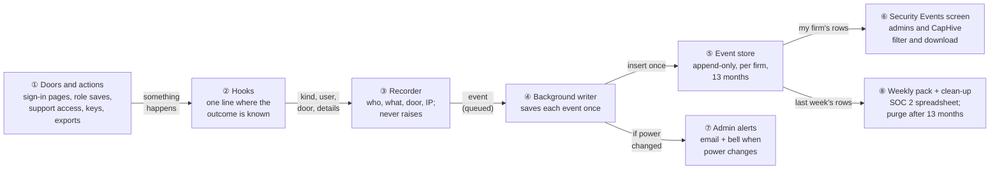

### Key concepts

**How the concepts fit together**

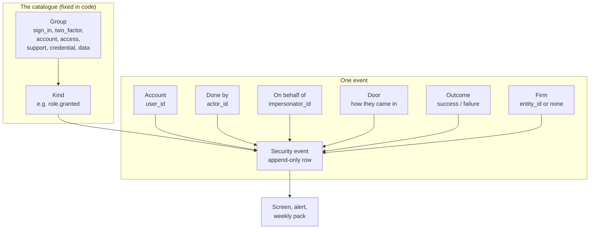

- The **catalogue** is a frozen constant: kinds can't be invented at runtime.
- One **event** answers who / what / when / where from / through which door / did it work.
- The **firm** decides who may see it; an event with no firm is CapHive-only.

**Glossary**

| Concept | What it is, in one line | Example | Stored in |
|---|---|---|---|
| Security event | One append-only row for one security-relevant moment | Priya, sign-in failed, invalid, 49.36.12.8 | `security_events` |
| Kind | One of 29 fixed types | `role.granted` | `security_events.kind` |
| Group | The kind's family, for filters and cards | `access` | `security_events.category` |
| Outcome | `success` or `failure` | `failure` | `security_events.outcome` |
| Account | The user the event is about | Priya Shah | `security_events.user_id` |
| Done by | The signed-in identity that caused it | Rahul Mehta | `security_events.actor_id` |
| On behalf of | The CapHive support user behind an impersonated session | Anil Kumar | `security_events.impersonator_id` (from `session[:support_user_id]`) |
| Door | How the person reached CapHive | `two_factor`, `magic_link`, `mobile`, `api`, `cross_region`, `mobile_handoff`, `mail_addin`, `oauth`, `password_reset`, `web_password`, `admin`, `system` | `security_events.door` |
| Firm | The tenant the event belongs to | Golden Angels Fund (18) | `security_events.entity_id` (NULL = CapHive only) |
| Identifier digest | SHA-256 of the lower-cased email typed on a failed sign-in | `9f2c…` | `security_events.identifier_digest` |
| Event uid | UUID minted on the request thread; makes the write idempotent | `0b6c…` | `security_events.uid` (unique) |
| Impersonation | A support user signed in as a client user (`login_as`, or a support `no_password_login`) | Anil as Priya | Session key `support_user_id` (today) |
| Firm switch | A support user moving into a client firm with company-admin rights | `SupportClientMapping#switch` | `users.json_fields['orig_entity_id']` (today) |
| Admin alert | Email + bell to the firm's company admins for power changes | "Approver role given to Rahul Mehta" | `noticed_events` / `noticed_notifications` |
| Weekly pack | Monday spreadsheet of last week's events, emailed to support@caphive.com | 02–08 Nov 2026 | Email attachment only |
| Retention | Events older than 13 months are purged nightly | Event of 08 Oct 2025 purged on 09 Nov 2026 | Not stored |
| Counter (M12) | A Prometheus number Grafana alerts on; no user, no IP | `failed_logins_total{door="web"}` | Prometheus (M12, separate) |

#### Security event — append-only record

- **What:** a row written once and never edited. Corrections are new rows (e.g. a revoke after a grant).
- **Why:** forensic evidence must not be editable by the people it watches.

| Kind / trigger | What it records | Example |
|---|---|---|
| Something an attacker tries | failure + reason + IP | `sign_in.failed`, reason `invalid` |
| Something that grants power | who, to whom, which power | `role.granted`, role `approver` |
| Something that takes data out | what was exported | `data.exported`, `capital_calls#index (xlsx)` |

**What it does NOT cover:** field-level history of records (that's `audits`); per-request API calls
(only the sign-in that issues a token is recorded); throttled requests (they never reach Rails — M12
counts them).

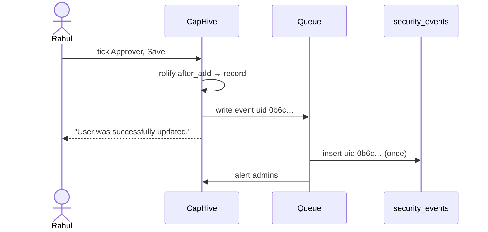

**Rules**
- No controller action edits or deletes; the model is `readonly?` once persisted.
- Only `SecurityEventPurgeJob` deletes, and only rows older than 13 months.
- A retried write with the same `uid` inserts nothing and sends no second alert.

#### Door — how the person came in

- **What:** a closed list naming the entry path, so "how did they get in?" has a one-word answer.
- **Why:** the same person can arrive by eight doors; a compromise usually uses one unusual door.

| Door | Entry point | Example |
|---|---|---|
| `web_password` | Website sign-in form | Priya types password |
| `two_factor` | Website after a code | Priya + WhatsApp code |
| `magic_link` | Email / WhatsApp sign-in link | "Sign in with link" |
| `password_reset` | Reset-password link | Forgot password |
| `mobile` | LP mobile app | iPhone app |
| `api` | `POST /users/tokens/sign_in` | Script sign-in |
| `cross_region` | IN ↔ US switch (web or app) | "Switch to US" |
| `mobile_handoff` | App → website hand-off link | "Open in browser" |
| `mail_addin` | Outlook / Gmail add-in | Outlook sidebar |
| `oauth` | OAuth authorise / MCP bearer | Claude MCP connector |
| `admin` / `system` | Admin console / jobs and rake | Firm deactivation job |

**What it does NOT cover:** the device; the user agent is stored separately.

#### Impersonation and firm switch — CapHive support access

- **What:** two existing ways CapHive support acts inside a client firm. Today only a session key
  (`users_controller.rb:267`, `:301`) and `json_fields` record them.
- **Why record:** the client should know support was inside, and for how long.
- **Ends:** impersonation ends only at sign-out — there is no stop action (`sessions_controller.rb:51`
  `reset_session`); a firm switch ends with `SupportClientMapping#revert` (`:109`).

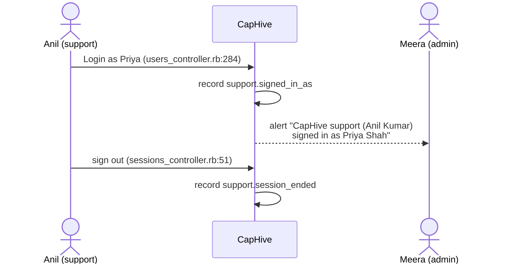

**Rules**
- Done by = the support user; Account = the client user; Firm = the client user's firm.
- Everything done while impersonating also carries `impersonator_id`.

#### Counter vs event — how M12 and M11 fit

| | Counter (M12, Group A) | Event (this change) |
|---|---|---|
| Purpose | Alerting: "failed logins spiked" | Forensics: "who, which IP, which door" |
| Holds | A number + closed labels | Account, actor, IP, UA, details |
| Latency | Seconds (Prometheus scrape) | Seconds–minutes (Sidekiq) |
| Retention | Prometheus window | 13 months |
| Where | Grafana | Security Events screen, weekly pack |

- Same hook points, separate outputs: M12 keeps its own counters; this change does not edit them.
- The recorder also publishes `ActiveSupport::Notifications` `recorded.security_event` (kind, outcome,
  door — no PII) so M12 may count from it later instead of adding a second hook. Optional; nothing here
  depends on it.
- Reviewer flow: Grafana alert fires → open Security Events filtered to that kind and window → read IPs
  and accounts.

### Walkthrough: one example, start to finish

**Setup.** Golden Angels Fund is entity **18** (admins Rahul, Meera). Priya Shah is an LP user of 18
with two-factor by WhatsApp. Anil Kumar is CapHive support, mapped to 18 with support enabled. Beta
Capital is entity **31**. Region IN.

Legend: ✓ recorded · ✉ alert sent · — nothing recorded.

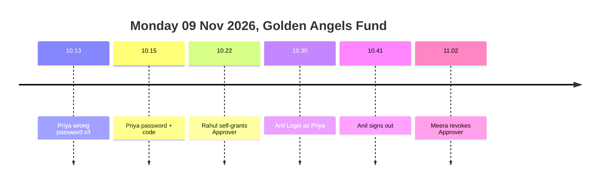

**Phase 1 — sign-in**

| # | When | What happens | Behind the scenes | Result |
|---|---|---|---|---|
| 1 | 10:13 | Priya types a wrong password | Doors (①) → Warden failure hook (②) → recorder (③) → writer (④) → store (⑤) | ✓ `sign_in.failed` invalid, user Priya, firm 18 |
| 2 | 10:14 | Wrong again, twice | Same as row 1 | ✓ 2 more rows; `failed_attempts` = 3 |
| 3 | 10:15 | Correct password | `warden.authenticate!` passes; Priya signed out for 2FA (`sessions_controller.rb:37`) | — (not a success yet) |
| 4 | 10:15 | Wrong WhatsApp code | `handle_wrong_code` hook (②) | ✓ `two_factor.code_failed` attempt 1 |
| 5 | 10:15 | Right code | `complete_login` hook (②) | ✓ `sign_in.succeeded` door `two_factor` |

**Phase 2 — power changes**

| # | When | What happens | Behind the scenes | Result |
|---|---|---|---|---|
| 6 | 10:22 | Rahul ticks Approver on himself | rolify `after_add` (②) → recorder (③) → writer (④) | ✓ `role.granted` approver, user = actor = Rahul |
| 7 | 10:22 | — | Writer (④) sees an alert kind → admin alerts (⑦) | ✉ Rahul + Meera: "Approver role given to Rahul Mehta" |
| 8 | 10:30 | Anil uses Login as on Priya | `login_as` hook after `session[:support_user_id]` (②) | ✓ `support.signed_in_as`, actor Anil, firm 18; ✉ admins |
| 9 | 10:41 | Anil signs out | `SessionsController#destroy` hook before `reset_session` (②) | ✓ `support.session_ended` |
| 10 | 11:02 | Meera unticks Approver for Rahul | rolify `after_remove` (②) | ✓ `role.revoked`; ✉ admins |

**Phase 3 — stall and review**

| # | When | What happens | Behind the scenes | Result |
|---|---|---|---|---|
| 11 | 11:30 | Redis is full (MISCONF); Priya signs in again | Recorder (③) enqueue raises → direct insert fallback | ✓ row saved inline; Priya signed in normally |
| 12 | 12:00 | Meera opens Security Events | Screen (⑥) scope = firm 18 | 10 rows; cards 3 · 2 · 1 · 0 |
| 13 | Mon 16 Nov 07:00 | Weekly pack | Pack job (⑧) for 09–15 Nov, all firms in IN | ✉ support@caphive.com: "[IN] Security events…" xlsx, Priya on "Failed sign-ins by account" (3 on 09 Nov) |

Snapshot at row 12 (Meera's screen):

```
Security Events ⓘ                                [Filter] [Download]
 Failed sign-ins 3 | Role changes 2 | Support access 1 | Exports 0
 09/11/2026 11:02  Role revoked: Approver   ✓  Rahul Mehta  Meera Iyer          Website
 09/11/2026 10:41  Support session ended    ✓  Priya Shah   Anil Kumar (support) Website
 09/11/2026 10:30  Support signed in as     ✓  Priya Shah   Anil Kumar (support) Website
 09/11/2026 10:22  Role granted: Approver   ✓  Rahul Mehta  Rahul Mehta          Website
```

What to notice:
- Row 3 records nothing: a correct password is not a success until the code passes (D4).
- Rows 6 and 10 come from rolify callbacks, not from `UsersController#update` — any route is caught (D2).
- Row 11 shows the never-fail rule: the queue failing changes nothing for Priya (D5).
- Beta Capital (31) sees none of these rows (D7).

### Key ideas

| # | Idea | In one line | Card |
|---|---|---|---|
| 1 | Hook where the truth is | Callbacks catch every route; controllers only where only they know the door | [②](#②-hooks) |
| 2 | One recorder, never raises | Every hook is one line; failure handling lives once | [③](#③-recorder) |
| 3 | Queue first, insert if the queue is down | Sign-in latency unchanged; events not lost | [④](#④-background-writer) |
| 4 | Firm on every row | Tenant scoping is a plain `entity_id` filter | [⑤](#⑤-event-store), [⑥](#⑥-security-events-screen) |
| 5 | Alerts only for power | Roles admin/approver, support switch, support access | [⑦](#⑦-admin-alerts) |
| 6 | Don't duplicate audits | Access rights, investor access, permissions stay in `audits` | [D3](#d3-flags-go-to-security-events-not-to-audits) |

**FAQ**

| Question | Answer |
|---|---|
| Why not just log lines? | Logs are per box, not tenant-scoped, rotated in days and not queryable by a firm admin. The SOC 2 review needs 1 year. |
| Does anyone get blocked? | No. Recording is observational; no hook changes a response. |
| Why not record every API request? | Volume (every MCP/mobile call) with no forensic gain over the token-issuing sign-in. Per-request refusals are recorded. |
| Why is a correct password not a success? | For 2FA users Warden authenticates before the code (`sessions_controller.rb:27`); recording then would claim a sign-in that may never complete. |

---

## 2. The same picture with real names

### Picture

```mermaid
flowchart LR
    classDef new fill:#d4edda,stroke:#2e7d32,color:#000
    classDef mod fill:#fff3cd,stroke:#b8860b,color:#000
    classDef reuse fill:#eceff1,stroke:#90a4ae,color:#000
    s1["① SessionsController, TwoFactorController,<br/>UsersController, MobileSignIn, McpController…<br/><i>the doors and actions</i>"]:::reuse
    s2["② Warden before_failure, rolify after_add/remove,<br/>User#record_security_changes, 14 call lines<br/><i>one line where the outcome is known</i>"]:::mod
    s3["③ SecurityEvents.record<br/>SecurityEvents::Catalogue<br/><i>builds attrs; never raises</i>"]:::new
    s4["④ SecurityEventWriteJob<br/><i>insert by uid; fallback inline</i>"]:::new
    s5["⑤ SecurityEvent<br/>security_events table<br/><i>append-only</i>"]:::new
    s6["⑥ SecurityEventsController#index<br/>SecurityEventPolicy, SecurityEventDownloadJob<br/><i>firm-scoped list + xlsx</i>"]:::new
    s7["⑦ SecurityEventAlert + SecurityEventNotifier<br/>SecurityEventsMailer#admin_alert<br/><i>company admins</i>"]:::new
    s8["⑧ SecurityEventWeeklyPackJob<br/>SecurityEventPurgeJob<br/><i>Monday xlsx; nightly purge</i>"]:::new
    s1 -->|"callback /<br/>action line"| s2
    s2 -->|"record(kind, user:,<br/>door:, details:)"| s3
    s3 -->|"perform_later(attrs)"| s4
    s4 -->|"create! uid"| s5
    s4 -->|"Alert.deliver(event)"| s7
    s5 -->|"policy_scope"| s6
    s5 -->|"occurred_at range"| s8
    click s1 "#①-doors-and-actions"
    click s2 "#②-hooks"
    click s3 "#③-recorder"
    click s4 "#④-background-writer"
    click s5 "#⑤-event-store"
    click s6 "#⑥-security-events-screen"
    click s7 "#⑦-admin-alerts"
    click s8 "#⑧-weekly-pack-and-clean-up"
```

Colour = footprint: **green** new, **amber** modified, **grey** reused unchanged. Exact files are in
[lld.md File Map](lld.md#file-map).

### What each box does

| # | Box | Real parts | What it does | When it runs | What it decides | Details |
|---|---|---|---|---|---|---|
| ① | Doors and actions | Existing controllers/services | Sign-in, role save, Login as, token create, export | Request | Success or refusal (unchanged) | [card ①](#①-doors-and-actions) |
| ② | Hooks | Warden, rolify, User after-commit, 14 lines | Calls the recorder once per moment | In the request / callback | Which kind, which door | [card ②](#②-hooks) |
| ③ | Recorder | `SecurityEvents.record`, `Catalogue`, `Context` | Builds attrs (IP, UA, actor, firm, uid); enqueues | In the request, < 1 ms, no queries | Firm; drop secrets | [card ③](#③-recorder) |
| ④ | Background writer | `SecurityEventWriteJob` | Inserts once; triggers alert | Sidekiq `:default` | Duplicate? alert? | [card ④](#④-background-writer) |
| ⑤ | Event store | `SecurityEvent`, `security_events` | Holds rows; read-only model | — | — | [card ⑤](#⑤-event-store) |
| ⑥ | Screen | `SecurityEventsController`, `SecurityEventPolicy`, `SecurityEventDownloadJob` | List, filter, cards, xlsx | Request / job | Who sees which firm | [card ⑥](#⑥-security-events-screen) |
| ⑦ | Admin alerts | `SecurityEventAlert`, `SecurityEventNotifier`, `SecurityEventsMailer` | Email + bell | Inside ④ | Alert kind? recipients | [card ⑦](#⑦-admin-alerts) |
| ⑧ | Weekly pack + clean-up | `SecurityEventWeeklyPackJob`, `SecurityEventPurgeJob` | Monday xlsx; purge > 13 months | sidekiq-cron | Week window; cut-off | [card ⑧](#⑧-weekly-pack-and-clean-up) |

### One run, end to end

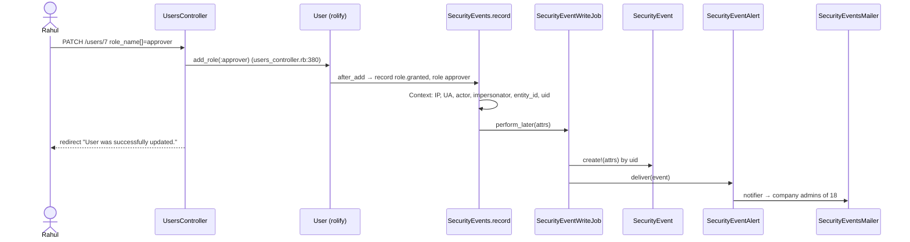

### Lifecycles

N/A — an event has no status; it is written once and only ever deleted by retention. The only time
dimension is `occurred_at` vs the 13-month cut-off ([card ⑧](#⑧-weekly-pack-and-clean-up)).

### What users see

**At a glance**

| Where in CapHive | Today | After this change | Who sees it |
|---|---|---|---|
| Settings menu | Audit Trail | + Security Events | Company admins, support, super |
| Settings › Security Events | — | Firm's events, filters, cards, Download | Same |
| Email + bell | — | Admin alert (role admin/approver, support switch, support access) | Company admins of the firm |
| Email (Monday) | — | Weekly pack xlsx | support@caphive.com (per-region `SECURITY_EVENTS_WEEKLY_TO`) |
| Every sign-in, role save, Login as | — | Unchanged | Everyone |

**Main journey — Meera reviews**

```
┌ Security Events ⓘ ①                         [② Filter] [③ Download] ┐
│ ④ Failed sign-ins 3 │ Role changes 2 │ Support access 1 │ Exports 0 │
│ ⑤ Period 10/10/2026 – 09/11/2026 · Group: All                      │
│ ⑥ When │ Event ⓘ │ Outcome │ Account │ Done by │ Door │ IP │ Region │
│   09/11/2026 10:22 │ Role granted: Approver │ ✓ │ Rahul │ Rahul │ … │
│ ⑦ ‹ 1 2 3 ›                                                         │
└─────────────────────────────────────────────────────────────────────┘
```

| Step | The user… | They see |
|---|---|---|
| 1 | Opens Settings › Security Events | ① title with ⓘ tooltip; ④ cards; ⑥ last 30 days |
| 2 | ② Filter → Group = Access, Apply | Table and cards reload in the turbo frame |
| 3 | Hovers ⓘ on an Event cell | Details: "Role: approver" |
| 4 | ③ Download | Flash "Your request is being processed. You will receive an email shortly." |

**Screen standards**

| Screen | Kind | Copies | Breadcrumbs | Tabs (lazy pills) | Turbo (frames / streams per action) | Stats cards (= grid totals) | Filter + search | Actions (header + Actions dropdown) | Help | Full width |
|---|---|---|---|---|---|---|---|---|---|---|
| Security Events | index | `capital_calls/_index` (h1.h3 header, outline `ti` buttons, `_grid_stats` via `NumberStatsComponent`, `layouts/filter`, `RansackTable`, pagy) | Settings › Security Events | None (one list) | `security_events_frame` wraps cards + table; filter and paging replace the frame; no row actions | Failed sign-ins, Role changes, Support access, Exports = grouped count of the filtered scope | `layouts/filter`: dates, group, kind, outcome, account, IP. **No `SearchComponent`** — no search index; filter by account/IP instead | Header: Filter · Download (outline). No Actions dropdown — read-only | Title ⓘ; Event cell ⓘ with details; Door ⓘ; empty state with next step | `container-fluid mw-100` |
| Admin alert email | email | `FinancialStatementsMailer#unlocked_notification` layout | — | — | — | — | — | Button "Open Security Events" | — | — |

- No row action changes data, so no turbo-stream responses are needed; filter/page = frame replace.
- Help is tooltips; the only coloured badge is outcome (`bg-success-subtle` / `bg-danger-subtle`).
- One icon per group: `ti-login` sign-in, `ti-shield-lock` two-factor, `ti-user-cog` account,
  `ti-key` access, `ti-headset` support, `ti-plug` credential, `ti-download` data.
- Hand-made mock copying the reference markup: [mocks/security_events_index.html](mocks/security_events_index.html).

### Design decisions

**At a glance**

| # | Decision | Why, in one line |
|---|---|---|
| D1 | New `security_events` table, not `audits` | `audits` has no firm column, is 1.65M rows / 2.1 GB, and failed sign-ins have no record |
| D2 | Hook model callbacks first, controllers second | Callbacks catch every route (11 files grant roles) |
| D3 | Flags go to security events, not to audits | No duplication; the event carries from → to |
| D4 | Record sign-in success at completion points, not in Warden `after_authentication` | Warden fires before the 2FA code |
| D5 | Queue first, direct insert fallback, log last; never raise | User asked for async; Redis MISCONF must not lose events or fail sign-in |
| D6 | Request context from `Audited.store` | Audited::Sweeper already stores the controller, IP and request uuid per request |
| D7 | Policy scope by `entity_id`; NULL-firm rows super-only | Plain tenant scoping; unknown emails belong to nobody |
| D8 | Alerts only for admin/approver roles, support switch and support access | Power changes are rare; sign-ins would drown the signal |
| D9 | 13-month retention, nightly purge | Methodology §6 asks ≥ 1 year |
| D10 | Failed-sign-in email stored only as a digest | Users type passwords into the email box |
| D11 | Weekly pack to support@caphive.com via per-region `SECURITY_EVENTS_WEEKLY_TO` | User's choice (2026-11-09); per-region setting keeps IN and US independent |

#### D1. New table, not `audits`

- **Problem:** where do events live? E.g. "unknown email failed to sign in at 03:12" has no record to hang an audit on.
- **Decision:** new `security_events` table with `entity_id`, read by `SecurityEvent`.
- **Why:**
  - `audits` has no `entity_id` (`db/schema.rb:768-788`); `AuditPolicy::Scope` filters by employees' user ids (`audit_policy.rb:5`) — can't hold NULL-user failures.
  - `audits` ≈ 1.65M rows, 1.7 GB data + 0.4 GB index (information_schema, prod copy); an `ALTER` to add columns is a long lock, and retention would differ (forever vs 13 months).
  - Events are ~3% of audit volume (see [Performance](#performance)).
- **Not chosen:** extending `audits` with `kind`/`entity_id` — large DDL, mixed retention, policy rewrite.
- **Where:** `security_events`, `SecurityEvent`.

#### D2. Hook model callbacks first

- **Problem:** roles are granted from `users_controller.rb:380`, `support_client_mapping.rb`, `permission.rb`, `investor_advisor.rb`, `investor_access.rb`, `users_sync_controller.rb`, `fetch_or_create_user.rb`, rake tasks — 11 files.
- **Decision:** rolify `after_add`/`after_remove` (`user.rb:173`) and `User#record_security_changes` after-commit; controller lines only where the door/outcome is known nowhere else.
- **Why:** one hook per fact; new call sites are covered automatically.
- **Not chosen:** recording in `UsersController#update` only (the finding's line) — misses 10 other routes.
- **Where:** `User`, [card ②](#②-hooks).

#### D3. Flags go to security events, not to audits

- **Problem:** `enable_support`, `two_factor_enabled`, `active`, `locked_at` aren't in `audit_fields` (`user.rb:18`).
- **Decision:** record them as events with `details: {from:, to:}`; leave `audit_fields` unchanged.
- **Why:** one place to look; events have firm + IP + door; `locked_at` changes on every lockout and doesn't belong in the 1.65M-row table.
- **Not chosen:** widening `audit_fields` too — the same fact in two tables, two retention rules.
- **Where:** `User#record_security_changes`.

#### D4. Sign-in success at completion points

- **Problem:** `warden.authenticate!` (`sessions_controller.rb:27`) succeeds for 2FA users before the code; they are signed out at `:37`.
- **Decision:** explicit `record("sign_in.succeeded", door:)` at each completion (`sessions_controller.rb:41`, `two_factor_controller.rb:349`, …). Warden is used only for **failures** (`before_failure`, filtered to `POST /users/sign_in`).
- **Why:** exactly one success per real sign-in; `before_failure` also catches `:locked`/`:inactive` thrown by Devise's activatable hook.
- **Not chosen:** `after_set_user` — fires on the pre-2FA authenticate and on every `sign_in` incl. Login as and enrolment, needing fragile filtering.
- **Where:** [card ②](#②-hooks) rows S1–S2.

#### D5. Queue first, insert fallback, log last

- **Problem:** async was asked for, but Redis has failed before (MISCONF when the data box disk fills) — enqueue then raises inside a sign-in.
- **Decision:** `SecurityEventWriteJob.perform_later(attrs)`; on any error → `SecurityEvent.write!(attrs)` inline on the writing role; on error → one `Rails.logger.warn` JSON line `[security_event]`. Never re-raise.
- **Why:** no added DB write in the normal request; GET requests on the replica (DatabaseSelector) don't need `connected_to(role: :writing)`; alerts run in the job.
- **Not chosen:** always inline insert — writes on replica-routed requests, alert fan-out in the request.
- **Where:** `SecurityEvents.record`, `SecurityEventWriteJob`.

#### D6. Request context from `Audited.store`

- **Problem:** model callbacks (rolify, after-commit) don't see the request.
- **Decision:** `SecurityEvents::Context` reads `Audited.store[:current_controller]` (request IP, UA, `request_id`, `current_user`, `session[:support_user_id]`); in jobs, `Current.user` (restored by `ApplicationJob`); else `system`.
- **Why:** `Audited::Sweeper` already fills it per request (`config/initializers/audited.rb` sets `current_user_or_support_user`); no change to `Current`.
- **Not chosen:** new `Current` attributes + before_action — another existing-file change for the same data.
- **Where:** `SecurityEvents::Context`.

#### D7. Scope by `entity_id`

- **Problem:** who sees which events, including events about unknown emails?
- **Decision:** `SecurityEventPolicy::Scope`: super → all; support → firms from enabled `SupportClientMapping` with `enable_support` (the `BaseScope#resolve_admin` pattern, `base_scope.rb:19`); company admin → own `entity_id`; others → none. `entity_id IS NULL` only for super.
- **Why:** same shape as every other policy; no row loop checks.
- **Not chosen:** scoping by user ids as `AuditPolicy` does — misses NULL-user rows and is a big `IN` list.
- **Where:** `SecurityEventPolicy`.

#### D8. Alerts only for power changes

- **Problem:** which events email admins?
- **Decision:** `role.granted/revoked` for `company_admin`/`approver` when the grantee lacks `:support`; `support_access.enabled/disabled`; `support.signed_in_as`; `support.firm_switched`.
- **Why:** ~4 alerts/month/firm; a firm switch already adds `company_admin` to the support user (`support_client_mapping.rb:77`), so the support-role exclusion avoids two alerts for one act.
- **Not chosen:** alert on failed sign-ins — that's M12's Grafana alert, aggregated.
- **Where:** `SecurityEventAlert::ALERT_KINDS`.

#### D9. 13-month retention

- **Problem:** SOC 2 evidence needs ≥ 1 year (`security_event_review_methodology.md` §6).
- **Decision:** `SecurityEventPurgeJob` daily deletes `occurred_at < 13.months.ago` in batches of 5,000.
- **Why:** a month of margin for the annual audit; bounded table.
- **Not chosen:** keep forever — unbounded IP/UA personal data.
- **Where:** `SecurityEventPurgeJob`.

#### D10. Digest, not email, on failed sign-in

- **Problem:** the email box sometimes holds a password typed in the wrong field.
- **Decision:** store `identifier_digest = SHA256(downcased email + per-region pepper)` only; when the email matches a user, store `user_id` instead.
- **Why:** reviewers can still search ("did anyone try ravi@…?") by digesting the query; no secret at rest.
- **Not chosen:** store the email — leaks mistyped passwords; store nothing — no way to see credential stuffing on one address.
- **Where:** `SecurityEvents::Context#identifier_digest`.

#### D11. Weekly pack to support@caphive.com (decided 2026-11-09)

- **Problem:** who receives the SOC 2 weekly export?
- **Decision:** one mailbox, **support@caphive.com**, read from a per-region setting
  `SECURITY_EVENTS_WEEKLY_TO` (set to `support@caphive.com` in both `.env.production.in` and
  `.env.production.us`). The subject names the region: "[IN] Security events 02 Nov – 08 Nov 2026".
- **Why:** the user chose a shared support mailbox over individual super users (2026-11-09). The address is read
  per region, not hard-coded, because IN and US are independent environments: each region's job reads its own
  setting and sends only its own region's events, and the region in the subject keeps the two packs apart in one
  inbox.
- **Not chosen:** every super user of the region (the earlier draft): people change, and a mailbox is easier to
  hand over and audit. A hard-coded address: shared config across regions.
- **Where:** `SecurityEventWeeklyPackJob`; unset setting → the job logs a warning and sends nothing.

**FAQ**

| Question | Answer |
|---|---|
| Why not a gem like `authtrail`? | It covers web sign-in only (Warden), and the hard parts here are mobile, API, OAuth, roles and impersonation. |
| Why does the screen not use `SearchComponent`? | It queries Elasticsearch; events are not indexed (volume, PII). Filters cover account and IP. |
| Is anything exposed over MCP? | No. No ontology YAML is added; events are not an MCP surface. |

---

## 3. One card per box

### ① Doors and actions

The existing entry points. **Unchanged** in behaviour: no message, redirect or status changes.

| Owns | Reads / receives | Produces |
|---|---|---|
| Sign-in, 2FA, profile, role, support, token, export flows | Requests | The moment ② hooks onto |

- Doors that never touch Warden: devise-api tokens, mobile app, OAuth/MCP bearer, mail add-ins — they
  get explicit lines in ②.
- Email change is impossible (`user.rb:252` `email_cannot_change`) — no kind for it.
- No admin lock/unlock action exists; locks come from Devise lockable and `two_factor_verifier.rb:184`.
- There is no Excel/Word add-in; only Outlook and Gmail.

**Worked examples:** regression rows E46–E49 ([business-rules § 7](business-rules.md#7-never-affects-the-user--phase-1)).

**FAQ**

| Question | Answer |
|---|---|
| Does any door change? | No — only a recorder line is added; tests assert the same messages. |

### ② Hooks

One line per moment. The full catalogue — 29 kinds, each with its exact hook:

**Sign-in (`sign_in`)**

| ID | Kind | Door | Outcome | Hook (file:line) | Account from |
|---|---|---|---|---|---|
| S1a | `sign_in.succeeded` | `web_password` | success | `users/sessions_controller.rb:41` after `sign_in(resource)` | `resource` |
| S1b | `sign_in.succeeded` | `two_factor` | success | `users/two_factor_controller.rb:349` `complete_login`; enrolments `:144`, `:189`, `:232` | `@user` |
| S1c | `sign_in.succeeded` | `magic_link` | success | `users_controller.rb:264` after `sign_in @user` (non-support branch) | `@user` |
| S1d | `sign_in.succeeded` | `password_reset` | success | `users/passwords_controller.rb` new `update` wrapper (`:15` is the 2FA suppression) when `signed_in?` | `resource` |
| S1e | `sign_in.succeeded` / `failed` | `mobile` | both | `api/mobile/v1/sessions_controller.rb:63` `render_result` (`:session` = success; error kinds = failure) | `result.user` / email digest |
| S1f | `sign_in.succeeded` | `api` | success | `config/initializers/devise_api.rb` `after_successful_sign_in` | resource owner |
| S1g | `sign_in.failed` | `api` | failure | `users/tokens_controller.rb:15` after `super` when status ≥ 400 | email digest |
| S1h | `sign_in.succeeded` | `cross_region` | success | `users_controller.rb:186` after `sign_in(user)`; mobile via `render_result` (`mobile_sign_in.rb:141`) | `user` |
| S1i | `sign_in.failed` | `cross_region` | failure | `users_controller.rb:462` `reject_handoff` | email if given |
| S1j | `sign_in.succeeded` / `failed` | `mobile_handoff` | both | `users/mobile_handoffs_controller.rb:34` / `:29` | `user` |
| S1k | `sign_in.succeeded` | `mail_addin` | success | `outlook_addin_controller.rb:58`; `gmail_addin_controller.rb:87` | `current_user` |
| S1l | `sign_in.failed` | `mail_addin` | failure | `api/v1/mail/base_controller.rb:81` (401 rescue), `:72`, `:80` | token user if known |
| S1m | `sign_in.failed` | `oauth` | failure | `mcp_controller.rb:97` (401 render) — reasons invalid / deactivated / entity mismatch; **missing token records nothing** | token user if known |
| S2a | `sign_in.failed` | `web_password` | failure | new `config/initializers/security_event_warden.rb` `before_failure`, only `POST /users/sign_in`; reason = `env['warden.options'][:message]` (`:invalid`, `:locked`, `:inactive`) | `User.find_for_authentication(email)` in the job, else digest |
| S2b | `sign_in.failed` | `magic_link` | failure | `users_controller.rb:216` (bad/expired link), `:233` (support delegation refused) | `support_user` / none |
| S3 | `sign_out` | `web_password` | success | `users/sessions_controller.rb:51` **before** `reset_session` | `current_user` |

**Two-factor (`two_factor`)**

| ID | Kind | Hook | Notes |
|---|---|---|---|
| T1 | `two_factor.code_failed` | `two_factor_controller.rb:362` `handle_wrong_code`; mobile `render_result` wrong-code kind (`mobile_sign_in.rb:94`) | details: `attempt`, `challenge_ended` (`:376-379`) |
| T2 | `two_factor.enabled` / `two_factor.disabled` | `User#record_security_changes` on `two_factor_enabled` | any route incl. admin console |
| T3 | `two_factor.method_set` | same, `two_factor_mode` nil → mode | enrolment `:142`, `:187`, `:230` |
| T4 | `two_factor.method_reset` | same, mode → nil while enabled | `two_factor_reset.rb:88`; actor admin or self |

**Account (`account`)**

| ID | Kind | Hook | Notes |
|---|---|---|---|
| A1 | `password.changed` | `record_security_changes` on `encrypted_password` | Devise registration update, reset, admin form |
| A2 | `password.reset_requested` | `users/passwords_controller.rb` new `create` wrapper | user only if found; paranoid response unchanged |
| A3 | `phone.changed` | `record_security_changes` on `phone` (`user.rb:413`) | details: last 2 digits only; the full numbers stay in `audits` |
| A4 | `account.locked` / `account.unlocked` | `record_security_changes` on `locked_at` | reason: `failed_attempts ≥ 6` → too many passwords, else too many codes |
| A5 | `account.deactivated` / `account.reactivated` | `record_security_changes` on `active` | admin console, `users_sync_controller.rb:93` |
| A6 | `firm.deactivated` | `entities_controller.rb:127` `deactivate` | `EntityDeactivationJob` uses `update_all` — one firm event instead of N |

**Access (`access`)**

| ID | Kind | Hook | Notes |
|---|---|---|---|
| R1 | `role.granted` / `role.revoked` | rolify `after_add` / `after_remove` at `user.rb:173` | details: role name, resource type/id when scoped |
| R2 | `support_access.enabled` / `support_access.disabled` | `record_security_changes` on `enable_support`; `User.disable_support_for_all` (`user.rb:986`) one `system` event | |

**Support access (`support`)**

| ID | Kind | Hook | Notes |
|---|---|---|---|
| P1 | `support.signed_in_as` | `users_controller.rb:301` (login_as), `:267` (support `no_password_login`) | actor = support user; firm = target's |
| P2 | `support.session_ended` | `users/sessions_controller.rb:51` when `session[:support_user_id]` present | before `reset_session` |
| P3 | `support.firm_switched` / `support.switched_back` | `support_client_mapping.rb:77` `switch`, `:109` `revert` | firm = client entity |

**Credentials (`credential`)**

| ID | Kind | Hook | Notes |
|---|---|---|---|
| K1 | `api_token.created` / `api_token.revoked` | `users/api_tokens_controller.rb:16`, `:29` | details: token name; never the token |
| K2 | `mobile_device.revoked` | `users/mobile_devices_controller.rb:12`; `api/mobile/v1/sessions_controller.rb:51` | details: device name, reason |
| K3 | `connected_app.authorised` | `config/initializers/doorkeeper.rb:500` `after_successful_authorization` (uncomment + implement) | details: application name, scopes |

**Data (`data`)**

| ID | Kind | Hook | Notes |
|---|---|---|---|
| D1 | `data.exported` | `application_controller.rb` `after_action` when `request.format.xlsx?` and 2xx/3xx | covers 29 controllers incl. `audits_controller.rb:32` |
| D2 | `data.exported` | `folders_controller.rb:31`, `documents_controller.rb:375` | bulk document download |
| D3 | `data.exported` | `entities_controller.rb:153` | firm data dump |
| D4 | `data.exported` | `report_builder_controller.rb:182`, `secondary_sales_controller.rb:130` | report / sale download |

Not recorded (already elsewhere): access rights, investor access, support-client mappings and
permission changes — `Trackable` audits (`access_right.rb:2`, `investor_access.rb:2`,
`support_client_mapping.rb:2`, `user.rb:18`). Single document views — `ViewedBy`
(`documents_controller.rb:181`).

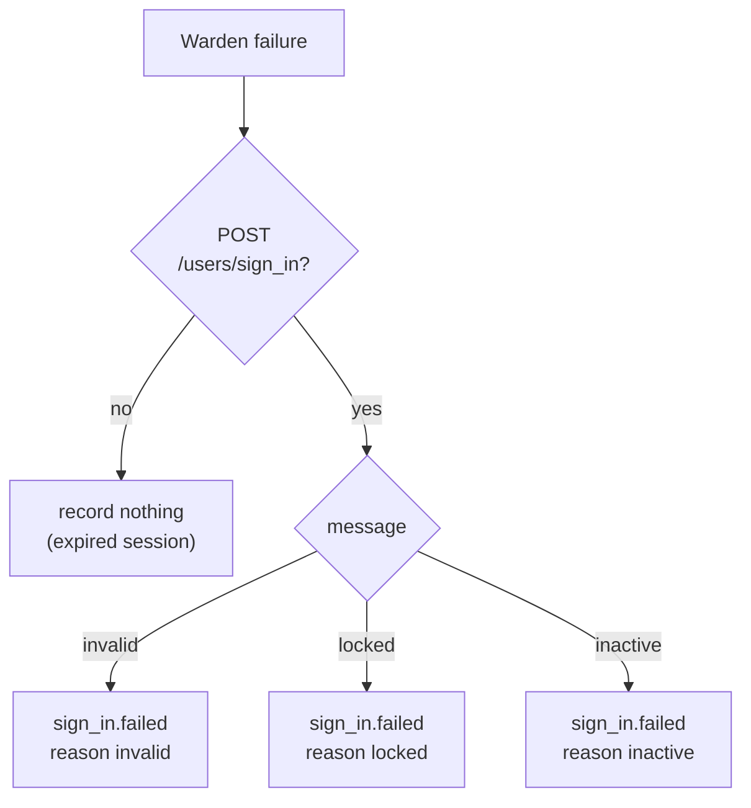

| Hook family | Count | Runs in | Failure handling |
|---|---|---|---|
| Model callbacks (rolify, after-commit) | 2 | after commit / HABTM add | recorder rescues |
| Warden `before_failure` | 1 | failure app | recorder rescues |
| Gem config hooks | 2 | gem controller | recorder rescues |
| Controller / service lines | ~22 | the action, after the outcome | recorder rescues |

**Worked examples:** H1–H27, E1–E32, X1–X2 ([business-rules § 1–4](business-rules.md#1-sign-in--phase-1)).

**FAQ**

| Question | Answer |
|---|---|
| Does rolify fire `after_remove` on `remove_role`? | It passes the options to the `has_and_belongs_to_many :roles` callbacks; `remove_role` deletes through the association. Task 2.1 proves it with H17 and E25 before anything else is built on it. |
| Why not use `after_commit` for role grants? | HABTM rows have no model; the association callback is the only hook. It runs inside the caller's transaction, so the job is enqueued `after_commit` of that transaction via `ActiveRecord.after_all_transactions_commit` — a rolled-back grant records nothing (E24). |
| Why filter `before_failure` on the path? | Every expired-session `authenticate_user!` also lands in the failure app with `:unauthenticated`. |
| What about OAuth token refresh/revoke at `/oauth/token`? | Not recorded: machine-to-machine, high volume. Authorisation (K3) is the human act. |

### ③ Recorder

The one call every hook makes. Builds the event attributes on the request thread from memory only (no
queries) and hands them to ④.

| Owns | Reads / receives | Produces |
|---|---|---|
| `SecurityEvents.record`, `Catalogue`, `Context` | kind, user, door, outcome, details | attrs hash + `recorded.security_event` notification |

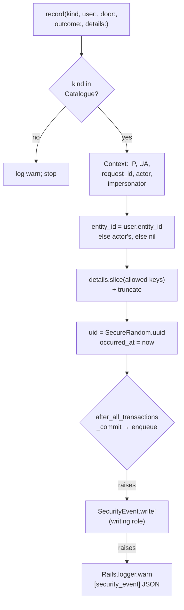

- **Catalogue:** frozen hash `kind → {category:, alert:, allowed_detail_keys:}`. Unknown kinds are a
  programming error: logged, never raised.
- **Detail allowlist:** each kind lists its keys (e.g. `role.granted` → `role`, `resource_type`,
  `resource_id`). Anything else is dropped, so a caller can't leak a token by passing `params`.
- **Never raises:** the whole body is wrapped; returns `nil`.

**Worked examples:** E33–E37, X3–X5 ([business-rules § 5](business-rules.md#5-recorder-and-writer--phase-1)).

**FAQ**

| Question | Answer |
|---|---|
| Why build attrs on the request thread? | IP, UA and actor exist only there; the job just inserts. |
| Why `after_all_transactions_commit`? | A role grant inside a rolled-back transaction must not be recorded. Outside a transaction it runs immediately. |

### ④ Background writer

| Owns | Reads / receives | Produces |
|---|---|---|
| `SecurityEventWriteJob` | attrs (plain hash, ids only) | one row; alert call |

| Item | Value |
|---|---|
| Queue | `:default` (alerts should be prompt; tiny job) |
| Args logging | `self.log_arguments = false` (IP/UA must not reach the Sidekiq log — cf. L14) |
| Idempotency | unique index on `uid`; `RecordNotUnique` → return without alert |
| Retry | ActiveJob default (Sidekiq 25) for DB errors |
| Alert | `SecurityEventAlert.deliver(event)` only after a fresh insert |
| Account resolution | for S2a, `User.find_for_authentication(email)` happens here, not in Warden; then the digest is dropped if found |

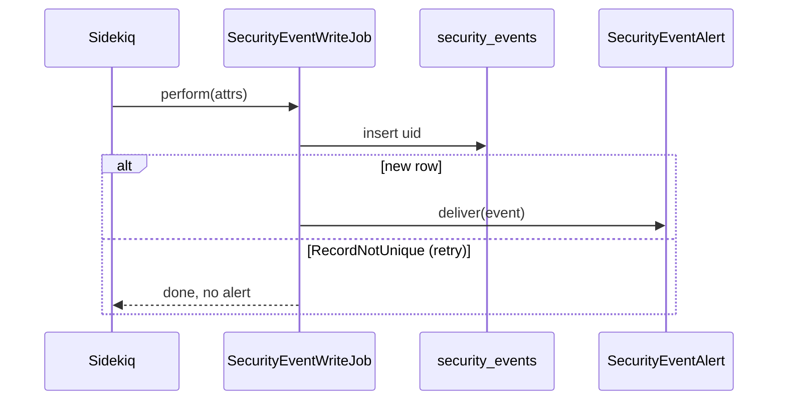

**Worked examples:** H28, E33, E34, X3 ([business-rules § 5](business-rules.md#5-recorder-and-writer--phase-1)).

**FAQ**

| Question | Answer |
|---|---|
| Why not the `:low` queue? | `:low` holds 67 job classes incl. dumps; an alert 30 min late is not useful. |
| Why resolve the user in the job for web failures? | Keeps the Warden hook query-free and timing-neutral (no user-enumeration timing). |

### ⑤ Event store

| Owns | Reads / receives | Produces |
|---|---|---|
| `security_events`, `SecurityEvent` | inserts from ④ | rows for ⑥ and ⑧ |

- `SecurityEvent#readonly?` → `persisted?`; no `update`/`destroy` path; purge uses `delete_all` on a batch.
- `belongs_to :entity, :user, :actor, :impersonator` — all `optional: true` (failures may have none).
- Not `Trackable` (an audit of an audit), not `acts_as_paranoid`, no Chewy index.
- `ransackable_attributes`: `kind category outcome door ip_address occurred_at user_id actor_id region`.
- Schema: [Part 4](#data-model-and-schema-changes).

**Worked examples:** X4, X5 ([business-rules § 5](business-rules.md#5-recorder-and-writer--phase-1)).

**FAQ**

| Question | Answer |
|---|---|
| Why no foreign keys? | A deleted user or firm must not block or cascade-delete evidence. Ids are indexed. |

### ⑥ Security Events screen

| Owns | Reads / receives | Produces |
|---|---|---|
| `SecurityEventsController#index`, `SecurityEventPolicy`, `SecurityEventDownloadJob`, views | filters | list, cards, xlsx email |

**Routes**

| Verb and path | Action | Does | Responds with |
|---|---|---|---|
| `GET /security_events` | `index` | filtered, paginated list + cards | HTML (frame `security_events_frame`) |
| `GET /security_events.xlsx` | `index` | enqueues `SecurityEventDownloadJob(params, user_id:)` | redirect back + flash |

**Role → access**

| Role | `index?` | Scope |
|---|---|---|
| `super` | yes | all rows incl. `entity_id IS NULL` |
| `support` | yes | `entity_id IN` enabled mappings with `enable_support` (`base_scope.rb:19` pattern) |
| `company_admin` | yes | `entity_id = user.entity_id` |
| employee, approver, investor, advisor | no | `none` |
| Impersonating support | as the impersonated user | (policy sees `current_user`) |

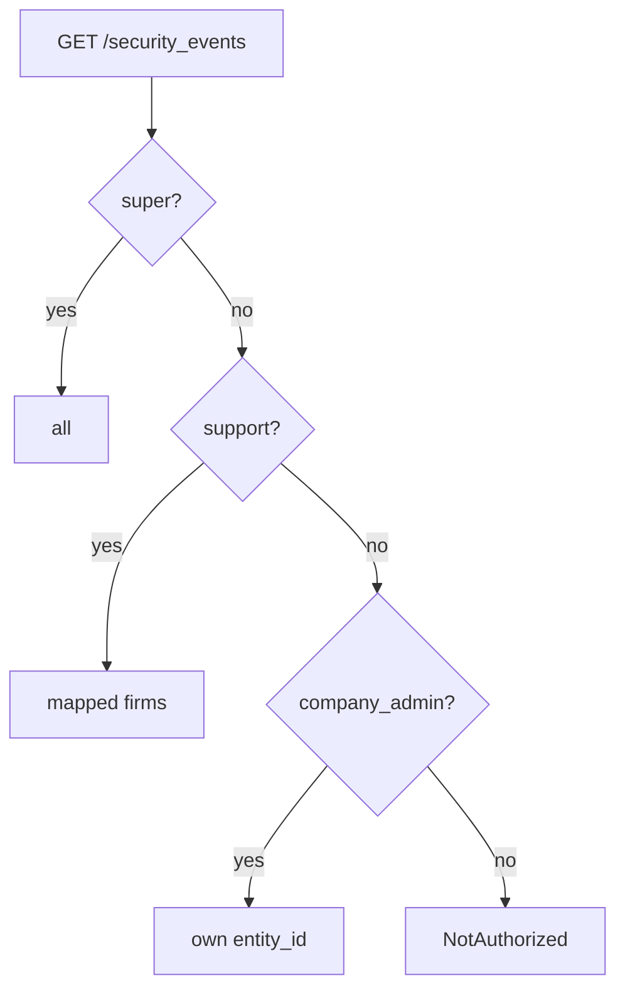

- `authorize SecurityEvent` + `policy_scope(SecurityEvent)` then `ransack` with the allowlist.
- Default period: last 30 days; max 13 months (refused range → clamped, flash).
- Download job re-loads the user and re-applies `SecurityEventPolicy::Scope` (as `AuditDownloadJob`
  does, `audit_download_job.rb:6`), renders `security_events/index.xlsx.axlsx`, mails via
  `SecurityEventsMailer#download`.
- Menu link in `_company_menus.html.erb:138` shown when `policy(SecurityEvent).index?`.

**Worked examples:** H29–H31, E38–E40, E44–E45, X6–X11 ([business-rules § 6](business-rules.md#6-screen-alerts-pack--phase-3)).

**FAQ**

| Question | Answer |
|---|---|
| Can support see a firm without support enabled? | No — same rule as every support scope. |
| Why can't approvers see it? | Approvers are the role most worth watching; admins oversee them. |

### ⑦ Admin alerts

| Owns | Reads / receives | Produces |
|---|---|---|
| `SecurityEventAlert`, `SecurityEventNotifier`, `SecurityEventsMailer#admin_alert` | a fresh event | email + bell per admin |

- `ALERT_KINDS`: `role.granted`, `role.revoked` (only roles `company_admin`, `approver`, grantee without
  `:support`), `support_access.enabled`, `support_access.disabled`, `support.signed_in_as`,
  `support.firm_switched`.
- Recipients (one place): `User.company_admins.active.where(entity_id: event.entity_id)` — includes the actor.
- No firm → no alert.
- Email dates via `l(...)` → `Mon dd, yyyy` (`EmailDateLocalization`).

**Worked examples:** H32–H33, E41–E42, X12 ([business-rules § 6](business-rules.md#6-screen-alerts-pack--phase-3)).

**FAQ**

| Question | Answer |
|---|---|
| Why include the actor? | A lone admin's self-grant still lands in an inbox; harmless otherwise. |
| Can a firm mute it? | No — see [Notifications](#notifications). |

### ⑧ Weekly pack and clean-up

| Owns | Reads / receives | Produces |
|---|---|---|
| `SecurityEventWeeklyPackJob`, `SecurityEventPurgeJob` | `occurred_at` windows | xlsx email; deleted rows |

| Job | Cron (sidekiq.rb) | Window | Does |
|---|---|---|---|
| Weekly pack | in `'30 1 * * 1'` (07:00 IST); us `'0 12 * * 1'` | previous Mon 00:00 – Sun 23:59 local | xlsx (All, Failed sign-ins by account, Access, Support, Exports) → `SECURITY_EVENTS_WEEKLY_TO` (support@caphive.com), subject prefixed with the region |
| Purge | `'15 21 * * *'` in / `'15 7 * * *'` us (off-peak) | `occurred_at < 13.months.ago` | `in_batches(of: 5_000).delete_all` |

**Worked examples:** H34–H35, E43 ([business-rules § 6](business-rules.md#6-screen-alerts-pack--phase-3)).

**FAQ**

| Question | Answer |
|---|---|
| What if the pack fails? | Sidekiq retries; ExceptionNotifier on final failure; the reviewer can Download the same range from ⑥. |

---

## 4. Reference

### Class diagram

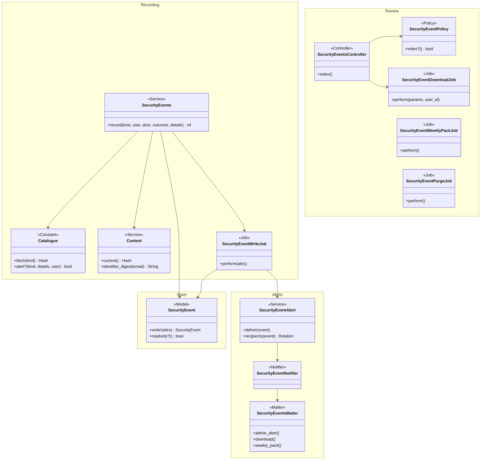

### Data model and schema changes

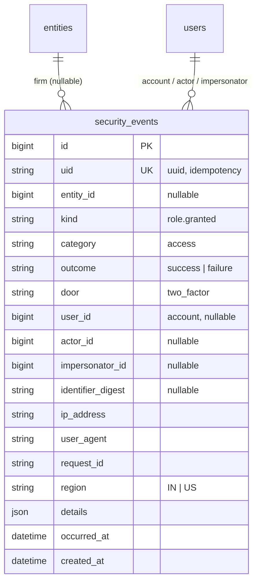

**Indexes:** `uid` unique · `[entity_id, occurred_at]` · `[user_id, occurred_at]` · `[kind, occurred_at]` · `[ip_address, occurred_at]` · `[occurred_at]`

**Schema changes**

**`security_events`** (new): the append-only trail; nothing similar exists (D1).

| Column / index | What changed | Why it's needed |
|---|---|---|
| `id` | Added, bigint PK | Row identity, keyset paging |
| `uid` | Added, string(36), unique | Retry-safe insert; alert sent once |
| `entity_id` | Added, bigint, null | Tenant scope; NULL = unknown account (CapHive only) |
| `kind` | Added, string(40) | What happened (catalogue key) |
| `category` | Added, string(20) | Group filter and stats cards without a CASE over kinds |
| `outcome` | Added, string(10) | Success/failure filter, the core of brute-force review |
| `door` | Added, string(20) | How they came in |
| `user_id` | Added, bigint, null | Account the event is about |
| `actor_id` | Added, bigint, null | Done by (differs from account for admin acts) |
| `impersonator_id` | Added, bigint, null | CapHive support behind the session |
| `identifier_digest` | Added, string(64), null | Search failed attempts on unknown/any email without storing it (D10) |
| `ip_address` | Added, string(45) | IPv6-safe; "same IP many accounts" |
| `user_agent` | Added, string(255) | Device/browser forensics; truncated |
| `request_id` | Added, string(36) | Join to app logs and `audits.request_uuid` |
| `region` | Added, string(5) | Explicit in exports when IN/US packs are compared |
| `details` | Added, json, null | Kind-specific allowlisted keys (role, reason, from/to, name) |
| `occurred_at` | Added, datetime(6) | When it happened (writes are async, so ≠ `created_at`) |
| `created_at` | Added, datetime(6) | When written; lag check |
| idx `[entity_id, occurred_at]` | New | Admin screen default query |
| idx `[user_id, occurred_at]` | New | "Everything about Priya" |
| idx `[kind, occurred_at]` | New | Weekly pack sheets, card counts |
| idx `[ip_address, occurred_at]` | New | IP filter |
| idx `[occurred_at]` | New | Super's all-firm view, purge |

**Changes to existing models:** `User` callbacks only (K1–K3); `SupportClientMapping` two record lines
(K4). No column changes anywhere.

### Component contracts

| From → To | Contract | Direction rule |
|---|---|---|
| ① → ② | existing callback or the action's own line after its outcome | ② never changes ①'s response |
| ② → ③ | `SecurityEvents.record(kind, user:, door:, outcome: :success, details: {}, entity_id: nil, email: nil)` → `nil` | fire-and-forget; never raises |
| ③ → ④ | `SecurityEventWriteJob.perform_later(attrs)`; attrs = primitives only | enqueued after commit |
| ④ → ⑤ | `SecurityEvent.write!(attrs)` | insert only |
| ④ → ⑦ | `SecurityEventAlert.deliver(event)` | only after a fresh insert |
| ⑤ → ⑥ | `SecurityEventPolicy::Scope#resolve` + ransack allowlist | read-only |
| ⑤ → ⑧ | `where(occurred_at: range)` / purge `< cutoff` | purge is the only delete |

### Notifications

| Notification | Trigger | Recipients | Channel | Customisable | Default | Sent once? |
|---|---|---|---|---|---|---|
| Role change alert | `role.granted`/`revoked`, role `company_admin` or `approver`, grantee not `:support` | Active company admins of the event's firm (incl. actor) | Email + bell (`SecurityEventNotifier`) | No (internal security alert) | On, always | Only on fresh insert by `uid` |
| Support switch alert | `support_access.enabled`/`disabled` | Same | Email + bell | No | On | Same |
| Support access alert | `support.signed_in_as`, `support.firm_switched` | Same | Email + bell | No | On | Same |
| Download ready | Download clicked | The requesting user | Email with xlsx | No | On | One per click (job) |
| Weekly pack | Monday cron | support@caphive.com (`SECURITY_EVENTS_WEEKLY_TO`, per region) | Email with xlsx | No | On | sidekiq-cron one run/week; retry re-sends at most once more |
| Investors | — | — | — | — | — | Considered: no investor email. LPs don't administer roles; Devise password/email-change mails stay off as today (`devise.rb:140,143`); adding them is a separate product decision |

### Cross-cutting concerns

#### Transactions and queries

- ③ enqueues after the outer transaction commits (`ActiveRecord.after_all_transactions_commit`); a
  rolled-back role grant records nothing.
- ④ single insert; no transaction needed. ⑦ notifier delivery is after the insert (not in a transaction).
- ⑥ list: one scoped query + one grouped count + one `users` preload.

#### Exception handling and monitoring

| Failure | Who is alerted | Channel | Detail |
|---|---|---|---|
| Enqueue fails | Nobody (fallback inserts) | — | warn log `[security_event] enqueue_failed` |
| Inline insert fails | Engineering | ExceptionNotifier (rate-limited) + warn log JSON | event preserved in log |
| Job fails after retries | Engineering | Sidekiq dead set + ExceptionNotifier | |
| Alert mail fails | Engineering | Noticed delivery error → ExceptionNotifier | row is already saved |

#### Architecture and design patterns

| # | Pattern | How this design applies it | Existing example reused | Where |
|---|---|---|---|---|
| 1 | Pack boundaries | New `app/packs/core/security_events/` inside the `core` package; hooks call only `SecurityEvents.record` | `app/packs/core/access_rights` | ③–⑧ |
| 2 | Thin controllers, skinny models | Controller authorizes, scopes, renders; recorder is a `.record` service; model has scopes only | `AuditsController` | ⑥, ③ |
| 3 | Single responsibility | Recorder builds, job writes, alert decides recipients, policy scopes | — | ③④⑦⑥ |
| 4 | Reuse before you add | `Audited.store` context, `AuditDownloadJob` export shape, `BaseNotifier`, `NumberStatsComponent`, `RansackTable`, `layouts/filter`, `BaseScope` support pattern, `CrossSiteMetrics` never-fail rule. Existing-model changes flagged in K1–K4 | listed | all |
| 5 | Configuration as data | Not needed — kinds and alert rules are security policy, not per-firm configuration; a firm must not mute its own watch | — | — |
| 6 | Explicit state machines | Not needed — events have no status | — | — |
| 7 | Append-only audit records | `readonly?`, no update path, purge only | `audits` | ⑤ |
| 8 | Background work | Write, download, pack, purge are Sidekiq; idempotent by `uid`; cron in `sidekiq.rb` | `AuditDownloadJob`, `ReportDraftCleanupJob` | ④⑧ |
| 9 | Notifications | `SecurityEventNotifier < BaseNotifier`; recipients in `SecurityEventAlert` only; not a CustomNotification (internal) | `FinancialStatementNotifier` | ⑦ |
| 10 | UI | Turbo frame list; no new CSS; copies `capital_calls/_index` | — | ⑥ |
| 11 | Queries and data | Grouped counts; ransack allowlist; no `present?` on relations; no access to `audits` | — | ⑥ |
| 12 | AI | Not needed — no AI | — | — |
| 13 | Rollout | Phase 1 recording (no UI), Phase 2 access/support/credential/export hooks, Phase 3 screen + alerts + pack; each shippable; no per-entity flag (security control applies to all) | — | tasks |
| 14 | YAGNI / DRY | One recorder; no dedupe/rate-cap layer (throttles bound volume); no per-user "my activity" page | — | — |

#### Performance

- **Volume (prod copy, read-only aggregates):** 3,503 users; 45,843 lifetime sign-ins since Jul 2022
  (≈ 880/month); 39–77 distinct users signing in per month (May–Nov 2026). `audits` ≈ 727k rows over
  the last 12 months (≈ 60k/month).
- **Estimate:**
  - sign-in successes ≈ 900/month; failures, 2FA, sign-outs ≈ 1,200/month; exports, roles, other ≈ 400/month
  - ≈ 2,500 events/month ≈ 30k/year ≈ 4% of `audits`; at ~400 B/row ≈ 12 MB/year
  - 10× growth → 300k rows in the 13-month window ≈ 120 MB
- **Attack bound:** `logins/ip` 10 per 30 s (`rack_attack.rb:211`) → ≤ 28,800 failure rows/day/IP;
  a week from one IP ≈ 200k rows ≈ 80 MB — absorbed; M12 alerts on it.
- **Request cost:** ③ does no query; one Redis `LPUSH` (~1 ms) after commit.

**Query budget**

| Page / frame / job | Rows shown or processed | Queries (budget, independent of rows) | Preloads / grouped queries | Per-row lookups avoided |
|---|---|---|---|---|
| Security Events list | 25/page | ≤ 6 (scope+page, count, grouped category count, users preload, menu policy) | `includes(:user, :actor, :impersonator)`; `group(:category).count` | per-row user link check → link only if user's entity is in scope (memo of entity ids) |
| `SecurityEventWriteJob` | 1 | ≤ 3 (insert; user lookup for S2a; admin recipients) | — | — |
| `SecurityEventDownloadJob` | ≤ 13 months of one firm (~5k) | ≤ 4 | `find_each`, users preloaded per batch | — |
| `SecurityEventWeeklyPackJob` | ~1k/week | ≤ 6 | grouped counts per sheet | — |
| `SecurityEventPurgeJob` | batches of 5,000 | 1 per batch | `in_batches` on `occurred_at` | — |

#### Security

| # | Item | How this design meets it | Where | Test |
|---|---|---|---|---|
| 1 | Authorization | `authorize SecurityEvent`; `policy_scope(SecurityEvent)`; no `show` | `SecurityEventPolicy` | X6, X7 |
| 2 | Tenant isolation | Scope by `entity_id`; NULL super-only; download job re-scopes | ⑥ | X8, X9 |
| 3 | Mass assignment | No create/update params; ransack allowlist only; no write routes | ⑥ | X8, X11 |
| 4 | No code from data | `kind` looked up in a frozen hash; no `constantize`/`send` | ③ | E35 |
| 5 | Injection | Ransack allowlisted attrs; details rendered escaped; xlsx values prefixed `'` when starting `= + - @` (cf. L17) | ⑥ | E44 |
| 6 | Background jobs | Write job gets primitives only; download job reloads user and scope | ④⑥ | X9 |
| 7 | Files and documents | xlsx generated server-side, emailed to the requester only | ⑥⑧ | H31, X9 |
| 8 | AI / LLM | N/A — no AI; events are not exposed over MCP | — | — |
| 9 | Webhooks, tokens, links | Never store tokens, codes, signed ids, session ids; detail allowlist; job `log_arguments = false` | ③④ | E36, X5 |
| 10 | Rate limiting | Write volume bounded by existing throttles; Download reuses the job pattern | — | Existing rack_attack throttles unchanged; E33 (retry idempotent) |
| 11 | Audit and logging | This is the audit; append-only; fallback log has no secrets; `filter_parameter_logging` unchanged | ⑤ | X4 |
| 12 | Verification | Brakeman + bundler-audit clean; `features/security/security_events_tenant_isolation.feature` | — | E45, X6–X11 |

### Worked examples

Every H/E/X row — shared setup, happy path, edge and error cases, with their spec scenario and feature —
lives in [business-rules.md](business-rules.md) (H1–H35, E1–E49, X1–X12). The cards above cite the IDs;
the QA checklist and tasks reuse them.

### Testing

- Cucumber only. Four features under `features/security/`: `security_events_sign_in.feature`,
  `security_events_access.feature`, `security_events_screen.feature`,
  `security_events_tenant_isolation.feature`; new steps in `security_events_steps.rb`.
- Jobs run inline in these features (`perform_enqueued_jobs`); a step forces enqueue failure to prove D5.
- Every scenario carries `# ID — path` and code comments name the IDs they implement.

### Risks and open questions

- rolify callbacks don't fire on some path (e.g. `roles.delete_all`) → H17/E25/E26 prove the common paths; grep
  for direct `users_roles` writes in task 2.1.
- `Audited.store[:current_controller]` absent in API controllers → Context falls back to explicit
  `request:` passed by those hooks (mobile, MCP, mail add-in pass it).
- Alert noise during bulk user import → only admin/approver alert; imports grant employee/investor.
- `SECURITY_EVENTS_WEEKLY_TO` missing on a box → the job logs a warning and sends nothing; the deploy checklist
  sets it in both regions.

| # | Open question | Current thinking | Status |
|---|---|---|---|
| 1 | Who receives the weekly pack? | **support@caphive.com** (D11) | Decided by user 2026-11-09 |
| 2 | Should LPs get a "new sign-in to your account" email? | **Not in this change** | Decided 2026-11-09 (recommendation accepted) |
| 3 | 13 months or 24? | **13 months** (D9) | Decided 2026-11-09 (recommendation accepted) |

**FAQ**

| Question | Answer |
|---|---|
| Where do I start reviewing? | [Key changes needing approval](#key-changes-needing-approval), then card ②'s catalogue. |
| What ships first? | Phase 1: table, recorder, writer and sign-in/2FA/account hooks — evidence starts accruing before any UI. |
