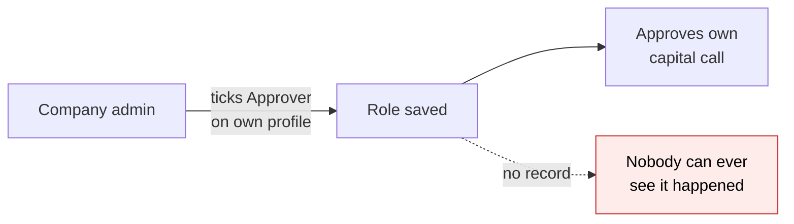
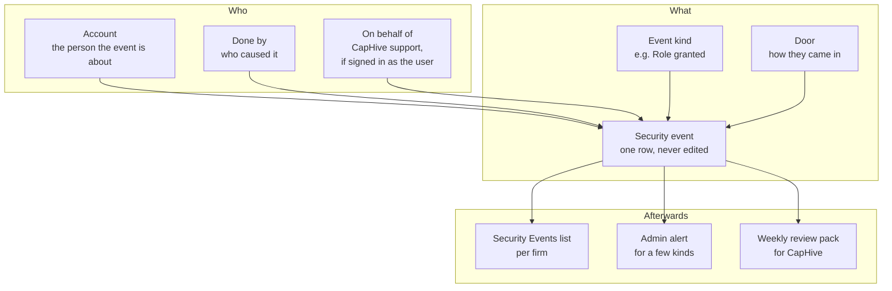
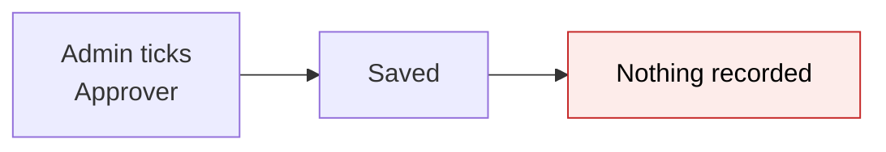
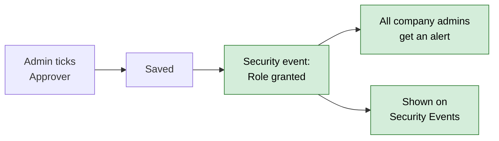
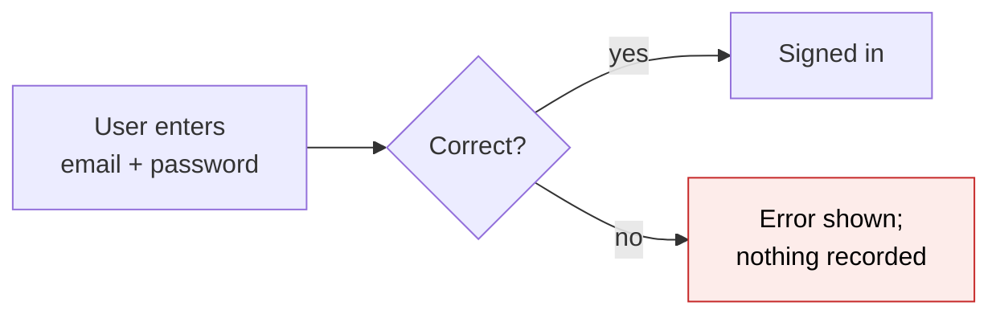
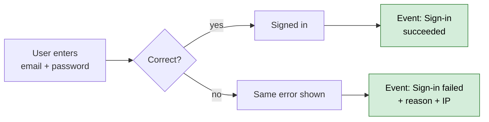
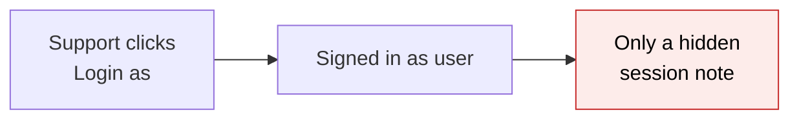
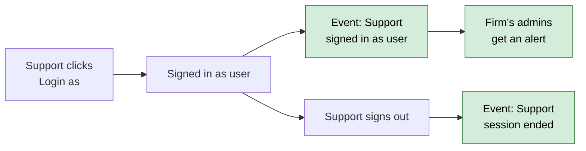
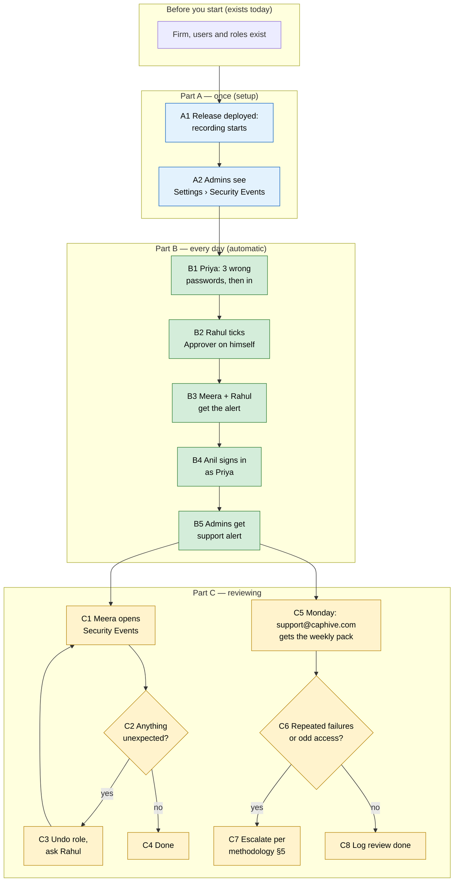

# Security Event Trail — Proposal

> **Audience:** Business team, product, QA, support — non-technical.
> **Companion document:** [Design](design.md)
> **New to this? Start with the [Workflow Journey](#workflow-journey)** — every action, in order, from start to the outcome.

> **Planning phase — no code changes.** This document proposes and explains the change. Do not
> edit application code while writing it; implementation happens later, in the tasks phase.

> **Source:** security finding **M11** (OWASP A09 — Logging and Alerting) in
> `docs/security/owasp_top10_review_2026_11.md`.

---

## Why

- **Nothing records who changed a person's access.** A company admin can give themselves the
  *approver* role, or switch on "Enable support" for CapHive, and no record of it exists anywhere.
  Today's Audit Trail records name, email, phone and permission changes for a user, but not roles,
  not the support switch, not two-factor or lock status.
- **Sign-ins leave no trail.** There is no record of a successful or failed sign-in, a wrong
  two-factor code, an account lock, a CapHive support person entering a client's account, or an
  API token being created. If an LP says "someone got into my account", we cannot answer when, from
  where, or how.
- **Our weekly SOC 2 review cannot be done.** `security_event_review_methodology.md` §4 asks the
  reviewer to "spot-check application logs for repeated authentication failures … against the same
  account". Those failures are not recorded, so the review has nothing to look at.
- **It hides other risks.** Finding M13 (one person drafts and approves a capital call) is worse
  because self-granting *approver* leaves no trace.



## What Changes

- **A new Security Events list** in each firm's Settings menu, next to Audit Trail. Every
  security-relevant moment is one row: who, what, when, from which IP, through which door, and
  whether it worked.
- **About 30 kinds of event are recorded automatically**, in seven groups: sign-in, two-factor,
  account, access (roles and the support switch), CapHive support access, keys and connected apps,
  and data exports.
- **Company admins get an email and a bell notification** when, in their firm, someone gets or
  loses the *company admin* or *approver* role, "Enable support" is switched on or off, or a CapHive
  support person signs in as one of their users.
- **CapHive's security reviewer gets a weekly pack** (Monday, by email): every event of the past week
  across all firms in that region, as a spreadsheet. This is the evidence the SOC 2 weekly review
  needs.
- **Recording can never block anyone.** If recording fails, the sign-in or action still goes
  through; the event goes to the server log instead.
- **Nothing changes for investors** — no new emails, screens or steps. Their sign-ins are simply
  recorded.
- No **BREAKING** changes.

### Key concepts



| Concept | What it means for you | Example |
|---|---|---|
| Security event | One recorded moment that matters for account safety; never edited or deleted by hand | "Sign-in failed — wrong password — 49.36.12.8 — 09 Nov 2026 10:14" |
| Event kind | The type of moment, from a fixed list of about 30 | Role granted · Two-factor code wrong · Data exported |
| Group | Kinds bundled for filtering | Sign-in · Two-factor · Account · Access · Support access · Keys and apps · Data |
| Outcome | Did it work? | Succeeded · Failed |
| Account | The person the event is about | Priya Shah (LP) |
| Done by | The person who caused it — the same as Account when you act on yourself | Rahul Mehta (company admin) granted Priya *approver* |
| On behalf of | The CapHive support person, when they were signed in as someone | "Done by Rahul Mehta, on behalf of Anil (CapHive support)" |
| Door | How the person reached CapHive | Website password · Email link · Mobile app · API key · Connected app (MCP / OAuth) · Outlook/Gmail add-in · Region switch |
| Admin alert | Email + bell to the firm's company admins for the few kinds that change who holds power | "Rahul Mehta was given the Approver role by Rahul Mehta" |
| Weekly review pack | A Monday email to CapHive's security reviewer with last week's events as a spreadsheet | 1,214 events, 37 failed sign-ins, 2 role grants |
| Retention | How long events are kept | 13 months, then removed automatically |

**Admin alert — rules**
- **What:** an email and a bell notification to every company admin of the firm.
- **Why:** a change of power should be seen by more than the person who made it.
- **Only for:** *company admin* or *approver* given or taken away; "Enable support" on or off; a
  CapHive support person signs in as one of the firm's users.
- **Not for:** sign-ins, failed sign-ins, employee/investor roles, exports — those are on the list
  only (they happen hundreds of times a week and would drown the alert).
- **Example:** Rahul ticks *Approver* on his own profile → Rahul and Meera (the other admin) both get
  "Rahul Mehta was given the Approver role by Rahul Mehta".

**Retention — rules**
- **What:** events older than 13 months are removed by a nightly clean-up.
- **Why:** SOC 2 asks for at least 1 year of evidence (methodology §6); 13 months gives a month of
  margin for the annual audit.
- **Not covered:** the Audit Trail's own retention is unchanged.

### Flow Diagram

Granting a role — before and after.





Signing in — before and after.





CapHive support signing in as a client user — before and after.





---

## Workflow Journey

### Who is involved

| Person | Role | What they do in the journey |
|---|---|---|
| Rahul Mehta | Company admin, Golden Angels Fund | Grants himself *approver*; later reads the list |
| Meera Iyer | Company admin, Golden Angels Fund | Gets the alert; reviews the list |
| Priya Shah | LP of Golden Angels | Signs in; mistypes her password three times |
| Anil Kumar | CapHive support | Signs in as Priya to help her |
| Divya Rao | CapHive security reviewer (super user) | Runs the Monday SOC 2 review |

### The journey on one page



### Before you start

| Needed | Why | Where it comes from |
|---|---|---|
| A firm with at least one company admin | Admins see the list and get alerts | Exists today |
| CapHive support mapping for the firm | Needed for B4 (Login as) | Support Client Mappings (exists) |
| support@caphive.com mailbox | Receives the weekly pack in each region (`SECURITY_EVENTS_WEEKLY_TO`) | Exists today; setting is new |

### Part A — once (setup)

| Step | Who | Where | Action | What the system does | What you see |
|---|---|---|---|---|---|
| A1 | CapHive engineering | Release | Deploy | Starts recording every event kind; nothing is back-filled | Nothing visible yet |
| A2 | Rahul, Meera | Settings menu | Open the menu | Shows "Security Events" under "Audit Trail" (company admins only) | New menu entry |

### Part B — every day (automatic)

| Step | Who | Where | Action | What the system does | What you see |
|---|---|---|---|---|---|
| B1 | Priya | Sign-in page | Wrong password ×3, then right | Records 3 × "Sign-in failed — wrong password" and 1 × "Sign-in succeeded — website password" | Same error message as today; signs in normally |
| B2 | Rahul | Users › Rahul › Edit | Ticks *Approver*, Save | Records "Role granted — Approver" (Account: Rahul, Done by: Rahul) | "User was successfully updated." (unchanged) |
| B3 | Meera, Rahul | Email + bell | — | Sends the admin alert to both admins | Email: "Approver role given to Rahul Mehta" |
| B4 | Anil | Support › Golden Angels › Priya › Login as | Click | Records "Support signed in as user" (Account: Priya, Done by: Anil) | "Signed in as Priya Shah" (unchanged) |
| B5 | Meera, Rahul | Email + bell | — | Sends the support-access alert | Email: "CapHive support (Anil Kumar) signed in as Priya Shah" |
| B6 | Anil | Top bar › Sign out | Sign out | Records "Support session ended" | Back to sign-in page |

### Part C — reviewing

| Step | Who | Where | Action | What the system does | What you see |
|---|---|---|---|---|---|
| C1 | Meera | Settings › Security Events | Open | Lists the firm's last 30 days, newest first | Stats cards + table (mock below) |
| C2 | Meera | Filter › Group = Access | Filter | Narrows to role and support-switch events | 1 row: Rahul → Approver |
| C3 | Meera | Users › Rahul › Edit | Unticks *Approver* | Records "Role revoked — Approver"; alert sent again | New row on the list |
| C5 | Divya (reads support@caphive.com) | Email (Monday 07:00 local) | Open the attachment | Weekly pack job built the spreadsheet of last Mon–Sun | "[IN] Security events 02 Nov – 08 Nov 2026: 1,214 events" |
| C6 | Divya | Spreadsheet › "Failed sign-ins by account" sheet | Read | — | Accounts with ≥ 5 failures in a day highlighted |
| C7 | Divya | — | Escalate per methodology §5 | — | — |
| C8 | Divya | Review log | Record the review | — | — |

### What you see

```
Security Events  ⓘ                                     [Filter] [Download]
┌───────────────┬───────────────┬───────────────┬───────────────┐
│ Failed sign-in│ Role changes  │ Support access│ Exports       │
│      3        │      2        │      1        │      4        │
└───────────────┴───────────────┴───────────────┴───────────────┘
Period: 10 Oct 2026 – 09 Nov 2026 (last 30 days) · Group: All
┌──────────────────┬────────────────────────┬─────────┬─────────────┬──────────────────────────┬──────────────┬───────────────┐
│ When             │ Event                  │ Outcome │ Account     │ Done by                  │ Door         │ IP            │
├──────────────────┼────────────────────────┼─────────┼─────────────┼──────────────────────────┼──────────────┼───────────────┤
│ 09/11/2026 11:02 │ Role revoked: Approver │ ✓       │ Rahul Mehta │ Meera Iyer               │ Website      │ 103.21.4.7    │
│ 09/11/2026 10:41 │ Support session ended  │ ✓       │ Priya Shah  │ Anil Kumar (support)     │ Website      │ 52.66.10.3    │
│ 09/11/2026 10:30 │ Support signed in as   │ ✓       │ Priya Shah  │ Anil Kumar (support)     │ Website      │ 52.66.10.3    │
│ 09/11/2026 10:22 │ Role granted: Approver │ ✓       │ Rahul Mehta │ Rahul Mehta              │ Website      │ 103.21.4.7    │
│ 09/11/2026 10:15 │ Sign-in                │ ✓       │ Priya Shah  │ Priya Shah               │ Website pwd  │ 49.36.12.8    │
│ 09/11/2026 10:14 │ Sign-in: wrong password│ ✗       │ Priya Shah  │ —                        │ Website pwd  │ 49.36.12.8    │
│ 09/11/2026 10:14 │ Sign-in: wrong password│ ✗       │ Priya Shah  │ —                        │ Website pwd  │ 49.36.12.8    │
│ 09/11/2026 10:13 │ Sign-in: wrong password│ ✗       │ Priya Shah  │ —                        │ Website pwd  │ 49.36.12.8    │
└──────────────────┴────────────────────────┴─────────┴─────────────┴──────────────────────────┴──────────────┴───────────────┘
```

- Card arithmetic (same rows as the table, filtered period): Failed sign-in = 3 (rows 6–8);
  Role changes = 2 (granted + revoked); Support access = 1 (sign-in as, not the "ended" row);
  Exports = 4 (not on this page — older rows).
- Dates follow the viewer's locale (`en` shown: dd/mm/yyyy).

### What goes wrong

- **The background queue is down** (e.g. during a deploy):
  - Priya still signs in; nothing is shown to her.
  - The event is saved straight away instead of being queued, so it is still on the list.
  - Only if that also fails is it written to the server log as one line, and Priya still signs in.
  - Fix: none needed by the user; engineering sees the log line in the error dashboard.
- **Meera filters to a user who has no events:** the empty state says "No security events for
  Priya Shah in this period. Widen the dates or clear the filter."

### Summary: the minimum actions

| # | Action | Who | How often |
|---|---|---|---|
| 1 | Deploy | CapHive engineering | Once |
| 2 | Read the admin alert email | Company admins | When one arrives |
| 3 | Glance at Security Events | Company admins | Optional, e.g. monthly |
| 4 | Review the weekly pack and log the review | CapHive security reviewer | Weekly (Monday) |

---

## User Stories

### US-1: See who changed access in my firm

**As a** company admin,
**I want** a list of every role and support-access change in my firm,
**So that** I can spot a change nobody agreed to.

**Acceptance criteria:**
- Settings › Security Events shows one row per role granted or revoked, with Account, Done by, date,
  IP and the role name.
- A role change made by any route (user edit screen, user import, investor access, advisor setup)
  appears; the user edit screen is not the only source.
- Switching "Enable support" on or off appears as "Support access enabled / disabled".

### US-2: Be told when power changes hands

**As a** company admin,
**I want** an email and bell notification when someone gets or loses *company admin* or *approver*,
**So that** a self-grant cannot go unnoticed.

**Acceptance criteria:**
- Every company admin of the firm gets it, including the person who made the change.
- Subject: "Approver role given to Rahul Mehta" / "Approver role removed from Rahul Mehta"
  (company admin likewise).
- Body names Done by, date (`Nov 09, 2026` format), IP, and links to Security Events.
- *Employee*, *investor* and other roles do NOT alert.

### US-3: Know when CapHive support enters my firm

**As a** company admin,
**I want** to be told when a CapHive support person signs in as one of my users,
**So that** support access is visible and accountable.

**Acceptance criteria:**
- Email + bell: "CapHive support (Anil Kumar) signed in as Priya Shah".
- The list shows both the start and the end of the support session.
- Anything Anil changes while signed in as Priya still shows "on behalf of" in the Audit Trail
  (unchanged behaviour).

### US-4: Investigate an account

**As a** company admin or CapHive support,
**I want** to filter the list by person, IP, group, outcome and dates,
**So that** I can answer "was this account broken into?".

**Acceptance criteria:**
- Filters: dates (default last 30 days), group, event kind, outcome, account, IP.
- A failed sign-in for an email that is not a CapHive user is shown only to CapHive (it belongs to
  no firm).
- No password, code, token or link is ever shown, in any row.

### US-5: Run the SOC 2 weekly review

**As** CapHive's security reviewer,
**I want** last week's events in a spreadsheet every Monday,
**So that** I can do and evidence the weekly review in methodology §4.

**Acceptance criteria:**
- Monday 07:00 local time (IN and US separately), email to every *super* user of that region.
- Sheets: All events; Failed sign-ins by account (count per account per day); Access changes;
  Support access; Exports.
- The same spreadsheet can be downloaded any time from the list (Download), for any period.

### US-6: Nothing I do gets slower or blocked

**As** any user,
**I want** sign-in and every action to behave exactly as today,
**So that** recording never gets in my way.

**Acceptance criteria:**
- Sign-in, sign-out, role save and Login as show the same messages as today.
- If recording fails, the action still completes.

---

## UI Behavior

### Settings › Security Events

See the mock in [What you see](#what-you-see) and the hand-made HTML mock
[mocks/security_events_index.html](mocks/security_events_index.html).

**Behavior notes:**
- Header: title "Security Events" with ⓘ tooltip "Sign-ins, two-factor, role and support-access
  changes, keys and exports in your firm. Kept for 13 months."; buttons Filter and Download.
- Four stats cards count the filtered rows: Failed sign-ins · Role changes · Support access · Exports.
- Filter panel opens in place; applying it reloads only the table and cards.
- Each row's Event cell has a tooltip with the details (e.g. "Reason: wrong password",
  "Key name: Zapier sync", "Export: Capital calls (xlsx)").
- Account and Done by link to the user's page when the viewer may see that user.
- Download → "Your request is being processed. You will receive an email shortly." (same as Audit
  Trail today).
- Empty state: "No security events in this period. Widen the dates or clear the filter."
- Read-only: there is no edit or delete anywhere.

### Admin alert email

```
Subject: Approver role given to Rahul Mehta

Rahul Mehta was given the Approver role in Golden Angels Fund.

  Done by:  Rahul Mehta
  When:     Nov 09, 2026 10:22
  From IP:  103.21.4.7

If you did not expect this, review it in Security Events.
[ Open Security Events ]
```

---

## What This Feature Does NOT Cover

| Excluded | Covered In |
|---|---|
| Alerts on brute force, throttling and authorization denials (Grafana) | M12 (Group A, separate fix) |
| Requiring two-factor for privileged roles | M8 (`require-2fa-privileged-roles`) |
| One person both drafting and approving a capital call | M13 (`capital-call-distribution-maker-checker`) |
| Investor-access and access-right grants | Already in the Audit Trail (unchanged) |
| Every single document view by an LP | Already counted per user per document ("Viewed by"); not repeated |
| A "my sign-in activity" page for each user | Later, if asked |
| Back-filling events from before release | Not possible — the data never existed |
| AWS / database / server access logs | CloudTrail and GuardDuty (methodology §3) |

---

## Validation Rules

| Field | Rule | Default |
|---|---|---|
| Period filter | Start ≤ end; at most 13 months back | Last 30 days |
| Download period | At most 13 months | The filtered period |
| Event details | Never contain a password, code, token, link or secret | — |
| User agent | Cut to 255 characters | — |
| Retention | Events older than 13 months removed nightly | 13 months |

---

## Behavior Rules

| Scenario | What User Sees |
|---|---|
| Wrong password | Same message as today; a "Sign-in failed" row appears for the firm's admins |
| Email not registered | Same message as today; row visible to CapHive only |
| Account locked after too many tries | Same message as today; "Account locked" row |
| Wrong two-factor code | Same message as today; "Two-factor code wrong" row |
| Admin grants *approver* | "User was successfully updated."; alert email "Approver role given to …" |
| Admin grants *employee* | "User was successfully updated."; row only, no alert |
| Support "Login as" | "Signed in as Priya Shah"; alert "CapHive support (Anil Kumar) signed in as Priya Shah" |
| Recording fails | No visible change; event written to the server log |
| Non-admin opens Security Events by URL | "You are not authorized to perform this action." |
| Download | "Your request is being processed. You will receive an email shortly." |

---

## Resolved Design Decisions

| # | Decision | Resolution |
|---|---|---|
| 1 | New list or extend the Audit Trail? | New list. The Audit Trail is about record changes and has no firm column; events like failed sign-ins have no record |
| 2 | Which kinds alert admins? | Only *company admin*/*approver* changes, support switch, support sign-in-as |
| 3 | How long kept? | 13 months |
| 4 | Show unknown-email failures to firms? | No — CapHive only |
| 5 | Can recording block a user? | Never |
| 6 | Re-record access-right / investor-access grants? | No — they are already in the Audit Trail |

---

## Capabilities

### New Capabilities

- `identity/security-event-trail`: recording, viewing, alerting on and exporting security events
  (sign-in, two-factor, account, access, support access, keys and apps, data exports).

### Modified Capabilities

<!-- None: `identity/cross-region-login` behaviour is unchanged; region-switch sign-ins are only recorded. -->

---

## Impact

- **Sign-in pages** (website, email link, WhatsApp link, two-factor, mobile app, API keys,
  connected apps, Outlook/Gmail add-ins, region switch): record an event; no visible change.
- **User edit screen, user import, investor access, advisor setup**: role changes recorded.
- **Login as / support firm switch**: recorded and alerted.
- **Profile › API tokens, connected apps, mobile devices**: create/revoke recorded.
- **Every spreadsheet download, folder download, audit download and data dump**: recorded.
- **Settings menu**: new "Security Events" entry for company admins and CapHive.
- **New emails**: admin alert (3 kinds), weekly review pack (CapHive only).
- **New nightly clean-up and Monday pack** in the background job schedule.

---

## Benefits

1. A company admin can see, and is told, when anyone in the firm gains or loses power.
2. "Was my account broken into?" gets a factual answer: every sign-in, failure, door and IP.
3. CapHive support access to a client is visible to that client.
4. The SOC 2 weekly review becomes possible and evidenced every week.
5. Makes the maker–checker control (M13) auditable.

---

## FAQ

| Question | Answer |
|---|---|
| Who can see Security Events? | Company admins (own firm only) and CapHive super/support users (support: firms they support). Employees and investors cannot. |
| Will investors notice anything? | No. No new screens, steps or emails for them. |
| Does sign-in get slower? | No. Recording is handed to a background worker; see [design ⑥](design.md#④-background-writer). |
| What if recording breaks? | The sign-in or action still works. The event is saved directly if the queue is down, and goes to the server log only if that fails too. |
| Is anything secret stored? | No passwords, codes, tokens or links. IP address and browser name are stored, as the Audit Trail already stores IPs. |
| Can an admin delete or edit an event? | No. Nobody can, from any screen. Only the 13-month clean-up removes rows. |
| What about history before the release? | There is none — these events were never recorded. |
| Does this replace the Audit Trail? | No. The Audit Trail still shows what changed on a record; Security Events shows who got in and who got power. |
| Can a firm switch the alerts off? | No — a person watching themselves should not be able to mute the watch. |
| Does IN see US events? | No. Each region keeps and reviews its own. |
| Is there a charge? | No. |

---

## Design Principle for the Next Phase

- **One recorder, many one-line hooks.** ~30 event kinds across ~15 entry points risk 15 bespoke
  pieces of code. The design must use one recording call and hook it where existing callbacks
  already fire (sign-in, role add/remove, user save), not edit every caller.
- **Never fail the user.** Every hook must swallow its own failure; this rule must be designed
  once, in the recorder, not repeated per hook.
- **Don't duplicate the Audit Trail.** Access rights, investor access and permissions are already
  audited — link, don't copy.
- **Changes to existing models need approval** (User callbacks, role callbacks) — list them in the
  design's "Key changes needing approval".
- **Fit with M12, don't redesign it.** Counters alert; events explain. Same hook points, separate
  outputs.
