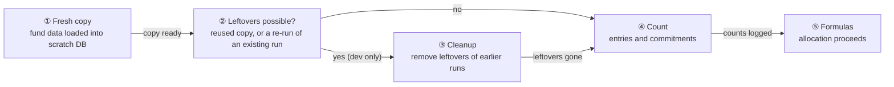
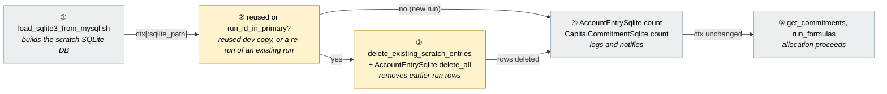
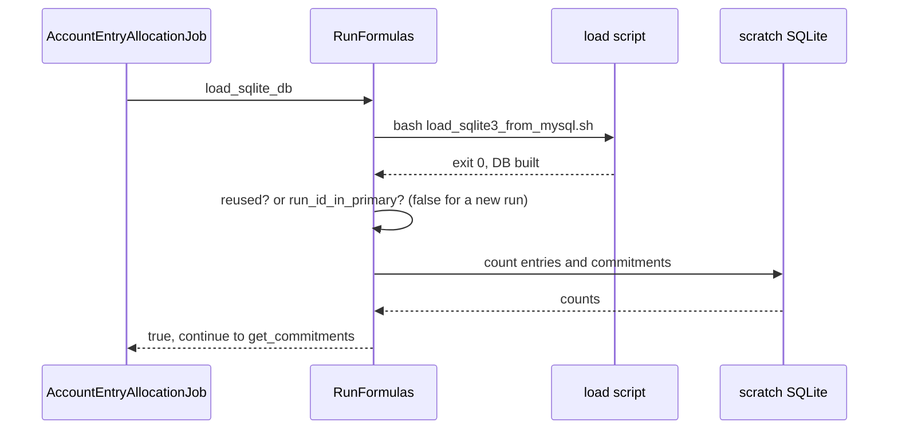
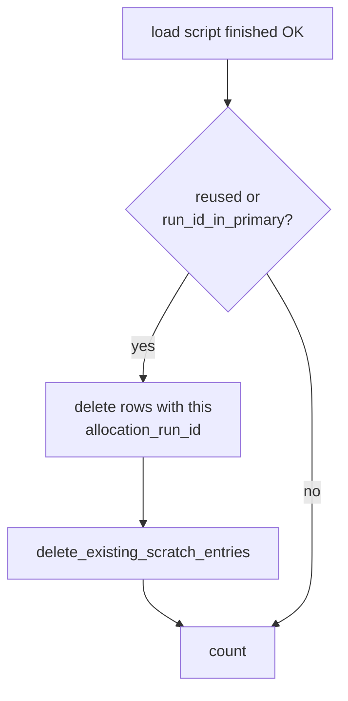
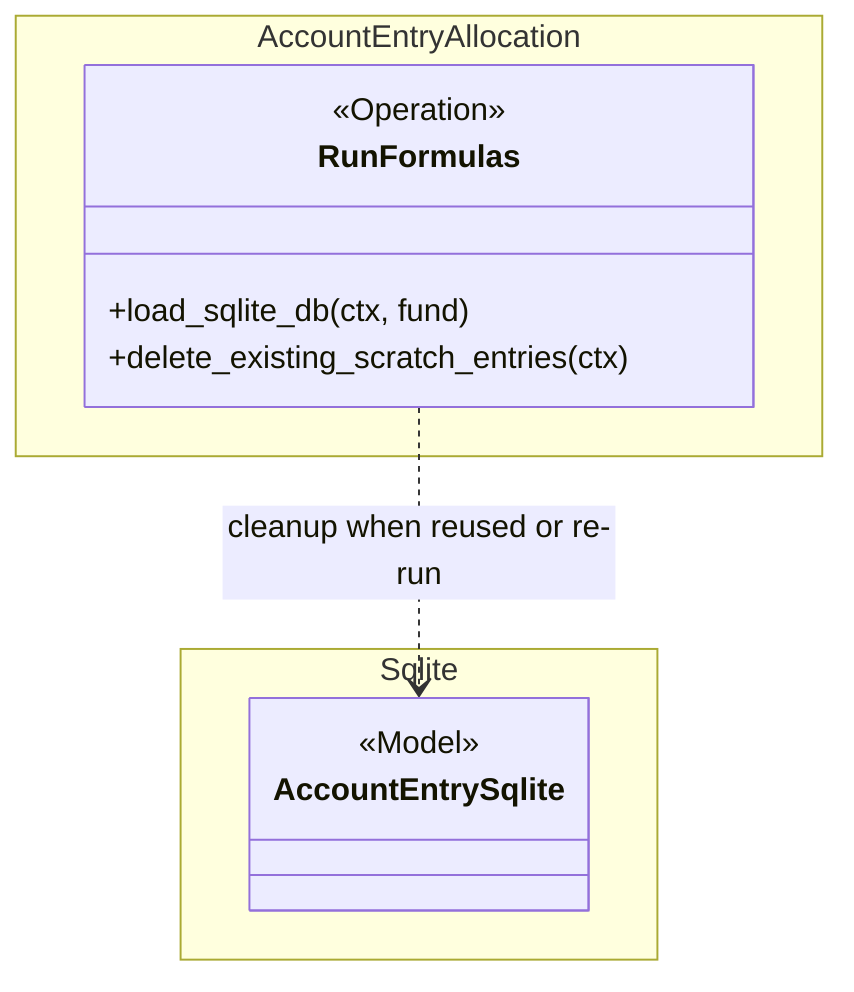

# Skip Redundant Cleanup in Allocation Data Load — Design

> **Audience:** Engineering team.
> **Companion documents:** [Proposal](proposal.md)

> **Planning phase — no code changes.** This document explains HOW the proposal will be built.
> Do not edit application code while writing it; implementation happens later, in the tasks phase.

> **Scale to the change.** This is a one-condition change, so the design has a single small picture
> and short cards. Sections that do not apply say `N/A` with the reason.

---

## Contents

- [1. The idea](#1-the-idea)
- [2. The same picture with real names](#2-the-same-picture-with-real-names)
- [3. One card per box](#3-one-card-per-box)
- [4. Reference](#4-reference)

---

## 1. The idea

### What this adds

After the scratch SQLite copy of a fund's data is built, `RunFormulas#load_sqlite_db` deletes rows tagged with the current allocation run id. On a freshly built copy for a brand-new run that delete matches nothing but scans every `account_entries` row. We guard it: it runs only when the copy was reused (`reused`, development) or the primary DB already holds rows with this run id (`run_id_in_primary?`, an indexed lookup), i.e. a re-run into an existing `AllocationRun` (`AllocationRun#rerun!`). The sibling cleanup `delete_existing_scratch_entries` stays under `reused` alone.

### The idea in one picture



### Walkthrough: one example, start to finish

**Setup.** Fund 320, about 1.05M `account_entries`, production, allocation run 1500. Legend: ● we are here, waiting on this, not done yet · ✓ done.

| # | When | What happens | Behind the scenes | Result |
|---|---|---|---|---|
| 1 | Run starts | Fund data is copied into a new scratch DB (about 33 minutes) | the fresh copy (①) is built by `load_sqlite3_from_mysql.sh` in a subprocess | **● Copy data**<br/>○ Count<br/>○ Formulas |
| 2 | Copy ends | The run asks whether leftovers are possible | the leftover check (②) sees a new file and no rows for this run id in the primary DB, so no cleanup | ✓ Copy data<br/>**● Count**<br/>○ Formulas |
| 3 | Straight on | Entries and commitments are counted through indexed columns | the count (④) logs "loaded N account_entries …" | ✓ Copy data<br/>✓ Count<br/>**● Formulas** |
| 4 | Dev, same fund again | A dev reuses the earlier copy, which still holds rows from run 1499 | the reuse check (②) is true, so the cleanup (③) runs first | Same as row 2, with cleanup before the count |
| 5 | Failure case | Script fails, so there is no scratch DB | unchanged: the `load_failed` path returns before this code is reached | Run marked failed, as today |

```
Before:  copy -> [delete WHERE allocation_run_id=1500: scans 1.05M rows, GVL held] -> count -> formulas
After:   copy ->                                                                      count -> formulas
```

**What to notice**
- The cleanup is only meaningful when rows tagged with this run id can exist: a reused dev copy, or a re-run into an existing run. A brand-new run never has any.
- The skipped scan is the only change; counts, notifications and formulas are untouched.
- No new flag or setting: the existing `reused` variable plus one small helper, `run_id_in_primary?`, which uses `index_account_entries_on_allocation_run_id`.

### Key ideas

| # | Idea | In one line | Card |
|---|---|---|---|
| 1 | Brand-new runs need no run cleanup | They have a new run id; a re-run of an existing run (`rerun!`) is detected by an indexed lookup and still cleans | [② Reuse check](#-reuse-check-and-cleanup) |
| 2 | Cheap guard, no scratch index | `reused` or `run_id_in_primary?`, so no extra index on the 1M-row scratch table | [② Reuse check](#-reuse-check-and-cleanup) |
| 3 | No index | Not needed once the scan is gone | [Design decisions](#design-decisions) |

**FAQ**

| Question | Answer |
|---|---|
| Does anything block users? | No. A step is removed, nothing is added. |

---

## 2. The same picture with real names

### Picture



Colour = footprint: **amber** modified, **grey** reused unchanged. Exact files are in lld.md when it is written.

### What each box does

| # | Box | Real parts | What it does | When it runs | What it decides | Details |
|---|---|---|---|---|---|---|
| ① | Build scratch DB | `script/load_sqlite3_from_mysql.sh`, `Open3.capture2e` | Exports MySQL data to TSV and imports into SQLite | Every allocation run that loads data | Whether the load succeeded | unchanged |
| ② | Reuse check | `reused` local and `RunFormulas#run_id_in_primary?` | Says whether this file was left by an earlier dev run, or the run already owns rows in the primary DB | Right after the load | Whether cleanup is needed | [card](#-reuse-check-and-cleanup) |
| ③ | Cleanup | `AccountEntrySqlite.where(allocation_run_id:).delete_all`, `delete_existing_scratch_entries` | Removes rows tagged with this run id (and, when reused, the earlier run's generated rows) | When reused or `run_id_in_primary?` | Nothing | [card](#-reuse-check-and-cleanup) |
| ④ | Count | `AccountEntrySqlite`, `CapitalCommitmentSqlite` counts | Logs sizes, warns on zero commitments | Every run | Whether to warn | unchanged |
| ⑤ | Formulas | `get_commitments`, `run_formulas` | Allocation itself | Every run | n/a | unchanged |

### One run, end to end



### Lifecycles

N/A — no stored or derived status is added or changed.

### What users see

N/A — no screen, email or alert changes. Messages are identical.

### Design decisions

1. **Guard the delete with `reused || run_id_in_primary?`** — Choice: run `AccountEntrySqlite.where(allocation_run_id:).delete_all` only for a reused copy or when `AccountEntry.exists?(allocation_run_id:)` on the primary DB. Alternative considered: `reused` only (the first version of this change). Rejected after review: `AllocationRun#rerun!` is a supported ops path. `delete_existing_primary_entries` only clears formulas in scope, so live rows of a since-disabled or deleted formula keep the run id, the load script copies them (it skips only soft-deleted rows, `deleted_at IS NULL`), and `migrate_entries_to_primary` inserts them again; reproduced with `rerun!` on the `allocate_account_entries_2` fixture (810 rows grew to 820 or 816, totals wrong). Alternative considered: delete unconditionally but make it fast. Rejected: it still wastes a pass on every new run. The primary-DB check hits `index_account_entries_on_allocation_run_id`, so it is cheap and new runs still skip the scan.
2. **No index on `account_entries.allocation_run_id`** — Alternative considered: add `CREATE INDEX` to `INDEX_account_entries` in the load script, so the delete becomes a lookup. Rejected because:
   - once the delete is skipped on fresh copies, nothing on a fresh copy queries by run id alone;
   - the move-back query in the migration step (`migrated` exists only in the scratch DB and is 0 for every loaded row, so it does not narrow anything): the per-formula call uses `index_account_entries_on_fund_formula_id`, and the final catch-all call (no formula) uses `idx_ae_fund_gen_date_formula` (fund_id, generated), which reads the fund's generated rows and filters by run id. Checked with `EXPLAIN QUERY PLAN` on a 500k-row table built from the script's own schema (about 150k generated rows for the fund, 77ms warm). It runs once per run, so it is accepted; on a cold multi-GB file it is the next thing to watch;
   - the `allocation_run_id` ransack filter in the "done" links runs against the primary DB, not the scratch DB;
   - the index costs load time on a 1M-row table in a load that already takes about 33 minutes, and enlarges scratch files on a disk at 81%.
   Revisit if timing logs show gaps in the "Migrating N entries" step.
3. **Raise `WatchdogSec` from 120 to 600 in `config/deploy/services/sidekiq_IRM_env.service.erb`** — Done alongside A as a safety margin; A removes the known cause, the longer limit tolerates any other long GVL-holding native call (the unit's own comment already says the limit should be generous for exactly that). Sidekiq then pings every 300s. Alternative considered: leave it at 120 and rely on A alone. Rejected because a single stall of a few minutes kills every in-flight job, and `AccountEntryAllocationJob` has `retry: 0`. Cost: a truly wedged process is restarted after up to 10 minutes instead of 2. Also update the matching row in `docs/operations/process_supervision.md` and the unit comment.
4. **Dedicated allocation Sidekiq process** — Not now. It limits blast radius for any future stall but is an operations change. Recorded as a possible follow-up.

**FAQ**

| Question | Answer |
|---|---|
| Why is the delete safe to skip for a new run? | The run id is assigned at run start and the load script copies `allocation_run_id` from MySQL, so a new id matches no source row. For an existing run, rows tagged with it can survive `delete_existing_primary_entries` (formulas no longer in scope), which is exactly what `run_id_in_primary?` detects; that case still cleans. |
| Why check the primary DB and not the scratch DB? | Asking the scratch DB would be the same unindexed scan we are removing. The primary DB has `index_account_entries_on_allocation_run_id`. `AccountEntry` hides soft-deleted rows, which matches the load script (it never copies them). |
| What if the primary DB has rows with this run id before the load? | `delete_existing_entries` runs earlier against the primary DB, and a new run id is created per run. It is not a scratch-DB concern. |
| What if the stall persists after this change? | Then the hypothesis was wrong. Investigate before adding indexes or raising limits (see risks). |

---

## 3. One card per box

### ② Reuse check and cleanup

Boxes ② and ③ share a card: ② decides, ③ acts.

| Owns | Reads / receives | Produces |
|---|---|---|
| The condition around the run-id delete in `RunFormulas#load_sqlite_db` | `reused` (already computed earlier in the method), `run_id_in_primary?`, `ctx[:allocation_run_id]` | Either a scratch DB with this run's leftovers removed (reused copy, or re-run of an existing run) or untouched (new run) |



Build note: the run-id delete runs `if reused || run_id_in_primary?(ctx)`; `delete_existing_scratch_entries(ctx)` stays `if reused`. One small private helper, `run_id_in_primary?`, is added.

**Worked examples:** H1, H2, E1.

**FAQ**

| Question | Answer |
|---|---|
| Why not skip it in development too? | A reused dev copy can hold rows from earlier runs, which is exactly what this cleanup exists for. |
| Is a re-run a rare case? | No. `AllocationRun#rerun!` re-runs into the same record on purpose, so the period is replaced. Only the first version of this change treated it as an accepted risk, and review showed duplicated entries. |

---

## 4. Reference

### Class diagram



Only `RunFormulas#load_sqlite_db` changes. No new classes.

### Data model and schema changes

N/A — no tables, columns or indexes change (an index was considered and rejected, see Design decisions #2).

### Component contracts

| From → To | Contract | Direction rule |
|---|---|---|
| ① → ② | `ctx[:sqlite_path]`, `reused` | Reuse check reads only what the load step produced |
| ② → ③ | `reused || run_id_in_primary?` | Cleanup only when true |
| ② → ④ | both false (new run) | Skip straight to counting |
| ③ → ④ | rows removed | Counts run after cleanup so they exclude leftovers |

### Cross-cutting concerns

#### Transactions and queries

N/A — no writes beyond removing a delete.

#### Exception handling and monitoring

N/A — the existing `rescue StandardError` / `load_failed` wrapper still covers this block unchanged.

#### Performance and security

- Removes one full scan of `account_entries` on every fresh load. On fund 320 (1,052,425 rows) the scan held the Ruby GVL long enough for the Sidekiq heartbeat (120s watchdog) to miss its window.
- No tenant or access change; scratch DB files are per run.

### Worked examples

**ID legend:** **H** = Happy path · **E** = Edge case · **X** = Error (exception) case.

No delta specs exist (`skip_specs`), so the Spec scenario column is `n/a`.

**Shared setup:**

| Record | Name | Key data |
|---|---|---|
| Fund | Alpha Fund | has capital commitments and account entries |
| Allocation run | run 1 | new id each run |

#### Happy Path

| # | Scenario | Given | When | Then | Spec scenario | Feature |
|---|---|---|---|---|---|---|
| H1 | Fresh load skips the run-id cleanup | Alpha Fund, no earlier scratch copy | Allocation runs | No delete by `allocation_run_id` is issued; counts are logged; formulas run | n/a | allocation feature (reuse existing) |
| H2 | Results unchanged | Same inputs as before the change | Allocation runs | Generated entries match the pre-change results | n/a | allocation feature (reuse existing) |

#### Edge Cases

| # | Scenario | Given | When | Then | Spec scenario | Feature |
|---|---|---|---|---|---|---|
| E1 | Reused dev copy still cleaned | development, scratch copy from an earlier run holds rows with an old run id | Allocation runs again | Leftover rows are removed before counting | n/a | allocation_scratch_cleanup.feature |
| E2 | Re-run after a formula was disabled (last, then first) | Run completed once (810 entries); that formula is then disabled | `AllocationRun#rerun!` | The cleanup is issued; entry count and total are unchanged (no duplicates) | n/a | allocation_scratch_cleanup.feature |
| E3 | Re-run, nothing changed | Run completed once | `AllocationRun#rerun!` | Same entries and total, status Success | n/a | allocation_scratch_cleanup.feature |

#### Error Cases

| # | Scenario | Given | When | Then | Spec scenario | Feature |
|---|---|---|---|---|---|---|
| X1 | Script failure unchanged | load script exits non-zero | Allocation runs | `load_failed` message as today; cleanup never reached | n/a | allocation feature |

### Testing

Cucumber only. Reuse the existing allocation feature and its steps. E1 needs the reuse case, which only exists in development (`reuse_scratch_db?`), so it stubs it and points `ALLOCATION_SCRATCH_DIR` at a throwaway `Dir.mktmpdir` so it can never touch a developer's real `tmp/allocation` copies. H1 and E1/E2 record the SQL issued (`sql.active_record`) and look for the run-id DELETE. E2/E3 call `AllocationRun#rerun!(now: true)` and compare the fund's entry count and sum before and after.

### Risks and open questions

- [The stall is not fixed] → The `allocation_run_id` scan is the best-fitting hypothesis, not proven. After release, check the Sidekiq log for the "loaded N account_entries" line and the absence of watchdog kills. If kills continue, investigate further before adding indexes. A stall longer than the new 600s limit would still restart Sidekiq, so keep watching for it.
- [Slower recovery from a real hang] → `WatchdogSec=600` means a genuinely wedged Sidekiq stays down up to 10 minutes. Accepted; the existing "Sidekiq Down" alerts and canary still fire for a stopped service.
- [Re-run into an existing run] → Covered: `run_id_in_primary?` makes the cleanup run when the primary DB already holds rows for the run id (E2, E3). Residual risk: the lookup relies on `index_account_entries_on_allocation_run_id` in MySQL; if that index were dropped, the check would scan the primary table once per run.

| # | Open question | Current thinking | Status |
|---|---|---|---|
| 1 | Dedicated Sidekiq process for allocation jobs | Worth doing if any stall recurs; separate change | Deferred |

**FAQ**

| Question | Answer |
|---|---|
| Where do I start reviewing? | [Card ②](#-reuse-check-and-cleanup) and the single guarded block in `RunFormulas#load_sqlite_db`. |
